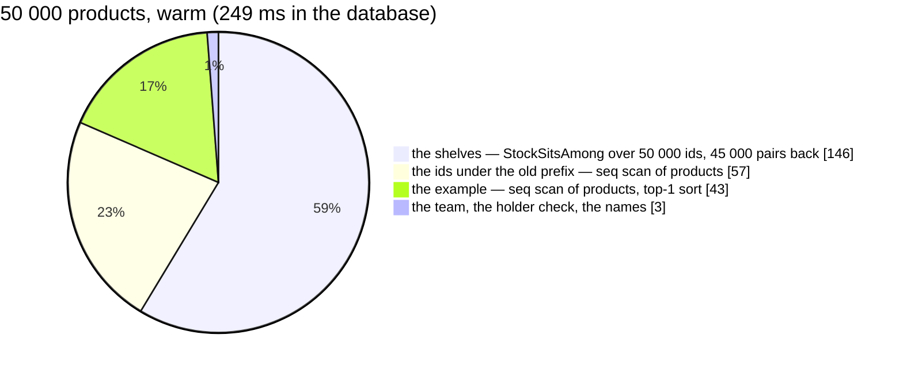

# TeamCodePreview (the team code confirm's figures) — performance audit

**Verdict:** 🟡 **heavy** by the audit's thresholds — **5 000 products 143–210 ms, 50 000 products 220–250 ms**, over the
150 ms median, with **6 statements at every size** (one over the 5-statement line, no statement per product) and three
single statements of 40–150 ms each. It is a read the confirm WAITS on: the person pressed Save and sees the four lines a
quarter of a second later. No plan is wrong for the seed's shape; the time is three reads that each touch the whole team:
two sequential scans of `products` (the example, the ids) and the shelves read over the moving ids. The options below
are for the owner — none is built (a rewrite of the shelves read or a new index needs a measured gain first:
`a-pure-index-is-added-without-asking` covers only a pure index, and none was measured faster here).

**Measured:** 2026-11-27 · `team_v1/team_code_preview.go` (`TeamCodePreview`), `product_v1/product_code_preview_team.go`
(`PreviewTeamRecompose`), `inventory_v1/stock_sits_among.go` · `cmd/app_development/product_code_preview_perf_test.go`
(`TestPerf_TeamCodePreview`, `-tags perfaudit`), through the real wiring (`team_v1.NewService` →
`NewProductCodeRecomposer` → `product_v1` → `NewProductStockNarrower`) · seed `perfTcSeed` (TeamCodeUpdate's): 150 000
background products in five other teams (half on a shelf), a team of 5 000 and a team of 50 000 (10 % archived each),
75 % of each team on a shelf with units in warehouse A, 15 % in warehouse B too, 5 % on a shelf at 0 — so 4 500 / 45 000
(product, warehouse) pairs · `warehouse_test`, inside the test transaction.

| the preview | products | wall | db | statements | the heaviest statement |
| --- | --- | --- | --- | --- | --- |
| 5 000 · cold | 5 000 | **210 ms** | 210 ms | 6 | the example, 77 ms (seq scan) |
| 5 000 · warm | 5 000 | **143 ms** | 143 ms | 6 | the ids, 59 ms (seq scan) |
| 50 000 · cold | 50 000 | **220 ms** | 217 ms | 6 | the shelves, 91 ms (45 000 pairs back) |
| 50 000 · warm | 50 000 | **250 ms** | 249 ms | 6 | the shelves, 146 ms |

## The statements (50 000, warm)

| # | statement | rows | time | plan |
| --- | --- | --- | --- | --- |
| 1 | the team (`teams` by id) | 1 | 1.0 ms | seq scan of a 5-row table |
| 2 | the code's holder (`teams` ∪ `team_former_codes`) | 0 | < 1 ms | index / tiny tables |
| 3 | the example: `… WHERE team_id = ? AND starts_with(product_code, ?) ORDER BY archived, id LIMIT 1` | 1 | 43 ms | parallel seq scan of `products` (205 000 rows), top-N heapsort |
| 4 | the ids: `SELECT id FROM products WHERE team_id = ? AND starts_with(product_code, ?)` | 50 000 | 57 ms | seq scan of `products` (the team is 25 % of the table) |
| 5 | the shelves: `SELECT DISTINCT product_id, warehouse_id FROM product_placements WHERE product_id = ANY(<50 000 ids>) AND stock_count > 0` | 45 000 | 146 ms (EXPLAIN 51 ms + 18 ms planning) | seq scan of `product_placements`, sort for DISTINCT; the rest is the ≈ 400 KB id array going in and 45 000 pairs coming back over the loopback |
| 6 | the warehouses' names (`teams` by ids) | 2 | 1.0 ms | seq scan of a 5-row table |

## Findings and options (for the owner — nothing applied)

1. **The shelves read returns every (product, warehouse) pair when the confirm needs only the distinct warehouses.**
   `StockSitsAmong` is the write's read (it needs the pairs for the reprint waits); the preview reuses it as the build
   brief asked, and dedups 45 000 pairs into 2 ids in Go. *Option A:* a sibling inventory read answering
   `SELECT DISTINCT warehouse_id … WHERE product_id = ANY(?) AND stock_count > 0` — 2 rows back instead of 45 000 (the
   expected saving is most of the 95 ms spent outside EXPLAIN's 51 ms); a new read beside the write's, no write path
   touched. *Option B:* keep it — the confirm is opened rarely (a team code changes a few times in its life).
2. **The products are scanned twice** (the example, then the ids). *Option:* one statement answering both
   (`SELECT id, archived, product_code … ` and the example picked in Go) — saves one scan (≈ 45 ms) at the cost of
   50 000 codes over the wire; or an `(team_id, archived, id)` index for the example's top-1 (a pure index, to be measured
   — at the seed's 25 % selectivity the planner keeps the seq scan, so no gain was measured and none is added).
3. **`starts_with(product_code, …)` cannot use the code's unique btree** (`products_product_code_unique` has the default
   collation's operator class). The same predicate is the write's (TeamCodeUpdate.md), so any index for it serves both —
   an owner's call, measured on both reads and on every writer of `products` first.

Code: `backend/services/team_service/team_v1/team_code_preview.go`, `backend/services/product_service/product_v1/product_code_preview_team.go`.
