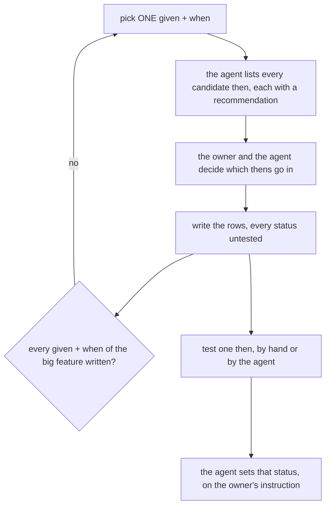
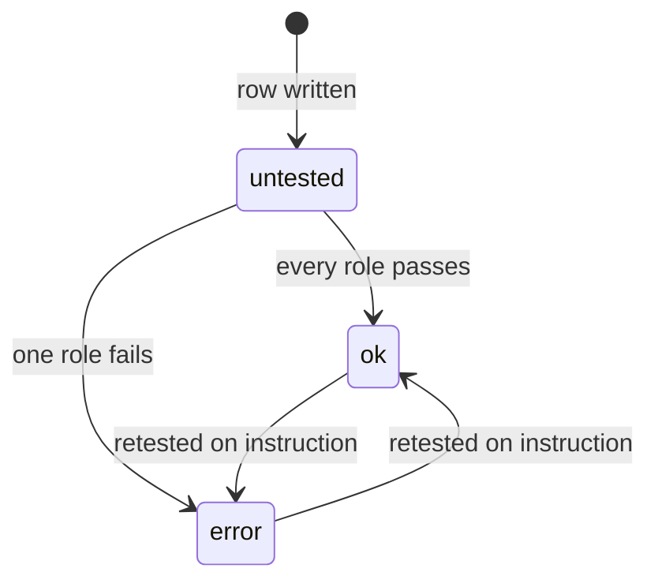

# Acceptances

write with `Given-When-Then` format

An acceptance file is the owner's checklist for one small feature. It has a few rows, one for each thing a person does. It is
**not** the test suite: the existing unit, story and e2e tests stay, as the agent's regression tests.

```
docs/acceptances/<big>/<small>.md   the same coordinates as docs/business/ and docs/technical/
docs/acceptances/<big>/context.md   the big feature's index: its small features and their statuses
docs/acceptances/thens.md           a then shared by more than one given + when (see the copy rule below)
```

Start from one big feature. Its other small features can stay an empty template until they are discussed.

## How a file grows





| rule | |
| --- | --- |
| [one-row-per-then](#one-row-per-then) | `given \| when \| then \| status`, and each then gets its own row |
| [given-is-who-can](#given-is-who-can) | one actor, `team:role` or `team:all`, and only a role that CAN |
| [when-carries-the-state](#when-carries-the-state) | one action and the state it starts from, in lowercase |
| [every-candidate-is-listed](#every-candidate-is-listed) | the agent lists every candidate then, including the ones it would leave out |
| [a-then-is-one-visible-effect](#a-then-is-one-visible-effect) | one effect a person can see, with no measure in the wording |
| [a-then-is-copied-word-for-word](#a-then-is-copied-word-for-word) | the same effect is written the same way everywhere |
| [status-is-per-then](#status-is-per-then) | `ok` / `error` / `untested`, changed only on the owner's instruction |
| [acceptances-are-markdown](#acceptances-are-markdown) | no Gherkin runner |
| [only-the-discussion-changes-a-row](#only-the-discussion-changes-a-row) | nothing outside this loop edits a row |

## one-row-per-then

The columns are `given | when | then | status`. Each then is its own row, so each status sits beside its own then. A blank
given and when continue the row above.

```markdown
| given | when | then | status |
| --- | --- | --- | --- |
| `selling:all` | create restock | restock is listed as ongoing | untested |
| | | ongoing stock increases | untested |
```

## given-is-who-can

- One actor, named the way the system names it: `<team type>:<role>`, e.g. `selling:owner`, or `<team type>:all` when every
  role of that team type can. The roles are in [role.proto](../../proto/warehouse/role_base/v1/role.proto).
- **Only a role that CAN do it.** A refused role gets no row, and that includes a read-only role.
- **Root is never written.** It passes every check, so writing it would repeat one global rule in every file.
- The given names WHO only. The state an action starts from goes in the when.

## when-carries-the-state

One action, and the state it starts from, written simply and in lowercase: `create restock`, `cancel an ongoing restock`,
`accept an arrived restock`. A read (a list, a detail) is never a when: what a person can read shows up as a then of the
action that caused it.

## every-candidate-is-listed

When a given + when is discussed, the agent lists **every** candidate then, including the ones it would leave out, each with
a recommendation. The owner and the agent then decide together. The agent bases its recommendation on these criteria:

| recommend IN | recommend OUT |
| --- | --- |
| an effect a person can see, on a screen or as a number | an internal effect, such as an event sent or a table row (the agent's unit test covers that) |
| a consequence of THIS action | what a later action causes, which belongs to that action |
| an effect in another team or service, which a per-screen test never catches | a refusal or a validation |

## a-then-is-one-visible-effect

- One effect per row.
- A condition goes in brackets: `product is listed in the target warehouse (if new)`. Each such then is tested in its own run,
  set up to meet its condition.
- **No measure in the wording.** The expected number is set when the then is tested, by hand or by the agent on the owner's
  instruction.

## a-then-is-copied-word-for-word

The same effect is written with exactly the same words everywhere, so it is recognised as the same then and checked the same
way. When a second given + when uses a then, that then gets a row in `thens.md`: the then, and where a person sees it.
Until then, the shared list is not needed.

## status-is-per-then

- `ok`, `error`, or `untested`. A row is written `untested`.
- `team:all` is tested with **every** role of that team type. If one role fails, the then is `error`.
- A then observed by another team (*the target warehouse sees it incoming*) is checked as any **one** role there that can read it.
- **The agent changes a status only on the owner's instruction, one then at a time.** If the agent's own test later fails, the
  agent reports it in chat and leaves the status alone.

## acceptances-are-markdown

Plain markdown and no runner. The owner tests a then by hand, or the agent tests it on the owner's instruction, and the status
records the result.

## only-the-discussion-changes-a-row

Acceptances are made semi-automatically: a row exists because one given + when was discussed with the owner. So **nothing
outside that loop changes one**. A code change, a refactor, an updated business or technical doc, or another agent's pass
never rewrites a given, a when, a then or a status. When the code disagrees with a then, that is a failure to report in chat
for the owner to decide on, not a reason to edit the row.
