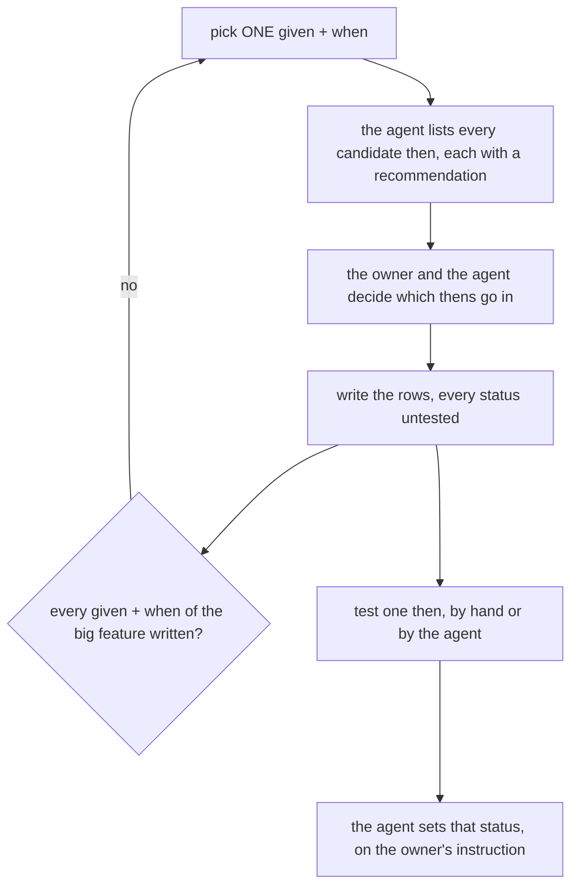
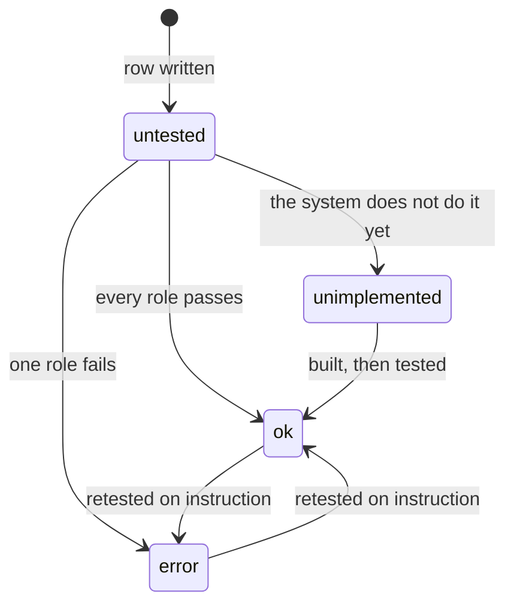

# Acceptances

write with `Given-When-Then` format

An acceptance file is the owner's checklist for one small feature. It has a few rows, one for each thing a person does. It is
**not** the test suite: the existing unit, story and e2e tests stay, as the agent's regression tests.

```
docs/acceptances/<big>/<small>.md   the same coordinates as docs/business/ and docs/technical/
docs/acceptances/<big>/context.md   the big feature's index: its small features and their statuses
docs/acceptances/progress.md        every given + when by the day it was discussed, with its status counts
```

Start from one big feature. Its other small features can stay an empty template until they are discussed.

## How a file grows





| rule | |
| --- | --- |
| [one-row-per-then](#one-row-per-then) | an HTML table `given`, `when`, `then`, `status`: a given has one when, a when has many thens, each then its own row, given and when spanning them |
| [given-is-who-wants-what-in-which-case](#given-is-who-wants-what-in-which-case) | one actor that CAN, what they want, and the case — every fact its thens rest on: `selling:all` wants to restock<br>(2 products · 1 warehouse · operational account · no shipping cost) |
| [when-is-one-action](#when-is-one-action) | the action alone, in lowercase: `create restock`, `accept restock` |
| [every-candidate-is-listed](#every-candidate-is-listed) | the agent lists every candidate then, including the ones it would leave out |
| [a-then-is-one-visible-effect](#a-then-is-one-visible-effect) | one effect a person can see, with no measure in the wording |
| [status-is-per-then](#status-is-per-then) | `✅ ok` / `❌ error` / `🚧 unimplemented` / `⬜ untested`, changed only on the owner's instruction |
| [acceptances-are-markdown](#acceptances-are-markdown) | no Gherkin runner and no test file of its own: the agent's checks live in the feature's regression spec |
| [only-the-discussion-changes-a-row](#only-the-discussion-changes-a-row) | nothing outside this loop edits a row |
| [progress-is-by-day](#progress-is-by-day) | `progress.md` lists each action under its day, with the status counts of all its givens' thens |

## one-row-per-then

The columns are `given`, `when`, `then`, `status`. A given has one when, and a when has many thens. Each then is its own
row, so each status sits beside its own then, and the given and the when **span** their thens.

**The table is HTML**, because a markdown table cannot span a cell: `rowspan` on the given's and the when's `<td>`, one
`<tr>` per line so a then stays one line of the file.

```html
<table>
<tr><th>given</th><th>when</th><th>then</th><th>status</th></tr>
<tr><td rowspan="2" valign="top"><code>selling:all</code> wants to restock<br>(1 product · 1 warehouse · operational account · no shipping cost)</td><td rowspan="2" valign="top">create restock</td><td>restock created with 1 product</td><td>⬜ untested</td></tr>
<tr><td>ongoing stock of 1 product increases</td><td>⬜ untested</td></tr>
<tr><td><code>selling:all</code> wants to edit a restock<br>(status: ongoing · 1 product · change shipping cost · 1 warehouse · operational account)</td><td>edit restock</td><td>restock shows new shipping cost</td><td>⬜ untested</td></tr>
</table>
```

- ⚠ **`rowspan` is the number of its thens.** A then added or removed changes it, or every row below shifts a column.
  A given with one then has no `rowspan`. A spanning cell is `valign="top"`, so the given reads beside its first then.
- Inside the table markdown is not read: a backtick is `<code>`, a link is `<a href="…">`.

## given-is-who-wants-what-in-which-case

- One actor, what they want to get done, and the case, in lowercase:
  `` `selling:all` wants to restock<br>(2 products · 1 warehouse · operational account · no shipping cost) ``,
  `` `warehouse:all` wants to accept a restock<br>(status: ongoing · all received · new product · no COD · multi suppliers) ``.
- **The case goes in brackets on its own line**, after a `<br>`. It holds the state the action starts from and the
  condition it is tested under, so a then carries no brackets of its own.
- **The case names every fact its thens rest on**, short, separated by ` · `: a then about the warehouse needs
  `1 warehouse` in its given, one about the paying account needs `operational account`. Every case of an action names
  all of them, the same ones it shares as well — `no shipping cost` beside `shipping cost` — so the cases read side by
  side. No numbers: the given says WHAT is set up, as a then says what is seen.
- **A then names the given's fact it checks, in the same words**: given `(1 product · 1 warehouse · operational account ·
  no shipping cost)`, thens `1 product recorded at warehouse`, `operational account balance decreases by product total`.
  A fact is the word for what exists before the action — `operational account`, what the form offers — and the then
  keeps it rather than renaming it for its role.
- **What an action changes is a fact of its own**: `` `selling:all` wants to edit a restock<br>(status: ongoing · 1 product ·
  change shipping cost · 1 warehouse · operational account) `` — the status, what the restock holds, the part that changes,
  then the facts its thens rest on.
- **A status as a fact reads `status: <status>`**: `` `warehouse:all` wants to receive a restock<br>(status: ongoing · no
  COD) `` — the status the restock is in before the action, beside the case's other facts.
- **One given, one when.** A different case is a different given, and so is a different goal, even on the same restock:
  editing a restock is not wanting to restock, and accepting it is not receiving it.
- **Each given is tested in its own run**, set up to meet its case.
- **Each given lists all its thens**, even the ones another case of the action shares. A then its case changes says how
  ([a-then-is-one-visible-effect](#a-then-is-one-visible-effect)).
- **A given whose flow is not known yet is one row of `-`**: `-` as its then and `-` as its status. It is a case the owner
  knows exists and has not designed, and it counts in no total until its thens are written.
- The actor is named the way the system names it: `<team type>:<role>`, e.g. `selling:owner`, or `<team type>:all` when
  every role of that team type can. The roles are in [role.proto](../../proto/warehouse/role_base/v1/role.proto).
- **Only a role that CAN do it.** A refused role gets no row, and that includes a read-only role.
- **Root is never written.** It passes every check, so writing it would repeat one global rule in every file.

## when-is-one-action

- The action alone, in lowercase: `create restock`, `mark arrived restock`, `accept restock`, `edit restock`. Its case lives in the given.
- A read (a list, a detail) is never a when: what a person can read shows up as a then of the action that caused it.

## every-candidate-is-listed

When a given + when is discussed, the agent lists **every** candidate then, including the ones it would leave out, each with
a recommendation. The owner and the agent then decide together. The agent bases its recommendation on these criteria:

| recommend IN | recommend OUT |
| --- | --- |
| an effect a person can see, on a screen or as a number | an internal effect, such as an event sent or a table row (the agent's unit test covers that) |
| a consequence of THIS action | what a later action causes, which belongs to that action |
| an effect in another team or service, which a per-screen test never catches | a refusal or a validation |

## a-then-is-one-visible-effect

- One effect per row.
- **Short, like a note.** No `the`, no `a`, and no `is` where the line reads without it: `restock created`,
  `recorded at warehouse`, `recorded in account history`.
- **A case's then says what its case changes**: `ongoing stock of product 1 and product 2 increases`,
  `paying account balance decreases, shipping cost included`. A then the case does not change keeps the plain words.
- **No condition in the wording.** A condition is the case of the given
  ([given-is-who-wants-what-in-which-case](#given-is-who-wants-what-in-which-case)).
- **No measure in the wording.** The expected number is set when the then is tested, by hand or by the agent on the owner's
  instruction.

## status-is-per-then

- `✅ ok`, `❌ error`, `🚧 unimplemented`, or `⬜ untested`. The emoji is part of the value, so a status can be read at a
  glance. A new row is written `⬜ untested`.
- `❌ error` means the system does it, but wrongly. `🚧 unimplemented` means the then is agreed, but the system does not do
  it yet.
- **An `❌ error` links to its entry under `## Errors`**, at the foot of the same file. The entry's heading is a name that
  says what goes wrong, and the entry gives the then, what was expected, what actually happens, the cause, where it was
  seen, and the check that pins it. When the error is fixed and the status changes, the entry is deleted.
- `team:all` is tested with **every** role of that team type. If one role fails, the then is `error`.
- A then observed by another team (*recorded at warehouse*) is checked as any **one** role there that can read it.
- **The agent changes a status only on the owner's instruction, one then at a time.** If the agent's own test later fails, the
  agent reports it in chat and leaves the status alone.
- **The agent's own passing test does not make a then `✅ ok`.** It is reported in chat, and the then stays `⬜ untested`
  until the owner says it has been checked. Only the thens the owner names are written `ok`.

## acceptances-are-markdown

Plain markdown and no runner. The owner tests a then by hand, or the agent tests it on the owner's instruction, and the status
records the result.

**An acceptance has no test file of its own** (owner). The agent's check for a then goes in the **regression spec of the
feature its WHEN belongs to**, as one block per given + when. All of create restock's thens go in
`frontend/e2e/restock.spec.ts`, including the one that shows in the financial account. That spec is the agent's, not the
acceptance's. The status stays the owner's record, and the spec is what keeps that record true.

```
docs/acceptances/inventory/restock.md   the status: the owner's record
frontend/e2e/restock.spec.ts            the check: the agent's regression test
```

A then that is `❌ error` or `🚧 unimplemented` keeps its check, marked **`test.fail`** with the status in its reason. The
suite stays green while the system is wrong. The day the system gets it right, the check turns red, and that is the sign
to ask the owner to change the status.

## only-the-discussion-changes-a-row

Acceptances are made semi-automatically: a row exists because one given + when was discussed with the owner. So **nothing
outside that loop changes one**. A code change, a refactor, an updated business or technical doc, or another agent's pass
never rewrites a given, a when, a then or a status. When the code disagrees with a then, that is a failure to report in chat
for the owner to decide on, not a reason to edit the row.

## progress-is-by-day

[progress.md](progress.md) lists every action under the day it was discussed, newest day last. One line holds all the
givens of that action, whatever their case:

```markdown
## 2026-11-11

- `warehouse:all` wants to receive a restock · [mark arrived restock](inventory/restock.md) (5 thens: ✅ 4, 🚧 1)
```

- The counts are the thens' statuses **today**, in the order ✅ ❌ 🚧 ⬜, and a zero is left out.
- It is derived from the small-feature files. When a row is written or a status changes, its line changes in the same edit,
  as the counts in the big feature's `context.md` do.
