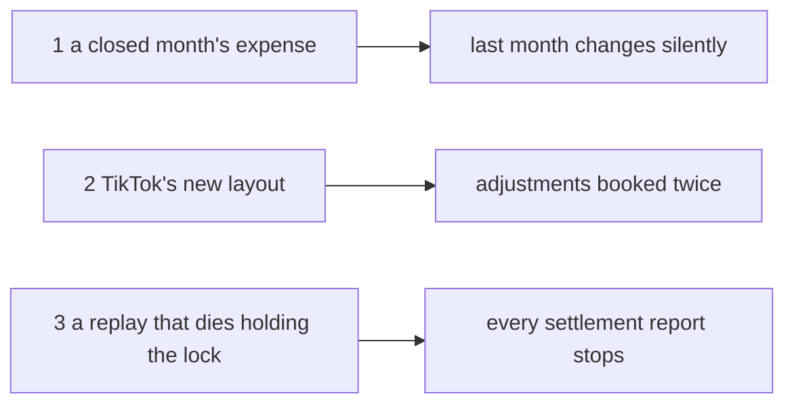

# The 7 Biggest Questions

Every open question in every `_clarify.md`, rolled up to the seven that block the most.

> **Derived file — regenerate, never hand-edit.** Same rule as a `state_report`. The open SET comes
> from `*_clarify.md` only, never from `*_decision.md`, so an answered question leaves here the moment
> it is recorded. Rebuild it whenever any `_clarify.md` changes.
>
> ⚠ **But the RANK is checked against the code, not only against the docs.** A rebuild that reads the
> clarify files alone cannot see that a question has been overtaken by what shipped. Before ranking a row,
> open the file it is about.
>
> **Ranked by what is BLOCKED**, not by how interesting the question is — a question that stops a
> lifecycle pass outranks one that merely matters. Several rows below are **one question asked in several
> docs**, and merging those is most of what this file is for.

**94 open questions across 41 files.** The three below are shown; **91 are not** — they are not
closed, only smaller. The per-file counts are at the bottom.

🔄 **Re-ranked fresh** (2026-10-19), after all seven rows closed. Every live claim in the new seven was checked against the code the same day. ⚠ **Two counted questions are re-routes already decided elsewhere** (ledger Q1 → [a-limit-change-is-recorded](business/balance/context_decision.md#a-limit-change-is-recorded), [the-block-stops-orders-only](business/balance/context_decision.md#the-block-stops-orders-only); excel_readers Q6 → [only-a-successful-withdrawal-is-recorded](business/settlement/settlement_importer_decision.md#only-a-successful-withdrawal-is-recorded)), and **about 13 more look overtaken** by today's decisions — they stay counted until each is closed at source.

🔄 **Rebuilt fresh** (2026-10-12), after `dev` merged into `backup/inventory`. Every count is recounted from the files, and
every row of the seven was re-checked against the clarify it names and, where it claims something is live, against the
code. What changed:

- 🔀 *(2026-10-30)* **94**: `frada` merged into `backup/inventory`. One question came with it, product Q13 — [Q13](business/product/context_clarify.md#question) — at EXACTLY the minimum, may another team still order? The screens' owner decided ≤ on 2026-10-30 (closed at the minimum, [the-minimum-closes-at-the-minimum](technical/frontend/products_decision.md#the-minimum-closes-at-the-minimum)); context.md line 86 and [the-reserve-stops-other-teams-at-low-stock](business/product/context_decision.md#the-reserve-stops-other-teams-at-low-stock) open it there. One contradiction, recorded there. Not ranked into the three: it blocks no pass — the screens already follow ≤. Net +1.
- 🆕 *(2026-10-30)* **93**: settlement's move to the analytic pattern BUILT — `MetricSearch` / `MetricData`, both screens on them, the three old reads gone ([the-move-to-the-metric-pattern](business/settlement/analytic_context_clarify.md#the-move-to-the-metric-pattern)). One opened from the build: whether a take rate ranks, and above what sale ([a-take-rate-ranks-above-what-sale](business/settlement/analytic_context_clarify.md#a-take-rate-ranks-above-what-sale)) — settlement Q9. Net +1.
- ▼ *(2026-10-30)* **92**: rpc_provide — a-position-is-not-a-sum closed: `FieldStatType` gains `POSITION`, a balance never summed over time, Rp in its own graph ([a-position-is-its-own-stat-type](business/analytic/rpc_provide_decision.md#a-position-is-its-own-stat-type)), as recommended; built in `analytic_base` and the screen. Net −1.
- ▼ *(2026-10-30)* **93**: settlement Q8 closed — a settlement metric reads both tables, a shop with a person refused ([one-settlement-metric-reads-both-tables](business/settlement/context_decision.md#one-settlement-metric-reads-both-tables)), on your point that the group is the request's, against my first two-metric answer; and what Settlement offers: the headline and the breakdown, not the 13 raw types ([settlement-serves-its-headline-and-its-breakdown](business/settlement/context_decision.md#settlement-serves-its-headline-and-its-breakdown)), as recommended. Net −1.
- 🆕 *(2026-10-30)* **94**: settlement's move to the analytic pattern analysed ([the-move-to-the-metric-pattern](business/settlement/analytic_context_clarify.md#the-move-to-the-metric-pattern)). Three opened, each where it can be answered: settlement Q8, how one metric serves both of its tables, since a shop and a person cannot be read together ([shop-and-person-in-one-metric](business/settlement/context_decision.md#one-settlement-metric-reads-both-tables)); and in rpc_provide, a balance is a position, never summed over time ([a-position-is-not-a-sum](business/analytic/rpc_provide_decision.md#a-position-is-its-own-stat-type)), and a 16-field metric needs the picker to tick fields ([the-picker-ticks-fields](business/analytic/rpc_provide_clarify.md#the-picker-ticks-fields)). Net +3.
- ▼ *(2026-10-30)* **91**: order_statistic_metric — which-metric-ids closed: the five ids are kept, `metrics/orders/` and what happened to the order ([the-order-metric-ids-name-what-moved](business/order/order_statistic_metric_decision.md#the-order-metric-ids-name-what-moved)), as recommended. **order_statistic_metric has no open question.** Net −1.
- ▼ *(2026-10-30)* **92**: order_statistic_metric — are-past-orders-folded closed: no backfill, the metrics count from the fold onward, because this is the dev phase ([the-order-metrics-count-from-the-fold-onward](business/order/order_statistic_metric_decision.md#the-order-metrics-count-from-the-fold-onward)), against my yes. The footer said 91 while the rows summed to 93 — all three now 92. Net −1.
- ▲ *(2026-10-29)* **93**: order_statistic_metric — the five metrics are built, with the Order Status Change event and the fold ([the-status-changes-publish-nothing](business/order/order_statistic_metric_clarify.md#the-status-changes-publish-nothing) ✅). Building them opened two: [which-metric-ids](business/order/order_statistic_metric_decision.md#the-order-metric-ids-name-what-moved) (keep `metrics/orders/<what moved>`) and [are-past-orders-folded](business/order/order_statistic_metric_decision.md#the-order-metrics-count-from-the-fold-onward) (fold the past once). One contradiction: [a-no-user-row-cannot-be-a-key](business/order/order_statistic_metric_clarify.md#a-no-user-row-cannot-be-a-key). Neither blocks anything shipped, so neither ranks. Net +2.
- 🔄 *(2026-10-29)* **91**: order context — the contradiction the-build-lets-a-person-draft-and-promotes-on-the-server resolved as [a-draft-becomes-an-order-through-order-create](business/order/context_decision.md#a-draft-becomes-an-order-through-order-create): the draft page's Promote sends `OrderCreate` with `order_draft_id`, `OrderDraftPromote` and Save as Draft removed, one draft makes one order. Built. **The order context has no open question and no open contradiction**; only the parked barcode is left. A contradiction, not a counted question. Net zero.
- 🔄 *(2026-10-29)* **91**: order context — the contradiction the-build-still-treats-an-empty-ref-as-a-phone-order resolved as [an-order-ref-is-required-by-the-rpc](business/order/context_decision.md#an-order-ref-is-required-by-the-rpc): the create request's validation refuses an empty ref, no database rule, and Promote now copies the draft's ref (it never had). Built. A contradiction, not a counted question. Net zero.
- ▼ *(2026-10-29)* **91**: technical order design — question 7, the date on a row, closed for every screen as [a-table-date-is-short-and-every-time-is-wib](technical/frontend/context_decision.md#a-table-date-is-short-and-every-time-is-wib): `29 Okt 13:05` in a table cell, the year only when it is not this year, Jakarta time everywhere. As recommended. **technical order design has 1 open question left: the product barcode, parked.** Net −1.
- ▼ *(2026-10-29)* **92**: technical order design — question 13, where a draft's pushing app goes on the row, closed as [the-draft-row-names-the-person-and-the-app](technical/frontend/order_draft_decision.md#the-draft-row-names-the-person-and-the-app): `oleh <name> via <app>` on one line, your counter to my `via` alone. Built. Net −1.
- ▼ *(2026-10-29)* **93**: technical order design — question 19, what the order Import may move, closed as [the-import-moves-only-after-handover](technical/order/design_decision.md#the-import-moves-only-after-handover): only customer service's moves after handover, everything else listed with its reason, never a cancel. As recommended (A), after *"tell more"*. Net −1.
- ▼ *(2026-10-29)* **94**: technical order design — question 1, the per-period report, closed as overtaken: [the-period-report-is-the-analytic-screen](technical/order/design_decision.md#the-period-report-is-the-analytic-screen). Neither extend `/settlement/report` nor a second screen: the order figures are metrics on the one analytic screen. As recommended. Net −1.
- ▼ *(2026-10-29)* **95**: order_statistic_metric — lost-is-not-a-metric closed by your edit adding *Order Lost Created*: [lost-is-a-metric-and-completed-is-not](business/order/order_statistic_metric_decision.md#lost-is-a-metric-and-completed-is-not), as recommended. The same edit dropped the product filters, so that contradiction is resolved. **order_statistic_metric has no open question**: five order metrics, two questions parked for inventory, two slips left. Net −1.
- ▼ *(2026-10-29)* **96**: order_statistic_metric — product figures are inventory's, for later ([product-figures-belong-to-inventory](business/order/order_statistic_metric_decision.md#product-figures-belong-to-inventory)), so what-the-product-metric-counts and a-borrowed-line-counts-for-the-seller are parked ⏸, not counted, until inventory has a metric doc to move them to. The order metrics are four. Net −2.
- ▼ *(2026-10-29)* **98**: order_statistic_metric — which-groups closed by your edit adding `group by :` to the four: [the-four-group-by-team-shop-warehouse-user-and-time](business/order/order_statistic_metric_decision.md#the-four-group-by-team-shop-warehouse-user-and-time), as recommended. Order Product's groups moved into what-the-product-metric-counts, since the doc has no entry for it yet. Net −1.
- ▼ *(2026-10-29)* **99**: order_statistic_metric — a-warehouse-sees-no-seller-money closed as [the decision of that name](business/order/order_statistic_metric_decision.md#a-warehouse-sees-no-seller-money): a warehouse gets counts and quantities, the money fields `optional` and left unset by the service, a sort on money refused. As recommended. Net −1.
- 🔄 *(2026-10-29)* **100**: order_statistic_metric — a-warehouse-reads-the-orders-it-ships closed as [the decision of that name](business/order/order_statistic_metric_decision.md#a-warehouse-reads-the-orders-it-ships), as recommended. Recording it showed my recommendation had missed that a warehouse's order list hides the seller's money (now recorded in [a-warehouse-sees-no-seller-money](business/order/order_statistic_metric_decision.md#a-warehouse-sees-no-seller-money)), so a-warehouse-sees-no-seller-money opened: counts and quantities only, the money fields unset by the service. Net zero.
- 🔄 *(2026-10-29)* **100**: order_statistic_metric + rpc_provide — which-team-the-team-group-means closed by your edit adding `GROUP_TYPE_WAREHOUSE`: [the-warehouse-is-its-own-group](business/analytic/rpc_provide_decision.md#the-warehouse-is-its-own-group) for the pattern, [the-team-group-is-the-seller](business/order/order_statistic_metric_decision.md#the-team-group-is-the-seller) for orders. As recommended, and it supersedes two rpc_provide decisions, recorded as [the-team-group-reversed-in-a-day](business/analytic/rpc_provide_clarify.md#the-team-group-reversed-in-a-day). What was left of it stays open: whether a warehouse's scope reads the orders it ships. Net zero.
- ▼ *(2026-10-29)* **100**: order_statistic_metric — which-user closed as [a-metrics-user-is-the-orders-creator](business/order/order_statistic_metric_decision.md#a-metrics-user-is-the-orders-creator): the order's creator on every order metric, not whoever made the change, as recommended. Net −1.
- ▼ *(2026-10-29)* **101**: order_statistic_metric — which-total closed as [a-total-is-the-total-cost](business/order/order_statistic_metric_decision.md#a-total-is-the-total-cost): every `*_total` is `total_cost`, every `*_mp_total` is `platform_total`, as recommended. Net −1.
- ▼ *(2026-10-29)* **102**: order_statistic_metric — which-day-a-fact-falls-on closed as [a-fact-counts-on-the-day-it-happened](business/order/order_statistic_metric_decision.md#a-fact-counts-on-the-day-it-happened): a cancel or a return counts on the day of its move, Created on our `created_at`, as recommended. Net −1.
- 🆕 *(2026-10-29)* **103**: order_statistic_metric — your new list of order metrics for the analytic screen. Decided the same day: the four count whole orders and product gets its own line metric ([product-is-its-own-line-metric](business/order/order_statistic_metric_decision.md#product-is-its-own-line-metric)), as recommended. Opened eight: which day a cancel or return counts on, which total, which user, which team the team group means, the groups, what the product metric counts, whose a borrowed line is, and whether Lost is a metric. They block only the order metrics, which nothing waits on yet, so none ranks. The order rows of rpc_provide's clarify moved with the text. New file. Net +8.
- 🔄 *(2026-10-29)* **95**: rpc_provide — the picker follows your metric tree: Order, Settlement, Inventory, Expense, with Ads Expense inside Expense ([the-picker-follows-the-metric-tree](business/analytic/rpc_provide_decision.md#the-picker-follows-the-metric-tree)), as recommended; built. A contradiction, not a counted question. Net zero.
- 🔄 *(2026-10-29)* **95**: rpc_provide — the team group and the warehouse filter: no contract change; a two-team metric's doc says which team `TEAM` means, and the screen names the group by it ([a-team-group-is-named-by-the-team-it-means](business/analytic/rpc_provide_decision.md#superseded-a-team-group-is-named-by-the-team-it-means)), as recommended. A contradiction, not a counted question. Net zero.
- 🔄 *(2026-10-29)* **95**: rpc_provide — a time graph runs oldest first, an id graph keeps the table's ranking ([a-time-graph-runs-oldest-first](business/analytic/rpc_provide_decision.md#a-time-graph-runs-oldest-first)), as recommended; already built that way. A critique, not a counted question. Net zero.
- 🔄 *(2026-10-29)* **95**: rpc_provide — every number field carries its stat type, checked at startup, and `rank_min_sample` only on a ratio ([every-number-field-carries-a-stat-type](business/analytic/rpc_provide_decision.md#every-number-field-carries-a-stat-type)), as recommended. A critique, not a counted question; built in `analytic_base` and `san_metric`, the supplier metric tagged. Net zero.
- ▼ *(2026-10-28)* **95**: rpc_provide — a-report-can-group-by-warehouse closed as [the-team-group-covers-warehouses](business/analytic/rpc_provide_decision.md#superseded-the-team-group-covers-warehouses): no warehouse group, a warehouse is a team. Against my yes. New contradiction: the filter keeps its own `WAREHOUSE` because a warehouse fee has two teams, while the group has only `TEAM` ([the-team-group-and-the-warehouse-filter-name-one-thing-twice](business/analytic/rpc_provide_decision.md#superseded-a-team-group-is-named-by-the-team-it-means)); recommended: each metric doc says which team its `TEAM` group means. **rpc_provide has no open question.**
- 🆕 *(2026-10-28)* **96**: rpc_provide — a-report-can-group-by-warehouse opened, from *"is all grouping exist?"*: the filters gain `WAREHOUSE`, but `GroupType` has no warehouse, so warehouses cannot be put side by side. Recommended: `GROUP_TYPE_WAREHOUSE = 11`, added with its first metric. Blocks only a by-warehouse report. Also answered: team and user are in the contract but no sample metric reads by them, so the screen does not offer them yet. Net +1.
- 🔄 *(2026-10-28)* **95**: rpc_provide — the table and the graph are tabs, one view at a time ([the-table-and-the-graph-are-tabs](business/analytic/rpc_provide_decision.md#the-table-and-the-graph-are-tabs)), from your *"make tab table and graph"*. Built; the tab rides in the URL. Not a question. Net zero.
- 🔄 *(2026-10-28)* **95**: rpc_provide — the graph is built in Storybook on Chakra's charts ([a-chart-is-chakras-chart](technical/frontend/context_decision.md#a-chart-is-chakras-chart), as recommended). Building it showed my own spec wrong for time: *"in the table's order"* draws a newest-first week right to left. A critique, not a question: [a-time-graph-runs-oldest-first](business/analytic/rpc_provide_decision.md#a-time-graph-runs-oldest-first), built that way for you to look at. Net zero.
- ▼ *(2026-10-28)* **95**: rpc_provide — what-the-graph-draws closed as [the-graph-draws-the-table](business/analytic/rpc_provide_decision.md#the-graph-draws-the-table): line charts, the table's group along the bottom, one graph per `FieldStatType`, each column a line in the legend. As recommended, except bars for a shop or product group, which you answered with *"line chart"*. **rpc_provide has no open question.**
- 🆕 *(2026-10-28)* **96**: rpc_provide — your new §Analytic UI: the table and a graph both compose any metric, the graph split by `FieldStatType`. Opened what-the-graph-draws: does the graph draw the table (its group, rows and fields, a panel per stat type) or is it composed on its own? Recommended: it draws the table. Blocks only the chart pass ([the-chart-waits-for-a-chart-component](business/analytic/rpc_provide_decision.md#the-chart-waits-for-a-chart-component)), so it does not rank. Also corrected this file: "the other 98" and "sums to 101" were stale against its own 95. Net +1.
- ▼ *(2026-10-28)* **95**: analytic context **re-analysed against the code** — six of its seven questions closed as overtaken, each with its evidence ([closed-this-pass](business/analytic/context_clarify.md#closed-this-pass)): the pattern was built twice, settlement and supplier, on [settlement/analytic_context.md](business/settlement/analytic_context.md), and rpc_provide decided how a metric is served. Left: the expense correction, narrowed to what a void and a reducing adjustment write — row 1 restated, since its business rule was answered on 2026-10-19 and only the build is live. New contradiction: the pattern is written in settlement's doc, not in `context.md`. The analytic runner-up removed. Net −6.
- ▼ *(2026-10-28)* **101**: rpc_provide — `warehouse` and `user` join `FilterType`, warehouse its own type beside `TEAM` ([the-filters-gain-warehouse-and-user](business/analytic/rpc_provide_decision.md#the-filters-gain-warehouse-and-user)), as recommended; and your `FieldStatType` recorded ([a-field-declares-its-stat-type](business/analytic/rpc_provide_decision.md#a-field-declares-its-stat-type)), its startup check a critique. **rpc_provide has no open question.**
- ▼ *(2026-10-28)* **102**: rpc_provide — the Supplier Report drops its search ([superseded-the-supplier-report-drops-its-search](business/analytic/rpc_provide_decision.md#superseded-the-supplier-report-drops-its-search)), against my supplier-only keyword; supplier's search decision renamed [superseded-the-supplier-report-searches-like-discover](business/supplier/context_decision.md#superseded-the-supplier-report-searches-like-discover). The keyword is out of the contract, the supplier metric, its tests and the screen. Net −1.
- 🔄 *(2026-10-27)* **103**: rpc_provide — your edit removed `FILTER_TYPE_KEYWORD`, closing what-a-keyword-matches ([the-generic-keyword-is-removed](business/analytic/rpc_provide_decision.md#the-generic-keyword-is-removed)), against my typed keyword. Two opened: the Supplier Report's live search rides on that keyword ([the-supplier-search-loses-its-filter](business/analytic/rpc_provide_decision.md#the-supplier-report-drops-its-search)), and your new metric tree filters by `warehouse` and `user`, which `FilterType` lacks ([the-tree-names-filters-the-enum-lacks](business/analytic/rpc_provide_decision.md#the-filters-gain-warehouse-and-user)). Net +1.
- 🆕 *(2026-10-27)* **102**: rpc_provide — [what-a-keyword-matches](business/analytic/rpc_provide_decision.md#the-generic-keyword-is-removed) opened: `FILTER_TYPE_KEYWORD` says nothing of what it matches, and `metrics/suppliers` already reads it as *which suppliers* under every group, so a second metric listing it would narrow two columns of one row differently behind one box. Recommended: a keyword names its dimension (`SUPPLIER_KEYWORD`). Blocks only a second keyword metric. Net +1.
- 🔄 *(2026-10-27)* **101**: supplier Q19 restated, not answered — supplier's four reads became `metrics/suppliers` (`MetricSearch` / `MetricData`), so the window question is now the metric's, for both screens: a year is 63 ms to rank and 61 ms for its headline, and the old series caps (366 days, 60 months, 20 years) went with `AnalyticTimeSearch`. Net zero.
- ▼ *(2026-10-27)* **101**: rpc_provide Q11 closed — Add Metric keeps Order first and opens on it, for now ([order-opens-the-metric-picker-for-now](business/analytic/rpc_provide_decision.md#order-opens-the-metric-picker-for-now)), as recommended. **rpc_provide has no open question.**
- 🔄 *(2026-10-27)* **102**: rpc_provide — **design_accept**: the Analytic screen is accepted ([the-analytic-screen-is-accepted](business/analytic/rpc_provide_decision.md#the-analytic-screen-is-accepted)) with its three deferred details as recommended — the rows line always shown ([the-rows-line-says-what-the-rows-are](business/analytic/rpc_provide_decision.md#the-rows-line-says-what-the-rows-are)), a group change drops the columns that cannot follow ([a-group-change-drops-the-columns-that-cannot-follow](business/analytic/rpc_provide_decision.md#a-group-change-drops-the-columns-that-cannot-follow)), no chart until a chart component exists ([the-chart-waits-for-a-chart-component](business/analytic/rpc_provide_decision.md#the-chart-waits-for-a-chart-component)). Q11 opened: the category order in Add Metric. Backend analysis is next. Also: the table summed to 101 while its notes said 105 — corrected. Net +1.
- 🔄 *(2026-10-27)* **101**: rpc_provide — every metric lists `SUMMARY`, checked at startup ([every-metric-has-a-summary](business/analytic/rpc_provide_decision.md#every-metric-has-a-summary)); the rows line, the group change and the chart cap deferred to the screen pass ([screen-details-wait-for-the-screen](business/analytic/rpc_provide_decision.md#screen-details-wait-for-the-screen)). Not counted questions. Net zero.
- ▼ *(2026-10-27)* **101**: rpc_provide Q10 closed — `GroupType` grows with the reports: `TEAM` and `USER` now, financial account's three when it moves ([the-group-enum-grows-with-the-reports](business/analytic/rpc_provide_decision.md#the-group-enum-grows-with-the-reports)), as recommended. **rpc_provide has no open question**; four proposals wait for a yes or no.
- 🔄 *(2026-10-27)* **102**: rpc_provide — your edit brought the doc's contract in line with every decision (twelve sites). Re-reading it opened Q10: `GroupType` lacks the team and user groups `## General.` lists, and settlement and financial account cannot move without theirs. Net +1.
- 🔄 *(2026-10-27)* **101**: rpc_provide — a metric body carries no key; the key lives in the map, three cases per metric (by id, by day, summary), `metric_key` removed ([the-key-lives-in-the-map](business/analytic/rpc_provide_decision.md#the-key-lives-in-the-map)), as recommended. Clarify rebuilt: an edit of mine had deleted its Proposed Design; restored as the whole decided contract. Net zero.
- ▼ *(2026-10-27)* **101**: rpc_provide Q9 closed — a headline is the same metric read with `GROUP_TYPE_SUMMARY`, no summary metric of its own ([the-headline-is-the-metric-grouped-by-summary](business/analytic/rpc_provide_decision.md#the-headline-is-the-metric-grouped-by-summary)), as recommended; the old entry renamed `superseded-`. **rpc_provide has no open question.**
- 🔄 *(2026-10-27)* **102**: rpc_provide Q8 closed — the table picks one group ([the-table-picks-one-group](business/analytic/rpc_provide_decision.md#the-table-picks-one-group)), a metric that cannot group by it is greyed in the picker ([a-metric-that-cannot-group-is-greyed](business/analytic/rpc_provide_decision.md#a-metric-that-cannot-group-is-greyed)); `one-metric-per-grain` renamed `superseded-`. Q9 opened: the headline as the same metric with no group. Net zero.
- 🆕 *(2026-10-27)* **102**: rpc_provide — your `supported_group_by`: one metric per measure, the group chosen for the table. It would supersede `one-metric-per-grain` and the id's *last segment is the key*. Q8 opened: a metric that cannot group by the table's group, in the picker. Net +1.
- 🔄 *(2026-10-26)* **101**: rpc_provide — your `## Example Use Case In UI` section: one sort field per table ([one-sort-field-per-table](business/analytic/rpc_provide_decision.md#one-sort-field-per-table)); my *stock lost per shop* examples corrected to a product table, no verdict changed. Net zero.
- 🔄 *(2026-10-26)* **101**: rpc_provide — a filter removed by an added metric is announced by an info toast ([a-removed-filter-is-announced](business/analytic/rpc_provide_decision.md#a-removed-filter-is-announced)), as recommended. Net zero.
- 🔄 *(2026-10-26)* **101**: rpc_provide — a report's metrics, filters, sort and page live in its URL, so a second tab is the compare view ([the-report-lives-in-the-url](business/analytic/rpc_provide_decision.md#the-report-lives-in-the-url)), as recommended. Net zero.
- 🔄 *(2026-10-26)* **101**: rpc_provide — a summary metric is summed from its grouped twin's table, so the headline always equals the rows ([the-headline-is-the-sum-of-its-rows](business/analytic/rpc_provide_decision.md#the-headline-is-the-sum-of-its-rows)), as recommended. Net zero.
- 🔄 *(2026-10-26)* **101**: rpc_provide — the key, DESC, breaks every tie in a `MetricSearch`; an unspecified sort is DESC ([the-key-breaks-every-tie](business/analytic/rpc_provide_decision.md#the-key-breaks-every-tie)), as recommended. **rpc_provide has no open question and no open critique**; three contradictions are text for you to fix. Net zero.
- 🔄 *(2026-10-26)* **101**: rpc_provide — a rate field declares `rank_min_sample`; rows below it follow unranked, so supplier's 50-unit rule survives the move ([a-rate-ranks-only-above-its-minimum-sample](business/analytic/rpc_provide_decision.md#a-rate-ranks-only-above-its-minimum-sample)), as recommended. Net zero.
- 🔄 *(2026-10-26)* **101**: rpc_provide — `has_next` from reading limit + 1, so the last page greys the pager out instead of opening an empty one ([a-page-says-whether-another-follows](business/analytic/rpc_provide_decision.md#a-page-says-whether-another-follows)), as recommended. Net zero.
- 🔄 *(2026-10-26)* **101**: rpc_provide — a metric page returns no total, the end is an empty page, `GrowingPager` reads it ([a-metric-page-has-no-total](business/analytic/rpc_provide_decision.md#a-metric-page-has-no-total)), against my `PageInfo`. ⚠ An exception to HARD RULE 9's `PageInfo`, not yet written into the rule. Net zero.
- 🔄 *(2026-10-26)* **101**: rpc_provide — `field_sort_key` removed by your edit: a sort field is its proto name ([a-sort-field-is-its-proto-name](business/analytic/rpc_provide_decision.md#a-sort-field-is-its-proto-name)), as recommended. Net zero.
- 🔄 *(2026-10-26)* **101**: rpc_provide — your edit: a sort names its metric and its field, `field_sort_key` kept ([a-sort-names-its-metric-and-field](business/analytic/rpc_provide_decision.md#a-sort-names-its-metric-and-field)), and the date range is `date_min` / `date_max` strings. Left as critique: which name `MetricSort.field` carries. Net zero.
- 🔄 *(2026-10-26)* **101**: rpc_provide — a metric id is a name, its last segment the key, unique across services ([a-metric-id-is-a-name-not-a-route](business/analytic/rpc_provide_decision.md#a-metric-id-is-a-name-not-a-route)), as recommended. Net zero.
- 🔄 *(2026-10-26)* **101**: rpc_provide critique `time-has-no-grain` closed — one metric per grain, each its own `metric_id`, no `timeframe` field ([one-metric-per-grain](business/analytic/rpc_provide_decision.md#superseded-one-metric-per-grain)), as recommended; `keys-come-in-two-shapes` closed as covered by the day string. Net zero.
- 🔄 *(2026-10-26)* **101**: rpc_provide critique `a-day-not-a-timestamp` closed — a date range is two Jakarta `YYYY-MM-DD` strings, inclusive, not `Timestamp` and not `google.type.Date` ([a-day-is-a-jakarta-date-string](business/analytic/rpc_provide_decision.md#a-day-is-a-jakarta-date-string)), as recommended. Net zero.
- 🔄 *(2026-10-26)* **101**: rpc_provide critique `no-headline` closed — a headline is its own summary metric with no key, e.g. `OrderSummaryMetric` ([a-headline-is-its-own-summary-metric](business/analytic/rpc_provide_decision.md#superseded-a-headline-is-its-own-summary-metric)), against my `total` key. Not a counted question. Net zero.
- ▼ *(2026-10-26)* **101**: rpc_provide Q7 closed — the A / B view is deferred; for now a person compares by opening the report in a second tab ([compare-in-another-tab-for-now](business/analytic/rpc_provide_decision.md#compare-in-another-tab-for-now)). **rpc_provide has no open question** again.
- 🔄 *(2026-10-26)* **102**: rpc_provide — paging is not a filter, `FILTER_TYPE_PAGINATION` removed by your edit ([a-page-is-not-a-filter](business/analytic/rpc_provide_decision.md#a-page-is-not-a-filter)); the page landed on the response, not the request — a critique. Q7 opened: what may differ between A and B in an A / B compare. Net +1.
- ▼ *(2026-10-26)* **101**: rpc_provide Q6 closed — a metric has one key; a line per shop is a daily metric filtered by that shop, the shops ranked by a shop-grouped one ([a-metric-has-one-key](business/analytic/rpc_provide_decision.md#a-metric-has-one-key)). **rpc_provide has no open question**; its critiques stay, each with a recommendation.
- ▼ *(2026-10-26)* **102**: rpc_provide Q5 closed — a week is Monday to Sunday, Jakarta, keyed by its Monday, never summed into a month ([a-week-is-monday-to-sunday-jakarta](business/analytic/rpc_provide_decision.md#a-week-is-monday-to-sunday-jakarta)), as recommended.
- 🔄 *(2026-10-26)* **103**: rpc_provide's contradiction `one-metric-out-many-asked` resolved by your edit — `MetricDataResponse` is `repeated MetricData`, one item per asked metric ([one-call-answers-every-asked-metric](business/analytic/rpc_provide_decision.md#one-call-answers-every-asked-metric)), as recommended. Not a counted question. Net zero.
- ▼ *(2026-10-26)* **103**: rpc_provide Q4 closed — a table's rows are exactly the keys `MetricSearch` sends, a zero key shown when the ranking service sends it ([the-rows-are-the-keys-step-one-sends](business/analytic/rpc_provide_decision.md#the-rows-are-the-keys-step-one-sends)); and your edit gave `MetricData` the filters, which scope the numbers and never the keys ([the-fill-step-scopes-its-numbers-by-the-filters](business/analytic/rpc_provide_decision.md#the-fill-step-scopes-its-numbers-by-the-filters)), as recommended.
- ▼ *(2026-10-26)* **104**: rpc_provide Q3 closed — `MetricSearch` / `MetricData` replace the shipped analytic reads of settlement, supplier and financial account, supplier first ([the-pattern-replaces-the-shipped-analytics](business/analytic/rpc_provide_decision.md#the-pattern-replaces-the-shipped-analytics)), as recommended. ⚠ The move must carry supplier's 50-unit rate minimum, which the generic response has no seat for.
- ▼ *(2026-10-26)* **105**: rpc_provide Q2 closed — a new metric removes the filters it cannot use, as your doc draws it ([a-new-metric-removes-the-filters-it-cannot-use](business/analytic/rpc_provide_decision.md#a-new-metric-removes-the-filters-it-cannot-use)), against my keep-and-dash.
- ▼ *(2026-10-26)* **106**: rpc_provide Q1 closed — for now every member of a team, the CS included, reads every metric of it, for transparency ([every-member-reads-every-metric-of-their-team](business/analytic/rpc_provide_decision.md#every-member-reads-every-metric-of-their-team)), against my own-RPC-pair. One metric RPC pair per service.
- 🔄 *(2026-10-26)* **107**: rpc_provide Q1 narrowed — a metric RPC is guarded like every RPC, `request_policy` on the request, no roles per metric ([a-metric-rpc-is-guarded-like-every-rpc](business/analytic/rpc_provide_decision.md#a-metric-rpc-is-guarded-like-every-rpc)), against my roles-in-`MetricOption`. Left: a metric some roles of one team must not see. Net zero.
- 🆕 *(2026-10-26)* **107**: your new [rpc_provide.md](business/analytic/rpc_provide.md) — six questions opened in [rpc_provide_clarify.md](business/analytic/rpc_provide_clarify.md#question): who may read a metric, a filter a new metric cannot honour, whether it replaces the three shipped analytic contracts, the ranking metric deciding the rows, the week, a Group × Time chart. None ranks into the three: nothing is built on it yet. Net +6.
- 🔄 *(2026-10-26)* **101**: the order detail — technical order Q11 closed, no return record until tracking ([the-return-leg-waits-for-tracking](technical/frontend/order_detail_decision.md#the-return-leg-waits-for-tracking)); Q12 closed, a note is a timeline row never edited ([a-note-is-a-timeline-row](technical/frontend/order_detail_decision.md#a-note-is-a-timeline-row)), its contract accepted; Q20 closed, Edit Withdrawal and its mark go ([no-withdrawal-is-typed-on-an-order](technical/frontend/order_detail_decision.md#no-withdrawal-is-typed-on-an-order)). All as recommended. None ranks into the three. Net −3.
- ✅ *(2026-10-23)* **104**: **built** — `LiabilityCreditByIds`, accepted the same day: the order form's Debt limits are real and the debtor's pair detail carries its badge. Net zero.
- ▼ *(2026-10-23)* **104**: technical balance Q9 closed — the debtor sees each limit set on it, its debt and the 80% badge, on the order form and the pair detail ([the-debtor-sees-the-limits-set-on-it](technical/balance/team_balance_design_decision.md#the-debtor-sees-the-limits-set-on-it)), as recommended. Its read awaits the owner's accept.
- ✅ *(2026-10-23)* **105**: **built** — the code half of #2 (2026-10-19): the ledger posts each owner's frozen line totals and `liability_terms.product_markup_bp` is dropped ([the-ledger-charges-the-frozen-line-total](technical/balance/team_balance_design_decision.md#the-ledger-charges-the-frozen-line-total)). Its "still live in the code" no longer holds. No question opened or closed. Net zero.
- 🔄 *(2026-10-22)* **105**: bundle — the last critiques closed, none of them a counted question: `owner_team_id` dropped ([a-bundle-line-reads-its-owner-from-the-product](business/product/product_bundle_decision.md#a-bundle-line-reads-its-owner-from-the-product)); names may repeat ([bundle-names-may-repeat](business/product/product_bundle_decision.md#bundle-names-may-repeat)), against my *unique within the team*; a bundle has at least one line ([a-bundle-has-at-least-one-line](business/product/product_bundle_decision.md#a-bundle-has-at-least-one-line)). Net zero.
- 🔄 *(2026-10-22)* **105**: bundle — anyone may create one, only its creator or an Admin and above may change it, via your new `created_by_user_id` ([the-creator-or-an-admin-edits-a-bundle](business/product/product_bundle_decision.md#the-creator-or-an-admin-edits-a-bundle)), beyond my option A. **Bundle has no open question left.** Net −1.
- 🔄 *(2026-10-22)* **106**: bundle — another team's product in a bundle never blocks its owner; a locked or deleted one leaves the line unavailable for the CS to fill ([a-borrowed-product-never-blocks-its-owner](business/product/product_bundle_decision.md#a-borrowed-product-never-blocks-its-owner)), as recommended. Net −1.
- 🔄 *(2026-10-22)* **107**: bundle — the order keeps only product lines, a bundle is hard-deleted ([the-order-keeps-only-product-lines](business/product/product_bundle_decision.md#the-order-keeps-only-product-lines)), as recommended. Net −1.
- 🔄 *(2026-10-22)* **108**: bundle — a line carries its `quantity` ([a-bundle-line-carries-its-quantity](business/product/product_bundle_decision.md#a-bundle-line-carries-its-quantity)), as recommended. Net −1.
- 🆕 *(2026-10-22)* **109**: your new [product_bundle.md](business/product/product_bundle.md) — four questions opened in [product_bundle_clarify.md](business/product/product_bundle_clarify.md#question): a line's quantity, whether the order remembers the bundle, a borrowed product that gets locked or deleted, who may write a bundle. None of them ranks into the three: no pass on bundles is in progress, and the order form's bundle card runs on samples. Net +4.
- 🔄 *(2026-10-22)* **105**: technical order Q5 closed — Edit Resi is the seller's until handover, the number, the file or both ([the-seller-edits-the-resi-until-handover](technical/frontend/order_list_decision.md#the-seller-edits-the-resi-until-handover)); Q9 closed — the urgency bands stay a fixed 6 h and 24 h ([the-urgency-bands-are-6-and-24-hours](technical/frontend/order_list_decision.md#the-urgency-bands-are-6-and-24-hours)), against my per-channel; Q10 closed — an order line keeps no platform title, the draft's is a reference only ([an-order-line-keeps-no-platform-title](technical/frontend/order_detail_decision.md#an-order-line-keeps-no-platform-title)); Q15 closed — the draft's price is its `platform_total` ([the-draft-price-is-platform-total](technical/frontend/order_draft_decision.md#the-draft-price-is-platform-total)); Q14 closed — a draft stores no mapping, the form maps ([a-draft-stores-no-mapping](technical/frontend/order_draft_decision.md#a-draft-stores-no-mapping)); Q2, Q3, Q4 and Q8 closed as overtaken by decisions already made; Q19 and Q20 opened, left open for later — what the order Import may move, and the order list's withdrawal leftovers. Also decided, none of them a counted question: the seller list's warehouse filter, `platform_created_at` required at finalize, `platform_shipment_deadline` the platform's and optional, the date filter's created/platform switch. Net −7.
- ✅ *(2026-10-21)* **112**: **built** — the eleven statuses with one `OrderStatusChange` for every plain move ([one-status-change-for-every-plain-move](technical/frontend/warehouse_order_list_decision.md#one-status-change-for-every-plain-move)); settlement opens and cancels the sale from the order events ([settlement-opens-the-sale-from-the-order-event](business/settlement/context_decision.md#settlement-opens-the-sale-from-the-order-event)), the emulator now pushing locally ([the-emulator-pushes-locally](technical/event_architecture/context_decision.md#the-emulator-pushes-locally)); root reads every team's orders; the return warehouse table and its Settings card, `team_infos`' two return columns dropped — order_return's Contradiction resolved. The two ⛔/⚠ notes below on the old statuses and `OpenSale` are done. Net zero.
- 🔄 *(2026-10-21)* **112**: order context's Awaiting emptied — buyer shipping and COD need nothing on the order, COD being only ever the marketplace's ([cod-and-shipping-are-the-platforms](business/order/context_decision.md#cod-and-shipping-are-the-platforms)). **Order context has nothing open, critiqued, contradicted or awaiting.** Net zero.
- 🔄 *(2026-10-21)* **112**: order context's Awaiting — a parcel back after `lost` is a `found` stock-in naming the order ([a-found-lost-parcel-is-a-found-stock-in](business/order/context_decision.md#a-found-lost-parcel-is-a-found-stock-in)), as recommended. Not a counted question. Net zero.
- 🔄 *(2026-10-21)* **112**: your settlement §Type `initial_total` now has settlement receive the order events, not be called ([settlement-opens-the-sale-from-the-order-event](business/settlement/context_decision.md#settlement-opens-the-sale-from-the-order-event)); order creation's last contradiction resolved. ⛔ The build still calls `OpenSale`, and `OrderPlaced` lacks `shop_id` and the platform total. Net zero.
- 🔄 *(2026-10-21)* **112**: your balance §Balance Policy 2 now checks the warehouse and each lending team on every order; order context's `the-debt-check-skips-the-warehouse` resolved. Net zero.
- 🔄 *(2026-10-21)* **112**: order context's critique `what-an-order-must-prove` closed as covered ([what-an-order-proves-is-already-kept](business/order/context_decision.md#what-an-order-proves-is-already-kept)). Net zero.
- 🔄 *(2026-10-21)* **112**: the order list gets one tab per status plus All, `return_completed` its own ([one-tab-per-status](technical/frontend/order_list_decision.md#one-tab-per-status)), as recommended; order context's `the-warehouse-steps-rule-met-the-return-status` resolved. ⚠ The tabs and the proto enum still carry the six old statuses. Net zero.
- 🔄 *(2026-10-21)* **112**: order context's last contradiction row closed — a `return` order's menu drops *Selesaikan Order* until settlement shows the withdrawal ([finish-order-on-a-return-waits-for-the-withdrawal](technical/frontend/order_list_decision.md#finish-order-on-a-return-waits-for-the-withdrawal)), as recommended. Net zero.
- 🔄 *(2026-10-19)* **112**: #1, an adjustment counts on the day of the expense it fixes, so the wrong month becomes right, visibly ([an-adjustment-counts-on-the-day-it-fixes](business/analytic/context_decision.md#an-adjustment-counts-on-the-day-it-fixes)), as recommended. Left: `ExpenseVoid`, a reducing adjustment. Net zero.
- 🔄 *(2026-10-19)* **112**: #1, half answered — an expense is never edited; a correction is a new row ([an-expense-is-never-edited](business/analytic/context_decision.md#an-expense-is-never-edited)), against my *edit, logged*. Left: the adjustment's date, `ExpenseVoid`, a reducing adjustment. Net zero.
- ✅ *(2026-10-19)* **112**: **#1 closed as a row** — export is one `OrderExport(team_id, filter)` for both lists ([one-export-is-the-list-as-a-file](technical/frontend/warehouse_order_list_decision.md#one-export-is-the-list-as-a-file)), as recommended; the workbench contract is settled. Q18 stays open and counted for the barcode alone, ⏸ parked by you. The rest move up one. Three rows shown.
- 🔄 *(2026-10-19)* **112**: #1, Q18 labels settled — `OrderLabels` merges the labels of orders a warehouse ships into one PDF, access following the order ([a-warehouse-prints-the-labels-of-orders-it-ships](technical/frontend/warehouse_order_list_decision.md#a-warehouse-prints-the-labels-of-orders-it-ships)), as recommended. ⛔ Found live: the warehouse cannot open even one label today. The barcode is ⏸ parked by you. Left: export. Net zero.
- 🔄 *(2026-10-19)* **112**: #1, Q18 four of seven settled — one `OrderStatusChange` for every plain move, many orders at once, while cancel and return accept keep their own RPCs ([one-status-change-for-every-plain-move](technical/frontend/warehouse_order_list_decision.md#one-status-change-for-every-plain-move)), as recommended; two parts were already overtaken. Left: the barcode, labels printed together, export. Net zero.
- ▼ *(2026-10-19)* **112**: #1, Q17 closed — `OrderListFilter` gains seller team, marketplace and courier; the shipment-state switch is dropped for the status tabs ([the-filter-gains-seller-marketplace-and-courier](technical/frontend/warehouse_order_list_decision.md#the-filter-gains-seller-marketplace-and-courier)), as recommended. Q18 left.
- ▼ *(2026-10-19)* **113**: #1, Q16 closed — the warehouse row fills from a new unscoped `ShopByIds` and `UserByIDs`, one call each per page, with `item_quantity` on the list row ([the-warehouse-row-fills-from-shop-and-user-by-ids](technical/frontend/warehouse_order_list_decision.md#the-warehouse-row-fills-from-shop-and-user-by-ids)) — your proposal. Q17 and Q18 left.
- ✅ *(2026-10-19)* **114**: **#1 closed** — root reads every team's orders: a request scoped to the root team has no team filter, as settlement's reports already do ([root-reads-every-teams-orders](technical/frontend/order_list_decision.md#root-reads-every-teams-orders)), as recommended. ⚠ Not built. The rest move up one. Four rows shown.
- ✅ *(2026-10-19)* **115**: **#1 closed** — a transfer's door charge is its own type, `TRANSFER_FEE`, keyed by the transfer ([a-transfer-charge-is-a-transfer-fee](business/balance/context_decision.md#a-transfer-charge-is-a-transfer-fee)), as recommended. ⚠ Still booked nowhere until liability subscribes to the event. One contradiction: balance context.md's cause 2 names the restock only. The rest move up one. Five rows shown.
- ✅ *(2026-10-19)* **116**: **#1 closed** — `OrderPlaced` carries the frozen `warehouse_fee` ([the-event-carries-the-warehouse-fee](business/teams/warehouse/context_decision.md#the-event-carries-the-warehouse-fee)), as recommended. The fee contract is whole: `goods_cost`, one rate per warehouse, a floor and a cap, no rate refuses, one warehouse per call, the flat rate dropped last. The rest move up one. Six rows shown.
- ▼ *(2026-10-19)* **117**: #1, step 5 closed — `handling_fee` is dropped as the last of five steps ([the-flat-rate-is-dropped-last](business/teams/warehouse/context_decision.md#the-flat-rate-is-dropped-last)), as recommended; technical balance Q8, its rename, closes as moot. #1 has one part left: does `OrderPlaced` carry the amount.
- ▼ *(2026-10-19)* **119**: #1, step 4 closed — one warehouse per call, as your payload has it ([the-fee-is-priced-one-warehouse-at-a-time](business/teams/warehouse/context_decision.md#the-fee-is-priced-one-warehouse-at-a-time)), as recommended, which reversed my `repeated`.
- ▼ *(2026-10-19)* **120**: #1, step 3 closed — a warehouse that never set its fee refuses the order ([a-warehouse-with-no-rate-takes-no-orders](business/teams/warehouse/context_decision.md#a-warehouse-with-no-rate-takes-no-orders)), against my *charge nothing, with a `configured` flag*. Your rollback already undoes the take; the refusal goes live after every warehouse has a rate.
- 🔄 *(2026-10-19)* **121**: #1, step 2 reversed — you changed your mind: `min_fee`, default 0 ([the-fee-has-a-floor-and-a-cap](business/teams/warehouse/context_decision.md#the-fee-has-a-floor-and-a-cap)), as recommended; the old entry is renamed `superseded-`. A warehouse's default flat fee carries over exactly again; only a seller's own flat rate changes. Net zero.
- ▼ *(2026-10-19)* **121**: #1, step 2 closed — a cap and no floor ([superseded-the-fee-has-a-cap-and-no-floor](business/teams/warehouse/context_decision.md#superseded-the-fee-has-a-cap-and-no-floor)), against my `min_fee`. ⚠ With one rate per warehouse too, today's flat fee has no percent form: the cut-over changes every seller's charge.
- ▼ *(2026-10-19)* **122**: #1, step 1 closed — one rate per warehouse, the same for every seller ([one-rate-per-warehouse](business/teams/warehouse/context_decision.md#one-rate-per-warehouse)), against my per-seller override; `team_id` stays as the scope only.
- ▼ *(2026-10-19)* **123**: two of #1's warehouse questions closed at the source — the fee is priced on `goods_cost`, as your order docs already say ([the-fee-is-priced-on-goods-cost](business/teams/warehouse/context_decision.md#the-fee-is-priced-on-goods-cost)), and the refund question was overtaken by the order decisions. `how-does-the-amount-reach-balance` narrows to the event. #1 stands.
- ✅ *(2026-10-19)* **125**: **#1 closed** — the label samples are not sensitive and stay committed; the repo stays public ([the-label-samples-may-be-committed](technical/packages/receipt_readers/context_decision.md#the-label-samples-may-be-committed)), against my *make it private, untrack the folder*. The six below move up one, and [meta Q2](business/settlement/meta_context_clarify.md#question) — a replay lock nothing releases if the process dies, ⛔ live — enters at #7.
- 🔄 *(2026-10-19)* **126**: **re-ranked** — a new seven: label PDFs in the public repo, the warehouse fee contract, the transfer's courier charge, root's empty order list, the warehouse workbench, a closed month's expense, TikTok's new layout. Five are live in code, each checked.
- ✅ *(2026-10-19)* **126**: **#6 closed** — a wrong day is re-folded from the log by an operator command ([a-wrong-day-is-refolded-from-the-log](business/settlement/context_decision.md#a-wrong-day-is-refolded-from-the-log)), as recommended. **All seven rows are closed; a full re-rank is due.** Net zero — the drift item was a section, not a numbered question.
- ✅ *(2026-10-19)* **126**: **#5 closed** — events only, for now ([a-report-is-fed-by-events-only-for-now](business/analytic/context_decision.md#a-report-is-fed-by-events-only-for-now)), against my two paths. #6 now covers every lost event. One row shown.
- ▼ *(2026-10-19)* **127**: shop Q6 closed — a grant goes only to a team member ([a-grant-goes-only-to-a-team-member](business/shop/context_decision.md#a-grant-goes-only-to-a-team-member)), as recommended. **Shop has no open question.**
- ▼ *(2026-10-19)* **128**: shop Q5 closed — no `platform_shop_ref`, the import trusts the picked shop ([the-picked-shop-is-trusted-no-platform-ref](business/shop/context_decision.md#the-picked-shop-is-trusted-no-platform-ref)), against my first recommendation.
- ▼ *(2026-10-19)* **129**: shop Q4 closed — marketplace and team fixed at creation ([a-shops-marketplace-and-team-are-fixed](business/shop/context_decision.md#a-shops-marketplace-and-team-are-fixed)), as recommended.
- ✅ *(2026-10-19)* **130**: **#3 closed** — part 3e, owner and admin close and reopen, a closed shop keeps its grants and primary CS editable ([a-closed-shop-locks-all-but-its-grants](business/shop/context_decision.md#a-closed-shop-locks-all-but-its-grants)). All five parts as recommended. Two rows shown.
- 🔄 *(2026-10-19)* **131**: #3, part 3d — the code is unique among open shops, reopen refused while one holds it ([a-shop-code-is-unique-among-open-shops](business/shop/context_decision.md#a-shop-code-is-unique-among-open-shops)).
- 🔄 *(2026-10-19)* **131**: #3, part 3c — the close goes through, its drafts stay and cannot be finalized ([a-close-leaves-the-drafts-waiting](business/shop/context_decision.md#a-close-leaves-the-drafts-waiting)).
- 🔄 *(2026-10-19)* **131**: #3, part 3b — a closed shop refuses only new selling; `ShopAccessCheck` returns the status and each caller decides ([a-closed-shop-refuses-only-new-selling](business/shop/context_decision.md#a-closed-shop-refuses-only-new-selling)). The importer takes a closed shop.
- 🔄 *(2026-10-19)* **131**: #3, part 3a — a shop is closed, never deleted ([a-shop-is-closed-never-deleted](business/shop/context_decision.md#a-shop-is-closed-never-deleted)), as recommended; the shops already deleted become closed. 3b–3e still open, so #3 stands.
- ✅ *(2026-10-19)* **131**: **#2 closed** — per product; the ledger posts the frozen line totals and `liability_terms.product_markup_bp` is dropped ([the-ledger-charges-the-frozen-line-total](technical/balance/team_balance_design_decision.md#the-ledger-charges-the-frozen-line-total)). ⚠ Still live in the code until built. Three rows shown.
- 🔄 *(2026-10-19)* **132**: your guided edits to context.md, order_return.md and order_creation.md resolve six contradictions and two critiques across the three order clarifies. Nothing open or closed. Net zero.
- ▼ *(2026-10-19)* **132**: order return `return_user_id-is-unread` closed — dropped ([return-user-id-is-dropped](business/order/context_decision.md#return-user-id-is-dropped)). **Order return has no open question.**
- ▼ *(2026-10-19)* **133**: order return `a-short-delivered-parcel-has-no-home` closed — accepted whole, the gap written off as a `problem` ([a-short-return-is-accepted-and-the-gap-written-off](business/order/context_decision.md#a-short-return-is-accepted-and-the-gap-written-off)), as recommended.
- ▼ *(2026-10-19)* **134**: order return `the-returned-unit-keeps-the-lenders-label` closed — relabel at the accept ([a-returned-borrowed-unit-is-relabelled-at-the-accept](business/order/context_decision.md#a-returned-borrowed-unit-is-relabelled-at-the-accept)), as recommended.
- ▼ *(2026-10-19)* **135**: order return `when-must-the-map-exist` closed — at order create ([a-borrowed-line-needs-its-map-at-create](business/order/context_decision.md#a-borrowed-line-needs-its-map-at-create)), as recommended. order_creation.md does not draw it yet.
- ▲ *(2026-10-19)* **136**: your new §Order Return Flow — a return never clones a product, an unmapped borrowed line is an error ([a-return-never-clones-a-product](business/order/context_decision.md#a-return-never-clones-a-product)). `who-names-a-cloned-product` is moot; opened: [when-must-the-map-exist](business/order/order_return_clarify.md#when-must-the-map-exist) and [the-returned-unit-keeps-the-lenders-label](business/order/order_return_clarify.md#the-returned-unit-keeps-the-lenders-label). Two contradictions.
- ▼ *(2026-10-19)* **135**: order return `does-the-accept-record-where-it-was-accepted` closed — the accept records its warehouse automatically ([the-accept-records-where-it-was-accepted](business/order/context_decision.md#the-accept-records-where-it-was-accepted)), as recommended.
- ▼ *(2026-10-17)* **136**: two order return questions closed, both overtaken by the redrawn §Status Move — a forced return follows it ([a-forced-return-follows-the-status-move](business/order/context_decision.md#a-forced-return-follows-the-status-move)), and a claimed return that never arrives goes `lost`.
- ▼ *(2026-10-17)* **138**: order return `who-moves-the-drifted-stock-back` closed — stock in several warehouses is normal, the team transfers it if it wants ([stock-in-the-return-warehouse-is-not-drift](business/order/context_decision.md#stock-in-the-return-warehouse-is-not-drift)), against my drift report.
- ▼ *(2026-10-17)* **139**: order return `which-warehouses-may-be-named` closed — any warehouse ([a-team-may-pick-any-return-warehouse](business/order/context_decision.md#a-team-may-pick-any-return-warehouse)), against my *only one it works with*.
- ✅ *(2026-10-17)* **140**: **#7 closed** — create refuses a team with no `team_return_configurations` row, turned on after every team has one ([create-refuses-a-team-with-no-return-warehouse](business/order/context_decision.md#create-refuses-a-team-with-no-return-warehouse)), as recommended. Four rows shown. One contradiction: order_creation.md's *Check the Request* does not draw it yet.
- 🔄 *(2026-10-17)* **141**: **#7 rewritten** — the return warehouse lives in `team_return_configurations` and `team_infos.return_warehouse_id` is dropped ([the-return-warehouse-lives-in-team-return-configurations](business/order/context_decision.md#the-return-warehouse-lives-in-team-return-configurations)), against my *no new table*. #7 narrows to the create gate and its rollout. Net zero.
- 🔄 *(2026-10-17)* **141**: your redrawn order_creation.md and §How We Warn Duplicate Order resolve four contradictions and the debt box; the draft is deleted inside the order's transaction ([the-draft-is-deleted-in-the-orders-transaction](business/order/context_decision.md#the-draft-is-deleted-in-the-orders-transaction)). No question opened or closed. Net zero.
- ▼ *(2026-10-17)* **141**: your §Status Move redraw and the deleted §Complete Journey close `the-journey-stops-setting-statuses` ([the-status-move-is-the-only-journey](business/order/context_decision.md#the-status-move-is-the-only-journey)), and three contradictions with it — plus inventory order's `two-journeys-for-one-order`. **Order context has no open question.**
- ▼ *(2026-10-17)* **142**: two order context questions closed in chat, as recommended — only a cancel reverses the sale ([lost-and-return-leave-the-sale-open](business/order/context_decision.md#lost-and-return-leave-the-sale-open)), an order needs its courier ([no-order-without-a-courier](business/order/context_decision.md#no-order-without-a-courier)). Also `return → lost` ([a-return-that-never-arrives-goes-lost](business/order/context_decision.md#a-return-that-never-arrives-goes-lost)), closing a contradiction row. Order context has one open question left.
- ▼ *(2026-10-17)* **144**: your §Order Shipments item 3 closes `an-unmarked-order-can-leave-shipping` — `shipping → return` exists, customer service from the platform, the warehouse forcing it on the same edge ([shipping-can-go-straight-to-return](business/order/context_decision.md#shipping-can-go-straight-to-return)).
- 🔄 *(2026-10-17)* **145**: your §Order Shipments answers `nobody-is-named-after-the-handover` — customer service marks `shipped` and `problem` by hand ([customer-service-sets-shipped-and-problem-by-hand](business/order/context_decision.md#customer-service-sets-shipped-and-problem-by-hand)), against my merge. Opened: [an-unmarked-order-can-leave-shipping](business/order/context_clarify.md#an-unmarked-order-can-leave-shipping) — a parcel back before anyone marked it. Net zero.
- ▲ *(2026-10-17)* **145**: order context [nobody-is-named-after-the-handover](business/order/context_clarify.md#nobody-is-named-after-the-handover) — nothing sets `shipped` or `problem`; if the third-party app cannot see the platform's shipping status, I recommend merging `shipping` and `shipped`. One contradiction: the order-list menu offers three moves §Status Move lacks, one a real hole (`return --> lost`).
- ▼ *(2026-10-17)* **144**: order context's `the-order-announces-what-shipped-and-what-came-back` closed, as recommended — no new events, since a short pick never ships and a return is whole ([what-shipped-is-what-was-ordered](business/order/context_decision.md#what-shipped-is-what-was-ordered)), and `return` reverses neither fee ([a-return-keeps-both-fees](business/order/context_decision.md#a-return-keeps-both-fees)). Also decided in chat: a cancel refunds the warehouse fee in full, after `picked` too ([a-cancel-refunds-the-warehouse-fee-in-full](business/order/context_decision.md#a-cancel-refunds-the-warehouse-fee-in-full)), against my *keep it once picked*.
- ▲ *(2026-10-16)* **145**: the cut-over keeps `StockAdjust` and the one-rack `StockOpname` as provisional ledger adjustments ([old-shelf-corrections-move-onto-the-ledgers-provisionally](technical/stock/design_decision.md#old-shelf-corrections-move-onto-the-ledgers-provisionally)), against my *remove until designed*. Opened: [adjustment Q1–Q4](business/inventory/adjustment_clarify.md#question) — the port's choices, for you to confirm or reverse. One contradiction: a recount books money on one screen only. Nothing blocked: the port runs on today's behaviour meanwhile.
- ▼ *(2026-10-16)* **141**: inventory context Q16 closed, as recommended — only inventory's half of a return is parked; order_return.md's calls into inventory are return.md's brief ([order-returns-calls-are-return-mds-brief](business/inventory/context_decision.md#order-returns-calls-are-return-mds-brief)). **No inventory clarify has an open question.**
- ▼ *(2026-10-16)* **142**: inventory context Q7 closed, as recommended — expiry is a report; the take keeps oldest-first and a rack does not track batches ([expiry-is-a-report](business/inventory/context_decision.md#expiry-is-a-report)).
- ▼ *(2026-10-16)* **143**: inventory context Q17 closed, as recommended — a transfer's create links its products to the receiving warehouse ([a-transfer-links-its-products-to-the-receiver](business/inventory/context_decision.md#a-transfer-links-its-products-to-the-receiver)).
- ▼ *(2026-10-16)* **144**: inventory context Q9 closed, as recommended — five things inventory does not own, each with its owner ([inventory-stops-at-five-lines](business/inventory/context_decision.md#inventory-stops-at-five-lines)).
- ▼ *(2026-10-16)* **145**: inventory context Q8 closed, as recommended — inventory owns the restock end to end ([inventory-owns-the-restock-end-to-end](business/inventory/context_decision.md#inventory-owns-the-restock-end-to-end)).
- ▼ *(2026-10-16)* **146**: mutation_and_ledger Q1 closed, option a — the template shrinks to an index of the words, the three shared rules, where each ledger lives and one line on events ([the-template-is-an-index](technical/ledger/mutation_and_ledger_decision.md#the-template-is-an-index)). Its stat-pipeline critique moved to analytic.
- ✅ *(2026-10-16)* **147**: **#1 closed — the inventory ledgers can be built.** The template's Idempotency Layer question is technical (owner: *"is it technical ?"*) and not a blocker: event dedup — an event processed once per service — is built in the event library, and the order's key is a different thing, keeping create and rollback consistent. Five rows shown.
- ▼ *(2026-10-16)* **147**: inventory context Q14 closed — 14d against my split: a late cost is the selling team's expense, or a transfer to the warehouse, and inventory does nothing ([a-late-cost-is-an-expense-not-a-revaluation](business/inventory/context_decision.md#a-late-cost-is-an-expense-not-a-revaluation)).
- 🔄 *(2026-10-16)* **148**: inventory context 14c answered, as recommended — the take that empties a batch takes all its remaining value ([an-emptying-take-takes-all-the-value](business/inventory/context_decision.md#an-emptying-take-takes-all-the-value)); 4 digits stays the precision. Net zero.
- ▼ *(2026-10-16)* **148**: transaction Q2 closed — items are read by history, the order's line cost, the sample list, shared-product info and reports, first the rack and batch stock flow ([items-are-what-history-and-reports-read](business/inventory/transaction_decision.md#items-are-what-history-and-reports-read)). **Transaction has no open question.**
- 🔄 *(2026-10-16)* **149**: your design — `opname` leaves `tx_type` for `problem` and `found`, the ledgers carry the reason (`broken`, `lost`, `found`), and the session lists its transactions in `opname_session_final_transactions` ([problem-and-found-replace-opname](business/inventory/transaction_decision.md#problem-and-found-replace-opname), [a-session-lists-its-final-transactions](business/inventory/opname_decision.md#a-session-lists-its-final-transactions)). Transaction Q2c answered. One contradiction: opname.md still draws the old shape in two lines. Net zero.
- ▼ *(2026-10-16)* **149**: transaction Q9 closed, as recommended — a sample's recipient is its own column ([a-sample-keeps-its-recipient](business/inventory/transaction_decision.md#a-sample-keeps-its-recipient)).
- 🔄 *(2026-10-16)* **150**: your placement.md and batch.md edits make the three type lists agree; [the-two-type-lists-do-not-line-up](business/inventory/transaction_clarify.md#the-two-type-lists-do-not-line-up) is resolved. Net zero.
- ▼ *(2026-10-16)* **150**: transaction Q5 closed by your edit — `revaluation` and `opname` added to `tx_type` ([revaluation-and-opname-are-transaction-types](business/inventory/transaction_decision.md#revaluation-and-opname-are-transaction-types)); `opname` was replaced later the same day.
- ▼ *(2026-10-16)* **151**: transaction Q4 closed, as recommended (reframed) — a rollback only undoes a take, and a wrong stock-in is corrected by an `adjustment` ([a-rollback-only-undoes-a-take](business/inventory/transaction_decision.md#a-rollback-only-undoes-a-take)).
- 🔄 *(2026-10-16)* **152**: your redrawn rollback reads the placement and batch logs and inverts them — `the-rollback-draws-get-items` resolved. Net zero.
- ▲ *(2026-10-16)* **152**: your new `warehouse_products` in inventory context.md, upserted by a restock's create before its transaction. Opened: [inventory context Q17](business/inventory/context_clarify.md#question), a transfer brings products into a warehouse too. One contradiction: its team is `team_id` there and `owner_team_id` in the stock design.
- ▼ *(2026-10-16)* **151**: placement Q5 closed, option b — a placement deletes at 0 stock, and staff and admin talk it over first ([a-placement-deletes-at-zero-stock](business/inventory/placement_decision.md#a-placement-deletes-at-zero-stock)). **Placement has no open question.**
- ▼ *(2026-10-16)* **152**: order context closes [picked-and-shipping-are-order-statuses](business/order/context_decision.md#picked-and-shipping-are-order-statuses), as recommended; transaction Q8 closes against my `picked_at` — *picked* is logged on `order_timeline_logs` ([picked-lives-on-the-order-timeline](business/inventory/transaction_decision.md#picked-lives-on-the-order-timeline)), superseding [superseded-the-verify-scan-tells-inventory-picked](business/inventory/order_decision.md#superseded-the-verify-scan-tells-inventory-picked). Opened: [placement Q5](business/inventory/placement_clarify.md#question), how the rack delete learns a sold unit still waits.
- ▼ *(2026-10-16)* **153**: inventory order Q12 closed — several orders on one label are all shown, and the staff ask the selling team or the warehouse admin ([two-orders-on-one-label-are-shown-not-chosen](business/inventory/order_decision.md#two-orders-on-one-label-are-shown-not-chosen)), against my *the picker chooses*. **Inventory order has no open question.**
- 🔄 *(2026-10-16)* **154**: inventory order Q11 closed, as recommended — one page, opened first by the label ([the-pick-page-opens-first-by-the-label](business/inventory/order_decision.md#the-pick-page-opens-first-by-the-label)); a label scan finds the order by `order_external_ref_id` or `receipt` ([a-label-scan-reads-the-ref-or-the-receipt](business/inventory/order_decision.md#a-label-scan-reads-the-ref-or-the-receipt)). Opened: [inventory order Q12](business/inventory/order_clarify.md#question), which order a code matching two opens. Net zero.
- ▲ *(2026-10-16)* **154**: your redrawn inventory §How Warehouse Process The Order, and `picked` and `shipping` in the order status list. Opened: [inventory order Q11](business/inventory/order_clarify.md#question) (where the picker reads the racks before the walk) and order context's [picked-and-shipping-are-order-statuses](business/order/context_clarify.md#picked-and-shipping-are-order-statuses) (they reverse [the-warehouse-steps-are-not-order-statuses](business/order/context_decision.md#the-warehouse-steps-are-not-order-statuses) for two steps). Transaction Q8 gains its moment, *Set Picked*; its recommendation is unchanged. Three contradictions reported.
- ▼ *(2026-10-16)* **152**: transaction Q3 closed, as recommended — a rollback flips each log row ([a-rollback-reverses-its-log-rows](business/inventory/transaction_decision.md#a-rollback-reverses-its-log-rows)). #1 loses *reversing a rollback from the log rows*.
- 🔄 *(2026-10-15)* **168**: the drafts are a list of their own — no Drafts tab on the order lists, *Pesanan ▸ Daftar · Draf* in the menu ([the-drafts-are-a-list-of-their-own](technical/frontend/order_draft_decision.md#the-drafts-are-a-list-of-their-own)). Order design Q13 (where a draft's app goes on the row) is re-worded — the app's name is in the order form's hint card, the detail page being gone — and stays open. Net zero.
- 🔄 *(2026-10-15)* **168**: a draft opens in the order form ([the-draft-opens-in-the-order-form](technical/frontend/order_draft_decision.md#the-draft-opens-in-the-order-form)) — half of the draft contradiction in [business/order](business/order/context_clarify.md#the-build-lets-a-person-draft-and-promotes-on-the-server) closes: a draft is finished in the seeded form and deleted when its order is created. Save as Draft stays, and `OrderCreate` takes no `order_draft_id`. Net zero.
- ▼ *(2026-10-15)* **153**: inventory order Q5 closed, as recommended — a platform cancel goes back through `pending` ([a-platform-cancel-goes-back-through-pending](business/inventory/order_decision.md#a-platform-cancel-goes-back-through-pending)). **Inventory order has no open question.**
- ▼ *(2026-10-15)* **154**: order context's timeline question closed — `order_timeline_logs` replaces the built `order_events`, which is dropped ([order-timeline-logs-replaces-order-events](business/order/context_decision.md#order-timeline-logs-replaces-order-events)); ⚠ not built.
- ▼ *(2026-10-15)* **155**: inventory order Q10 closed against my loss-at-the-report — missing goods are found by the staff's count while they talk it over ([a-missing-unit-is-found-by-opname](business/inventory/order_decision.md#a-missing-unit-is-found-by-opname)); a count before the cancel sees nothing, the next one does.
- ▼ *(2026-10-15)* **156**: order context's who-may-cancel closed against my *both may* — only the selling team cancels; the warehouse hands back to `pending` so customer service chases it, and usually cancels and re-creates ([only-the-selling-team-cancels](business/order/context_decision.md#only-the-selling-team-cancels)). That ending makes inventory order Q10 a loop if the release puts the missing unit back.
- ▲ *(2026-10-15)* **157**: inventory order Q2 closed — goods on no rack send the order back to `pending` with a note on your new `order_timeline_logs`, the selling team decides ([missing-goods-send-the-order-back-to-pending](business/inventory/order_decision.md#missing-goods-send-the-order-back-to-pending)). Opened: inventory order Q10 (a cancel would put the missing unit back on the book) and order context's [the-timeline-is-order-events](business/order/context_clarify.md#the-timeline-is-order-events). The status diagram lacks `processed --> pending`.
- 🔄 *(2026-10-15)* **156**: transaction Q1 re-answered by your edit — option **b**, the key claimed in its own table `idempotency_order_check` and removed from `inventory_transactions` ([the-key-is-claimed-in-its-own-table](business/inventory/transaction_decision.md#the-key-is-claimed-in-its-own-table)); the per-team order key is withdrawn. Counts unchanged.
- ▼ *(2026-10-15)* **156**: transaction Q1 closed — the key is UNIQUE on inventory's column alone, and an early cancel writes an empty rolled-back row ([superseded-a-key-buys-one-take-by-its-unique-index](business/inventory/transaction_decision.md#superseded-a-key-buys-one-take-by-its-unique-index)); the order's key is unique per team ([superseded-the-order-key-is-unique-within-its-team](business/order/context_decision.md#superseded-the-order-key-is-unique-within-its-team)). Inventory order Q8 closed — the placement page reads racks by `transaction_id` ([the-placement-page-reads-racks-by-transaction-id](business/inventory/order_decision.md#the-placement-page-reads-racks-by-transaction-id)). #1 loses *how one take per key is enforced*.
- ▼ *(2026-10-15)* **158**: inventory order Q7 closed — one error, three reasons (key used · not allowed · not enough stock), every refused line named ([a-refusal-names-its-reason-and-every-line](business/inventory/order_decision.md#a-refusal-names-its-reason-and-every-line)); the third has no exit in the owner's §Flow yet.
- ▼ *(2026-10-15)* **159**: settlement_importer Q15 closed — two live orders on one ref post to the **shop**, naming both ([two-live-orders-on-a-ref-post-to-the-shop](business/settlement/settlement_importer_decision.md#two-live-orders-on-a-ref-post-to-the-shop)); ⚠ not built. **#4 is closed and its slot is empty** — six are shown until the next full rank.
- ▼ *(2026-10-15)* **160**: product Q3 closed — the reserve is a **low-stock line**: `total stock ≥ reserve`, the quantity wanted not counted, other teams only ([the-reserve-stops-other-teams-at-low-stock](business/product/context_decision.md#the-reserve-stops-other-teams-at-low-stock)), against my minus-wanted boundary.
- ▼ *(2026-10-15)* **161**: inventory order Q6 closed against my under-the-lock — the reserve is checked before the take on a plain read of the product's total stock, **every warehouse** ([the-reserve-is-read-before-the-take](business/inventory/order_decision.md#the-reserve-is-read-before-the-take)); the same-second overlap and a small warehouse emptied are accepted costs. Product Q3 narrows to the boundary and the owner's own orders.
- ▼ *(2026-10-15)* **162**: the key shortcut is dropped — a used key is refused, never answered with an order ([the-order-refuses-a-used-key](business/order/context_decision.md#the-order-refuses-a-used-key)). **Order creation has no open question.**
- ▼ *(2026-10-15)* **163**: both teams named apart in the take — the request carries the ordering `team_id`, each line `owner_team_id` ([the-take-names-the-orderer-and-each-owner](business/order/context_decision.md#the-take-names-the-orderer-and-each-owner)), and an order's inventory transaction is the ordering team's ([an-order-transaction-is-the-ordering-teams](business/inventory/transaction_decision.md#an-order-transaction-is-the-ordering-teams)) — order_creation's which-team and transaction Q7 close. #1 loses *whose `team_id` on a cross-team order*.
- ▼ *(2026-10-15)* **166**: the debt check's three answers, all as recommended — [over-the-limit-refuses-the-create](business/order/context_decision.md#over-the-limit-refuses-the-create), [the-warehouse-is-a-creditor-on-every-order](business/order/context_decision.md#the-warehouse-is-a-creditor-on-every-order), [a-failed-owner-lookup-refuses-the-create](business/order/context_decision.md#a-failed-owner-lookup-refuses-the-create). Order context 7 → 5.
- 🔄 *(2026-10-15)* **168**: you drew the debt check before the transaction ([the-debt-check-runs-before-the-take](business/order/context_decision.md#the-debt-check-runs-before-the-take)) — order context closes `the-order-consults-the-debt-it-does-not-manage` and `finalize-enforces-every-rule-on-both-doors`, and opens [the-warehouse-is-a-creditor-too](business/order/context_clarify.md#the-warehouse-is-a-creditor-too) (8 → 7). Order creation recounted at 3, not 2 — `key-already-used-gets-its-own-message` is still open. Net zero.
- ▼ *(2026-10-15)* **168**: three answers in chat — doubles are mostly one live and one cancelled, the rest for reasons kept out of this repo · *Try Again* always warns ([a-try-again-always-warns](business/order/context_decision.md#a-try-again-always-warns)) · the warning reads drafts ([the-duplicate-warning-reads-drafts-too](business/order/context_decision.md#the-duplicate-warning-reads-drafts-too)). #4 narrows to *which of two live orders gets the money*.
- ▲ *(2026-10-15)* **170**: a duplicate ref is **warned, not refused** ([a-duplicate-ref-is-warned-not-refused](business/order/context_decision.md#a-duplicate-ref-is-warned-not-refused)), against my partial index — the uniqueness decision is now `superseded-…`. **#4 becomes *a ref on two live orders***: the built importer pays the newest of them (settlement_importer Q15, +1). The order context's uniqueness question narrows to whether the warning reads drafts.
- ▼ *(2026-10-15)* **169**: your third edit refuses a used key ([a-used-key-is-refused-first](business/inventory/order_decision.md#a-used-key-is-refused-first)) — order Q9 closed — and every submit mints a new key ([every-submit-mints-a-new-key](business/order/context_decision.md#every-submit-mints-a-new-key)), which closes `a-refused-take-sends-no-cancel` by removing its case. **#4 is now *what stops a Try Again double-ordering*** — with the key no longer recognising a resend, the shop + ref index is load-bearing.
- ▲ *(2026-10-15)* **171**: your second edit of inventory order.md §Flow looks the key up first and **returns** an existing transaction — against [inventory-takes-a-key-once](business/order/context_decision.md#inventory-takes-a-key-once) (`the-take-replays-a-used-key`, order Q9). Following it found that a refused take still fires `InventoryTxCancel` (`a-refused-take-sends-no-cancel`). Both join **#4**, now *what a resent key gets back*.
- ▲ *(2026-10-15)* **169**: your new inventory order.md §`OrderTransactionCreate` — the take reads product configuration before its transaction and checks private and the reserve ([the-take-checks-the-product-first](business/inventory/order_decision.md#the-take-checks-the-product-first)). It opens three in [order_clarify](business/inventory/order_clarify.md#question): a reserve compared before the lock lets two borrowers past it (Q6), the take's refusals (Q7), where the receipt's racks come from (Q8). Order's finalize question and product Q3 narrowed, counts unchanged.
- 🔄 *(2026-10-15)* **166**: the order keeps ONE `transaction_id` ([an-order-is-one-inventory-transaction](business/order/context_decision.md#an-order-is-one-inventory-transaction)). #1 moves with it: the key can be UNIQUE on inventory's own column, so `inventory_take_keys` is no longer recommended, and an order's transaction is the ordering team's. Counts unchanged.
- 🔄 *(2026-10-15)* **166**: the owner fixed three contradictions in order_creation.md and named the compensation `InventoryTxCancel` ([the-compensation-event-is-inventory-tx-cancel](business/order/context_decision.md#the-compensation-event-is-inventory-tx-cancel)). The form's loop was proposed and drawn the same day ([the-form-locks-until-it-is-answered](business/order/context_decision.md#the-form-locks-until-it-is-answered)); what it left open — [key-already-used-gets-its-own-message](business/order/order_creation_clarify.md#key-already-used-gets-its-own-message) — is +1, and a same-second resend never reaches the unique index, so #4's fix has one site, not two.
- ▼ *(2026-10-15)* **165**: four ledger rules and the money type closed in chat — [the-caller-opens-the-transaction](technical/ledger/mutation_and_ledger_decision.md#the-caller-opens-the-transaction), [ledger-logs-are-append-only](technical/ledger/mutation_and_ledger_decision.md#ledger-logs-are-append-only), [both-ledgers-count-the-same-units](business/inventory/context_decision.md#both-ledgers-count-the-same-units), [a-batch-keeps-its-supplier](business/inventory/context_decision.md#a-batch-keeps-its-supplier), [money-is-double-in-the-api-too](technical/stock/design_decision.md#money-is-double-in-the-api-too). **The restock accept is no longer blocked.**
- 🔄 *(2026-10-15)* **168**: warehouse transfer Q10 closed, option B — balance posts the transfer's courier debt from the accepted event ([balance-posts-the-transfers-on-site-debt-from-the-event](business/inventory/warehouse_transfer_decision.md#balance-posts-the-transfers-on-site-debt-from-the-event)). **Transfer has no open question.** It raised balance Q13: under `INCIDENTAL_FEE`, a transfer whose id matches a restock's is dropped as a duplicate. Net zero.
- ▼ *(2026-10-15)* **168**: technical stock Q5 closed — nothing is in production, so the ledgers replace today's tables outright, no switch-over ([no-switch-over-the-ledgers-replace-todays-tables](technical/stock/design_decision.md#no-switch-over-the-ledgers-replace-todays-tables)). #1 loses its cut-over.
- 🔄 *(2026-10-15)* **169**: restock passed design_accept ([the-restock-prototype-is-accepted](business/inventory/restock_decision.md#the-restock-prototype-is-accepted)); #1 now holds three accepted designs and opname's.
- ▼ *(2026-10-14)* **169**: restock Q23 closed, b — a box nobody raised comes in by the team's restock, as opname's rule ([a-box-nobody-raised-comes-in-by-the-teams-restock](business/inventory/restock_decision.md#a-box-nobody-raised-comes-in-by-the-teams-restock)). **Restock has no open question.**
- 🔄 *(2026-10-14)* **170**: restock's accept waits for the ledger switch-over, as you chose ([the-decided-ledgers-come-before-the-restock-accept](business/inventory/restock_decision.md#the-decided-ledgers-come-before-the-restock-accept)) — #1 now blocks four designs: restock, opname, transfer, placement. Restock Q23 now recommends your opname rule.
- ▼ *(2026-10-14)* **170**: restock Q22 closed in chat, B — *all qty* is every unit ordered, and a broken or missing unit carries the landed price ([all-qty-is-every-unit-ordered](business/inventory/restock_decision.md#all-qty-is-every-unit-ordered)). Product Q2 closes with it.
- 🔄 *(2026-10-14)* **172**: restock Q22 corrected — my argument mixed a door problem with a rack loss ([q22-mixed-the-door-and-the-rack](business/inventory/restock_clarify.md#q22-mixed-the-door-and-the-rack)); I now lean C and ask what *all qty* meant.
- ▼ *(2026-10-14)* **172**: technical stock Q3 closed by your restock.md §Calculating Price Unit — the cost share is the whole restock's, by quantity ([unit-price-is-line-price-plus-costs-per-unit](business/inventory/restock_decision.md#unit-price-is-line-price-plus-costs-per-unit)). Restock Q22 narrows to B or C.
- 🔄 *(2026-10-14)* **173**: you deleted inventory context.md's receiving flow ([each-flow-draws-its-own-receiving](business/inventory/context_decision.md#each-flow-draws-its-own-receiving)). Context Q1 and Q3 moved to restock as Q22 (the divisor, where the prototype counts a receiving loss twice) and Q23 (a box nobody raised). Net zero.
- ▲ *(2026-10-14)* **173**: your §General item 2 and return.md — return is *unplanned* ([return-is-unplanned](business/inventory/context_decision.md#return-is-unplanned)); inventory context Q16 asks whether [order_return.md](business/order/order_return.md)'s warehouse half is parked too. Context Q1 gains the double count: the prototype divides by good units while problem rows carry the ordered share.
- ▲ *(2026-10-14)* **172**: warehouse transfer Q10 — does the on-site charge's debt follow restock's out of the accept? Restock's rule was reversed in chat ([balance-posts-the-couriers-debt-from-the-event](business/inventory/restock_decision.md#balance-posts-the-couriers-debt-from-the-event)); restock still has no open question. #1 corrected: restock is prototyped, but no design_accept is recorded for it.
- ▼ *(2026-10-14)* **171**: inventory context Q10 closed by your §General item 2 (now item 3) — the two designs live on separate branches ([the-two-inventory-designs-live-on-separate-branches](business/inventory/context_decision.md#the-two-inventory-designs-live-on-separate-branches)).
- ▼ *(2026-10-14)* **172**: opname Q21 closed in chat — a short rack gets a lost draft from the system ([a-short-rack-gets-a-lost-draft-from-the-system](business/inventory/opname_decision.md#a-short-rack-gets-a-lost-draft-from-the-system)). **Opname has no open question.**
- 🔄 *(2026-10-14)* **173**: your redrawn counting box resolves an opname contradiction; Q21 still open.
- ▲ *(2026-10-14)* **173**: opname re-checked — Q21, a short rack can be marked counted with no draft.
- ▼ *(2026-10-14)* **172**: opname Q20 closed in chat — a reason is required on every draft ([a-difference-needs-its-reason-on-the-draft](business/inventory/opname_decision.md#a-difference-needs-its-reason-on-the-draft)). **Opname has no open question.**
- 🔄 *(2026-10-14)* **173**: opname Q20 narrowed — 20a answered (the system fills the surplus count); 20b left.
- ▼ *(2026-10-14)* **173**: opname Q19 closed in chat, as recommended — rows at 0 snapshotted, an `all` count visits every rack ([a-snapshot-includes-rows-at-zero](business/inventory/opname_decision.md#a-snapshot-includes-rows-at-zero)).
- ▼ *(2026-10-14)* **174**: opname Q18 closed in chat — a unit never stocked here comes in by restock ([a-unit-never-stocked-here-comes-in-by-restock](business/inventory/opname_decision.md#a-unit-never-stocked-here-comes-in-by-restock)).
- ▲ *(2026-10-14)* **175**: your `opname_surplus_drafts` — opname Q20, its number and where notes live.
- ▼ *(2026-10-14)* **174**: opname Q17 closed in chat — the plan's target is only a filter ([the-plan-target-is-only-a-filter](business/inventory/opname_decision.md#the-plan-target-is-only-a-filter)).
- ▲ *(2026-10-14)* **175**: your §Stock Opname Flow edit — opname Q19, which `product_placements` rows a snapshot takes.
- 🔄 *(2026-10-14)* **174**: opname Q17 narrowed by your edit — `plan` recorded, `plan_id` open.
- ▲ *(2026-10-13)* **174**: opname re-checked — Q17 a session does not store its plan, Q18 a surplus with no price has no way in.
- ▼ *(2026-10-13)* **172**: opname Q13 closed by your rewrite of the stock-problem flow — **opname has no open question** ([the-problem-flow-opens-at-finalize-and-adjustment](business/inventory/opname_decision.md#the-problem-flow-opens-at-finalize-and-adjustment)).
- ▼ *(2026-10-13)* **173**: opname Q12 and Q14 closed in chat, as recommended — a counted row is read-only until sent back ([a-counted-row-is-read-only-until-sent-back](business/inventory/opname_decision.md#a-counted-row-is-read-only-until-sent-back)), a surplus carries no reason ([a-surplus-carries-no-reason](business/inventory/opname_decision.md#a-surplus-carries-no-reason)).
- ▼ *(2026-10-13)* **175**: opname Q16 closed in chat — broken is posted as written, only the rest is netted ([broken-posts-as-written-the-rest-nets](business/inventory/opname_decision.md#broken-posts-as-written-the-rest-nets)).
- ▼ *(2026-10-13)* **176**: inventory context Q6 closed in chat — a broken unit is thrown away ([a-broken-unit-is-thrown-away](business/inventory/context_decision.md#a-broken-unit-is-thrown-away)).
- ▼ *(2026-10-13)* **177**: opname Q15 closed by your edit — a problem row names its rack ([a-problem-row-names-its-rack](business/inventory/opname_decision.md#a-problem-row-names-its-rack)).
- ▲ *(2026-10-13)* **178**: your §How Staff Work On Session and the draft table — Q12 and Q14 narrowed, Q16 opened (the draft names no session or rack).
- ▲ *(2026-10-13)* **177**: a critique of the finished opname design opens four (Q12–Q15); the fifth, a count that could not record broken, is answered by [a-count-is-of-sellable-units](business/inventory/opname_decision.md#a-count-is-of-sellable-units).
- ▼ *(2026-10-13)* **173**: opname Q10 closed — **opname has no open question** ([expected-is-the-book-figure](business/inventory/opname_decision.md#expected-is-the-book-figure)).
- ▼ *(2026-10-13)* **174**: opname Q9 closed — a team asks outside the system ([a-team-asks-for-a-count-outside-the-system](business/inventory/opname_decision.md#a-team-asks-for-a-count-outside-the-system)).
- ▼ *(2026-10-13)* **175**: opname Q8 closed — a second person for money, never one's own count ([nobody-finalizes-their-own-count](business/inventory/opname_decision.md#nobody-finalizes-their-own-count)).
- ▼ *(2026-10-13)* **176**: opname Q5 closed — no system check; a count starts after order processing ([a-count-starts-when-order-processing-is-done](business/inventory/opname_decision.md#a-count-starts-when-order-processing-is-done)).
- ▼ *(2026-10-13)* **177**: opname Q4 closed — a lock stops units moving, never a sale ([a-lock-stops-units-moving-not-sales](business/inventory/opname_decision.md#a-lock-stops-units-moving-not-sales)).
- ▼ *(2026-10-13)* **178**: opname Q3 closed — the lock is the open snapshot row ([the-lock-is-the-open-snapshot-row](business/inventory/opname_decision.md#the-lock-is-the-open-snapshot-row)).
- ▼ *(2026-10-13)* **179**: opname Q7 closed — no tolerance ([a-count-has-no-tolerance](business/inventory/opname_decision.md#a-count-has-no-tolerance)); 10e answered inside Q10.
- ▼ *(2026-10-13, later still)* **180**: opname Q1 closed — a blind count, then a reveal ([a-count-is-blind-then-revealed](business/inventory/opname_decision.md#a-count-is-blind-then-revealed)).
- ▼ *(2026-10-13, later)* **181**: opname Q11 closed in chat, every part as recommended, and Q6 with it — a product is netted across the session and counted on all its racks ([a-count-nets-each-product-across-the-session](business/inventory/opname_decision.md#a-count-nets-each-product-across-the-session)).
- 🔄 *(2026-10-13)* **183**: opname.md gained a stock-problem register — context 14b answered in substance by it, and [opname Q11](business/inventory/opname_clarify.md#question) opened (+1).
- **182, not 183** at the rebuild. The old table carried a stale row: `technical/architecture` said 9 and has 8 (its Q7 was answered in
  settlement).
- **The old #1 left** — *how is a half-succeeded order found?* — because it is decided, not open:
  [a-lost-publish-is-not-tracked-on-the-order](business/order/context_decision.md#a-lost-publish-is-not-tracked-on-the-order).
- **The ledger questions merge into one row, and it goes to #1.** Three accepted designs wait on it.
- **🆕 #4 enters** from the merged idempotency key: a key looked up alone hands one team another team's order.
- **The round-by-round log that grew above the seven is dropped.** Up to this rebuild it is in git:
  `git show 8252289:docs/biggest_question.md`.

| # | The question | Blocks | Asked in | My recommendation |
| --- | --- | --- | --- | --- |
| **1** | **The expense correction is decided and not built — what do a void and a reducing adjustment write?** ⛔ **Live:** [expense_update.go](../backend/services/expense_service/expense_v1/expense_update.go) still overwrites `amount` and `occurred_at` in place and publishes nothing, against [an-expense-is-never-edited](business/analytic/context_decision.md#an-expense-is-never-edited) — last month changes silently | every expense or P&L figure, now that reports are events-only ([a-report-is-fed-by-events-only-for-now](business/analytic/context_decision.md#a-report-is-fed-by-events-only-for-now)) | [analytic](business/analytic/context_clarify.md#what-a-void-and-a-reducing-adjustment-write) | a void writes an adjustment of minus the whole amount, dated to the expense; a reducing adjustment carries a signed amount and names the expense it corrects — then `ExpenseUpdate` goes |
| **2** | **Do TikTok adjustments get booked twice after its 2026-09 export layout change?** A live risk in the shipped importer, not yet measured | wrong money on a shop's position if a period is downloaded again | [excel_readers Q7](technical/packages/excel_readers/context_clarify.md#question) | measure first — re-download one period already in the samples; if adjustments re-key, map each respelled `Type` to its old spelling before hashing |
| **3** | **What releases a lock the replay died holding?** ⛔ **Live:** [analytic_replay_compute.go](../backend/services/settlement_service/settlement_v1/analytic_replay_compute.go) sets `process_event_lock` and releases it in a `defer`, with no lease — a process killed mid-replay leaves it set, every settlement fold answers 500, and good events pile into the dead-letter topic until a person resets it by hand. `supplier_service` has the same lock | every settlement report, now that a replay is the range-rebuild path ([the-replay-seeks-the-broker](business/settlement/context_decision.md#the-replay-seeks-the-broker)) | [meta Q2](business/settlement/meta_context_clarify.md#question) | a one-minute lease: the replay stamps the lock, the fold treats an older one as released and logs it loudly |

**Runners-up:** [balance Q5](business/balance/context_clarify.md#question) — a dispute can stay open forever ·
[member Q1, Q2, Q4](business/project/member_clarify.md#question) — who owns ledger · [shipment Q1](business/shipment/context_clarify.md#question)
— eight couriers live orders use have no channel, and an order now needs one.

## Where the other 91 are

⚠ **This table is every file's FULL open count, not the residue** — the seven above are rolled up *from* these files, so
the column sums to **94**, the whole set, not to 91. *Feeds* names the row of the seven a file's questions are part of.

| File | Open | Feeds |
| --- | ---: | --- |
| [technical/order/design_clarify.md](technical/order/design_clarify.md#question) | 1 |  |
| [business/teams/warehouse/context_clarify.md](business/teams/warehouse/context_clarify.md#question) | 5 |  |
| [business/order/order_statistic_metric_clarify.md](business/order/order_statistic_metric_clarify.md#question) | 0 |  |
| [business/product/context_clarify.md](business/product/context_clarify.md#question) | 10 |  |
| [business/product/product_bundle_clarify.md](business/product/product_bundle_clarify.md#question) | 0 |  |
| [technical/packages/receipt_readers/context_clarify.md](technical/packages/receipt_readers/context_clarify.md#question) | 9 |  |
| [business/inventory/adjustment_clarify.md](business/inventory/adjustment_clarify.md#question) | 4 |  |
| [business/inventory/opname_clarify.md](business/inventory/opname_clarify.md#question) | 0 |  |
| [business/order/context_clarify.md](business/order/context_clarify.md#question) | 0 |  |
| [business/order/order_return_clarify.md](business/order/order_return_clarify.md#question) | 0 |  |
| [business/analytic/context_clarify.md](business/analytic/context_clarify.md#question) | 1 | #1 |
| [business/analytic/rpc_provide_clarify.md](business/analytic/rpc_provide_clarify.md#question) | 1 |  |
| [business/inventory/context_clarify.md](business/inventory/context_clarify.md#question) | 0 |  |
| [business/inventory/transaction_clarify.md](business/inventory/transaction_clarify.md#question) | 0 |  |
| [technical/architecture/context_clarify.md](technical/architecture/context_clarify.md#question) | 8 |  |
| [business/balance/context_clarify.md](business/balance/context_clarify.md#question) | 7 |  |
| [business/ledger/context_clarify.md](business/ledger/context_clarify.md#question) | 7 |  |
| [technical/packages/excel_readers/context_clarify.md](technical/packages/excel_readers/context_clarify.md#question) | 7 | #2 |
| [business/business_level_clarify.md](business/business_level_clarify.md#question) | 6 |  |
| [business/mcp/context_clarify.md](business/mcp/context_clarify.md#question) | 6 |  |
| [technical/balance/team_balance_design_clarify.md](technical/balance/team_balance_design_clarify.md#question) | 3 |  |
| [business/project/member_clarify.md](business/project/member_clarify.md#question) | 5 |  |
| [business/settlement/context_clarify.md](business/settlement/context_clarify.md#question) | 4 |  |
| [business/shop/context_clarify.md](business/shop/context_clarify.md#question) | 0 |  |
| [technical/development/workflow_clarify.md](technical/development/workflow_clarify.md#question) | 4 |  |
| [technical/ledger/mutation_and_ledger_clarify.md](technical/ledger/mutation_and_ledger_clarify.md#question) | 0 |  |
| [technical/stock/design_clarify.md](technical/stock/design_clarify.md#question) | 0 |  |
| [business/inventory/order_clarify.md](business/inventory/order_clarify.md#question) | 0 |  |
| [business/order/order_creation_clarify.md](business/order/order_creation_clarify.md#question) | 0 |  |
| [technical/cost/design_clarify.md](technical/cost/design_clarify.md#question) | 2 |  |
| [business/settlement/meta_context_clarify.md](business/settlement/meta_context_clarify.md#question) | 1 | #3 |
| [business/inventory/warehouse_transfer_clarify.md](business/inventory/warehouse_transfer_clarify.md#question) | 0 |  |
| [business/shipment/context_clarify.md](business/shipment/context_clarify.md#question) | 1 |  |
| [business/supplier/context_clarify.md](business/supplier/context_clarify.md#question) | 1 |  |
| [business/financial_account/context_clarify.md](business/financial_account/context_clarify.md#question) | 0 |  |
| [business/inventory/placement_clarify.md](business/inventory/placement_clarify.md#question) | 0 |  |
| [business/inventory/restock_clarify.md](business/inventory/restock_clarify.md#question) | 0 |  |
| [business/settlement/analytic_context_clarify.md](business/settlement/analytic_context_clarify.md#question) | 1 |  |
| [business/settlement/settlement_importer_clarify.md](business/settlement/settlement_importer_clarify.md#question) | 0 |  |
| [business/user/context_clarify.md](business/user/context_clarify.md#question) | 0 |  |
| [technical/event_architecture/context_clarify.md](technical/event_architecture/context_clarify.md#question) | 0 |  |

> **Counted from each file's Question section, at either heading level** — a numbered item or a `###` named one. An
> item marked ✅, moved (➡) or withdrawn is not open, and **a question whose parts are all answered or moved counts as
> closed** even when its own line carries no ✅ ([inventory context Q11](business/inventory/context_clarify.md#question) is
> the one case). Rows sum to **94** across **41** files. ⚠ **Worth fixing at the source:** one heading
> level and one closed-marker across every clarify makes this count mechanical instead of a judgement call.
