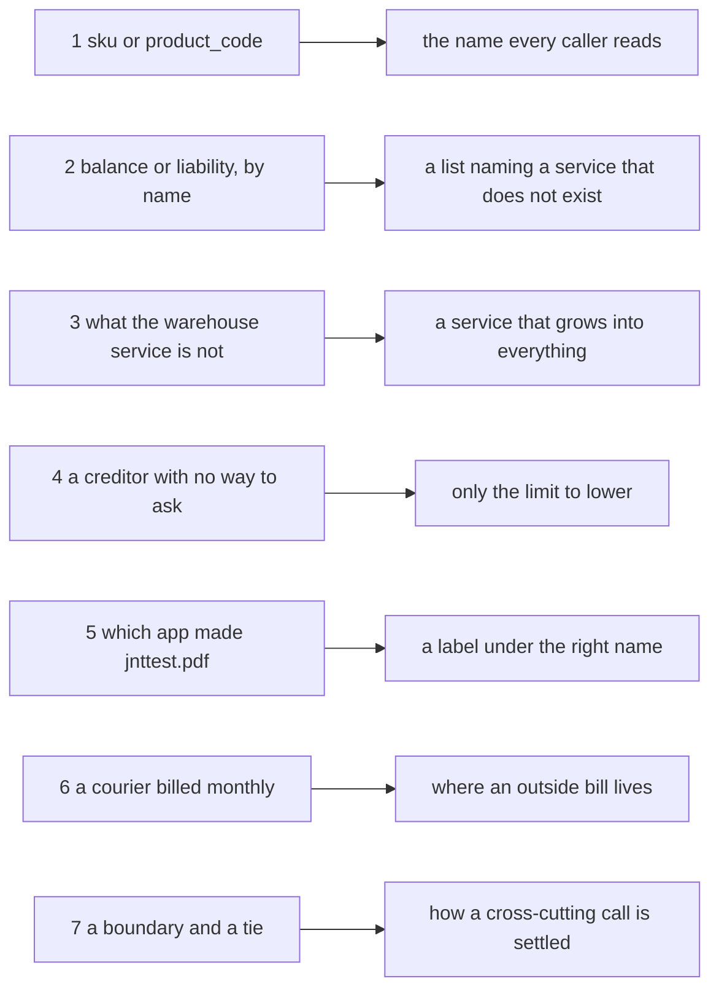

# The 7 Biggest Questions

Every open question in every `_clarify.md`, rolled up to the seven that block the most.

> **Derived file — regenerate, never hand-edit.** Same rule as a `state_report`. The open SET comes
> from `*_clarify.md` only, never from `*_decision.md`, so an answered question leaves here the moment
> it is recorded. Rebuild it whenever any `_clarify.md` changes.
>
> ⚠ **But the RANK is checked against the code, not only against the docs.** A rebuild that reads the
> clarify files alone cannot see that a question has been overtaken by what shipped. Before ranking a row,
> open the file it is about.
>
> **Ranked by what is BLOCKED**, not by how interesting the question is — a question that stops a
> lifecycle pass outranks one that merely matters. Several rows below are **one question asked in several
> docs**, and merging those is most of what this file is for.

**33 open questions across 41 files.** The seven below are shown; **26 are not** — they are not closed, only
smaller. ⚠ **17 of the 33 look overtaken** ([listed below](#looks-overtaken)) and stay counted until you confirm
each. The per-file counts are at the bottom.

🔄 *(2026-10-31)* **33**: the screen now says *Product code* (*Kode produk*), never "SKU"
([the-screen-says-product-code](technical/frontend/products_decision.md#the-screen-says-product-code)) — built. Product Q7
narrows to the field itself and stays #1. Net zero.

▼ *(2026-10-31)* **33**: the old #1, two buildings, closed — one warehouse team is one building; a second site is a
second team ([one-warehouse-team-is-one-building](business/teams/warehouse/context_decision.md#one-warehouse-team-is-one-building)),
as recommended; nothing changes. The rest move up one; member Q3 and Q4 enter together at #7. Net −1.

▼ *(2026-10-31)* **34**: the old #1, balance Q4, closed — the return half is in scope: at the return accept the
warehouse person may enter the courier's ask, optional, posted like the restock's
([a-return-may-carry-the-couriers-ask](business/balance/context_decision.md#a-return-may-carry-the-couriers-ask)),
against my *later* — *"courrier rarely ask"*. ⛔ Not built. The rest move up one; balance Q7 enters at #7. Net −1.

▼ *(2026-10-31)* **35**: the old #1, receipt_readers Q17, closed — a label that disagrees with the typed resi only
warns at submit, and the five mismatched samples are not investigated, for now
([a-receipt-mismatch-is-only-a-warning](technical/packages/receipt_readers/context_decision.md#a-receipt-mismatch-is-only-a-warning)).
Nothing to build. The rest move up one; receipt_readers Q1 enters at #7. Net −1.

▼ *(2026-10-31)* **36**: the old #1, member Q1's riders, closed — `category` goes with Products, `team` with Users &
Roles ([category-goes-with-products-and-team-with-users](business/project/member_decision.md#category-goes-with-products-and-team-with-users)),
as recommended. Member Q1 is closed in both halves. The rest move up one; balance Q6 enters at #7. Net −1.

▼ *(2026-10-31)* **37**: the old #1, settlement Q2, closed — problem funding is whatever the platform pays, under its
own label; no type of its own and no claim screen ([problem-funding-is-what-the-platform-pays](business/settlement/context_decision.md#problem-funding-is-what-the-platform-pays)),
as recommended, after *"tell more"* — which corrected my claim that your worked example was stale: for Shopee it is
right. Nothing to build. The rest move up one; the warehouse's *Whats Not* enters at #7. Net −1.

▼ *(2026-10-31)* **38**: the old #1, the as-of question, closed — every money metric says *as of* the newest event its
service has folded ([a-money-metric-says-as-of-when](business/analytic/rpc_provide_decision.md#a-money-metric-says-as-of-when)),
as recommended, after *"tell more"* — which corrected my claim that it tells a quiet day from a stuck fold: it cannot.
⛔ Not built. **rpc_provide has no open question.** The rest move up one; architecture Q10 enters at #7. Net −1.

▼ *(2026-10-31)* **39**: the old #1, product Q4, closed — a lock stops new orders only; an order already placed goes on
([a-lock-stops-new-orders-only](business/product/context_decision.md#a-lock-stops-new-orders-only)), as recommended;
nothing changes. The rest move up one; product Q7 enters at #7. Net −1.

▼ *(2026-10-31)* **40**: the old #1, architecture Q8, closed — region_service stays its own service
([region-stays-its-own-service](technical/architecture/context_decision.md#region-stays-its-own-service)), as
recommended; nothing changes. The rest move up one; one warehouse team, two sites, enters at #7. Net −1.

▼ *(2026-10-31)* **41**: the old #1, one-off closures, closed — a warehouse keeps a list of closures, a date range and a
reason, read by the closed-day warning ([a-warehouse-records-its-holidays](business/teams/warehouse/context_decision.md#a-warehouse-records-its-holidays)),
as recommended. ⛔ Not built. The rest move up one; balance Q4 enters at #7. Net −1.

▼ *(2026-10-31)* **42**: the old #1, mcp Q7, closed — buyer data reaches the agent, nothing cleared: *"its company
system"* ([buyer-data-reaches-the-agent](business/mcp/context_decision.md#buyer-data-reaches-the-agent)), against my
clearing; the personal-data exposure is recorded as the accepted cost. **mcp has no open question** — every one of
Q3–Q8 answered today, and the next MCP pass can start. The rest move up one; receipt_readers Q17 enters at #7. Net −1.

🔄 *(2026-10-31)* **43**: mcp Q6 closed — the agent reads through the metric pattern, plus a product search, an order by
its ref and the balance positions ([the-agent-reads-through-the-metric-pattern](business/mcp/context_decision.md#the-agent-reads-through-the-metric-pattern)),
as recommended. #1 is now mcp Q7, the last MCP question. Net −1.

🔄 *(2026-10-31)* **44**: mcp Q5 closed — the owner and admin connect an agent; CS and staff once the owner turns it on
([the-owner-decides-who-connects-an-agent](business/mcp/context_decision.md#the-owner-decides-who-connects-an-agent)),
as recommended. #1 stays, now two questions. Net −1.

🔄 *(2026-10-31)* **45**: mcp Q4 closed — root's agent keeps the bypass and reads every team; everyone else's reads one
([a-roots-agent-reads-every-team](business/mcp/context_decision.md#a-roots-agent-reads-every-team)), against my no-bypass.
#1 stays, now three questions. Net −1.

🔄 *(2026-10-31)* **46**: mcp Q3 closed — the login mints the agent its own credential: named, one team, 90 days, revoked
on its own ([an-agent-gets-its-own-team-credential](business/mcp/context_decision.md#an-agent-gets-its-own-team-credential)),
as recommended. ⛔ Not built. #1 stays, now four questions. Net −1.

▼ *(2026-10-31)* **47**: the old #1, business_level Q5, closed — *transparency accounting* is one claim: every charge a
team bears shows its cause, its frozen amount and who recorded it, never overwritten
([transparency-is-every-charge-traceable](business/business_level_decision.md#transparency-is-every-charge-traceable)),
as recommended. The team balance meets it today; the expense correction is the known gap. A new decision file,
[business_level_decision.md](business/business_level_decision.md). The rest move up one; member Q1's two riders enter
at #7. Net −1.

▼ *(2026-10-31)* **48**: the old #1, the three confirmations of the temporary Adjust port, withdrawn — after your *"why
not direct to finished design ?"*, the port is not refined further and the next inventory pass builds the finished
stock count ([the-finished-count-comes-next-not-a-refined-port](business/inventory/adjustment_decision.md#the-finished-count-comes-next-not-a-refined-port)):
your design accept of the count prototype, then the stock-problem register. **adjustment has no open question.** Also
found: retiring `ledger` leaves your settlement doc posting to the retired book — one contradiction there. The rest
move up one; settlement Q2 enters at #7. Net −3.

▼ *(2026-10-31)* **51**: the old #1, who owns `ledger`, answered by retiring it — no central book; every service keeps
its own ledger and serves its own metrics ([ledger-is-retired-as-a-context](business/project/member_decision.md#ledger-is-retired-as-a-context)),
as recommended. Ledger Q5 closed with the book (it leaves the overtaken list); ledger Q7 moved to the metric pattern
and enters at #7. Member Q1 stays open, narrowed to its two riders — who owns `category` and `team`. One contradiction:
your ledger/context.md still draws the book. **ledger has no open question.** Net −1.

▼ *(2026-10-31)* **52**: the old #1, supplier Q19, closed — a metric reads at most 366 days, on every metric of every
service, and a request with no range is refused too
([a-metric-reads-at-most-a-year](business/analytic/rpc_provide_decision.md#a-metric-reads-at-most-a-year)), recorded
with the metric pattern, as recommended. ⛔ Not built. **supplier has no open question.** The rest move up one;
product Q4 enters at #7. Net −1.

▼ *(2026-10-31)* **53**: the old #1, product Q8, closed and **built** — the four product writes drop the warehouse
roles; no team-type read, because a selling role exists only in a selling team
([the-product-writes-drop-the-warehouse-roles](business/product/context_decision.md#the-product-writes-drop-the-warehouse-roles)).
Checking it found the narrowing decided 2026-09-12 had never been built — a warehouse owner could create a product.
Pinned by `TestProductWrites_AreTheSellingTeamsAlone`. The rest move up one; architecture Q8 enters at #7. Net −1.

▼ *(2026-10-31)* **54**: the old #1, the non-cash payment — balance Q3 and team balance Q2 — closed as one: a payment
always moves money between accounts, with proof — a bank transfer, a wallet transfer or cash from a cash box — never
goods, and no netting method, because the pair balance already nets
([a-payment-always-moves-money](business/balance/context_decision.md#a-payment-always-moves-money)). My `offset` was
wrong. Nothing to build. **team balance has no open question.** The rest move up one; one-off closures enter at #7.
Net −2.

▼ *(2026-10-31)* **56**: the old #1, mcp Q8, closed — C: our server hosts the MCP at a public URL behind an OAuth login,
and the shipped app goes ([our-server-hosts-the-mcp](business/mcp/context_decision.md#our-server-hosts-the-mcp)),
as recommended; it supersedes the local-app decision. Q3's recommendation moved with it (the login mints the
credential). One contradiction: your context.md still ships a local app. ⛔ Not built. The rest move up one; the MCP's
five remaining questions enter together at #7. Net −1.

▼ *(2026-10-31)* **57**: the old #1, product Q9, closed — a product has exactly one category
([a-product-has-one-category](business/product/context_decision.md#a-product-has-one-category)), reversing your
*"categories is plural"*; the link table is cancelled and the built `category_id` stands. One contradiction: your
field list still says `categories`. Nothing to build. The rest move up one; business_level Q5 enters at #7. Net −1.

▼ *(2026-10-31)* **58**: the old #1, adjustment Q2, closed — a recount shortfall is written off and owed, as a stock
count is ([a-recount-shortfall-is-written-off-and-owed](business/inventory/adjustment_decision.md#a-recount-shortfall-is-written-off-and-owed)),
as recommended, after *"tell more"*; its contradiction is resolved. A new decision file,
[adjustment_decision.md](business/inventory/adjustment_decision.md). ⛔ Not built. The rest move up one; the context's
other three — confirmations of the port — enter together at #7. Net −1.

▼ *(2026-10-31)* **59**: the old #1, what a closed day does, closed — it warns and never refuses; the hours gate no
restock ([a-closed-day-warns-and-never-refuses](business/teams/warehouse/context_decision.md#a-closed-day-warns-and-never-refuses)),
against my own first *refuse*: a paid marketplace order must be recorded at any hour. ⛔ Not built. The rest move up
one; member Q1 enters at #7, its recommendation re-asked. Net −1.

▼ *(2026-10-31)* **60**: the old #1, the warehouse profile, closed — location and both weekly grids move whole to
`warehouse_service`; a selling team's default warehouse stays in `team_service`
([the-warehouse-profile-lives-in-warehouse-service](business/teams/warehouse/context_decision.md#the-warehouse-profile-lives-in-warehouse-service)),
as recommended. ⛔ Not built. The rest move up one; supplier Q19 enters at #7. Net −1.

▼ *(2026-10-31)* **61**: the old #1, balance Q5, closed — an entry stays disputable forever, no window
([an-entry-stays-disputable-forever](business/balance/context_decision.md#an-entry-stays-disputable-forever)), against my
window; checking it found no dispute feature anywhere, and a false `found` is bounded by the claim rule once stock
problems are built. Nothing to build. The rest move up one; product Q8 enters at #7. Net −1.

▼ *(2026-10-31)* **62**: the old #1, excel_readers Q2 (Tokopedia), closed — only Shopee and TikTok for now; a Tokopedia
order inside a TikTok file is that TikTok shop's row ([only-shopee-and-tiktok-for-now](technical/packages/excel_readers/context_decision.md#only-shopee-and-tiktok-for-now)).
Nothing to build. The rest move up one; the non-cash payment — two questions in two docs — enters at #7. Net −1.

⏸ *(2026-10-31)* **63**: the old #1, excel_readers Q7 (TikTok's 2026-09 layout), **parked by you** — it needs one period
downloaded again in the new layout, which only you can fetch. ⚠ Until then a re-imported TikTok period may book its
adjustments twice. A parked question is not counted. The rest move up one; mcp Q8 enters at #7. Net −1.

▼ *(2026-10-31)* **64**: the old #1, the picker question, closed — a metric is added whole, every field a column, for
now ([a-metric-is-added-whole-for-now](business/analytic/rpc_provide_decision.md#a-metric-is-added-whole-for-now)),
against my field level. Nothing to build — it is what runs. **rpc_provide has no open question.** The rest move up
one; product Q9 enters at #7. Net −1.

▼ *(2026-10-31)* **65**: the old #1, settlement meta Q2, closed — `process_event_lock` is a one-minute lease, for the
fold and for the next replay, read from the row's own `updated_at`
([a-dead-replays-lock-expires-after-a-minute](business/settlement/meta_context_decision.md#a-dead-replays-lock-expires-after-a-minute)).
Your *"make it 5 minute"* was changed back to one minute once five retries were shown to dead-letter at ~2½ minutes.
Recording it found a second gap — a new replay also refuses a dead one's lock. A new decision file,
[meta_context_decision.md](business/settlement/meta_context_decision.md). ⛔ Not built, in settlement or supplier. The
rest move up one; adjustment Q2 enters at #7. Net −1.

▼ *(2026-10-31)* **66**: the old #1, product Q11, closed and then redesigned by you the same day — *"its lead to over
enginered"*: a never-used product is deleted, a used one is only archived and unarchived, archive allowed even with
stock on a shelf ([a-used-product-is-archived-never-deleted](business/product/context_decision.md#a-used-product-is-archived-never-deleted)).
It supersedes both delete rules, answers product Q12 (an archived product resolves by id — it leaves the overtaken
list) and withdraws Q14 (does a completed order block a delete?), which no longer arises. One contradiction: your
context.md still renames the code on delete. ⛔ Not built — today's Delete is already a soft delete, so it is mostly a
rename to Archive / Unarchive, plus a new Delete with the history check. The rest move up one; what a closed day does
enters at #7. Net −2.

▼ *(2026-10-31)* **68**: the old #1, the expense correction, closed — one kind of correction, a signed adjustment naming
its expense; Void is dropped, Batalkan writes minus the whole amount
([every-correction-is-a-signed-adjustment](business/analytic/context_decision.md#every-correction-is-a-signed-adjustment)),
after your *"whats void, its seems weird"* turned my recommendation. ⛔ **Decided, not built** — `ExpenseUpdate` still
overwrites in place. One contradiction, in [financial_account](business/financial_account/context_clarify.md#an-expense-void-is-now-a-negative-adjustment).
The rest move up one; the warehouse profile enters at #7. Net −1.

▼ *(2026-10-31)* **69**: the old #1, shipment Q1, closed — the eight couriers are channels, seeded by `00002`
([the-channels-are-what-orders-ship-by](business/shipment/context_decision.md#the-channels-are-what-orders-ship-by)),
as recommended, so [no-order-without-a-courier](business/order/context_decision.md#no-order-without-a-courier) can be
built. One contradiction: your §Shipment Channel That Exists still lists three. The rest move up one; balance Q5 enters
at #7. Net −1.

▼ *(2026-10-31)* **70**: the old #1, product Q13, closed — at exactly the reserve a product is open, closed only under
it ([exactly-the-reserve-stays-open](business/product/context_decision.md#exactly-the-reserve-stays-open)), as
recommended; the screens now follow `<` ([a-minimum-closes-only-under-it](technical/frontend/products_decision.md#a-minimum-closes-only-under-it)).
The rest move up one; excel_readers Q2 enters at #7. Net −1.

🔄 **Re-checked question by question** (2026-10-31). Each of the 94 counted questions was read against every
`_decision.md` and, where it claims something about the code, against the code:

| | |
| ---: | --- |
| 22 | **answered** by a recorded decision — closed at source today, each now a ✅ line naming its decision. A 23rd, architecture Q10, was kept open on checking: [liability-stays](technical/balance/team_balance_design_decision.md#liability-stays) calls itself evidence for it, not an answer |
| 1 | **not open**: technical order design's barcode is ⏸ parked, and a parked question is not counted |
| 19 | **look overtaken** by the code or by your docs, with no decision saying so — [listed below](#looks-overtaken) |
| 52 | **really open** |

The old #1 changed meaning on checking: the expense correction does not block "every P&L figure" — no report fed by
expense events exists yet. The round-by-round log that grew above the seven is dropped; up to this rebuild it is in
git: `git show eda0ca92:docs/biggest_question.md`.

| # | The question | Blocks | Asked in | My recommendation |
| --- | --- | --- | --- | --- |
| **1** | **Does the FIELD become `product_code`, composed on write?** The screen already says *Product code* ([the-screen-says-product-code](technical/frontend/products_decision.md#the-screen-says-product-code)). Your doc names one globally unique `product_code`, composed as `<team_code>-<what the team types>` ([the-code-is-composed-from-the-team-code](business/product/context_decision.md#the-code-is-composed-from-the-team-code)); the wire and the database still store only `sku`, the team's part, unique per team | the composed code — and an archived product's code, which today's index frees but the archive decision keeps | [product Q7](business/product/context_clarify.md#question) | rename `sku` → `product_code` and compose it on write, as your doc says — one code on the sticker, at the scan, everywhere |
| **2** | **Is the balance service `balance_service` or `liability_service`?** Your architecture list says `balance_service`; the code shipped `liability_service`, and the screens say *Liability* / *Kewajiban*. [liability-stays](technical/balance/team_balance_design_decision.md#liability-stays) cancelled the rename, but calls itself evidence for this question, not its answer | your architecture list naming a service that does not exist | [architecture Q10](technical/architecture/context_clarify.md#question) | `liability_service`, as built — then your list's line 7 says so |
| **3** | **What is NOT the warehouse service's job?** Your warehouse doc says only *"manage warehouse teams"* — the one thing `team_service` already does. What is not its job is unwritten: stock, racks and the count are inventory's, the balance and its postings are liability's, identity and membership are team's | the warehouse service growing into the warehouse's everything | [warehouse](business/teams/warehouse/context_clarify.md#what-is-NOT-the-warehouse-services-job) | a *Whats Not* section naming those, as the order context has |
| **4** | **How does a creditor chase a debtor who never looks?** Payment is debtor-initiated by design — your payment flow opens with *"Team A see -100.000"*. The debtor now sees its limits and an 80% badge ([the-debtor-sees-the-limits-set-on-it](technical/balance/team_balance_design_decision.md#the-debtor-sees-the-limits-set-on-it)), but the creditor's only lever is lowering the limit, which stops the debtor trading rather than asking it to pay | a creditor with no way to ask for its money | [balance Q6](business/balance/context_clarify.md#question) | a request-for-payment that posts nothing — a notice, never a block |
| **5** | **Which app produced `jnttest.pdf`?** The label is read under the TikTok layouts already; only its name waits. It shares its generator and fonts with a TikTok / Tokopedia label, and its order id is a TikTok one | a label filed under the right platform's name | [receipt_readers Q1](technical/packages/receipt_readers/context_clarify.md#question) | close it as *TikTok, J&T Express* |
| **6** | **Are suppliers and couriers this balance's?** Half answered: a restock bought on credit is recorded as paid when raised ([a-restock-must-name-the-account-that-paid](business/financial_account/context_decision.md#a-restock-must-name-the-account-that-paid)), so a supplier is never owed here. Left: a courier invoiced monthly, rather than paid at the door | where a monthly courier bill lives | [balance Q7](business/balance/context_clarify.md#question) | not in the team balance — an outsider cannot confirm a payment; name where it does live |
| **7** | **Who settles a boundary between two people's contexts, and who breaks a tie?** Today's instance: the warehouse's loss reimbursement writes an inventory event onto a team's balance — two people's contexts. Q4's addressee half is answered ("the owner" has meant Heri); left: who settles a cross-cutting call — the hard rules, the proto contract, merging to `main` — once two people decide | how a call that spans two people's contexts is settled | [member Q3, Q4](business/project/member_clarify.md#question) | the caller proposes, the callee accepts; a tie goes to Heri |

Until production every ⛔ above is a risk to dev data, not an incident —
[no-switch-over-the-ledgers-replace-todays-tables](technical/stock/design_decision.md#no-switch-over-the-ledgers-replace-todays-tables).

**Runners-up:**
[the overtaken list](#looks-overtaken) — 17 questions the code or your docs moved past; one yes each closes them ·
[receipt_readers Q8, Q9, Q10](technical/packages/receipt_readers/context_clarify.md#question) — the label's phone, a masked
value and the address; nothing reads them yet, so they could be ⏸ parked. ·
[receipt_readers Q11](technical/packages/receipt_readers/context_clarify.md#question) — a KiriminAja label prints only
its own `OID-…`; is that the order id?

**Worth merging at source:** [receipt_readers Q8, Q9, Q10](technical/packages/receipt_readers/context_clarify.md#question) read fields nothing
consumes yet, so they could be ⏸ parked.

## looks-overtaken

Counted, because no decision closes them — but the code or your own docs moved past each. **One yes per row closes
it.**

| Asked in | The question | Why it looks overtaken |
| --- | --- | --- |
| [member Q5](business/project/member_clarify.md#question) | does the single-`dev`-branch rule survive two people? | `dev` has been idle since 2026-10-12; work lands on `backup/inventory`, `thoni`, `frada`, `hfrada`, merged across. ⚠ **CLAUDE.md §Git workflow still says *commit straight to `dev`*, and every agent reads it** |
| [workflow Q3](technical/development/workflow_clarify.md#question) | how many people build on `dev` at once? | the same question as member Q5 |
| [member Q2](business/project/member_clarify.md#question) | does member.md grant decision authority, or only the work? | in practice you decide stock and analytic on this branch, and Toni designs their own stock doc on `thoni` |
| [balance Q1](business/balance/context_clarify.md#question) | does an operating cost ever move a team balance? | you ruled *never recharged onward* on 2026-07-21 — recorded only in the expense migration's comment, never as a decision |
| [cost Q2](technical/cost/design_clarify.md#question) | does a cost also move the team balance? | the same question as balance Q1 |
| [cost Q1](technical/cost/design_clarify.md#question) | is `costs.balance` cumulative or outstanding? | `costs` / `cost_logs` were never built; an expense is paid at create and never edited, so nothing is outstanding |
| [balance Q9](business/balance/context_clarify.md#question) | should an order's warehouse fee be readable beside its settlement? | the fee is kept on the order and built ([warehouse-prices-balance-records](business/teams/warehouse/context_decision.md#warehouse-prices-balance-records)) |
| [settlement Q5](business/settlement/context_clarify.md#question) | does a cancel undo the live sale or the original row? | [cancel-zeroes-the-live-sale](business/settlement/context_decision.md#cancel-zeroes-the-live-sale) only holds if it is the live sale, and it is built that way |
| [excel_readers Q4](technical/packages/excel_readers/context_clarify.md#question) | are `wderror` and `x` real values or hand-edited fixtures? | an unmapped type is held either way, so nothing depends on the answer |
| [receipt_readers Q4](technical/packages/receipt_readers/context_clarify.md#question) | do sellers upload photos of labels? | PDF-only is built and accepted ([the-receipt-check-prototype-is-accepted](business/shipment/context_decision.md#the-receipt-check-prototype-is-accepted)) |
| [product Q10](business/product/context_clarify.md#question) | is `is_private` the shared lock, or a second switch? | no `is_private` exists anywhere; `cross_locked` is the one lock ([one-lock-three-ways](technical/frontend/products_decision.md#one-lock-three-ways)) |
| [business_level Q3](business/business_level_clarify.md#question) | can a team be two types? | the schema holds one `type` per team, and the menu is built from it |
| [business_level Q6](business/business_level_clarify.md#question) | is §Warehouse 8 a promotion of placement? | placement is its own context now ([placement.md](business/inventory/placement.md)) |
| [architecture Q9](technical/architecture/context_clarify.md#question) | what does `systems/` hold? | you deleted `systems.md` on 2026-09-12; CLAUDE.md's three trees have no `systems` rung |
| [architecture Q11](technical/architecture/context_clarify.md#question) | is `export_service` a service? | it was built as `settlement_importer_service` (2026-09-29) |
| [workflow Q1](technical/development/workflow_clarify.md#question) | fold workflow.md into level.md? | the workflow lives in [development_lifecycle.md](development_lifecycle.md); workflow.md is a one-line stub |
| [workflow Q2](technical/development/workflow_clarify.md#question) | is CLAUDE.md the projection of workflow.md? | CLAUDE.md derives from development_lifecycle.md |

## Where the other 26 are

⚠ **This table is every file's FULL open count, not the residue** — the seven above are rolled up *from* these files, so
the column sums to **33**, the whole set, not to 26. *Overtaken* is how many of a file's open questions are in the
[list above](#looks-overtaken); *Feeds* names the row of the seven a file's questions are part of.

| File | Open | Overtaken | Feeds |
| --- | ---: | ---: | --- |
| [technical/packages/receipt_readers/context_clarify.md](technical/packages/receipt_readers/context_clarify.md#question) | 8 | 1 | #5 |
| [business/product/context_clarify.md](business/product/context_clarify.md#question) | 2 | 1 | #1 |
| [business/balance/context_clarify.md](business/balance/context_clarify.md#question) | 4 | 2 | #4, #6 |
| [business/mcp/context_clarify.md](business/mcp/context_clarify.md#question) | 0 |  |  |
| [business/teams/warehouse/context_clarify.md](business/teams/warehouse/context_clarify.md#question) | 1 |  | #3 |
| [business/project/member_clarify.md](business/project/member_clarify.md#question) | 4 | 2 | #7 |
| [business/inventory/adjustment_clarify.md](business/inventory/adjustment_clarify.md#question) | 0 |  |  |
| [technical/packages/excel_readers/context_clarify.md](technical/packages/excel_readers/context_clarify.md#question) | 2 | 1 |  |
| [technical/architecture/context_clarify.md](technical/architecture/context_clarify.md#question) | 3 | 2 | #2 |
| [business/business_level_clarify.md](business/business_level_clarify.md#question) | 2 | 2 |  |
| [technical/development/workflow_clarify.md](technical/development/workflow_clarify.md#question) | 3 | 3 |  |
| [business/ledger/context_clarify.md](business/ledger/context_clarify.md#question) | 0 |  |  |
| [business/settlement/context_clarify.md](business/settlement/context_clarify.md#question) | 1 | 1 |  |
| [technical/cost/design_clarify.md](technical/cost/design_clarify.md#question) | 2 | 2 |  |
| [technical/balance/team_balance_design_clarify.md](technical/balance/team_balance_design_clarify.md#question) | 0 |  |  |
| [business/analytic/context_clarify.md](business/analytic/context_clarify.md#question) | 0 |  |  |
| [business/analytic/rpc_provide_clarify.md](business/analytic/rpc_provide_clarify.md#question) | 0 |  |  |
| [business/settlement/meta_context_clarify.md](business/settlement/meta_context_clarify.md#question) | 0 |  |  |
| [business/settlement/analytic_context_clarify.md](business/settlement/analytic_context_clarify.md#question) | 1 |  |  |
| [business/shipment/context_clarify.md](business/shipment/context_clarify.md#question) | 0 |  |  |
| [business/supplier/context_clarify.md](business/supplier/context_clarify.md#question) | 0 |  |  |
| [technical/order/design_clarify.md](technical/order/design_clarify.md#question) | 0 |  |  |
| [business/order/context_clarify.md](business/order/context_clarify.md#question) | 0 |  |  |
| [business/order/order_creation_clarify.md](business/order/order_creation_clarify.md#question) | 0 |  |  |
| [business/order/order_return_clarify.md](business/order/order_return_clarify.md#question) | 0 |  |  |
| [business/order/order_statistic_metric_clarify.md](business/order/order_statistic_metric_clarify.md#question) | 0 |  |  |
| [business/product/product_bundle_clarify.md](business/product/product_bundle_clarify.md#question) | 0 |  |  |
| [business/inventory/context_clarify.md](business/inventory/context_clarify.md#question) | 0 |  |  |
| [business/inventory/opname_clarify.md](business/inventory/opname_clarify.md#question) | 0 |  |  |
| [business/inventory/order_clarify.md](business/inventory/order_clarify.md#question) | 0 |  |  |
| [business/inventory/placement_clarify.md](business/inventory/placement_clarify.md#question) | 0 |  |  |
| [business/inventory/restock_clarify.md](business/inventory/restock_clarify.md#question) | 0 |  |  |
| [business/inventory/transaction_clarify.md](business/inventory/transaction_clarify.md#question) | 0 |  |  |
| [business/inventory/warehouse_transfer_clarify.md](business/inventory/warehouse_transfer_clarify.md#question) | 0 |  |  |
| [business/financial_account/context_clarify.md](business/financial_account/context_clarify.md#question) | 0 |  |  |
| [business/settlement/settlement_importer_clarify.md](business/settlement/settlement_importer_clarify.md#question) | 0 |  |  |
| [business/shop/context_clarify.md](business/shop/context_clarify.md#question) | 0 |  |  |
| [business/user/context_clarify.md](business/user/context_clarify.md#question) | 0 |  |  |
| [technical/event_architecture/context_clarify.md](technical/event_architecture/context_clarify.md#question) | 0 |  |  |
| [technical/ledger/mutation_and_ledger_clarify.md](technical/ledger/mutation_and_ledger_clarify.md#question) | 0 |  |  |
| [technical/stock/design_clarify.md](technical/stock/design_clarify.md#question) | 0 |  |  |

> **Counted from each file's Question section, at either heading level** — a numbered item or a `###` named one. An
> item marked ✅, moved (➡), withdrawn or ⏸ parked is not open, and **a question whose parts are all answered or moved
> counts as closed** even when its own line carries no ✅. Rows sum to **33** across **41** files.
>
> ⚠ **Stale at source, found on this pass and not fixed** — each is a clarify's own text:
> [product](business/product/context_clarify.md)'s preamble and its decision file cite drifted question numbers (Q9
> for team type is Q8, Q8 for categories is Q9, Q11 for the ByIds one is Q12) ·
> [event_architecture](technical/event_architecture/context_clarify.md) still says the library cannot publish the
> decided envelope, which it now does · [teams/warehouse](business/teams/warehouse/context_clarify.md) links two
> anchors that do not exist (`#does-the-order-freeze-the-fee`, `#who-owns-the-rate-after-this`) and its *already
> built* table predates the fee rollout.
