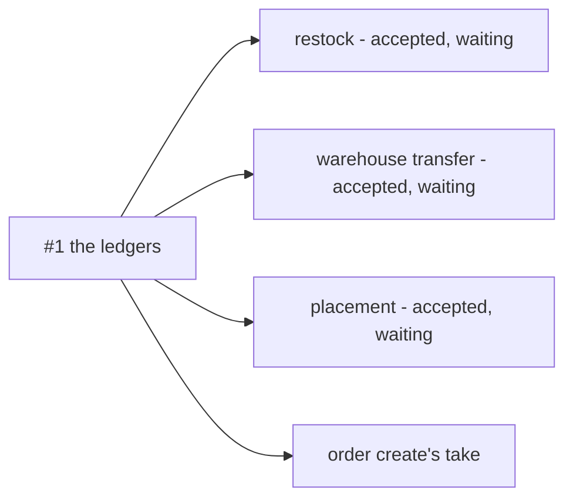

# The 7 Biggest Questions

Every open question in every `_clarify.md`, rolled up to the seven that block the most.

> **Derived file — regenerate, never hand-edit.** Same rule as a `state_report`. The open SET comes
> from `*_clarify.md` only, never from `*_decision.md`, so an answered question leaves here the moment
> it is recorded. Rebuild it whenever any `_clarify.md` changes.
>
> ⚠ **But the RANK is checked against the code, not only against the docs.** A rebuild that reads the
> clarify files alone cannot see that a question has been overtaken by what shipped. Before ranking a row,
> open the file it is about.
>
> **Ranked by what is BLOCKED**, not by how interesting the question is — a question that stops a
> lifecycle pass outranks one that merely matters. Several rows below are **one question asked in several
> docs**, and merging those is most of what this file is for.

**154 open questions across 34 files.** The five below are shown — #1 and #4 closed, their slots wait for a full rank; **149 are not** — they are not
closed, only smaller. The per-file counts are at the bottom.

🔄 **Merged into `thoni`** (2026-10-17). This file is `backup/inventory`'s fresh recount, plus the three `business/stock_thoni/` rows
it did not carry, recounted by the rule at the foot of the table: `context_clarify.md` **13**, `restock_flow_clarify.md` **0**,
`order_creation_provide_clarify.md` **0** — 141 + 13 = **154** across **40** files. The two files both branches touched and git
merged on its own (`order/order_return_clarify.md` 9, `technical/stock/design_clarify.md` 0) recount to the same numbers.
⚠ The seven were **not** re-ranked in this merge — the stock_thoni questions are counted, not yet ranked against them.
▲ +1 the same day, testing the merge: the supplier context reads its figures from an accepted restock, and stock_thoni's approval sends nothing ([penerimaan-tidak-mengabari-supplier](business/stock_thoni/restock_flow_clarify.md#penerimaan-tidak-mengabari-supplier)) — 155. On `thoni`, Heri's `business/inventory/` is ignored at its owner's request; its rows below are all 0.
🔄 **2026-10-17 — Heri's inventory left out on `thoni`.** The owner: *"abaikan inventory nya heri"*, as that folder's own
context.md §General 3 asks. Its seven rows (all 0) are removed from the table, and `stock_thoni/context_clarify.md` drops to
**12** (*pindah-ke-inventory* answered — [inventory-heri-diabaikan-di-thoni](business/stock_thoni/context_decision.md#inventory-heri-diabaikan-di-thoni))
— **154** across **33** files. ⚠ The log lines and row #1 below that name `business/inventory/` are `backup/inventory`'s
history, kept as merged; on this branch they are not tracked, and the seven still wait for a full re-rank.
🔄 Later the same day the owner widened it — Heri's inventory must not influence stock_thoni even through other contexts: the reserve contradiction narrows to `qty` ([cadangan-tanpa-qty](business/stock_thoni/order_creation_provide_clarify.md#cadangan-tanpa-qty)), the supplier question keeps only the supplier's own need, and a parked item resting on Heri's design is dropped. Counts unchanged.
🆕 Then a `RACKS` table in stock_thoni's model: no new question (the rack mechanism is unwritten, its questions parked); two small critiques on the table and one on placement, which does not yet check that a rack belongs to the transaction's warehouse. A comparison with `technical/stock` (Heri's) was withdrawn. Counts unchanged.
▼▲ 0 then: same-instant slots are ordered by `id` after all — the owner reversed "ignore it" within minutes ([slot-seri-diurutkan-dengan-id](business/stock_thoni/context_decision.md#slot-seri-diurutkan-dengan-id)); to be written in the take's slot pick.
▼▲ 0 then: all written — rack names unique per warehouse, placement refuses a rack of another warehouse, slots ordered `created_at, id`; and (missed earlier) the create request now has its team scope and the items and log carry the transaction id. The restock flow's open set: one question (supplier) and one critique (topic names).
▼▲ 0 then: a paste-ready fix for the topic names — one proto message per kabar, each naming its own `stock-restock-*` topic, `event_id` = tx + kind.
▼▲ 0 then: adopted — `sendEvent` with `event_id`, each caller sends its own message ([kabar-restock-dikirim-sebagai-pesan-proto](business/stock_thoni/context_decision.md#kabar-restock-dikirim-sebagai-pesan-proto)). The restock flow's open set is one question: does acceptance notify the supplier.
▲ +2 on 2026-10-19 — stock_thoni's new `rack_flow.md` (create by the warehouse admin, search, update): what the rack's counts include, good and broken (*isi-rak-dihitung-dari-apa* ✅), and who may update a rack (*siapa-mengubah-rak*, answered since: [rak-dibuat-diubah-admin-dicari-semua-anggota](business/stock_thoni/context_decision.md#rak-dibuat-diubah-admin-dicari-semua-anggota)) — **156** across **34**. `events.md` now holds the three restock messages.
▼ −1 the same day — racks cannot be deleted, the admin creates and updates them, every warehouse member searches them, paged (recorded). Open: which slots a rack's counts include — **155**.
▼ −1 then: good and broken slots are summed, empty slots ignored ([isi-rak-menjumlah-baik-dan-rusak](business/stock_thoni/context_decision.md#isi-rak-menjumlah-baik-dan-rusak)) — the rack flow has no open question; **154**.
▼▲ 0 then: the rack search gains two filters, name and "only empty racks"; empty is read with the same count (a rack holding only broken goods is not empty). One small critique: `sku_count`/`sku_sum` often tie, so every sort should end with `id` (*urutan-isi-rak-sering-seri*, answered since: [urutan-rak-diakhiri-id](business/stock_thoni/context_decision.md#urutan-rak-diakhiri-id)). Counts unchanged.
▲ +1 then: the rack sort ends with `id` (recorded, [urutan-rak-diakhiri-id](business/stock_thoni/context_decision.md#urutan-rak-diakhiri-id)); the name filter now tolerates typos with `pg_trgm`, and a critique asks that the exact name always come first. Opened: should the rack search read its counts from the slots or from a summary — the owner suggested `SKU_STATEMENT`, which has no rack (*isi-rak-dibaca-dari-slot-atau-ringkasan*, answered since: [isi-rak-dihitung-dari-slot-saat-dicari](business/stock_thoni/context_decision.md#isi-rak-dihitung-dari-slot-saat-dicari)) — **155**.
▼ −1 then, tested on a local Postgres 17 in rolled-back transactions: the counts are read from the slot tables at search time, with partial indexes `where count > 0` (7–11 ms over 600,000 slots, against 55–90 ms without) — [isi-rak-dihitung-dari-slot-saat-dicari](business/stock_thoni/context_decision.md#isi-rak-dihitung-dari-slot-saat-dicari); and no `pg_trgm`, which for short rack codes found neighbours rather than fixing typos ([nama-rak-dicari-tanpa-pg-trgm](business/stock_thoni/context_decision.md#nama-rak-dicari-tanpa-pg-trgm)). Open: two tested critiques on the name filter and line 25 still naming `pg_trgm` — **154**.
▼▲ 0 then: `A-01`, `A01` and `a 01` stay three different racks — uniqueness stays `lower(name)` ([tanda-pisah-membedakan-nama-rak](business/stock_thoni/context_decision.md#tanda-pisah-membedakan-nama-rak)); the name critiques now compare the exact name by the real name, not the separator-free key (tested). Counts unchanged.
▼▲ 0 then: `rack_name_key` adopted for search only, not for uniqueness ([nama-rak-dicari-lewat-kunci](business/stock_thoni/context_decision.md#nama-rak-dicari-lewat-kunci)), and line 25 no longer names `pg_trgm`. The rack flow keeps one critique (the exact name first) and no question. Counts unchanged.
▼▲ 0 then: the exact name always comes first ([nama-persis-selalu-pertama](business/stock_thoni/context_decision.md#nama-persis-selalu-pertama)) — the rack flow has no open question and no critique. Counts unchanged.

🔄 **Rebuilt fresh** (2026-10-12), after `dev` merged into `backup/inventory`. Every count is recounted from the files, and
every row of the seven was re-checked against the clarify it names and, where it claims something is live, against the
code. What changed:

- ▼ *(2026-10-16)* **141**: inventory context Q16 closed, as recommended — only inventory's half of a return is parked; order_return.md's calls into inventory are return.md's brief ([order-returns-calls-are-return-mds-brief](business/inventory/context_decision.md#order-returns-calls-are-return-mds-brief)). **No inventory clarify has an open question.**
- ▼ *(2026-10-16)* **142**: inventory context Q7 closed, as recommended — expiry is a report; the take keeps oldest-first and a rack does not track batches ([expiry-is-a-report](business/inventory/context_decision.md#expiry-is-a-report)).
- ▼ *(2026-10-16)* **143**: inventory context Q17 closed, as recommended — a transfer's create links its products to the receiving warehouse ([a-transfer-links-its-products-to-the-receiver](business/inventory/context_decision.md#a-transfer-links-its-products-to-the-receiver)).
- ▼ *(2026-10-16)* **144**: inventory context Q9 closed, as recommended — five things inventory does not own, each with its owner ([inventory-stops-at-five-lines](business/inventory/context_decision.md#inventory-stops-at-five-lines)).
- ▼ *(2026-10-16)* **145**: inventory context Q8 closed, as recommended — inventory owns the restock end to end ([inventory-owns-the-restock-end-to-end](business/inventory/context_decision.md#inventory-owns-the-restock-end-to-end)).
- ▼ *(2026-10-16)* **146**: mutation_and_ledger Q1 closed, option a — the template shrinks to an index of the words, the three shared rules, where each ledger lives and one line on events ([the-template-is-an-index](technical/ledger/mutation_and_ledger_decision.md#the-template-is-an-index)). Its stat-pipeline critique moved to analytic.
- ✅ *(2026-10-16)* **147**: **#1 closed — the inventory ledgers can be built.** The template's Idempotency Layer question is technical (owner: *"is it technical ?"*) and not a blocker: event dedup — an event processed once per service — is built in the event library, and the order's key is a different thing, keeping create and rollback consistent. Five rows shown.
- ▼ *(2026-10-16)* **147**: inventory context Q14 closed — 14d against my split: a late cost is the selling team's expense, or a transfer to the warehouse, and inventory does nothing ([a-late-cost-is-an-expense-not-a-revaluation](business/inventory/context_decision.md#a-late-cost-is-an-expense-not-a-revaluation)).
- 🔄 *(2026-10-16)* **148**: inventory context 14c answered, as recommended — the take that empties a batch takes all its remaining value ([an-emptying-take-takes-all-the-value](business/inventory/context_decision.md#an-emptying-take-takes-all-the-value)); 4 digits stays the precision. Net zero.
- ▼ *(2026-10-16)* **148**: transaction Q2 closed — items are read by history, the order's line cost, the sample list, shared-product info and reports, first the rack and batch stock flow ([items-are-what-history-and-reports-read](business/inventory/transaction_decision.md#items-are-what-history-and-reports-read)). **Transaction has no open question.**
- 🔄 *(2026-10-16)* **149**: your design — `opname` leaves `tx_type` for `problem` and `found`, the ledgers carry the reason (`broken`, `lost`, `found`), and the session lists its transactions in `opname_session_final_transactions` ([problem-and-found-replace-opname](business/inventory/transaction_decision.md#problem-and-found-replace-opname), [a-session-lists-its-final-transactions](business/inventory/opname_decision.md#a-session-lists-its-final-transactions)). Transaction Q2c answered. One contradiction: opname.md still draws the old shape in two lines. Net zero.
- ▼ *(2026-10-16)* **149**: transaction Q9 closed, as recommended — a sample's recipient is its own column ([a-sample-keeps-its-recipient](business/inventory/transaction_decision.md#a-sample-keeps-its-recipient)).
- 🔄 *(2026-10-16)* **150**: your placement.md and batch.md edits make the three type lists agree; [the-two-type-lists-do-not-line-up](business/inventory/transaction_clarify.md#the-two-type-lists-do-not-line-up) is resolved. Net zero.
- ▼ *(2026-10-16)* **150**: transaction Q5 closed by your edit — `revaluation` and `opname` added to `tx_type` ([revaluation-and-opname-are-transaction-types](business/inventory/transaction_decision.md#revaluation-and-opname-are-transaction-types)); `opname` was replaced later the same day.
- ▼ *(2026-10-16)* **151**: transaction Q4 closed, as recommended (reframed) — a rollback only undoes a take, and a wrong stock-in is corrected by an `adjustment` ([a-rollback-only-undoes-a-take](business/inventory/transaction_decision.md#a-rollback-only-undoes-a-take)).
- 🔄 *(2026-10-16)* **152**: your redrawn rollback reads the placement and batch logs and inverts them — `the-rollback-draws-get-items` resolved. Net zero.
- ▲ *(2026-10-16)* **152**: your new `warehouse_products` in inventory context.md, upserted by a restock's create before its transaction. Opened: [inventory context Q17](business/inventory/context_clarify.md#question), a transfer brings products into a warehouse too. One contradiction: its team is `team_id` there and `owner_team_id` in the stock design.
- ▼ *(2026-10-16)* **151**: placement Q5 closed, option b — a placement deletes at 0 stock, and staff and admin talk it over first ([a-placement-deletes-at-zero-stock](business/inventory/placement_decision.md#a-placement-deletes-at-zero-stock)). **Placement has no open question.**
- ▼ *(2026-10-16)* **152**: order context closes [picked-and-shipping-are-order-statuses](business/order/context_decision.md#picked-and-shipping-are-order-statuses), as recommended; transaction Q8 closes against my `picked_at` — *picked* is logged on `order_timeline_logs` ([picked-lives-on-the-order-timeline](business/inventory/transaction_decision.md#picked-lives-on-the-order-timeline)), superseding [superseded-the-verify-scan-tells-inventory-picked](business/inventory/order_decision.md#superseded-the-verify-scan-tells-inventory-picked). Opened: [placement Q5](business/inventory/placement_clarify.md#question), how the rack delete learns a sold unit still waits.
- ▼ *(2026-10-16)* **153**: inventory order Q12 closed — several orders on one label are all shown, and the staff ask the selling team or the warehouse admin ([two-orders-on-one-label-are-shown-not-chosen](business/inventory/order_decision.md#two-orders-on-one-label-are-shown-not-chosen)), against my *the picker chooses*. **Inventory order has no open question.**
- 🔄 *(2026-10-16)* **154**: inventory order Q11 closed, as recommended — one page, opened first by the label ([the-pick-page-opens-first-by-the-label](business/inventory/order_decision.md#the-pick-page-opens-first-by-the-label)); a label scan finds the order by `order_external_ref_id` or `receipt` ([a-label-scan-reads-the-ref-or-the-receipt](business/inventory/order_decision.md#a-label-scan-reads-the-ref-or-the-receipt)). Opened: [inventory order Q12](business/inventory/order_clarify.md#question), which order a code matching two opens. Net zero.
- ▲ *(2026-10-16)* **154**: your redrawn inventory §How Warehouse Process The Order, and `picked` and `shipping` in the order status list. Opened: [inventory order Q11](business/inventory/order_clarify.md#question) (where the picker reads the racks before the walk) and order context's [picked-and-shipping-are-order-statuses](business/order/context_clarify.md#picked-and-shipping-are-order-statuses) (they reverse [the-warehouse-steps-are-not-order-statuses](business/order/context_decision.md#the-warehouse-steps-are-not-order-statuses) for two steps). Transaction Q8 gains its moment, *Set Picked*; its recommendation is unchanged. Three contradictions reported.
- ▼ *(2026-10-16)* **152**: transaction Q3 closed, as recommended — a rollback flips each log row ([a-rollback-reverses-its-log-rows](business/inventory/transaction_decision.md#a-rollback-reverses-its-log-rows)). #1 loses *reversing a rollback from the log rows*.
- ▼ *(2026-10-15)* **153**: inventory order Q5 closed, as recommended — a platform cancel goes back through `pending` ([a-platform-cancel-goes-back-through-pending](business/inventory/order_decision.md#a-platform-cancel-goes-back-through-pending)). **Inventory order has no open question.**
- ▼ *(2026-10-15)* **154**: order context's timeline question closed — `order_timeline_logs` replaces the built `order_events`, which is dropped ([order-timeline-logs-replaces-order-events](business/order/context_decision.md#order-timeline-logs-replaces-order-events)); ⚠ not built.
- ▼ *(2026-10-15)* **155**: inventory order Q10 closed against my loss-at-the-report — missing goods are found by the staff's count while they talk it over ([a-missing-unit-is-found-by-opname](business/inventory/order_decision.md#a-missing-unit-is-found-by-opname)); a count before the cancel sees nothing, the next one does.
- ▼ *(2026-10-15)* **156**: order context's who-may-cancel closed against my *both may* — only the selling team cancels; the warehouse hands back to `pending` so customer service chases it, and usually cancels and re-creates ([only-the-selling-team-cancels](business/order/context_decision.md#only-the-selling-team-cancels)). That ending makes inventory order Q10 a loop if the release puts the missing unit back.
- ▲ *(2026-10-15)* **157**: inventory order Q2 closed — goods on no rack send the order back to `pending` with a note on your new `order_timeline_logs`, the selling team decides ([missing-goods-send-the-order-back-to-pending](business/inventory/order_decision.md#missing-goods-send-the-order-back-to-pending)). Opened: inventory order Q10 (a cancel would put the missing unit back on the book) and order context's [the-timeline-is-order-events](business/order/context_clarify.md#the-timeline-is-order-events). The status diagram lacks `processed --> pending`.
- 🔄 *(2026-10-15)* **156**: transaction Q1 re-answered by your edit — option **b**, the key claimed in its own table `idempotency_order_check` and removed from `inventory_transactions` ([the-key-is-claimed-in-its-own-table](business/inventory/transaction_decision.md#the-key-is-claimed-in-its-own-table)); the per-team order key is withdrawn. Counts unchanged.
- ▼ *(2026-10-15)* **156**: transaction Q1 closed — the key is UNIQUE on inventory's column alone, and an early cancel writes an empty rolled-back row ([superseded-a-key-buys-one-take-by-its-unique-index](business/inventory/transaction_decision.md#superseded-a-key-buys-one-take-by-its-unique-index)); the order's key is unique per team ([superseded-the-order-key-is-unique-within-its-team](business/order/context_decision.md#superseded-the-order-key-is-unique-within-its-team)). Inventory order Q8 closed — the placement page reads racks by `transaction_id` ([the-placement-page-reads-racks-by-transaction-id](business/inventory/order_decision.md#the-placement-page-reads-racks-by-transaction-id)). #1 loses *how one take per key is enforced*.
- ▼ *(2026-10-15)* **158**: inventory order Q7 closed — one error, three reasons (key used · not allowed · not enough stock), every refused line named ([a-refusal-names-its-reason-and-every-line](business/inventory/order_decision.md#a-refusal-names-its-reason-and-every-line)); the third has no exit in the owner's §Flow yet.
- ▼ *(2026-10-15)* **159**: settlement_importer Q15 closed — two live orders on one ref post to the **shop**, naming both ([two-live-orders-on-a-ref-post-to-the-shop](business/settlement/settlement_importer_decision.md#two-live-orders-on-a-ref-post-to-the-shop)); ⚠ not built. **#4 is closed and its slot is empty** — six are shown until the next full rank.
- ▼ *(2026-10-15)* **160**: product Q3 closed — the reserve is a **low-stock line**: `total stock ≥ reserve`, the quantity wanted not counted, other teams only ([the-reserve-stops-other-teams-at-low-stock](business/product/context_decision.md#the-reserve-stops-other-teams-at-low-stock)), against my minus-wanted boundary.
- ▼ *(2026-10-15)* **161**: inventory order Q6 closed against my under-the-lock — the reserve is checked before the take on a plain read of the product's total stock, **every warehouse** ([the-reserve-is-read-before-the-take](business/inventory/order_decision.md#the-reserve-is-read-before-the-take)); the same-second overlap and a small warehouse emptied are accepted costs. Product Q3 narrows to the boundary and the owner's own orders.
- ▼ *(2026-10-15)* **162**: the key shortcut is dropped — a used key is refused, never answered with an order ([the-order-refuses-a-used-key](business/order/context_decision.md#the-order-refuses-a-used-key)). **Order creation has no open question.**
- ▼ *(2026-10-15)* **163**: both teams named apart in the take — the request carries the ordering `team_id`, each line `owner_team_id` ([the-take-names-the-orderer-and-each-owner](business/order/context_decision.md#the-take-names-the-orderer-and-each-owner)), and an order's inventory transaction is the ordering team's ([an-order-transaction-is-the-ordering-teams](business/inventory/transaction_decision.md#an-order-transaction-is-the-ordering-teams)) — order_creation's which-team and transaction Q7 close. #1 loses *whose `team_id` on a cross-team order*.
- ▼ *(2026-10-15)* **166**: the debt check's three answers, all as recommended — [over-the-limit-refuses-the-create](business/order/context_decision.md#over-the-limit-refuses-the-create), [the-warehouse-is-a-creditor-on-every-order](business/order/context_decision.md#the-warehouse-is-a-creditor-on-every-order), [a-failed-owner-lookup-refuses-the-create](business/order/context_decision.md#a-failed-owner-lookup-refuses-the-create). Order context 7 → 5.
- 🔄 *(2026-10-15)* **168**: you drew the debt check before the transaction ([the-debt-check-runs-before-the-take](business/order/context_decision.md#the-debt-check-runs-before-the-take)) — order context closes `the-order-consults-the-debt-it-does-not-manage` and `finalize-enforces-every-rule-on-both-doors`, and opens `the-warehouse-is-a-creditor-too` (answered since: [the-warehouse-is-a-creditor-on-every-order](business/order/context_decision.md#the-warehouse-is-a-creditor-on-every-order)) (8 → 7). Order creation recounted at 3, not 2 — `key-already-used-gets-its-own-message` is still open. Net zero.
- ▼ *(2026-10-15)* **168**: three answers in chat — doubles are mostly one live and one cancelled, the rest for reasons kept out of this repo · *Try Again* always warns ([a-try-again-always-warns](business/order/context_decision.md#a-try-again-always-warns)) · the warning reads drafts ([the-duplicate-warning-reads-drafts-too](business/order/context_decision.md#the-duplicate-warning-reads-drafts-too)). #4 narrows to *which of two live orders gets the money*.
- ▲ *(2026-10-15)* **170**: a duplicate ref is **warned, not refused** ([a-duplicate-ref-is-warned-not-refused](business/order/context_decision.md#a-duplicate-ref-is-warned-not-refused)), against my partial index — the uniqueness decision is now `superseded-…`. **#4 becomes *a ref on two live orders***: the built importer pays the newest of them (settlement_importer Q15, +1). The order context's uniqueness question narrows to whether the warning reads drafts.
- ▼ *(2026-10-15)* **169**: your third edit refuses a used key ([a-used-key-is-refused-first](business/inventory/order_decision.md#a-used-key-is-refused-first)) — order Q9 closed — and every submit mints a new key ([every-submit-mints-a-new-key](business/order/context_decision.md#every-submit-mints-a-new-key)), which closes `a-refused-take-sends-no-cancel` by removing its case. **#4 is now *what stops a Try Again double-ordering*** — with the key no longer recognising a resend, the shop + ref index is load-bearing.
- ▲ *(2026-10-15)* **171**: your second edit of inventory order.md §Flow looks the key up first and **returns** an existing transaction — against [inventory-takes-a-key-once](business/order/context_decision.md#inventory-takes-a-key-once) (`the-take-replays-a-used-key`, order Q9). Following it found that a refused take still fires `InventoryTxCancel` (`a-refused-take-sends-no-cancel`). Both join **#4**, now *what a resent key gets back*.
- ▲ *(2026-10-15)* **169**: your new inventory order.md §`OrderTransactionCreate` — the take reads product configuration before its transaction and checks private and the reserve ([the-take-checks-the-product-first](business/inventory/order_decision.md#the-take-checks-the-product-first)). It opens three in [order_clarify](business/inventory/order_clarify.md#question): a reserve compared before the lock lets two borrowers past it (Q6), the take's refusals (Q7), where the receipt's racks come from (Q8). Order's finalize question and product Q3 narrowed, counts unchanged.
- 🔄 *(2026-10-15)* **166**: the order keeps ONE `transaction_id` ([an-order-is-one-inventory-transaction](business/order/context_decision.md#an-order-is-one-inventory-transaction)). #1 moves with it: the key can be UNIQUE on inventory's own column, so `inventory_take_keys` is no longer recommended, and an order's transaction is the ordering team's. Counts unchanged.
- 🔄 *(2026-10-15)* **166**: the owner fixed three contradictions in order_creation.md and named the compensation `InventoryTxCancel` ([the-compensation-event-is-inventory-tx-cancel](business/order/context_decision.md#the-compensation-event-is-inventory-tx-cancel)). The form's loop was proposed and drawn the same day ([the-form-locks-until-it-is-answered](business/order/context_decision.md#the-form-locks-until-it-is-answered)); what it left open — [key-already-used-gets-its-own-message](business/order/order_creation_clarify.md#key-already-used-gets-its-own-message) — is +1, and a same-second resend never reaches the unique index, so #4's fix has one site, not two.
- ▼ *(2026-10-15)* **165**: four ledger rules and the money type closed in chat — [the-caller-opens-the-transaction](technical/ledger/mutation_and_ledger_decision.md#the-caller-opens-the-transaction), [ledger-logs-are-append-only](technical/ledger/mutation_and_ledger_decision.md#ledger-logs-are-append-only), [both-ledgers-count-the-same-units](business/inventory/context_decision.md#both-ledgers-count-the-same-units), [a-batch-keeps-its-supplier](business/inventory/context_decision.md#a-batch-keeps-its-supplier), [money-is-double-in-the-api-too](technical/stock/design_decision.md#money-is-double-in-the-api-too). **The restock accept is no longer blocked.**
- 🔄 *(2026-10-15)* **168**: warehouse transfer Q10 closed, option B — balance posts the transfer's courier debt from the accepted event ([balance-posts-the-transfers-on-site-debt-from-the-event](business/inventory/warehouse_transfer_decision.md#balance-posts-the-transfers-on-site-debt-from-the-event)). **Transfer has no open question.** It raised balance Q13: under `INCIDENTAL_FEE`, a transfer whose id matches a restock's is dropped as a duplicate. Net zero.
- ▼ *(2026-10-15)* **168**: technical stock Q5 closed — nothing is in production, so the ledgers replace today's tables outright, no switch-over ([no-switch-over-the-ledgers-replace-todays-tables](technical/stock/design_decision.md#no-switch-over-the-ledgers-replace-todays-tables)). #1 loses its cut-over.
- 🔄 *(2026-10-15)* **169**: restock passed design_accept ([the-restock-prototype-is-accepted](business/inventory/restock_decision.md#the-restock-prototype-is-accepted)); #1 now holds three accepted designs and opname's.
- ▼ *(2026-10-14)* **169**: restock Q23 closed, b — a box nobody raised comes in by the team's restock, as opname's rule ([a-box-nobody-raised-comes-in-by-the-teams-restock](business/inventory/restock_decision.md#a-box-nobody-raised-comes-in-by-the-teams-restock)). **Restock has no open question.**
- 🔄 *(2026-10-14)* **170**: restock's accept waits for the ledger switch-over, as you chose ([the-decided-ledgers-come-before-the-restock-accept](business/inventory/restock_decision.md#the-decided-ledgers-come-before-the-restock-accept)) — #1 now blocks four designs: restock, opname, transfer, placement. Restock Q23 now recommends your opname rule.
- ▼ *(2026-10-14)* **170**: restock Q22 closed in chat, B — *all qty* is every unit ordered, and a broken or missing unit carries the landed price ([all-qty-is-every-unit-ordered](business/inventory/restock_decision.md#all-qty-is-every-unit-ordered)). Product Q2 closes with it.
- 🔄 *(2026-10-14)* **172**: restock Q22 corrected — my argument mixed a door problem with a rack loss ([q22-mixed-the-door-and-the-rack](business/inventory/restock_clarify.md#q22-mixed-the-door-and-the-rack)); I now lean C and ask what *all qty* meant.
- ▼ *(2026-10-14)* **172**: technical stock Q3 closed by your restock.md §Calculating Price Unit — the cost share is the whole restock's, by quantity ([unit-price-is-line-price-plus-costs-per-unit](business/inventory/restock_decision.md#unit-price-is-line-price-plus-costs-per-unit)). Restock Q22 narrows to B or C.
- 🔄 *(2026-10-14)* **173**: you deleted inventory context.md's receiving flow ([each-flow-draws-its-own-receiving](business/inventory/context_decision.md#each-flow-draws-its-own-receiving)). Context Q1 and Q3 moved to restock as Q22 (the divisor, where the prototype counts a receiving loss twice) and Q23 (a box nobody raised). Net zero.
- ▲ *(2026-10-14)* **173**: your §General item 2 and return.md — return is *unplanned* ([return-is-unplanned](business/inventory/context_decision.md#return-is-unplanned)); inventory context Q16 asks whether [order_return.md](business/order/order_return.md)'s warehouse half is parked too. Context Q1 gains the double count: the prototype divides by good units while problem rows carry the ordered share.
- ▲ *(2026-10-14)* **172**: warehouse transfer Q10 — does the on-site charge's debt follow restock's out of the accept? Restock's rule was reversed in chat ([balance-posts-the-couriers-debt-from-the-event](business/inventory/restock_decision.md#balance-posts-the-couriers-debt-from-the-event)); restock still has no open question. #1 corrected: restock is prototyped, but no design_accept is recorded for it.
- ▼ *(2026-10-14)* **171**: inventory context Q10 closed by your §General item 2 (now item 3) — the two designs live on separate branches ([the-two-inventory-designs-live-on-separate-branches](business/inventory/context_decision.md#the-two-inventory-designs-live-on-separate-branches)).
- ▼ *(2026-10-14)* **172**: opname Q21 closed in chat — a short rack gets a lost draft from the system ([a-short-rack-gets-a-lost-draft-from-the-system](business/inventory/opname_decision.md#a-short-rack-gets-a-lost-draft-from-the-system)). **Opname has no open question.**
- 🔄 *(2026-10-14)* **173**: your redrawn counting box resolves an opname contradiction; Q21 still open.
- ▲ *(2026-10-14)* **173**: opname re-checked — Q21, a short rack can be marked counted with no draft.
- ▼ *(2026-10-14)* **172**: opname Q20 closed in chat — a reason is required on every draft ([a-difference-needs-its-reason-on-the-draft](business/inventory/opname_decision.md#a-difference-needs-its-reason-on-the-draft)). **Opname has no open question.**
- 🔄 *(2026-10-14)* **173**: opname Q20 narrowed — 20a answered (the system fills the surplus count); 20b left.
- ▼ *(2026-10-14)* **173**: opname Q19 closed in chat, as recommended — rows at 0 snapshotted, an `all` count visits every rack ([a-snapshot-includes-rows-at-zero](business/inventory/opname_decision.md#a-snapshot-includes-rows-at-zero)).
- ▼ *(2026-10-14)* **174**: opname Q18 closed in chat — a unit never stocked here comes in by restock ([a-unit-never-stocked-here-comes-in-by-restock](business/inventory/opname_decision.md#a-unit-never-stocked-here-comes-in-by-restock)).
- ▲ *(2026-10-14)* **175**: your `opname_surplus_drafts` — opname Q20, its number and where notes live.
- ▼ *(2026-10-14)* **174**: opname Q17 closed in chat — the plan's target is only a filter ([the-plan-target-is-only-a-filter](business/inventory/opname_decision.md#the-plan-target-is-only-a-filter)).
- ▲ *(2026-10-14)* **175**: your §Stock Opname Flow edit — opname Q19, which `product_placements` rows a snapshot takes.
- 🔄 *(2026-10-14)* **174**: opname Q17 narrowed by your edit — `plan` recorded, `plan_id` open.
- ▲ *(2026-10-13)* **174**: opname re-checked — Q17 a session does not store its plan, Q18 a surplus with no price has no way in.
- ▼ *(2026-10-13)* **172**: opname Q13 closed by your rewrite of the stock-problem flow — **opname has no open question** ([the-problem-flow-opens-at-finalize-and-adjustment](business/inventory/opname_decision.md#the-problem-flow-opens-at-finalize-and-adjustment)).
- ▼ *(2026-10-13)* **173**: opname Q12 and Q14 closed in chat, as recommended — a counted row is read-only until sent back ([a-counted-row-is-read-only-until-sent-back](business/inventory/opname_decision.md#a-counted-row-is-read-only-until-sent-back)), a surplus carries no reason ([a-surplus-carries-no-reason](business/inventory/opname_decision.md#a-surplus-carries-no-reason)).
- ▼ *(2026-10-13)* **175**: opname Q16 closed in chat — broken is posted as written, only the rest is netted ([broken-posts-as-written-the-rest-nets](business/inventory/opname_decision.md#broken-posts-as-written-the-rest-nets)).
- ▼ *(2026-10-13)* **176**: inventory context Q6 closed in chat — a broken unit is thrown away ([a-broken-unit-is-thrown-away](business/inventory/context_decision.md#a-broken-unit-is-thrown-away)).
- ▼ *(2026-10-13)* **177**: opname Q15 closed by your edit — a problem row names its rack ([a-problem-row-names-its-rack](business/inventory/opname_decision.md#a-problem-row-names-its-rack)).
- ▲ *(2026-10-13)* **178**: your §How Staff Work On Session and the draft table — Q12 and Q14 narrowed, Q16 opened (the draft names no session or rack).
- ▲ *(2026-10-13)* **177**: a critique of the finished opname design opens four (Q12–Q15); the fifth, a count that could not record broken, is answered by [a-count-is-of-sellable-units](business/inventory/opname_decision.md#a-count-is-of-sellable-units).
- ▼ *(2026-10-13)* **173**: opname Q10 closed — **opname has no open question** ([expected-is-the-book-figure](business/inventory/opname_decision.md#expected-is-the-book-figure)).
- ▼ *(2026-10-13)* **174**: opname Q9 closed — a team asks outside the system ([a-team-asks-for-a-count-outside-the-system](business/inventory/opname_decision.md#a-team-asks-for-a-count-outside-the-system)).
- ▼ *(2026-10-13)* **175**: opname Q8 closed — a second person for money, never one's own count ([nobody-finalizes-their-own-count](business/inventory/opname_decision.md#nobody-finalizes-their-own-count)).
- ▼ *(2026-10-13)* **176**: opname Q5 closed — no system check; a count starts after order processing ([a-count-starts-when-order-processing-is-done](business/inventory/opname_decision.md#a-count-starts-when-order-processing-is-done)).
- ▼ *(2026-10-13)* **177**: opname Q4 closed — a lock stops units moving, never a sale ([a-lock-stops-units-moving-not-sales](business/inventory/opname_decision.md#a-lock-stops-units-moving-not-sales)).
- ▼ *(2026-10-13)* **178**: opname Q3 closed — the lock is the open snapshot row ([the-lock-is-the-open-snapshot-row](business/inventory/opname_decision.md#the-lock-is-the-open-snapshot-row)).
- ▼ *(2026-10-13)* **179**: opname Q7 closed — no tolerance ([a-count-has-no-tolerance](business/inventory/opname_decision.md#a-count-has-no-tolerance)); 10e answered inside Q10.
- ▼ *(2026-10-13, later still)* **180**: opname Q1 closed — a blind count, then a reveal ([a-count-is-blind-then-revealed](business/inventory/opname_decision.md#a-count-is-blind-then-revealed)).
- ▼ *(2026-10-13, later)* **181**: opname Q11 closed in chat, every part as recommended, and Q6 with it — a product is netted across the session and counted on all its racks ([a-count-nets-each-product-across-the-session](business/inventory/opname_decision.md#a-count-nets-each-product-across-the-session)).
- 🔄 *(2026-10-13)* **183**: opname.md gained a stock-problem register — context 14b answered in substance by it, and [opname Q11](business/inventory/opname_clarify.md#question) opened (+1).
- **182, not 183** at the rebuild. The old table carried a stale row: `technical/architecture` said 9 and has 8 (its Q7 was answered in
  settlement).
- **The old #1 left** — *how is a half-succeeded order found?* — because it is decided, not open:
  [a-lost-publish-is-not-tracked-on-the-order](business/order/context_decision.md#a-lost-publish-is-not-tracked-on-the-order).
- **The ledger questions merge into one row, and it goes to #1.** Three accepted designs wait on it.
- **🆕 #4 enters** from the merged idempotency key: a key looked up alone hands one team another team's order.
- **The round-by-round log that grew above the seven is dropped.** Up to this rebuild it is in git:
  `git show 8252289:docs/biggest_question.md`.

| # | The question | Blocks | Asked in | My recommendation |
| --- | --- | --- | --- | --- |
| **1** | ✅ *(2026-10-16)* **Closed — the inventory ledgers' rules are decided.** Every business question that stood in the way of building them is answered: the key ([the-key-is-claimed-in-its-own-table](business/inventory/transaction_decision.md#the-key-is-claimed-in-its-own-table)), items ([items-are-what-history-and-reports-read](business/inventory/transaction_decision.md#items-are-what-history-and-reports-read)), the rollback ([a-rollback-only-undoes-a-take](business/inventory/transaction_decision.md#a-rollback-only-undoes-a-take)), the types ([problem-and-found-replace-opname](business/inventory/transaction_decision.md#problem-and-found-replace-opname)), an emptied batch ([an-emptying-take-takes-all-the-value](business/inventory/context_decision.md#an-emptying-take-takes-all-the-value)), a late cost ([a-late-cost-is-an-expense-not-a-revaluation](business/inventory/context_decision.md#a-late-cost-is-an-expense-not-a-revaluation)). ✅ The template's *Idempotency Layer* ([mutation_and_ledger Q1](technical/ledger/mutation_and_ledger_clarify.md#question)) is answered too — the doc becomes an index ([the-template-is-an-index](technical/ledger/mutation_and_ledger_decision.md#the-template-is-an-index)); it was technical and never a blocker: the rule it states — an event is processed once, per service — is already built in the event library (`san_event`), and the order's key is a different thing, keeping create and rollback consistent | — | — | the owner's docs still owe their redraws — each listed in its clarify |
| **2** | **Which markup does the LEDGER charge from?** ⛔ **Live, re-checked 2026-10-12.** The product detail quotes `products.cross_markup_bps`; [`order_fees.go`](../backend/services/liability_service/liability_v1/order_fees.go) charges `liability_terms.product_markup_bp`. Nothing keeps the two equal, so the quote and the invoice disagree in whichever direction was edited last | every cross-sold order's fee — what a team is quoted against what it is billed | [technical balance](technical/balance/team_balance_design_clarify.md#question) · [Contradiction](business/balance/context_clarify.md#two-markups-exist-and-the-screen-and-the-ledger-read-different-ones) | **`order_fees.go` reads the PRODUCT's rate when it freezes the fee, and `liability_terms.product_markup_bp` is dropped in the same migration.** ⚠ The read moves, the column goes and the frontend's pass-through bridge is deleted together, or the fee breaks |
| **3** | **May a closed shop still be paid?** ⛔ **Live, re-checked 2026-10-12.** [`ShopAccessCheck`](../backend/services/selling_service/selling_v1/shop_access_check.go) answers a deleted shop `NotFound`, so a shop's last statements — paid after it stops selling — can never be imported | a closed shop's last payouts, refused at the import and again at settlement · its last withdrawals | [shop](business/shop/context_clarify.md#question) — *what does delete do to a shop with history* | **Close rather than delete** — only new selling is refused; the check returns the shop with its status and each caller decides: the importer, settlement and the accounts take it, an order refuses it |
| **4** | ✅ *(2026-10-15)* **Closed — two live orders on one ref.** Every part is decided: a duplicate is warned ([a-duplicate-ref-is-warned-not-refused](business/order/context_decision.md#a-duplicate-ref-is-warned-not-refused)), a used key is refused ([the-order-refuses-a-used-key](business/order/context_decision.md#the-order-refuses-a-used-key)), and a statement line on two live orders posts to the shop ([two-live-orders-on-a-ref-post-to-the-shop](business/settlement/settlement_importer_decision.md#two-live-orders-on-a-ref-post-to-the-shop)). ⚠ **Not built:** `orderInShop` still pays the newest. **The slot is empty until the next full rank** | — | — | — |
| **5** | **Can a report heal from a lost event — or is the broker its only path?** Every report is folded from events, the publish is trusted ([no-outbox-the-publish-is-trusted](technical/event_architecture/context_decision.md#no-outbox-the-publish-is-trusted)), and nothing checks a report against its log ([the-reconcile-check-is-not-built](business/settlement/context_decision.md#the-reconcile-check-is-not-built)) | the correctness of every stream-built report — settlement's ships on the broker alone, and supplier's daily report copies it ([the-report-is-processed-like-settlement](business/supplier/context_decision.md#the-report-is-processed-like-settlement)) | [analytic Q2](business/analytic/context_clarify.md#question) | **Two paths, one fold**: the event is a doorbell, and a tick reads the log after a cursor and folds what the doorbell missed ([the design](business/analytic/context_clarify.md#log-is-the-source-broker-is-the-trigger)). ⚠ If not, strike the template's promised nightly reconcile |
| **6** | **How is drift repaired when the LOG is right and only the FOLD was lost?** `system_adjustment` moves the log and the report together, so it repairs damage where both were wrong — and every known drift cause leaves only the report wrong | out-of-window report drift, which the replay cannot reach by decision and the adjustment cannot express — found only when a person notices | [settlement](business/settlement/context_clarify.md#-system_adjustment-in-the-log-repairs-one-class-of-damage-and-cannot-repair-the-other) | **A targeted DAY RE-FOLD from the log** — re-read one scope's rows for one day and rewrite that day; it reaches any date and leaves the ledger true. ⚠ It is a second reader of the log, so decide it on its own rather than inheriting [the-replay-seeks-the-broker](business/settlement/context_decision.md#the-replay-seeks-the-broker) |
| **7** | **Where does a returned parcel land — and does an OWN product go through the cross-product map?** [order_return.md](business/order/order_return.md) adds `product_return_maps` beside a config that already ships: `team_infos.return_warehouse_id`, written by no screen and read by no server. No order-create gate on it exists in code (re-checked 2026-10-12), so nothing live is blocked | the return context, which cannot be built from a flow that clones own products · a duplicate table in a second service | [order_return](business/order/order_return_clarify.md#question) | **No new table** — keep `team_infos.return_warehouse_id`, add a per-**shop** override, resolve it on the order form and **freeze it on the order**. **Gate the request, not the config row** |

## Where the other 149 are

⚠ **This table is every file's FULL open count, not the residue** — the seven above are rolled up *from* these files, so
the column sums to **154**, the whole set, not to 149. *Feeds* names the row of the seven a file's questions are part of.

| File | Open | Feeds |
| --- | ---: | --- |
| [technical/order/design_clarify.md](technical/order/design_clarify.md#question) | 18 |  |
| [business/teams/warehouse/context_clarify.md](business/teams/warehouse/context_clarify.md#question) | 13 |  |
| [business/stock_thoni/context_clarify.md](business/stock_thoni/context_clarify.md#question) | 12 |  |
| [business/product/context_clarify.md](business/product/context_clarify.md#question) | 9 |  |
| [technical/packages/receipt_readers/context_clarify.md](technical/packages/receipt_readers/context_clarify.md#question) | 10 |  |
| [business/order/context_clarify.md](business/order/context_clarify.md#question) | 4 |  |
| [business/order/order_return_clarify.md](business/order/order_return_clarify.md#question) | 9 | #7 |
| [business/analytic/context_clarify.md](business/analytic/context_clarify.md#question) | 8 | #5 |
| [technical/architecture/context_clarify.md](technical/architecture/context_clarify.md#question) | 8 |  |
| [business/balance/context_clarify.md](business/balance/context_clarify.md#question) | 8 | #2 (its contradiction) |
| [business/ledger/context_clarify.md](business/ledger/context_clarify.md#question) | 7 |  |
| [technical/packages/excel_readers/context_clarify.md](technical/packages/excel_readers/context_clarify.md#question) | 7 |  |
| [business/business_level_clarify.md](business/business_level_clarify.md#question) | 6 |  |
| [business/mcp/context_clarify.md](business/mcp/context_clarify.md#question) | 6 |  |
| [technical/balance/team_balance_design_clarify.md](technical/balance/team_balance_design_clarify.md#question) | 6 | #2 |
| [business/project/member_clarify.md](business/project/member_clarify.md#question) | 5 |  |
| [business/settlement/context_clarify.md](business/settlement/context_clarify.md#question) | 4 | #6 |
| [business/shop/context_clarify.md](business/shop/context_clarify.md#question) | 4 | #3 |
| [technical/development/workflow_clarify.md](technical/development/workflow_clarify.md#question) | 4 |  |
| [technical/ledger/mutation_and_ledger_clarify.md](technical/ledger/mutation_and_ledger_clarify.md#question) | 0 |  |
| [technical/stock/design_clarify.md](technical/stock/design_clarify.md#question) | 0 |  |
| [business/order/order_creation_clarify.md](business/order/order_creation_clarify.md#question) | 0 |  |
| [business/stock_thoni/restock_flow_clarify.md](business/stock_thoni/restock_flow_clarify.md#question) | 1 |  |
| [business/stock_thoni/order_creation_provide_clarify.md](business/stock_thoni/order_creation_provide_clarify.md#question) | 0 |  |
| [business/stock_thoni/rack_flow_clarify.md](business/stock_thoni/rack_flow_clarify.md#question) | 0 |  |
| [technical/cost/design_clarify.md](technical/cost/design_clarify.md#question) | 2 |  |
| [business/settlement/meta_context_clarify.md](business/settlement/meta_context_clarify.md#question) | 1 |  |
| [business/shipment/context_clarify.md](business/shipment/context_clarify.md#question) | 1 |  |
| [business/supplier/context_clarify.md](business/supplier/context_clarify.md#question) | 1 |  |
| [business/financial_account/context_clarify.md](business/financial_account/context_clarify.md#question) | 0 |  |
| [business/settlement/analytic_context_clarify.md](business/settlement/analytic_context_clarify.md#question) | 0 |  |
| [business/settlement/settlement_importer_clarify.md](business/settlement/settlement_importer_clarify.md#question) | 0 |  |
| [business/user/context_clarify.md](business/user/context_clarify.md#question) | 0 |  |
| [technical/event_architecture/context_clarify.md](technical/event_architecture/context_clarify.md#question) | 0 |  |

> **Counted from each file's Question section, at either heading level** — a numbered item or a `###` named one. An
> item marked ✅, moved (➡) or withdrawn is not open, and **a question whose parts are all answered or moved counts as
> closed** even when its own line carries no ✅ ([inventory context Q11](business/inventory/context_clarify.md#question) is
> the one case). Rows sum to **154** across **34** files. ⚠ **Worth fixing at the source:** one heading
> level and one closed-marker across every clarify makes this count mechanical instead of a judgement call.
