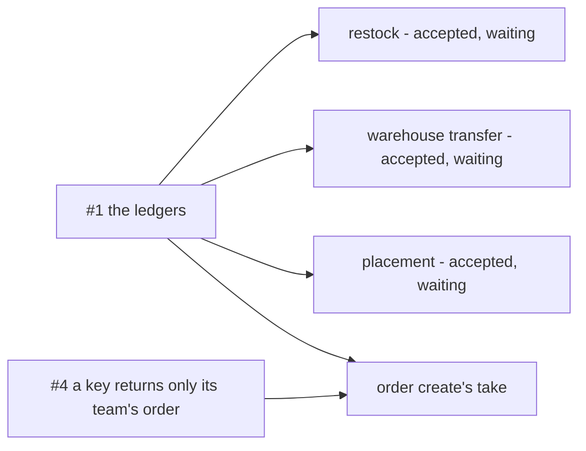

# The 7 Biggest Questions

Every open question in every `_clarify.md`, rolled up to the seven that block the most.

> **Derived file — regenerate, never hand-edit.** Same rule as a `state_report`. The open SET comes
> from `*_clarify.md` only, never from `*_decision.md`, so an answered question leaves here the moment
> it is recorded. Rebuild it whenever any `_clarify.md` changes.
>
> ⚠ **But the RANK is checked against the code, not only against the docs.** A rebuild that reads the
> clarify files alone cannot see that a question has been overtaken by what shipped. Before ranking a row,
> open the file it is about.
>
> **Ranked by what is BLOCKED**, not by how interesting the question is — a question that stops a
> lifecycle pass outranks one that merely matters. Several rows below are **one question asked in several
> docs**, and merging those is most of what this file is for.

**166 open questions across 37 files.** The seven below are shown; **159 are not** — they are not
closed, only smaller. The per-file counts are at the bottom.

🔄 **Rebuilt fresh** (2026-10-12), after `dev` merged into `backup/inventory`. Every count is recounted from the files, and
every row of the seven was re-checked against the clarify it names and, where it claims something is live, against the
code. What changed:

- 🔄 *(2026-10-15)* **166**: the owner fixed three contradictions in order_creation.md and named the compensation `InventoryTxCancel` ([the-compensation-event-is-inventory-tx-cancel](business/order/context_decision.md#the-compensation-event-is-inventory-tx-cancel)). The form's loop was proposed and drawn the same day ([the-form-locks-until-it-is-answered](business/order/context_decision.md#the-form-locks-until-it-is-answered)); what it left open — [key-already-used-gets-its-own-message](business/order/order_creation_clarify.md#key-already-used-gets-its-own-message) — is +1, and a same-second resend never reaches the unique index, so #4's fix has one site, not two.
- ▼ *(2026-10-15)* **165**: four ledger rules and the money type closed in chat — [the-caller-opens-the-transaction](technical/ledger/mutation_and_ledger_decision.md#the-caller-opens-the-transaction), [ledger-logs-are-append-only](technical/ledger/mutation_and_ledger_decision.md#ledger-logs-are-append-only), [both-ledgers-count-the-same-units](business/inventory/context_decision.md#both-ledgers-count-the-same-units), [a-batch-keeps-its-supplier](business/inventory/context_decision.md#a-batch-keeps-its-supplier), [money-is-double-in-the-api-too](technical/stock/design_decision.md#money-is-double-in-the-api-too). **The restock accept is no longer blocked.**
- ▼ *(2026-10-15)* **168**: technical stock Q5 closed — nothing is in production, so the ledgers replace today's tables outright, no switch-over ([no-switch-over-the-ledgers-replace-todays-tables](technical/stock/design_decision.md#no-switch-over-the-ledgers-replace-todays-tables)). #1 loses its cut-over.
- 🔄 *(2026-10-15)* **169**: restock passed design_accept ([the-restock-prototype-is-accepted](business/inventory/restock_decision.md#the-restock-prototype-is-accepted)); #1 now holds three accepted designs and opname's.
- ▼ *(2026-10-14)* **169**: restock Q23 closed, b — a box nobody raised comes in by the team's restock, as opname's rule ([a-box-nobody-raised-comes-in-by-the-teams-restock](business/inventory/restock_decision.md#a-box-nobody-raised-comes-in-by-the-teams-restock)). **Restock has no open question.**
- 🔄 *(2026-10-14)* **170**: restock's accept waits for the ledger switch-over, as you chose ([the-decided-ledgers-come-before-the-restock-accept](business/inventory/restock_decision.md#the-decided-ledgers-come-before-the-restock-accept)) — #1 now blocks four designs: restock, opname, transfer, placement. Restock Q23 now recommends your opname rule.
- ▼ *(2026-10-14)* **170**: restock Q22 closed in chat, B — *all qty* is every unit ordered, and a broken or missing unit carries the landed price ([all-qty-is-every-unit-ordered](business/inventory/restock_decision.md#all-qty-is-every-unit-ordered)). Product Q2 closes with it.
- 🔄 *(2026-10-14)* **172**: restock Q22 corrected — my argument mixed a door problem with a rack loss ([q22-mixed-the-door-and-the-rack](business/inventory/restock_clarify.md#q22-mixed-the-door-and-the-rack)); I now lean C and ask what *all qty* meant.
- ▼ *(2026-10-14)* **172**: technical stock Q3 closed by your restock.md §Calculating Price Unit — the cost share is the whole restock's, by quantity ([unit-price-is-line-price-plus-costs-per-unit](business/inventory/restock_decision.md#unit-price-is-line-price-plus-costs-per-unit)). Restock Q22 narrows to B or C.
- 🔄 *(2026-10-14)* **173**: you deleted inventory context.md's receiving flow ([each-flow-draws-its-own-receiving](business/inventory/context_decision.md#each-flow-draws-its-own-receiving)). Context Q1 and Q3 moved to restock as Q22 (the divisor, where the prototype counts a receiving loss twice) and Q23 (a box nobody raised). Net zero.
- ▲ *(2026-10-14)* **173**: your §General item 2 and return.md — return is *unplanned* ([return-is-unplanned](business/inventory/context_decision.md#return-is-unplanned)); inventory context Q16 asks whether [order_return.md](business/order/order_return.md)'s warehouse half is parked too. Context Q1 gains the double count: the prototype divides by good units while problem rows carry the ordered share.
- ▲ *(2026-10-14)* **172**: warehouse transfer Q10 — does the on-site charge's debt follow restock's out of the accept? Restock's rule was reversed in chat ([balance-posts-the-couriers-debt-from-the-event](business/inventory/restock_decision.md#balance-posts-the-couriers-debt-from-the-event)); restock still has no open question. #1 corrected: restock is prototyped, but no design_accept is recorded for it.
- ▼ *(2026-10-14)* **171**: inventory context Q10 closed by your §General item 2 (now item 3) — the two designs live on separate branches ([the-two-inventory-designs-live-on-separate-branches](business/inventory/context_decision.md#the-two-inventory-designs-live-on-separate-branches)).
- ▼ *(2026-10-14)* **172**: opname Q21 closed in chat — a short rack gets a lost draft from the system ([a-short-rack-gets-a-lost-draft-from-the-system](business/inventory/opname_decision.md#a-short-rack-gets-a-lost-draft-from-the-system)). **Opname has no open question.**
- 🔄 *(2026-10-14)* **173**: your redrawn counting box resolves an opname contradiction; Q21 still open.
- ▲ *(2026-10-14)* **173**: opname re-checked — Q21, a short rack can be marked counted with no draft.
- ▼ *(2026-10-14)* **172**: opname Q20 closed in chat — a reason is required on every draft ([a-difference-needs-its-reason-on-the-draft](business/inventory/opname_decision.md#a-difference-needs-its-reason-on-the-draft)). **Opname has no open question.**
- 🔄 *(2026-10-14)* **173**: opname Q20 narrowed — 20a answered (the system fills the surplus count); 20b left.
- ▼ *(2026-10-14)* **173**: opname Q19 closed in chat, as recommended — rows at 0 snapshotted, an `all` count visits every rack ([a-snapshot-includes-rows-at-zero](business/inventory/opname_decision.md#a-snapshot-includes-rows-at-zero)).
- ▼ *(2026-10-14)* **174**: opname Q18 closed in chat — a unit never stocked here comes in by restock ([a-unit-never-stocked-here-comes-in-by-restock](business/inventory/opname_decision.md#a-unit-never-stocked-here-comes-in-by-restock)).
- ▲ *(2026-10-14)* **175**: your `opname_surplus_drafts` — opname Q20, its number and where notes live.
- ▼ *(2026-10-14)* **174**: opname Q17 closed in chat — the plan's target is only a filter ([the-plan-target-is-only-a-filter](business/inventory/opname_decision.md#the-plan-target-is-only-a-filter)).
- ▲ *(2026-10-14)* **175**: your §Stock Opname Flow edit — opname Q19, which `product_placements` rows a snapshot takes.
- 🔄 *(2026-10-14)* **174**: opname Q17 narrowed by your edit — `plan` recorded, `plan_id` open.
- ▲ *(2026-10-13)* **174**: opname re-checked — Q17 a session does not store its plan, Q18 a surplus with no price has no way in.
- ▼ *(2026-10-13)* **172**: opname Q13 closed by your rewrite of the stock-problem flow — **opname has no open question** ([the-problem-flow-opens-at-finalize-and-adjustment](business/inventory/opname_decision.md#the-problem-flow-opens-at-finalize-and-adjustment)).
- ▼ *(2026-10-13)* **173**: opname Q12 and Q14 closed in chat, as recommended — a counted row is read-only until sent back ([a-counted-row-is-read-only-until-sent-back](business/inventory/opname_decision.md#a-counted-row-is-read-only-until-sent-back)), a surplus carries no reason ([a-surplus-carries-no-reason](business/inventory/opname_decision.md#a-surplus-carries-no-reason)).
- ▼ *(2026-10-13)* **175**: opname Q16 closed in chat — broken is posted as written, only the rest is netted ([broken-posts-as-written-the-rest-nets](business/inventory/opname_decision.md#broken-posts-as-written-the-rest-nets)).
- ▼ *(2026-10-13)* **176**: inventory context Q6 closed in chat — a broken unit is thrown away ([a-broken-unit-is-thrown-away](business/inventory/context_decision.md#a-broken-unit-is-thrown-away)).
- ▼ *(2026-10-13)* **177**: opname Q15 closed by your edit — a problem row names its rack ([a-problem-row-names-its-rack](business/inventory/opname_decision.md#a-problem-row-names-its-rack)).
- ▲ *(2026-10-13)* **178**: your §How Staff Work On Session and the draft table — Q12 and Q14 narrowed, Q16 opened (the draft names no session or rack).
- ▲ *(2026-10-13)* **177**: a critique of the finished opname design opens four (Q12–Q15); the fifth, a count that could not record broken, is answered by [a-count-is-of-sellable-units](business/inventory/opname_decision.md#a-count-is-of-sellable-units).
- ▼ *(2026-10-13)* **173**: opname Q10 closed — **opname has no open question** ([expected-is-the-book-figure](business/inventory/opname_decision.md#expected-is-the-book-figure)).
- ▼ *(2026-10-13)* **174**: opname Q9 closed — a team asks outside the system ([a-team-asks-for-a-count-outside-the-system](business/inventory/opname_decision.md#a-team-asks-for-a-count-outside-the-system)).
- ▼ *(2026-10-13)* **175**: opname Q8 closed — a second person for money, never one's own count ([nobody-finalizes-their-own-count](business/inventory/opname_decision.md#nobody-finalizes-their-own-count)).
- ▼ *(2026-10-13)* **176**: opname Q5 closed — no system check; a count starts after order processing ([a-count-starts-when-order-processing-is-done](business/inventory/opname_decision.md#a-count-starts-when-order-processing-is-done)).
- ▼ *(2026-10-13)* **177**: opname Q4 closed — a lock stops units moving, never a sale ([a-lock-stops-units-moving-not-sales](business/inventory/opname_decision.md#a-lock-stops-units-moving-not-sales)).
- ▼ *(2026-10-13)* **178**: opname Q3 closed — the lock is the open snapshot row ([the-lock-is-the-open-snapshot-row](business/inventory/opname_decision.md#the-lock-is-the-open-snapshot-row)).
- ▼ *(2026-10-13)* **179**: opname Q7 closed — no tolerance ([a-count-has-no-tolerance](business/inventory/opname_decision.md#a-count-has-no-tolerance)); 10e answered inside Q10.
- ▼ *(2026-10-13, later still)* **180**: opname Q1 closed — a blind count, then a reveal ([a-count-is-blind-then-revealed](business/inventory/opname_decision.md#a-count-is-blind-then-revealed)).
- ▼ *(2026-10-13, later)* **181**: opname Q11 closed in chat, every part as recommended, and Q6 with it — a product is netted across the session and counted on all its racks ([a-count-nets-each-product-across-the-session](business/inventory/opname_decision.md#a-count-nets-each-product-across-the-session)).
- 🔄 *(2026-10-13)* **183**: opname.md gained a stock-problem register — context 14b answered in substance by it, and [opname Q11](business/inventory/opname_clarify.md#question) opened (+1).
- **182, not 183** at the rebuild. The old table carried a stale row: `technical/architecture` said 9 and has 8 (its Q7 was answered in
  settlement).
- **The old #1 left** — *how is a half-succeeded order found?* — because it is decided, not open:
  [a-lost-publish-is-not-tracked-on-the-order](business/order/context_decision.md#a-lost-publish-is-not-tracked-on-the-order).
- **The ledger questions merge into one row, and it goes to #1.** Three accepted designs wait on it.
- **🆕 #4 enters** from the merged idempotency key: a key looked up alone hands one team another team's order.
- **The round-by-round log that grew above the seven is dropped.** Up to this rebuild it is in git:
  `git show 8252289:docs/biggest_question.md`.

| # | The question | Blocks | Asked in | My recommendation |
| --- | --- | --- | --- | --- |
| **1** | **What do the inventory ledgers still not say?** Merged from four docs. The owner chose to build the decided ledgers first ([the-decided-ledgers-come-before-the-transfer](business/inventory/warehouse_transfer_decision.md#the-decided-ledgers-come-before-the-transfer)), and they cannot be built until these close: how a release finds an order's take — 🔄 **by the idempotency key**, since inventory never learns the order id ([every-release-goes-by-the-key](business/order/context_decision.md#every-release-goes-by-the-key)); ✅ the key is on the transaction ([an-orders-take-carries-its-idempotency-key](business/inventory/transaction_decision.md#an-orders-take-carries-its-idempotency-key)), and how *one take per key* is enforced stays open · an item's total and direction (✅ it names its product) · reversing a rollback from the log rows · a batch going below zero · types for a revaluation and a count · whose `team_id` on a cross-team order · where *picked* and a sample's recipient are kept · a batch's last unit taking its last rupiah, and a late cost · the template's idempotency · one `change_type` list | ⛔ **three prototyped designs** — the warehouse transfer and placement are accepted, opname awaits its design_accept; ✅ *(2026-10-15)* restock's accept no longer waits on this row · the take inside order create | [transaction Q1–Q5, Q7–Q9](business/inventory/transaction_clarify.md#question) and its two contradictions · [inventory context Q14](business/inventory/context_clarify.md#question) · [mutation_and_ledger Q1](technical/ledger/mutation_and_ledger_clarify.md#question) | your key column **plus `inventory_take_keys`**, so the database enforces one take per key · items carry `product_id` · reverse the **log rows** · refuse a batch below zero · add `revaluation` and `opname` · the **stock owner's** team · `picked_at` and `recipient` columns · the batch's value is the truth, a late cost split by units · ✅ a found unit claims the loss it came from ([a-surplus-claims-a-lost-unit-first](business/inventory/opname_decision.md#a-surplus-claims-a-lost-unit-first)) · one type list |
| **2** | **Which markup does the LEDGER charge from?** ⛔ **Live, re-checked 2026-10-12.** The product detail quotes `products.cross_markup_bps`; [`order_fees.go`](../backend/services/liability_service/liability_v1/order_fees.go) charges `liability_terms.product_markup_bp`. Nothing keeps the two equal, so the quote and the invoice disagree in whichever direction was edited last | every cross-sold order's fee — what a team is quoted against what it is billed | [technical balance](technical/balance/team_balance_design_clarify.md#question) · [Contradiction](business/balance/context_clarify.md#two-markups-exist-and-the-screen-and-the-ledger-read-different-ones) | **`order_fees.go` reads the PRODUCT's rate when it freezes the fee, and `liability_terms.product_markup_bp` is dropped in the same migration.** ⚠ The read moves, the column goes and the frontend's pass-through bridge is deleted together, or the fee breaks |
| **3** | **May a closed shop still be paid?** ⛔ **Live, re-checked 2026-10-12.** [`ShopAccessCheck`](../backend/services/selling_service/selling_v1/shop_access_check.go) answers a deleted shop `NotFound`, so a shop's last statements — paid after it stops selling — can never be imported | a closed shop's last payouts, refused at the import and again at settlement · its last withdrawals | [shop](business/shop/context_clarify.md#question) — *what does delete do to a shop with history* | **Close rather than delete** — only new selling is refused; the check returns the shop with its status and each caller decides: the importer, settlement and the accounts take it, an order refuses it |
| **4** | 🆕 **Does a key return only its own team's order?** The resend shortcut — *"an order already has K? return it"* — looks K up alone. K comes from the browser, so a bug or a hostile caller sending another team's K is handed **another team's order**, and the access check passes because it checks the request's team, not the order found | ⛔ building the idempotency key ([the-order-stores-its-idempotency-key](business/order/context_decision.md#the-order-stores-its-idempotency-key)) — as designed, the shortcut leaks across teams | [order_creation](business/order/order_creation_clarify.md#a-key-returns-only-its-own-teams-order) | **Match K and the request's team.** A K found under another team is refused as a used key, never returned. One site — the lookup; a same-second resend is refused by inventory before the insert |
| **5** | **Can a report heal from a lost event — or is the broker its only path?** Every report is folded from events, the publish is trusted ([no-outbox-the-publish-is-trusted](technical/event_architecture/context_decision.md#no-outbox-the-publish-is-trusted)), and nothing checks a report against its log ([the-reconcile-check-is-not-built](business/settlement/context_decision.md#the-reconcile-check-is-not-built)) | the correctness of every stream-built report — settlement's ships on the broker alone, and supplier's daily report copies it ([the-report-is-processed-like-settlement](business/supplier/context_decision.md#the-report-is-processed-like-settlement)) | [analytic Q2](business/analytic/context_clarify.md#question) | **Two paths, one fold**: the event is a doorbell, and a tick reads the log after a cursor and folds what the doorbell missed ([the design](business/analytic/context_clarify.md#log-is-the-source-broker-is-the-trigger)). ⚠ If not, strike the template's promised nightly reconcile |
| **6** | **How is drift repaired when the LOG is right and only the FOLD was lost?** `system_adjustment` moves the log and the report together, so it repairs damage where both were wrong — and every known drift cause leaves only the report wrong | out-of-window report drift, which the replay cannot reach by decision and the adjustment cannot express — found only when a person notices | [settlement](business/settlement/context_clarify.md#-system_adjustment-in-the-log-repairs-one-class-of-damage-and-cannot-repair-the-other) | **A targeted DAY RE-FOLD from the log** — re-read one scope's rows for one day and rewrite that day; it reaches any date and leaves the ledger true. ⚠ It is a second reader of the log, so decide it on its own rather than inheriting [the-replay-seeks-the-broker](business/settlement/context_decision.md#the-replay-seeks-the-broker) |
| **7** | **Where does a returned parcel land — and does an OWN product go through the cross-product map?** [order_return.md](business/order/order_return.md) adds `product_return_maps` beside a config that already ships: `team_infos.return_warehouse_id`, written by no screen and read by no server. No order-create gate on it exists in code (re-checked 2026-10-12), so nothing live is blocked | the return context, which cannot be built from a flow that clones own products · a duplicate table in a second service | [order_return](business/order/order_return_clarify.md#question) | **No new table** — keep `team_infos.return_warehouse_id`, add a per-**shop** override, resolve it on the order form and **freeze it on the order**. **Gate the request, not the config row** |

## Where the other 164 are

⚠ **This table is every file's FULL open count, not the residue** — the seven above are rolled up *from* these files, so
the column sums to **166**, the whole set, not to 159. *Feeds* names the row of the seven a file's questions are part of.

| File | Open | Feeds |
| --- | ---: | --- |
| [technical/order/design_clarify.md](technical/order/design_clarify.md#question) | 18 |  |
| [business/teams/warehouse/context_clarify.md](business/teams/warehouse/context_clarify.md#question) | 13 |  |
| [business/product/context_clarify.md](business/product/context_clarify.md#question) | 10 |  |
| [technical/packages/receipt_readers/context_clarify.md](technical/packages/receipt_readers/context_clarify.md#question) | 10 |  |
| [business/inventory/opname_clarify.md](business/inventory/opname_clarify.md#question) | 0 |  |
| [business/order/context_clarify.md](business/order/context_clarify.md#question) | 9 |  |
| [business/order/order_return_clarify.md](business/order/order_return_clarify.md#question) | 9 | #7 |
| [business/analytic/context_clarify.md](business/analytic/context_clarify.md#question) | 8 | #5 |
| [business/inventory/context_clarify.md](business/inventory/context_clarify.md#question) | 5 | #1 (Q14) |
| [business/inventory/transaction_clarify.md](business/inventory/transaction_clarify.md#question) | 8 | #1 |
| [technical/architecture/context_clarify.md](technical/architecture/context_clarify.md#question) | 8 |  |
| [business/balance/context_clarify.md](business/balance/context_clarify.md#question) | 7 | #2 (its contradiction) |
| [business/ledger/context_clarify.md](business/ledger/context_clarify.md#question) | 7 |  |
| [technical/packages/excel_readers/context_clarify.md](technical/packages/excel_readers/context_clarify.md#question) | 7 |  |
| [business/business_level_clarify.md](business/business_level_clarify.md#question) | 6 |  |
| [business/mcp/context_clarify.md](business/mcp/context_clarify.md#question) | 6 |  |
| [technical/balance/team_balance_design_clarify.md](technical/balance/team_balance_design_clarify.md#question) | 6 | #2 |
| [business/project/member_clarify.md](business/project/member_clarify.md#question) | 5 |  |
| [business/settlement/context_clarify.md](business/settlement/context_clarify.md#question) | 4 | #6 |
| [business/shop/context_clarify.md](business/shop/context_clarify.md#question) | 4 | #3 |
| [technical/development/workflow_clarify.md](technical/development/workflow_clarify.md#question) | 4 |  |
| [technical/ledger/mutation_and_ledger_clarify.md](technical/ledger/mutation_and_ledger_clarify.md#question) | 1 | #1 |
| [technical/stock/design_clarify.md](technical/stock/design_clarify.md#question) | 0 |  |
| [business/inventory/order_clarify.md](business/inventory/order_clarify.md#question) | 2 |  |
| [business/order/order_creation_clarify.md](business/order/order_creation_clarify.md#question) | 3 | #4 |
| [technical/cost/design_clarify.md](technical/cost/design_clarify.md#question) | 2 |  |
| [business/settlement/meta_context_clarify.md](business/settlement/meta_context_clarify.md#question) | 1 |  |
| [business/inventory/warehouse_transfer_clarify.md](business/inventory/warehouse_transfer_clarify.md#question) | 1 |  |
| [business/shipment/context_clarify.md](business/shipment/context_clarify.md#question) | 1 |  |
| [business/supplier/context_clarify.md](business/supplier/context_clarify.md#question) | 1 |  |
| [business/financial_account/context_clarify.md](business/financial_account/context_clarify.md#question) | 0 |  |
| [business/inventory/placement_clarify.md](business/inventory/placement_clarify.md#question) | 0 |  |
| [business/inventory/restock_clarify.md](business/inventory/restock_clarify.md#question) | 0 |  |
| [business/settlement/analytic_context_clarify.md](business/settlement/analytic_context_clarify.md#question) | 0 |  |
| [business/settlement/settlement_importer_clarify.md](business/settlement/settlement_importer_clarify.md#question) | 0 |  |
| [business/user/context_clarify.md](business/user/context_clarify.md#question) | 0 |  |
| [technical/event_architecture/context_clarify.md](technical/event_architecture/context_clarify.md#question) | 0 |  |

> **Counted from each file's Question section, at either heading level** — a numbered item or a `###` named one. An
> item marked ✅, moved (➡) or withdrawn is not open, and **a question whose parts are all answered or moved counts as
> closed** even when its own line carries no ✅ ([inventory context Q11](business/inventory/context_clarify.md#question) is
> the one case). Rows sum to **166** across **37** files. ⚠ **Worth fixing at the source:** one heading
> level and one closed-marker across every clarify makes this count mechanical instead of a judgement call.
