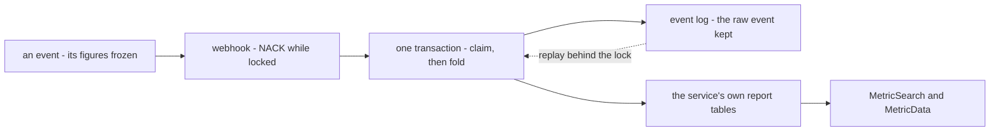
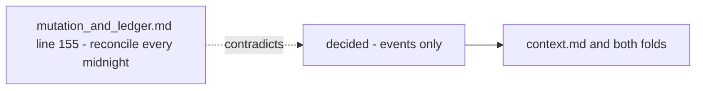
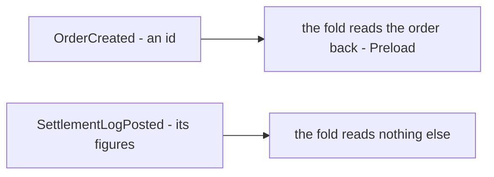
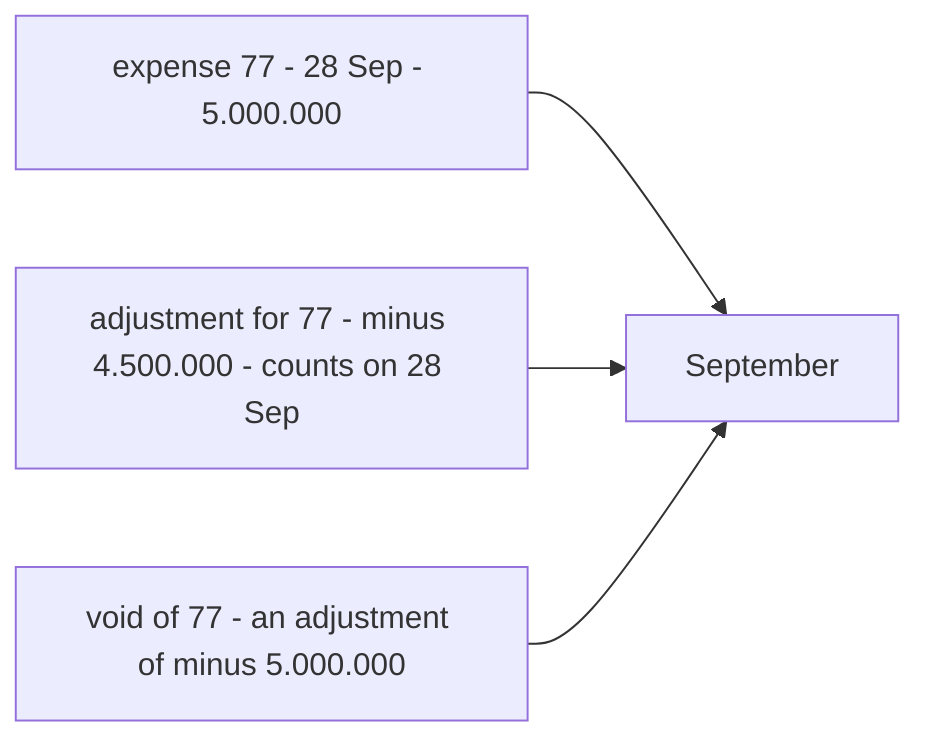

# Clarity — `analytic/context.md`

Critique, questions and warnings about [context.md](./context.md). That doc is yours — this one is
mine. Answered points are **deleted**, so this file is always the current open set.

> **Re-analysed 2026-10-28, against the code.** Since the last pass (2026-10-19) the pattern was **built twice** —
> settlement's report and supplier's figures — on the design you wrote in
> [settlement/analytic_context.md](../settlement/analytic_context.md), and [rpc_provide.md](./rpc_provide.md) decided how a
> metric reaches the screen. Most of this file was arguing a pipeline that now exists in a different shape, so **six of
> the seven questions and most critiques are closed** ([closed-this-pass](#closed-this-pass)), each with its evidence.
>
> **Open:** one question — the expense correction, decided and not built ([Question](#question)) · three contradictions ·
> five critiques.
>
> ✅ The diagrams parse (`npm run lint:mermaid`).

Siblings: [settlement/analytic_context.md](../settlement/analytic_context.md) — the pattern as built ·
[rpc_provide.md](./rpc_provide.md) — how a metric is served ·
[mutation_and_ledger](../../technical/ledger/mutation_and_ledger_clarify.md) ·
[event_architecture](../../technical/event_architecture/context_clarify.md).

## closed-this-pass

| was | closed | evidence |
| --- | --- | --- |
| **Q1** — accept my 14-rule contract | ✅ **overtaken** — you wrote your own, and both folds run it | [settlement/analytic_context.md](../settlement/analytic_context.md) §Idempotency Layer, §Flow, §How `AnalyticReplayCompute` works. How my rules score against it: [the-built-folds-against-the-contract](#the-built-folds-against-the-contract) |
| **Q3** — is a grain a table or a key · C15 | ✅ **answered per consumer**, two ways | settlement: a table per dimension (`shop_settlement_daily_reports`, `user_settlement_daily_reports`). Supplier: one finest-grain table (`supplier_product_daily_reports`), grouped when read. The read side no longer cares ([the-table-picks-one-group](./rpc_provide_decision.md#the-table-picks-one-group)) |
| **Q4** — a library or a service · C9 | ✅ **each service folds and serves its own**, the screen composes them — no analytic service | [the-pattern-replaces-the-shipped-analytics](./rpc_provide_decision.md#the-pattern-replaces-the-shipped-analytics). A figure computed from two services (a margin) is what your new rpc_provide §Composite Metric ? opens |
| **Q5** — which source first · C13 · the four-logs contradiction | ✅ **built** | `SettlementLogPosted` (settlement) and `RestockAccepted` (inventory → supplier). Under [events-only](./context_decision.md#a-report-is-fed-by-events-only-for-now) a fold reads events, not logs — and `stock_movements` is dropped ([00029](../../../backend/services/inventory_service/db_migrations/00029_drop_the_old_stock_tables.sql)) |
| **Q7** — the lag per report | ➡ **each report's own** ([reports-belong-to-the-consumer](./context_decision.md#reports-belong-to-the-consumer)) | what the pattern owes is a way to SEE the lag — [C8](#critique) |
| **Q8** — what this does that `revenue_service` did not | ✅ **answered by building it** | settlement's report is a fold from day one ([the-report-is-the-pipeline-from-day-one](../settlement/context_decision.md#the-report-is-the-pipeline-from-day-one)) |
| **C3** — a publish after commit can be lost | ✅ **accepted** — a lost event is repaired by hand | [a-report-is-fed-by-events-only-for-now](./context_decision.md#a-report-is-fed-by-events-only-for-now); `event_source.Redrive` re-publishes a dead-lettered message. Still true: [order_place.go](../../../backend/services/selling_service/selling_v1/order_place.go) publishes after its commit |
| **C4** — no rebuild path | ✅ **built** | settlement's `AnalyticReplayCompute` behind `process_event_lock`; supplier replays the same way, and backfilled its past accepts once |
| **C5** — push or pull | ✅ **push**, against my pull | both folds are webhooks |
| **C7** — the claim and the fold in one transaction | ✅ **built** | both folds: the lock, the `*_event_logs` claim and the fold in one transaction |
| **C16** — no consumer yet | ✅ **two** | above |
| **C17** — the pattern is not written down | ✅ **written** — in settlement's doc, not this one | which is now [the-pattern-is-written-in-settlement-not-here](#the-pattern-is-written-in-settlement-not-here) |
| C2 · C20 | merged — into [the reconcile contradiction](#the-reconcile-pass-exists-in-one-doc-and-has-no-box-in-the-other) and [C19](#critique) | |
| C6 — *"streaming"* names machinery we lack | dropped — naming only; both services call it a fold | |
| the sections behind them | removed: `fair-note-on-what-exists`, `the-report-table-this-repo-already-deleted`, `what-the-pattern-owes-an-implementer`, `single-source-is-the-services-own-cross-source-is-analytics`, `a-grain-is-a-key-a-measure-set-is-a-table`, `one-fact-three-audiences`, and `two-questions-need-the-pipeline` — a consumer-side list, [not this doc's](./context_decision.md#reports-belong-to-the-consumer) | |

⚠ These close by cross-reference to your other decisions and to the code, not by an answer given here. Reopen any you
disagree with.

---

# Contradiction

## the-pattern-is-written-in-settlement-not-here

`## Responsbility` says this doc **provides the pattern**. The pattern that runs is in
[settlement/analytic_context.md](../settlement/analytic_context.md), and supplier adopted it from there by name
([the-report-is-processed-like-settlement](../supplier/context_decision.md#the-report-is-processed-like-settlement)).
This doc still draws an earlier one:

| | `context.md` draws | what runs, in settlement and supplier |
| --- | --- | --- |
| dedup | an *Idempotency Layer* box | the event id claimed in `*_event_logs`, the raw event kept, inside the fold's transaction |
| delivery | push **and** pull | push only — a webhook that NACKs while `process_event_lock` is held |
| repair | nothing | a replay behind the lock (`AnalyticReplayCompute`) |
| report tables | one fold → a team, a shop and a supplier table | each service its own fold and its own tables |
| enrichment | *Preload If Needed* | none — both read only the event and their own report rows |
| serving | — | `MetricSearch` / `MetricData` ([rpc_provide.md](./rpc_provide.md)) |

**→ Recommend:** this doc points to settlement's §Idempotency Layer, §Flow and §How `AnalyticReplayCompute` works as
**the** pattern, or lifts them here, and drops the three tables and `Preload If Needed`. A pattern doc that draws a
different pipeline from the two that run is the one the next implementer copies.

## The reconcile pass exists in one doc and has no box in the other

You decided **events only** ([a-report-is-fed-by-events-only-for-now](./context_decision.md#a-report-is-fed-by-events-only-for-now)).
[mutation_and_ledger.md](../../technical/ledger/mutation_and_ledger.md) line 155 still says *"Statistic is streaming
and reconcile every midnight + 1 hour"*, inside a `# Statistic Design.` (line 151) that
[the-template-is-an-index](../../technical/ledger/mutation_and_ledger_decision.md#the-template-is-an-index) removed.

**→ Recommend:** delete that `# Statistic Design.` — it is yours — or reduce item 2 to *"streaming, a reconcile
later"*, so nobody builds on a reconcile that is not planned.

## The example event is thin, and the shipped event argues against thin

`## Event` shows `OrderCreated { order_id }`. Every event a fold reads carries its figures: `OrderPlaced` (revenue,
cost, every line), `SettlementLogPosted` (the change, team, shop, `posted_on`), `RestockAccepted` (each line's units and
price — [each-figure-is-read-at-the-accept](../supplier/context_decision.md#each-figure-is-read-at-the-accept)). Under
events-only **the event is the record**, so a thin one forces the fold to read the source back — the leak in
[C19](#critique).

**→ Recommend:** the example carries its figures, like the three that ship.

---

# Critique

| | Problem | → Recommend |
| --- | --- | --- |
| **8** | ⛔ **A stalled fold is invisible.** Neither fold records how far it has got, so a stuck subscription reads as a quiet day — and supplier's *"FOLDED, NOT LIVE"* lives only in a code comment. HARD RULE 10 makes freshness a correctness rule here. | Each fold keeps a **watermark** — the newest event folded, and when — and `MetricData` returns it, so the screen prints *"as of 14:05"*. And a fold never serves an operational number: a stock level stays a live read. |
| **19** | **`Preload If Needed` leaks across the boundary `### Why` draws** — and both built folds show it is not needed: they read only the event and their own rows. A fold that preloads live state gives a different answer on replay than it gave live (was C20). | Drop the box, or rename it *"read only what the event froze"*. |
| **18** | **`### Why` names a benefit, not the coupling** — [name-the-coupling-not-the-benefit](#name-the-coupling-not-the-benefit). | Name the **schema** coupling, and state the price beside it: the number lags ([C8](#critique)). |
| **11** | **One fact belongs to several teams.** An order is the selling team's and the warehouse's — and now concretely: Order Created filters by `team` **and** `warehouse` ([the-filters-gain-warehouse-and-user](./rpc_provide_decision.md#the-filters-gain-warehouse-and-user)). | Decide it with the order metric: one row carrying both team ids serves both filters. Which scope a warehouse caller reads by is that metric's question. |
| **10** | **A comparison with no axes** — *"Maybe `Toni` have another design to compare."* | Fix the axes before it arrives: replay, lag, redelivery and order, the ops surface, cost, how a definition change rolls out. |

## name-the-coupling-not-the-benefit

| the coupling | the symptom | the cheapest fix | needs this pattern? |
| --- | --- | --- | --- |
| **load** | a year-long report slows order placement | a read replica | ⛔ no |
| **availability** | analytics is down, so an order cannot be placed | an event, fire and forget | ✅ yes |
| **schema** | a report needs settlement + inventory + expense | ⛔ nothing else works — a service never reads another's tables (HARD RULE 3) | ✅ **yes — the strongest argument** |
| **lifecycle** | a report's definition change needs an operational deploy | a replayable fold | ⚠ partly — the replay buys it |

**→ My proposal for the section, in one line:** *a report across services cannot be a query, so it is folded from what
services publish, and an operational write never waits or fails because the fold is down.* The price is that the number
lags, so the screen says by how much ([C8](#critique)).

## log-is-the-source-broker-is-the-trigger

✅ **Closed.** It proposed reading the source log as the truth path; you chose events only
([a-report-is-fed-by-events-only-for-now](./context_decision.md#a-report-is-fed-by-events-only-for-now)), and both folds
repair by replay instead.

---

# Proposed Design

## the-built-folds-against-the-contract

My 14 rules (the closed Q1), scored against the two folds that run. **Your pattern holds;** two rules are missing from
it, and both are [C8](#critique).

| rule | settlement | supplier |
| --- | --- | --- |
| a bucket day that never moves | ✅ `posted_on` | ✅ `accepted_on` |
| an event id derived from the row | ✅ | ✅ |
| at most once per event | ✅ `settlement_event_logs` | ✅ `supplier_event_logs` |
| the claim and the fold in one transaction | ✅ | ✅ |
| order-independent | ✅ the change summed, and carried into every later day's balance | ✅ summed |
| reads nothing mutable | ✅ | ✅ |
| rebuild | ✅ a replay behind `process_event_lock` | ✅ a replay as settlement's, and a one-shot backfill |
| grain | a table per dimension — shop, user | one finest-grain table, grouped when read |
| ⛔ a watermark | none | none |
| ⛔ never serves an operational number | not stated | not stated |
| a truth path (`LogRead`) | parked — events only | parked |

⚠ Both folds share one more live gap, asked where it can be answered: a replay that dies holding `process_event_lock`
leaves it set ([settlement meta Q2](../settlement/meta_context_clarify.md#question)).

---

# Question

### what-a-void-and-a-reducing-adjustment-write

⛔ **The expense correction is decided and not built.** [an-expense-is-never-edited](./context_decision.md#an-expense-is-never-edited)
removes `ExpenseUpdate`; [expense_update.go:67](../../../backend/services/expense_service/expense_v1/expense_update.go)
still overwrites the amount, kind, shop and `occurred_at`, and `expense_service` publishes nothing. Two details are left
before it can be built:

| | → Recommend |
| --- | --- |
| does `ExpenseVoid` stay? | ✅ as a button, but it writes an **adjustment of minus the whole amount**, dated to the expense — one way to correct, not two. Today it stamps `voided_at` on the row, which is an edit |
| how is a reducing adjustment written, when an amount is always positive? | an adjustment carries a **signed** amount, never zero, and names the expense it corrects. An expense's own amount stays positive |

---

# Awaiting

- Nothing yet on how long the `*_event_logs` are kept, or what the folds cost to run.
