# How Analytic Provide to Frontend.


## Challenges.
1. Every pieces data live in different places.
2. We should have comparing, sort any piece datas.

## General.
There is 2 biggests kind of data in analytic.
1. Time Related Data Analytic:
    - daily
    - weekly
    - monthly
    - yearly

2. Group Related Data Analytic:
    - Team Grouped.
    - User Grouped.
    - Product Grouped.
    - Shop Grouped.
    - etc

## Basic Flow.
1. This is explain how we get metric data accross service. 
2. This scenario that just example for explaining the flow with mock / not real name metric and service.

For example, we have scenario like this:
1. We need load 2 metric data that live in 2 different service
2. `TeamStockMetric` that live inventory_service. It has `product_filter`, `supplier_filter`, and `daterange_filter` supported.
3. `TeamOrderMetric` that live order service. It has `product_filter`, `shop_filter`, and `daterange_filter` supported.
4. `TeamOrderMetric` has field `order_count` that can be sorted. And we load and sort by `order_count` and filter by product.

```mermaid

sequenceDiagram

participant user as User

box Frontend
    participant ui as UI
    participant met as Metric Api Provider

end

box Backend
    participant ord as Order Service
    participant inv as Inventory Service
end

user->>ui: Select 2 Metric Data that want to Display in ui Table/graph.

rect rgb(70, 36, 90)
    note right of ui: Update Filter View Step.
    ui->>+met: Get Supported Filter that can support all metric selected.
    met-->>-ui: Update Filter UI View. 
end

ui->>met: Request Load Data Metric. 

rect rgb(36, 63, 90)
    note right of met: Sorting and Filtering Step.
    met-->>met: check supported filter.
    met-->>met: find service that capable doing filter and sort.
    met->>+ord: Call MetricSearch and bring filter and sort.
    ord-->>-met: Return Sorted Keys.
end

rect rgb(90, 86, 36)
    note right of met: Get Metric Data Step.
    met->>+ord: Call MetricData and bring supported metric_ids lists.
    ord-->>-met: Return Data Metric of Order.
    met->>ui: load in ui.

    met->>+inv: Call MetricData and bring supported metric_ids lists.
    inv-->>-met: Return Data Metric of Inventory.
    met->>ui: load in ui.
end

user->>ui: User Updating filter, add new metric, remove metric and so on.

```





## Metric.
In analytic, we have piece data that called `metric`. For example:
- `OrderMetric`, read by day or by shop:
    - `order_created_count`
    - `order_cancel_count`

- `StockLostMetric`, read by day or by product:
    - `lost_count`
    - `lost_amount`

That's just a few example of piece metric. For more definition may be written in each other context folder in docs.
Every metric has `metric_id` that use to load data in rpc that we talk further.

## Proto Contracts.
1. We have analytic global option that live in `./proto/warehouse/analytic_base`
    ```proto

    enum SortType {
        SORT_TYPE_UNSPECIFIED
        SORT_TYPE_DESC
        SORT_TYPE_ASC
    }

    message MetricSort {
        string      metric_id
        string      field
        SortType    sort_type
    } 

    message DateRangeFilter {
        string date_min
        string date_max
    }

    message PaginationFilter {
        int32       offset
        int32       limit
    }

    // ... other metric that listed in `FilterType`

    message FilterItem {
        oneof f {
            DateRangeFilter date_range_filter
            // ... other filter that defined
        }
    }

    enum FilterType {
        FILTER_TYPE_UNSPECIFIED
        FILTER_TYPE_DATE_RANGE
        FILTER_TYPE_PRODUCT
        FILTER_TYPE_TEAM
        FILTER_TYPE_SHOP
        FILTER_TYPE_SUPPLIER
    }

    enum GroupType {
        GROUP_TYPE_UNSPECIFIED

        GROUP_TYPE_SUMMARY

        GROUP_TYPE_DAILY
        GROUP_TYPE_WEEKLY
        GROUP_TYPE_MONTHLY
        GROUP_TYPE_YEARLY

        GROUP_TYPE_PRODUCT
        GROUP_TYPE_SHOP
        GROUP_TYPE_SUPPLIER
        GROUP_TYPE_TEAM
        GROUP_TYPE_USER
    }

    message MetricOption {
        repeated FilterType     supported_filters
        repeated FilterType     required_filters
        repeated GroupType      supported_group_by
        string                  metric_id
    }

    extend google.protobuf.MessageOptions {
        MetricOption metric
    }

    message SortOption {
        bool    can_sort
        int64   rank_min_sample     // a rate: rows with a smaller sample follow, unranked. 0 = none
    }

    enum FieldStatType {
        FIELD_STAT_TYPE_UNSPECIFIED
        FIELD_STAT_TYPE_RATIO
        FIELD_STAT_TYPE_QTY
        FIELD_STAT_TYPE_CURRENCY
    }

    extend google.protobuf.FieldOptions {
        SortOption      metric_sort
        FieldStatType   field_stat_type
    }


    message IDList {
        repeated uint64     ids         // SHOP, PRODUCT, SUPPLIER, TEAM, USER and other
    }

    message DayList {
        repeated string     days        // DAILY ... YEARLY, each bucket's first day
    }

    message MetricKeys {
        oneof k {
            IDList          ids
            DayList         days
        }
    }

    ```

### Metric Contract.
**Every metric contract must follow this pattern**

```proto

// Example.
message OrderMetric {
    option (warehouse.analytic_base.v1.metric) = {
        supported_filters: [
            FILTER_TYPE_DATE_RANGE,
            FILTER_TYPE_SHOP,
            FILTER_TYPE_TEAM
        ],

        required_filters: [
            FILTER_TYPE_DATE_RANGE
        ],

        supported_group_by: [
            GROUP_TYPE_SUMMARY,
            GROUP_TYPE_DAILY,
            GROUP_TYPE_WEEKLY,
            GROUP_TYPE_MONTHLY,
            GROUP_TYPE_YEARLY,
            GROUP_TYPE_SHOP
        ],

        metric_id: "metrics/orders"
    }

    int64       order_count             [(warehouse.analytic_base.v1.metric_sort) = { can_sort: true }]
    double      order_total             [(warehouse.analytic_base.v1.metric_sort) = { can_sort: true }]
}

message OrderMetricByID {
    map<uint64, OrderMetric>    items   // SHOP, PRODUCT, SUPPLIER
}

message OrderMetricByDay {
    map<string, OrderMetric>    items   // DAILY ... YEARLY, "2026-10-01"
}


```
### Service RPC Contracts.
Search RPC contract Example.
```proto

service Service {
    rpc MetricSearch(MetricSearchRequest) returns (MetricSearchResponse);
    rpc MetricData(MetricDataRequest) returns (MetricDataResponse);

    // ... other rpc
}


message MetricSearchRequest {
    option (warehouse.role_base.v1.request_policy) = { roles: [ ... ] }

    uint64                  team_id         [(warehouse.role_base.v1.use_scope) = true]
    GroupType               group_by        // never SUMMARY, a summary is not searched
    repeated FilterItem     filters
    MetricSort              sort
    PaginationFilter        page
}


message MetricSearchResponse {
    MetricKeys              keys            // filtered and sorted, the key DESC on a tie
    bool                    has_next        // read limit + 1, no total
}

message MetricDataRequest {
    option (warehouse.role_base.v1.request_policy) = { roles: [ ... ] }

    uint64                  team_id         [(warehouse.role_base.v1.use_scope) = true]
    GroupType               group_by
    repeated FilterItem     filters         // the same as the search
    MetricKeys              keys            // none for SUMMARY
    repeated string         metric_ids
}

message MetricData {
    oneof m {
        OrderMetricByID     order_by_id
        OrderMetricByDay    order_by_day
        OrderMetric         order_summary

        //... the same three for every other metric
    }
}

message MetricDataResponse {
    repeated MetricData     metric_datas
}


```

# Analytic UI
1. we have table that can compose any metric.
2. we have graph that can compose any metric.
    graph is separate by `FieldStatType`. because no sense for comparing qty and price in same graph


## Example Use Case In UI Why i Structured like above.
1. We Can Compose Dynamicly table for easy comparing data in one table.
2. For example we need analitic shop. and first we select order metric. Its show like this:

    | Shop   | Order Count | Order Total |
    |:-------|:------:|------:|
    | Toko Maryam | 12 | 12.000.000 |
    | Toko Baru Segu | 10 | 1.000.000 |

3. And When another Metric supported, for example Settlement Metric selected, Its show like this:

    | Shop   | Order Count | Order Total | Settlement Amount | Profit |
    |:-------|:------:|------:|------:|------:|
    | Toko Maryam | 12 | 12.000.000 | 5.000.000 | 1.000.000 |
    | Toko Baru Segu | 10 | 1.000.000 | 800.000 | 500.000 |
    | Toko Satria | 30 | 400.000 | 300.000 | 20.000 |

4. Its okay we only can sort one field (no multiple sort like Order Count + Profit). And for example when order count is sorted descending, its like this:

    | Shop   | Order Count | Order Total | Settlement Amount | Profit |
    |:-------|:------:|------:|------:|------:|
    | Toko Satria | 30 | 400.000 | 300.000 | 20.000 |
    | Toko Maryam | 12 | 12.000.000 | 5.000.000 | 1.000.000 |
    | Toko Baru Segu | 10 | 1.000.000 | 800.000 | 500.000 |
    

4. above table header its not real usage implementation, its just example and explaining how ui work with metric.


## Metric That Exist in Analytic.
1. In Ui Metric Selected like nested category.


### Composite Metric ?