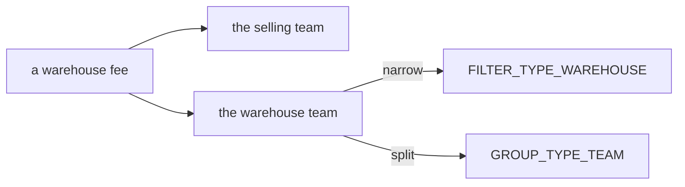
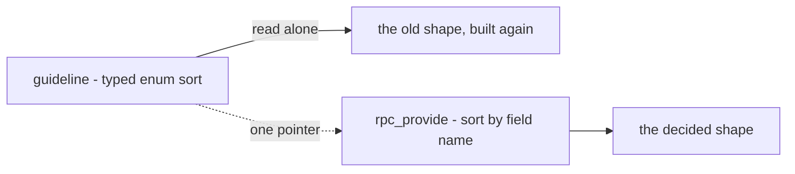
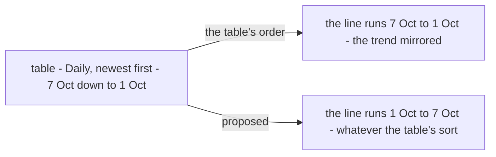
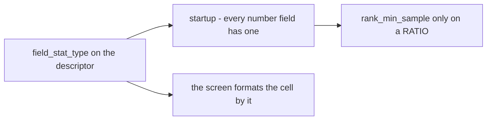
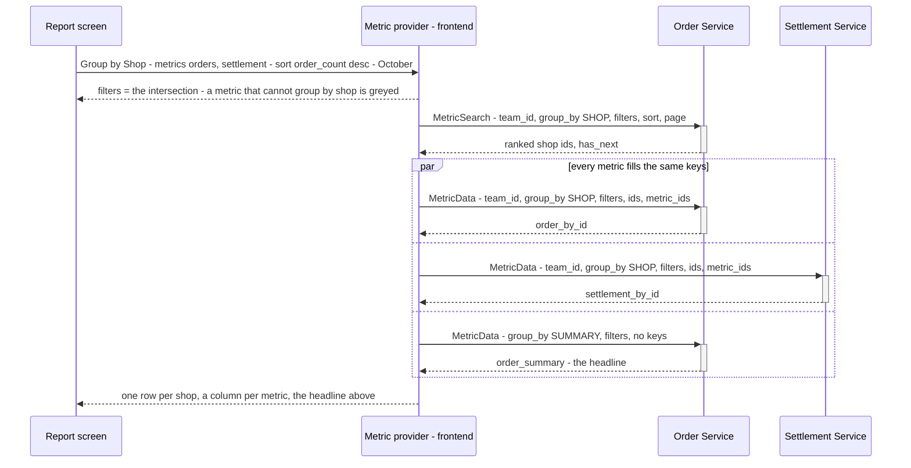

# Clarity — `analytic/rpc_provide.md`

Critique, questions and a proposed design for [rpc_provide.md](./rpc_provide.md). That doc is yours — this one is
mine. Answered points are **deleted**, so this file is always the current open set.

> **State (2026-10-28).** 45 decisions in [rpc_provide_decision.md](./rpc_provide_decision.md), two of them superseded.
> The latest: no warehouse group, because a warehouse is a team ([the-team-group-covers-warehouses](./rpc_provide_decision.md#the-team-group-covers-warehouses)),
> which leaves a tension with the warehouse filter ([Contradiction](#the-team-group-and-the-warehouse-filter-name-one-thing-twice)).
> Before it: the table and the graph are tabs ([the-table-and-the-graph-are-tabs](./rpc_provide_decision.md#the-table-and-the-graph-are-tabs)).
> The screen is accepted ([the-analytic-screen-is-accepted](./rpc_provide_decision.md#the-analytic-screen-is-accepted))
> and `metrics/suppliers` is built on the contract. Your §Analytic UI is decided as
> [the-graph-draws-the-table](./rpc_provide_decision.md#the-graph-draws-the-table): line charts, one per stat type, the
> columns as the legend. It gives the startup check a second reason ([a-stat-type-is-checked-at-startup](#a-stat-type-is-checked-at-startup)).
> **The graph is built** in Storybook on Chakra's charts, on sample figures. One detail of it is a proposal, built so
> you can see it: [a-time-graph-runs-oldest-first](#a-time-graph-runs-oldest-first).
> **No question is open.** Still waiting on you: [ads-moved-under-expense](#ads-moved-under-expense), the guideline's
> pointer, and the slips under [Contradiction](#contradiction). §Composite Metric ? is empty, so it isn't designed yet.
>
> ✅ The diagrams parse (`npm run lint:mermaid`).

Siblings: [context_clarify.md](./context_clarify.md) — the fold that fills the tables these RPCs read ·
[guidelines/service-guideline.md](../../../guidelines/service-guideline.md) — the List/Overview shapes this overlaps.

---

# Contradiction

✅ Resolved by your edits of 2026-10-27: the contract matched the decisions (twelve sites), and `GroupType` gained
`TEAM` and `USER` ([the-group-enum-grows-with-the-reports](./rpc_provide_decision.md#the-group-enum-grows-with-the-reports)).
`IDList`'s comment now reads *"SHOP, PRODUCT, SUPPLIER, TEAM, USER and other"* (line 191). Small slips left:

| line | says | → Recommend |
| --- | --- | --- |
| 126 | *"// ... other **metric** that listed in `FilterType`"* | *"other **filter**"* — it introduces the filter messages |
| 135–142 | `FilterType` has no `WAREHOUSE` or `USER` | add both ([the-filters-gain-warehouse-and-user](./rpc_provide_decision.md#the-filters-gain-warehouse-and-user)) |
| 242 | `OrderMetricByID` *"SHOP, PRODUCT, SUPPLIER"* | only the id groups its `supported_group_by` lists — in the example, `SHOP` alone |
| 308 | *"we have table that can compose **any** metric"* | *"any metric that can be grouped by the table's group"*: a metric that can't is greyed ([a-metric-that-cannot-group-is-greyed](./rpc_provide_decision.md#a-metric-that-cannot-group-is-greyed)) |
| 359, 369, 379 | `fiter :` | `filter :` |
| 389, 394 | `mp_total` in Order Created and Order Cancel | `created_mp_total`, `cancel_mp_total` — the returns already prefix theirs (`return_created_mp_total`) |

## the-team-group-and-the-warehouse-filter-name-one-thing-twice

| decision | says |
| --- | --- |
| [the-filters-gain-warehouse-and-user](./rpc_provide_decision.md#the-filters-gain-warehouse-and-user) | *"a warehouse fee has **both** a selling team and a warehouse, so `TEAM` cannot carry both"*, so the filter has its own `WAREHOUSE` |
| [the-team-group-covers-warehouses](./rpc_provide_decision.md#the-team-group-covers-warehouses) | the group has no `WAREHOUSE`, and `TEAM` carries the warehouse |

The example: a root caller groups warehouse fees by `TEAM`. Is a row a seller or a warehouse? And a seller narrows by
*Warehouse* but splits by *Team*, two names for the same thing on one screen.



**→ Recommend:** no contract change. Every metric that books two teams says in its doc which one its `TEAM` group
means (Warehouse Fee: the warehouse), and the screen labels that group by what it means (*Warehouse*), not *Team*.

## ads-moved-under-expense

The tree puts **Ads Expense inside Expense** and has no Ads category. The picker opens five: Order, Settlement,
Inventory, Ads, Expense ([order-opens-the-metric-picker-for-now](./rpc_provide_decision.md#order-opens-the-metric-picker-for-now)).

**→ Recommend:** the picker follows the tree, with four categories and Ads Expense inside Expense. It changes only the
sample catalogue (`features/analytic/catalogue.ts`) and one story. The contract is untouched.

## the-guideline-still-sorts-by-enum

[the-pattern-replaces-the-shipped-analytics](./rpc_provide_decision.md#the-pattern-replaces-the-shipped-analytics) made
this doc **the** analytic rule. [service-guideline.md](../../../guidelines/service-guideline.md) §Rule Exposing Data
Collection Overview still tells an analytic read to sort by a **typed enum** per data type; this doc sorts by a field
**name**. The next agent reading the guideline alone builds the old shape.

**→ Recommend:** one line in the guideline — *"analytics: see docs/business/analytic/rpc_provide.md"*. Yours to write;
I do not edit `guidelines/`.



---

# Critique

## a-time-graph-runs-oldest-first

[the-graph-draws-the-table](./rpc_provide_decision.md#the-graph-draws-the-table) puts the points *"in the table's
order"*. That was my spec, and it is wrong for time. A time table lists **newest first** by default (or ranked by a
figure), so a graph in that order draws the week right to left, and a rising week reads as a falling one.



**→ Recommend:** a time group is always drawn oldest first, and an id group keeps the table's order (its ranking). It's
built that way so you can look at it (story `ByDayGraphRunsOldestFirst`). If you say no, it's one line to change back.

## the-tree-is-the-catalogue-and-misses-three-things

Your §Metric That Exist in Analytic is the first real list of metrics, so the screen will be built from it.

| missing | why it matters | → Recommend |
| --- | --- | --- |
| the groups each metric reads by | the picker greys a metric by its groups ([a-metric-that-cannot-group-is-greyed](./rpc_provide_decision.md#a-metric-that-cannot-group-is-greyed)) | a `group :` list per entry, beside `filter :` |
| filters for Order Cancel, Order Return Created, Order Return Arrived | the screen shows the filters every chosen metric shares | list them, or write *"as Order Created"* |
| `metrics/suppliers`, already built | a metric missing from the tree is missing from the picker | under **Inventory › Restock** — restock value and broken rate, by supplier and by product |

## a-stat-type-is-checked-at-startup

Your `field_stat_type` ([a-field-declares-its-stat-type](./rpc_provide_decision.md#a-field-declares-its-stat-type)) is what
the screen needs to show a number — *Rp 1.200.000*, *1.200*, *4,8 %* — instead of guessing from its own copy. Since
§Analytic UI, it also decides **which graph panel** a field goes into. It is only dependable if nothing can leave it out.



| | → Recommend |
| --- | --- |
| a field without it | refused at startup by `san_metric.ValidateDescriptors`: `UNSPECIFIED` on a metric's number field fails the boot, so the screen never guesses |
| the graph | needs it too: an `UNSPECIFIED` field has no graph to go into ([the-graph-draws-the-table](./rpc_provide_decision.md#the-graph-draws-the-table)), so it's a second reader that must not guess |
| `rank_min_sample` | allowed only on a `RATIO` field — a minimum sample means nothing on a count or an amount ([a-rate-ranks-only-above-its-minimum-sample](./rpc_provide_decision.md#a-rate-ranks-only-above-its-minimum-sample)) |
| what it is NOT | a rule for summing. The screen formats by it and never adds up a column: the headline is the service's `SUMMARY`, so a ratio is worked out there from summed units ([the-headline-is-the-metric-grouped-by-summary](./rpc_provide_decision.md#the-headline-is-the-metric-grouped-by-summary)) |

---

# Proposed Design

## the-two-steps



| step | rule |
| --- | --- |
| the group | one per table, picked by the person; a metric without it is greyed in the picker ([a-metric-that-cannot-group-is-greyed](./rpc_provide_decision.md#a-metric-that-cannot-group-is-greyed)) |
| filters shown | the intersection of every metric's `supported_filters`, read off the generated descriptor with `getOption` — no call. ⚠ The `analytic_base` file must be **imported** in the frontend, or the option reads as absent |
| who ranks | the service owning `sort.metric_id`. A time group sorted by date needs **no** search — the provider lists the days itself, a quiet day included. `SUMMARY` needs none |
| who fills | every service owning an asked metric, **in parallel**, the same keys and filters |
| a missing key | never — a key with nothing in the window gets an all-zero body |
| a column that fails | shows its own error; the other columns stay |
| the state | the URL ([the-report-lives-in-the-url](./rpc_provide_decision.md#the-report-lives-in-the-url)) |
| where it lives | `frontend/src/features/analytic/`, plain TS with no React, so an export can reuse it |

## the-contract

The whole contract as decided — every line traced to a decision in
[rpc_provide_decision.md](./rpc_provide_decision.md).

```proto
// warehouse/analytic_base/v1 ─────────────────────────────────────────────────────────────

enum SortType {
  SORT_TYPE_UNSPECIFIED = 0;             // reads as DESC (the-key-breaks-every-tie)
  SORT_TYPE_DESC = 1;
  SORT_TYPE_ASC = 2;
}

message MetricSort {                     // one per table (one-sort-field-per-table)
  string metric_id = 1;
  string field = 2;                      // the field's proto name (a-sort-field-is-its-proto-name)
  SortType sort_type = 3;
}

message DateRangeFilter {                // a Jakarta day, YYYY-MM-DD, both inclusive (a-day-is-a-jakarta-date-string)
  string date_min = 1;
  string date_max = 2;
}

message PaginationFilter {               // on the request only (a-metric-page-has-no-total)
  int32 offset = 1;
  int32 limit = 2;
}

// One id each (a-filter-names-one-id-and-shares-its-types-number) — the screen narrows by one shop, one product.
message ProductFilter  { uint64 product_id = 1; }
message TeamFilter     { uint64 team_id = 1; }       // a dimension, never the caller's scope
message ShopFilter     { uint64 shop_id = 1; }
message SupplierFilter { uint64 supplier_id = 1; }
message WarehouseFilter { uint64 warehouse_id = 1; }  // the warehouse team (the-filters-gain-warehouse-and-user)
message UserFilter     { uint64 user_id = 1; }       // whom the fact is booked to

message FilterItem {                     // case N is FilterType N
  oneof f {
    DateRangeFilter date_range_filter = 1;
    // 2 reserved — the keyword (the-generic-keyword-is-removed)
    ProductFilter   product_filter = 3;
    TeamFilter      team_filter = 4;
    ShopFilter      shop_filter = 5;
    SupplierFilter  supplier_filter = 6;
    WarehouseFilter warehouse_filter = 7;
    UserFilter      user_filter = 8;
  }
}

enum FilterType {                        // no PAGINATION (a-page-is-not-a-filter)
  FILTER_TYPE_UNSPECIFIED = 0;
  FILTER_TYPE_DATE_RANGE = 1;
  reserved 2;                            // the keyword (the-generic-keyword-is-removed)
  FILTER_TYPE_PRODUCT = 3;
  FILTER_TYPE_TEAM = 4;                  // a dimension, never the caller's scope
  FILTER_TYPE_SHOP = 5;
  FILTER_TYPE_SUPPLIER = 6;
  FILTER_TYPE_WAREHOUSE = 7;             // added with the first metric that lists it
  FILTER_TYPE_USER = 8;
}

enum GroupType {                         // the table's (the-table-picks-one-group)
  GROUP_TYPE_UNSPECIFIED = 0;            // refused
  GROUP_TYPE_SUMMARY = 1;                // the headline (the-headline-is-the-metric-grouped-by-summary)
  GROUP_TYPE_DAILY = 2;
  GROUP_TYPE_WEEKLY = 3;                 // Monday to Sunday, Jakarta
  GROUP_TYPE_MONTHLY = 4;
  GROUP_TYPE_YEARLY = 5;
  GROUP_TYPE_PRODUCT = 6;
  GROUP_TYPE_SHOP = 7;
  GROUP_TYPE_SUPPLIER = 8;
  GROUP_TYPE_TEAM = 9;                   // across teams only for a root-team caller (the-group-enum-grows-with-the-reports)
  GROUP_TYPE_USER = 10;                  // the user the fact is booked to — each metric's doc says which
}

message MetricOption {
  repeated FilterType supported_filters = 1;
  repeated FilterType required_filters = 2;
  repeated GroupType supported_group_by = 3;
  string metric_id = 4;                  // a name, never a route; unique across services (a-metric-id-is-a-name-not-a-route)
}

extend google.protobuf.MessageOptions {
  MetricOption metric = …;
}

message SortOption {
  bool can_sort = 1;
  int64 rank_min_sample = 2;             // a rate (a-rate-ranks-only-above-its-minimum-sample); 0 = none
}

enum FieldStatType {                     // what kind of number (a-field-declares-its-stat-type)
  FIELD_STAT_TYPE_UNSPECIFIED = 0;       // refused at startup — proposed (a-stat-type-is-checked-at-startup)
  FIELD_STAT_TYPE_RATIO = 1;
  FIELD_STAT_TYPE_QTY = 2;
  FIELD_STAT_TYPE_CURRENCY = 3;
}

extend google.protobuf.FieldOptions {
  SortOption metric_sort = 50003;        // metric_key removed (the-key-lives-in-the-map)
  FieldStatType field_stat_type = 50004; // 50002 is role_base's use_scope
}

message IDList  { repeated uint64 ids = 1; }    // SHOP · PRODUCT · SUPPLIER · TEAM · USER — at most 200
message DayList { repeated string days = 1; }   // DAILY … YEARLY — each bucket's first day

message MetricKeys {
  oneof k {
    IDList ids = 1;
    DayList days = 2;
  }
}
```

```proto
// a metric — in its own service ──────────────────────────────────────────────────────────

message OrderMetric {
  option (warehouse.analytic_base.v1.metric) = {
    metric_id: "metrics/orders"
    supported_filters: [FILTER_TYPE_DATE_RANGE, FILTER_TYPE_SHOP, FILTER_TYPE_PRODUCT]
    required_filters: [FILTER_TYPE_DATE_RANGE]
    supported_group_by: [GROUP_TYPE_SUMMARY, GROUP_TYPE_DAILY, GROUP_TYPE_WEEKLY, GROUP_TYPE_MONTHLY,
                         GROUP_TYPE_YEARLY, GROUP_TYPE_SHOP, GROUP_TYPE_PRODUCT]
  };

  int64 order_count = 1 [
    (warehouse.analytic_base.v1.metric_sort) = { can_sort: true },
    (warehouse.analytic_base.v1.field_stat_type) = FIELD_STAT_TYPE_QTY
  ];
  double order_total = 2 [
    (warehouse.analytic_base.v1.metric_sort) = { can_sort: true },
    (warehouse.analytic_base.v1.field_stat_type) = FIELD_STAT_TYPE_CURRENCY
  ];
}

message OrderMetricByID  { map<uint64, OrderMetric> items = 1; }
message OrderMetricByDay { map<string, OrderMetric> items = 1; }
```

```proto
// the two RPCs — in each service ─────────────────────────────────────────────────────────

service OrderService {
  rpc MetricSearch(MetricSearchRequest) returns (MetricSearchResponse);
  rpc MetricData(MetricDataRequest) returns (MetricDataResponse);
}

message MetricSearchRequest {
  option (warehouse.role_base.v1.request_policy) = { roles: [/* who may read this service's metrics */] };
  uint64 team_id = 1 [(warehouse.role_base.v1.use_scope) = true];
  GroupType group_by = 2;                // never SUMMARY — a summary is not searched
  repeated FilterItem filters = 3;
  MetricSort sort = 4;
  PaginationFilter page = 5;             // required
}

message MetricSearchResponse {
  MetricKeys keys = 1;                   // ranked; the key DESC on a tie (the-key-breaks-every-tie)
  bool has_next = 2;                     // read limit + 1 — no total (a-page-says-whether-another-follows)
}

message MetricDataRequest {
  option (warehouse.role_base.v1.request_policy) = { roles: [/* the same as its MetricSearch */] };
  uint64 team_id = 1 [(warehouse.role_base.v1.use_scope) = true];
  GroupType group_by = 2;
  repeated FilterItem filters = 3;       // the same as the search — scopes the numbers, never the keys
  MetricKeys keys = 4;                   // at most a page; none for SUMMARY
  repeated string metric_ids = 5;
}

message MetricData {                     // one per asked metric (one-call-answers-every-asked-metric)
  oneof m {
    OrderMetricByID  order_by_id = 1;
    OrderMetricByDay order_by_day = 2;
    OrderMetric      order_summary = 3;
    // … the same three for every metric the service owns
  }
}

message MetricDataResponse {
  repeated MetricData metric_datas = 1;
}
```

---

# Question

Every question is closed, each one in [rpc_provide_decision.md](./rpc_provide_decision.md). The last was
a-report-can-group-by-warehouse, now [the-team-group-covers-warehouses](./rpc_provide_decision.md#the-team-group-covers-warehouses).

✅ **No question is open.**
