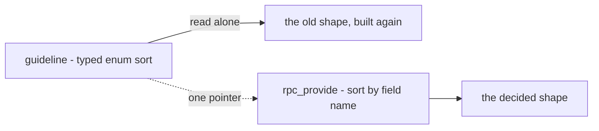
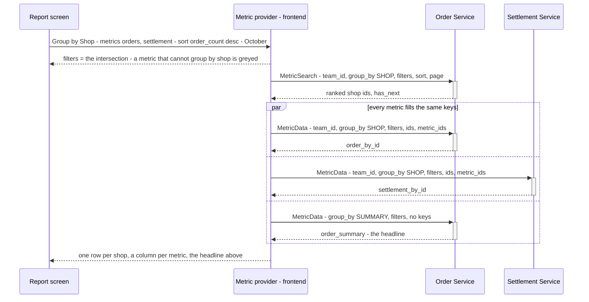

# Clarity — `analytic/rpc_provide.md`

Critique, questions and a proposed design for [rpc_provide.md](./rpc_provide.md). That doc is yours — this one is
mine. Answered points are **deleted**, so this file is always the current open set.

> **State (2026-10-27).** 32 decisions in [rpc_provide_decision.md](./rpc_provide_decision.md), two of them superseded.
> Your doc's contract matches them, `TEAM` and `USER` included. Open: only the guideline's pointer here. Three
> screen details wait for the screen pass.
>
> ✏️ My early examples used *stock lost per shop*, which cannot exist; they now use your shop + settlement table, or a
> product table.
>
> ✅ The diagrams parse (`npm run lint:mermaid`).

Siblings: [context_clarify.md](./context_clarify.md) — the fold that fills the tables these RPCs read ·
[guidelines/service-guideline.md](../../../guidelines/service-guideline.md) — the List/Overview shapes this overlaps.

---

# Contradiction

✅ Resolved by your edits of 2026-10-27: the contract matched the decisions (twelve sites), and `GroupType` gained
`TEAM` and `USER` ([the-group-enum-grows-with-the-reports](./rpc_provide_decision.md#the-group-enum-grows-with-the-reports)).
`IDList`'s comment now reads *"SHOP, PRODUCT, SUPPLIER, TEAM, USER and other"* (line 184). One comment trails it:
`OrderMetricByID` (line 235) still says *"SHOP, PRODUCT, SUPPLIER"* — for this metric it is only the id groups its
`supported_group_by` lists, which in the example is `SHOP` alone.

## the-guideline-still-sorts-by-enum

[the-pattern-replaces-the-shipped-analytics](./rpc_provide_decision.md#the-pattern-replaces-the-shipped-analytics) made
this doc **the** analytic rule. [service-guideline.md](../../../guidelines/service-guideline.md) §Rule Exposing Data
Collection Overview still tells an analytic read to sort by a **typed enum** per data type; this doc sorts by a field
**name**. The next agent reading the guideline alone builds the old shape.

**→ Recommend:** one line in the guideline — *"analytics: see docs/business/analytic/rpc_provide.md"*. Yours to write;
I do not edit `guidelines/`.



---

# Critique

✅ **No critique is open** — the last, the body's key, is
[the-key-lives-in-the-map](./rpc_provide_decision.md#the-key-lives-in-the-map).

---

# Proposed Design

## the-two-steps



| step | rule |
| --- | --- |
| the group | one per table, picked by the person; a metric without it is greyed in the picker ([a-metric-that-cannot-group-is-greyed](./rpc_provide_decision.md#a-metric-that-cannot-group-is-greyed)) |
| filters shown | the intersection of every metric's `supported_filters`, read off the generated descriptor with `getOption` — no call. ⚠ The `analytic_base` file must be **imported** in the frontend, or the option reads as absent |
| who ranks | the service owning `sort.metric_id`. A time group sorted by date needs **no** search — the provider lists the days itself, a quiet day included. `SUMMARY` needs none |
| who fills | every service owning an asked metric, **in parallel**, the same keys and filters |
| a missing key | never — a key with nothing in the window gets an all-zero body |
| a column that fails | shows its own error; the other columns stay |
| the state | the URL ([the-report-lives-in-the-url](./rpc_provide_decision.md#the-report-lives-in-the-url)) |
| where it lives | `frontend/src/features/analytic/`, plain TS with no React, so an export can reuse it |

## the-contract

The whole contract as decided — every line traced to a decision in
[rpc_provide_decision.md](./rpc_provide_decision.md).

```proto
// warehouse/analytic_base/v1 ─────────────────────────────────────────────────────────────

enum SortType {
  SORT_TYPE_UNSPECIFIED = 0;             // reads as DESC (the-key-breaks-every-tie)
  SORT_TYPE_DESC = 1;
  SORT_TYPE_ASC = 2;
}

message MetricSort {                     // one per table (one-sort-field-per-table)
  string metric_id = 1;
  string field = 2;                      // the field's proto name (a-sort-field-is-its-proto-name)
  SortType sort_type = 3;
}

message DateRangeFilter {                // a Jakarta day, YYYY-MM-DD, both inclusive (a-day-is-a-jakarta-date-string)
  string date_min = 1;
  string date_max = 2;
}

message PaginationFilter {               // on the request only (a-metric-page-has-no-total)
  int32 offset = 1;
  int32 limit = 2;
}

message FilterItem {
  oneof f {
    DateRangeFilter date_range_filter = 1;
    // … one case per FilterType
  }
}

enum FilterType {                        // no PAGINATION (a-page-is-not-a-filter)
  FILTER_TYPE_UNSPECIFIED = 0;
  FILTER_TYPE_DATE_RANGE = 1;
  FILTER_TYPE_KEYWORD = 2;
  FILTER_TYPE_PRODUCT = 3;
  FILTER_TYPE_TEAM = 4;                  // a dimension, never the caller's scope
  FILTER_TYPE_SHOP = 5;
  FILTER_TYPE_SUPPLIER = 6;
}

enum GroupType {                         // the table's (the-table-picks-one-group)
  GROUP_TYPE_UNSPECIFIED = 0;            // refused
  GROUP_TYPE_SUMMARY = 1;                // the headline (the-headline-is-the-metric-grouped-by-summary)
  GROUP_TYPE_DAILY = 2;
  GROUP_TYPE_WEEKLY = 3;                 // Monday to Sunday, Jakarta
  GROUP_TYPE_MONTHLY = 4;
  GROUP_TYPE_YEARLY = 5;
  GROUP_TYPE_PRODUCT = 6;
  GROUP_TYPE_SHOP = 7;
  GROUP_TYPE_SUPPLIER = 8;
}

message MetricOption {
  repeated FilterType supported_filters = 1;
  repeated FilterType required_filters = 2;
  repeated GroupType supported_group_by = 3;
  string metric_id = 4;                  // a name, never a route; unique across services (a-metric-id-is-a-name-not-a-route)
}

extend google.protobuf.MessageOptions {
  MetricOption metric = …;
}

message SortOption {
  bool can_sort = 1;
  int64 rank_min_sample = 2;             // a rate (a-rate-ranks-only-above-its-minimum-sample); 0 = none
}

extend google.protobuf.FieldOptions {
  SortOption metric_sort = …;            // metric_key removed (the-key-lives-in-the-map)
}

message IDList  { repeated uint64 ids = 1; }    // SHOP · PRODUCT · SUPPLIER
message DayList { repeated string days = 1; }   // DAILY … YEARLY — each bucket's first day

message MetricKeys {
  oneof k {
    IDList ids = 1;
    DayList days = 2;
  }
}
```

```proto
// a metric — in its own service ──────────────────────────────────────────────────────────

message OrderMetric {
  option (warehouse.analytic_base.v1.metric) = {
    metric_id: "metrics/orders"
    supported_filters: [FILTER_TYPE_DATE_RANGE, FILTER_TYPE_SHOP, FILTER_TYPE_PRODUCT]
    required_filters: [FILTER_TYPE_DATE_RANGE]
    supported_group_by: [GROUP_TYPE_SUMMARY, GROUP_TYPE_DAILY, GROUP_TYPE_WEEKLY, GROUP_TYPE_MONTHLY,
                         GROUP_TYPE_YEARLY, GROUP_TYPE_SHOP, GROUP_TYPE_PRODUCT]
  };

  int64  order_count = 1 [(warehouse.analytic_base.v1.metric_sort) = { can_sort: true }];
  double order_total = 2 [(warehouse.analytic_base.v1.metric_sort) = { can_sort: true }];
}

message OrderMetricByID  { map<uint64, OrderMetric> items = 1; }
message OrderMetricByDay { map<string, OrderMetric> items = 1; }
```

```proto
// the two RPCs — in each service ─────────────────────────────────────────────────────────

service OrderService {
  rpc MetricSearch(MetricSearchRequest) returns (MetricSearchResponse);
  rpc MetricData(MetricDataRequest) returns (MetricDataResponse);
}

message MetricSearchRequest {
  option (warehouse.role_base.v1.request_policy) = { roles: [/* who may read this service's metrics */] };
  uint64 team_id = 1 [(warehouse.role_base.v1.use_scope) = true];
  GroupType group_by = 2;                // never SUMMARY — a summary is not searched
  repeated FilterItem filters = 3;
  MetricSort sort = 4;
  PaginationFilter page = 5;             // required
}

message MetricSearchResponse {
  MetricKeys keys = 1;                   // ranked; the key DESC on a tie (the-key-breaks-every-tie)
  bool has_next = 2;                     // read limit + 1 — no total (a-page-says-whether-another-follows)
}

message MetricDataRequest {
  option (warehouse.role_base.v1.request_policy) = { roles: [/* the same as its MetricSearch */] };
  uint64 team_id = 1 [(warehouse.role_base.v1.use_scope) = true];
  GroupType group_by = 2;
  repeated FilterItem filters = 3;       // the same as the search — scopes the numbers, never the keys
  MetricKeys keys = 4;                   // at most a page; none for SUMMARY
  repeated string metric_ids = 5;
}

message MetricData {                     // one per asked metric (one-call-answers-every-asked-metric)
  oneof m {
    OrderMetricByID  order_by_id = 1;
    OrderMetricByDay order_by_day = 2;
    OrderMetric      order_summary = 3;
    // … the same three for every metric the service owns
  }
}

message MetricDataResponse {
  repeated MetricData metric_datas = 1;
}
```

---

# Question

✅ **No question is open** — Q10 is [the-group-enum-grows-with-the-reports](./rpc_provide_decision.md#the-group-enum-grows-with-the-reports).

⏸ **Deferred to the screen pass:** the rows line, the group change removing columns, the 5-line chart cap
([screen-details-wait-for-the-screen](./rpc_provide_decision.md#screen-details-wait-for-the-screen)). ✅ Every metric has a
summary ([every-metric-has-a-summary](./rpc_provide_decision.md#every-metric-has-a-summary)).
