# Decisions — `analytic/rpc_provide.md`

What the owner decided about [rpc_provide.md](./rpc_provide.md), with the reasoning that produced it.
**Append-only** — a decision is added here before it is acted on, and it is never edited away.
The open set lives in [rpc_provide_clarify.md](./rpc_provide_clarify.md).

> ✏️ **Examples corrected (2026-10-26, owner-approved).** The early entries illustrated with *stock lost per shop*, which
> cannot exist — stock is lost in the warehouse, and a shop is a marketplace storefront. Their diagrams now use a
> **product** table (orders per product, stock lost per product — the shop filter is the one stock lost cannot use).
> No verdict changed. Quoted questions are left as they were asked.

---

## a-metric-rpc-is-guarded-like-every-rpc

> Owner, in chat (2026-10-26): *"role defined like other rpc in request payload"* — to
> [Q1](./rpc_provide_clarify.md#question), *"who may read a metric?"*. Against my recommendation (`roles` per metric
> in `MetricOption`, with one shared gate).

**The verdict.** `MetricSearch` and `MetricData` are guarded like every other RPC: a `request_policy` on the request
message and a top-level `team_id [use_scope]`. A metric carries **no roles of its own**. Whoever may call a service's
metric RPC may read every metric it serves, for the team they are scoped to.

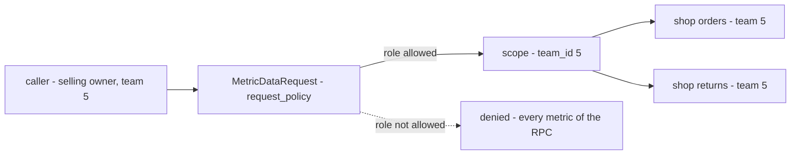

**The spec.**

| | |
| --- | --- |
| who may call | the request message's `request_policy`, read by the access interceptor — one place for the whole ACL, as everywhere else |
| which team's numbers | the top-level `team_id`, `use_scope` — ROOT/ADMINISTRATOR in team 1 see every team's |
| `MetricOption` | `metric_id`, `supported_filters`, `required_filters` — **no** `roles` |
| why I give way | the scope already narrows every metric to the caller's own team, so the shared role list only matters for a metric that some roles **of the same team** must not see |
| still open | that one case — [a-metric-some-roles-must-not-see](./rpc_provide_clarify.md#question), [Q1](./rpc_provide_clarify.md#question) |

---

## every-member-reads-every-metric-of-their-team

> Owner, in chat (2026-10-26): *"for now, cs can view all metric inside that team joined. it for transparency"* — to
> [Q1](./rpc_provide_clarify.md#question), *"does a metric some roles of a team must not see get its own RPC pair?"*.
> Against my recommendation (its own pair, with a narrower policy).

**The verdict.** For now, every member of a team — the CS included — reads **every** metric of that team. There is no
metric hidden from one role inside a team, so no service needs a second metric RPC pair for it. The reason is
**transparency**: the people who run the shops see the same numbers as the people who own them.

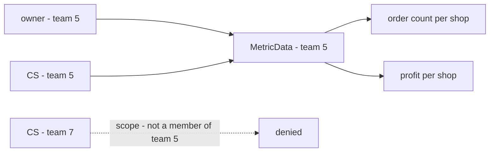

**The spec.**

| | |
| --- | --- |
| inside a team | every role the RPC's `request_policy` allows reads every metric that RPC serves — no metric is narrower |
| across teams | unchanged — the `team_id` scope keeps a caller to the teams they joined ([a-metric-rpc-is-guarded-like-every-rpc](#a-metric-rpc-is-guarded-like-every-rpc)) |
| a service's metric RPCs | one `MetricSearch` / `MetricData` pair per service |
| *"for now"* | a metric that must be hidden from a role later gets its own pair with the narrower policy — an added RPC, no change to the others |

---

## a-new-metric-removes-the-filters-it-cannot-use

> Owner, in chat (2026-10-26): *"add stock lost, and remove shop filter"* — to [Q2](./rpc_provide_clarify.md#question),
> *"a metric that cannot honour a filter the person set: drop the filter, or keep it and show that column as `—`?"*.
> As drawn in [rpc_provide.md](./rpc_provide.md), against my recommendation (keep the filter, dash the column).

**The verdict.** The filter bar is the **intersection** of what every selected metric supports, as the doc draws it.
Adding a metric that cannot use a filter the person set **removes that filter**, and every column is reloaded without
it — so every number on screen always answers the same question.

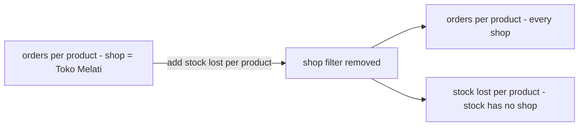

**The spec.**

| | |
| --- | --- |
| the filters shown | the intersection of every selected metric's `supported_filters` |
| a filter set and then unsupported | removed when the metric is added, and every column reloads |
| a required filter | the union of every selected metric's `required_filters` — the table does not load without them |
| the notice | proposed, not decided: a toast names the filter removed and the metric that removed it — *"Shop filter removed: stock lost cannot filter by shop"* |
| removing the metric again | does not bring the filter back — the person sets it again |

---

## the-pattern-replaces-the-shipped-analytics

> Owner, in chat (2026-10-26): *"yes, its more robust right ?"* — to [Q3](./rpc_provide_clarify.md#question), *"does
> this pattern replace the three shipped analytic contracts?"*. As recommended.

**The verdict.** `MetricSearch` / `MetricData` **replace** the analytic reads already shipped in settlement, supplier
and financial account. Supplier moves first, as the proof; the other two follow. A service never keeps both shapes —
its old reads are removed in the same change that moves its screen.

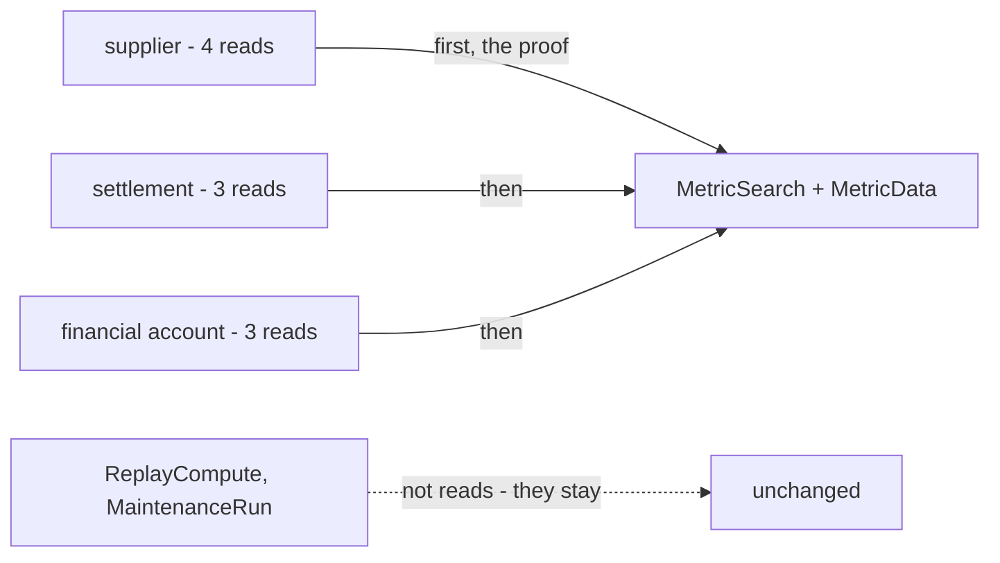

**The spec.**

| | |
| --- | --- |
| replaced | `AnalyticTimeSearch`, `AnalyticGroupSearch`, `AnalyticGroupMetric` in all three, and supplier's `AnalyticProductSearch` |
| kept | `AnalyticReplayCompute` and `AnalyticMaintenanceRun` — they repair the fold, they do not read it |
| the order | supplier → settlement → financial account |
| one shape per service | the old reads go in the same change that moves the screen — never two paths to one number |
| each report's own rules | carried over, never dropped in the move — see [a-rate-needs-a-minimum-sample](#a-rate-ranks-only-above-its-minimum-sample) |
| the guideline | [service-guideline.md](../../../guidelines/service-guideline.md) is the owner's: a pointer from it to this doc is theirs to add |

**Is it more robust?** As a system, yes: one provider, one rule for ties, totals, pages and missing keys, and a table
can mix services, which no shipped report can. It is weaker in **one** place unless guarded: a metric id or a sort
field is a string, so a typo fails at run time instead of at build. The guard is to never type one by hand — the
frontend reads both off the generated schema, and the server refuses an unknown one by reflection.

✅ Built 2026-11-05 — financial account, the last of the three: `AnalyticTimeSearch` / `AnalyticGroupSearch` / `AnalyticGroupMetric` removed with their callers, tests and docs; the Financial Account Report moved onto `MetricSearch` / `MetricData`.

---

## the-fill-step-scopes-its-numbers-by-the-filters

> Owner (2026-10-26), in [rpc_provide.md](./rpc_provide.md) `### Service RPC Contracts.` — `MetricDataRequest` gained
> `repeated FilterItem filters` — and in chat, to *"does step 2 take the date range and product, only to scope the
> numbers?"*: *"yes"*. As recommended.

**The verdict.** The filters do two jobs. **Choosing the rows** is step 1's alone — `MetricData` never adds or drops a
key. **Scoping the numbers** is both steps' — `MetricData` takes the same filters `MetricSearch` used, and fills each
key under them.

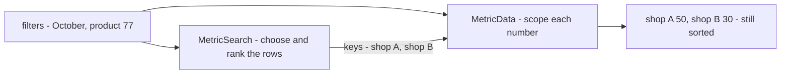

**The spec.**

| | |
| --- | --- |
| `MetricDataRequest.filters` | the **same** list `MetricSearch` was sent — the provider passes it on unchanged |
| a key in step 2 | answered whatever its numbers — never dropped, never added; a key with nothing gets an all-zero metric |
| why | without it, step 1 ranks by product 77 in October and step 2 fills every product, every month — the table reads unsorted |

---

## the-rows-are-the-keys-step-one-sends

> Owner, in chat (2026-10-26): *"depend that key list sended, is C included, its showed"* — to
> [Q4](./rpc_provide_clarify.md#question), *"when sorted by orders, is it OK that shop C — 0 orders, 3 lost — doesn't
> show?"*.

**The verdict.** A table's rows are **exactly** the keys `MetricSearch` returns. If the ranking service sends shop C,
C is shown; if it does not, C is not. No other service adds a row.

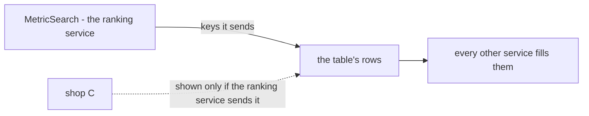

**The spec.**

| | |
| --- | --- |
| the rows | the keys step 1 returned, in its order — nothing else |
| a key with zero | the ranking service's choice: one that knows every shop of the team may send a shop with 0 orders, and it shows |
| a ratio across two services | cannot be sorted — it follows, since one service ranks and no single service holds both numbers (*sold ÷ in stock*) |
| a label on screen | proposed, not decided: *"rows: shops with orders"* when the ranking service sends only keys it has figures for |

---

## one-call-answers-every-asked-metric

> Owner (2026-10-26), in [rpc_provide.md](./rpc_provide.md) `### Service RPC Contracts.` — `MetricDataResponse` became
> `repeated MetricData metric_datas`, each a `oneof m`. Resolves the contradiction
> [one-metric-out-many-asked](#one-call-answers-every-asked-metric), as first recommended.

**The verdict.** One `MetricData` call answers **every** metric it was asked for: the response is a list, one item per
asked `metrics_ids` entry, and each item is a `oneof` holding that one metric's map.

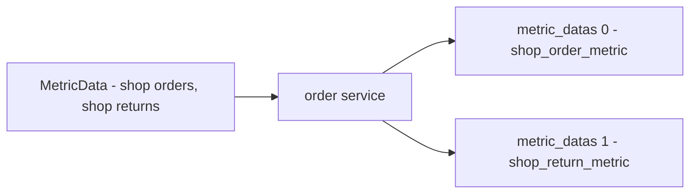

**The spec.**

| | |
| --- | --- |
| `MetricDataResponse` | `repeated MetricData metric_datas` |
| `MetricData` | `oneof m { ShopOrderMetricMap shop_order_metric · … one case per metric the service owns }` |
| one item per asked metric | never fewer — a metric with nothing in the window is still an item, every key at zero |
| the provider | matches an item to its metric by the `oneof` case's message type and its `metric_id` option — never by position |

---

## a-week-is-monday-to-sunday-jakarta

> Owner, in chat (2026-10-26): *"ok"* — to [Q5](./rpc_provide_clarify.md#question), *"a week: Monday to Sunday,
> Jakarta?"*. As recommended.

**The verdict.** A weekly bucket is the **ISO week**: Monday 00:00 to Sunday 23:59, Jakarta time. Its key is the
Monday's date. A week that crosses a month end belongs to **no** month — so weekly figures are never summed into a
monthly one; a month is read from its own days.

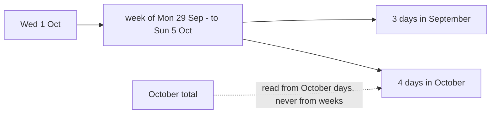

**The spec.**

| | |
| --- | --- |
| a week | Monday to Sunday, Jakarta |
| its key | the Monday, `YYYY-MM-DD` — the bucket's first day, as daily, monthly and yearly already are |
| a week across two months | one bucket, whole — never split |
| a month's total | summed from its days, never from its weeks |
| a range starting mid-week | the first bucket is that week, holding only the days inside the range |

---

## a-metric-has-one-key

> Owner, in chat (2026-10-26): *"there is no metric keyed like that, for that case we have shop grouped metric that can
> filter by daterange and daily metric that can filter by date range and shop"* — to
> [Q6](./rpc_provide_clarify.md#question), *"one line per shop on a chart — shop × day in this pattern?"*. As
> recommended, and sharper: not *later*, but *never needed*.

**The verdict.** Every metric is keyed by **one** thing — a group id or a day. There is no shop × day metric. A chart
with one line per shop is two metrics the pattern already has: a **shop-grouped** metric ranks the shops over the date
range, and a **daily** metric filtered by date range **and one shop** draws each line.

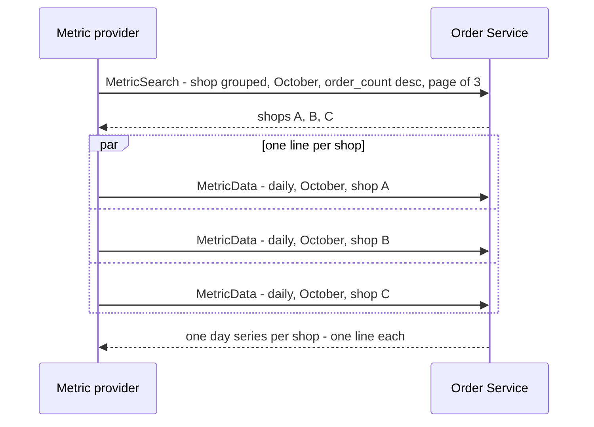

**The spec.**

| | |
| --- | --- |
| a metric's key | one — a group id (`IdList`) or a day (`DayList`), never both |
| a line per shop | a daily metric with `FILTER_TYPE_SHOP` set to that **one** shop — one call per line, in parallel |
| several shops in one shop filter | one line: their days summed — not a line each |
| which shops | the shop-grouped metric's `MetricSearch`, so the lines are the top shops of the same window |
| a cap on lines | proposed, not decided: 5 per chart, so a chart is never more than 6 calls |

---

## a-page-is-not-a-filter

> Owner (2026-10-26), in chat — *"for pagination, yes"* — and in [rpc_provide.md](./rpc_provide.md):
> `FILTER_TYPE_PAGINATION` removed from `FilterType`, and `PaginationFilter pagination` added to `MetricSearchResponse`.
> As recommended for the filter; where the page sits is still open
> ([the-page-is-on-the-response](#a-page-is-not-a-filter)).

**The verdict.** Paging is **not** a filter. A metric does not declare it, so adding a metric can never switch paging
off — every `MetricSearch` pages, always (HARD RULE 9).

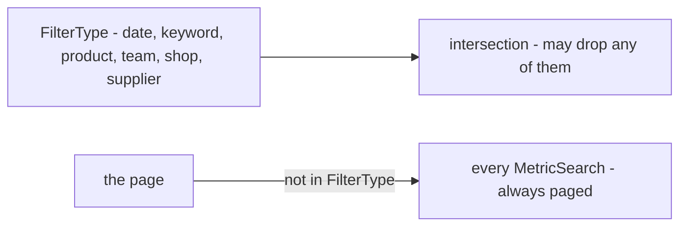

**The spec.**

| | |
| --- | --- |
| `FilterType` | no `FILTER_TYPE_PAGINATION` |
| a metric's `supported_filters` | never lists paging |
| `MetricSearch` | always pages — the intersection cannot remove it |
| `MetricData` | does not page — it fills the keys of one page, so it is capped at a page's size |

---

## compare-in-another-tab-for-now

> Owner, in chat (2026-10-26): *"defer A / B view. for now its simply user can open different tab for compex
> comparing"* — to [Q7](./rpc_provide_clarify.md#question), *"A / B compare: what may differ between A and B?"*.

**The verdict.** There is **no A / B view** for now. To compare, the person opens the report in a second browser tab
with other filters and reads the two side by side. The pattern needs nothing for it: each tab is an ordinary table.

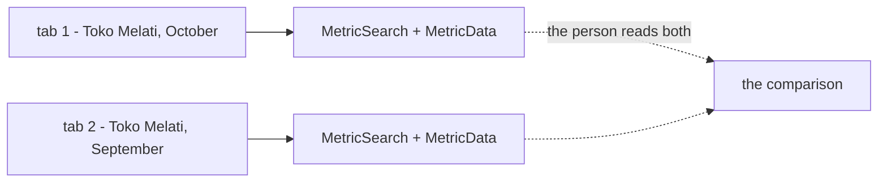

**The spec.**

| | |
| --- | --- |
| an A / B view | ⏸ deferred — (a) any filters, (b) one filter split, (c) the period only stay unchosen |
| comparing today | a second tab, same report, other filters |
| what the pattern needs | nothing — no compare key, no second filter set in a request |
| the report's state | proposed, not decided: metrics, filters, sort and page live in the **URL**, so *open in new tab* starts from the same table and only the filter to compare needs changing |

---

## superseded-a-headline-is-its-own-summary-metric

> ⛔ **Superseded 2026-10-27** by [the-headline-is-the-metric-grouped-by-summary](#the-headline-is-the-metric-grouped-by-summary)
> — the headline is the same metric read with `GROUP_TYPE_SUMMARY`, not a metric of its own.

> Owner, in chat (2026-10-26): *"No, we have different metric, like OrderSummaryMetric that can filtering to"* — to the
> critique [no-headline](./rpc_provide_clarify.md#critique), *"a `total` case on the keys, so the fill step answers one
> row for the whole filter?"*. Against my recommendation.

**The verdict.** A report's headline is **its own metric** — `OrderSummaryMetric` — with filters like any other. It
has **no key**: it answers one row for everything the filters cover. The keys stay ids or days; there is no `total`
case.

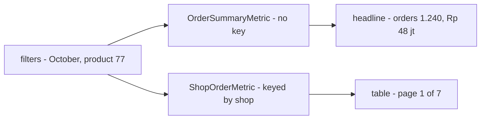

**The spec.**

| | |
| --- | --- |
| a summary metric | a metric message with **no** `metric_key` field, its own `metric_id` (e.g. `metrics/orders/summary`) and its own `supported_filters` |
| how it is read | `MetricData` with the filters and **no keys** — the provider never calls `MetricSearch` for it |
| its answer | one message, not a map — `MetricData.m` holds `OrderSummaryMetric` itself |
| the shipped `total` fields | become summary metrics when each service moves ([the-pattern-replaces-the-shipped-analytics](#the-pattern-replaces-the-shipped-analytics)) |
| the headline and the table agree | proposed, not decided: a summary metric is summed from the **same** report table, under the same filters, as its grouped twin — so the headline is always the sum of every row, every page |

---

## a-day-is-a-jakarta-date-string

> Owner, in chat (2026-10-26): *"use `message DateRangeFilter { string start_date; string end_date }` like your
> recomendation"* — to the critique [a-day-not-a-timestamp](./rpc_provide_clarify.md#critique), after weighing
> `google.type.Date`. As recommended.

**The verdict.** A date range is two **Jakarta calendar days**, written `YYYY-MM-DD`, both inclusive. Never a
`Timestamp` — the report tables hold one row per Jakarta day, so a range that starts mid-day cannot be answered, and a
browser in another timezone would shift the day. A string, not `google.type.Date`, because a Time table's key is the
same day and a proto map cannot be keyed by a message: one shape for a day, everywhere.

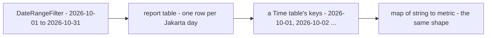

**The spec.**

```proto
message DateRangeFilter {
    string start_date = 1;   // "2026-10-01" — a Jakarta day, inclusive
    string end_date   = 2;   // "2026-10-31" — inclusive
}
```

| | |
| --- | --- |
| the format | `^[0-9]{4}-[0-9]{2}-[0-9]{2}$`, by protovalidate — as the shipped `AnalyticDateRange` |
| the timezone | always Jakarta — the string carries none, and the browser's is never applied |
| `end_date` before `start_date` | refused |
| a day key everywhere else | the same string — `DayList`, a Time map's key, a bucket's `at` |
| a week, a month, a year | keyed by its first day ([a-week-is-monday-to-sunday-jakarta](#a-week-is-monday-to-sunday-jakarta)) |

---

## superseded-one-metric-per-grain

> ⛔ **Superseded 2026-10-27** by [the-table-picks-one-group](#the-table-picks-one-group) — a grain is a `group_by`
> value, not its own metric. Kept as the record of what was decided before.

> Owner, in chat (2026-10-26): *"yes, i follow your recomendation, but later we also have
> metrics/orders/settlement/daily and other"* — to the critique [time-has-no-grain](./rpc_provide_clarify.md#critique),
> *"one metric per grain, or a `timeframe` field?"*. As recommended (revised from my first `timeframe` field).

**The verdict.** Daily, weekly, monthly and yearly are **four metrics**, each with its own `metric_id`, keyed by its
bucket's first day. No request carries a grain: picking *Weekly* on screen swaps the daily metric for the weekly one.
The four share one body message, so a measure is defined once. The same holds for every measure that follows —
`metrics/orders/settlement/daily` and the rest.

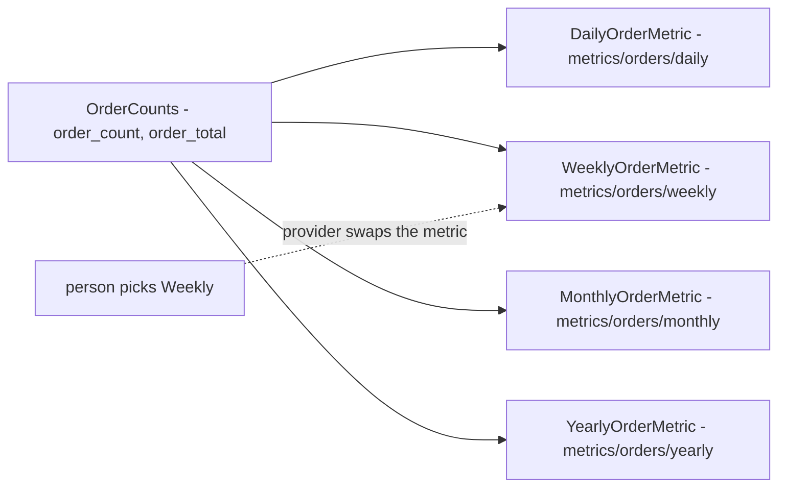

**The spec.**

| | |
| --- | --- |
| a grain | its own metric message and `metric_id` — never a request field |
| the keys | the bucket's first day as `YYYY-MM-DD`: the day, the Monday, the 1st, 1 January ([a-week-is-monday-to-sunday-jakarta](#a-week-is-monday-to-sunday-jakarta)) |
| the body | one message per measure, shared by its four grains |
| a measure without a grain | is not offered at it — a metric that does not exist cannot be picked |
| more measures | follow the same shape: `metrics/orders/settlement/daily`, … |

---

## a-metric-id-is-a-name-not-a-route

> Owner, in chat (2026-10-26): *"ok"* — to the critique
> [a-metric-id-is-a-name-not-a-route](./rpc_provide_clarify.md#critique), *"the path is a name, the last segment is the
> key, an id is unique across every service?"*. As recommended.

**The verdict.** A `metric_id` is a **name** for people and the picker, never an address. Three rules:

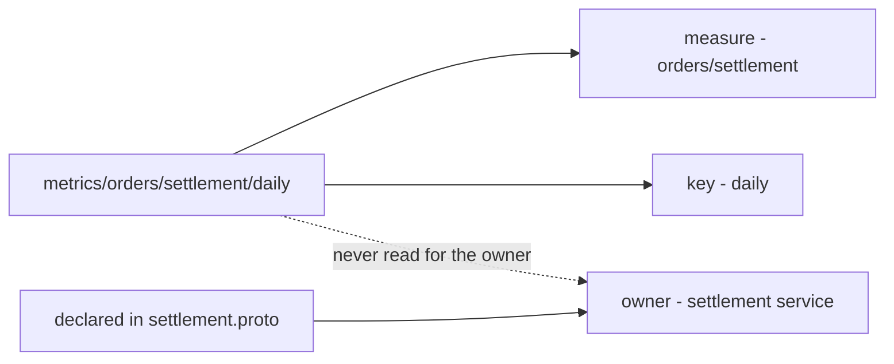

**The spec.**

| rule | |
| --- | --- |
| the path is a name, never a route | the provider finds a metric's service from the proto file that declares it — never from the path |
| the last segment is the key | `daily` · `weekly` · `monthly` · `yearly` · `summary` · a group (`shop`, `product`, …) — everything before it is the measure |
| the picker groups by measure | `orders/settlement` → daily · weekly · monthly · yearly · shop · summary |
| an id is unique across every service | checked at startup — two declarations of one id refuse to boot, as `ValidateDescriptors()` refuses a bad scope |
| the `metrics/` prefix | on every id, so an id is never mistaken for any other kind of string |

---

## a-sort-names-its-metric-and-field

> Owner (2026-10-26), in [rpc_provide.md](./rpc_provide.md) `## Proto Contracts.` — `MetricSort` became
> `{ metric_id, field, sort_type }`, and `SortOption.sort_key` became `field_sort_key`. To the contradiction
> [metric-key-means-three-things](#a-sort-names-its-metric-and-field). The sort as recommended;
> the sort key **kept**, against my *"the field's name is the key"*.

**The verdict.** A sort names **which metric** and **which field** — two metrics can both carry `order_count`, and the
sort must say whose. A sortable field declares its own `field_sort_key` in its option.

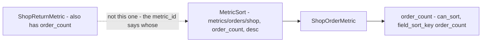

**The spec.**

| | |
| --- | --- |
| `MetricSort` | `string metric_id` · `string field` · `SortType sort_type` |
| `SortOption` | `bool can_sort` · `string field_sort_key` |
| what `MetricSort.field` carries | still open — [the-sort-field-has-two-names](#a-sort-field-is-its-proto-name) |

**Also in the same edit:** `DateRangeFilter` is now `string date_min` / `string date_max`. That is
[a-day-is-a-jakarta-date-string](#a-day-is-a-jakarta-date-string) under **your** field names — `date_min` / `date_max`
replace the `start_date` / `end_date` written there, and every rule of that entry holds for them.

---

## a-sort-field-is-its-proto-name

> Owner (2026-10-26), in chat — *"okey, i remove field_sort_key"* — and in [rpc_provide.md](./rpc_provide.md):
> `SortOption` is now `{ can_sort }` alone. To [the-sort-field-has-two-names](#a-sort-field-is-its-proto-name),
> after comparing the two. As recommended. Supersedes the `field_sort_key` row of
> [a-sort-names-its-metric-and-field](#a-sort-names-its-metric-and-field).

**The verdict.** A sortable field has **one** name — its proto name. `MetricSort.field` carries it (`"order_count"`),
and `SortOption` only says whether the field may be sorted. protoc already makes a field name unique within a message,
so nothing of ours has to.

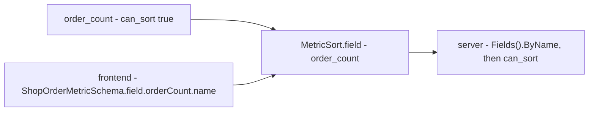

**The spec.**

| | |
| --- | --- |
| `SortOption` | `bool can_sort` — no key string |
| `MetricSort.field` | the field's proto name, snake_case: `"order_count"` |
| the server | `Fields().ByName(field)`; refused when the field is missing or not `can_sort` |
| the frontend | reads the name off the generated schema — never types it |
| renaming a sortable field | changes its sort key too — already a breaking change, since JSON clients read the same name |

---

## a-metric-page-has-no-total

> Owner, in chat (2026-10-26): *"returning total is expensive, so frontend just call next and next, and if data empty,
> its reach end of page. and its okay"* — to [the-page-is-on-the-response](#a-page-is-not-a-filter),
> *"the asked page on the request, `PageInfo` with the totals on the response?"*. Against my recommendation on the
> totals.

**The verdict.** `MetricSearch` returns **no total** — no page count, no item count. A total is a second aggregate over
the whole filter, run on every page turn. The screen asks for the next page until one comes back **empty**, and that is
the end. This is the pager the app already has: `GrowingPager` is *"a pager for lists that know only whether ANOTHER
page exists — no total"*.

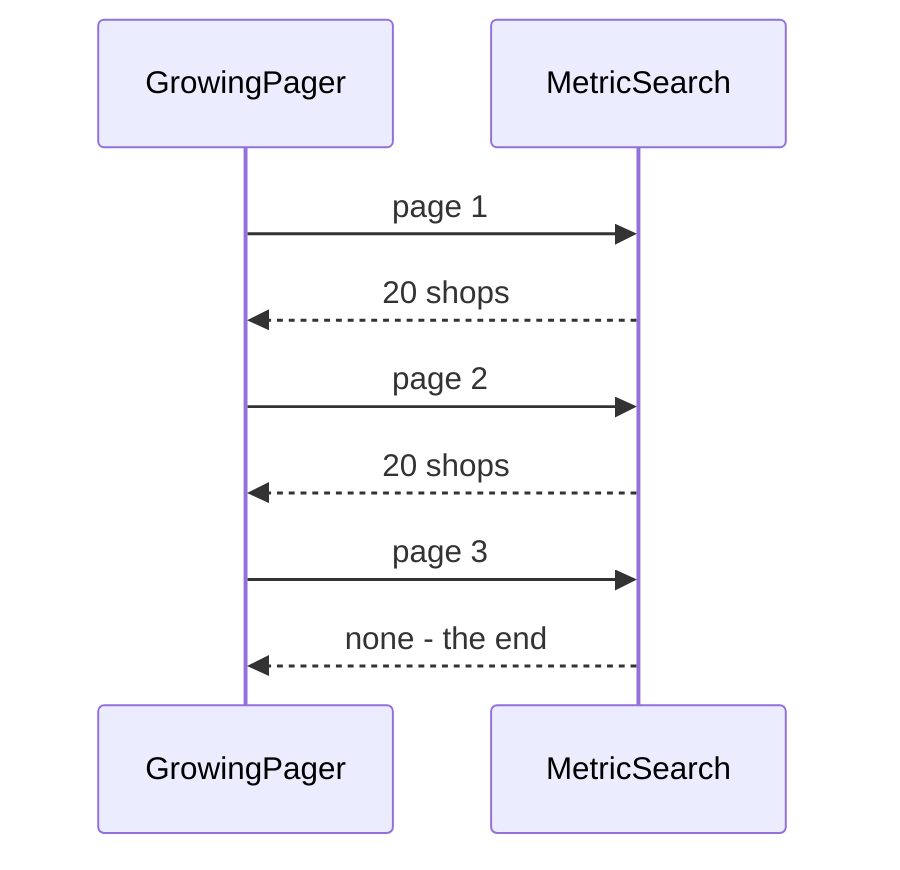

**The spec.**

| | |
| --- | --- |
| the request | carries the page asked for — `PaginationFilter { offset, limit }` on `MetricSearchRequest` |
| the response | the keys only — no total pages, no total items |
| the end | a page with no keys |
| the pager | `GrowingPager` ([every-list-pages-with-the-growing-pager](../../technical/frontend/context_decision.md#every-list-pages-with-the-growing-pager)) — never `Pagination`, which needs a total |
| ⚠ HARD RULE 9 | [CLAUDE.md](../../../CLAUDE.md) says a growing list *"returns a `warehouse.common.v1.PageInfo page_info`"*. A metric search does not — an exception, the owner's to write into the rule |
| the last full page | open — [the-last-page-is-an-empty-click](#a-page-says-whether-another-follows) |

---

## a-page-says-whether-another-follows

> Owner, in chat (2026-10-26): *"ok"* — to [the-last-page-is-an-empty-click](#a-page-says-whether-another-follows),
> *"a `bool has_next`, found by reading limit + 1 rows?"*. As recommended. Refines the end of
> [a-metric-page-has-no-total](#a-metric-page-has-no-total): the end is `has_next = false`, not an empty page.

**The verdict.** `MetricSearchResponse` carries `bool has_next`. The service reads **one row more** than the limit,
returns the limit, and `has_next` says whether the extra row existed. Still no total and no second query — and the
pager greys out **›** on the last real page instead of opening an empty one.

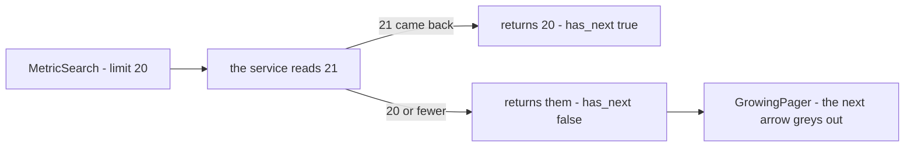

**The spec.**

| | |
| --- | --- |
| `MetricSearchResponse` | the keys · `bool has_next` |
| how it is found | `LIMIT limit + 1` on the same query — the extra row is never returned |
| the pager | `GrowingPager.hasNext` reads it directly |
| an empty page | only when the filter matches nothing at all — never as the end of a list |

---

## a-rate-ranks-only-above-its-minimum-sample

> Owner, in chat (2026-10-26): *"ok"* — to [a-rate-needs-a-minimum-sample](#a-rate-ranks-only-above-its-minimum-sample),
> *"declare a minimum on rate fields, named `rank_min_sample`?"*, after asking whether it is for performance (it is
> not — it is for the ranking to mean something). As recommended.

**The verdict.** A rate field declares the smallest sample it may be ranked on. Sorted by that rate, rows **at or
above** the minimum are ranked; rows below it **still show**, after the ranked ones, unranked. A rate from one unit is
luck, and a list that opens with it is not trusted.

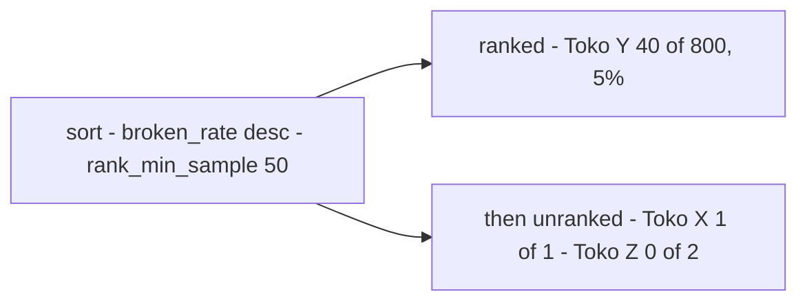

**The spec.**

```proto
message SortOption {
    bool  can_sort        = 1;
    int64 rank_min_sample = 2;   // a rate: rows with a smaller sample follow, unranked. 0 = no minimum
}

double broken_rate  [(metric_sort) = { can_sort: true, rank_min_sample: 50 }]
```

| | |
| --- | --- |
| what counts as the sample | the rate's own denominator — restocked units for a broken rate, orders for a cancel rate. The service knows it |
| a count or an amount | sets nothing — `0` is no minimum |
| rows below it | never dropped — they follow the ranked rows, in key order |
| the screen | reads the number off the descriptor — *"ranked among suppliers with ≥ 50 units"* — never a copy of its own |
| supplier's `rate_min_units` | becomes `rank_min_sample: 50` on `broken_rate` when supplier moves ([the-pattern-replaces-the-shipped-analytics](#the-pattern-replaces-the-shipped-analytics)) |
| performance | not its purpose — one more term in `ORDER BY` |

---

## the-key-breaks-every-tie

> Owner, in chat (2026-10-26): *"we default sort by desc"*, then — after *"why we add shop_id in order?"* was walked
> through — *"okey i accept it"*. To [ties-move-rows-between-pages](#the-key-breaks-every-tie).
> As recommended, with the direction the owner's: DESC.

**The verdict.** Every `MetricSearch` ends its `ORDER BY` with the row's **key, descending**. Rows that tie on the
sorted value — common in a report: most shops cancel nothing in a week — then still have exactly one place, on every
query. Page 2 continues exactly where page 1 stopped, and a refetch of unchanged data puts every row back where it was.
A sort with no direction given is DESC.

```mermaid
flowchart LR
  t["A 5 - B 0 - C 0 - D 0 - E 0"] --> o["ORDER BY order_count DESC, shop_id DESC"]
  o --> l["always A, E, D, C, B"]
  l --> p1["page 1 - A, E"]
  l --> p2["page 2 - D, C"]
  l --> p3["page 3 - B"]
```

**The spec.**

| | |
| --- | --- |
| the tie-breaker | the metric's key — `shop_id`, `product_id`, the day — always last in `ORDER BY` |
| its direction | always DESC, whatever the person picked for the sort |
| `SORT_TYPE_UNSPECIFIED` | reads as DESC |
| who writes it | every `MetricSearch` — a rule of the pattern, never a per-metric choice |
| what it does not fix | a row whose number changes between two page loads can still cross the page boundary — the data moved, not the order |
| the cost | one more column in `ORDER BY`, on a key that is already indexed |

---

## the-headline-is-the-sum-of-its-rows

> Owner, in chat (2026-10-26): *"ok"* — to the proposed row of
> [a-headline-is-its-own-summary-metric](#superseded-a-headline-is-its-own-summary-metric), *"must the headline always equal the
> sum of the rows?"*. As recommended. That row is no longer *proposed*: it is this entry.

**The verdict.** A summary metric is summed from the **same report table**, under the **same filters**, as its grouped
twin. The headline is then always exactly the sum of every row on every page. Something a total needs that no row has —
an order with no shop — becomes **its own row**, so the sum still closes.

```mermaid
flowchart LR
  t["shop_order_daily_reports"] --> g["ShopOrderMetric - SUM, GROUP BY shop_id"]
  t --> s["OrderSummaryMetric - SUM, no GROUP BY"]
  g --> r["rows - 50 + 30 + ... = 1.240"]
  s --> h["headline - 1.240"]
  n["orders with no shop"] -->|"its own row - no shop"| g
```

**The spec.**

| | |
| --- | --- |
| a summary metric's source | the report table its grouped twin reads — never a second table, never the live source rows |
| its filters | the same `supported_filters`, applied the same way |
| what it may add | only what can be summed from those rows — an average or a rate is computed from the same sums |
| a fact with no group | a row of its own (`no shop`, `no supplier`), never only in the total |
| the check | the summary's sum and the grouped metric's sum over every key are equal — a unit test of every pair |

---

## the-report-lives-in-the-url

> Owner, in chat (2026-10-26): *"ok"* — to the proposed row of
> [compare-in-another-tab-for-now](#compare-in-another-tab-for-now), *"does the report keep its state in the URL?"*.
> As recommended. That row is no longer *proposed*: it is this entry.

**The verdict.** A report's state is its **URL**: the chosen metrics, the filters, the sort and the page. *Open in new
tab* then opens the same table, so comparing is changing one filter in the second tab. A refresh keeps the table, and a
link can be sent.

```mermaid
flowchart LR
  u["/reports/orders?m=...&date=2026-10-01..2026-10-31&shop=12&sort=...&page=2"] --> t1["tab 1 - October"]
  u -->|"open in new tab"| t2["tab 2 - the same table"]
  t2 -->|"change one filter"| t3["tab 2 - September"]
```

**The spec.**

| | |
| --- | --- |
| in the URL | the metric ids · every filter set · the sort (`metric_id`, field, direction) · the page |
| not in the URL | anything the access check decides — whoever opens a link sees only what their own role and team allow |
| a refresh | rebuilds the same table from the URL |
| a metric the URL names that no longer exists | dropped, and the filters it alone allowed go with it — as [a-new-metric-removes-the-filters-it-cannot-use](#a-new-metric-removes-the-filters-it-cannot-use) |
| a malformed value | ignored — the report opens without it, never an error page |
| the pager | `GrowingPager` opens at the URL's page, the trail starting there |

---

## a-removed-filter-is-announced

> Owner, in chat (2026-10-26): *"ok"* — to the proposed row of
> [a-new-metric-removes-the-filters-it-cannot-use](#a-new-metric-removes-the-filters-it-cannot-use), *"does the screen
> say when a metric removes a filter?"*. As recommended. That row is no longer *proposed*: it is this entry.

**The verdict.** When adding a metric removes a filter the person had **set**, an info toast says which filter and
why. A number that jumps on screen always comes with its reason.

```mermaid
flowchart LR
  a["Shop - Toko Melati - set"] -->|"add stock lost"| r["shop filter removed"]
  r --> t["toast - Shop filter removed - Stock lost cannot be filtered by shop"]
  n["no filter set"] -.->|"add stock lost"| q["nothing removed - no toast"]
```

**The spec.**

| | |
| --- | --- |
| when | a filter that had a value is removed because a metric was added |
| never | when nothing was removed — adding a metric is silent otherwise |
| the control | the app's `Toaster`, info tone, closes by itself |
| the copy | title *"Shop filter removed"* · description *"Stock lost cannot be filtered by shop."* — sentence case, as every toast |
| several at once | one toast naming every filter removed |
| undo | none — removing the metric does not restore the filter ([a-new-metric-removes-the-filters-it-cannot-use](#a-new-metric-removes-the-filters-it-cannot-use)) |

---

## one-sort-field-per-table

> Owner (2026-10-26), in [rpc_provide.md](./rpc_provide.md) `## Example Use Case In UI Why i Structured like above.`
> item 4: *"Its okay we only can sort one field (no multiple sort like Order Count + Profit)"*.

**The verdict.** A table is sorted by **one** field of **one** metric — `MetricSort` is a single message, never a list.
*Order Count, then Profit* is not offered. The key tie-breaker
([the-key-breaks-every-tie](#the-key-breaks-every-tie)) is not a second sort: the person never picks it and never sees it.

```mermaid
flowchart LR
  h["the person clicks Order Count"] --> s["MetricSort - metrics/orders/shop, order_count, desc"]
  s --> o["ORDER BY order_count DESC, shop_id DESC"]
  p["then clicks Profit"] -->|"replaces the sort"| s2["MetricSort - the settlement metric, profit, desc"]
```

**The spec.**

| | |
| --- | --- |
| `MetricSearchRequest.sort` | one `MetricSort` — not `repeated` |
| clicking a second column | replaces the sort, never adds to it |
| the service that ranks | the one owning the sorted field — Profit sorted means settlement ranks the shops ([the-rows-are-the-keys-step-one-sends](#the-rows-are-the-keys-step-one-sends)) |
| the tie-breaker | the key, always, unseen — not a sort the person chose |

---

## the-table-picks-one-group

> Owner (2026-10-27), in [rpc_provide.md](./rpc_provide.md) `## Proto Contracts.` — `enum GroupType` and
> `MetricOption.supported_group_by` — and in chat: *"i think it add supported_group_by is better"*; then *"yes
> greyed"* to [Q8](./rpc_provide_clarify.md#question), which asked it of a table grouped by Shop. Reverses my
> one-metric-per-grain.

**The verdict.** A metric is **one measure** — `OrderMetric`: count, total — and declares the groups it can be read
by. The **table** picks one group; every column is read by it, so every column shares the rows. *Daily*, *weekly*,
*shop*, *product* are all values of one `group_by`.

```mermaid
flowchart LR
  g["the table - Group by Shop"] --> o["metrics/orders - supported_group_by - shop, product, daily, weekly"]
  g --> s["metrics/settlement - supported_group_by - shop, daily"]
  o --> r["one row per shop"]
  s --> r
```

**The spec.**

| | |
| --- | --- |
| `GroupType` | `DAILY` · `WEEKLY` · `MONTHLY` · `YEARLY` · `PRODUCT` · `SHOP` · `SUPPLIER` — as the owner's doc |
| `MetricOption` | `supported_filters` · `required_filters` · `supported_group_by` · `metric_id` |
| the request | `GroupType group_by` on both `MetricSearchRequest` and `MetricDataRequest` — the service cannot rank or fill without it |
| a metric id | `metrics/orders` — the group is no longer in it. Supersedes the *last segment is the key* row of [a-metric-id-is-a-name-not-a-route](#a-metric-id-is-a-name-not-a-route); its other rules stand |
| one key per table | [a-metric-has-one-key](#a-metric-has-one-key) holds **per table**: one `group_by`, never shop × day |
| a grain | a `group_by` value — supersedes [superseded-one-metric-per-grain](#superseded-one-metric-per-grain). A week is still Monday–Sunday ([a-week-is-monday-to-sunday-jakarta](#a-week-is-monday-to-sunday-jakarta)) |
| the body's key | proposed, not decided: the body carries no key field (`metric_key` goes); two map wrappers per metric, by id and by day — [group-by-belongs-to-the-table](#the-key-lives-in-the-map) |

---

## a-metric-that-cannot-group-is-greyed

> Owner, in chat (2026-10-27): *"yes greyed"* — to [Q8](./rpc_provide_clarify.md#question), *"the table is grouped by
> Shop: is a metric that cannot group by shop hidden, greyed out with its reason, or offered and then the group
> changes?"*. As recommended.

**The verdict.** In the metric picker, a metric whose `supported_group_by` lacks the table's group is **shown,
greyed out, with the reason**. It cannot be picked. The group never changes because a column was added — the rows ARE
the group.

```mermaid
flowchart LR
  t["Group by Shop"] --> p["metric picker"]
  p --> o["Order - pickable"]
  p --> s["Settlement - pickable"]
  p --> i["Inventory - greyed - cannot be grouped by shop"]
  i -.->|"to reach it"| c["the person switches to Group by Product"]
```

**The spec.**

| | |
| --- | --- |
| shown | always — a greyed metric still tells the person it exists |
| the reason | *"Cannot be grouped by shop"* — the table's group, by name |
| picking it | impossible while the group is wrong |
| changing the group | removes the columns whose metric does not support the new group, announced like a removed filter ([a-removed-filter-is-announced](#a-removed-filter-is-announced)) — proposed, not decided |
| unlike a filter | a filter is removed to fit a new metric; a group never is |

---

## the-headline-is-the-metric-grouped-by-summary

> Owner (2026-10-27), in [rpc_provide.md](./rpc_provide.md) — `GROUP_TYPE_SUMMARY` added to `GroupType` — and in
> chat: *"i add GROUP_TYPE_SUMMARY check that"*. To [Q9](./rpc_provide_clarify.md#question), *"is the headline the same
> metric read with no group, instead of its own `OrderSummaryMetric`?"*. As recommended, under the owner's name
> `SUMMARY` for my `NONE`. Supersedes [superseded-a-headline-is-its-own-summary-metric](#superseded-a-headline-is-its-own-summary-metric).

**The verdict.** A headline is the **same metric** read with `group_by = GROUP_TYPE_SUMMARY`: one row for everything
the filters cover. There is no `OrderSummaryMetric`. One metric, one report table, one query shape — so
[the-headline-is-the-sum-of-its-rows](#the-headline-is-the-sum-of-its-rows) holds **by construction**.

```mermaid
flowchart LR
  m["metrics/orders"] -->|"group_by SHOP"| t["the table - Toko Maryam 12, Toko Baru Segu 10 ..."]
  m -->|"group_by SUMMARY"| h["the headline - Orders 1.240"]
  t -.->|"same metric, same table - always equal"| h
```

**The spec.**

| | |
| --- | --- |
| `GroupType` | `SUMMARY` · `DAILY` · `WEEKLY` · `MONTHLY` · `YEARLY` · `PRODUCT` · `SHOP` · `SUPPLIER` |
| how it is read | `MetricData` with `group_by = SUMMARY`, the table's filters, **no keys** — never a `MetricSearch` |
| its answer | one body message, not a map |
| `GROUP_TYPE_UNSPECIFIED` | refused — a request that forgets the field gets an error, never a silent total |
| which metrics have a headline | those listing `SUMMARY` in `supported_group_by` — proposed, not decided: every metric lists it, since anything that can be grouped can be summed |
| the shipped `total` fields | become `group_by = SUMMARY` when each service moves ([the-pattern-replaces-the-shipped-analytics](#the-pattern-replaces-the-shipped-analytics)) |
| [the-headline-is-the-sum-of-its-rows](#the-headline-is-the-sum-of-its-rows) | still the rule; its *"a unit test of every pair"* now tests one metric read two ways |

---

## the-key-lives-in-the-map

> Owner, in chat (2026-10-27): *"yes"*, then *"yes"* to the confirmation — to the critique
> [group-by-belongs-to-the-table](./rpc_provide_clarify.md#critique), *"three typed cases per metric, or one
> string-keyed map?"*. As recommended: three typed cases.

**The verdict.** A metric's body carries **no key** — one `OrderMetric` is read by shop, by day or as a summary, so the
key cannot live inside it. The key lives in the **map** that holds the bodies. Each metric has three `oneof` cases in
`MetricData`: by id, by day, and the summary body. The `metric_key` field option is removed.

```mermaid
flowchart LR
  b["OrderMetric - order_count, order_total - no key"] --> i["OrderMetricByID - map uint64 to OrderMetric - SHOP, PRODUCT, SUPPLIER"]
  b --> d["OrderMetricByDay - map string to OrderMetric - DAILY to YEARLY"]
  b --> s["order_summary - one OrderMetric - SUMMARY"]
```

**The spec.**

```proto
message OrderMetric {                                   // the body — no key field
    int64  order_count = 1 [(metric_sort) = { can_sort: true }];
    double order_total = 2 [(metric_sort) = { can_sort: true }];
}
message OrderMetricByID  { map<uint64, OrderMetric> items = 1; }   // SHOP · PRODUCT · SUPPLIER
message OrderMetricByDay { map<string, OrderMetric> items = 1; }   // DAILY · WEEKLY · MONTHLY · YEARLY — "2026-10-01"

message MetricData {
    oneof m {
        OrderMetricByID  order_by_id   = 1;
        OrderMetricByDay order_by_day  = 2;
        OrderMetric      order_summary = 3;             // SUMMARY
        // … the same three for every metric the service owns
    }
}
```

| | |
| --- | --- |
| `metric_key` field option | removed — nothing left to mark |
| why two map wrappers | a proto `map` cannot sit directly in a `oneof` |
| why not one string-keyed map | ids would travel as text, and every reader would parse them back |
| a group's case | `SHOP` / `PRODUCT` / `SUPPLIER` → `_by_id`; `DAILY` … `YEARLY` → `_by_day`; `SUMMARY` → `_summary` |
| the keys sent | follow the same split — an id list or a day list, none for `SUMMARY` |

---

## the-group-enum-grows-with-the-reports

> Owner (2026-10-27), in [rpc_provide.md](./rpc_provide.md) — `GROUP_TYPE_TEAM` and `GROUP_TYPE_USER` added to
> `GroupType` — and in chat: *"check again in proto contract"*. To [Q10](./rpc_provide_clarify.md#question), *"does
> `GroupType` grow with the groups the reports need — `TEAM` and `USER` now, financial account's when it moves?"*. As
> recommended.

**The verdict.** `GroupType` is one shared enum that **grows** with the groups the reports need, like `FilterType`.
`TEAM` and `USER` join now — your `## General.` lists them, and settlement groups by both. Financial account's
`ACCOUNT`, `PROVIDER` and `CHANGE_TYPE` join the day it moves. Every group keys by a number, so `IDList` carries them
all — a change type by its enum value.

```mermaid
flowchart LR
  e["GroupType"] --> now["now - SUMMARY, DAILY ... YEARLY, PRODUCT, SHOP, SUPPLIER, TEAM, USER"]
  e -.->|"when financial account moves"| later["ACCOUNT, PROVIDER, CHANGE_TYPE"]
  now --> s["settlement can move - team, shop, user"]
```

**The spec.**

| | |
| --- | --- |
| `GroupType` now | `SUMMARY` · `DAILY` · `WEEKLY` · `MONTHLY` · `YEARLY` · `PRODUCT` · `SHOP` · `SUPPLIER` · `TEAM` · `USER` |
| a new group | added to `analytic_base` in the change that first needs it — never a service-local group enum |
| the key | a number in `IDList` for every non-time group — an id, or an enum value |
| `TEAM` across teams | only for a caller scoped to the **root** team; any other scope yields its own team alone — carried over from settlement's shipped rule |
| `USER` | the user the fact is booked to — each metric's doc says which user that is |

✅ Built 2026-11-05 — `GROUP_TYPE_ACCOUNT`, `GROUP_TYPE_PROVIDER`, `GROUP_TYPE_CHANGE_TYPE` (12–14) joined `analytic_base` with the Finance metrics.

---

## every-metric-has-a-summary

> Owner, in chat (2026-10-27): *"okay, go ahead"* — to proposal **c** in [rpc_provide_clarify.md](./rpc_provide_clarify.md#question),
> *"every metric lists `SUMMARY`, checked at startup?"*. As recommended. The proposed row of
> [the-headline-is-the-metric-grouped-by-summary](#the-headline-is-the-metric-grouped-by-summary) is no longer
> *proposed*: it is this entry.

**The verdict.** Every metric lists `GROUP_TYPE_SUMMARY` in `supported_group_by`, so every table can show a headline.
The server **refuses to start** on a metric without it. A rate is never summed — its summary is computed from the same
sums its rows use.

```mermaid
flowchart LR
  m["a metric's supported_group_by"] --> c{"lists SUMMARY"}
  c -->|"yes"| ok["boots - every table has a headline"]
  c -->|"no"| no["refuses to start - names the metric"]
```

**The spec.**

| | |
| --- | --- |
| `supported_group_by` | always contains `GROUP_TYPE_SUMMARY` |
| the check | at startup, beside the `metric_id` uniqueness check ([a-metric-id-is-a-name-not-a-route](#a-metric-id-is-a-name-not-a-route)) |
| a count or an amount | its summary is the sum over every row the filters cover |
| a rate | computed from the summed parts — total broken ÷ total units — never the average of the rows' rates |

---

## screen-details-wait-for-the-screen

> Owner, in chat (2026-10-27): *"okay, go ahead"* — to *"defer a, b and d to the screen pass"*. As recommended.

**The verdict.** Three proposals are display behaviour, not contract, and are decided **with the screen in front of
the owner** — in Storybook, at the screen pass — not from text. ⏸ Deferred, not dropped: the screen pass builds a story
for each, so the choice is made by clicking, not imagining.

```mermaid
flowchart LR
  p["a, b, d - display only"] --> s["screen pass - Storybook"]
  s --> st["a story per case - with and without"]
  st --> d["the owner decides by clicking"]
```

**The spec.**

| | deferred | the stories the screen pass builds |
| --- | --- | --- |
| a | a line above the table — *"Rows: shops with orders"* — when the sort moves to another service's field | sorted by Order Count · sorted by Profit · sorted by Profit with the line |
| b | changing the group removes the columns that cannot follow, with a toast | Group by Shop with Inventory greyed · switch to Product |
| d | a chart with one line per shop is capped at 5 lines | the top shops' daily chart at 3, 5 and 10 lines |
| the contract | unchanged either way — nothing here touches the proto | |

---

## the-analytic-screen-is-accepted

> Owner, in chat (2026-10-27): *"Accept all as recommended"* — to *"accept (with a, b, d as recommended), or tell me
> what's wrong with the screen?"*. It is the lifecycle's design_accept
> ([design-accept-blocks](../../development_lifecycle_decision.md#design-accept-blocks)).

**The verdict.** The Storybook prototype is the design: `Pages/Analytic/Composer` as it stands on branch
`backup/inventory` on 2026-10-27, on the contract decided above. The three deferred screen details
([screen-details-wait-for-the-screen](#screen-details-wait-for-the-screen)) close with it, each as recommended:
[the-rows-line-says-what-the-rows-are](#the-rows-line-says-what-the-rows-are),
[a-group-change-drops-the-columns-that-cannot-follow](#a-group-change-drops-the-columns-that-cannot-follow),
[the-chart-waits-for-a-chart-component](#the-chart-waits-for-a-chart-component).

```mermaid
flowchart LR
  P["prototype - Pages/Analytic/Composer"] -->|"design_accept, 2026-10-27"| B["backend analysis"]
  B --> O["proto analytic_base/v1 and the startup checks"]
  O --> S["supplier first - then settlement, then financial account"]
  S --> R["route and menu entry - with the first real metric"]
```

**The spec.**

| | |
| --- | --- |
| accepted | `frontend/src/pages/analytic/`, `frontend/src/features/analytic/`, and the contract in this file |
| not accepted, still open | the category order in Add Metric — see [rpc_provide_clarify.md](./rpc_provide_clarify.md#question) |
| the pending marks | `figures`, `catalogue`, `pickers` — each is removed by the backend step that serves it for real |
| a contract change after this | a new pass through the screen, not a quiet edit |
| next | backend analysis, in the order of [the-pattern-replaces-the-shipped-analytics](#the-pattern-replaces-the-shipped-analytics) |
| ✅ route and menu built *(2026-10-29)* | with the first served metrics, the five order metrics: `/analytic` routed, and an **Analytic** entry in Operations after the team's orders (after Inventory for root and admin), for every member — ⚠ the placement is my reading, not asked. The `figures` and `catalogue` marks stay for the metrics still on samples; `pickers` now covers product and supplier only |

---

## the-rows-line-says-what-the-rows-are

> Owner, in chat (2026-10-27): *"Accept all as recommended"* — to deferred detail **a**. As recommended.

**The verdict.** Whenever a figure ranks the rows, a muted line above the table says what the rows are —
*"Rows: shops with orders in this period"*. Sorting by Profit hands the ranking to settlement, so a shop with orders and
no settlement leaves the table; without the line that reads as a shop lost.

```mermaid
flowchart LR
  s1["sort by Order Count"] --> l1["Rows: shops with orders in this period"]
  s2["sort by Profit"] --> l2["Rows: shops with settlement in this period"]
  s3["a time group sorted by period"] --> l3["no line - the rows are the days"]
```

**The spec.**

| | |
| --- | --- |
| shown | whenever the rows are ranked by a metric's field — the metric named is the one whose service ranks |
| not shown | the rows sorted by their key — a time group by its period, where the provider lists the days itself and no service ranks |
| built | `AnalyticPage` — the `rowsLine` prop is gone; story `SortedByProfit` pins both texts |

---

## a-group-change-drops-the-columns-that-cannot-follow

> Owner, in chat (2026-10-27): *"Accept all as recommended"* — to deferred detail **b**. As recommended.

**The verdict.** Changing the table's group removes every metric that cannot be grouped by the new one, and an info
toast names what went and why. The rows ARE the group, so the metrics give way, never the group — the same rule as a
filter an added metric cannot use ([a-new-metric-removes-the-filters-it-cannot-use](#a-new-metric-removes-the-filters-it-cannot-use),
[a-removed-filter-is-announced](#a-removed-filter-is-announced)).

```mermaid
flowchart LR
  g["group Product - Orders, Stock lost"] -->|"switch to Shop"| c{"each metric lists SHOP"}
  c -->|"Orders - yes"| k["kept"]
  c -->|"Stock lost - no"| d["removed"]
  d --> t["toast - Stock lost removed, cannot be grouped by shops"]
```

**The spec.**

| | |
| --- | --- |
| removed | every chosen metric whose `supported_group_by` lacks the new group |
| the sort | kept if its metric survives; otherwise it falls back to the group's default |
| the toast | `info`, the removed metrics named, the reason the new group |
| built | `AnalyticPage.setGroup`; stories `InventoryGreyedByShop`, `SwitchGroupToProduct` |

---

## the-chart-waits-for-a-chart-component

> Owner, in chat (2026-10-27): *"Accept all as recommended"* — to deferred detail **d**. As recommended.

**The verdict.** The screen is accepted **without** a chart. A chart is its own pass, and it starts with a chart
component in the design system (`components/`), which the app does not have. The 5-line cap is decided there, with the
chart on screen. Nothing in the contract changes either way.

```mermaid
flowchart LR
  a["screen accepted - no chart"] --> c["chart pass - a chart component in components/"]
  c --> st["stories at 3, 5 and 10 lines"]
  st --> cap["the owner decides the cap"]
```

**The spec.**

| | |
| --- | --- |
| now | no chart on `Pages/Analytic/Composer`; the table and the headline carry the report |
| the chart pass | a chart component with its story first, then the per-shop daily chart, then the cap |
| the contract | unchanged — a chart reads the same `MetricData` the table does |

---

## order-opens-the-metric-picker-for-now

> Owner, in chat (2026-10-27): *"for q 11 for now yes"* — to [Q11](./rpc_provide_clarify.md#question), *"keep Order
> first, or your doc's order?"*. As recommended, and marked *for now* by the owner.

**The verdict.** For now, Add Metric lists its categories *Order, Settlement, Inventory, Ads, Expense*, and opens on
**Order** — the figure every team reads daily. Your §How Metric Selected lists them *Expense* first; that list names
the categories, and the picker's order is this entry. *For now*: revisit when real metrics arrive and it is clear which
category people open most.

```mermaid
flowchart LR
  a["Add Metric"] --> o["opens on Order"]
  o --> l["Order · Settlement · Inventory · Ads · Expense"]
```

**The spec.**

| | |
| --- | --- |
| the order | `METRIC_CATEGORIES` in `frontend/src/features/analytic/catalogue.ts` — unchanged |
| opens on | the first category, Order |
| revisit | when real metrics are wired, by which category is opened most |

---

## a-filter-names-one-id-and-shares-its-types-number

> Owner, in chat (2026-10-27): *"Continue"* — to *"are you OK with the two filter details, and shall I go on to
> supplier?"*, after backend step 1 filled in what the doc left open. As recommended.

**The verdict.** Each filter carries **one** id, because the accepted screen narrows by one shop, one product, one
supplier. Each `FilterItem` case is numbered as its `FilterType`, so a filter maps to its type with no table.

```mermaid
flowchart LR
  t["FILTER_TYPE_SHOP = 5"] --- c["FilterItem.shop_filter = 5"]
  c --> s["ShopFilter - shop_id, one id"]
```

**The spec.**

| | |
| --- | --- |
| the filters | `DateRangeFilter{date_min, date_max}`, `KeywordFilter{keyword}`, `ProductFilter{product_id}`, `TeamFilter{team_id}`, `ShopFilter{shop_id}`, `SupplierFilter{supplier_id}` |
| the numbering | `FilterItem` case N is `FilterType` N — date range 1 … supplier 6; a new type takes the next number in both |
| limits | a page 1–200, a key list at most 200, a keyword 1–100 characters |
| multi-select later | a new `repeated` field beside the single id — the single id is never reused |
| where | [proto/warehouse/analytic_base/v1/analytic.proto](../../../proto/warehouse/analytic_base/v1/analytic.proto) |

---

## the-generic-keyword-is-removed

> Owner (2026-10-27), in [rpc_provide.md](./rpc_provide.md) — `FILTER_TYPE_KEYWORD` removed from `FilterType` — and in
> chat: *"i remove FILTER_TYPE_KEYWORD"*. To [what-a-keyword-matches](./rpc_provide_clarify.md#question), *"a keyword
> names its dimension (A), matches the rows (B), or no keyword (C)?"* — C, against my A.

**The verdict.** No filter type is a bare keyword. A filter means one thing in every column; a keyword meant whatever
each metric chose, so two columns of one row could be narrowed by different things behind one box.

```mermaid
flowchart LR
  k["FILTER_TYPE_KEYWORD"] -->|"removed"| f["FilterType - date range, product, team, shop, supplier"]
  f --> one["one filter, one meaning in every column"]
```

**The spec.**

| | |
| --- | --- |
| `FilterType` | `UNSPECIFIED` · `DATE_RANGE` · `PRODUCT` · `TEAM` · `SHOP` · `SUPPLIER` |
| the number 2 | reserved in `FilterType` and in `FilterItem`, so case N stays `FilterType` N ([a-filter-names-one-id-and-shares-its-types-number](#a-filter-names-one-id-and-shares-its-types-number)) |
| the code it removes | `KeywordFilter` in `analytic_base`; `FILTER_TYPE_KEYWORD` on `metrics/suppliers`, its keyword join and their tests |
| ⚠ still open | the Supplier Report's search is sent as that keyword — [the-supplier-search-loses-its-filter](#the-supplier-report-keeps-its-search). The code waits for it |

✅ **Built 2026-10-30** (verified in code 2026-11-05) — the Supplier Report's search is back as a typed `FILTER_TYPE_SUPPLIER_KEYWORD` (`analytic_base/v1/analytic.proto` 9, `supplier_analytic.proto`), per [the-supplier-report-keeps-its-search](#the-supplier-report-keeps-its-search).

---

## superseded-the-supplier-report-drops-its-search

⛔ **Superseded 2026-10-30** by [the-supplier-report-keeps-its-search](#the-supplier-report-keeps-its-search): the search is back, as its own typed filter.

> Owner, in chat (2026-10-28): *"b"* — to [the-supplier-search-loses-its-filter](./rpc_provide_clarify.md#question),
> *"keep the Supplier Report's search as `FILTER_TYPE_SUPPLIER_KEYWORD` (A), or let the search go (B)?"* — B, against
> my A.

**The verdict.** The Supplier Report has no search. It ranks every supplier in the window, narrowed only by whose
restocks; one supplier's figures are its Statistics tab, a click from its row. Supersedes
[the-supplier-report-searches-like-discover](../supplier/context_decision.md#superseded-the-supplier-report-searches-like-discover).

```mermaid
flowchart LR
  r["Supplier Report"] --> f["the window, whose restocks"]
  f --> k["the ranking and the headline - every supplier"]
  k -->|"a row"| s["that supplier's Statistics tab"]
```

**The spec.**

| | |
| --- | --- |
| `metrics/suppliers` filters | `DATE_RANGE` (required) · `TEAM` · `SUPPLIER` |
| the headline | every supplier in the window, or one team's restocks — no longer *"what the search found"* |
| a one-supplier picker | not added — a ranking narrowed to one supplier is one row, which the Statistics tab already shows. ⚠ My reading of B, not asked |
| removed | the search box and its two texts, the story `TheSearchNarrowsTheRankingAndTheHeadline`, the keyword join in `metric_shared.go` and its tests |
| kept | `SupplierList`'s `q` — Discover's search is its own request field, not this filter |

---

## the-filters-gain-warehouse-and-user

> Owner, in chat (2026-10-28): *"continue"* — to [the-tree-names-filters-the-enum-lacks](./rpc_provide_clarify.md#question), *"add
> `FILTER_TYPE_WAREHOUSE` (its own type, not `TEAM`) and `FILTER_TYPE_USER` — should I go with that?"*. Read as yes;
> as recommended.

**The verdict.** `FilterType` gains `WAREHOUSE` and `USER`, each one id. A warehouse is a team in this system, but a
warehouse fee has **both** a selling team and a warehouse, so `TEAM` cannot carry both.

```mermaid
flowchart LR
  fee["a warehouse fee"] --> t["TEAM - whose figures"]
  fee --> w["WAREHOUSE - the warehouse team it happened in"]
  fee --> u["USER - who it is booked to"]
```

**The spec.**

| | |
| --- | --- |
| `FilterType` | + `FILTER_TYPE_WAREHOUSE = 7` · `FILTER_TYPE_USER = 8` |
| `FilterItem` | `WarehouseFilter{warehouse_id}` = 7 · `UserFilter{user_id}` = 8 — one id each, the case number its type's ([a-filter-names-one-id-and-shares-its-types-number](#a-filter-names-one-id-and-shares-its-types-number)) |
| `TEAM` and `WAREHOUSE` | both team ids, two roles: `TEAM` stays whose figures they are, `WAREHOUSE` is the warehouse team the fact happened in. A metric with both roles lists both |
| `USER` | the user the fact is booked to — each metric's doc says which, as for `GROUP_TYPE_USER` ([the-group-enum-grows-with-the-reports](#the-group-enum-grows-with-the-reports)) |
| when | added to `analytic_base` with the first metric that lists one (Warehouse Fee or Order Created), not before, the same as a group |
| your doc | `FilterType` gains the two lines — yours to write |

---

## a-field-declares-its-stat-type

> Owner (2026-10-28), in [rpc_provide.md](./rpc_provide.md) — `enum FieldStatType` and a `field_stat_type` field option
> beside `metric_sort`.

**The verdict.** A metric's number field says what kind of number it is (a quantity, a currency amount or a ratio), on
the field itself, read by reflection like `metric_sort`.

```mermaid
flowchart LR
  f["a metric's number field"] --> q["QTY - order_count, transaction_count"]
  f --> c["CURRENCY - order_total, amount"]
  f --> r["RATIO - broken_rate"]
```

**The spec.**

```proto
enum FieldStatType {
  FIELD_STAT_TYPE_UNSPECIFIED = 0;
  FIELD_STAT_TYPE_RATIO = 1;
  FIELD_STAT_TYPE_QTY = 2;
  FIELD_STAT_TYPE_CURRENCY = 3;
}

extend google.protobuf.FieldOptions {
  SortOption    metric_sort     = 50003;
  FieldStatType field_stat_type = 50004;   // 50002 is role_base's use_scope
}
```

| | |
| --- | --- |
| replaces | the screen's own `kind: "count" \| "money"` in `features/analytic/catalogue.ts` — that copy goes when the provider reads the descriptor |
| open | whether every field must carry it, and what checks it — [a-stat-type-is-checked-at-startup](#every-number-field-carries-a-stat-type) |

---

## the-graph-draws-the-table

> Owner (2026-10-28), in [rpc_provide.md](./rpc_provide.md) §Analytic UI — *"graph is separate by `FieldStatType`"* — and
> in chat: *"for graph is line chart. x is the value metric, and y is grouped things. and same field type is one graph
> with column is the legend"*. To [what-the-graph-draws](./rpc_provide_clarify.md#question), *"does the graph draw the
> table (A), or is it composed on its own (B)?"*, that is A, as recommended. On which way it is drawn, *"A"*: the group
> along the bottom, against the literal reading of *"x is the value"*.

**The verdict.** The graph is the table drawn as **line charts**: the table's group along the bottom, the value up the
side, **one graph per `FieldStatType`** among the chosen fields, and each of the table's columns a line, named in the
legend. Two metrics' money fields share one graph, and that shared graph is where they get compared.

```mermaid
flowchart LR
  t["the table - group Daily - Orders and Settlement chosen"] --> f["its columns"]
  f -->|"CURRENCY"| c["graph - Order Total, Settlement Amount"]
  f -->|"QTY"| q["graph - Order Count"]
  f -->|"RATIO - none chosen"| n["no graph"]
  c --> l["a line per column - the days along the bottom, Rp up the side"]
```

**The spec.**

| | |
| --- | --- |
| the kind | a line chart, for every group. ⚠ Against my bars for a shop or product group (a line there joins shops with nothing between them, so its slope only shows the sort order). Raised twice, answered with *"line chart"* |
| along the bottom | the table's keys, in the table's order: the days of a time group, or the current page's rows for an id group |
| up the side | the value, formatted by the graph's `FieldStatType` (*Rp*, a count, a %) |
| a graph | one per `FieldStatType` among the chosen fields, so at most three, in column order |
| a line | one per column, named in the legend as the column is |
| the calls, the state | none of its own: it draws the `MetricData` the table already holds, from the same URL ([the-report-lives-in-the-url](#the-report-lives-in-the-url)). ⚠ My reading of A, not asked |
| `SUMMARY` | no graph, because the headline already shows it. ⚠ My reading of A, not asked |
| not this graph | one line per shop over the days ([a-metric-has-one-key](#a-metric-has-one-key)), a line per key rather than per column. It is a different chart |
| when | the chart pass ([the-chart-waits-for-a-chart-component](#the-chart-waits-for-a-chart-component)), which still starts with a chart component. The cap on lines per graph is decided there |
| depends on | every number field carrying its stat type, since a field without one has no graph to go into ([a-stat-type-is-checked-at-startup](#every-number-field-carries-a-stat-type)) |

---

## the-table-and-the-graph-are-tabs

> Owner, in chat (2026-10-28): *"make tab table and graph. so its not one view"*, on seeing the graph built above the
> table.

**The verdict.** The report shows **one view at a time**: a **Table** tab and a **Graph** tab under the headline. The
graph is still the table drawn ([the-graph-draws-the-table](#the-graph-draws-the-table)). It just has its own tab now
instead of sitting above the table.

```mermaid
flowchart LR
  h["the headline - every figure, group SUMMARY"] --> t{"the tab"}
  t -->|"Table - the default"| tb["the rows line, the table, the pager"]
  t -->|"Graph"| gr["the rows line, a graph per stat type, the pager"]
```

**The spec.**

| | |
| --- | --- |
| the tabs | **Table** · **Graph**, each with its icon, the chosen one in rose ([a-selected-tab-is-in-the-main-tone](../../technical/frontend/context_decision.md#a-selected-tab-is-in-the-main-tone)) |
| the default | Table. ⚠ My reading, not asked |
| in the URL | `v=graph`, so a link or a refresh opens the same view ([the-report-lives-in-the-url](#the-report-lives-in-the-url)); Table is the default and is left out. ⚠ My reading, not asked |
| above both | the group, the metrics, the filters and the headline: they define the report, whichever way it is drawn |
| on both | the rows line and the pager, because the graph draws the table's current page. ⚠ My reading, not asked |
| switching | keeps the page, the sort and the filters, and only changes how the rows are drawn |
| no rows | the same *nothing in this period* line on both tabs |

---

## superseded-the-team-group-covers-warehouses

> ⛔ **Superseded 2026-10-29** by [the-warehouse-is-its-own-group](#the-warehouse-is-its-own-group): the order metrics
> showed that one team group cannot serve a reader who needs both sides. Kept as the record of what was decided before.

> Owner, in chat (2026-10-28): *"no group team is enough"*, to
> [a-report-can-group-by-warehouse](./rpc_provide_clarify.md#question), *"should `GroupType` gain
> `GROUP_TYPE_WAREHOUSE = 11`?"*. Against my yes.

**The verdict.** `GroupType` gets no warehouse group. A warehouse is a team in this system, so a report that puts
warehouses side by side groups by `GROUP_TYPE_TEAM`.

```mermaid
flowchart LR
  q["a row per warehouse"] --> t["GROUP_TYPE_TEAM - a warehouse is a team"]
  t -.->|"not added"| w["GROUP_TYPE_WAREHOUSE"]
```

**The spec.**

| | |
| --- | --- |
| `GroupType` | unchanged: `TEAM` = 9 and `USER` = 10 are the last |
| comparing warehouses | group by `TEAM` |
| a fact with two teams | ⚠ My reading, not asked: a warehouse fee has a selling team and a warehouse team. The caller's scope already says whose figures they are, so `TEAM` groups by the other team, which for a seller is the warehouse. Each metric's doc says which team, as it already does for `USER` |
| the filter | unchanged: `FILTER_TYPE_WAREHOUSE` stays its own type ([the-filters-gain-warehouse-and-user](#the-filters-gain-warehouse-and-user)). The tension between the two is in the clarify's Contradiction section |

---

## every-number-field-carries-a-stat-type

> Owner, in chat (2026-10-29): *"yes"* — to [a-stat-type-is-checked-at-startup](./rpc_provide_clarify.md#critique),
> *"every metric number field must carry `field_stat_type`: required at startup, `rank_min_sample` only on a `RATIO`,
> display only. If you agree, I'll add the option and the check."*. As recommended.

**The verdict.** Every number field of a metric carries a `field_stat_type` that is not `UNSPECIFIED`, and the server
refuses to start without it. Two readers depend on it, the cell's format and the graph a column is drawn in
([the-graph-draws-the-table](#the-graph-draws-the-table)), and neither may guess. A minimum sample belongs to a ratio
only.

```mermaid
flowchart LR
  f["a metric's number field"] --> c{"field_stat_type"}
  c -->|"missing or UNSPECIFIED"| x["the server refuses to start"]
  c -->|"QTY, CURRENCY or RATIO"| ok["the cell's format and its graph"]
  ok --> r["rank_min_sample - only on a RATIO"]
```

**The spec.**

| | |
| --- | --- |
| the option | `FieldStatType field_stat_type = 50004` on `FieldOptions`, in `analytic_base` ([a-field-declares-its-stat-type](#a-field-declares-its-stat-type)) |
| refused at startup | by `san_metric.ValidateDescriptors`: a metric's single-number field without one · `rank_min_sample` above 0 on a field that is not `RATIO` · a stat type on a field that is not a single number · either option on a message that is not a metric |
| read by | the screen: the cell's format, and which graph the column goes in. Until the provider reads the descriptor, the sample catalogue's `kind` stands in for it |
| never | a rule for summing — a total is the service's `SUMMARY` ([the-headline-is-the-metric-grouped-by-summary](#the-headline-is-the-metric-grouped-by-summary)) |
| `metrics/suppliers` | the three counts `QTY`, the three valuations `CURRENCY`, `broken_rate` `RATIO` |

---

## a-time-graph-runs-oldest-first

> Owner, in chat (2026-10-29): *"yes"* — to [a-time-graph-runs-oldest-first](./rpc_provide_clarify.md#critique), *"draw a
> time graph oldest first, whatever the table's sort, and keep the table's ranking for a shop or product graph?"*. As
> recommended.

**The verdict.** A graph over a time group always runs **oldest first**, left to right, whatever the table's sort. A
graph over an id group keeps the table's order, which is its ranking. This amends *"in the table's order"* in
[the-graph-draws-the-table](#the-graph-draws-the-table) for time: a week the table lists newest first would otherwise
be drawn right to left, and a rising week would read as a falling one.

```mermaid
flowchart LR
  t["table - Daily, newest first - 7 Oct down to 1 Oct"] --> g["the graph - 1 Oct to 7 Oct"]
  s["table - Shop, ranked by Order Count"] --> h["the graph - the same ranking"]
```

**The spec.**

| | |
| --- | --- |
| a time group | the page's periods drawn oldest first, whether the table sorts by period or ranks by a figure |
| an id group | the page's rows in the table's order |
| the page | unchanged: the graph draws the table's current page ([the-table-and-the-graph-are-tabs](#the-table-and-the-graph-are-tabs)) |
| built | `ReportGraphs` in `pages/analytic/components/`; story `ByDayGraphRunsOldestFirst` |

---

## superseded-a-team-group-is-named-by-the-team-it-means

> ⛔ **Superseded 2026-10-29** by [the-warehouse-is-its-own-group](#the-warehouse-is-its-own-group): with a warehouse
> group, `TEAM` means one team on every metric, so no group is named by its reader. Kept as the record of what was decided
> before.

> Owner, in chat (2026-10-29): *"yes"* — to [the-team-group-and-the-warehouse-filter-name-one-thing-twice](./rpc_provide_clarify.md#contradiction),
> *"no contract change: each metric that involves two teams says in its doc which one its `TEAM` group means, and the
> screen labels the group by that meaning — *Warehouse*, not *Team*?"*. As recommended.

**The verdict.** `GROUP_TYPE_TEAM` stays the one team group ([superseded-the-team-group-covers-warehouses](#superseded-the-team-group-covers-warehouses)),
and `FILTER_TYPE_WAREHOUSE` stays its own filter ([the-filters-gain-warehouse-and-user](#the-filters-gain-warehouse-and-user)).
A metric whose fact involves two teams says in its doc which team its `TEAM` group splits by, and the screen names
the group by that team's role, so a seller reading warehouse fees picks *Warehouse*, never a *Team* that means the same
thing as the filter beside it.

```mermaid
flowchart LR
  fee["a warehouse fee - a selling team and a warehouse"] --> doc["its doc - TEAM is the warehouse"]
  doc --> g["the group select - Warehouse"]
  fee --> f["the filter - Warehouse, FILTER_TYPE_WAREHOUSE"]
  g -.->|"one name for one thing"| f
```

**The spec.**

| | |
| --- | --- |
| the contract | unchanged |
| a metric with two teams | its doc says which team `TEAM` groups by: Warehouse Fee, the warehouse |
| a metric with one team | `TEAM` is that team, and the group is called *Team* |
| the screen | names the group by the role. ⚠ Where the screen reads that role from (the doc alone, or an option on the metric) is decided with the first two-team metric, Warehouse Fee. Nothing is built before it |
| ⚠ a table of two metrics whose `TEAM` means different teams | the rows would be different teams under one heading. My reading, not asked: the picker greys the second, as it greys a metric that cannot follow the group ([a-metric-that-cannot-group-is-greyed](#a-metric-that-cannot-group-is-greyed)). Decided with that first metric too |

---

## the-picker-follows-the-metric-tree

> Owner, in chat (2026-10-29): *"yes"* — to [ads-moved-under-expense](./rpc_provide_clarify.md#contradiction), *"the picker
> follows your tree, with four categories and Ads Expense inside Expense?"*. As recommended.

**The verdict.** Add Metric's categories are your §Metric That Exist in Analytic: **Order, Settlement, Inventory,
Expense**, with **Ads Expense** inside Expense. There is no Ads category. It still opens on Order, the order this file
set for now ([order-opens-the-metric-picker-for-now](#order-opens-the-metric-picker-for-now)), with Ads gone from it.

```mermaid
flowchart LR
  p["Add Metric"] --> o["Order"]
  p --> s["Settlement"]
  p --> i["Inventory"]
  p --> e["Expense"]
  e --> w["Warehouse Fee"]
  e --> a["Ads Expense"]
```

**The spec.**

| | |
| --- | --- |
| the categories | `METRIC_CATEGORIES` in `frontend/src/features/analytic/catalogue.ts`: order, settlement, inventory, expense |
| Ads Expense | the sample `metrics/ads`, now in Expense and named as the tree names it |
| a new category | added when your tree gains one, never by the screen alone |
| pinned | story `AddMetricDrillsIntoACategory`: there is no Ads category, and Ads Expense is ticked from Expense |

---

## the-warehouse-is-its-own-group

> Owner (2026-10-29), in [rpc_provide.md](./rpc_provide.md) `enum GroupType` — gained `GROUP_TYPE_WAREHOUSE`, between
> `TEAM` and `USER` — and in chat: *"I ADD GROUP_TYPE_WAREHOUSE in group type"*. That answered *"add the warehouse
> group, or keep `TEAM` only and accept that root can't put warehouses side by side?"*, asked while settling the order
> metrics ([order_statistic_metric_clarify.md](../order/order_statistic_metric_clarify.md)). As recommended, which
> reverses [superseded-the-team-group-covers-warehouses](#superseded-the-team-group-covers-warehouses).

**The verdict.** `GroupType` gains `WAREHOUSE`. Each group now means **one** thing on every metric and for every reader:
`TEAM` is the team whose fact it is (for an order, the seller), and `WAREHOUSE` is the warehouse team it happened in. The
two groups match the two filters, `FILTER_TYPE_TEAM` and `FILTER_TYPE_WAREHOUSE`
([the-filters-gain-warehouse-and-user](#the-filters-gain-warehouse-and-user)). A group is never named by who is reading,
so [superseded-a-team-group-is-named-by-the-team-it-means](#superseded-a-team-group-is-named-by-the-team-it-means) goes
with it.

**Why it reversed.** With one team group, a two-team fact had to choose a side. Root reads every team and asks for both
*orders per seller* and *orders per warehouse*. Whichever side `TEAM` meant, the other report could not be built.

```mermaid
flowchart LR
  o["an order - seller A, warehouse W"] --> t["GROUP_TYPE_TEAM - seller A"]
  o --> w["GROUP_TYPE_WAREHOUSE - warehouse W"]
  t --- ft["FILTER_TYPE_TEAM"]
  w --- fw["FILTER_TYPE_WAREHOUSE"]
  r["root"] --> t
  r --> w
```

**The spec.**

| | |
| --- | --- |
| `GroupType` | + `GROUP_TYPE_WAREHOUSE = 11`. Your doc lists it between `TEAM` and `USER`; proto numbers never move, so `USER` keeps 10 |
| `TEAM` | the team whose fact it is, the same for every reader |
| `WAREHOUSE` | the warehouse team the fact happened in. Only a metric with a warehouse side lists it: the order metrics, Warehouse Fee |
| a one-row group | a seller grouping by its own team, or a warehouse by itself, gives one row. ⚠ My reading, not asked: the metric still lists the group, and the screen offers it, because root and a warehouse need it. Hiding it per reader is a screen detail, decided when the screen meets it |
| when | added to `analytic_base` and to the screen's `GroupType` with the first metric that lists it, the same as the filters |
| the screen | the group is called *Warehouse*, always |

---

## a-position-is-its-own-stat-type

> Owner, in chat (2026-10-30): *"yes"* — to [a-position-is-not-a-sum](./rpc_provide_clarify.md#question), *"add
> `FIELD_STAT_TYPE_POSITION`, money at a moment: shown as Rp, its own graph, served at the window's edges, never summed
> by anything else?"*. As recommended.

**The verdict.** `FieldStatType` gains **`POSITION`**: an amount of money at a moment, a balance, not a movement. It
adds up across keys (the shops add up to the team) but **never across time**: a period's position is its edge, and the
service serves it. The screen shows it as Rp and draws positions in a graph of their own. This narrows
[the-headline-is-the-sum-of-its-rows](#the-headline-is-the-sum-of-its-rows) to movements: a position's headline is the
window's edge.

```mermaid
flowchart LR
  a["1 Oct close -5.000.000"] --> m["October close"]
  b["31 Oct close -7.000.000"] --> m
  m --> v["-7.000.000 - the last day, never the sum"]
```

**The spec.**

| | |
| --- | --- |
| the value | `FIELD_STAT_TYPE_POSITION = 4` |
| a time group's cell | the period's edge, served by the service |
| the headline | the window's edge: the service's `SUMMARY` |
| an id group's cell | the key's own position, and the keys add up to the team's |
| the screen | Rp, like `CURRENCY`, in a graph of its own, *Positions (Rp)* |
| `rank_min_sample` | not on a position: it stays a `RATIO`'s alone ([every-number-field-carries-a-stat-type](#every-number-field-carries-a-stat-type)) |
| the first one | settlement's *position to date* ([settlement-serves-its-headline-and-its-breakdown](../settlement/context_decision.md#settlement-serves-its-headline-and-its-breakdown)) |

---

## the-analytic-entry-follows-home

> Owner, in chat (2026-10-30): *"place analytic menu after home"* — against my unasked placement of 2026-10-29, inside
> Operations after the team's orders (a selling team, a warehouse) or after Inventory (root and admin).

**The verdict.** The Analytic entry sits **right after Home**, in the lead section with no heading — above Operations,
Finance and Team, for every team type that has metrics. Analytic reads across every section below it (orders,
settlement, stock, expenses), so it is not one of Operations' screens.

```
▌Home
 Analytic                ← the lead section: no heading
OPERATIONS
  Products ›  Inventories ›  Suppliers ›  Shops  Orders
FINANCE
  …
```

**The spec.**

| | |
| --- | --- |
| where | `menuSectionsFor` in `frontend/src/layouts/nav.ts` — the lead section is `[HOME, ANALYTIC]` |
| who | a selling team, a warehouse, root and admin — every member, not role-gated, as before ([every-member-reads-every-metric-of-their-team](#every-member-reads-every-metric-of-their-team)) |
| the phone | the More sheet draws `menuFor`, so Analytic follows Home there too. The bottom bar is unchanged — its three tabs are a decision of their own |
| the sections | ⚠ widens [the-sidebar-is-in-sections](../../technical/frontend/context_decision.md#the-sidebar-is-in-sections), whose lead section was Home alone |
| pinned by | `Layouts/Desktop/Sidebar` → `TheMenuIsInSections`: the lead section's links are exactly Home, Analytic |

---

## the-supplier-report-keeps-its-search

> Owner, in chat (2026-10-30), on merging `frada`: *"for supplier report, Discover, locked product, we follow frada"* —
> `frada`'s Supplier Report has a search. It reverses [superseded-the-supplier-report-drops-its-search](#superseded-the-supplier-report-drops-its-search) (*"b"*, 2026-10-28), and so lands on the option
> that answer declined: A, a supplier-only keyword filter.

**The verdict.** The Supplier Report has a search again. It is a TYPED filter, `FILTER_TYPE_SUPPLIER_KEYWORD`, and it
means one thing: the supplier a row is about matches as the supplier list's own `q` does — its name, address,
contact, or a live store's name. That is why it does not bring back
[the-generic-keyword-is-removed](#the-generic-keyword-is-removed)'s problem, a keyword that meant whatever each metric
chose: only a metric about suppliers lists it.

```mermaid
flowchart LR
  r["Supplier Report - the search box"] -->|"SupplierKeywordFilter q"| s["metrics/suppliers"]
  s --> m["rows whose supplier matches - name, address, contact, a live store"]
  m --> k["the ranking and the headline - what the search found"]
```

**The spec.**

| | |
| --- | --- |
| the contract | `SupplierKeywordFilter { q }` (1–100 characters), `FilterItem` case 9, `FILTER_TYPE_SUPPLIER_KEYWORD = 9` in `analytic_base` |
| who lists it | `metrics/suppliers` alone — its filters are now the window (required), `TEAM`, `SUPPLIER`, `SUPPLIER_KEYWORD` |
| the match | supplier_service's own tables, a subquery: `suppliers` name / address / contact, or a live `supplier_channels` name, `ILIKE` with the pattern's wildcards neutralised. A DELETED supplier is found — it is still ranked ([a-deleted-supplier-is-kept-for-its-figures](../supplier/context_decision.md#a-deleted-supplier-is-kept-for-its-figures)) |
| the headline | what the search found — the same filter on the SUMMARY |
| the screen | `frada`'s: the search box in the filter bar, in the URL as `q`, its own empty hint (*No supplier matches.*), counted by Clear |
| the Analytic screen | does not offer it — no metric there is about suppliers yet |
| tests | `TestMetricSearch_TheKeywordFindsSuppliersAsTheListDoes`; the stories `TheSearchNarrowsTheRankingAndTheHeadline` and `FiltersLiveInTheUrl` |

## a-metric-is-added-whole-for-now

> Owner, in chat (2026-10-31): *"for now, just metric is enough"* — to [the-picker-ticks-fields](./rpc_provide_clarify.md#question),
> *may a metric open one level further so its fields can be ticked one by one?* Against my A, and **for now** — as
> [compare-in-another-tab-for-now](#compare-in-another-tab-for-now) deferred the A / B view.

**The verdict.** Add Metric adds a metric **whole** — every field a column — as it does today. The picker does not open a
metric into its fields. The tree's third level (`fields :` in §Metric That Exist in Analytic) says what a metric
carries; it is not a picker level.

```
Add Metric
  Settlement
    ☑ Settlement by type    → its 10 fields, 10 columns — as today
```

| | |
| --- | --- |
| the picker | category → metric; ticking a metric adds all its fields |
| the cost, accepted for now | a wide metric draws all its columns — settlement by type's 10 do not fit a phone |
| ✅ built | nothing to build — this is what runs today ([MetricPicker.tsx](../../../frontend/src/pages/analytic/components/MetricPicker.tsx)) |
| when it comes back | a metric too wide to read, or a person who wants two of its fields — then the picker opens a metric into its fields, as the tree draws them; ticking the metric still takes them all |

## a-metric-reads-at-most-a-year

> Owner, in chat (2026-10-31): *"yes, i follow your recomendation"* — to [supplier Q19](../supplier/context_clarify.md#question),
> *how far back may the Supplier Report rank?*, asked as a rule for every metric: order and settlement share the gap. As
> recommended.

**The verdict.** A metric's date range is **at most 366 days**, on every metric of every service. A longer range is
refused, with a message naming the limit. A ranking reads every daily row in its window, so an unlimited range is one
that gets slower every day the business runs — a year is 63 ms for `metrics/suppliers`, three years ~600 ms
([MetricSearch.md](../../../audits/services/supplier_service/performances/MetricSearch.md)).

```mermaid
flowchart LR
  W["a metric's date range"] --> C{"366 days or fewer?"}
  C -->|"yes"| R["read - about 63 ms for a year"]
  C -->|"no"| X["refused - pick a year at most"]
  M["later, only on request - a monthly summary table"] -.-> L["multi-year rankings"]
```

| | |
| --- | --- |
| the limit | `date_max − date_min` of at most 366 days, both days inclusive — a leap year fits |
| where | each service's metric filter parse — `selling`, `settlement`, `supplier` — beside its *range backwards* check, as `InvalidArgument` |
| ⚠ my spec — no range at all | refused too: a request with no date range is *since the start*, the very read the cap exists to stop |
| the screen | the analytic date picker offers no range over a year, and shows the refusal's message if one is sent |
| the cost, accepted | *which supplier was best over two years?* is two one-year rankings |
| when it comes back | someone asks for a multi-year ranking — then a monthly summary table, written by the same fold |

✅ **Built 2026-11-02.**

| | |
| --- | --- |
| the rule, once | [san_metric.CheckRange](../../../backend/pkgs/san_metric/range.go) — 366 days, both ends counted; each service answers it as `InvalidArgument` beside its *range backwards* check (`selling`, `settlement`, `supplier`) |
| no range at all | already refused: every metric lists `FILTER_TYPE_DATE_RANGE` as required |
| the screens | Analytic, the Settlement Report and the Supplier Report do not send a range over a year, and say so — *That range covers 367 days. A report reads at most 366* — the daily statement's pattern |
| ⚠ my build detail — the picker | the date picker itself still lets a person pick a longer range by hand; its quick ranges stop at *Last 1 year* (365 or 366 days), and a longer hand-picked one is answered by the line above, never sent |
| tests | `range_test.go` (a leap year fits, 367 does not), one 367-day refusal per service, the `ARangeOverAYearIsNotSent` story |

## a-money-metric-says-as-of-when

> Owner, in chat (2026-10-31): *"tell more"*, then *"i follow your recomendation"* — to
> [a-money-figure-says-how-current-it-is](./rpc_provide_clarify.md#question), moved here from the retired ledger. As
> recommended — for honesty, not diagnosis.

**The verdict.** Every money metric says **as of when**: the time of the newest event its service has folded. A figure
is a projection, seconds behind its source normally and longer while a retry or a replay holds an event back; a screen
that shows the time is honest about that, where one that shows nothing reads as live.

```
an order settles → event published → the fold applies it, stamping settlement_event_logs
                                      → the metric reads the report rows → "as of 14:04"
```

```mermaid
flowchart LR
  E["an event"] --> F["the service's fold"]
  F --> L["its event log - stamped"]
  F --> T["the report rows"]
  T --> R["MetricData"]
  L -->|"the newest stamp"| R
  R --> S["the screen - as of 14:04"]
```

| | |
| --- | --- |
| the time | the newest `created_at` in the service's event log — `settlement_event_logs`, and its peers in order and supplier |
| per | service, not metric — one fold per service, so all of its metrics share one *as of* |
| the contract | one field on the metric response, added — not a breaking change |
| the screen | *as of 14:04* under the table, in Jakarta time |
| what it tells | everything up to that time is in the figure |
| ⚠ what it cannot tell | a quiet day from a stuck fold — both stop the time moving; that is the operator's, through the dead-letter topic and the lease's loud log ([a-dead-replays-lock-expires-after-a-minute](../settlement/meta_context_decision.md#a-dead-replays-lock-expires-after-a-minute)) |

✅ **Built 2026-11-02.**

| | |
| --- | --- |
| the contract | `int64 as_of_unix = 2` on the `MetricDataResponse` of `selling`, `settlement` and `supplier` — added, not breaking; 0 = nothing folded yet |
| the read | `MAX(created_at)` of the service's event log, one index read — `order_event_logs` gained the `created_at` index its two peers already had (selling migration `00031`) |
| the screens | the Settlement Report and the Supplier Report under their headline, and the Analytic composer under its table — *As of 7 Oct 14:04 WIB* (`formatUnixDateTimeShort`, so the day is said when it is not today) |
| ⚠ my build detail — two services | the composer reads several services; it shows the **oldest** of their times, the one every figure on the table is complete up to |
| ⚠ not on | a supplier's own page (`SupplierStatistics`) and the daily statement — neither is a metric-pattern report screen; each is a one-line addition if wanted |
| tests | one per service (0 before any claim, then the newest claim's time whatever order they landed in) and a `SaysAsOfWhen` story on each of the three screens |

---

## a-warehouse-fee-counts-on-its-day-and-a-cancel-takes-it-back-on-its-day

> In chat *(owner, 2026-11-05)* — *"A"*, as recommended, to: when an order is cancelled, what happens to its warehouse fee in the Warehouse Fee figures?

**The verdict.** Warehouse Fee is **net, each on the day it happened**: an order's fee counts on the day it was placed, and a cancel takes it back on the day of the cancel. Past days never change, and the figures match what the Team Balance actually charged ([the-event-carries-the-warehouse-fee](../teams/warehouse/context_decision.md#the-event-carries-the-warehouse-fee) — frozen on the order, carried by `OrderPlaced`, reversed on cancel).

| | |
| --- | --- |
| placed | `transaction_count` +1, `amount` + the fee, on the placement day |
| cancelled | `transaction_count` −1, `amount` − the fee, on the cancel day |
| an earlier day | never re-folded by a later cancel |

✅ Built 2026-11-05 — selling's order metrics fold writes a signed `warehouse_fee` row of `order_daily_reports` (00038) in the same claim as the `created` / `cancelled` row: +1 / + the frozen fee on the placement day, −1 / − the fee on the cancel's day (`order_analytic_fold.go`).

---

## warehouse-fee-groups-like-the-order-metrics

> In chat *(owner, 2026-11-05)* — *"A"*, as recommended, to: which groupings should Warehouse Fee offer?

**The verdict.** Warehouse Fee offers the order metrics' eight groups — **seller, shop, warehouse, created by, and daily, weekly, monthly, yearly** — because the fee is a fact of the order and carries the same keys (the order's selling team, shop, warehouse and creator). *Seller* is the selling team and *Warehouse* the warehouse for every reader ([the-warehouse-is-its-own-group](#the-warehouse-is-its-own-group)). The filters are the owner's tree's: team, shop, warehouse, user, date range.

✅ Built 2026-11-05 — `WarehouseFeeMetric` in `order_analytic.proto` declares the order metrics' filters and groups; served by `OrderAnalyticService.MetricSearch` / `MetricData` over the same report rows.

---

## a-warehouse-sees-its-own-fee-amount

> In chat *(owner, 2026-11-05)* — *"A"*, as recommended, to: does a warehouse see the Warehouse Fee amount?

**The verdict.** Yes. A warehouse reading Warehouse Fee sees both `transaction_count` and `amount`: the fee is the warehouse's own income, not the seller's money, so [a-warehouse-sees-no-seller-money](../order/order_statistic_metric_decision.md#a-warehouse-sees-no-seller-money) — which leaves a warehouse counts only on the order metrics — does not hide it. A seller sees the same two fields for what it paid.

✅ Built 2026-11-05 — `amount` is set (and sortable) for a warehouse reader (`orderMetric.warehouseMoney`); the order metrics' money stays unset for it.

---

## the-warehouse-fee-prototype-is-accepted

> In chat *(owner, 2026-11-05)* — *"A"*, replying to the six Storybook screenshots of Warehouse Fee (Add Metric under Expense; a seller by warehouse; a warehouse by seller; by shop; phone by warehouse and by shop).

**The verdict.** The prototype is the design: **Warehouse fee** under *Expense*, two fields — *Fee transactions* (`transaction_count`) and *Fee amount* (`amount`) — with the filters team, shop, warehouse, user and date range, and the groups of [warehouse-fee-groups-like-the-order-metrics](#warehouse-fee-groups-like-the-order-metrics). Accepted with it: the metric id **`metrics/warehouse_fee`**, and *Created by* is **the person who created the order**.

✅ Built 2026-11-05 — `metrics/warehouse_fee` moved from `PROTOTYPE_METRICS` into the live catalogue (`WAREHOUSE_FEE_METRIC`, read off the proto); the Storybook stub serves it; e2e place → cancel nets the figure back.

---

## financial-accounts-serve-their-changes-and-their-types

> In chat *(owner, 2026-11-05)* — *"A"*, as recommended, to: when the financial-account figures move onto the metric shape ([the-pattern-replaces-the-shipped-analytics](#the-pattern-replaces-the-shipped-analytics)), what do they contain?

**The verdict.** Two metrics, like settlement's headline and breakdown ([settlement-serves-its-headline-and-its-breakdown](../settlement/context_decision.md#settlement-serves-its-headline-and-its-breakdown)):

| metric | fields | groups |
| --- | --- | --- |
| `metrics/financial_accounts` | one money field per change type (restock, expense, transfer, …) plus `change` (the net); `opening_balance` and `closing_balance` as positions — the balance at the start and the end of each period, never summed | summary, daily / weekly / monthly / yearly, Account, Provider |
| `metrics/financial_accounts/types` | `amount` | Change type (with time, Account, Provider) |

Together they cover every grouping already decided for the move — Account, Provider, Change type ([the-group-enum-grows-with-the-reports](#the-group-enum-grows-with-the-reports)) and time.

✅ Built 2026-11-05 — `AccountChangeMetric` (`metrics/financial_accounts`) and `AccountChangeTypeMetric` (`metrics/financial_accounts/types`) in `financial_account_analytic.proto`, served by `FinancialAccountAnalyticService.MetricSearch` / `MetricData` (`financial_account_v1/metric_*.go`) from `financial_account_daily_reports`.

---

## analytic-gains-a-finance-category

> In chat *(owner, 2026-11-05)* — *"B"* (not the recommended A, which kept them off the screen until the tree had a Finance category), to: where do the financial-account metrics appear?

**The verdict.** The Analytic composer gains a **Finance** category now, holding the two metrics of [financial-accounts-serve-their-changes-and-their-types](#financial-accounts-serve-their-changes-and-their-types); the Financial Account Report moves onto the same reads. The owner's tree in `rpc_provide.md` has no Finance category yet — this adds it. A visible change, so a Storybook prototype comes first and the owner accepts it before the backend.

✅ Built 2026-11-05 — Finance is a live category of the composer (`FINANCE_METRICS` in `features/analytic/catalogue.ts`, read off the proto); the Financial Account Report reads the same two RPCs (`features/financialAccount/analytics.ts`).

---

## the-balance-series-is-a-running-sum

> In chat *(owner, 2026-11-05)* — *"A"*, as recommended, to: should the financial-account move also fix the slow balance-over-time read?

**The verdict.** Yes, in the same move. The balance per period is **one running sum** over the account's changes in date order — the balance before the range read once, then each period's change added — instead of re-deriving the balance from all history for every period (the `AnalyticTimeSearch` perf audit finding). The `opening_balance` / `closing_balance` positions of [financial-accounts-serve-their-changes-and-their-types](#financial-accounts-serve-their-changes-and-their-types) are read this way.

✅ Built 2026-11-05 — each account's last daily row before the window is read once, the window's rows summed per day, then a running sum per period (`metric_shared.go` `series`); a year daily at a page of 200 went from 1 482 ms to 11 ms (`TestPerf_FinanceMetric`, audit `AnalyticTimeSearch.md` marked resolved).

---

## inventory-lost-counts-the-warehouses-custody-losses

> In chat *(owner, 2026-11-05)* — *"A"*, as recommended, to: what counts as lost in Inventory Lost?

**The verdict.** Inventory Lost counts losses **in the warehouse's custody**: a shortage a stock count found, and stock a Stock Adjust marked *lost* — each valued at its batch price, which is what the warehouse owes. Not counted: broken stock, a transfer lost on the way, a restock parcel lost before it arrived.

| field | what |
| --- | --- |
| `lost_count` | units lost |
| `lost_amount` | those units at their batch price |

The losses are recorded per batch in `warehouse_stock_problems`; no event publishes them yet, so the build adds one before a report can fold them.

✅ Built 2026-11-05 — `inventory_lost_daily_reports` (inventory 00037), folded in-process in the loss's own transaction from a count's shortage and a Stock Adjust "lost" at the batch price (`inventory_mutations.foldLost`); no event — inventory owns both the register and the report (reasoned in docs/development_state/analytic/rpc_provide.md).

---

## inventory-lost-is-gross

> In chat *(owner, 2026-11-05)* — *"A"*, as recommended, to: when lost stock is later found, does Inventory Lost go down?

**The verdict.** No. Inventory Lost counts **every loss on the day it happened** ([inventory-lost-counts-the-warehouses-custody-losses](#inventory-lost-counts-the-warehouses-custody-losses)); a Found Stock claim never subtracts from it, and past days never change. *Found* becomes its own figure later, so both can be read side by side.

✅ Built 2026-11-05 — the fold only adds; a Found claim updates the problem row, never the report (`TestMetricData_AFoundClaimDoesNotSubtract`).

---

## inventory-lost-groups-and-sits-under-inventory

> In chat *(owner, 2026-11-05)* — *"A"*, as recommended, to: how is Inventory Lost grouped, and where does it sit?

**The verdict.** Inventory Lost (`lost_count`, `lost_amount` — [inventory-lost-counts-the-warehouses-custody-losses](#inventory-lost-counts-the-warehouses-custody-losses), [inventory-lost-is-gross](#inventory-lost-is-gross)) groups by **product, supplier, seller** (the team that owns the stock), **warehouse**, and **daily / weekly / monthly / yearly**. No shop: lost stock belongs to no shop, so the shop filter is removed ([a-new-metric-removes-the-filters-it-cannot-use](#a-new-metric-removes-the-filters-it-cannot-use)). It sits in the composer as a new leaf **Inventory › Lost**, which the owner's tree (Transfer, Ready, Restock, Return) did not list. A visible change, so a Storybook prototype and the owner's accept come before the backend.

✅ Built 2026-11-05 — `InventoryLostMetric` groups product, supplier, seller (`TEAM`), warehouse and time, no shop; Inventory › Lost stock in the composer.

---

## the-finance-prototype-is-accepted

> In chat *(owner, 2026-11-05)* — *"A"*, replying to the Storybook screenshots of the Finance category (picker, Account changes daily / by account / graph / phone, Change types by change type).

**The verdict.** The prototype is the design for [analytic-gains-a-finance-category](#analytic-gains-a-finance-category) and [financial-accounts-serve-their-changes-and-their-types](#financial-accounts-serve-their-changes-and-their-types), with the calls drawn in it:

| | |
| --- | --- |
| place | Finance is the last category, with a bank icon |
| Account changes | reads as a statement: opening balance, one column per change type (all nine, in the proto's order, even when 0), net change, closing balance |
| sign | money out is negative, so the type columns add up to the net change |
| the type named like the balance | `OPENING_BALANCE` reads **Account opened** (`account_opening`) |
| a period cut by the range | its edges are at the range boundary |
| a quiet account | shown, with its balance |
| summary cards | the range's opening and closing balance — positions, never summed ([a-position-is-its-own-stat-type](#a-position-is-its-own-stat-type)) |
| Change types | `amount`, grouped by change type; Account changes is greyed under that group |

Built with it: the highlighted summary card no longer cuts a nine-digit Rp figure, and the by-account table fits a 1440 screen.

✅ Built 2026-11-05 — the statement columns, signs, `account_opening`, the cut period, the quiet account and the summary positions served by the backend and asserted in `metric_data_test.go`; the lead headline card takes two columns of a crowded strip and the composer's table wraps headings to two lines, so both fit 1440 (story `FitsA1440Screen`).

---

## finance-filters-by-account

> In chat *(owner, 2026-11-05)* — *"A"*, as recommended, to: which filters should Finance have? (the prototype drew the date range only)

**The verdict.** Both Finance metrics take the **date range** and an **Account** filter — one account or several — under every group. No Provider filter (grouping by Provider stays).

✅ Built 2026-11-05 — `FILTER_TYPE_ACCOUNT` (`AccountFilter{account_ids}`, one to 200) in `analytic_base`, listed by both Finance metrics; the composer's multi-account `AccountsFilter` (`acc=` in the URL).

---

## every-team-reads-its-own-finance

> In chat *(owner, 2026-11-05)* — *"A"*, as recommended, to: who can read Finance?

**The verdict.** **Every team reads its own accounts** in Finance — selling teams and warehouses alike (a warehouse has accounts too, e.g. *Kas Gudang*, and the financial-account analytics already let a warehouse read its own). No team reads another team's accounts. Root reads within its own scope; an admin reads only — Finance has nothing to change.

✅ Built 2026-11-05 — both reads are scoped to `team_id` always (the root team to its own), the warehouse roles are on both policies, and another team's account id in the filter matches nothing (`TestMetric_AnotherTeamReadsNothing`, `TestMetric_AWarehouseReadsItsOwnAccounts`, e2e `finance_metrics.spec.ts`).

---

## the-inventory-lost-prototype-is-accepted

> In chat *(owner, 2026-11-05)* — *"A"*, replying to the Storybook screenshots of Inventory › Lost (picker, by product, by supplier, by warehouse, the shop filter removed, phone).

**The verdict.** The prototype is the design for [inventory-lost-groups-and-sits-under-inventory](#inventory-lost-groups-and-sits-under-inventory): `metrics/inventory/lost` under *Inventory*, fields **Lost units** (`lost_count`) and **Lost amount** (`lost_amount`); filters date, seller, warehouse, product, supplier; groups product, supplier, seller, warehouse and time; adding it drops a shop filter with a toast saying why. Accepted with it: the leaf is named **Lost stock** (id *Stok hilang*) — so the rows line reads "suppliers with lost stock in this period".

✅ Built 2026-11-05 — served by `InventoryAnalyticService` (`inventory_analytic.proto`), live in the composer as **Lost stock / Stok hilang**, replacing the *Stock lost* sample; filters date, seller, warehouse, product, supplier.

---

## a-warehouse-sees-its-lost-amount

> In chat *(owner, 2026-11-05)* — *"A"*, as recommended, to: can a warehouse see the Lost amount?

**The verdict.** Yes. A warehouse reading Lost stock sees **Lost units and Lost amount**: the amount is what the warehouse owes for stock lost in its custody — its own money — so [a-warehouse-sees-no-seller-money](../order/order_statistic_metric_decision.md#a-warehouse-sees-no-seller-money) does not hide it. The seller owning the stock sees both too; a team that is neither reads nothing.

✅ Built 2026-11-05 — the reader is `warehouse_id = team OR team_id = team`: the warehouse and the owning seller read both fields, any other team nothing (`TestMetricData_TheWarehouseAndTheOwnerReadItAnotherTeamNothing`).

---

## root-reads-every-teams-lost-stock

> In chat *(owner, 2026-11-05)* — *"Yes I follow your recommendation, A"*, to: does root see every team's Lost stock, or only its own?

**The verdict.** Root reads **every team's** Lost stock, as it reads the order metrics. Finance stays root's own accounts only ([every-team-reads-its-own-finance](#every-team-reads-its-own-finance)) — an account is one team's money, a loss is a warehouse's and a seller's shared fact.

✅ **Built 2026-11-05** — `inventory_v1/lost_metric_shared.go` scoping.

---

## lost-stock-is-not-backfilled

> In chat *(owner, 2026-11-05)* — *"Yes I follow your recommendation, A"*, to: are losses recorded before the Lost stock report (inventory migration 00037) replayed into it?

**The verdict.** No backfill. Lost stock counts from the day the report was built; losses already in `warehouse_stock_problems` before it are not replayed. Revamp has no real counts yet ([revamp-has-no-real-orders-yet](../order/context_decision.md#revamp-has-no-real-orders-yet)), so nothing real is missed.

---

## expense-has-ads-and-expenses

> In chat *(owner, 2026-11-06)* — *"A"*, as recommended, to: which expense metrics, and where in the tree? (Storybook prototype `Pages/Analytic/Expense`, screenshots sent the same day.)

**The verdict.** The *Expense* category holds, beside Warehouse Fee, two leaves:

| leaf | id | fields | why its own leaf |
| --- | --- | --- | --- |
| **Ads expense** | `metrics/ads` | `amount` (the tree's) | only ads name a shop ([an-expense-names-a-shop-only-for-ads](../financial_account/context_decision.md#an-expense-names-a-shop-only-for-ads)), so only it filters by shop |
| **Expenses** | `metrics/expenses` | one money field per kind — Ads, Payroll, Operational, Other, Stock loss — plus **Total** | one tick shows all money out, matching the Expenses page and the statement |

The owner's tree listed Ads Expense only; this adds *Expenses*. Groups, filters, sources and readers are decided one by one after this.

✅ Built 2026-11-06 — `ExpenseAnalyticService` (`expense_analytic.proto`): *Ads expense* `metrics/ads` (`amount`) and *Expenses* `metrics/expenses` (`ads`, `payroll`, `operational`, `other`, `total`), live under Expense in the composer beside Warehouse fee; the old `ads_spend` / `expense_total` samples are gone.

---

## expense-figures-are-read-from-its-own-records

> In chat *(owner, 2026-11-06)* — *"A"*, as recommended, to: build the expense metrics from `ExpenseCreated` / `ExpenseAdjusted` events, or from expense_service's own records?

**The verdict.** expense_service keeps the figures **from its own `expense_records`** — a report written in the same transaction as the expense, as Lost stock is kept inside inventory. Every expense counts: *Stock loss* (which publishes no event), and expenses made before *Paid from* (no paying account, so no event). Analytic's Expenses then equal the Expenses page and the statement. The events stay for the paying account only.

✅ Built 2026-11-06 — `expense_metric_daily_reports` (expense 00006), written by `ExpenseCreate` / `ExpenseAdjust` in the expense row's own transaction (`expense_v1/metric_fold.go`); no event is read (`TestExpenseCreate_AFailedFoldKeepsNoExpense`).

---

## an-expense-correction-counts-on-the-day-it-is-made

> In chat *(owner, 2026-11-06)* — *"B"* (**not** the recommended A, which confirmed [an-adjustment-counts-on-the-day-it-fixes](./context_decision.md#an-adjustment-counts-on-the-day-it-fixes)), to: which day does an expense correction count on in Analytic? Asked with the example — an ad of Rp 500.000 on 14 Oct corrected by −450.000 on 20 Oct — and the cost: Analytic would then disagree with the Expenses page, the statement and the paying account.

**The verdict.** In Analytic's expense metrics ([expense-has-ads-and-expenses](#expense-has-ads-and-expenses)) a correction counts **on the day it is made**, like a Warehouse Fee cancel ([a-warehouse-fee-counts-on-its-day-and-a-cancel-takes-it-back-on-its-day](#a-warehouse-fee-counts-on-its-day-and-a-cancel-takes-it-back-on-its-day)): 14 Oct keeps Rp 500.000, 20 Oct reads −450.000, and **past days never change**. A cancel takes the whole expense back on the cancel day.

| | the day |
| --- | --- |
| Analytic — Ads expense, Expenses | **the correction's own day** (this decision) |
| the Expenses page, `/statement`, the paying account | unchanged — the expense's day ([an-expense-posts-on-its-own-day](../financial_account/context_decision.md#an-expense-posts-on-its-own-day)) |

**Supersedes** [an-adjustment-counts-on-the-day-it-fixes](./context_decision.md#an-adjustment-counts-on-the-day-it-fixes) for Analytic. ⚠ A day or month in Analytic can differ from the same period on the Expenses page by the corrections made later — accepted. ⚠ Not built.

✅ Built 2026-11-06 — an expense on its `occurred_at`, a correction and a cancel on the Jakarta day they are made; `expense_records` keeps the expense's day for the Expenses page, the statement and the account (`TestMetricData_ACorrectionCountsOnTheDayItIsMade`, e2e `the_expense_metrics.spec.ts`).

---

## stock-loss-stays-out-of-analytic-expenses

> In chat *(owner, 2026-11-06)* — *"B"*, to: does Analytic's *Expenses* ([expense-has-ads-and-expenses](#expense-has-ads-and-expenses)) show the warehouse's stock-loss expense? The loss itself was already decided twice — the warehouse owes the owning team ([the-warehouse-payable-is-broken-and-lost](../balance/context_decision.md#the-warehouse-payable-is-broken-and-lost)) and writes it off as its stock-loss expense ([a-recount-shortfall-is-written-off-and-owed](../inventory/adjustment_decision.md#a-recount-shortfall-is-written-off-and-owed)); only its place in Analytic was open.

**The verdict.** Analytic's **Expenses** carries only the kinds a person types — **Ads, Payroll, Operational, Other** — and **Total** over those. The `STOCK_LOSS` expense rows are **not** in it. In Analytic a loss is read as [Lost stock](#inventory-lost-counts-the-warehouses-custody-losses), and as money owed in Team Balance. Nothing changes in how inventory records a loss.

✅ Built 2026-11-06 — the fold skips `STOCK_LOSS` and the report's `CHECK (kind BETWEEN 1 AND 4)` refuses it (`TestMetricData_AStockLossIsNeverCounted`).

---

## the-expense-metrics-follow-the-decisions-already-made

> Settled 2026-11-06 by the assistant **from decisions the owner had already made** — not asked again. The owner pointed out that already-decided points were being re-asked; each row names the decision it follows. ⚠ marks a reading the owner may correct.

| point | settled as | follows |
| --- | --- | --- |
| who reads | every member of a team, CS included, reads its own team's expense figures | [every-member-reads-every-metric-of-their-team](#every-member-reads-every-metric-of-their-team) |
| root | ⚠ reads every team's — the tree's `team` filter only means something across teams, as for the order metrics and Lost stock | the tree (`Ads Expense — fiter: team, shop, user, date range`), [root-reads-every-teams-lost-stock](#root-reads-every-teams-lost-stock) |
| filters | Ads expense: team, shop, user, date range (the tree). Expenses: the same without shop | the tree; [a-new-metric-removes-the-filters-it-cannot-use](#a-new-metric-removes-the-filters-it-cannot-use) |
| groups | ⚠ seller, warehouse, created by, daily / weekly / monthly / yearly; Ads expense also by shop. A warehouse team's expense groups under *Warehouse* | [the-warehouse-is-its-own-group](#the-warehouse-is-its-own-group); the order metrics' groups |
| settlement's ads fee | **not** in Ads expense — typed `ADS` expenses only | [settlement-ads-and-accounts-are-independent](../financial_account/context_decision.md#settlement-ads-and-accounts-are-independent) |
| a transfer's shipping | **not** in Expenses — it is a paying-account row, and the Expenses screen lists only what a person typed | [a-transfers-shipping-posts-as-an-expense](../financial_account/context_decision.md#a-transfers-shipping-posts-as-an-expense) |
| ids and fields | `metrics/ads` (`amount`, the tree's), `metrics/expenses` (one field per typed kind + `total`) | the tree; [expense-has-ads-and-expenses](#expense-has-ads-and-expenses), [stock-loss-stays-out-of-analytic-expenses](#stock-loss-stays-out-of-analytic-expenses) |

✅ Built 2026-11-06 — readers (every member incl. CS and warehouse staff its own team, root every team's), the filters and groups as in the table; a selling team's expense under Seller, a warehouse team's under Warehouse (`expense_team_sides.go`).

---

## an-expense-correction-counts-for-who-made-it

> In chat *(owner, 2026-11-06)* — *"A"*, as recommended, to: in *Created by*, whose figure does an expense correction count under?

**The verdict.** A correction counts for **the person who made it**, on the day it was made ([an-expense-correction-counts-on-the-day-it-is-made](#an-expense-correction-counts-on-the-day-it-is-made)). The original expense stays under the person who typed it, on its day. A person who only corrects can read negative for that day — accepted: it shows who changed what. A cancel counts the same way, for the person who cancelled.

✅ Built 2026-11-06 — the report row's person is the row's `created_by`: the typer of an expense, the maker of a correction or cancel (`TestMetricData_CreatedByCountsTheCorrector`; the e2e reads the corrector's −450.000 by Created by).

---

## the-expense-prototype-is-accepted

> In chat *(owner, 2026-11-06)* — *"A"*, replying to the Storybook screenshots of the expense metrics (`expense_metrics_v2/`: picker, Ads daily with the 20 Oct correction, Expenses by kind monthly, Created by with the corrector, a warehouse team, root by Seller, phone).

**The verdict.** The prototype is the design for [expense-has-ads-and-expenses](#expense-has-ads-and-expenses) and the decisions after it, with one rule settled with it: **when the figures are grouped by Seller, the headline counts only the sellers' rows** — a warehouse team's expenses (grouped under *Warehouse*) are not in a Seller headline, so the top always equals the rows. Grouped by Warehouse, the headline is the warehouses'. Ungrouped (summary / time only), the headline is every expense the reader can see. ⚠ Not built.

✅ Built 2026-11-06 — the 18 accepted stories pass through the real wire path (stub `expenseAnalyticStub.ts`); the headline rule is `MetricDataRequest.rows_group` — the provider sends the table's group, and by Seller / Warehouse the server sums only that group's rows (`TestMetricData_TheHeadlineCountsOnlyTheGroupsRows`, story `RootReadsEveryTeamsExpenses`).

---

## the-four-inventory-metrics-filter-like-lost-stock

> Owner, in chat (2026-11-09): *"for 2 deciding possible filter for that four"*, then *"A"*, as recommended — to the filters of
> the four Inventory metrics [rpc_provide.md](./rpc_provide.md)'s tree lists (*Transfer, Ready, Restock, Return*), proposed on
> the accepted [the-inventory-lost-prototype-is-accepted](#the-inventory-lost-prototype-is-accepted)'s set.

**The verdict.** Each of the four takes **Lost stock's filters** — *date range (required) · team · warehouse · product ·
supplier* — and groups like it — *summary · daily · weekly · monthly · yearly · product · supplier · team · warehouse*. No
**user** filter: these are about goods, not who typed them. No **shop** filter: inventory's figures are not a shop's; the
order-side return metrics already read returns by shop.

| metric | what it counts | the warehouse filter means |
| --- | --- | --- |
| **Restock** | units and value **accepted**, per day | where it was received |
| **Transfer** | units and value moved | **either side**; grouped by warehouse, each warehouse shows **sent** and **received** |
| **Return** | units back on the shelf, plus **broken** and **missing** ([return-md-is-retired](../inventory/return_decision.md#return-md-is-retired)) | the return warehouse |
| **Ready** | stock on hand at the end of each day — a **position**, like the finance balances ([a-position-is-its-own-stat-type](#a-position-is-its-own-stat-type)) | where the stock sits |

**What it does NOT settle:** each metric's exact fields, its day (the accept's or the send's, for a transfer), who reads it
(a warehouse its own, as [a-warehouse-sees-its-own-fee-amount](#a-warehouse-sees-its-own-fee-amount)?) — asked from the
Storybook prototype, as Warehouse Fee's were. ⚠ Not built.

✅ Built 2026-11-12 — the backend: `InventoryAnalyticService` serves `metrics/inventory/restock`, `…/transfer`, `…/return` and `…/ready` beside Lost stock, with its filters (date range required, seller, warehouse, product, supplier) and groups (summary, daily–yearly, product, supplier, seller, warehouse) — [inventory rpc.md](../../services/inventory_service/rpc.md#restock-transfer-returned-stock-and-ready-stock-on-the-analytic-composer--inventoryanalyticservice). The Analytic screens are not wired yet.

✅ Built 2026-11-12 — the screens: each of the four takes Lost stock's filters and groups on the Analytic composer (story `EachTakesLostStocksFilters`).

---

## the-inventory-metrics-prototype-is-accepted

> Owner (Heri), in chat (2026-11-12): *"A"*, as recommended — to the Storybook prototype (`pages/analytic/inventoryMetrics.stories.tsx`, screenshots of the catalogue, each metric by product / warehouse / day, desktop and phone) of [the-four-inventory-metrics-filter-like-lost-stock](#the-four-inventory-metrics-filter-like-lost-stock).

**The verdict.** Accepted as shown — drawn like [Lost stock](#the-inventory-lost-prototype-is-accepted), with its filters and groups.

| metric (en / id) | fields | its day |
| --- | --- | --- |
| **Restock** / Restok | units accepted, value accepted, broken at the door, missing at the door | the accept day |
| **Transfer** / Transfer | units and value **sent** (under the sender), units and value **received** (under the receiver), units and value **in transit** (a position, under the receiving warehouse) | asked separately |
| **Returned stock** / Stok retur | units back on the shelf, value back, broken (thrown away), missing | the return accept day |
| **Ready stock** / Stok siap | units on hand, stock value — **positions**: the headline is the last day, never a sum | the end of each Jakarta day |

| | |
| --- | --- |
| no count of restocks or returns | [product-is-its-own-line-metric](../order/order_statistic_metric_decision.md#product-is-its-own-line-metric) — one restock of two products would land in two product rows |
| who reads | every member of the team ([every-member-reads-every-metric-of-their-team](#every-member-reads-every-metric-of-their-team)); a **warehouse** sees **units only** on Restock, Transfer and Returned stock ([a-warehouse-sees-no-seller-money](../order/order_statistic_metric_decision.md#a-warehouse-sees-no-seller-money)); the seller and root see all |
| still asked | the transfer's day; whether a warehouse sees Ready's value; how Ready's daily position is recorded |

⚠ Not built.

✅ Built 2026-11-12 — the backend: the accepted fields (`InventoryRestockMetric`, `InventoryTransferMetric`, `InventoryReturnMetric`, `InventoryReadyMetric`), no count of restocks or returns; Restock on the accept day, Returned stock on the return accept day; a warehouse caller gets the value fields of Restock, Transfer and Returned stock unset (`restock_metric_data_test.go`, `return_metric_data_test.go`, `transfer_metric_data_test.go`). The screens are still the Storybook prototype.

✅ Built 2026-11-12 — the screens: Restock / Restok, Transfer / Transfer, Returned stock / Stok retur and Ready stock / Stok siap are live under Inventory on the Analytic composer, read off their served descriptors (`catalogue.ts` `INVENTORY_METRICS`) and answered by `MetricSearch` / `MetricData` — drawn as the prototype was; a warehouse reader gets no value tile, column or sort on Restock, Transfer and Returned stock (a link ranked by a value opens on units), Ready's value it reads; the prototype (`InventoryMetricsPrototype.tsx`, `inventoryPrototype.ts`, the sample-answerer hook) is deleted. Stories `pages/analytic/inventoryMetrics.stories.tsx` (24, through the stub), e2e `the_inventory_metrics.spec.ts`.

---

## a-transfer-counts-each-side-on-its-own-day

> Owner (Heri), in chat (2026-11-12): *"A"*, as recommended — to: which day does the Transfer metric ([the-inventory-metrics-prototype-is-accepted](#the-inventory-metrics-prototype-is-accepted)) count a transfer on? (A: each side on its own day; B: sent on the ship day; C: the whole transfer once, on the accept day.)

**The verdict.** Each side counts on **its own day**, the day the stock really changed:

| | the day |
| --- | --- |
| **sent** (under the sender) | the create day — the units leave the sender then ([a-transfer-takes-from-the-sender-at-create](../inventory/warehouse_transfer_decision.md#a-transfer-takes-from-the-sender-at-create)); a cancel takes it back on the **cancel** day |
| **received** (under the receiver) | the accept day |
| **in transit** (a position, under the receiver) | every day from create to the day before accept |

*Example:* created on the 3rd, accepted on the 5th — sent on the 3rd, in transit on the 3rd and the 4th, received on the 5th. ⚠ Not built.

✅ Built 2026-11-12 — the backend: sent = the out-leg's `transfer_out` change rows under the sender on the create day (a cancel's reversal nets on the cancel day), received = `transfer_in` under the receiver on the accept day, in transit a units and value position under the receiver from the create to the day before the accept or cancel; the accept and the cancel stamp their day with the stock transaction's clock (`TestTransferMetric_EachSideCountsOnItsOwnDay`). Screens not wired yet.

✅ Built 2026-11-12 — the screens: Transfer by warehouse shows each warehouse's sent and received; in transit is drawn as a position, the headline the window's last day (stories `TransferByWarehouseStory`, `TransferDailyInTransitIsAPosition`; e2e `the_inventory_metrics.spec.ts`).

---

## a-warehouse-sees-ready-value-but-a-shelf-only-units

> Owner (Heri), in chat (2026-11-12): *"B, but in placement level, just only unit"* — to: does a warehouse see Ready stock's value? (A, recommended: units only, like Restock / Transfer / Returned stock; B: units and value — the rack page already shows a warehouse each shelf's value, never decided either way: [racks_decision.md](../../technical/frontend/racks_decision.md) keeps *the value on the shelf (no decision about a warehouse's money here)*.)

**The verdict.** Two levels, two answers:

| level | a warehouse sees |
| --- | --- |
| **Ready stock** on Analytic (the warehouse's whole stock, by day / product / supplier / team / warehouse) | **units on hand and stock value** — unlike Restock, Transfer and Returned stock ([the-inventory-metrics-prototype-is-accepted](#the-inventory-metrics-prototype-is-accepted)) |
| the **placement level** — a rack and what sits on it (the rack list's *Di rak ini*, the rack page's shelf with *Harga/pcs · Nilai*, a placement's figures) | **units only** — no unit price, no value |

The owning seller and root keep every figure. ⚠ My reading of *"in placement level, just only unit"* — the owner may correct it. ⚠ Not built: Ready stock's warehouse reader; the rack screens drop price and value for a warehouse reader.

✅ Built 2026-11-12 — Ready stock's warehouse reader, the backend: a warehouse reads `on_hand_count` and `on_hand_value` (`TestReadyMetric_ByWarehouseAndWhoReads`). The rack screens' units only for a warehouse are not built.

✅ Built 2026-11-12 — Ready stock's warehouse reader on screen: units on hand and stock value, sortable by it (story `ReadyAWarehouseReadsItsOwn`, e2e `the_inventory_metrics.spec.ts`). The rack screens' units only for a warehouse are still not built.

✅ Built 2026-11-12 — the placement level in units for a warehouse: `RackDetail`'s value and unknown-cost count and `RackStock`'s unit price, cost-known and value are left unset for a caller acting with a warehouse role (Root from outside and the admin monitor keep them); the rack page draws the tile's value, *Harga/pcs · Nilai* and a phone block's price line only where sent (stories `RackDetail / Shelf`, e2e `the_warehouse_reads_a_shelf_in_units.spec.ts`). The rack list was units only already.

---

## ready-stock-is-folded-in-the-stock-changes-own-step

> Owner (Heri), in chat (2026-11-12): *"A"*, as recommended — to: how is Ready stock's daily position ([the-inventory-metrics-prototype-is-accepted](#the-inventory-metrics-prototype-is-accepted)) recorded? (A: in the same step as each stock change, as Lost stock is; B: a job catching up every few minutes — the timer path [a-report-is-fed-by-events-only-for-now](./context_decision.md#a-report-is-fed-by-events-only-for-now) ruled out; C: no table, read from the stock history every time.)

**The verdict.** Every stock change — the order take included, and restock accept, transfer send / receive / cancel, return accept, loss, adjustment, opname, sample, revaluation — writes its **daily change row in its own transaction**, as Lost stock's fold does. A past day's position is read back from today's stock and the changes after that day. The figure is never behind and no change can be missed.

| | |
| --- | --- |
| the cost | measured on the order take before and after, recorded in its perf audit |
| the lock order | the report rows are the transaction's **last** locks, as Lost stock's (lock-order.md) |
| a units position | units on hand and in transit are drawn as a **units position** — the money-only position type of [a-position-is-its-own-stat-type](#a-position-is-its-own-stat-type) gains a units sibling (its own *Positions (units)* graph) — an implementation reading, not asked |

⚠ Not built.

✅ Built 2026-11-12 — `inventory_ledgers.StockTransaction` around all 13 stock writers: the day's change rows (`inventory_stock_daily_changes`, inventory 00042) as the transaction's last upsert, after the door rows; a ledger write outside one is refused; a past day read backwards from today's batches; `FIELD_STAT_TYPE_QTY_POSITION = 5` is the units position. The order take: 12 → 13 statements, committed median +0.5 ms at one line, +0.9 ms at twenty ([OrderTransactionCreate.md](../../../audits/services/inventory_service/performances/OrderTransactionCreate.md#after-the-ready-fold-2026-11-12)); concurrent writers safe ([lock-order.md](../../../audits/services/inventory_service/concurrency/lock-order.md#the-stock-reports-are-every-stock-transactions-last-locks-2026-11-12)). Ready far back and root's year read 0.3–0.6 s at a busy year — open ([MetricData.md](../../../audits/services/inventory_service/performances/MetricData.md)).

✅ Built 2026-11-12 — the units position on screen: `QTY_POSITION` reads as the `unitsPosition` kind, written as units and drawn in its own *Positions (units)* / *Posisi (unit)* graph; positions are never added over time on screen — the headline and every row are the service's edges.
