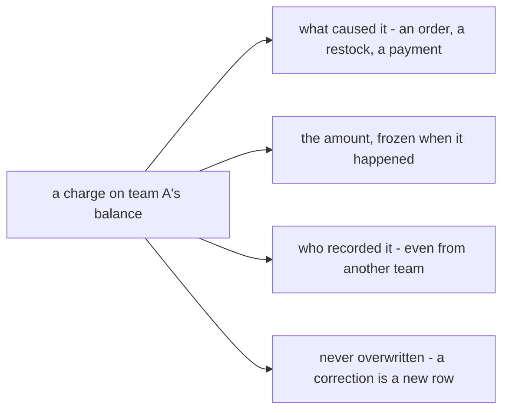

# Decisions — `business_level.md`

What the owner decided about [business_level.md](./business_level.md), recorded before it is acted on. **Append-only**
— the opposite lifecycle to [business_level_clarify.md](./business_level_clarify.md), which holds only what is still
open. Earlier answers to this doc's questions live in the context that could answer them, linked from the clarify.

| | |
| --- | --- |
| [transparency-is-every-charge-traceable](#transparency-is-every-charge-traceable) | *transparency accounting* means: every charge a team bears shows what caused it, its frozen amount and who recorded it — never overwritten |

---

## transparency-is-every-charge-traceable

> Owner, in chat (2026-10-31): *"yes"* — to [Q5](./business_level_clarify.md#question), *what does "transparency
> accounting" have to prove, and to whom?*, on the claim recommended. As recommended.

**The verdict.** §covered 3, *"provide transparency accounting"*, means one testable claim:

> Any team can see, for every charge against it, **the event that caused it**, **the amount frozen at that moment**, and
> **who recorded it** — even when that person is not on their team. Nothing is overwritten; a correction is a new row.

**To whom:** each team, about the money between it and every other team — not the owner reading the whole business,
which the metrics already serve.

| the claim's part | where it is decided | built |
| --- | --- | --- |
| the cause | the log's `source_type` / `source_id` | ✅ [liability_log.go](../../backend/services/liability_service/liability_service_models/liability_log.go) |
| the frozen amount | [the-ledger-charges-the-frozen-line-total](../technical/balance/team_balance_design_decision.md#the-ledger-charges-the-frozen-line-total) | ✅ |
| who recorded it | [every-entry-names-who-posted-it](../technical/balance/team_balance_design_decision.md#every-entry-names-who-posted-it) | ✅ `actor_id` |
| both teams see it | [the-pair-detail-shows-both-logs](../technical/balance/team_balance_design_decision.md#the-pair-detail-shows-both-logs) | ✅ |
| never overwritten | append-only logs ([ledger-logs-are-append-only](../technical/ledger/mutation_and_ledger_decision.md#ledger-logs-are-append-only)); an expense corrected by a new row ([every-correction-is-a-signed-adjustment](./analytic/context_decision.md#every-correction-is-a-signed-adjustment)) | ⛔ the expense correction is not built — `ExpenseUpdate` still overwrites |

**What follows:** a new kind of charge between teams owes this claim — a cause, a frozen amount, an actor, both sides'
view — or it is not transparent by the project's own definition.
