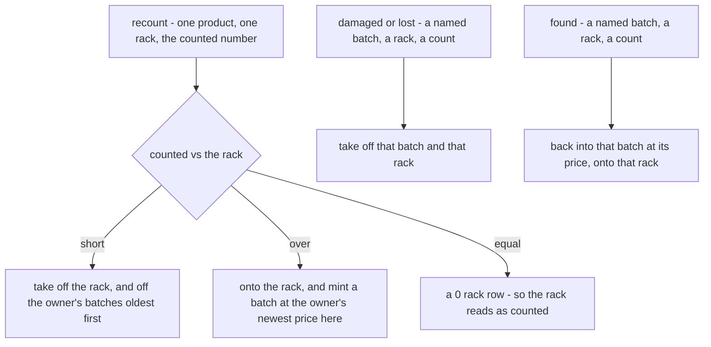
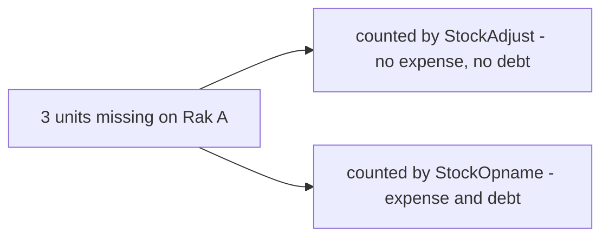

# Clarify — `inventory/adjustment.md`

[adjustment.md](./adjustment.md) is yours, and this file is mine. When a point is answered I delete it here, and your
answer goes in an `adjustment_decision.md` beside it.

> 🆕 **Opened 2026-10-16:** you chose to keep `StockAdjust` and the one-rack `StockOpname` working through the cut-over,
> ported onto the ledgers **provisionally**
> ([old-shelf-corrections-move-onto-the-ledgers-provisionally](../../technical/stock/design_decision.md#old-shelf-corrections-move-onto-the-ledgers-provisionally)).
> Your adjustment.md is still empty, so every choice the port had to make is listed below — confirm or reverse each.
> Until then the port keeps today's behaviour wherever today had one.

## Proposed Design

The port, per reason. Every call writes `adjustment` transactions — one per owning team — and both ledgers move the
same units (both-ledgers-count-the-same-units).

| call | ledgers | money — unchanged from today |
| --- | --- | --- |
| `StockAdjust` recount | as drawn above | **none** |
| `StockAdjust` damaged / lost | the named batch, value at its share | written off to expense after commit; the owner is owed it, inside the transaction |
| `StockAdjust` found | the named batch, at its `price_unit` | the owner's debt given back; no expense |
| `StockOpname` (one rack, many lines) | each line is a recount; one transaction per owning team | the shortfall written off (one expense for the rack) and owed to each owner |
| unplaced | refused — every unit is on a rack ([there-is-no-unplaced-pile](./restock_decision.md#there-is-no-unplaced-pile)) | — |

## Critique

### A recount's surplus has no batch to land in

Today a surplus is added to the oldest batch on the shelf, at no value. The ledgers have no units without value.

**→ Recommend:** mint one batch at the owner's newest batch price in this warehouse (0 when it has none) — the rule a
found surplus already follows ([last-price-is-the-teams-newest-batch-here](./opname_decision.md#last-price-is-the-teams-newest-batch-here)).

### The same loss still moves money or not depending on the screen

A recount through `StockAdjust` books nothing; the same shortfall found by `StockOpname` is written off and owed. This
was true before the port, and the port keeps it.

**→ Recommend:** book both, as `StockOpname` does — a missing unit costs the same whichever screen counted it.

### Damaged, lost and found name a batch; the decided problem and found do not

Today a person picks the batch. The decided `problem` and `found` transactions (problem-and-found-replace-opname) take
and claim by rule, not by choice.

**→ Recommend:** keep the named batch until adjustment.md says otherwise — these are provisional, and changing who
chooses the batch changes the screen.

## Recommendation

Confirm the port as drawn, with the surplus minted at the newest price and the recount booking its loss.

## Question

1. A recount's surplus: mint at the owner's newest batch price here (recommended), or another rule?
2. Should a `StockAdjust` recount write off and owe its shortfall, as `StockOpname` does? (recommended: yes)
3. Damaged / lost / found keep naming their batch until adjustment.md is designed? (recommended: yes)
4. A correct count writes a 0 rack row so the rack reads as counted — confirm?

# Contradiction

## a-recount-books-money-on-one-screen-only

The EXAMPLE — `StockAdjust`'s own comment: *"a RECOUNT loss values at the oldest batch's cost"* (Q4, 2026-08), while its
recount branch books nothing; `StockOpname` books both. One physical loss, two money outcomes.

**→ RECOMMEND:** [Q2](#question) — book both everywhere; the port is the moment to do it, since both writers are being
rewritten anyway.

