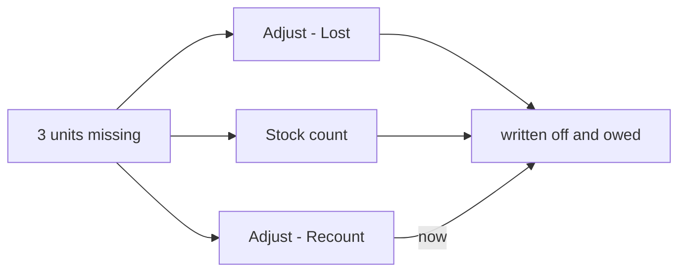
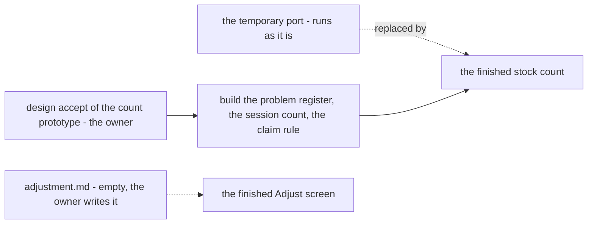

# Decisions — `inventory/adjustment.md`

What the owner decided about [adjustment.md](./adjustment.md), recorded before it is acted on. **Append-only** — the
opposite lifecycle to [adjustment_clarify.md](./adjustment_clarify.md), which holds only what is still open.

These decide the **provisional** port of `StockAdjust` and the one-rack `StockOpname` onto the ledgers
([old-shelf-corrections-move-onto-the-ledgers-provisionally](../../technical/stock/design_decision.md#old-shelf-corrections-move-onto-the-ledgers-provisionally)),
while adjustment.md itself is still empty.

| | |
| --- | --- |
| [a-recount-shortfall-is-written-off-and-owed](#a-recount-shortfall-is-written-off-and-owed) | a recount that finds fewer units than the rack holds books their cost as the stock count does — an expense, and a debt to the owning team |
| [the-finished-count-comes-next-not-a-refined-port](#the-finished-count-comes-next-not-a-refined-port) | the temporary port is not refined further; the next inventory pass builds the finished stock count |

---

## a-recount-shortfall-is-written-off-and-owed

> Owner, in chat (2026-10-31): *"tell more"*, then *"yes"* — to [Q2](./adjustment_clarify.md#question), *should a
> `StockAdjust` recount write off and owe its shortfall, as `StockOpname` does?* As recommended.

**The verdict.** A shortfall costs the same whichever screen records it. A **recount** on the Adjust screen that finds
fewer units than the rack holds now does what a stock count already does: the missing units are **written off** to the
warehouse's stock-loss expense, and the warehouse **owes the owning team** their cost. Recording the loss as *recount*
rather than *lost* no longer avoids the charge.

```
rack A-01: shelf says 10, recount says 7  →  3 short, oldest batches first
  batch #41: 2 units × Rp 10.000 = Rp 20.000
  batch #44: 1 unit  × Rp 12.000 = Rp 12.000
  → the warehouse's stock-loss expense Rp 32.000, and it owes the seller Rp 32.000
```



**The spec.**

| | |
| --- | --- |
| which units leave | the owner's batches **oldest first**, as the recount already takes them — each at its batch's price ([a-shortage-writes-a-row-per-batch](./opname_decision.md#a-shortage-writes-a-row-per-batch)) |
| the expense | one stock-loss expense for the call, after commit — as `StockOpname` and the damaged / lost reasons post it |
| the debt | owed to the owning team inside the transaction, as `PostStockDamage` lost — none when the owner is the warehouse itself |
| a surplus or an exact count | unchanged — a surplus is [Q1](./adjustment_clarify.md#question), an exact count writes its 0 rack row |
| accepted | a one-rack recount cannot tell *lost* from *on the next rack*; the provisional stock count is one-rack too and already charges, and the finished design nets a product across every rack ([a-count-nets-each-product-across-the-session](./opname_decision.md#a-count-nets-each-product-across-the-session)) |
| the finished design | unchanged — [an-adjustment-writes-the-same-problem-row](./opname_decision.md#an-adjustment-writes-the-same-problem-row) already says the same |

**What it resolves** (HARD RULE 11): the clarify's contradiction *a-recount-books-money-on-one-screen-only*.

⛔ **Not built.** The recount branch of [stock_adjust.go](../../../backend/services/inventory_service/inventory_v1/stock_adjust.go)
still moves no money.

## the-finished-count-comes-next-not-a-refined-port

> Owner, in chat (2026-10-31): *"why not direct to finished design ?"*, then *"yes"* to *"withdraw Q1, Q3 and Q4, and make
> the finished stock count the next inventory pass"*.

**The verdict.** The temporary port of `StockAdjust` and the one-rack `StockOpname`
([old-shelf-corrections-move-onto-the-ledgers-provisionally](../../technical/stock/design_decision.md#old-shelf-corrections-move-onto-the-ledgers-provisionally))
is **not refined any further** — no more decisions are spent on a version that will be replaced. It keeps running as it
is until the finished design lands. The next inventory pass builds the **finished stock count**.



| | |
| --- | --- |
| withdrawn | [Q1](./adjustment_clarify.md#question) (a recount surplus), Q3 (a named batch), Q4 (a 0 rack row) — each about the port |
| stands | [a-recount-shortfall-is-written-off-and-owed](#a-recount-shortfall-is-written-off-and-owed) — the one change to the port, already decided |
| the next pass, in order | 1 · the owner reviews and accepts the stock-count prototype ([opname.md](./opname.md)) · 2 · the stock-problem register (`warehouse_stock_problems`), the session count and the claim rule ([a-surplus-claims-a-lost-unit-first](./opname_decision.md#a-surplus-claims-a-lost-unit-first)) |
| the Adjust screen | still needs its own design — [adjustment.md](./adjustment.md) is empty; the finished count does not replace it by itself |
