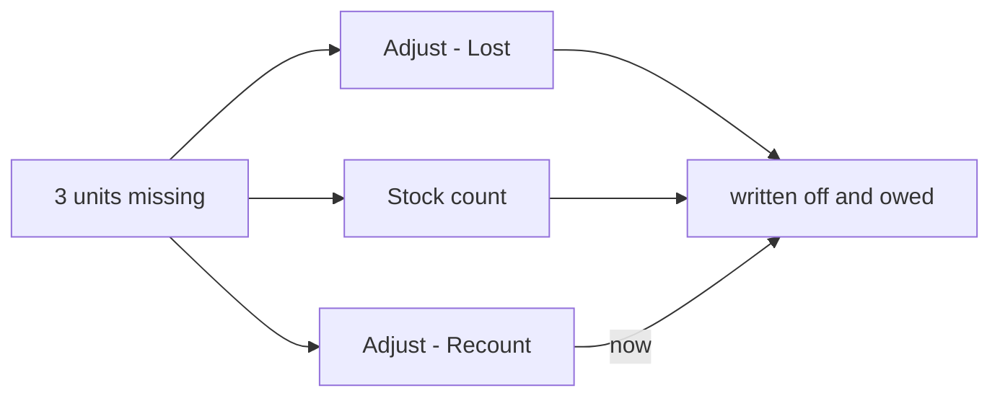
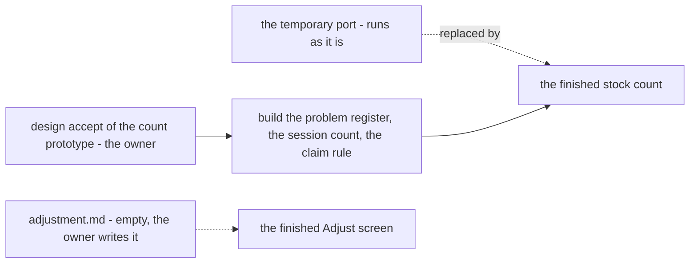

# Decisions — `inventory/adjustment.md`

What the owner decided about [adjustment.md](./adjustment_decision.md#adjustment-md-is-retired), recorded before it is acted on. **Append-only** — the
opposite lifecycle to [adjustment_clarify.md](./adjustment_clarify.md), which holds only what is still open.

These decide the **provisional** port of `StockAdjust` and the one-rack `StockOpname` onto the ledgers
([old-shelf-corrections-move-onto-the-ledgers-provisionally](../../technical/stock/design_decision.md#old-shelf-corrections-move-onto-the-ledgers-provisionally)),
while adjustment.md itself is still empty.

| | |
| --- | --- |
| [a-recount-shortfall-is-written-off-and-owed](#a-recount-shortfall-is-written-off-and-owed) | a recount that finds fewer units than the rack holds books their cost as the stock count does — an expense, and a debt to the owning team |
| [the-finished-count-comes-next-not-a-refined-port](#the-finished-count-comes-next-not-a-refined-port) | the temporary port is not refined further; the next inventory pass builds the finished stock count |
| [adjustment-md-is-retired](#adjustment-md-is-retired) | adjustment.md is deleted — what it was for is decided; correcting a wrong stock-in waits in the backlog | owner, as recommended | — |
| [the-warehouse-corrects-a-wrong-stock-in-alone](#the-warehouse-corrects-a-wrong-stock-in-alone) | the receiving warehouse's Owner or Admin corrects a wrong stock-in count alone, with a reason | owner, as recommended | — |
| [a-stock-in-correction-keeps-the-batch-price](#a-stock-in-correction-keeps-the-batch-price) | a wrong stock-in correction moves units at the batch's own price; units out are missing at the door, borne by the seller | owner, as recommended | — |
| [a-wrong-stock-in-is-a-received-count-correction](#a-wrong-stock-in-is-a-received-count-correction) | the correction is called Koreksi Jumlah Terima / Correct Received Count | owner, as recommended | — |
| [the-received-count-prototype-is-accepted](#the-received-count-prototype-is-accepted) | Koreksi Jumlah Terima looks and refuses as the prototype shows | owner, as recommended | — |
| [a-received-count-correction-counts-on-its-own-day](#a-received-count-correction-counts-on-its-own-day) | a received-count correction moves the figures on the day it is made, signed; past days never change | owner, as recommended | — |

---

## a-recount-shortfall-is-written-off-and-owed

> Owner, in chat (2026-10-31): *"tell more"*, then *"yes"* — to [Q2](./adjustment_clarify.md#question), *should a
> `StockAdjust` recount write off and owe its shortfall, as `StockOpname` does?* As recommended.

**The verdict.** A shortfall costs the same whichever screen records it. A **recount** on the Adjust screen that finds
fewer units than the rack holds now does what a stock count already does: the missing units are **written off** to the
warehouse's stock-loss expense, and the warehouse **owes the owning team** their cost. Recording the loss as *recount*
rather than *lost* no longer avoids the charge.

```
rack A-01: shelf says 10, recount says 7  →  3 short, oldest batches first
  batch #41: 2 units × Rp 10.000 = Rp 20.000
  batch #44: 1 unit  × Rp 12.000 = Rp 12.000
  → the warehouse's stock-loss expense Rp 32.000, and it owes the seller Rp 32.000
```



**The spec.**

| | |
| --- | --- |
| which units leave | the owner's batches **oldest first**, as the recount already takes them — each at its batch's price ([a-shortage-writes-a-row-per-batch](./opname_decision.md#a-shortage-writes-a-row-per-batch)) |
| the expense | one stock-loss expense for the call, after commit — as `StockOpname` and the damaged / lost reasons post it |
| the debt | owed to the owning team inside the transaction, as `PostStockDamage` lost — none when the owner is the warehouse itself |
| a surplus or an exact count | unchanged — a surplus is [Q1](./adjustment_clarify.md#question), an exact count writes its 0 rack row |
| accepted | a one-rack recount cannot tell *lost* from *on the next rack*; the provisional stock count is one-rack too and already charges, and the finished design nets a product across every rack ([a-count-nets-each-product-across-the-session](./opname_decision.md#a-count-nets-each-product-across-the-session)) |
| the finished design | unchanged — [an-adjustment-writes-the-same-problem-row](./opname_decision.md#an-adjustment-writes-the-same-problem-row) already says the same |

**What it resolves** (HARD RULE 11): the clarify's contradiction *a-recount-books-money-on-one-screen-only*.

✅ **Built 2026-11-02.** The recount branch of [stock_adjust.go](../../../backend/services/inventory_service/inventory_v1/stock_adjust.go)
reads what `PostRecount` already returns for the line — the owner, its adjustment transaction and the value of the
batches taken — and, for a shortfall, posts `PostStockDamage` as *lost* inside the transaction (none when the owner is
the warehouse) and one `PostStockLoss` under the recount's note after commit. No contract or schema change; the Adjust
screen is unchanged. Tests: `TestStockAdjust_ARecountShortfallIsOwed`, `…SurplusOwesNothing`,
`…OfTheWarehousesOwnGoodsOwesNobody`, and the write-off in `TestStockAdjust_WritesOffLossValue`.

## the-finished-count-comes-next-not-a-refined-port

> Owner, in chat (2026-10-31): *"why not direct to finished design ?"*, then *"yes"* to *"withdraw Q1, Q3 and Q4, and make
> the finished stock count the next inventory pass"*.

**The verdict.** The temporary port of `StockAdjust` and the one-rack `StockOpname`
([old-shelf-corrections-move-onto-the-ledgers-provisionally](../../technical/stock/design_decision.md#old-shelf-corrections-move-onto-the-ledgers-provisionally))
is **not refined any further** — no more decisions are spent on a version that will be replaced. It keeps running as it
is until the finished design lands. The next inventory pass builds the **finished stock count**.



| | |
| --- | --- |
| withdrawn | [Q1](./adjustment_clarify.md#question) (a recount surplus), Q3 (a named batch), Q4 (a 0 rack row) — each about the port |
| stands | [a-recount-shortfall-is-written-off-and-owed](#a-recount-shortfall-is-written-off-and-owed) — the one change to the port, already decided |
| the next pass, in order | 1 · the owner reviews and accepts the stock-count prototype ([opname.md](./opname.md)) · 2 · the stock-problem register (`warehouse_stock_problems`), the session count and the claim rule ([a-surplus-claims-a-lost-unit-first](./opname_decision.md#a-surplus-claims-a-lost-unit-first)) |
| the Adjust screen | still needs its own design — [adjustment.md](./adjustment_decision.md#adjustment-md-is-retired) is empty; the finished count does not replace it by itself |

✅ **Built 2026-11-02 — the backend step.** The finished count is in (the-count-prototype-is-accepted in
[opname_decision.md](./opname_decision.md#the-count-prototype-is-accepted)), and the Adjust screen's damaged and lost
became the register's second door ([an-adjustment-writes-the-same-problem-row](./opname_decision.md#an-adjustment-writes-the-same-problem-row)):
a `problem` transaction of the batch's owner and one `warehouse_stock_problems` row for the named batch, on the reported
rack (`inventory_mutations/post_problem.go`, `stock_adjust_problem_test.go`). The recount and the found are unchanged —
provisional `adjustment` transactions — and every adjust is refused on a product a count holds. The one-rack
`StockOpname` is retired.

---

## adjustment-md-is-retired

> Owner (Heri), in chat (2026-11-09): *"lets talk about adjustment.md, all decision is made right ? and this file just i forget to delete it"*, then *"A"* — as recommended: delete the file, point its links here, keep the one open point in the backlog.

**The verdict.** `adjustment.md` — a heading and nothing under it — is **deleted**. What it was meant to hold is decided and built elsewhere:

| | decided by |
| --- | --- |
| a recount shortfall | [a-recount-shortfall-is-written-off-and-owed](#a-recount-shortfall-is-written-off-and-owed) |
| the finished stock count | [the-finished-count-comes-next-not-a-refined-port](#the-finished-count-comes-next-not-a-refined-port), [the-count-prototype-is-accepted](./opname_decision.md#the-count-prototype-is-accepted) |
| damaged / lost on the Adjust screen | [an-adjustment-writes-the-same-problem-row](./opname_decision.md#an-adjustment-writes-the-same-problem-row) |
| found stock, a surplus | [an-adjust-found-waits-for-the-owner-or-admin](./opname_decision.md#an-adjust-found-waits-for-the-owner-or-admin), [a-surplus-claims-a-lost-unit-first](./opname_decision.md#a-surplus-claims-a-lost-unit-first) |

**The one point left open:** correcting a **wrong stock-in** (a restock or transfer accepted with the wrong count). Its direction is decided — never rolled back, corrected by an `adjustment` for the units still there ([a-rollback-only-undoes-a-take](./transaction_decision.md#a-rollback-only-undoes-a-take)) — but the correction itself (who makes it, whether it moves money, how it names what it corrects) is not designed. It waits in `docs/development_state/backlog.md` (*Later*), to be designed when needed; until then a recount shortfall is the only way, and it wrongly charges the warehouse a loss.

**What it ripples** (HARD RULE 11): the links into `adjustment.md` — in [adjustment_clarify](./adjustment_clarify.md), this file, [opname_decision](./opname_decision.md), [placement_decision](./placement_decision.md), [transaction_decision](./transaction_decision.md) and `development_state/inventory/opname.md` — now point here; their words are kept as written.

---

## the-warehouse-corrects-a-wrong-stock-in-alone

> Owner (Heri), in chat (2026-11-12): *"Tell more about q1"*, then *"B"* — to: who corrects a **wrong stock-in** (a restock or transfer accepted with the wrong count — [adjustment-md-is-retired](#adjustment-md-is-retired)'s open point)? A (recommended): the warehouse proposes, the seller's Owner or Admin approves before anything moves; **B: the warehouse corrects alone**; C: only the seller corrects. **Against the recommendation.**

**The verdict.** The **receiving warehouse's Owner or Admin** corrects the count on the restock or transfer it accepted, **with a reason**, and the correction **applies at once** — no approval by the selling team. The selling team sees it in the restock's / transfer's history and the batch's.

| | |
| --- | --- |
| who | the receiving warehouse's Owner or Admin (the side that counted the box — [any-warehouse-member-counts-what-arrived](./restock_decision.md#any-warehouse-member-counts-what-arrived)) |
| a reason | required |
| approval | none — it posts when saved |
| the selling team | sees the correction, its reason and who made it; does not approve it |
| how | an `adjustment` for the units still there, never a rollback ([a-rollback-only-undoes-a-take](./transaction_decision.md#a-rollback-only-undoes-a-take)) |

The money of a correction and its name are asked separately. ⚠ Not built.

✅ Built 2026-11-13 (backend) — `RestockRequestService.RestockReceivedCountCorrect` and `WarehouseTransferService.WarehouseTransferReceivedCountCorrect`: the receiving warehouse's Owner or Admin (Root and the Administrator stamped `is_override`), a required reason (trimmed, ≤ 200), posted at once in one stock transaction as an `adjustment` — no approval step; the selling team reads the correction rows on the restock's / transfer's detail. The screens are phase 2.

---

## a-stock-in-correction-keeps-the-batch-price

> Owner (Heri), in chat (2026-11-12): *"A"*, as recommended — to: the money of a wrong stock-in correction ([the-warehouse-corrects-a-wrong-stock-in-alone](#the-warehouse-corrects-a-wrong-stock-in-alone)). A: the batch's price never changes; B: re-price the batch as if the right count had been typed; C: no money moves.

**The verdict.** The batch's unit price **never changes**. A correction moves units at that price:

| the count was | the correction | the money |
| --- | --- | --- |
| **too many** (typed 12, the box held 10) | the 2 phantom units leave the batch | they become **missing at the door** on that restock or transfer, at the batch price — the **selling team bears** them, as if typed short at accept ([a-short-unit-at-the-door-is-missing](./restock_decision.md#a-short-unit-at-the-door-is-missing), [the-selling-team-bears-broken-missing-and-lost](./warehouse_transfer_decision.md#the-selling-team-bears-broken-missing-and-lost)); never a warehouse loss |
| **too few** (typed 12, the box held 14) | the 2 real units go **into the same batch** | at the batch price |

| | |
| --- | --- |
| units already gone (sold, moved, lost) | keep the price they left at |
| refused | taking out more units than the batch still holds — only the units still there are corrected ([a-rollback-only-undoes-a-take](./transaction_decision.md#a-rollback-only-undoes-a-take)) |
| the restock's costs | stay spread over the original count ([unit-price-is-line-price-plus-costs-per-unit](./restock_decision.md#unit-price-is-line-price-plus-costs-per-unit)) — no re-pricing |

The correction's name is asked separately. ⚠ Not built.

✅ Built 2026-11-13 (backend) — units out leave the line's batch (a transfer: its newest good layers' batches first) at the batch's price and the named rack; units in go back into the same batch (a transfer: the next layers', a layer with no batch at B minted at its own price) onto the named rack; the batch's price never changes, the restock's costs are not re-spread; more out than the batch or the rack still holds is refused (FailedPrecondition). Units out are the line's *Kurang (koreksi)*, valued for the selling team only.

---

## a-wrong-stock-in-is-a-received-count-correction

> Owner (Heri), in chat (2026-11-12): *"A"*, as recommended — to: what is the wrong stock-in correction ([the-warehouse-corrects-a-wrong-stock-in-alone](#the-warehouse-corrects-a-wrong-stock-in-alone), [a-stock-in-correction-keeps-the-batch-price](#a-stock-in-correction-keeps-the-batch-price)) called? The app already says *Koreksi Harga* (Correct Price) and *Koreksi* on the batch page (Adjust). A: *Koreksi Jumlah Terima*; B: *Koreksi Jumlah*; C: *Penyesuaian*.

**The verdict.**

| where | id | en |
| --- | --- | --- |
| the action, on the restock / transfer page | **Koreksi Jumlah Terima** | **Correct Received Count** |
| the history row | **Jumlah terima dikoreksi · 12 → 10**, with the reason and who | **Received count corrected · 12 → 10** |
| units taken out | the restock's / transfer's existing *Kurang* (missing at the door) word, marked **(koreksi)** | *Missing* **(correction)** |

It names what changed — the count the door received — and is never confused with the batch page's *Koreksi* (broken, lost, recount). In the ledger it stays an `adjustment` ([a-rollback-only-undoes-a-take](./transaction_decision.md#a-rollback-only-undoes-a-take)). A new screen element, so a Storybook prototype comes first for the owner's design accept. ⚠ Not built.

✅ Built 2026-11-13 (backend) — the ledger rows are an `adjustment` transaction whose batch and rack rows carry the change types `restock_correction` / `transfer_correction`; `StockHistory`, `RackHistory` and `OwnerStockHistory` read them as ADJUST with `received_count_correction` (from → to, the reason, the restock or transfer) for the *Jumlah terima dikoreksi · 12 → 10* row; the details carry `missing_by_correction` for *Kurang (koreksi)*.

---

## the-received-count-prototype-is-accepted

> Owner (Heri), in chat (2026-11-12): *"A"*, as recommended — to the Storybook prototype (`features/receivedCount/ReceivedCount.stories.tsx`, screenshots of the restock page's action, the form, the confirm, the warehouse's and the selling team's result, the transfer's, the batch history, the phone sheet) of [a-wrong-stock-in-is-a-received-count-correction](#a-wrong-stock-in-is-a-received-count-correction).

**The verdict.** Accepted as shown.

| | |
| --- | --- |
| where | the header of an **accepted** restock (beside Print) and an **accepted incoming** transfer, on the receiving warehouse's page; an icon / the ⋯ menu on a phone; never in list rows |
| who | the receiving warehouse's Owner or Admin, and Root / the System Administrator (*oleh tim Root*) — not staff, not the selling team, not the sending warehouse |
| the form | per line: ordered, received, broken, the batch and how many it still holds, the **real count**; too many → *N Kurang (koreksi)* out of the batch, from a rack the batch sits on; too few → *N* into the batch, onto a chosen rack; **units only**; a required reason; a confirm (never rolled back); a bottom sheet on a phone |
| refused, under the line | no change; below the broken count; more than ordered (restock) or sent (transfer); more out than the batch or the rack still holds; an empty reason |
| the result | the line reads *18 · dikoreksi dari 20*, *Kurang (koreksi) +2*; history *Jumlah terima dikoreksi · 20 → 18* + reason + who; the selling team also reads *senilai Rp … · ditanggung tim penjual*; the batch history shows the − / + |
| a unit over the line found later | **found stock** — Adjust › Found, approved by the Owner or Admin ([an-adjust-found-waits-for-the-owner-or-admin](./opname_decision.md#an-adjust-found-waits-for-the-owner-or-admin)), not a correction |
| Team Balance | nothing posts — a unit missing at the door is the selling team's own loss |

Which day the Analytic and supplier figures move is asked separately. ⚠ Not built.

✅ Built 2026-11-13 (backend) — who (the policy: Root, the Administrator, the warehouse's Owner and Admin; another warehouse's restock or transfer NotFound; the sending warehouse cannot), the refusals (no change, below broken, more than ordered / sent — *found stock: Adjust › Found*, more out than the batch or the rack holds, an empty reason, not accepted, a stale form, a product a running count holds on the rack), units only for the warehouse (`price_unit` / `total` / `missing_by_correction_total` unset), *dikoreksi dari* (`corrected_from`), the history rows (`count_corrections`), the form's facts (`correction_facts`: the batch, how many it holds, the racks) and no Team Balance posting. The screens are phase 2.

✅ Built 2026-11-13 (screens) — the prototype is live: *Correct Received Count* on the restock and transfer pages of the receiving warehouse (its Owner and Admin, Root stamped *by Root team*; accepted only; an icon on a phone, the ⋯ menu on a transfer), the form and its phone sheet on the server's facts (what the batch still holds, the racks holding the product), its refusals inline and the server's own message, the confirm; the lines' *corrected from N* and *Kurang N (correction)*, the history row with reason and who, the selling team's *worth Rp … · borne by the selling team*, and the batch's history row. Stories `features/receivedCount/ReceivedCount.stories.tsx`, e2e `the_received_count_is_corrected.spec.ts`.

---

## a-received-count-correction-counts-on-its-own-day

> Owner (Heri), in chat (2026-11-13): *"A"*, as recommended — to: when a received count is corrected ([the-received-count-prototype-is-accepted](#the-received-count-prototype-is-accepted)), which day do Analytic's Restock and Transfer metrics and the supplier's restock figures move on? A: the correction day, signed; B: the accept day, re-folded; C: they do not move.

**The verdict.** On **the day the correction is made**, signed. *Example:* accepted on 3 Nov as 20, corrected on 10 Nov to 18 → on **10 Nov** Restock reads accepted **−2** and missing at the door **+2** (value likewise), the supplier's restock figures the same; **3 Nov never changes**. A transfer's correction moves its *received* (and missing) the same way on its own day.

| | |
| --- | --- |
| Ready stock | already moves on the correction day — the stock change's own daily row ([ready-stock-is-folded-in-the-stock-changes-own-step](../analytic/rpc_provide_decision.md#ready-stock-is-folded-in-the-stock-changes-own-step)) |
| the restock / transfer page and the batch history | show the corrected count and the history row |
| past days | never re-folded |

⚠ Not built.

✅ Built 2026-11-13 (backend) — the correction's change rows land on its own day (`inventory_stock_daily_changes`, the stock transaction's last step): Restock reads accepted −N / +N and value, and missing at the door +N / −N (`inventory_door_daily_reports`, signed) on that day; Transfer reads received ±N and value on that day (a transfer's door missing has no Analytic figure; the detail carries it); Ready stock moves through the same row; the supplier's restock figures move on the correction day through the `RestockReceivedCountCorrected` event (`supplier-count-corrected`, the fold's handler, rebuilt by its day re-fold); the accept's day is never re-folded.
