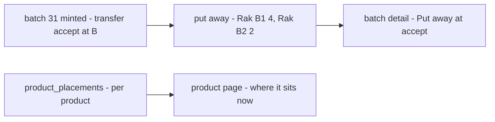

# Decisions — `inventory/batch.md`

What the owner settled about [batch.md](./batch.md), recorded before it is acted on. **Append-only** — a decision that is
later reversed is renamed and its references grepped (RULE 12), never quietly edited away.

| decision | says | from |
| --- | --- | --- |
| [a-batch-shows-the-racks-it-was-put-on](#a-batch-shows-the-racks-it-was-put-on) | a batch's racks are the racks its units were put away on when it was minted — history, labelled as put-away; where a product sits now is the product's own racks | chat, 2026-10-17 — as recommended |

---

## a-batch-shows-the-racks-it-was-put-on

> Owner, in chat *(2026-10-17)*: *"Racks it was put on"*, as recommended — asked what the batch detail's *where is this
> batch* tab and the batch receipt's rack column show, now that a rack counts units per product and never per batch
> ([expiry-is-a-report](./context_decision.md#expiry-is-a-report)).

**The verdict.** A rack does not know which batch a unit came from, so "where does batch 31 sit now" has no answer. A
batch shows instead **where its units were put away when it was minted** — the racks its restock's or transfer's
accept put them on. It is history, and the screen says so. Where the product sits today is the product's own racks.

**The spec.**

| | |
| --- | --- |
| a batch's racks | the rack rows of the transaction that minted it, for its product: `product_placement_logs` where `transaction_id` = `batches.transaction_id`, `product_id` = its product, `stock_change > 0` |
| the label | *put away at accept* — never *on hand* |
| a batch minted with no rack row | none listed |
| where it sits now | the product's racks (`product_placements`), on the product's page |
| one batch per product per mint | a restock lists a product once ([a-product-appears-once-per-restock](./restock_decision.md#a-product-appears-once-per-restock)) and a transfer mints one batch per source layer — several layers of one product share the in-leg's rack rows, so each lists the product's put-away |
