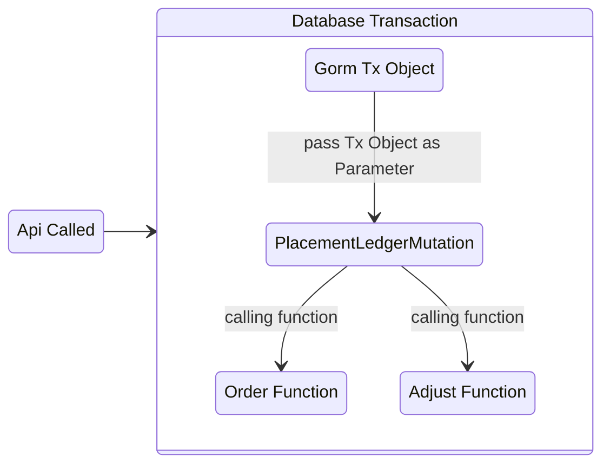

# Inventory Contexts.
**this design proposed by heri, toni have other design proposed too**

## General.
1. for restock reference, [see this](./restock.md)
2. for return reference,  [see this](./return.md)
3. when we on git branch `thoni`. avoid this context, `thoni` have own consideration. dont make this context as reference, decision and other. make this context folder like dont exists and ignored

## Responsbility.
1. managing stock.
2. managing restock.
3. managing return.
4. doing opname.
5. managing placements.
6. provide solid api for other service. like order for creating order.

## How We Breakdown Complexity in Inventory Service.
First, we have named `mutations`. Its collection of ready use function that acomodated batch ledger and placement ledger inside opened database transaction.

This is For Example:

## Placements.
Placement is like warehouse rack or physical placement in warehouse. like "rak 1", "rak ruang tengah" and other.

In Warehouse Team, we can:
- create placement
- update placement
- delete placement, placement can be delete if only have no stocks. And its soft delete

Placement have own ledger. [see this](./placement_ledger.md)

## Batches.
We have batch in inventory service. Because our product have different price unit across team and across time. for the reference [see this](./batch_ledger.md)

## Table that must we have for linking products.
1. Table `warehouse_products`
    
    field that must be have:
    - `id`
    - `team_id`
    - `warehouse_id`
    - `product_id`
    - `created_at`
    