# Decisions — `inventory/context.md`

What the owner settled, recorded before it is acted on. **Append-only** — a decision that is later
reversed is renamed and its references grepped (RULE 12), never quietly edited away.

| decision | what it decided |
| --- | --- |
| [stock-merges-into-inventory](#stock-merges-into-inventory) | there is no separate stock context — its rules live in `inventory/context.md` |
| [every-stock-change-belongs-to-a-transaction](#every-stock-change-belongs-to-a-transaction) | one `inventory_transactions` row per operation; both ledgers' log rows point at it — 🔄 its *no items table* is reversed by [a-transaction-lists-its-items](./transaction_decision.md#a-transaction-lists-its-items) |
| [one-mutation-per-operation](#one-mutation-per-operation) | a mutation is one operation — `PostOrder`, `PostRestock` — and it writes the transaction row and both ledgers; no RPC writes a ledger directly |
| [an-order-takes-from-the-lowest-shelf-first](#an-order-takes-from-the-lowest-shelf-first) | `PostOrder` lowers the product's shelf holding the fewest units first; the batch side stays FIFO |
| [batch-logs-carry-price-unit-after](#batch-logs-carry-price-unit-after) | `batch_logs` gains `price_unit_after`; `batch_price_logs` is kept beside it, and a mint or a revaluation writes both |
| [one-shelf-row-per-product-per-placement](#one-shelf-row-per-product-per-placement) | `product_placements` is unique on (`product_id`, `placement_id`); a placement's code is unique among the warehouse's undeleted placements |
| [superseded-a-placement-deletes-only-when-nothing-waits-on-it](#superseded-a-placement-deletes-only-when-nothing-waits-on-it) | ⛔ reversed — a placement deletes at 0 stock; staff and admin talk it over first ([a-placement-deletes-at-zero-stock](./placement_decision.md#a-placement-deletes-at-zero-stock)) |
| [the-owning-team-revalues-with-a-reason](#the-owning-team-revalues-with-a-reason) | only the owning team's Owner or Admin changes a batch's price, with a reason, and the warehouse sees it |
| [batches-lock-before-shelves-by-id](#batches-lock-before-shelves-by-id) | every mutation locks batches first, then shelves, each in id order — and locks a product's shelves before choosing among them by stock |
| [the-layer-under-a-mutation-is-a-ledger](#the-layer-under-a-mutation-is-a-ledger) | the per-ledger functions are a *Placement Ledger* and a *Batch Ledger*; only a mutation calls them |
| [a-wrong-rack-pick-waits-for-the-count](#a-wrong-rack-pick-waits-for-the-count) | the picker does not confirm the rack; a pick from another rack is corrected by the next stock opname |
| [a-broken-unit-is-thrown-away](#a-broken-unit-is-thrown-away) | a broken unit is taken off its rack and thrown away — no rack holds it, nobody gets it back; the warehouse pays the team for it |
| [the-two-inventory-designs-live-on-separate-branches](#the-two-inventory-designs-live-on-separate-branches) | this folder is Heri's inventory design; Toni's lives on branch `thoni`, where this folder is ignored — the two are kept apart, not compared on one page |
| [return-is-unplanned](#return-is-unplanned) | inventory designs nothing for a return yet; what depends on one is parked, not answered |
| [each-flow-draws-its-own-receiving](#each-flow-draws-its-own-receiving) | context.md no longer draws receiving; restock.md draws a restock's, return.md will draw a return's |
| [both-ledgers-count-the-same-units](#both-ledgers-count-the-same-units) | per transaction and product, the batch change equals the placement change; no batch goes below zero | chat, 2026-10-15 — answers Q14a, as recommended |
| [a-batch-keeps-its-supplier](#a-batch-keeps-its-supplier) | `batches.supplier_id` beside `supplier_channel_id`, both optional, copied from the restock line at accept | chat, 2026-10-15 — answers Q14h, as recommended |
| [an-emptying-take-takes-all-the-value](#an-emptying-take-takes-all-the-value) | a take of *n* removes `value × n ÷ units left`, and the take that empties a batch removes all its remaining value — an emptied batch is exactly Rp 0 |
| [a-late-cost-is-an-expense-not-a-revaluation](#a-late-cost-is-an-expense-not-a-revaluation) | a cost that arrives after a restock is accepted is the selling team's `expense` (or a `transfer` to the warehouse) in the financial account — inventory does nothing; a revaluation is only a typo or a markdown |
| [inventory-owns-the-restock-end-to-end](#inventory-owns-the-restock-end-to-end) | a restock is inventory's from the selling team's create to the warehouse's accept; the supplier and the money stay outside, reached by id and by events |
| [inventory-stops-at-five-lines](#inventory-stops-at-five-lines) | inventory does not own suppliers, money, an order's status, the product, or event delivery — each named with its owner beside §Responsbility |
| [a-transfer-links-its-products-to-the-receiver](#a-transfer-links-its-products-to-the-receiver) | a transfer's create upserts its products into `warehouse_products` for the receiving warehouse, as a restock's create does |
| [expiry-is-a-report](#expiry-is-a-report) | `expired_at` drives a report of what expires soon and where; the take keeps oldest batch first, and a rack does not track batches |
| [order-returns-calls-are-return-mds-brief](#order-returns-calls-are-return-mds-brief) | only inventory's half of a return is unplanned; order_return.md stands, and its three calls into inventory are return.md's brief |

---

## stock-merges-into-inventory

> Asked in chat as *"Does inventory contain stock, or replace it?"* — `inventory/context.md` said only
> *"managing stock"*, while `stock/context.md` held the loss rules and the receiving flow. **Owner (2026-09-14):
> merge stock context to inventory context.**

**The verdict.** `stock` is no longer a big context. `business/stock/context.md` is **deleted**; its two
sections — §Stock loss and §How Warehouse Team Member Accept Stock / Return That Arrived — are appended
**verbatim** to [inventory/context.md](./context.md). The open questions moved with them to
[context_clarify.md](./context_clarify.md).

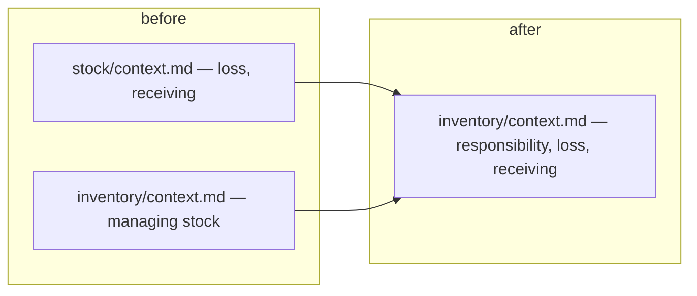

**Spec — what moved.**

| from | to |
| --- | --- |
| `business/stock/context.md` | appended to `business/inventory/context.md` |
| `business/stock/context_clarify.md` | `business/inventory/context_clarify.md` (history kept) |
| every link to either | repointed — clarify files, `biggest_question.md`, `development_state/toni.md`, the business-analyst agent, and the link target in `business_level.md` §Other Context Related |

**Not moved:** [technical/stock/design.md](../../technical/stock/design.md). The owner's instruction named
the business context; lining up the technical tree is asked in
[Question 10](./context_clarify.md#question).

---

## every-stock-change-belongs-to-a-transaction

> Owner, in [context.md](./context.md) §General Table That Must Have *(2026-10-08)* — the section that was *"Still
> Confused"*: `inventory_transactions` *"is for record all operation that happen in inventory"*, with its columns and
> `tx_type` list; `inventory_transaction_items` is gone. Same day, [placement.md](./placement.md) gives
> `product_placement_logs` a `transaction_id` and an `actor_id`, and [restock.md](./restock.md)'s accept transaction
> *"get transaction"* before it writes anything else. It answers the core of the clarify's Q13 — 13a, 13c and 13d as
> recommended (13d's drop was my first answer, which I had argued against in chat; your design keeps the declared figures
> in each act's own record, which answers that argument). 13b only in part.

**The verdict.** Every operation that changes stock is **one transaction row**, and every row in either ledger names
it. That is what ties a batch change to the shelf change made by the same act.

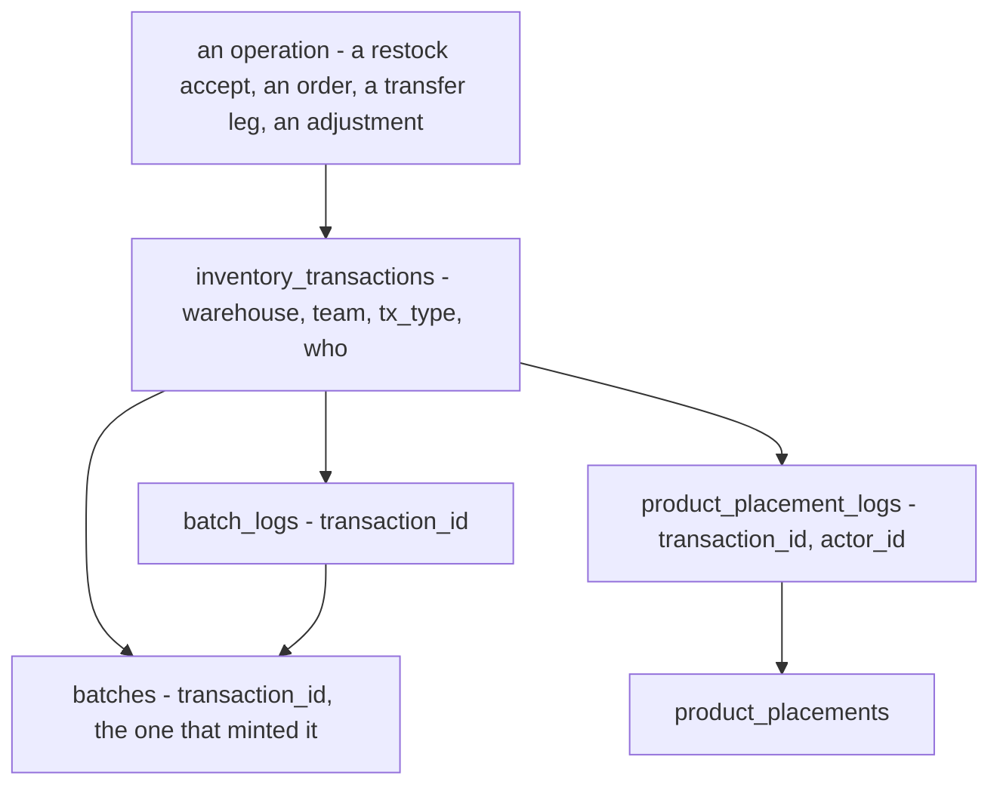

**The spec.**

| | |
| --- | --- |
| `inventory_transactions` | `id` · `warehouse_id` · `team_id` · `tx_type` · `create_by_user_id` · `updated_at` · `created_at` |
| `tx_type` | `order` · `restock` · `return` · `sample` · `transfer_in` · `transfer_out` · `adjustment` |
| `inventory_transaction_items` | **none** — the log rows are the lines |
| `batches.transaction_id`, `batch_logs.transaction_id` | as already in [batch.md](./batch.md) |
| `product_placement_logs` | 🆕 `transaction_id` · 🆕 `actor_id` |
| restock accept | the transaction comes **first**; the problem rows, the batch ledger and the placement ledger are written from it, in the one database transaction of [accept-is-one-transaction-then-an-event](./restock_decision.md#accept-is-one-transaction-then-an-event) |
| `restocks.transaction_id` | 🆕 the restock points at its transaction ([restock.md](./restock.md) §Table Should We Have In Restock, same day) |

**What it does NOT settle** — the open set is [context_clarify Q13](./context_clarify.md#question): a restock with a
second transaction, and how an order (in another service) names its own · whether accept *gets* one made earlier or *creates* one · the operations with no `tx_type`
(a shelf move, a revaluation, a count) · what `sample` is · how a mistake is undone · whose `team_id` a cross-team order
carries.

🔄 *(2026-10-09)* **Superseded in part.** The table moved to [transaction.md](./transaction.md), and the items row above is
reversed: [a-transaction-lists-its-items](./transaction_decision.md#a-transaction-lists-its-items). The open set moved to
[transaction_clarify.md](./transaction_clarify.md).

---

## one-mutation-per-operation

> Owner, in chat *(2026-10-08)*: *"for 1, per operation"*. The question was [context_clarify Q15a](./context_clarify.md#question)
> — *is a mutation one per ledger, or one per operation?* — raised by §How We Breakdown Complexity's
> `PlacementLedgerMutation` and [placement.md](./placement.md)'s per-ledger `PostOrder`. Answered as recommended.

**The verdict.** A mutation is **one operation in the building**, not one ledger. `PostOrder` takes stock for an order
from both ledgers at once, so *batch change = shelf change* is written once per operation, inside the mutation, and never
re-written by each RPC that calls it.

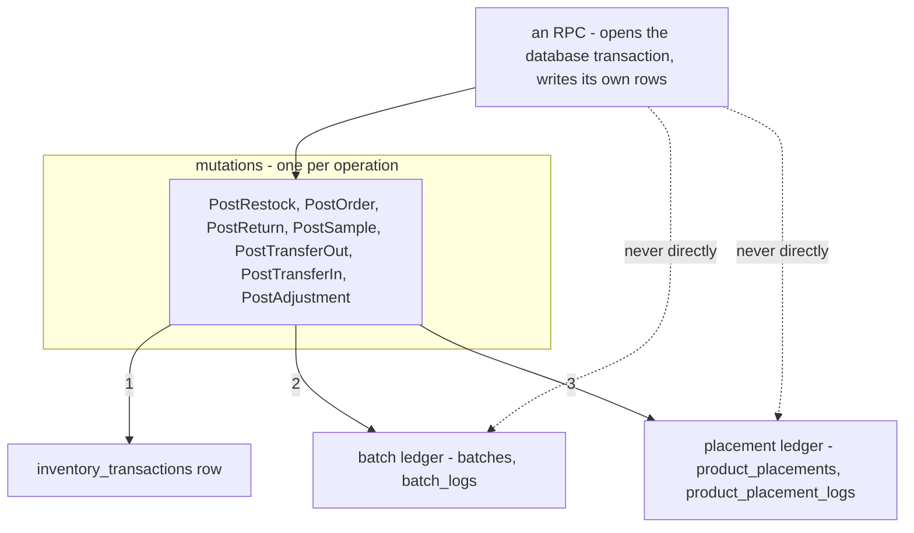

**The spec.**

| | |
| --- | --- |
| a mutation | one per operation, named `Post<Operation>` after [placement.md](./placement.md)'s `PostOrder` — one per `tx_type` |
| what it writes | the `inventory_transactions` row, then the batch ledger, then the placement ledger, in the transaction it is handed |
| the per-ledger functions | may exist beneath it — [placement.md](./placement.md) §Placement Ledger Mutation — and are called only by a mutation |
| an RPC | opens the database transaction (§How We Breakdown Complexity), writes its own rows — a restock's status, its problem items — and calls **one** mutation. It never writes a ledger |
| another service | calls an RPC, as [order.md](./order.md) draws it |

**What it does NOT settle:** which ledger is locked first ([Q15b](./context_clarify.md#question)); what the per-ledger layer
is called, now that *mutation* means the operation ([Q15c](./context_clarify.md#question)); whether the template agrees
the caller opens the transaction ([mutation_and_ledger Q4](../../technical/ledger/mutation_and_ledger_clarify.md#question)).

---

## an-order-takes-from-the-lowest-shelf-first

> Owner, in [placement.md](./placement.md) §Placement Ledger Mutation *(2026-10-08)*: *"Post Order — stock decrease with
> priority product placement that have low stock."* It answers [context_clarify Q11a](./context_clarify.md#question) —
> *an order names a product, not a shelf: which shelf does `PostOrder` lower?* — as recommended.

**The verdict.** When an order takes a product, the shelf that holds the **fewest** of it goes first. Small remainders
empty out and free their slot, instead of a few units lingering on every rack. The batch side is a separate rule: the
oldest batch goes first ([product/context.md](../product/context.md): *"batch pricing system that use FIFO"*). A shelf
does not know its batch, so the two orders never have to agree.

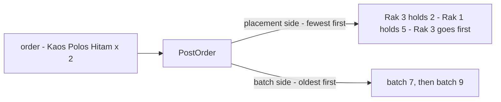

**The spec.**

| | |
| --- | --- |
| which shelves | the order's product, in the order's warehouse and team, with stock above 0 |
| the order they go in | ascending `stock_count` — the lowest first |
| the batch side | oldest batch first, independently ([one-mutation-per-operation](#one-mutation-per-operation) writes both in one call) |

**What it does NOT settle** — all in [context_clarify Q11](./context_clarify.md#question): a line bigger than the lowest
shelf, and two shelves holding the same count (11d) · whether the pick list prints the shelf, and a pick from another
shelf (11b) · a count before the pick (11c). The lock order is [Q15b](./context_clarify.md#question).

🔄 *(2026-10-13)* **Amended by [a-lock-stops-units-moving-not-sales](./opname_decision.md#a-lock-stops-units-moving-not-sales)**: the lowest shelf first, among the **unlocked**
shelves; a shelf being counted comes last.

---

## batch-logs-carry-price-unit-after

> Owner, in chat *(2026-10-08)*: *"for 14e, yes, add price_unit_after"* — then, asked what happens to
> `batch_price_logs`: **keep both**. It answers [context_clarify Q14e](./context_clarify.md#question) — **in part against
> my recommendation**, which was to drop `batch_price_logs`.

**The verdict.** Every `batch_logs` row says what the batch's unit price is **after** it, so the batch's own log reads as
a complete history of count, value and price. `batch_price_logs` stays as the dedicated record of price changes.

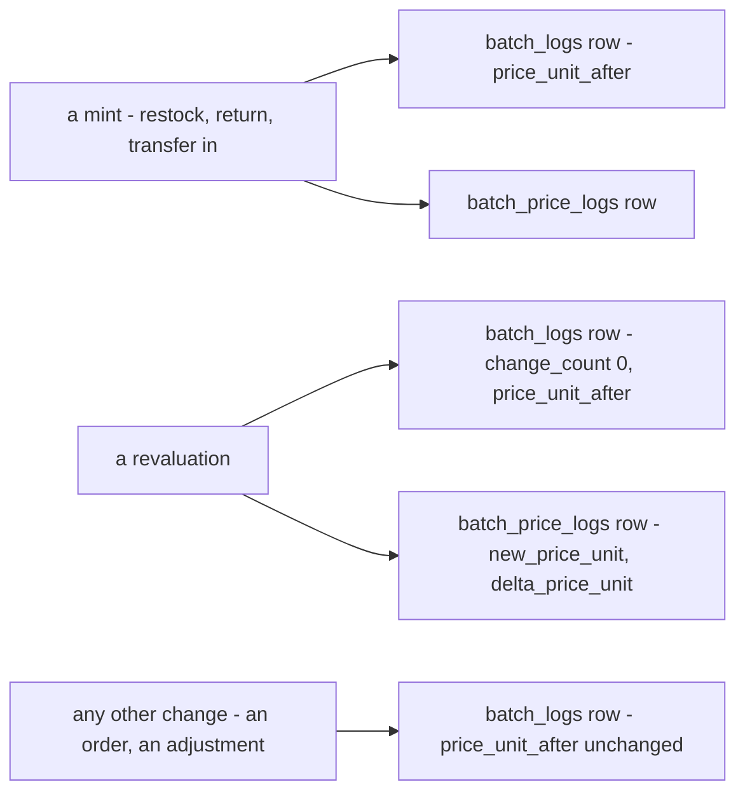

**The spec.**

| | |
| --- | --- |
| `batch_logs.price_unit_after` | 🆕 on every row — the batch's `price_unit` once this row is applied |
| a mint | writes a `batch_logs` row (`restock`, `return`…) **and** a `batch_price_logs` row — the batch's first price |
| a revaluation | writes a `batch_logs` row (`change_count` 0) **and** a `batch_price_logs` row |
| every other change | writes `batch_logs` only; `price_unit_after` repeats the current price |
| the two rows of one change | written by the one mutation, so `batch_price_logs.new_price_unit` = that `batch_logs` row's `price_unit_after` |

⚠ [batch.md](./batch.md)'s *Restock Flow Example* still draws a mint writing `batch_price_logs` only.

## one-shelf-row-per-product-per-placement

> Owner, in chat *(2026-10-08)*: *"for 14f … the unique is (product_id+placement_id)"* — then, asked what it covers: **the
> shelf rows, and a code is reusable**. It answers the uniqueness half of [context_clarify Q14f](./context_clarify.md#question),
> as recommended for the code.

**The verdict.** A product has **one row per shelf** — its count on Rak 3 is one number, never two rows to add up. And a
placement's code names a rack that exists: once *R1* is deleted, a new rack may be called *R1*.

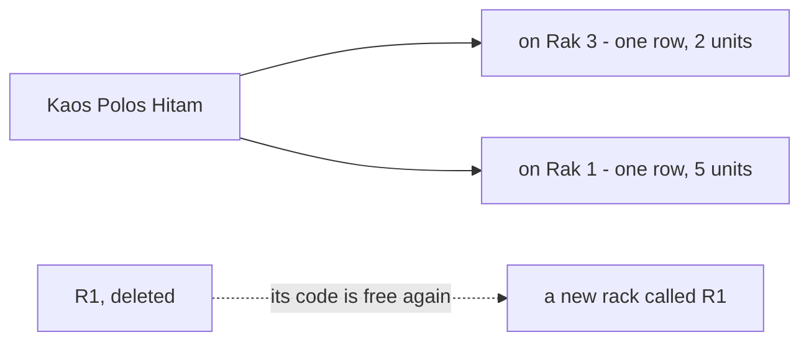

**The spec.**

| | |
| --- | --- |
| `product_placements` | unique (`product_id`, `placement_id`) — the placement fixes the warehouse, the product fixes the team |
| `placements.code` | unique per `warehouse_id` among rows where `deleted_at` is empty |

## superseded-a-placement-deletes-only-when-nothing-waits-on-it

> ⛔ **SUPERSEDED (2026-10-16)** by [a-placement-deletes-at-zero-stock](./placement_decision.md#a-placement-deletes-at-zero-stock):
> a placement at 0 stock can be deleted, with no check for a sold unit still waiting. *Picked* moved to the order
> ([picked-lives-on-the-order-timeline](./transaction_decision.md#picked-lives-on-the-order-timeline)), and the owner chose
> people over a cross-service check: the case almost never happens, and staff and admin talk before a placement is deleted.
> Kept below as it was decided.

> Owner, in chat *(2026-10-08)*: *"fo 14f i follow your recomendation"*. It answers the delete half of
> [context_clarify Q14f](./context_clarify.md#question), as recommended.

**The verdict.** A rack is deleted only when it is **truly** empty. Reading 0 is not enough: `PostOrder` lowers a shelf
when the order is created ([an-order-takes-from-the-lowest-shelf-first](#an-order-takes-from-the-lowest-shelf-first)),
so a rack can read 0 while a unit still sits on it waiting for the picker.

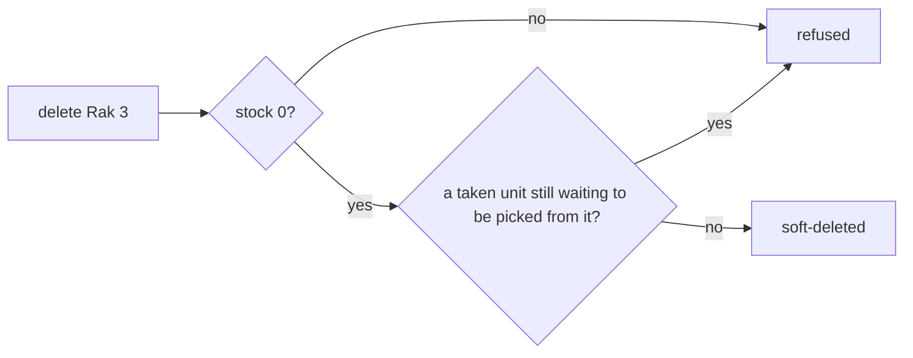

**The spec.**

| | |
| --- | --- |
| allowed when | every `product_placements` row on it is at 0 **and** no take from it is still unpicked |
| the delete | soft, as §Placements says |

**What it does NOT settle:** how inventory knows a take is unpicked — the pick time asked in
[Q11c](./context_clarify.md#question).

## the-owning-team-revalues-with-a-reason

> Owner, in chat *(2026-10-08)*: *"for 14g follow your recomendation"*. It answers
> [context_clarify Q14g](./context_clarify.md#question), as recommended.

**The verdict.** A batch's price is also what the warehouse reimburses for a unit lost in its custody
([warehouse-reimburses-unit-price](../business_level_clarify.md#warehouse-reimburses-unit-price)). So changing it is
limited to the people who own the goods, it always says why, and the warehouse holding them can see it.

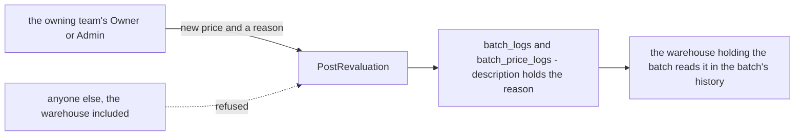

**The spec.**

| | |
| --- | --- |
| who | the Owner or Admin of the team that owns the batch — plus Root and the Administrator, as everywhere |
| the reason | required; written to `description` on both rows |
| the warehouse | sees every revaluation of a batch it holds, in that batch's history |

**What it does NOT settle:** what a revaluation is for, and where a late cost's sold share goes
([Q14d](./context_clarify.md#question)).

🔄 *(2026-10-16)* **Its open point is settled** — a revaluation is for a typo or a markdown; a late cost is an expense, never
a revaluation: [a-late-cost-is-an-expense-not-a-revaluation](#a-late-cost-is-an-expense-not-a-revaluation).

---

## batches-lock-before-shelves-by-id

> Owner, in chat *(2026-10-08)*: *"for 15b,c i follow your recomendation"*. It answers
> [context_clarify Q15b](./context_clarify.md#question), as recommended.

**The verdict.** Every mutation takes its locks in **one order**: the batch rows first, then the shelf rows, and within
each kind in ascending id. The pair working one product at the same second then queue behind each other instead of
deadlocking. Because [an-order-takes-from-the-lowest-shelf-first](#an-order-takes-from-the-lowest-shelf-first) chooses
shelves **by stock** — the very number two orders change under each other — a mutation locks all of the product's shelves
by id **first**, and chooses among them only once it holds them.

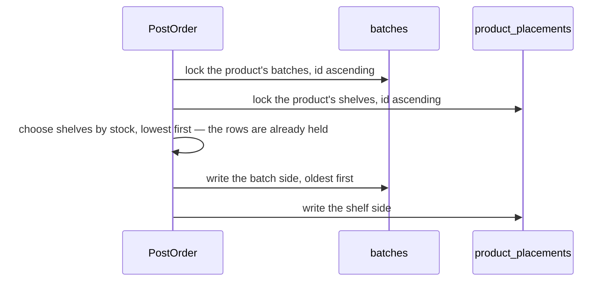

**The spec.**

| | |
| --- | --- |
| the order | `batches` before `product_placements`, each `ORDER BY id` |
| choosing by stock | after the lock, never before it — choosing first and locking in that order lets two orders lock the same rows in opposite orders |
| where it lives | inside the mutation ([one-mutation-per-operation](#one-mutation-per-operation)) — no RPC takes a ledger lock |
| proven by | the concurrency audit (`audit-sql`, [backend/pkgs/san_race](../../../backend/pkgs/san_race/)) on each write RPC |

## the-layer-under-a-mutation-is-a-ledger

> Owner, in chat *(2026-10-08)*: *"for 15b,c i follow your recomendation"*. It answers
> [context_clarify Q15c](./context_clarify.md#question), as recommended.

**The verdict.** *Mutation* means one operation ([one-mutation-per-operation](#one-mutation-per-operation)), as the ledger
template says. What writes a single ledger is called **the ledger**: a *Placement Ledger* and a *Batch Ledger*, each with
its own `PostOrder`, `PostRestock` and so on. The mutation `PostOrder` calls both ledgers' `PostOrder`; nothing outside
a mutation calls a ledger.

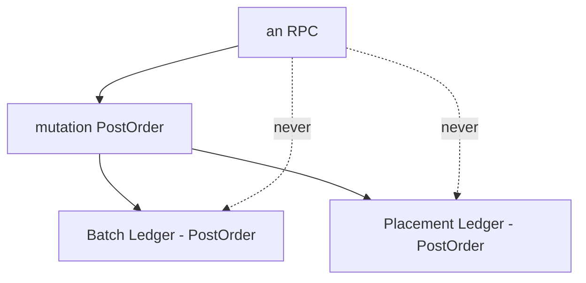

**The spec.**

| | |
| --- | --- |
| a mutation | one per operation, `Post<Operation>` — called by an RPC |
| a ledger | *Batch Ledger*, *Placement Ledger* — its functions are named for the operation too, and called only by a mutation |
| the template's word | its *Ledger Manager* is this layer |

⚠ Two places still use the old word: [placement.md](./placement.md)'s heading *Placement Ledger Mutation*, and
§How We Breakdown Complexity's diagram node `PlacementLedgerMutation` in [context.md](./context.md).

---

## a-wrong-rack-pick-waits-for-the-count

> Owner, in chat *(2026-10-08)*: *"for 11b, later warehouse staff doing stock opname and adjust the error"*. It answers
> [context_clarify Q11b](./context_clarify.md#question) — *the picker takes the item from a different rack than the system
> chose* — **against my recommendation**, which was for the picker to scan the rack they used.

**The verdict.** The pick list says which rack. The picker is not asked to confirm it. If they take the item from another
rack, nothing is recorded at the pick: the two racks stay wrong by one each until the next stock opname, and the opname's
adjustment puts them right. One scan less per pick, paid for with racks that can be briefly wrong.

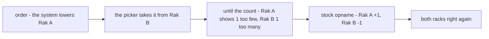

**The spec.**

| | |
| --- | --- |
| the pick | no rack confirmation — the rack on the pick list is assumed |
| a pick from another rack | both racks are off by one until counted |
| the fix | the next opname's adjustment, on both racks |

**What it does NOT settle:** that the fix must not charge the warehouse — Rak A +1 and Rak B −1 are one unit that moved,
not a loss and a find ([Q11e](./context_clarify.md#question)); and a count made *before* the pick, which the count itself
gets wrong ([Q11c](./context_clarify.md#question)).

## a-broken-unit-is-thrown-away

> Owner, in chat *(2026-10-13)*: *"broken dont have rack, its just simple take out and throw the trash"*. It answers
> [Q6](./context_clarify.md#question) — *after the warehouse has reimbursed a broken unit, whose object is it?* — and the
> broken half of [Critique 4](./context_clarify.md#critique). My recommendation, *the warehouse's*, assumed the object was
> kept; it is not.

**The verdict.** A broken unit is taken off its rack and **thrown away**. No rack or bin holds it, and it goes back to
nobody: the warehouse pays the team for it, and the object is gone. The stock ledgers only ever hold sellable units.

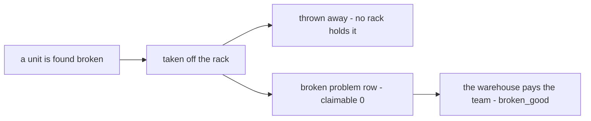

**The spec.**

| | |
| --- | --- |
| a broken unit | thrown away — never placed, never stored, never sold |
| the placement ledger | its rack goes down by it; no placement holds broken stock |
| the batch ledger | the unit leaves its batch — [broken-takes-its-batch-before-lost](./opname_decision.md#broken-takes-its-batch-before-lost) |
| the money | a `broken` problem row, `claimable_stock_count` 0 — the warehouse pays the team |
| found again | never — only a lost unit is claimed back ([a-surplus-claims-a-lost-unit-first](./opname_decision.md#a-surplus-claims-a-lost-unit-first)) |

## the-two-inventory-designs-live-on-separate-branches

> Owner, in [context.md](./context.md) §General item 2, item 3 since the return line was added *(2026-10-14)*: *"when we on git branch `thoni`. avoid this context,
> `thoni` have own consideration. dont make this context as reference, decision and other. make this context folder like
> dont exists and ignored"*. It answers the *where* of [Q10](./context_clarify.md#question) — *where is Toni's proposal?* —
> and overtakes my recommendation to write both into one repo to compare.

**The verdict.** Two inventory designs exist and stay apart. This folder is **Heri's**, worked on every branch but one;
**Toni's** is on branch `thoni`, where this folder is treated as if it did not exist — not a reference, not a decision, not
an input. Neither design is measured against the other here.

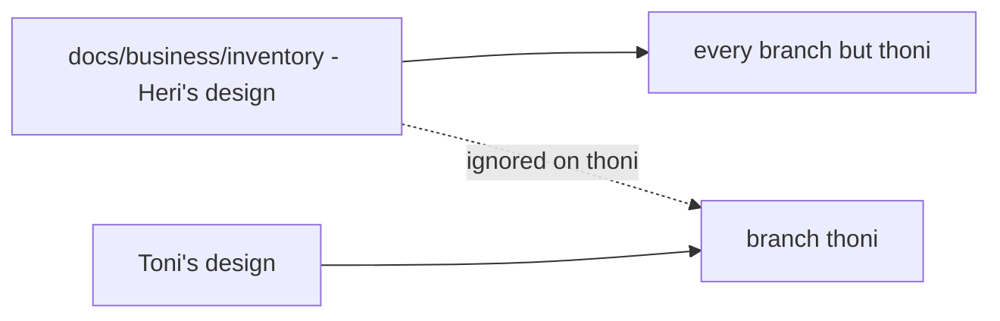

**The spec.**

| | |
| --- | --- |
| on `thoni` | `docs/business/inventory/` is not read, cited or built on, and is left out of the rollup |
| elsewhere | this folder is the inventory design |
| who picks between them | not here — [member_clarify Q4](../project/member_clarify.md#question) |

## return-is-unplanned

> Owner, in [context.md](./context.md) §General item 2 *(2026-10-14)*: *"for return reference, [see this](./return.md)"*, and
> [return.md](./return.md) *(2026-10-14)*: *"# Return Contexts. **unplanned**"*.

**The verdict.** A return has its own reference doc, as a restock does, and nothing is designed in it yet. Until it is,
inventory designs nothing for a return. A point that depends on one is **parked**: kept, but neither answered nor asked.

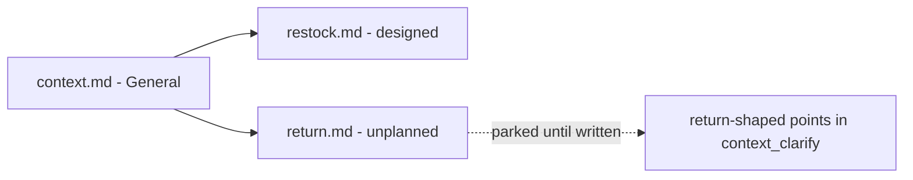

**The spec.**

| | |
| --- | --- |
| §Responsbility 3, *managing return* | stays inventory's; designed in return.md when it is planned |
| parked in [context_clarify](./context_clarify.md) | the unsellable customer return in the failure list · *which* selling team bears a cross-sold return · the return half of the receiving flow · the `return` tx_type |
| what it does NOT settle | whether [order_return.md](../order/order_return.md)'s calls into inventory are parked too ([context_clarify Q16](./context_clarify.md#question)) |

## each-flow-draws-its-own-receiving

> Owner, in [context.md](./context.md) *(2026-10-14)*: §How Warehouse Team Member Accept Stock / Return That Arrived
> **deleted**, after §General gained one reference per flow ([return-is-unplanned](#return-is-unplanned)).

**The verdict.** Receiving is drawn once, in the doc of the flow that receives. A restock's door is
[restock.md](./restock.md); a return's will be [return.md](./return.md). context.md keeps the rules that hold for every
flow (§Stock loss) and draws no procedure of its own, so a person's steps and a transaction's steps cannot disagree.

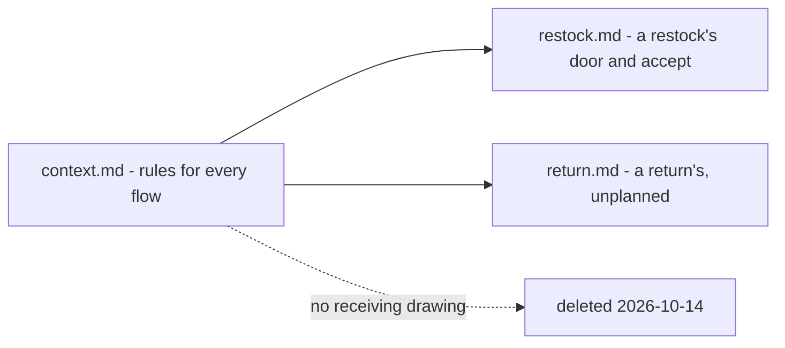

**The spec** — where each step of the deleted flow lives now:

| deleted step | now |
| --- | --- |
| receive, check on system, found | restock.md §Restock Flow |
| fee | the courier's charge and its note, at accept ([the-courier-is-paid-once-per-restock](./restock_decision.md#the-courier-is-paid-once-per-restock)) |
| lost, broken, valid quantity | `missing` worked out, broken typed, good = received − broken ([any-warehouse-member-counts-what-arrived](./restock_decision.md#any-warehouse-member-counts-what-arrived)) |
| set placements | the placement ledger, inside the accept ([accept-is-one-transaction-then-an-event](./restock_decision.md#accept-is-one-transaction-then-an-event)) |
| calculate unit price | open: the divisor, [restock_clarify Q22](./restock_clarify.md#question) |
| not found, report manually | open: [restock_clarify Q23](./restock_clarify.md#question) |
| the return half | parked ([return-is-unplanned](#return-is-unplanned)) |

**What it does NOT settle** — the scope of *"at receiving"* in §Stock loss 1, which the deleted title supplied:
[the-receiving-boundary-gap](./context_clarify.md#the-receiving-boundary-gap).

## both-ledgers-count-the-same-units

> Owner, in chat *(2026-10-15)*: *"for 1, 2, 3, 4 follow your recomendation"* — the third being
> [Q14a](./context_clarify.md#question), *nothing says the two ledgers count the same units.* As recommended.

**The verdict.** One rule, no exceptions: within one transaction, for each product, the units the batch ledger moves
equal the units the placement ledger moves. A move nets 0 on both; a revaluation moves no units on either. A unit on a
rack is always a unit some batch prices, and a unit a batch counts is always on some rack.

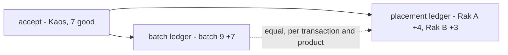

**The spec.**

| | |
| --- | --- |
| the rule | Σ batch_logs change = Σ placement_logs change, per `(transaction, product)` |
| where it is checked | every mutation's unit test asserts it |
| below zero | `CHECK (stock_count >= 0)` on `batches`, as [a-shelf-never-goes-below-zero](./placement_decision.md#a-shelf-never-goes-below-zero) put on placements |

## a-batch-keeps-its-supplier

> Owner, in chat *(2026-10-15)*: *"for 1, 2, 3, 4 follow your recomendation"* — the fourth being
> [Q14h](./context_clarify.md#question), *a batch from a stall purchase loses its supplier.* As recommended.

**The verdict.** A batch remembers who sold it even when there was no online store: `batches.supplier_id` sits beside
`supplier_channel_id`, both optional, copied from the restock line at accept
([a-line-may-name-a-supplier-without-a-channel](./restock_decision.md#a-line-may-name-a-supplier-without-a-channel)).

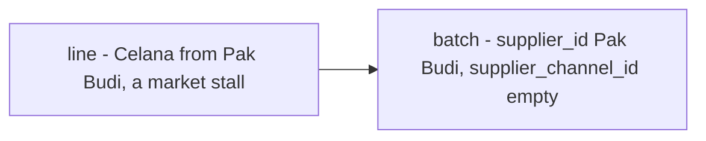

**The spec.**

| | |
| --- | --- |
| `batches.supplier_id` | 🆕 optional, an opaque supplier_service id, no FK |
| `batches.supplier_channel_id` | optional, as [batch.md](./batch.md) has it |
| written | at the restock accept, from the line; a transfer in copies both from its source batch ([the-receiver-mints-one-batch-per-source-batch](./warehouse_transfer_decision.md#the-receiver-mints-one-batch-per-source-batch)) |

## an-emptying-take-takes-all-the-value

> Owner, in chat (2026-10-16): *"can we set rule that we track just 4 decimal places ?"*, then *"yes"* to keeping 4 digits
> as decided and adding this rule. It answers 14c of [context_clarify Q14](./context_clarify.md#question), as recommended.

**The verdict.** A batch's **value is the truth**, not its price per unit. A take of *n* units removes
`value × n ÷ units left`, and the take that leaves the batch with **0 units removes all of its remaining value**. A batch at
0 units is then worth exactly Rp 0. Precision does not do this on its own: at any fixed number of places, 10.000 ÷ 3 leaves
dust at the last place.

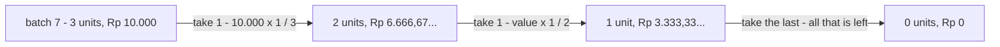

**The spec.**

| | |
| --- | --- |
| a take of *n*, units remain | removes `stock_valuation × n ÷ stock_count` |
| the take that empties the batch | removes `stock_valuation`, whatever it is |
| precision | as decided — `double`, compared at 4 digits ([stock-money-is-float64-compared-at-4-digits](../../technical/stock/design_decision.md#stock-money-is-float64-compared-at-4-digits)) |
| who absorbs the rounding | the sale that takes the last unit — at most a few ten-thousandths of a rupiah |
| applies to | every take: `order`, `sample`, `transfer_out`, `problem` |
| proven by | the take's unit test: a batch emptied over several takes ends at exactly 0 |

**What it does NOT settle:** a late cost on a part-sold batch (14d).

## a-late-cost-is-an-expense-not-a-revaluation

> Owner, in chat (2026-10-16): *"its just record as expense in selling. nothing operation in inventory. or transfer to
> warehouse in financial context"* — answering 14d of [context_clarify Q14](./context_clarify.md#question), against my
> *split it by units into the batch and a one-off cost*.

**The verdict.** A cost that arrives after a restock is accepted — a late freight invoice, a charge nobody entered at the
door — **never touches inventory**. The batch keeps the price it was accepted at. The selling team records the cost as an
**`expense`** in its financial account, or, when the warehouse is owed it, as a **`transfer`** to the warehouse
([financial_account context](../financial_account/context.md)). A revaluation stays for what it was drawn for: a typo or a
markdown, changing only the units left.

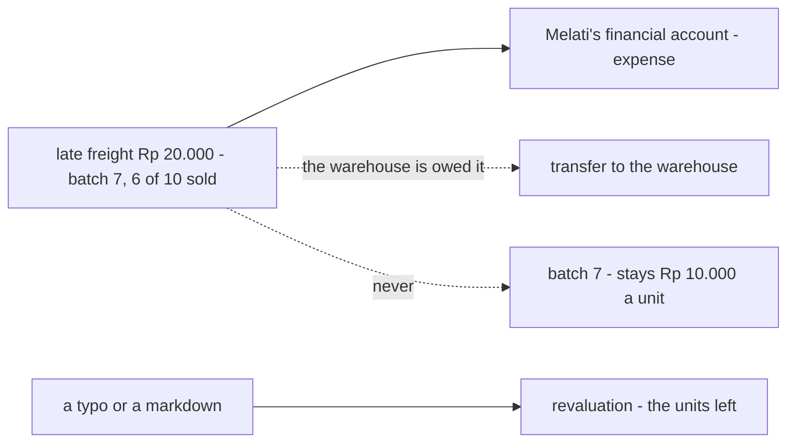

**The spec.**

| | |
| --- | --- |
| a late cost | an `expense` in the selling team's financial account, or a `transfer` to the warehouse |
| inventory | nothing — no revaluation, no transaction, no batch change |
| the batch | keeps its accepted price; later sales cost at it |
| a revaluation | only a typo or a markdown, by the owning team with a reason ([the-owning-team-revalues-with-a-reason](#the-owning-team-revalues-with-a-reason)); it changes the units left |
| the accepted cost | the batch's cost excludes the late cost, so a product's margin from inventory alone reads high — the true margin adds the team's expenses |

It closes [context_clarify Q14](./context_clarify.md#question): every part of the two ledgers' rules is decided.

## inventory-owns-the-restock-end-to-end

> Owner, in chat (2026-10-16): *"yes"* — closing [context_clarify Q8](./context_clarify.md#question), *does inventory own
> the restock from the moment the selling team creates it, or only from the door?*, as recommended. The answer had already
> been built into [restock.md](./restock.md); this records it.

**The verdict.** The restock is **inventory's from creation to accept** — the selling team creates it, cancels it before
accept, the warehouse marks it arrived or lost and accepts it, all in inventory. What stays outside is reached, not owned:
the supplier by `supplier_channel_id`, the money by restock's events.

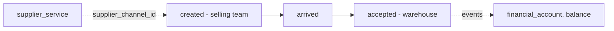

**The spec.**

| | |
| --- | --- |
| inventory | the restock record, its lines, its status (`ongoing` · `arrived` · `accepted` · `lost` · `cancel`), the accept that mints batches and fills racks |
| supplier_service | the supplier and its channel — a line names `supplier_channel_id` |
| financial_account, balance | the paying account and the courier's debt — from restock's events |
| no purchasing context | the buying decision is the selling team's act of creating the restock |

## inventory-stops-at-five-lines

> Owner, in chat (2026-10-16): *"yes"* — answering [context_clarify Q9](./context_clarify.md#question), *what does inventory
> NOT own?*, as recommended: a *Not Responsible For* list beside §Responsbility.

**The verdict.** Inventory's edge is written down, so a new feature does not re-argue it. Five things are someone else's,
and each line names who.

```mermaid
flowchart LR
  I["inventory - stock, restock, return, opname, placements, the take"]
  I -.->|"by id"| S["supplier_service - suppliers"]
  I -.->|"by events"| M["financial_account, balance - the money"]
  I -.->|"reads"| P["product_service - catalogue, reserve, private, markup"]
  O["order - its status, picked, shipping"] -.->|"calls the take"| I
  E["san_event, event_source - sending, dedup"] -.-> I
```

**The spec — the list, for §Responsbility:**

| inventory does **not** own | who does |
| --- | --- |
| suppliers and the buying decision | supplier_service · the selling team, by creating a restock ([inventory-owns-the-restock-end-to-end](#inventory-owns-the-restock-end-to-end)) |
| the money — paying accounts, the courier's debt, a late cost | financial_account and balance ([a-late-cost-is-an-expense-not-a-revaluation](#a-late-cost-is-an-expense-not-a-revaluation)) |
| an order's status, *picked* and *shipping* included | the order and its timeline ([picked-lives-on-the-order-timeline](./transaction_decision.md#picked-lives-on-the-order-timeline)) |
| the product — catalogue, reserve, private flag, markup | product_service; inventory reads it at the take ([the-take-checks-the-product-first](./order_decision.md#the-take-checks-the-product-first)) |
| sending and de-duplicating events | `san_event` / `event_source` |

⚠ **Not written yet** — the list is yours to add under §Responsbility in [context.md](./context.md).

## a-transfer-links-its-products-to-the-receiver

> Owner, in chat (2026-10-16): *"yes"* — answering [context_clarify Q17](./context_clarify.md#question), *which flows link a
> product to a warehouse?*, as recommended.

**The verdict.** Every way a product reaches a warehouse links it there. A restock's create already does; a **transfer's
create** now does too, for the **receiving** warehouse — so Warehouse B's crew sees the product coming, and its product
list shows the units once they are on B's racks.

```mermaid
flowchart LR
  R["restock create - into W"] -->|"upsert"| L["warehouse_products"]
  T["transfer create - Gudang Barat to Gudang Timur"] -->|"upsert, for Gudang Timur"| L
```

**The spec.**

| a product enters warehouse W by | linked by |
| --- | --- |
| a restock | its create — [restock.md](./restock.md) §Restock Created Flow |
| a transfer, into B | 🆕 its create, `warehouse_id` = B, each line's product |
| a box nobody raised | the team's restock ([a-box-nobody-raised-comes-in-by-the-teams-restock](./restock_decision.md#a-box-nobody-raised-comes-in-by-the-teams-restock)) |
| a return | nothing — it comes back to the warehouse that shipped it, already linked |

| | |
| --- | --- |
| how | an upsert before the transfer's transaction, as a restock's — *"not critical ops"* ([stock design](../../technical/stock/design.md)) |
| removed | never — a link says the warehouse handles the product, not that it holds any |
| ⚠ not drawn yet | the upsert is yours to add to [warehouse_transfer.md](./warehouse_transfer.md)'s create flow |

## expiry-is-a-report

> Owner, in chat (2026-10-16): *"a"* — answering [context_clarify Q7](./context_clarify.md#question), *does the picker take
> the soonest-expiring unit?*, as recommended.

**The verdict.** Expiry is something people **see and act on**, not something the take obeys. `batches.expired_at` feeds a
report of what expires soon and where; the take keeps choosing the **oldest batch first** for its cost; and a rack keeps
counting units per product, never per batch.

```mermaid
flowchart LR
  B["batch 5 - expires April, 6 units"] --> R["report - 6 vitamin C expiring in April, Rak A"]
  R --> P["the team marks them down"]
  R --> C["the crew moves them to the front"]
  T["an order's take"] -->|"oldest batch first - unchanged"| B3["batch 3"]
```

**The spec.**

| | |
| --- | --- |
| `batches.expired_at` | optional, as [batch.md](./batch.md) has it; read by the report |
| the report | per warehouse: batches with units left whose `expired_at` falls within a window, with their racks |
| the take | oldest batch first ([an-order-takes-from-the-lowest-shelf-first](#an-order-takes-from-the-lowest-shelf-first) for the racks) — expiry plays no part |
| a rack | `product_placements` counts per product per rack; no `batch_id` |
| acting on it | people — a markdown is a revaluation by the owning team ([the-owning-team-revalues-with-a-reason](#the-owning-team-revalues-with-a-reason)); a move to the front is a `move` |

**What it does NOT settle:** where the report lives and its window — no report is designed yet.

## order-returns-calls-are-return-mds-brief

> Owner, in chat (2026-10-16): *"yes"* — answering [context_clarify Q16](./context_clarify.md#question), *is
> order_return.md's warehouse half parked too?*, with option **a**, as recommended.

**The verdict.** [return-is-unplanned](#return-is-unplanned) parks **inventory's** half of a return, not the order's.
[order_return.md](../order/order_return.md) stands as written, and the three places it calls into inventory are the brief
[return.md](./return.md) starts from: when it is designed, it answers exactly these.

```mermaid
flowchart LR
  O["order_return.md - stands"] --> C1["Call Inventory Service to Create Return Transaction"]
  O --> C2["Warehouse Person Accepting Return"]
  O --> C3["Warehouse Force Order To Return"]
  C1 --> R["return.md - the brief, unplanned"]
  C2 --> R
  C3 --> R
```

**The spec — return.md's brief:**

| order_return.md asks inventory | for return.md to answer |
| --- | --- |
| *"Call Inventory Service to Create Return Transaction"* | the `return` transaction: which batch a unit goes back to, at what value, onto which rack |
| *"Warehouse Person Accepting Return"* | the accept: who, what is counted, what a broken returned unit becomes |
| *"Warehouse Force Order To Return"* | a parcel that arrives back before the order says `return` |

| | |
| --- | --- |
| inventory, until return.md is written | designs nothing for a return — unchanged |
| order_return.md | not parked — its order-side rules stand |
| already decided that return.md must keep | `return` is a `tx_type` and a ledger `change_type`; a return is a stock-in, never rolled back ([a-rollback-only-undoes-a-take](./transaction_decision.md#a-rollback-only-undoes-a-take)); it comes back to the warehouse that shipped it, already linked ([a-transfer-links-its-products-to-the-receiver](#a-transfer-links-its-products-to-the-receiver)) |
