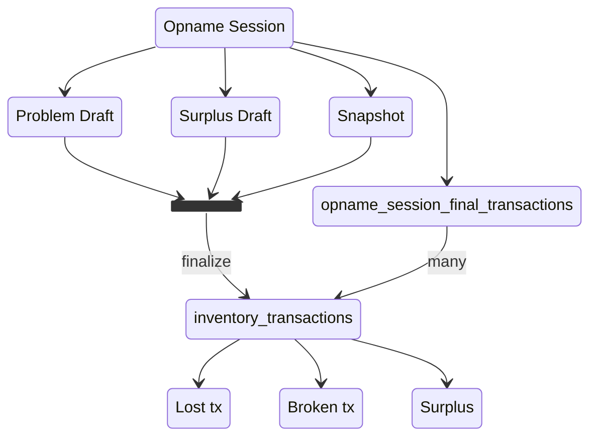
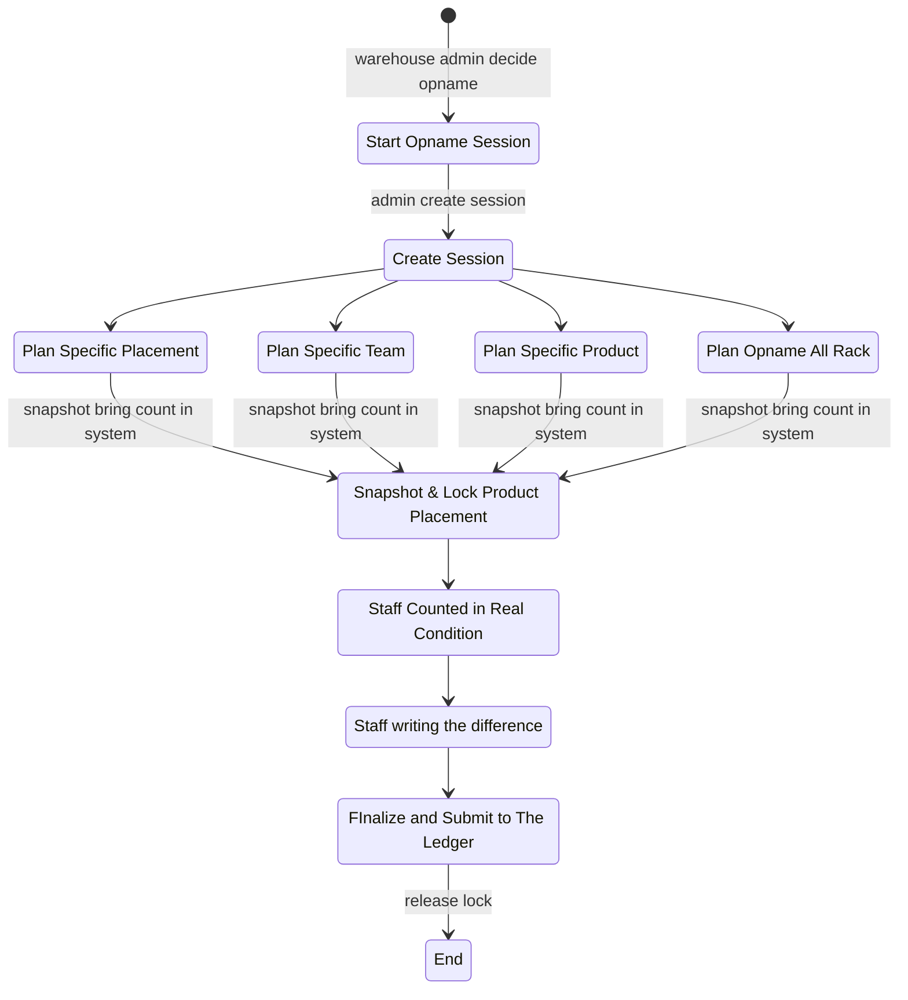
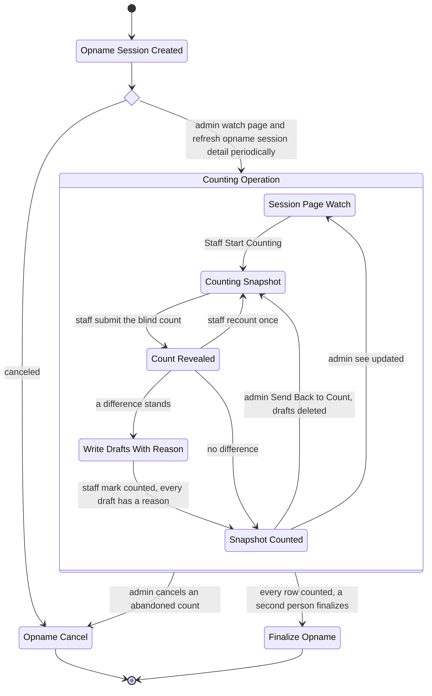
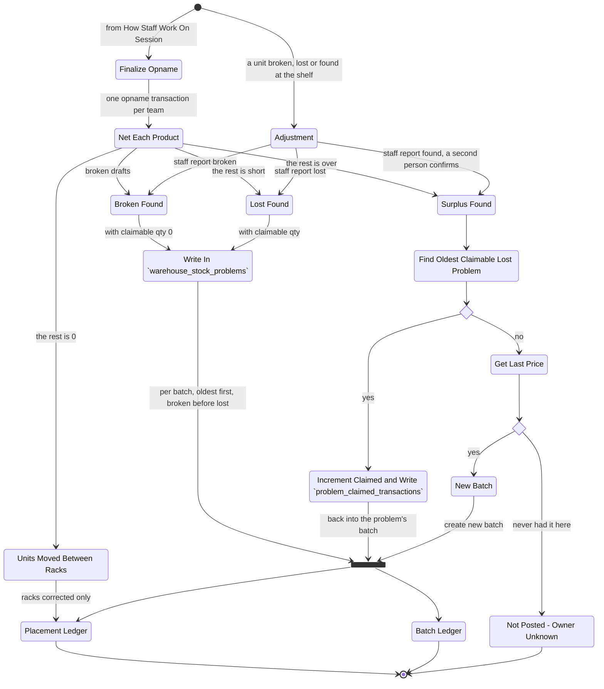

# Stock Opname Contexts.

## General.
1. Every Warehouse only can have 1 active opname session.

## Table That Must have in Stock Opname.

1. Table `opname_sessions`.

    Field that must have:
    - `id` as primary key
    - `warehouse_id`
    - `status`
    - `plan`

    - `created_by_id`
    - `finalized_by_id`
    - `finalized_at`
    - `created_at`

    Field `status` have:
    - `active`
    - `finish`
    - `cancel`

    Field `plan` have:
    - `all`
    - `team`
    - `product`
    - `placement`

2. Table `opname_session_snapshots`

    Field that must have:
    - `id` as primary key
    - `warehouse_id`
    - `team_id`
    - `product_id`
    - `placement_id`
    - `opname_session_id`

    - `status`

    - `system_stock_count`
    - `recounted_stock_count`
    
    - `counted_by_id`
    - `released_at`
    - `created_at`

    Field `status` have:
    - `created`
    - `counted`

3. Table `opname_problems_drafts`

    Field that must have:
    - `id` as primary key
    - `warehouse_id`
    - `team_id`
    - `product_id`
    - `placement_id`
    - `opname_session_id`
    
    - `note`
    - `problem_type`
    - `problem_stock_count`
    - `created_at`

    Field `problem_type` contain:
    - `broken`
    - `lost`

4. Table `opname_surplus_drafts`

    Field that must have:
    - `id` as primary key
    - `warehouse_id`
    - `team_id`
    - `product_id`
    - `placement_id`
    - `opname_session_id`
    
    - `note`
    - `surplus_stock_count`
    - `created_at`

5. Table `warehouse_stock_problems`

    Field that must have:
    - `id` as primary key
    - `warehouse_id`
    - `team_id`
    - `product_id`
    - `transaction_id`
    - `batch_id`
    - `placement_id`

    - `note`

    - `problem_type`
    
    - `problem_stock_count`
    - `price_unit`

    - `claimable_stock_count`
    - `claimed_stock_count`

    - `created_at`

    Field `problem_type` contain:
    - `broken`
    - `lost`

6. Table `problem_claimed_transactions`
    Field that must have:
    - `id` as primary key
    - `warehouse_id`
    - `problem_id`
    - `transaction_id`
    - `claimed_stock_count`
    - `created_at`

7. Table `opname_session_final_transactions`

    Field that must have:
    - `id` as primary key
    - `opname_session_id`
    - `transaction_id`, unique

## Opname Session Structure.

## Stock Opname Flow.

1. How we create snapshot.
    first, we query `product_placements` and create `opname_session_snapshots`

## How Staff Work On Session.

## How We Manage Stock Problem In Warehouses.
1. A stock problem comes in by two doors: *Finalize Opname* and *Adjustment*.
2. At *Finalize Opname* each product is settled: broken drafts are posted as written; the rest (sellable counted against book minus broken) is lost when short, surplus when over, and when 0 only the racks are corrected.
3. Broken and lost are written in `warehouse_stock_problems` per batch, oldest batch first, broken before lost. Broken has claimable 0; lost is claimable for all its units.
4. A surplus first claims the oldest open lost problem, and goes back into that problem's batch at its price. With nothing to claim, it is a new batch at the team's last price in this warehouse. If the team never had the product here, it is not posted.
5. Every claim writes a row in `problem_claimed_transactions`.

