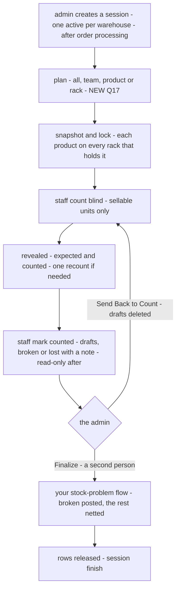
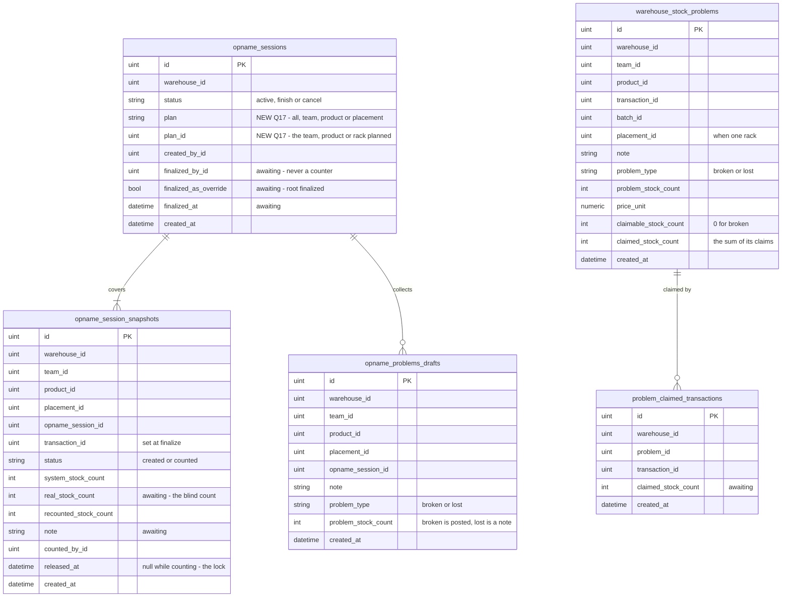
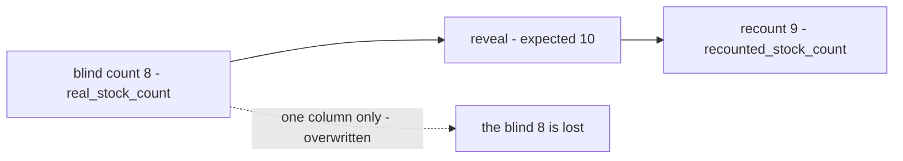

# Clarify — `inventory/opname.md`

[opname.md](./opname.md) is yours — this one is mine. An answered point is deleted; what you settle is recorded in
[opname_decision.md](./opname_decision.md).

> 🔄 **Re-checked 2026-10-13** after *"opname dont have any question and critique left ?"*: the [Proposed Design](#proposed-design)
> refreshed (it still showed a `submitted` state and the old register), and two gaps opened — [Q17](#question) a session does
> not store its plan, [Q18](#question) a surplus with no price has no way in.
>
> ✅ **Answered 2026-10-13:** Q13 by your rewrite of §How We Manage Stock Problem In Warehouses ([the-problem-flow-opens-at-finalize-and-adjustment](./opname_decision.md#the-problem-flow-opens-at-finalize-and-adjustment)),
> which also resolves *Missing Found*. **Opname has no open question.** Left: the contradiction
> [the-blind-count-lost-its-column](#the-blind-count-lost-its-column), and the [Awaiting](#awaiting-your-text) list — 🆕 *Send Back to
> Count* is not drawn in §How Staff Work On Session.
>
> ✅ **Answered 2026-10-13:** Q12 and Q14, as recommended — [a-counted-row-is-read-only-until-sent-back](./opname_decision.md#a-counted-row-is-read-only-until-sent-back), [a-surplus-carries-no-reason](./opname_decision.md#a-surplus-carries-no-reason). Open: Q13.
>
> ✅ **Answered 2026-10-13:** Q16 — broken is posted as written, only the rest is netted ([broken-posts-as-written-the-rest-nets](./opname_decision.md#broken-posts-as-written-the-rest-nets)).
>
> ✅ **Answered 2026-10-13:** the draft-to-problem conversion — broken before lost, notes with their racks, and Q15 by your
> edit: `placement_id` on the problem row. Q16 waits only on *net the product first*.
>
> 🔄 **Narrowed by your edit (2026-10-13):** Q16. Drafts name their session and their rack
> ([a-draft-names-its-session-and-rack](./opname_decision.md#a-draft-names-its-session-and-rack)) — per rack, not per product as I
> recommended. Left: finalize nets the product's drafts before posting.
>
> 🔄 **Re-examined after §How Staff Work On Session, §General and `opname_problems_draft` (2026-10-13).** Recorded:
> [one-active-count-per-warehouse](./opname_decision.md#one-active-count-per-warehouse) ·
> [a-snapshot-row-is-created-then-counted](./opname_decision.md#a-snapshot-row-is-created-then-counted) ·
> [the-difference-is-a-draft-until-finalize](./opname_decision.md#the-difference-is-a-draft-until-finalize), which moves the broken
> split from `broken_stock_count` into drafts. 🔄 [Q12](#question) narrows to a counted row's freeze and send-back, [Q14](#question)
> to a surplus's note, [Q13](#question) now reads *start at Finalize*. 🆕 [Q16](#question): the draft names no session and no rack.
>
> 🆕 **Critique of the whole design (2026-10-13), asked for in chat.** ✅ *A count cannot record broken* is answered by your
> counting rule — sellable units only, the shortage split into broken and lost
> ([a-count-is-of-sellable-units](./opname_decision.md#a-count-is-of-sellable-units)), which also corrects Q4's *goes in its
> note*. The other four are open: [Q12](#question) a state for the second person · [Q13](#question) the problem flow inside
> *Finalize* · [Q14](#question) a count's note · [Q15](#question) a loss's rack. ✅ Your `status` names are recorded.
>
> ✅ **Answered 2026-10-13:** Q10 closes — 10a-i and 10c by your edit, 10b in chat (*"dont overthinking"*: expected is the
> book, no `waiting_count`). **Opname has no open question.** 🆕 [Contradiction](#the-blind-count-lost-its-column): your
> edit removed `real_stock_count`, the blind count. What remains is that and the [Awaiting your text](#awaiting-your-text) list.
>
> ✅ **Answered by your edit (2026-10-13):** 10a — `opname_session_id` on the snapshot row · 10d — `session_placements`
> dropped. 🆕 10a-i: which transactions a session posted. Q10 stays open for 10a-i, 10b and 10c.
>
> ✅ **Answered 2026-10-13, in chat:** Q9 — yes, but outside the system: the team contacts the warehouse
> ([a-team-asks-for-a-count-outside-the-system](./opname_decision.md#a-team-asks-for-a-count-outside-the-system)), against my
> in-system request. Only [Q10](#question) is left.
>
> ✅ **Answered 2026-10-13, in chat:** Q8, every part — a money-moving difference waits for a second person; the warehouse
> Owner or Admin finalizes and never their own count; Root may, as a recorded override. ⚠ [Q10c](#question) (`counted_by_id`)
> is now forced by it, as 10a is by the lock.
>
> ✅ **Answered 2026-10-13, in chat:** Q5 — no system rule: the admin starts a count after order processing, as the
> warehouse already works, and a stray basket is caught at the reveal
> ([a-count-starts-when-order-processing-is-done](./opname_decision.md#a-count-starts-when-order-processing-is-done)), against
> my *the lock waits*.
>
> ✅ **Answered 2026-10-13, in chat:** Q4 — a lock stops units moving, never a sale; a pick on a locked rack waits
> ([a-lock-stops-units-moving-not-sales](./opname_decision.md#a-lock-stops-units-moving-not-sales)). ✅ **Resolved by your
> placement.md edit:** the [lock contradiction](#the-lock-is-drawn-on-the-product-and-stored-on-the-rack) — `locked` is gone.
>
> ✅ **Answered 2026-10-13, in chat:** Q3 and 3b — the lock is the open snapshot row, finalize or cancel releases it, the
> database allows one open count per product per rack, `placements.locked` goes; an abandoned count waits for the admin.
> The [lock contradiction](#the-lock-is-drawn-on-the-product-and-stored-on-the-rack) is decided.
> ⚠ [Q10a](#question), the snapshot row naming its session, is now forced by it.
>
> ✅ **Answered 2026-10-13, in chat:** Q7 — no tolerance ([a-count-has-no-tolerance](./opname_decision.md#a-count-has-no-tolerance)) ·
> 10e — `note` and `recounted_stock_count` on the snapshot row ([a-snapshot-row-keeps-its-note-and-recount](./opname_decision.md#a-snapshot-row-keeps-its-note-and-recount)).
>
> ✅ **Answered 2026-10-13, in chat:** Q1 — a blind count, then a reveal, with your *Staff writing the difference* kept as
> the step after it ([a-count-is-blind-then-revealed](./opname_decision.md#a-count-is-blind-then-revealed)), against my rename;
> and 1b, a product found here can be added. 🔄 Q7 narrows to a tolerance. 🆕 [Q10e](#question): where the note and the recount
> are kept.
>
> ✅ **Answered 2026-10-13, in chat:** Q11b–f, all as recommended — and with 11b, [Q6](#question). A product is netted
> across the session and always counted on all its racks, a surplus claims the oldest loss, a claim records its units, an
> adjustment writes the same register row, and *last price* is the team's newest batch here. **Q11 is closed.** Context
> Q14b closes with it. ⚠ Your flow still does not draw the claim row at *Increment Claimed*.
>
> ✅ **Answered 2026-10-13, in chat:** Q11a — one `lost` row per batch, oldest first
> ([a-shortage-writes-a-row-per-batch](./opname_decision.md#a-shortage-writes-a-row-per-batch)).
>
> 🔄 **Narrowed by your edit (2026-10-13):** Q11d. `problem_claimed_transactions` names each claim's problem and transaction
> ([a-claim-names-its-transaction](./opname_decision.md#a-claim-names-its-transaction)). Left of 11d: the units a claim took,
> and two counts claiming one unit at once. 11a–c, e and f are unchanged.
>
> **Re-examined after §How We Manage Stock Problem In Warehouses and `warehouse_stock_problems` (2026-10-13).** Recorded:
> [a-loss-in-custody-is-a-stock-problem](./opname_decision.md#a-loss-in-custody-is-a-stock-problem) ·
> [a-surplus-claims-a-lost-unit-first](./opname_decision.md#a-surplus-claims-a-lost-unit-first), which answers context Q14b
> in substance. ✅ The duplicate `warehouse_id` on the snapshot row is gone. 🆕 [Q11](#question): what the register still
> does not say — a shortage across two batches, a gain and a loss in one session, which problem a surplus claims, a claim
> with no trace, problems found outside a count, and *last price*. 🆕
> [Contradiction](#the-flow-says-missing-and-stores-lost): the flow's *Missing* is the receiving door's word.
>
> **Re-examined after your table and flow edits (2026-10-08).** ✅ [Q2](#question): one snapshot row per product on a rack
> ([a-snapshot-row-per-product-on-a-rack](./opname_decision.md#a-snapshot-row-per-product-on-a-rack)) · ✅ the grain of
> [Q3](#question): the lock covers the product on the rack
> ([a-count-locks-the-product-on-the-rack](./opname_decision.md#a-count-locks-the-product-on-the-rack)). 🆕 [Q10](#question):
> what the snapshot row still lacks. 🆕 [Contradiction](#the-lock-is-drawn-on-the-product-and-stored-on-the-rack): the flow
> locks the product on the rack, `placement.md` stores the lock on the rack. ⚠ `opname_session_snapshots` lists
> `warehouse_id` **twice** (lines 27 and 29).
>
> **First pass (2026-10-08)**, after §Table That Must have in Stock Opname, §Stock Opname Flow and `placements.locked`.
> Recorded: [an-opname-is-a-locked-session](./opname_decision.md#an-opname-is-a-locked-session) — it answers context Q5.
> ➡ **Re-routed here**, because this doc now answers them: context [Q4](./context_clarify.md#question) (tolerance),
> [Q11e](./context_clarify.md#question) (a whole product), [Q12](./context_clarify.md#question) (who confirms), what was
> left of context Q5 (a team asking for a count), and order [Q4](./order_clarify.md#question) (the basket).

Siblings: [context_clarify](./context_clarify.md) · [order_clarify](./order_clarify.md) · [restock_clarify](./restock_clarify.md).

---

## Proposed Design

*(refreshed 2026-10-13, after Q12, Q16 and your flow rewrite)* The whole design as decided. What your doc does not say yet is
marked **awaiting** ([Awaiting your text](#awaiting-your-text)) or **NEW** (an open [question](#question)).

### the session

### the tables

### the money

The register is your §How We Manage Stock Problem In Warehouses
([the-problem-flow-opens-at-finalize-and-adjustment](./opname_decision.md#the-problem-flow-opens-at-finalize-and-adjustment)). What each row moves:

| the register writes | money ([the-warehouse-payable-is-broken-and-lost](../balance/context_decision.md#the-warehouse-payable-is-broken-and-lost)) |
| --- | --- |
| a `lost` row | the warehouse owes the team `problem_stock_count × price_unit` — `lost_good` |
| a `broken` row | the warehouse owes the team the same — `broken_good`; the unit is thrown away |
| a claim | the team pays the warehouse back `claimed × price_unit` — `found` |
| a minted surplus | nothing: new stock for the team, nobody paid for it |
---

## Critique

| | Problem | → Recommend |
| --- | --- | --- |
| **1** | ✅ *(2026-10-13)* **Answered** — [a-count-is-blind-then-revealed](./opname_decision.md#a-count-is-blind-then-revealed). As first raised: **"Staff writing the difference"** means the counter knows the system's figure, and a counter who knows the answer tends to find it — and a shortfall is a warehouse debt. 🔄 Your new `real_stock_count` reads as *staff type what they see*; the flow still says *difference* | **staff type what they see; the system works out the difference**, and the snapshot stays hidden from the counter |
| **2** | ✅ **Answered** — `opname_session_snapshots` ([a-snapshot-row-per-product-on-a-rack](./opname_decision.md#a-snapshot-row-per-product-on-a-rack)). What the row still lacks is [Q10](#question) | — |
| **3** | ✅ *(2026-10-13)* **Answered** — [the-lock-is-the-open-snapshot-row](./opname_decision.md#the-lock-is-the-open-snapshot-row). As first raised: **The lock has no holder.** As a yes-or-no on a row: two sessions over one product on a rack, and the first to finish unlocks it under the second. A session abandoned halfway leaves it locked for ever | the lock **is** the counting session's snapshot row; a session has a status, and **cancel releases it** like finalize does |
| **4** | ✅ **Answered** — the product on the rack is locked, not the rack ([a-count-locks-the-product-on-the-rack](./opname_decision.md#a-count-locks-the-product-on-the-rack)) | — |
| **5** | ✅ *(2026-10-13)* **Answered** — [a-lock-stops-units-moving-not-sales](./opname_decision.md#a-lock-stops-units-moving-not-sales). As first raised: **What a lock blocks is not written.** Orders keep coming; refusing one because a rack is being counted refuses a real sale | **a lock stops units moving, not the book** — no receipt prints from it, no move, no put-away into it. `PostOrder` prefers unlocked racks and takes from a locked one only when nothing else holds the product; that receipt waits for the unlock |
| **6** | ✅ *(2026-10-13)* **Answered** — [a-count-starts-when-order-processing-is-done](./opname_decision.md#a-count-starts-when-order-processing-is-done). As first raised: **Units already in a basket when the lock starts** — printed, lifted, not yet scanned. The count finds the rack short | wait for them before locking — [Q5](#question) |
| **7** | ✅ *(2026-10-13)* **Answered** — [a-count-nets-each-product-across-the-session](./opname_decision.md#a-count-nets-each-product-across-the-session). As first raised: **One rack cannot net a wrong-rack pick.** It sees Rak B's −1 and not Rak A's +1, and charges the warehouse | money only for a product counted on all its racks — [Q6](#question) |

---

## Question

1. ✅ *(2026-10-13)* **Answered: a blind count, then a reveal** — [a-count-is-blind-then-revealed](./opname_decision.md#a-count-is-blind-then-revealed),
   and a product found here can be added ([a-counter-may-add-a-product-found-here](./opname_decision.md#a-counter-may-add-a-product-found-here)).
2. ✅ *(2026-10-08)* **Answered: `opname_session_snapshots`** —
   [a-snapshot-row-per-product-on-a-rack](./opname_decision.md#a-snapshot-row-per-product-on-a-rack).
3. ✅ *(2026-10-13)* **Answered, as recommended** — the lock is the open snapshot row, released by finalize or cancel
   ([the-lock-is-the-open-snapshot-row](./opname_decision.md#the-lock-is-the-open-snapshot-row)); an abandoned count waits for the
   admin ([an-abandoned-count-waits-for-the-admin](./opname_decision.md#an-abandoned-count-waits-for-the-admin)).
4. ✅ *(2026-10-13)* **Answered, as recommended** — [a-lock-stops-units-moving-not-sales](./opname_decision.md#a-lock-stops-units-moving-not-sales).
5. ✅ *(2026-10-13)* **Answered: no system rule** — the admin starts a count after order processing, and a stray basket
   is caught at the reveal ([a-count-starts-when-order-processing-is-done](./opname_decision.md#a-count-starts-when-order-processing-is-done)),
   against my *the lock waits*.
6. ✅ *(2026-10-13)* **Answered by Q11b** — a product's differences are netted across the session, and a product is always
   counted on all its racks ([a-count-nets-each-product-across-the-session](./opname_decision.md#a-count-nets-each-product-across-the-session),
   [a-rack-plan-counts-its-products-everywhere](./opname_decision.md#a-rack-plan-counts-its-products-everywhere)). My one-rack
   half — *a one-rack plan corrects the racks* — is withdrawn: it moved a rack without its batch.
7. ✅ *(2026-10-13)* **Answered: no tolerance** — [a-count-has-no-tolerance](./opname_decision.md#a-count-has-no-tolerance); the recount
   is the reveal step ([a-count-is-blind-then-revealed](./opname_decision.md#a-count-is-blind-then-revealed)).
8. ✅ *(2026-10-13)* **Answered, every part as recommended** — [a-money-difference-needs-a-second-person](./opname_decision.md#a-money-difference-needs-a-second-person) ·
   [nobody-finalizes-their-own-count](./opname_decision.md#nobody-finalizes-their-own-count) ·
   [root-finalizes-only-as-an-override](./opname_decision.md#root-finalizes-only-as-an-override).

9. ✅ *(2026-10-13)* **Answered: yes, outside the system** — the team contacts the warehouse, and the admin opens a
   team-scoped session ([a-team-asks-for-a-count-outside-the-system](./opname_decision.md#a-team-asks-for-a-count-outside-the-system)).
10. ✅ *(2026-10-13)* **Answered, every part** — [a-snapshot-row-names-its-session](./opname_decision.md#a-snapshot-row-names-its-session) ·
    [a-snapshot-row-names-its-transaction](./opname_decision.md#a-snapshot-row-names-its-transaction) ·
    [a-snapshot-row-names-its-counter](./opname_decision.md#a-snapshot-row-names-its-counter) ·
    [session-placements-is-dropped](./opname_decision.md#session-placements-is-dropped) ·
    [a-snapshot-row-keeps-its-note-and-recount](./opname_decision.md#a-snapshot-row-keeps-its-note-and-recount) ·
    [expected-is-the-book-figure](./opname_decision.md#expected-is-the-book-figure) (10b, against my `waiting_count`).
11. ✅ *(2026-10-13)* **Answered, every part as recommended** — [a-shortage-writes-a-row-per-batch](./opname_decision.md#a-shortage-writes-a-row-per-batch) ·
    [a-count-nets-each-product-across-the-session](./opname_decision.md#a-count-nets-each-product-across-the-session) ·
    [a-rack-plan-counts-its-products-everywhere](./opname_decision.md#a-rack-plan-counts-its-products-everywhere) ·
    [a-surplus-claims-the-oldest-loss-first](./opname_decision.md#a-surplus-claims-the-oldest-loss-first) ·
    [a-claim-records-its-units](./opname_decision.md#a-claim-records-its-units) ·
    [an-adjustment-writes-the-same-problem-row](./opname_decision.md#an-adjustment-writes-the-same-problem-row) ·
    [last-price-is-the-teams-newest-batch-here](./opname_decision.md#last-price-is-the-teams-newest-batch-here).

12. ✅ *(2026-10-13)* **Answered in chat, as recommended** — [a-counted-row-is-read-only-until-sent-back](./opname_decision.md#a-counted-row-is-read-only-until-sent-back).
13. ✅ *(2026-10-13)* **Answered by your edit** — [the-problem-flow-opens-at-finalize-and-adjustment](./opname_decision.md#the-problem-flow-opens-at-finalize-and-adjustment).
14. ✅ *(2026-10-13)* **Answered in chat, as recommended** — [a-surplus-carries-no-reason](./opname_decision.md#a-surplus-carries-no-reason).
15. ✅ *(2026-10-13)* **Answered by your edit** — [a-problem-row-names-its-rack](./opname_decision.md#a-problem-row-names-its-rack).
16. ✅ *(2026-10-13)* **Answered in chat** — [broken-posts-as-written-the-rest-nets](./opname_decision.md#broken-posts-as-written-the-rest-nets).
17. 🆕 *(2026-10-13, found re-checking)* **A session does not say what it planned.** *Plan Specific Team / Product /
    Placement* is chosen at the start and stored nowhere — `opname_sessions` has no plan. The rows say what was counted, but
    a rack planned empty leaves no row at all, and the session list can only say *"session 15"*.
    [session-placements-is-dropped](./opname_decision.md#session-placements-is-dropped) assumed *"a rack plan's own scope names the rack"*,
    which no column holds.
    **→ Recommend** two columns on `opname_sessions`: `plan` (`all` · `team` · `product` · `placement`) and `plan_id` (the
    team, product or rack; empty for `all`). Or say the rows are enough, and that decision's row is corrected.
18. 🆕 *(2026-10-13, found re-checking)* **A surplus with no price has no way in.**
    [last-price-is-the-teams-newest-batch-here](./opname_decision.md#last-price-is-the-teams-newest-batch-here) leaves it *Not Posted* when the
    team never had the product in this warehouse — a returned parcel brought to the nearest warehouse, say — and nobody yet
    names the owner or the price. The unit sits on a rack the book says is empty, and every next count finds it again.
    **→ Recommend:** it comes in by the door goods already use. The admin contacts the team, outside the system as
    [a-team-asks-for-a-count-outside-the-system](./opname_decision.md#a-team-asks-for-a-count-outside-the-system), and the team receives it as
    a restock, which gives it a price. Until then it is set aside, off the rack.
---

# Contradiction

## the-lock-is-drawn-on-the-product-and-stored-on-the-rack

✅ *(2026-10-13)* **Resolved** — you removed `locked` from [placement.md](./placement.md), as
[the-lock-is-the-open-snapshot-row](./opname_decision.md#the-lock-is-the-open-snapshot-row) decided. One lock, in one place.

## the-flow-says-missing-and-stores-lost

✅ *(2026-10-13)* **Resolved** — your rewritten flow says *Lost Found* ([the-problem-flow-opens-at-finalize-and-adjustment](./opname_decision.md#the-problem-flow-opens-at-finalize-and-adjustment)). One word for a
unit gone from a rack.

## the-blind-count-lost-its-column

*(2026-10-13, your snapshot-table edit)* The table now reads `system_stock_count` · `recounted_stock_count`, and
`real_stock_count` is gone:

| where | says |
| --- | --- |
| [a-snapshot-row-keeps-its-note-and-recount](./opname_decision.md#a-snapshot-row-keeps-its-note-and-recount), decided today | `real_stock_count` is the **blind count, never overwritten**; `recounted_stock_count` is the second count, set only when staff recount; plus a `note` |
| [opname.md](./opname.md) `opname_session_snapshots`, now | `system_stock_count` · `recounted_stock_count` — no `real_stock_count`, no `note` |

With only one count column, the blind count and the recount share it, and the recount — made **after** the expected figure
was shown — replaces what was counted before anyone knew it. That is the number [a-count-is-blind-then-revealed](./opname_decision.md#a-count-is-blind-then-revealed)
exists to keep.

**→ Recommend:** put `real_stock_count` back beside `recounted_stock_count`, and add `note`. If you meant the rename — one
count column only — say so, and the decision is renamed rather than left saying the opposite.

# Awaiting your text

Decided, and not yet in [opname.md](./opname.md) — yours to write:

| where | what | decided by |
| --- | --- | --- |
| `opname_sessions` | `finalized_by_id` · `finalized_at` · `finalized_as_override` | [nobody-finalizes-their-own-count](./opname_decision.md#nobody-finalizes-their-own-count), [root-finalizes-only-as-an-override](./opname_decision.md#root-finalizes-only-as-an-override) |
| `opname_session_snapshots` | `note` — and `real_stock_count` back ([the-blind-count-lost-its-column](#the-blind-count-lost-its-column)) | [a-snapshot-row-keeps-its-note-and-recount](./opname_decision.md#a-snapshot-row-keeps-its-note-and-recount) |
| `problem_claimed_transactions` | `claimed_stock_count` | [a-claim-records-its-units](./opname_decision.md#a-claim-records-its-units) |
| §How Staff Work On Session | *Send Back to Count* — the admin moves a counted row back to counting, its drafts deleted | [a-counted-row-is-read-only-until-sent-back](./opname_decision.md#a-counted-row-is-read-only-until-sent-back) |
