# Decisions — `inventory/opname.md`

What the owner settled, recorded before it is acted on. **Append-only** — a decision that is later reversed is renamed
and its references grepped (RULE 12), never quietly edited away. The open set is [opname_clarify.md](./opname_clarify.md).

| decision | says | from |
| --- | --- | --- |
| [an-opname-is-a-locked-session](#an-opname-is-a-locked-session) | the warehouse admin opens a session over all racks, a team, a product or a rack; it snapshots and locks, staff count, finalize posts to the ledger and releases the lock | your opname.md and `placements.locked`, 2026-10-08 — answers context Q5 |
| [a-snapshot-row-per-product-on-a-rack](#a-snapshot-row-per-product-on-a-rack) | `opname_session_snapshots` holds, per product on a rack, the system's count and the real count | your opname.md edit, 2026-10-08 — answers Q2, as recommended in shape |
| [a-count-locks-the-product-on-the-rack](#a-count-locks-the-product-on-the-rack) | the lock covers the product on the rack being counted, not the whole rack | your opname.md edit, 2026-10-08 — answers the grain half of Q3, as recommended |
| [a-loss-in-custody-is-a-stock-problem](#a-loss-in-custody-is-a-stock-problem) | a unit a count finds missing or broken is written to `warehouse_stock_problems` with its batch and unit price; a lost unit can be claimed back, a broken one cannot | your opname.md edit, 2026-10-13 — §How We Manage Stock Problem In Warehouses |
| [a-shortage-writes-a-row-per-batch](#a-shortage-writes-a-row-per-batch) | a shortage takes its batches oldest first and writes one `lost` row per batch, each at that batch's price | chat, 2026-10-13 — answers Q11a, as recommended |
| [a-count-is-blind-then-revealed](#a-count-is-blind-then-revealed) | staff count without seeing the system's figure; after submit it is revealed, and staff recount or write why for each difference | chat, 2026-10-13 — answers Q1: blind as recommended, your *Staff writing the difference* kept as the step after |
| [a-counter-may-add-a-product-found-here](#a-counter-may-add-a-product-found-here) | the counter can add a product the system does not expect on the rack; it joins the session with its other racks | chat, 2026-10-13 — answers Q1b, as recommended |
| [one-active-count-per-warehouse](#one-active-count-per-warehouse) | a warehouse runs one active session at a time | your opname.md edit, 2026-10-13 — §General |
| [a-snapshot-row-is-created-then-counted](#a-snapshot-row-is-created-then-counted) | each row is `created`, then marked `counted` by its staff; the admin watches the session page; finalize when every row is counted | your opname.md edit, 2026-10-13 — answers most of Q12 |
| [broken-takes-its-batch-before-lost](#broken-takes-its-batch-before-lost) | at finalize the batch ledger takes a product's broken units first, then its lost ones, oldest batch first | chat, 2026-10-13 — the conversion's order, as recommended |
| [a-problem-note-names-its-racks](#a-problem-note-names-its-racks) | a problem row's note carries each draft's note with its rack: *"Rak A: torn · Rak C: gone"* | chat, 2026-10-13 — as recommended |
| [a-problem-row-names-its-rack](#a-problem-row-names-its-rack) | `warehouse_stock_problems.placement_id`: set by an adjustment, and by a count when the row's units all came from one rack's draft | your opname.md edit, 2026-10-13 — answers Q15 and the conversion's rack, as recommended |
| [broken-posts-as-written-the-rest-nets](#broken-posts-as-written-the-rest-nets) | at finalize a product's broken drafts are posted as written; only the rest — sellable against the book less the broken — is netted: short is lost, over claims, zero is a move | chat, 2026-10-13 — Q16, after your rules on broken |
| [a-counted-row-is-read-only-until-sent-back](#a-counted-row-is-read-only-until-sent-back) | a `counted` row is read-only to its counter; the admin sends one back to `created`, its drafts deleted, and staff count it again | chat, 2026-10-13 — Q12, as recommended |
| [a-surplus-carries-no-reason](#a-surplus-carries-no-reason) | a surplus has no draft and no note — it claims or mints by rule; drafts stay `broken` · `lost` | chat, 2026-10-13 — Q14, as recommended |
| [the-problem-flow-opens-at-finalize-and-adjustment](#the-problem-flow-opens-at-finalize-and-adjustment) | the stock-problem flow opens at *Finalize Opname* and *Adjustment*, and draws every rule decided — *Lost Found*, the claim row, a surplus with no price not posted | your opname.md edit, 2026-10-13 — Q13, as recommended |
| [a-session-records-its-plan](#a-session-records-its-plan) | `opname_sessions.plan` says how the session was planned — all racks, a team, a product or a rack | your opname.md edit, 2026-10-14 — Q17, in part |
| [a-snapshot-is-made-from-product-placements](#a-snapshot-is-made-from-product-placements) | the snapshot step reads `product_placements` and writes one `opname_session_snapshots` row per product on a rack it returns | your opname.md edit, 2026-10-14 — §Stock Opname Flow |
| [the-plan-target-is-only-a-filter](#the-plan-target-is-only-a-filter) | the team, product or rack a plan picks only filters `product_placements` when the snapshot is made — it is not stored; no `plan_id` | chat, 2026-10-14 — Q17, **against my recommendation** |
| [a-unit-never-stocked-here-comes-in-by-restock](#a-unit-never-stocked-here-comes-in-by-restock) | a unit of a product its team never had in this warehouse is taken off the rack, not written to the session, and comes in by the team's restock | chat, 2026-10-14 — Q18; simpler than my recommendation |
| [a-snapshot-includes-rows-at-zero](#a-snapshot-includes-rows-at-zero) | the snapshot takes every `product_placements` row the plan selects, rows at 0 included | chat, 2026-10-14 — Q19a, as recommended |
| [an-all-count-visits-every-rack](#an-all-count-visits-every-rack) | an `all` count lists every rack of the warehouse, empty ones too; other plans list the racks of their rows | chat, 2026-10-14 — Q19b, as recommended |
| [a-surplus-draft-is-counted-by-the-system](#a-surplus-draft-is-counted-by-the-system) | `opname_surplus_drafts` keeps why a rack is over; its `surplus_stock_count` is the rack's counted − system, set by the system and never typed | your opname.md edit and chat, 2026-10-14 — Q20a, as recommended |
| [a-difference-needs-its-reason-on-the-draft](#a-difference-needs-its-reason-on-the-draft) | every draft — over, broken, lost — needs a typed reason before its row is marked counted; the snapshot row has no `note` | chat, 2026-10-14 — Q20b, as recommended |
| [a-row-is-marked-counted-after-its-drafts](#a-row-is-marked-counted-after-its-drafts) | a row is counted blind, revealed, recounted once, given its drafts with their reasons — and only then marked counted | your opname.md edit, 2026-10-14 — §How Staff Work On Session redrawn |
| [a-short-rack-gets-a-lost-draft-from-the-system](#a-short-rack-gets-a-lost-draft-from-the-system) | a rack revealed short gets a `lost` draft for the whole shortage from the system; staff move units to `broken`, and each draft needs its reason | chat, 2026-10-14 — Q21, as recommended |
| [a-row-keeps-only-its-latest-count](#a-row-keeps-only-its-latest-count) | a snapshot row has one count column, `recounted_stock_count`: the blind count, replaced by the recount when there is one | chat, 2026-10-14 — **against my recommendation** of a separate blind-count column |
| [finalizing-is-the-agreement](#finalizing-is-the-agreement) | finalizing a session agrees its debt, whoever finalizes — no `finalized_as_override` | chat, 2026-10-14 — **against my recommendation** |
| [a-draft-names-its-session-and-rack](#a-draft-names-its-session-and-rack) | `opname_problems_draft` carries `opname_session_id` and `placement_id`: a draft is what staff saw on one rack, in one session | your opname.md edit, 2026-10-13 — answers Q16a, and draws the draft per rack |
| [the-difference-is-a-draft-until-finalize](#the-difference-is-a-draft-until-finalize) | a count's broken and lost are `opname_problems_draft` rows, with a note, until finalize turns them into stock problems | your opname.md edit, 2026-10-13 — stores the split of a-count-is-of-sellable-units; answers Q14's shortage half |
| [a-count-is-of-sellable-units](#a-count-is-of-sellable-units) | staff count sellable units only; at *Staff writing the difference* the shortage splits into broken (`broken_stock_count`, never more than the shortage) and lost | chat, 2026-10-13 — your counting rule, against my *count every unit, of which broken* |
| [a-snapshot-row-names-its-transaction](#a-snapshot-row-names-its-transaction) | each snapshot row records the transaction it was posted in, one per owning team | your opname.md edit, 2026-10-13 — answers Q10a-i, as recommended |
| [a-snapshot-row-names-its-counter](#a-snapshot-row-names-its-counter) | each snapshot row carries `counted_by_id` | your opname.md edit, 2026-10-13 — answers Q10c, as recommended |
| [expected-is-the-book-figure](#expected-is-the-book-figure) | expected is `system_stock_count`, the book; no `waiting_count` — a sold unit still on the rack is rare and handled at the reveal | chat, 2026-10-13 — answers Q10b, **against** my `waiting_count` |
| [a-snapshot-row-names-its-session](#a-snapshot-row-names-its-session) | every snapshot row carries `opname_session_id`; a session acts only on its own rows | your opname.md edit, 2026-10-13 — answers Q10a, as recommended |
| [session-placements-is-dropped](#session-placements-is-dropped) | no separate list of a session's racks; the snapshot rows name them | your opname.md edit, 2026-10-13 — answers Q10d, as recommended |
| [a-team-asks-for-a-count-outside-the-system](#a-team-asks-for-a-count-outside-the-system) | a selling team asks the warehouse directly; no request feature; the admin decides and opens a team-scoped session | chat, 2026-10-13 — answers Q9: yes, but outside the system, against my in-system request |
| [a-money-difference-needs-a-second-person](#a-money-difference-needs-a-second-person) | a session with any lost, broken or found line waits for a second person; one that moves no money finalizes at once | chat, 2026-10-13 — answers Q8a, as recommended |
| [nobody-finalizes-their-own-count](#nobody-finalizes-their-own-count) | staff or a manager count, the warehouse Owner or Admin finalizes, and never a person who counted in the session | chat, 2026-10-13 — answers Q8b and Q8c, as recommended |
| [root-finalizes-only-as-an-override](#root-finalizes-only-as-an-override) | Root and the root Administrator may finalize, recorded as an override, never their own count | chat, 2026-10-13 — answers Q8d, as recommended |
| [a-count-starts-when-order-processing-is-done](#a-count-starts-when-order-processing-is-done) | no system check for units in a basket: the admin starts a count after order processing, and a stray basket is caught at the reveal | chat, 2026-10-13 — answers Q5, **against** my *the lock waits for printed lines* |
| [a-lock-stops-units-moving-not-sales](#a-lock-stops-units-moving-not-sales) | a counted product on a rack takes no put-away, move, sample or adjustment; an order is still taken, unlocked racks first, and its pick on a locked rack waits for the count | chat, 2026-10-13 — answers Q4, as recommended |
| [the-lock-is-the-open-snapshot-row](#the-lock-is-the-open-snapshot-row) | a count's lock is its open snapshot row; finalize or cancel releases it; one open count per product per rack, by the database; `placements.locked` dropped | chat, 2026-10-13 — answers Q3, as recommended |
| [an-abandoned-count-waits-for-the-admin](#an-abandoned-count-waits-for-the-admin) | an open count never releases on its own; a blocked action names the session, and the admin cancels it | chat, 2026-10-13 — answers Q3b, as recommended |
| [a-count-has-no-tolerance](#a-count-has-no-tolerance) | every net difference posts, however small; the recount and the second person stop noise, not a threshold | chat, 2026-10-13 — answers Q7, as recommended |
| [a-snapshot-row-keeps-its-note-and-recount](#a-snapshot-row-keeps-its-note-and-recount) | the snapshot row gains `note` and `recounted_stock_count`; the blind count is never overwritten | chat, 2026-10-13 — answers Q10e, as recommended |
| [a-count-nets-each-product-across-the-session](#a-count-nets-each-product-across-the-session) | a product's differences are summed over every rack in the session first; a −1 and a +1 is a move, and only the net costs money | chat, 2026-10-13 — answers Q11b, and with it Q6, as recommended |
| [a-rack-plan-counts-its-products-everywhere](#a-rack-plan-counts-its-products-everywhere) | a placement plan brings in every other rack holding each of its products — a product is always counted on all its racks | chat, 2026-10-13 — answers Q11b-i, as recommended |
| [a-surplus-claims-the-oldest-loss-first](#a-surplus-claims-the-oldest-loss-first) | a surplus claims the oldest open loss first, back into that loss's batch at its price | chat, 2026-10-13 — answers Q11c and the rest of context Q14b, as recommended |
| [a-claim-records-its-units](#a-claim-records-its-units) | `problem_claimed_transactions` gains `claimed_stock_count`; claims never exceed what is claimable, under a lock | chat, 2026-10-13 — answers the rest of Q11d, as recommended |
| [an-adjustment-writes-the-same-problem-row](#an-adjustment-writes-the-same-problem-row) | a loss or breakage outside a count is an adjustment writing the same register row; a found by either door needs a second person | chat, 2026-10-13 — answers Q11e, as recommended |
| [last-price-is-the-teams-newest-batch-here](#last-price-is-the-teams-newest-batch-here) | a surplus with nothing to claim is minted at the team's newest batch price for the product in this warehouse; with none, it does not post | chat, 2026-10-13 — answers Q11f, as recommended |
| [a-claim-names-its-transaction](#a-claim-names-its-transaction) | every claim on a stock problem is a `problem_claimed_transactions` row naming the problem and the transaction that claimed it | your opname.md edit, 2026-10-13 — answers the trace of Q11d, as recommended |
| [a-surplus-claims-a-lost-unit-first](#a-surplus-claims-a-lost-unit-first) | a unit a count finds extra first claims an open lost problem; with none to claim, it is minted as a new batch at the product's last price | your opname.md edit, 2026-10-13 — answers context Q14b in substance |

---

## an-opname-is-a-locked-session

> Owner, in [opname.md](./opname.md) *(2026-10-08)* — §Table That Must have in Stock Opname and §Stock Opname Flow — and
> `placements.locked` in [placement.md](./placement.md) the same day. It gives
> [a-count-locks-its-rack](./order_decision.md#a-count-locks-its-rack) its mechanism, and answers
> [context Q5](./context_clarify.md#question) — *who may call an opname, and at what grain?* — the who as I recommended
> (the warehouse), the grain wider than I did (four plans, not only per shelf).

**The verdict.** A stock opname is a **session**. The warehouse admin decides to count and creates it, planning one of
four scopes. Planning takes a snapshot of what the system holds and locks the racks; staff count what is really there and
record the difference; finalizing posts it to the ledger and releases the lock.

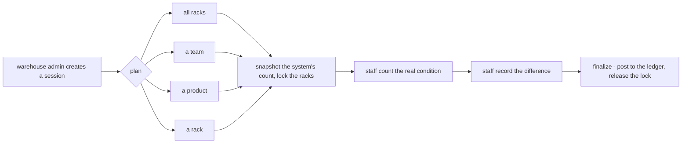

**The spec.**

| | |
| --- | --- |
| who opens it | the warehouse team's admin |
| `opname_sessions` | `id` · `warehouse_id` · `created_by_id` · `created_at` |
| `session_placements` | `id` · `placement_id` · `created_at` — the racks a session covers |
| `placements.locked` | 🆕 set at the snapshot, cleared at finalize |
| scopes | all racks · a specific team · a specific product · a specific rack |
| the snapshot | the system's count at the moment of locking |
| finalize | posts the difference to the ledger — a stock transaction ([every-stock-change-belongs-to-a-transaction](./context_decision.md#every-stock-change-belongs-to-a-transaction)) |

**What it does NOT settle** — the open set is [opname_clarify.md](./opname_clarify.md): what staff type · where the
snapshot and the count are kept · what a lock blocks, and who holds it · the units in a basket at locking · when a
difference costs money, and who confirms it.

---

## a-snapshot-row-per-product-on-a-rack

> Owner, in [opname.md](./opname.md) §Table That Must have in Stock Opname *(2026-10-08)*: a third table,
> `opname_session_snapshots`, with `team_id`, `product_id`, `placement_id`, `system_stock_count` and `real_stock_count`.
> It answers [opname_clarify Q2](./opname_clarify.md#question) — *where do the snapshot and the count live?* — in the shape I
> recommended (one row per product on a rack), under your name for it.

**The verdict.** A count is kept where it is made: **one row per product on a rack**, holding what the system said at the
snapshot and what staff found. The difference is the gap between the two.

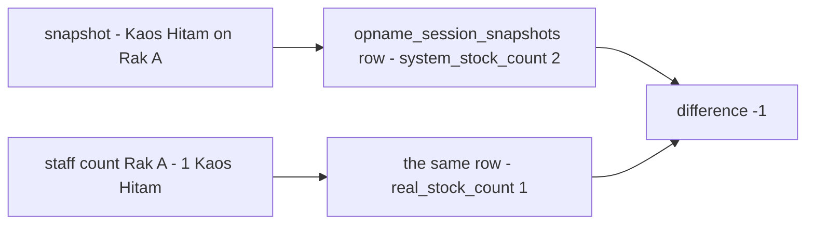

**The spec.**

| | |
| --- | --- |
| `opname_session_snapshots` | `id` · `warehouse_id` · `team_id` · `product_id` · `placement_id` · `system_stock_count` · `real_stock_count` · `created_at` |
| `system_stock_count` | written at the snapshot |
| `real_stock_count` | written when staff count |

**What it does NOT settle** — [opname_clarify Q10](./opname_clarify.md#question): the row names no session · whether
`system_stock_count` includes units sold but still on the rack · who counted it · whether `session_placements` is still
needed.

🔄 *(2026-10-14)* **Renamed**: what staff found is `recounted_stock_count`, not `real_stock_count` — [a-row-keeps-only-its-latest-count](#a-row-keeps-only-its-latest-count).

## a-count-locks-the-product-on-the-rack

> Owner, in [opname.md](./opname.md) §Stock Opname Flow *(2026-10-08)*: the step is now *"Snapshot & Lock **Product
> Placement**"*. It answers the grain half of [opname_clarify Q3](./opname_clarify.md#question) — *a product plan should
> not stop picks of the other products on the same rack* — as recommended.

**The verdict.** What a count locks is **the product on the rack** it is counting. Counting Kaos Hitam on Rak A stops
Kaos Hitam moving on Rak A; the shirts beside it can still be picked. A plan over a whole rack, or all racks, still locks
every product on it.

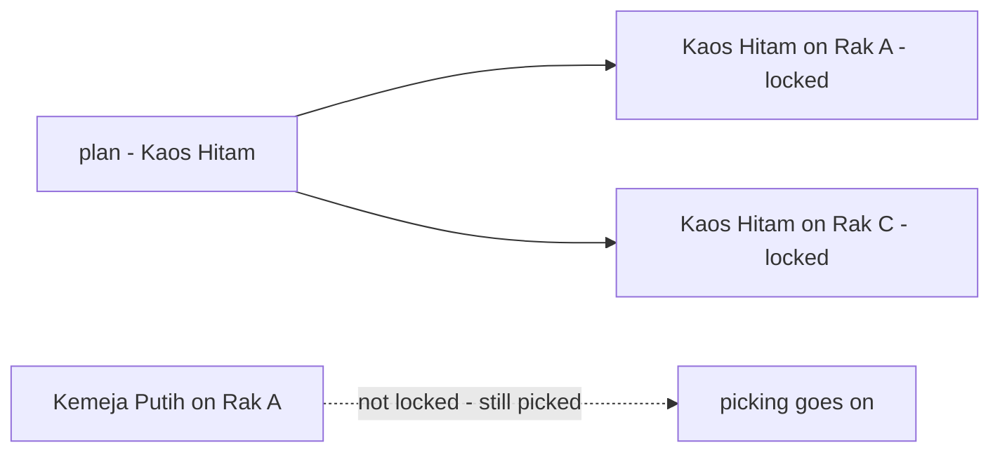

**The spec.**

| | |
| --- | --- |
| the lock | a `product_placements` row — one product on one rack |
| a rack or all-racks plan | locks every product on the racks it covers |
| released | at finalize, per [an-opname-is-a-locked-session](#an-opname-is-a-locked-session) |

**What it does NOT settle:** that [placement.md](./placement.md) still puts `locked` on the whole rack
([Contradiction](./opname_clarify.md#the-lock-is-drawn-on-the-product-and-stored-on-the-rack)); what holds the lock and
what releases it when a session is abandoned ([Q3](./opname_clarify.md#question)).

---

## a-loss-in-custody-is-a-stock-problem

> Owner, in [opname.md](./opname.md) *(2026-10-13)*: a new table `warehouse_stock_problems` in §Table That Must have in Stock
> Opname, and §How We Manage Stock Problem In Warehouses — *"Missing Found"* is written *"with claimable qty"*, *"Broken
> Found"* *"with claimable qty 0"*, then both ledgers are posted. It answers the core of
> [context Critique 5](./context_clarify.md#critique) — broken and lost are different events, and only a lost unit can come
> back — as recommended.

**The verdict.** A unit that goes missing or breaks **in the warehouse's custody** is a row in a register of its own:
which product, which batch, at what unit price, and how many of those units may still be claimed back. A lost unit may
turn up, so its whole count is claimable. A broken unit is here and unusable, so nothing of it is.

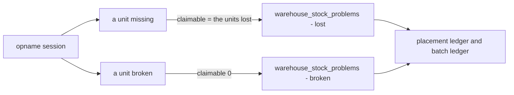

**The spec.**

| | |
| --- | --- |
| `warehouse_stock_problems` | `id` · `warehouse_id` · `team_id` · `product_id` · `transaction_id` · `batch_id` · `problem_type` · `problem_stock_count` · `price_unit` · `claimable_stock_count` · `claimed_stock_count` · `created_at` |
| `problem_type` | `broken` · `lost` |
| a unit missing at the count | a `lost` row; `claimable_stock_count` = the units lost |
| a unit broken at the count | a `broken` row; `claimable_stock_count` = 0 |
| then | the placement ledger and the batch ledger are posted |
| also fixed | `opname_session_snapshots` no longer lists `warehouse_id` twice |

**What it does NOT settle** — [opname Q11](./opname_clarify.md#question): which batch a shortage is taken from when it spans
two · gains and losses of one product on two racks in one session · problems found outside a count · the word the flow
uses for a shortage.

## a-surplus-claims-a-lost-unit-first

> Owner, in [opname.md](./opname.md) §How We Manage Stock Problem In Warehouses *(2026-10-13)*: *"Surplus Found"* → *"find
> that can claimable in `warehouse_stock_problems`"* → if found, *"Increment Claimed"*; if not, *"Get Last Price"* →
> *"New batch"*; then both ledgers. It answers [context Q14b](./context_clarify.md#question) — *a found unit, which batch?* —
> in substance: a found unit answers the loss it came from, not the newest batch.

**The verdict.** A unit a count finds **extra** is first assumed to be one the warehouse lost earlier: it claims an open
`lost` problem, and the money the warehouse paid for that loss comes back. Only when no lost unit is waiting to be claimed
is it treated as new stock, minted as a batch at the product's last price.

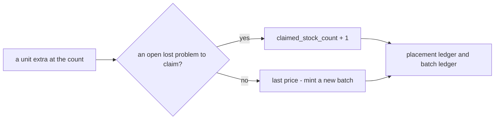

**The spec.**

| | |
| --- | --- |
| a surplus | first looks for a `lost` problem with `claimed_stock_count < claimable_stock_count` |
| one found | `claimed_stock_count` goes up by the units claimed, and both ledgers are posted |
| none found | the product's last price; a new batch is minted at it, and both ledgers are posted |
| a broken problem | never claimed: its `claimable_stock_count` is 0 |

**What it does NOT settle** — [opname Q11](./opname_clarify.md#question): which problem is claimed when several are open,
and into which batch the unit goes back · how a claim is traced to the count that made it · which "last price".

## a-claim-names-its-transaction

> Owner, in [opname.md](./opname.md) §Table That Must have in Stock Opname *(2026-10-13)*: *"5. Table
> `problem_claimed_transactions`"* — `id`, `warehouse_id`, `problem_id`, `transaction_id`, `created_at`. It answers the
> trace half of [opname Q11d](./opname_clarify.md#question) — *a claim leaves no trace* — as recommended, under your own name
> for the table.

**The verdict.** A claim is not only a counter going up. Each one is a row saying **which problem** was claimed and **which
transaction** claimed it, so balance's `found` can name the loss it reverses, and a wrong claim can be traced back to the
count that made it.

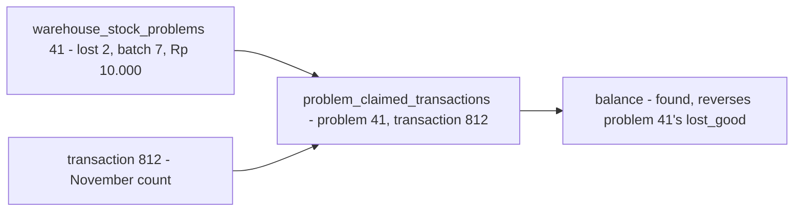

**The spec.**

| | |
| --- | --- |
| `problem_claimed_transactions` | `id` · `warehouse_id` · `problem_id` · `transaction_id` · `created_at` |
| one row per | a problem claimed by a transaction |
| beside it | `warehouse_stock_problems.claimed_stock_count`, still incremented by the claim |

**What it does NOT settle** — the rest of [opname Q11d](./opname_clarify.md#question): how many units a claim took · that
two counts at one second cannot claim one unit twice · and your §How We Manage Stock Problem In Warehouses does not yet draw
the row being written.

🔄 *(2026-10-13)* **Drawn**: the claim row is in your flow — [the-problem-flow-opens-at-finalize-and-adjustment](#the-problem-flow-opens-at-finalize-and-adjustment).

## a-shortage-writes-a-row-per-batch

> Owner, in chat *(2026-10-13)*: *"for 11a, its okay"*. It answers [opname Q11a](./opname_clarify.md#question) — *a
> shortage across two batches* — as recommended.

**The verdict.** A rack does not know its batches, so a shortage takes them the way a sale does: **oldest first**. It writes
**one `lost` row per batch it took**, each at that batch's own price, so a unit found later goes back to a real batch at
the price it left at.

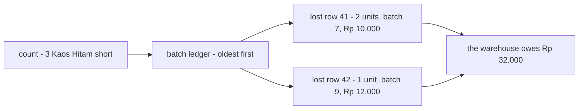

**The spec.**

| | |
| --- | --- |
| which batches | the product's batches for that team in the warehouse, oldest first — as every take |
| rows | one `warehouse_stock_problems` row per batch taken |
| each row | `batch_id` · `price_unit` of that batch · `problem_stock_count` = the units taken from it · `claimable_stock_count` = the same, for `lost` |
| the money | the sum of the rows: 2 × Rp 10.000 + 1 × Rp 12.000 = Rp 32.000 |

## a-count-nets-each-product-across-the-session

> Owner, in chat *(2026-10-13)*: *"for 11b, 11c, 11d, 11e, 11f i follow your recomendation"*. It answers
> [opname Q11b](./opname_clarify.md#question) — *a gain and a loss of one product in one count* — and with it
> [opname Q6](./opname_clarify.md#question), *when does a difference cost money*, as recommended.

**The verdict.** A count adds up each product's differences **across all the racks in the session** before anything costs
money. A −1 on one rack and a +1 on another is a move: each rack is corrected, and nobody pays. Only a **net** shortage
writes `lost` rows, and only a **net** surplus claims.

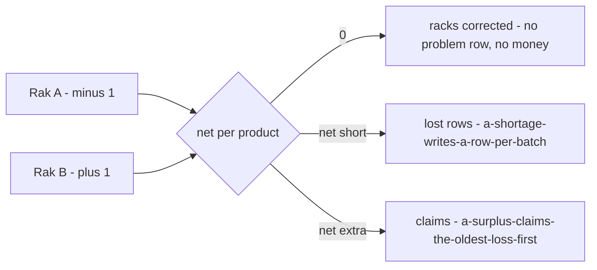

**The spec.**

| | |
| --- | --- |
| first | sum each product's differences over every rack in the session |
| net 0 | each rack gets its placement row; no batch row, no problem row, no money — as a move |
| net short | `lost` rows for the net, per [a-shortage-writes-a-row-per-batch](#a-shortage-writes-a-row-per-batch) |
| net extra | claims for the net, per [a-surplus-claims-the-oldest-loss-first](#a-surplus-claims-the-oldest-loss-first) |
| racks | every rack still corrected to what was counted |

🔄 *(2026-10-13)* **What is netted** is now *the rest* — sellable against the book less the broken — per [broken-posts-as-written-the-rest-nets](#broken-posts-as-written-the-rest-nets). Broken is posted beside it, never netted.

## a-rack-plan-counts-its-products-everywhere

> Owner, in chat *(2026-10-13)*, the same answer — 11b-i, as recommended. It overtakes the one-rack half of my
> [Q6](./opname_clarify.md#question) recommendation, *"a one-rack plan corrects the racks and leaves the money to a
> whole-product count"*, which would have moved a rack without its batch.

**The verdict.** A product is always counted on **all** its racks at once. *Plan Specific Placement* stays, and widens: every
product on the planned rack brings its other racks into the session. Without that, a count of one rack cannot tell a move
from a loss, and correcting the rack alone would leave the batch ledger counting units the racks do not
([context 14a](./context_clarify.md#question)).

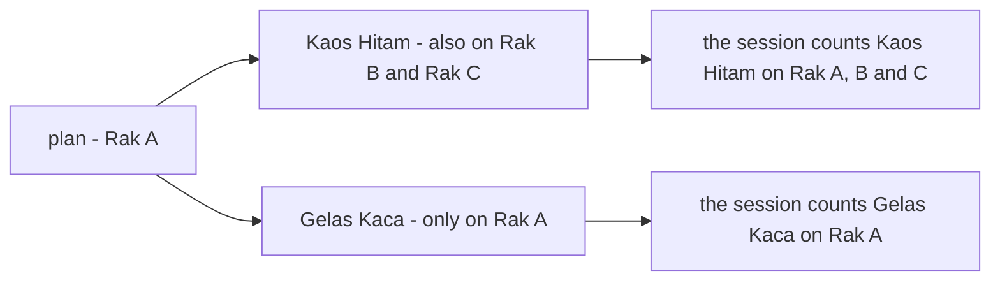

**The spec.**

| | |
| --- | --- |
| the four plans | all racks · a team · a product · a placement — unchanged |
| a placement plan | snapshots and locks each of its products on **every** rack that holds it, not only the planned one |
| the lock | per product on each rack, as [a-count-locks-the-product-on-the-rack](#a-count-locks-the-product-on-the-rack) — now over the wider set |

## a-surplus-claims-the-oldest-loss-first

> Owner, in chat *(2026-10-13)*, the same answer — [opname Q11c](./opname_clarify.md#question), as recommended. It completes
> [a-surplus-claims-a-lost-unit-first](#a-surplus-claims-a-lost-unit-first) and closes what was left of
> [context Q14b](./context_clarify.md#question).

**The verdict.** When several losses are open, a surplus claims the **oldest** first — a loss took the oldest units, so a
find returns them in the same order. The unit goes back **into the claimed row's batch, at its `price_unit`**, so the money
comes back at the price it left at. An emptied batch reopens for it.

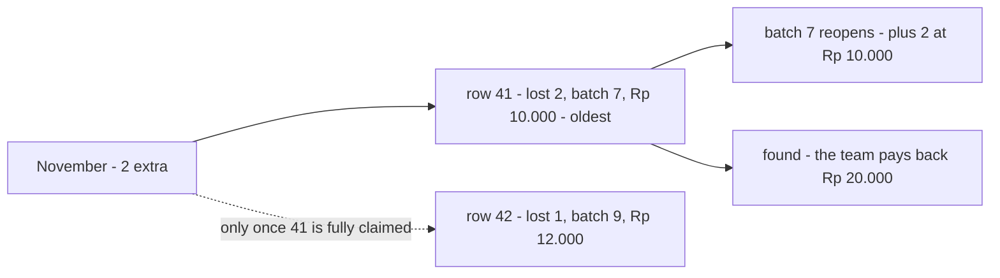

**The spec.**

| | |
| --- | --- |
| which rows | `lost` rows of the same warehouse, team and product with `claimed_stock_count < claimable_stock_count` |
| the order | oldest `created_at` first, then lowest id |
| the unit | into the row's `batch_id`, at the row's `price_unit`; a batch at 0 reopens |
| more extra than open | claim every open unit, then mint the rest per [last-price-is-the-teams-newest-batch-here](#last-price-is-the-teams-newest-batch-here) |

## a-claim-records-its-units

> Owner, in chat *(2026-10-13)*, the same answer — what was left of [opname Q11d](./opname_clarify.md#question), as
> recommended. It completes [a-claim-names-its-transaction](#a-claim-names-its-transaction).

**The verdict.** A claim row says **how many units** it took, so a correction gives back the right number. The problem's own
counter is the sum of its claims, and the database refuses a claim past what is claimable — two counts finalizing at the
same second cannot claim one unit twice.

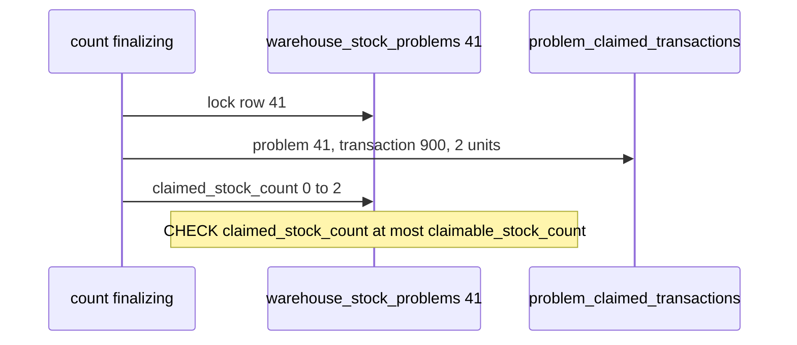

**The spec.**

| | |
| --- | --- |
| `problem_claimed_transactions` | 🆕 `claimed_stock_count` — the units this claim took |
| `warehouse_stock_problems.claimed_stock_count` | the sum of its claim rows |
| the guard | `CHECK (claimed_stock_count <= claimable_stock_count)`, and the problem row locked before it is claimed |
| the flow | *Increment Claimed* also writes the claim row — ⚠ your §How We Manage Stock Problem In Warehouses does not draw it yet |

🔄 *(2026-10-13)* **Drawn**: *Increment Claimed and Write `problem_claimed_transactions`* — [the-problem-flow-opens-at-finalize-and-adjustment](#the-problem-flow-opens-at-finalize-and-adjustment).

🔄 *(2026-10-14)* **Written** in your [opname.md](./opname.md): `claimed_stock_count` on `problem_claimed_transactions`.

## an-adjustment-writes-the-same-problem-row

> Owner, in chat *(2026-10-13)*, the same answer — [opname Q11e](./opname_clarify.md#question), as recommended.

**The verdict.** A loss or a breakage that nobody was counting — a carton dropped at 10:00 — is recorded by an
**adjustment** at the shelf, which writes **the same** `warehouse_stock_problems` row a count would. The register has two
doors; the row's transaction type, `adjustment` or `opname`, says which one it came through. A unit found outside a count
is an adjustment that claims, by the same rule as a count.

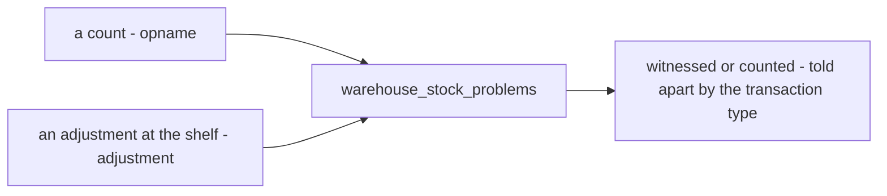

**The spec.**

| | |
| --- | --- |
| who writes the register | a count's finalize, and an adjustment |
| an adjustment's broken or lost | the same row, per [a-shortage-writes-a-row-per-batch](#a-shortage-writes-a-row-per-batch) |
| an adjustment's found | a claim, per [a-surplus-claims-the-oldest-loss-first](#a-surplus-claims-the-oldest-loss-first) |
| a found, by either door | erases a warehouse debt, so it is confirmed by a second person — who confirms is [Q8](./opname_clarify.md#question) |
| the adjustment's screen and rules | yours to write in [adjustment.md](./adjustment.md) |

## last-price-is-the-teams-newest-batch-here

> Owner, in chat *(2026-10-13)*, the same answer — [opname Q11f](./opname_clarify.md#question), as recommended. It completes
> the *"Get Last Price"* step of [a-surplus-claims-a-lost-unit-first](#a-surplus-claims-a-lost-unit-first).

**The verdict.** A surplus with no loss to claim is minted at the price of **the team's newest batch of that product in this
warehouse**, even an emptied one — each warehouse has its own freight, so another warehouse's price is not this one's cost.
If the team **never** had the product here, the surplus does not post: somebody has to say whose goods these are.

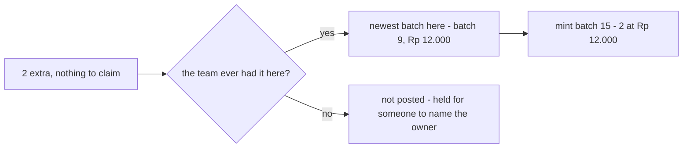

**The spec.**

| | |
| --- | --- |
| the price | `price_unit` of the newest batch of that product, team and warehouse — emptied batches included |
| none here | the surplus line does not post — who then names the owner, and how, is not settled here |
| the new batch | minted under the count's transaction; no money moves |

🔄 *(2026-10-14)* **Settled**: *none here* is no longer a count's problem — such a unit never enters the session ([a-unit-never-stocked-here-comes-in-by-restock](#a-unit-never-stocked-here-comes-in-by-restock)).

## a-count-is-blind-then-revealed

> Owner, in chat *(2026-10-13)*: *"for 1 c, a . yes blind count and "Staff writing the difference""* — confirmed, asked to
> choose between three readings, as **"Blind, then a reveal"**. It answers [opname Q1](./opname_clarify.md#question) —
> *does staff type what they count, or the difference?* — the count as recommended, and keeps your step *"Staff writing the
> difference"* as a second step, against my rename.

**The verdict.** Staff count **blind**: the screen names the product and the rack and never the system's figure, and they
type what they see. Only after they submit does the system **reveal** what it expected, what was counted and the
difference. Then comes your *"Staff writing the difference"*: for each difference, staff recount or write why, before the
session finalizes. The counter's first number is never one they were shown.

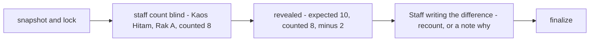

**The spec.**

| | |
| --- | --- |
| the count screen | product and rack, an empty quantity; **no** `system_stock_count` |
| stored | `real_stock_count` — what staff typed; the difference is worked out, never typed |
| the reveal | after submit: expected, counted and the difference, per product on each rack |
| *Staff writing the difference* | per difference: a recount, or a note saying why |
| your flow | unchanged — *"Staff writing the difference"* is this step |

**What it does NOT settle:** where the note is kept — the snapshot row has no column for it ([Q10e](./opname_clarify.md#question)) ·
⚠ a recount **after** the reveal is no longer blind, so what keeps it honest is the second person of
[Q8](./opname_clarify.md#question) · what "expected" counts — the sold units still waiting on the rack are
[Q10b](./opname_clarify.md#question) · a tolerance, the rest of [Q7](./opname_clarify.md#question).

🔄 *(2026-10-14)* **Stored** in `recounted_stock_count`, and a recount replaces it — the blind number is not kept ([a-row-keeps-only-its-latest-count](#a-row-keeps-only-its-latest-count)). The count is still made blind.

## a-counter-may-add-a-product-found-here

> Owner, in chat *(2026-10-13)*: *"for 2 1b, follow your recomendation"*. It answers 1b of
> [opname Q1](./opname_clarify.md#question) — *a product the system does not expect on that rack* — as recommended.

**The verdict.** The count lists the products the system expects on the rack — names only — and the counter can **add a
product found here** that is not on the list. A mis-shelved product is then counted where it really is, and
[a-rack-plan-counts-its-products-everywhere](#a-rack-plan-counts-its-products-everywhere) brings in its other racks, so
the netting sees the move instead of a surplus here and a shortage there.

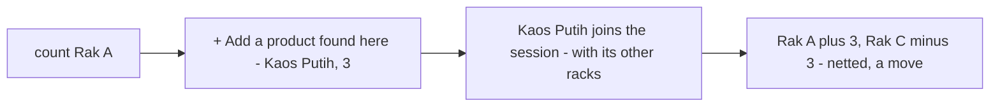

**The spec.**

| | |
| --- | --- |
| the list | the products the system expects on the rack, without quantities |
| *Add a product found here* | any product of the warehouse's teams; it joins the session with a `system_stock_count` of 0 on this rack |
| then | its other racks join the session, and are counted before it finalizes |

🔄 *(2026-10-14)* **Except** a product its team never had in this warehouse: it is taken out, not added ([a-unit-never-stocked-here-comes-in-by-restock](#a-unit-never-stocked-here-comes-in-by-restock)).

## a-count-has-no-tolerance

> Owner, in chat *(2026-10-13)*: *"for q7, q10e follow your recomendation"*. It answers what was left of
> [opname Q7](./opname_clarify.md#question) — *is there a tolerance?* — as recommended. The recount half was already
> answered by [a-count-is-blind-then-revealed](#a-count-is-blind-then-revealed).

**The verdict.** There is **no tolerance**. A count of 400 units that is 1 short writes a `lost` row and a debt, the same as
one that is 40 short. Small counting noise is stopped by the recount at the reveal and by the second person, not by a
threshold below which a loss quietly disappears.

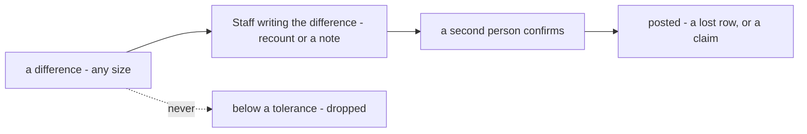

**The spec.**

| | |
| --- | --- |
| tolerance | none — every net difference posts |
| what stops noise | the recount after the reveal, and the second person ([Q8](./opname_clarify.md#question)) |

## a-snapshot-row-keeps-its-note-and-recount

> Owner, in chat *(2026-10-13)*, the same answer — 10e of [opname Q10](./opname_clarify.md#question), as recommended.

**The verdict.** *Staff writing the difference* writes onto the snapshot row: a **note** saying why a difference stands, and
the **recount**, when there was one, beside the first count. The first blind number is never overwritten, so a reader can
always see what was counted before anyone knew what was expected.

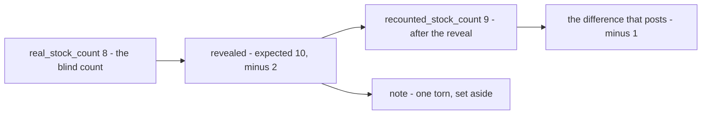

**The spec.**

| | |
| --- | --- |
| `opname_session_snapshots.note` | 🆕 optional — why the difference stands |
| `opname_session_snapshots.recounted_stock_count` | 🆕 optional — the second count, set only when staff recount; named beside your `real_stock_count` (the `recounted` of the clarify) |
| `real_stock_count` | the blind count, never overwritten |
| the difference that posts | from `recounted_stock_count` when there is one, else from `real_stock_count` |

🔄 *(2026-10-14)* **Its `note` is dropped** — the reason lives on the draft ([a-difference-needs-its-reason-on-the-draft](#a-difference-needs-its-reason-on-the-draft)). The recount, and the blind count never overwritten, stand.

🔄 *(2026-10-14)* **Reversed in both halves**: its `note` is dropped ([a-difference-needs-its-reason-on-the-draft](#a-difference-needs-its-reason-on-the-draft)), and the blind count **is** overwritten by the recount ([a-row-keeps-only-its-latest-count](#a-row-keeps-only-its-latest-count)). Read it as history.

## the-lock-is-the-open-snapshot-row

> Owner, in chat *(2026-10-13)*: *"for 1 yes"* — to *"the lock is the session's open snapshot row, released by finalize or
> cancel, with `placements.locked` dropped"*. It answers [opname Q3](./opname_clarify.md#question) — *what holds the lock,
> and what releases it?* — as recommended, and decides the
> [Contradiction](./opname_clarify.md#the-lock-is-drawn-on-the-product-and-stored-on-the-rack) between the flow and
> `placements.locked`.

**The verdict.** A count's lock is not a flag somebody sets and must remember to clear. It **is** the counting session's
snapshot row for that product on that rack: while the row is open, the product on that rack is locked. The session
releases every row it holds when it **finalizes or is cancelled**, and the database refuses a second open count over the
same product on the same rack. `placements.locked` goes — one lock, in one place.

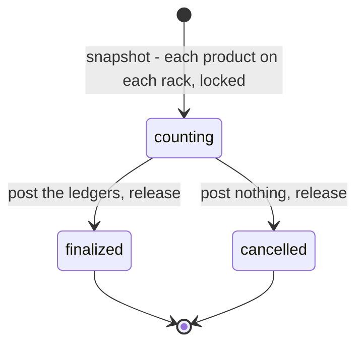

**The spec.**

| | |
| --- | --- |
| `opname_sessions.status` | 🆕 `counting` · `finalized` · `cancelled` |
| `opname_session_snapshots.released_at` | 🆕 empty while the session counts; set on all its rows at finalize or cancel |
| one count at a time | a unique index on `opname_session_snapshots (product_id, placement_id)` **where `released_at` is null** |
| a second session over a held product on a rack | refused, naming the session that holds it |
| finalize | posts the ledgers and sets `released_at`, in one database transaction |
| cancel | sets `released_at`, posts nothing; the counted rows stay for the record |
| rows added mid-count | a rack plan's other racks ([a-rack-plan-counts-its-products-everywhere](#a-rack-plan-counts-its-products-everywhere)) and *Add a product found here* ([a-counter-may-add-a-product-found-here](#a-counter-may-add-a-product-found-here)) lock the same way, and are refused the same way |
| `placements.locked` | **dropped** — ⚠ it is in your [placement.md](./placement.md), yours to remove |

**What it does NOT settle:** what the lock blocks — receipts, moves, an order's take ([Q4](./opname_clarify.md#question)) ·
the snapshot row naming its session, which this decision needs — `opname_session_id`, [Q10a](./opname_clarify.md#question).

🔄 *(2026-10-13)* **Your names, in [opname.md](./opname.md)**: `status` is `active` · `finish` · `cancel` — read them for my
`counting` · `finalized` · `cancelled` above.

## an-abandoned-count-waits-for-the-admin

> Owner, in chat *(2026-10-13)*: *"for 2 yes"* — to *"no automatic release; the admin cancels"*. It answers 3b of
> [opname Q3](./opname_clarify.md#question), as recommended.

**The verdict.** A count left open — started on Friday at 17:00 and never finished — is **never released on its own**. A
count's result is money, so it is never thrown away silently. Whatever it blocks says which count holds it, who started
it and when, so somebody knows whom to ask; the warehouse admin cancels it.

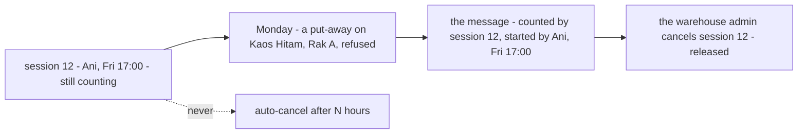

**The spec.**

| | |
| --- | --- |
| automatic release | none |
| a blocked action | names the session, who started it and when |
| who cancels | the warehouse admin — whoever may open a session ([an-opname-is-a-locked-session](#an-opname-is-a-locked-session)) |

## a-lock-stops-units-moving-not-sales

> Owner, in chat *(2026-10-13)*: *"for q4 follow your recomendation"*. It answers [opname Q4](./opname_clarify.md#question) —
> *what does a lock block?* — as recommended.

**The verdict.** While a product on a rack is being counted, **nothing may move its units** there: no put-away, no move, no
sample, no adjustment. **A sale is never refused** for it: an order's take prefers the product's unlocked racks, and uses a
locked one only when nothing else holds the product. What waits is the **picker**: a pick-list line on a locked rack is
held until the count releases, so the shelf does not change under the counter's eyes.

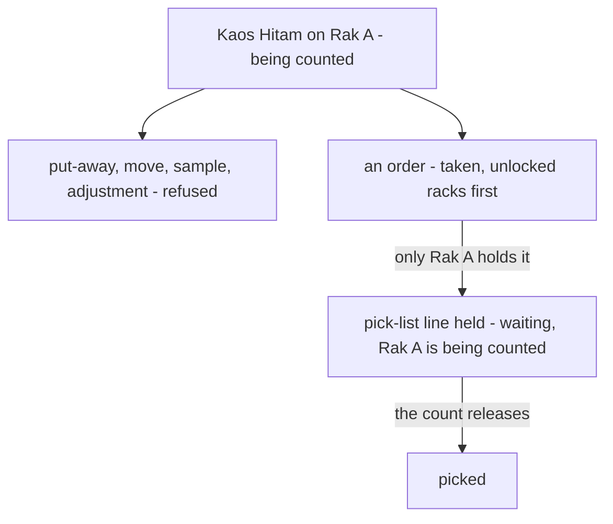

**The spec.**

| act on a locked product on a rack | |
| --- | --- |
| put-away from a restock or transfer accept | refused for that rack — the accept offers another rack or *Area Terima* |
| a move onto or off it | refused — the Move dialog already locks a counted product at 0 |
| a sample from it | refused — the Sample dialog already does |
| an adjustment | refused — a breakage seen during the count goes in its note ([a-snapshot-row-keeps-its-note-and-recount](#a-snapshot-row-keeps-its-note-and-recount)) |
| an order's take | **allowed**. The racks it takes from: unlocked first, fewest first among them; locked racks only for what the unlocked cannot fill |
| the pick-list line on a locked rack | held until the session releases, with *"waiting — Rak A is being counted"* |
| why the picker waits | the snapshot counted the sold unit as still on the rack (`waiting_count`); lifted mid-count, it reads as a false shortage — and a shortage is a debt |

**What it amends:** [an-order-takes-from-the-lowest-shelf-first](./context_decision.md#an-order-takes-from-the-lowest-shelf-first)
and [an-order-line-may-be-taken-from-several-racks](./placement_decision.md#an-order-line-may-be-taken-from-several-racks) —
fewest first still holds, **among the unlocked racks**; locked racks come last.

**What it does NOT settle:** units already in a basket when the lock starts ([Q5](./opname_clarify.md#question)) · how the
snapshot counts sold units still on the rack ([Q10b](./opname_clarify.md#question)).

🔄 *(2026-10-13)* **Corrected by [a-count-is-of-sellable-units](#a-count-is-of-sellable-units)**: a breakage seen during the count
goes in `broken_stock_count`, not in a note — a note writes no `broken` row.

## a-count-starts-when-order-processing-is-done

> Owner, in chat *(2026-10-13)*: *"for Opname Q5, its overkill, at the warehouse usually admin warehouse prevent staff
> opname if still processing order, the staff still busy for porcessing order too"*. It answers
> [opname Q5](./opname_clarify.md#question) — *units already in a basket when the lock starts* — **against my
> recommendation**, which was for the lock to wait, on screen, until no printed line in the scope was left unscanned.

**The verdict.** There is **no system rule** for it. In the warehouse, the admin does not start a count while orders are
still being processed — the staff are busy packing them anyway. So when a count starts, no unit is sitting in a basket.
If one ever does, the count's own steps catch it: the reveal shows the −1, and *Staff writing the difference* recounts
or notes *"order 9001 in a basket"*, before a second person confirms.

```mermaid
flowchart LR
  P["orders being processed"] -->|"the admin waits"| S["the admin starts the count"]
  S --> C["blind count"]
  C --> V["reveal - a stray basket shows as minus 1"]
  V --> W["Staff writing the difference - recount or a note"]
```

**The spec.**

| | |
| --- | --- |
| a system check before the lock | **none** |
| when a count starts | the warehouse admin's call — after order processing, as the warehouse already works |
| a unit in a basket anyway | a difference like any other: caught at the reveal by [a-count-is-blind-then-revealed](#a-count-is-blind-then-revealed), and confirmed or corrected before it posts |
| withdrawn | my *"the lock waits until no receipt in the scope is printed and unscanned"* |

## a-money-difference-needs-a-second-person

> Owner, in chat *(2026-10-13)*: *"for q8 i follow your recomendation"*. It answers 8a of
> [opname Q8](./opname_clarify.md#question) — *which differences need a second person?* — as recommended.

**The verdict.** Any difference that **moves money** waits for a second person before it posts: a shortage and a breakage,
which the warehouse owes, and a **find**, which pays the warehouse back. A false find erases a warehouse debt, so it is the
one most worth a second look. A count where nothing moves money finalizes at once.

```mermaid
flowchart LR
  F["the session's net differences"] --> Q{"any line moving money - lost, broken or found"}
  Q -->|"yes"| C["a second person confirms or sends it back"]
  Q -->|"no - all match, or only a minted surplus"| P["finalizes at once"]
  C -->|"confirmed"| P2["posted"]
  C -->|"sent back"| R["recount - the session stays counting"]
```

**The spec.**

| | |
| --- | --- |
| needs a second person | a session with any net `lost`, `broken` or `found` line |
| finalizes at once | a session where every product matches, or whose only differences mint a surplus — no money moves |
| sent back | the session stays `counting`; staff recount, and the reveal shows the new figures |

## nobody-finalizes-their-own-count

> Owner, in chat *(2026-10-13)*, the same answer — 8b and 8c of [opname Q8](./opname_clarify.md#question), as recommended.

**The verdict.** Warehouse **staff or a manager count**; the warehouse team's **Owner or Admin finalizes**. And whoever
finalizes may **never** be one of the session's counters — checked against the **person**, not the role, because one person
can hold two roles and a role check would let them confirm their own arithmetic.

```mermaid
flowchart LR
  A["Ani - counts Rak A, 2 short"] --> S["session 12"]
  S --> X{"who finalizes"}
  X -->|"Ani - also the warehouse Admin"| N["refused - her own count"]
  X -->|"Budi - the Owner, counted nothing"| Y["confirms or sends back"]
```

**The spec.**

| | |
| --- | --- |
| who counts | a member of the warehouse team — staff or a manager |
| who finalizes | the warehouse team's Owner or Admin |
| the check | the finalizer is not the `counted_by_id` of any of the session's snapshot rows — ⚠ that column is [Q10c](./opname_clarify.md#question), which this decision needs |
| recorded | `opname_sessions.finalized_by_id`, `finalized_at` |

🔄 *(2026-10-14)* **Written** in your [opname.md](./opname.md): `finalized_by_id` · `finalized_at` on `opname_sessions`.

## root-finalizes-only-as-an-override

> Owner, in chat *(2026-10-13)*, the same answer — 8d of [opname Q8](./opname_clarify.md#question), as recommended.

**The verdict.** Root and the root team's Administrator, who act in every team, **may** finalize a warehouse's count — and
the session records that it was an **override**, so it reads differently from the warehouse confirming its own debt. Even
then, never their own count.

```mermaid
flowchart LR
  R["Root - not a counter in session 12"] --> F["finalizes"]
  F --> O["session 12 - finalized as an override"]
  R2["Root - counted Rak B in session 12"] -.->|"refused"| F
```

**The spec.**

| | |
| --- | --- |
| who | Root, and the Administrator of the root team |
| recorded | `opname_sessions.finalized_as_override` — 🆕 true when the finalizer is not the warehouse team's Owner or Admin |
| still refused | their own count, per [nobody-finalizes-their-own-count](#nobody-finalizes-their-own-count) |

🔄 *(2026-10-14)* **Its record is reversed**: there is no `finalized_as_override` — a finalize by Root reads like any other ([finalizing-is-the-agreement](#finalizing-is-the-agreement)). Root and the root Administrator may still finalize, never their own count.

## a-team-asks-for-a-count-outside-the-system

> Owner, in chat *(2026-10-13)*: *"for q9, yes but outside system, selling just simple contact warehouse is enough"*. It
> answers [opname Q9](./opname_clarify.md#question) — *may a selling team ask for a count of its goods?* — yes as
> recommended, **but not as a feature**: my *a request the warehouse turns into a session within a stated time* is
> withdrawn.

**The verdict.** A selling team that doubts its numbers **asks the warehouse directly** — a message or a call. The system has
no request screen and no deadline. The warehouse admin decides whether and when to count, and opens a session scoped to
that team — a plan that already exists. The warehouse keeps the trigger, since it bears what the count finds.

```mermaid
flowchart LR
  T["Melati - Kaos Hitam looks wrong"] -->|"a message or a call - outside the system"| A["the warehouse admin"]
  A -->|"decides when"| S["opens a session - plan by team"]
  S --> C["counted as any other session"]
```

**The spec.**

| | |
| --- | --- |
| the request | outside the system — no screen, no table, no deadline |
| who opens the count | the warehouse admin, as for every session ([an-opname-is-a-locked-session](#an-opname-is-a-locked-session)) |
| the plan | *Plan Specific Team*, already in the flow |

## a-snapshot-row-names-its-session

> Owner, in [opname.md](./opname.md) §Table That Must have in Stock Opname *(2026-10-13)*: `opname_session_id` added to
> `opname_session_snapshots`. It answers 10a of [opname Q10](./opname_clarify.md#question) — *the row names no session* —
> as recommended.

**The verdict.** Every counted row says **which session** it belongs to. A session's finalize, its cancel, its reveal and its
second-person check all act on *"the rows of session 15"* — never on whatever rows happen to exist for a product on a rack,
which is how Monday's −2 would have been posted again on Thursday.

```mermaid
flowchart LR
  S12["session 12 - Monday"] --> R1["Kaos Hitam, Rak A - minus 2"]
  S15["session 15 - Thursday"] --> R2["Kaos Hitam, Rak A - 0"]
  F["finalize session 15"] -->|"only its own rows"| R2
```

**The spec.**

| | |
| --- | --- |
| `opname_session_snapshots.opname_session_id` | 🆕 required — the session the row belongs to |
| what reads it | finalize and cancel ([the-lock-is-the-open-snapshot-row](#the-lock-is-the-open-snapshot-row)) · the reveal ([a-count-is-blind-then-revealed](#a-count-is-blind-then-revealed)) · the counter check ([nobody-finalizes-their-own-count](#nobody-finalizes-their-own-count)) |

## session-placements-is-dropped

> Owner, in chat and in [opname.md](./opname.md) *(2026-10-13)*: *"table `session_placements` its look useless right ?"* —
> then *"yes i dropped that"*. It answers 10d of [opname Q10](./opname_clarify.md#question), as recommended.

**The verdict.** There is no separate list of a session's racks. The snapshot rows already name every rack a session
covers, and two lists of the same racks drift apart the first time one is written and the other is not.

```mermaid
flowchart LR
  S["session 15"] --> R["its snapshot rows - each names its rack"]
  X["session_placements"] -.->|"dropped"| S
```

**The spec.**

| | |
| --- | --- |
| `session_placements` | removed |
| a session's racks | the `placement_id`s of its snapshot rows |
| an empty rack counted empty | leaves no row; a rack plan's own scope names the rack it planned |

🔄 *(2026-10-14)* *"A rack plan's own scope"* is now `plan` ([a-session-records-its-plan](#a-session-records-its-plan)); **which** rack it planned waits on [Q17](./opname_clarify.md#question).

🔄 *(2026-10-14)* **Settled** by [the-plan-target-is-only-a-filter](#the-plan-target-is-only-a-filter): a rack plan does not keep its rack, so an empty rack counted empty leaves no trace.

🔄 *(2026-10-14)* **An `all` session's racks** are every rack of the warehouse, not only its rows' — [an-all-count-visits-every-rack](#an-all-count-visits-every-rack). Other plans: still its rows'.

## a-snapshot-row-names-its-transaction

> Owner, in chat and in [opname.md](./opname.md) *(2026-10-13)*: *"for 10a-i, yes i write it"* — `transaction_id` on
> `opname_session_snapshots`. It answers 10a-i of [opname Q10](./opname_clarify.md#question), as recommended.

**The verdict.** At finalize, every counted row records **the transaction it was posted in**. A transaction belongs to one
owning team, so a count over five teams posts five; the session finds its rows, and through them every transaction it
wrote, with no table in between.

```mermaid
flowchart LR
  S["session 15"] --> R1["Melati, Kaos Hitam, Rak A"]
  S --> R2["Sinar, Gelas Kaca, Rak A"]
  R1 -->|"transaction_id"| T1["901 - opname, Melati"]
  R2 -->|"transaction_id"| T2["902 - opname, Sinar"]
```

**The spec.**

| | |
| --- | --- |
| `opname_session_snapshots.transaction_id` | 🆕 set at finalize; empty while counting, and on a cancelled session |
| per team | one `opname` transaction per owning team in the session |

## a-snapshot-row-names-its-counter

> Owner, in chat and in [opname.md](./opname.md) *(2026-10-13)*: *"for 10c i add in `opname_session_snapshots`"* —
> `counted_by_id`. It answers 10c of [opname Q10](./opname_clarify.md#question), as recommended, and gives
> [nobody-finalizes-their-own-count](#nobody-finalizes-their-own-count) the column it checks.

**The verdict.** Every counted row says **who counted it**, so the finalizer can be checked against every counter in the
session.

```mermaid
flowchart LR
  R["snapshot rows of session 12 - counted_by Ani, Dodi"] --> X{"finalizer"}
  X -->|"Ani"| N["refused"]
  X -->|"Budi"| Y["allowed"]
```

**The spec.**

| | |
| --- | --- |
| `opname_session_snapshots.counted_by_id` | 🆕 the person who entered the count |
| the check | the finalizer is none of the session's `counted_by_id` |

## expected-is-the-book-figure

> Owner, in chat *(2026-10-13)*: *"for 10b, its rarely happen dont overthinking"*. It answers 10b of
> [opname Q10](./opname_clarify.md#question) — *does "expected" include units sold but still on the rack?* — **against my
> recommendation** of a `waiting_count` captured at the snapshot.

**The verdict.** "Expected" is the **book figure** at the snapshot, `system_stock_count`, and nothing more. A sold unit still
waiting on the rack is rare once counts start after order processing
([a-count-starts-when-order-processing-is-done](#a-count-starts-when-order-processing-is-done)); when one does, it shows at
the reveal as a +1 and is handled there, like a stray basket.

```mermaid
flowchart LR
  B["snapshot - book 10"] --> C["counted 11 - one sold, not yet picked"]
  C --> V["reveal - plus 1"]
  V --> W["Staff writing the difference - a note, or recount after the pick"]
  W --> P["a second person confirms"]
```

**The spec.**

| | |
| --- | --- |
| expected | `system_stock_count` — the book at the snapshot |
| `waiting_count` | not added |
| a waiting unit counted | a +1 at the reveal, handled there ([a-count-is-blind-then-revealed](#a-count-is-blind-then-revealed)) and by the second person ([a-money-difference-needs-a-second-person](#a-money-difference-needs-a-second-person)) |
| withdrawn | my `waiting_count` |

🔄 **What it touches.** [a-lock-stops-units-moving-not-sales](#a-lock-stops-units-moving-not-sales) gave `waiting_count` as
its reason for holding a pick on a locked rack. The rule still holds for a different reason: an order **after** the
snapshot lowers the book, but the snapshot already counted the unit — lifted mid-count, it reads as −1. Held, the count
matches.

## a-count-is-of-sellable-units

> Owner, in chat *(2026-10-13)*: *"if system 10, 1 lost and 1 broken, staff will be educated that counted as 8, so 1 broken
> and 1 lost"* — then *"8 is counted only sellable stock"*. It answers the critique *a count cannot record broken* —
> **against my recommendation**, which counted every unit and asked *"of which broken"* at the count.

**The verdict.** Staff count **sellable units only**; a torn shirt comes off the rack and is not counted. The blind count
stays one number. The shortage it reveals is then **split** at *Staff writing the difference*: so many broken, and the rest
lost. A broken unit can only explain a sellable unit that is missing, so the broken part is never more than the shortage.

```mermaid
flowchart LR
  C["count - sellable only - 8"] --> V["reveal - expected 10, minus 2"]
  V --> W["Staff writing the difference - of the 2, broken 1"]
  W --> B["broken row - 1, claimable 0"]
  W --> L["lost row - 1, claimable 1"]
```

**The spec.**

| | |
| --- | --- |
| the count | sellable units only; broken ones are set aside, off the rack |
| `opname_session_snapshots.broken_stock_count` | 🆕 of this row's shortage, how many are broken — entered at *Staff writing the difference* |
| the rule | `broken_stock_count` ≤ the shortage; the rest of the shortage is `lost` |
| no shortage | nothing broken to record — a torn unit the book never held was never stock |
| rows written | `broken` (claimable 0) and `lost` (claimable), oldest batch first, per [a-shortage-writes-a-row-per-batch](#a-shortage-writes-a-row-per-batch) |
| money | the warehouse owes for both — `broken_good` and `lost_good` |

🔄 **What it corrects.** [a-lock-stops-units-moving-not-sales](#a-lock-stops-units-moving-not-sales) said *"a breakage seen
during the count goes in its note"*. A note writes no `broken` row, so the warehouse would never pay and the unit would stay
in stock. It goes in `broken_stock_count`.

**What it does NOT settle:** what happens to the torn shirt once it is off the rack, and whose it is after the warehouse pays
for it — [context Q6](./context_clarify.md#question).

🔄 *(2026-10-13)* **Storage moved by your edit**: the broken and lost split lives in `opname_problems_draft`, not in a
`broken_stock_count` on the snapshot row ([the-difference-is-a-draft-until-finalize](#the-difference-is-a-draft-until-finalize)). The rule stands.

🔄 *(2026-10-13)* **Settled**: the torn shirt off the rack is thrown away ([a-broken-unit-is-thrown-away](./context_decision.md#a-broken-unit-is-thrown-away)).

🔄 *(2026-10-13)* **Cap dropped** by [broken-posts-as-written-the-rest-nets](#broken-posts-as-written-the-rest-nets): *broken ≤ the shortage* and *no shortage — nothing broken to record* no longer hold. A thrown-away unit is always posted; what it leaves unexplained is netted.

## one-active-count-per-warehouse

> Owner, in [opname.md](./opname.md) §General *(2026-10-13)*: *"Every Warehouse only can have 1 active opname session."*

**The verdict.** A warehouse runs **one count at a time**. A second session cannot be opened while one is `active`, so two
counts never overlap — on a product, a rack or anything else. It is simpler than one open count per product per rack, which
[the-lock-is-the-open-snapshot-row](#the-lock-is-the-open-snapshot-row) enforced.

```mermaid
flowchart LR
  A["session 12 - active"] --> X{"open another in this warehouse?"}
  X -->|"while 12 is active"| N["refused - session 12 is active"]
  X -->|"12 finished or cancelled"| Y["opened"]
```

**The spec.**

| | |
| --- | --- |
| the rule | at most one `opname_sessions` row per `warehouse_id` with `status = active` — a partial unique index |
| what it replaces | the per-product-per-rack index of [the-lock-is-the-open-snapshot-row](#the-lock-is-the-open-snapshot-row); the lock itself — the open snapshot row — is unchanged |
| an abandoned count | now blocks **every** count in the warehouse until the admin cancels it ([an-abandoned-count-waits-for-the-admin](#an-abandoned-count-waits-for-the-admin)) |
| a team's request | waits for the active session to end ([a-team-asks-for-a-count-outside-the-system](#a-team-asks-for-a-count-outside-the-system)) |

## a-snapshot-row-is-created-then-counted

> Owner, in [opname.md](./opname.md) *(2026-10-13)*: `opname_session_snapshots.status` — `created`, `counted` — and §How Staff
> Work On Session: *"Staff Start Counting"* → *"Staff mark counted snapshot"* → *"create draft change"* → *"admin see
> updated"*, while the admin *"watch page and refresh opname session detail periodically"*. It answers most of
> [opname Q12](./opname_clarify.md#question) — *a count waiting for its second person has no state* — per row, not per
> session.

**The verdict.** Each product on a rack is counted on its own: staff count it and **mark it counted**, its difference is
written as a draft, and the admin — watching the session page — sees each row arrive. A session is ready to finalize when
every row is counted. The second person is the admin watching, and what they see is per row.

```mermaid
stateDiagram-v2
  [*] --> created: snapshot
  created --> counted: staff mark counted - draft written
  counted --> [*]: finalize
```

**The spec.**

| | |
| --- | --- |
| `opname_session_snapshots.status` | 🆕 `created` · `counted` |
| marking counted | by the staff who counted it; writes the row's draft change ([the-difference-is-a-draft-until-finalize](#the-difference-is-a-draft-until-finalize)) |
| the admin's page | the session's rows, their status and their drafts, refreshed as they change |
| finalize | when every row of the session is `counted` |

**What it does NOT settle** — the rest of [Q12](./opname_clarify.md#question): whether a counted row can still be changed by
its counter, and how the admin sends one row back.

🔄 *(2026-10-14)* **The order is redrawn**: drafts are written **before** the row is marked counted, which closes them — [a-row-is-marked-counted-after-its-drafts](#a-row-is-marked-counted-after-its-drafts).

## the-difference-is-a-draft-until-finalize

> Owner, in [opname.md](./opname.md) §Table That Must have in Stock Opname *(2026-10-13)*: table `opname_problems_draft` —
> `id`, `warehouse_id`, `team_id`, `product_id`, `note`, `problem_type` (`broken`, `lost`), `problem_stock_count`,
> `created_at` — written at *"create draft change"*. It gives
> [a-count-is-of-sellable-units](#a-count-is-of-sellable-units) its storage — the broken and lost split lives in drafts,
> **not** in a `broken_stock_count` on the snapshot row — and answers the shortage half of [Q14](./opname_clarify.md#question),
> where a count's reason is kept.

**The verdict.** What a count finds is a **draft** until the session finalizes: so many broken and so many lost of a
product, each with a note. The admin sees the drafts as they are written; finalize turns them into
`warehouse_stock_problems` rows — one per batch, at its price — and posts the ledgers.

```mermaid
flowchart LR
  C["Kaos Hitam - counted 8, expected 10"] --> D1["draft - broken 1, note torn"]
  C --> D2["draft - lost 1"]
  D1 -->|"finalize"| P1["warehouse_stock_problems - broken, per batch"]
  D2 -->|"finalize"| P2["warehouse_stock_problems - lost, per batch"]
```

**The spec.**

| | |
| --- | --- |
| `opname_problems_draft` | `id` · `warehouse_id` · `team_id` · `product_id` · `note` · `problem_type` (`broken` · `lost`) · `problem_stock_count` · `created_at` |
| written | when a row is marked counted — the shortage split into broken and lost, with a note |
| at finalize | each draft becomes `warehouse_stock_problems` rows per [a-shortage-writes-a-row-per-batch](#a-shortage-writes-a-row-per-batch) |
| replaces | the `broken_stock_count` column of [a-count-is-of-sellable-units](#a-count-is-of-sellable-units) — the rule there stands |

**What it does NOT settle** — [opname Q16](./opname_clarify.md#question): the draft names no session and no rack, so drafts
of two sessions, or of one product's three racks, cannot be told apart, and a product cannot be netted across its racks
before its drafts are written.

🔄 *(2026-10-13)* **Renamed in your opname.md**: the table is `opname_problems_drafts`.

🔄 *(2026-10-13)* **At finalize** a `broken` draft is posted as written, and a `lost` draft is a note: lost is the netted rest — [broken-posts-as-written-the-rest-nets](#broken-posts-as-written-the-rest-nets).

🔄 *(2026-10-14)* **Who writes it**: a short rack's `lost` draft is the system's, its `broken` drafts are staff's — [a-short-rack-gets-a-lost-draft-from-the-system](#a-short-rack-gets-a-lost-draft-from-the-system).

## a-draft-names-its-session-and-rack

> Owner, in chat and in [opname.md](./opname.md) *(2026-10-13)*: *"for q16 i added, check again"* — `placement_id` and
> `opname_session_id` on `opname_problems_draft`. It answers 16a of [opname Q16](./opname_clarify.md#question) — *which
> session?* — as recommended, and makes the draft **per rack**, where I had recommended one draft set per product.

**The verdict.** A draft is what staff saw **on one rack, in one session**: *"Rak A — 1 torn, 1 gone"*. Last week's
cancelled session can no longer be read into this week's finalize, and the rack a breakage was seen on is kept.

```mermaid
flowchart LR
  S["session 15"] --> A["draft - Kaos Hitam, Rak A - broken 1"]
  S --> B["draft - Kaos Hitam, Rak C - lost 1"]
  X["session 12 - cancelled"] -.->|"never read by 15"| A
```

**The spec.**

| | |
| --- | --- |
| `opname_problems_draft.opname_session_id` | 🆕 required — the session the draft belongs to |
| `opname_problems_draft.placement_id` | 🆕 required — the rack the difference was seen on |
| the grain | one product on one rack, in one session — the same grain as its snapshot row |

**What it does NOT settle** — the rest of [Q16](./opname_clarify.md#question): per-rack drafts must still be netted across
the product's racks before anything posts.

## broken-takes-its-batch-before-lost

> Owner, in chat *(2026-10-13)*: *"for a,b i follow your recomendatio"* — a: at finalize, which batch goes to the broken
> units and which to the lost ones. As recommended.

**The verdict.** When a product is short and the shortage is split, the batch ledger takes the **broken** units first and
the **lost** units after them, both oldest batch first. Any fixed order would do; this one follows the split itself. It
matters later, because a lost row stays claimable at **its** batch's price.

```mermaid
flowchart LR
  S["Kaos Hitam - short 2 - broken 1, lost 1"] --> B1["broken 1 - batch 7, Rp 10.000 - oldest"]
  B1 --> L1["lost 1 - batch 9, Rp 12.000 - next"]
```

**The spec.**

| | |
| --- | --- |
| the order | broken, then lost; within each, oldest batch first |
| rows | one `warehouse_stock_problems` row per type per batch ([a-shortage-writes-a-row-per-batch](#a-shortage-writes-a-row-per-batch)) |

## a-problem-note-names-its-racks

> Owner, in chat *(2026-10-13)*, the same answer — b: a product short on two racks has two drafts, and the problem row is
> per batch, not per rack. As recommended.

**The verdict.** A problem row's note carries **each** of the product's draft notes, prefixed with the rack it was written
on, so nothing a counter wrote is lost in the conversion.

```mermaid
flowchart LR
  A["draft - Rak A - torn"] --> P["problem note - Rak A: torn · Rak C: gone"]
  C["draft - Rak C - gone"] --> P
```

**The spec.**

| | |
| --- | --- |
| `warehouse_stock_problems.note` | the product's draft notes for that type, each as *"<rack code>: <note>"*, joined by *" · "* |
| an adjustment | its own note, as written |

## a-problem-row-names-its-rack

> Owner, in chat and in [opname.md](./opname.md) *(2026-10-13)*: *"for c yes i add placement id"* — `placement_id` on
> `warehouse_stock_problems`. It answers [opname Q15](./opname_clarify.md#question) — *a loss does not say which rack* — and c
> of the conversion, as recommended.

**The verdict.** A problem row says **which rack** it happened on whenever that is known, so *"Rak C keeps losing goods"*
can be asked. An adjustment always knows its rack. A count knows it when the row's units all came from one rack's draft;
when a product's shortage was netted across several racks, it is left empty.

```mermaid
flowchart LR
  A["adjustment on Rak C"] --> P1["problem - placement Rak C"]
  O["count - all from Rak A's draft"] --> P2["problem - placement Rak A"]
  M["count - netted over Rak A and Rak C"] --> P3["problem - placement empty"]
```

**The spec.**

| | |
| --- | --- |
| `warehouse_stock_problems.placement_id` | 🆕 optional |
| set by an adjustment | always — the rack it was recorded on |
| set by a count | when every unit of the row came from one rack's draft |
| empty | when the row's units were netted across racks |

🔄 *(2026-10-13)* A `lost` row's units come from the netted rest, not from a draft ([broken-posts-as-written-the-rest-nets](#broken-posts-as-written-the-rest-nets)): it names a rack only when one rack alone was short and none was over.

## broken-posts-as-written-the-rest-nets

> Owner, in chat *(2026-10-13)*: *"yes"* — to [opname Q16](./opname_clarify.md#question) as restated after two rules of
> theirs: a broken unit is *"take out"*, the rack *"to be 4"*, and *"broken dont have rack, its just simple take out and
> throw the trash"* ([a-broken-unit-is-thrown-away](./context_decision.md#a-broken-unit-is-thrown-away)). It overtakes my
> first recommendation — net everything and cap broken at the net — which left a thrown-away shirt posted nowhere.

**The verdict.** At finalize each product is settled in two parts. **Broken** is a fact — units in the trash — so the
drafts' broken, summed, are posted as written. **The rest** is what is still unexplained: the sellable count against the
book less the broken. Only the rest is netted across the product's racks — short is lost, over claims, zero is a move. Every
rack is corrected to its sellable count.

```mermaid
flowchart LR
  D["the product - drafts and counts"] --> B["broken - summed, posted - in the trash"]
  D --> R["the rest - sellable, minus book, plus broken"]
  D --> PL["placement ledger - each rack to its sellable count"]
  R -->|"short n"| LO["lost n"]
  R -->|"0"| Z["nothing - a move"]
  R -->|"over n"| C["claims, then mint"]
```

**The spec.**

| | |
| --- | --- |
| broken | the product's `broken` drafts, summed — posted as written, oldest batch first ([broken-takes-its-batch-before-lost](#broken-takes-its-batch-before-lost)); no cap |
| the rest | sellable counted − (book − broken), per product, over every rack in the session |
| the rest short *n* | `lost` rows for *n* — [a-shortage-writes-a-row-per-batch](#a-shortage-writes-a-row-per-batch) |
| the rest 0 | no lost row, no claim — the units moved between racks |
| the rest over *n* | *n* claims, then mint — [a-surplus-claims-the-oldest-loss-first](#a-surplus-claims-the-oldest-loss-first) |
| each rack | its placement row, to its sellable count |
| a `lost` draft | its number is not posted — lost is the rest; its note goes on the lost row ([a-problem-note-names-its-racks](#a-problem-note-names-its-racks)) |
| after finalize | book − broken − lost + surplus = the sellable count |

| Kaos Hitam | Rak A | Rak B | book · sellable | broken | the rest | posted | book after |
| --- | --- | --- | --- | --- | --- | --- | --- |
| one rack, one tear | 5 → 4 | — | 5 · 4 | 1 | 4 − 4 = 0 | broken 1 | 4 |
| a tear and a move | 5 → 3 | 3 → 4 | 8 · 7 | 1 | 7 − 7 = 0 | broken 1 | 7 |
| a tear and an extra | 5 → 4 | 3 → 4 | 8 · 8 | 1 | 8 − 7 = +1 | broken 1 · +1 claims, then mint | 8 |

**What it overtakes** — each carries a 🔄 note: the cap of [a-count-is-of-sellable-units](#a-count-is-of-sellable-units),
what [a-count-nets-each-product-across-the-session](#a-count-nets-each-product-across-the-session) nets, how
[the-difference-is-a-draft-until-finalize](#the-difference-is-a-draft-until-finalize) turns drafts into rows, and a lost row's rack in
[a-problem-row-names-its-rack](#a-problem-row-names-its-rack).

## a-counted-row-is-read-only-until-sent-back

> Owner, in chat *(2026-10-13)*: *"for q12, q14 i follow your recomendation"*. It answers [opname Q12](./opname_clarify.md#question)
> — *can a counted row still change, and how does the admin send one back?* — as recommended.

**The verdict.** Once Ani marks a row `counted`, she can no longer change it, so the number the admin reads on the session
page is the number finalize posts. If the admin doubts it — *"recount Rak A"* — they send that one row back to `created`:
its drafts are deleted and staff count it again.

```mermaid
stateDiagram-v2
  [*] --> created
  created --> counted: staff mark counted - drafts written
  counted --> created: admin sends back - drafts deleted
  counted --> [*]: finalize
```

**The spec.**

| | |
| --- | --- |
| a `counted` row | read-only to its counter — its counts and its drafts |
| *Send Back to Count* | the warehouse admin, on one row of an `active` session |
| sent back | `status` → `created`; its counts and `counted_by_id` cleared; its `opname_problems_drafts` rows deleted |
| the lock | unchanged — the row stays open ([the-lock-is-the-open-snapshot-row](#the-lock-is-the-open-snapshot-row)) |
| finalize | only when every row is `counted` |

🔄 *(2026-10-14)* **Drawn** in your §How Staff Work On Session: *admin Send Back to Count, drafts deleted* — [a-row-is-marked-counted-after-its-drafts](#a-row-is-marked-counted-after-its-drafts).

## a-surplus-carries-no-reason

> Owner, in chat *(2026-10-13)*, the same answer — [opname Q14](./opname_clarify.md#question), *a surplus has no note*, as
> recommended.

**The verdict.** A surplus is not explained. It claims a lost unit back, or mints a batch, by rule — nobody acts on *why*
it was there. Drafts stay `broken` and `lost`. A counter who wants to say *"found behind the shelf"* writes it on the
snapshot row's note.

```mermaid
flowchart LR
  S["the rest - over 1"] --> C{"a lost unit to claim?"}
  C -->|"yes"| CL["claim - no note"]
  C -->|"no"| M["mint at the last price - no note"]
  R["found behind the shelf"] -.-> SN["the snapshot row's note"]
```

**The spec.**

| | |
| --- | --- |
| `opname_problems_drafts.problem_type` | `broken` · `lost` — no `surplus` |
| a claim or a mint | carries no note |
| a counter's remark | the snapshot row's `note` ([a-snapshot-row-keeps-its-note-and-recount](#a-snapshot-row-keeps-its-note-and-recount)) |

🔄 *(2026-10-14)* **Reversed by your edit**: a surplus has a draft and a reason — `opname_surplus_drafts` ([a-surplus-draft-is-counted-by-the-system](#a-surplus-draft-is-counted-by-the-system)). Still true: a claim or a mint carries no note.

## the-problem-flow-opens-at-finalize-and-adjustment

> Owner, in [opname.md](./opname.md) §How We Manage Stock Problem In Warehouses *(2026-10-13)*: the section rewritten — *"oh,
> How We Manage Stock Problem In Warehouses. section is olwd writing"* — to the proposal in [opname Q13](./opname_clarify.md#question).
> It answers Q13 — *the flow starts at the wrong step* — as recommended, and resolves the contradiction
> [the-flow-says-missing-and-stores-lost](./opname_clarify.md#the-flow-says-missing-and-stores-lost).

**The verdict.** A stock problem comes in by **two doors**: *Finalize Opname*, the last step of §How Staff Work On Session,
and *Adjustment* at the shelf. Nothing is found when a session starts. The flow now draws every rule settled since it was
first written, in the owner's own words.

```mermaid
flowchart LR
  F["Finalize Opname"] --> N{"Net Each Product"}
  A["Adjustment"] --> B["Broken Found"]
  A --> L["Lost Found"]
  A --> S["Surplus Found - a second person confirms"]
  N -->|"broken drafts"| B
  N -->|"the rest short"| L
  N -->|"the rest over"| S
  N -->|"the rest 0"| M["Units Moved Between Racks"]
  B --> W["warehouse_stock_problems"]
  L --> W
  S --> C{"oldest claimable lost?"}
  C -->|"yes"| I["Increment Claimed + problem_claimed_transactions"]
  C -->|"no"| P{"a last price here?"}
  P -->|"yes"| NB["New Batch"]
  P -->|"never had it here"| H["Not Posted"]
```

**The spec** — each step, and the decision it draws.

| step | decided by |
| --- | --- |
| two doors | [an-adjustment-writes-the-same-problem-row](#an-adjustment-writes-the-same-problem-row) |
| one opname transaction per team | [a-snapshot-row-names-its-transaction](#a-snapshot-row-names-its-transaction) |
| Net Each Product — broken drafts, the rest short / over / 0 | [broken-posts-as-written-the-rest-nets](#broken-posts-as-written-the-rest-nets) |
| *Lost Found*, not *Missing Found* | [the-flow-says-missing-and-stores-lost](./opname_clarify.md#the-flow-says-missing-and-stores-lost) |
| per batch, oldest first, broken before lost | [a-shortage-writes-a-row-per-batch](#a-shortage-writes-a-row-per-batch), [broken-takes-its-batch-before-lost](#broken-takes-its-batch-before-lost) |
| oldest claimable lost, back into its batch | [a-surplus-claims-the-oldest-loss-first](#a-surplus-claims-the-oldest-loss-first) |
| the claim row | [a-claim-names-its-transaction](#a-claim-names-its-transaction), [a-claim-records-its-units](#a-claim-records-its-units) |
| last price · never had it here | [last-price-is-the-teams-newest-batch-here](#last-price-is-the-teams-newest-batch-here) |
| an adjustment's found, confirmed by a second person | [an-adjustment-writes-the-same-problem-row](#an-adjustment-writes-the-same-problem-row) |

🔄 *(2026-10-14)* *Not Posted - Owner Unknown* is now a guard that should not fire — such a unit never reaches finalize or an adjustment ([a-unit-never-stocked-here-comes-in-by-restock](#a-unit-never-stocked-here-comes-in-by-restock)).

## a-session-records-its-plan

> Owner, in chat and in [opname.md](./opname.md) *(2026-10-14)*: *"for q17 i added it"* — `plan` on `opname_sessions`. It
> answers the first half of [opname Q17](./opname_clarify.md#question) — *a session does not say what it planned* — as
> recommended; `plan_id` was not added.

**The verdict.** A session keeps the plan the admin chose in §Stock Opname Flow, so the session list can say *"a team
count"* or *"a rack count"*, not only *"session 15"*.

```mermaid
flowchart LR
  C["Create Session"] --> P{"plan"}
  P -->|"all"| A["Plan Opname All Rack"]
  P -->|"team"| T["Plan Specific Team"]
  P -->|"product"| PR["Plan Specific Product"]
  P -->|"placement"| PL["Plan Specific Placement"]
```

**The spec.**

| | |
| --- | --- |
| `opname_sessions.plan` | 🆕 `all` · `team` · `product` · `placement` — the four plans of §Stock Opname Flow |
| set | when the admin creates the session; never changed |

**What it does NOT settle** — the rest of [Q17](./opname_clarify.md#question): **which** team, product or rack was planned.

🔄 *(2026-10-14)* **Settled**: which team, product or rack is not stored — [the-plan-target-is-only-a-filter](#the-plan-target-is-only-a-filter).

## a-snapshot-is-made-from-product-placements

> Owner, in [opname.md](./opname.md) §Stock Opname Flow *(2026-10-14)*: *"How we create snapshot. first, we query
> `product_placements` and create `opname_session_snapshots`"*.

**The verdict.** The snapshot is a copy of the shelf book: each `product_placements` row the plan selects becomes one
snapshot row, carrying the stock the book shows at that moment. Creating the rows is what locks them.

```mermaid
flowchart LR
  P["the plan"] --> Q["query product_placements"]
  Q --> R["one opname_session_snapshots row per product on a rack"]
  R --> L["open rows - the lock"]
```

**The spec.**

| | |
| --- | --- |
| the source | `product_placements` — one snapshot row per row it returns |
| `system_stock_count` | that row's stock at the snapshot — the book ([expected-is-the-book-figure](#expected-is-the-book-figure)) |
| `team_id` | the product's owning team |
| `status` | `created` ([a-snapshot-row-is-created-then-counted](#a-snapshot-row-is-created-then-counted)) |
| the lock | the open rows themselves ([the-lock-is-the-open-snapshot-row](#the-lock-is-the-open-snapshot-row)) |

**What it does NOT settle** — [opname Q19](./opname_clarify.md#question): which rows each plan selects, whether a row at 0 is
one of them, and how an empty rack is visited.

🔄 *(2026-10-14)* **Settled**: rows at 0 are taken ([a-snapshot-includes-rows-at-zero](#a-snapshot-includes-rows-at-zero)); an `all` count visits every rack ([an-all-count-visits-every-rack](#an-all-count-visits-every-rack)).

## the-plan-target-is-only-a-filter

> Owner, in chat *(2026-10-14)*: *"for q17, no, its just like filter on frontend for creating snapshot"*. It answers
> [opname Q17](./opname_clarify.md#question) — *which team, product or rack?* — **against my recommendation** of a `plan_id`.

**The verdict.** The team, product or rack the admin picks is a **filter** on the create screen: it chooses which
`product_placements` rows become snapshot rows, and is then forgotten. The session keeps only the kind of plan; the rows
are the record of what was counted.

```mermaid
flowchart LR
  U["create screen - plan team, filter Toko Melati"] --> Q["query product_placements - filtered"]
  Q --> R["snapshot rows - the record"]
  U --> S["opname_sessions.plan = team"]
  U -.->|"not stored"| X["Toko Melati"]
```

**The spec.**

| | |
| --- | --- |
| the plan's target | a filter on the create screen — team, product or rack; never stored |
| `opname_sessions` | `plan` only — no `plan_id` |
| what a session counted | its snapshot rows: a `team` or `product` session shows its target from them |
| a rack plan | keeps no rack — its rows include the widened racks ([a-rack-plan-counts-its-products-everywhere](#a-rack-plan-counts-its-products-everywhere)) |
| an empty rack, planned | the filter selects no row, so there is nothing to count |
| withdrawn | my `plan_id` |

## a-unit-never-stocked-here-comes-in-by-restock

> Owner, in chat *(2026-10-14)*: *"if that happen, the stock take out phsically from placement. no need writing to opname
> session. but warehouse staff contact to the related selling team, and let the selling team create restock for that"*. It
> answers [opname Q18](./opname_clarify.md#question) — *a surplus with no price* — more simply than my recommendation, which
> wrote the unit into the session and left it *Not Posted* at finalize.

**The verdict.** A unit of a product its team **never had in this warehouse** is not stock here yet. Staff take it off the
rack and do not count it; the session never hears of it. They tell the selling team, and the team brings it in the way all
goods come in — a restock, which gives it its cost.

```mermaid
flowchart LR
  F["staff find Kaos Hitam - Toko Melati never had it here"] --> O["taken off the rack - not counted"]
  O --> C["staff contact Toko Melati"]
  C --> R["Toko Melati - Create Restock, its cost"]
  R --> A["warehouse - Accept - batch, rack, sellable"]
```

**The spec.**

| | |
| --- | --- |
| the case | a found unit of a product its team has **no** batch of in this warehouse — nothing to claim, no last price |
| the session | not written: no snapshot row, no surplus draft, nothing at finalize |
| the shelf | staff take it off the rack, physically |
| then | warehouse staff contact the selling team, outside the system |
| getting in | the team creates a restock; the warehouse accepts it at once — the restock gives the price |
| how the counter knows | *Add a Product Found Here* says so when that team never had the product here, instead of adding it |
| outside a count | the same — an adjustment does not record it either |
| withdrawn | my *Not Posted at finalize*, and its *neither ledger* rule |

## a-snapshot-includes-rows-at-zero

> Owner, in chat *(2026-10-14)*: *"yes make it as recomended"* — to [opname Q19](./opname_clarify.md#question), 19a option i.

**The verdict.** The snapshot filter has no `stock > 0` condition: a shelf row at 0 is counted like any other. The count
that fixes a wrong-rack pick ([a-wrong-rack-pick-waits-for-the-count](./context_decision.md#a-wrong-rack-pick-waits-for-the-count))
must look where the book says 0 — that is where the unit is.

```mermaid
flowchart LR
  O["order lowers Rak A to 0 - picker takes from Rak B"] --> S["snapshot - Rak A 0, Rak B 3"]
  S --> C["counted - Rak A 1, Rak B 2"]
  C --> N["net 0 - racks corrected, no money"]
```

**The spec.**

| | |
| --- | --- |
| the filter | the plan's rows of `product_placements` — `stock_count` 0 included |
| a 0 row | a snapshot row with `system_stock_count` 0, counted blind like any other |
| if the lists grow long | fall back to 0 rows only for a product with stock elsewhere in the session — not decided now |

## an-all-count-visits-every-rack

> Owner, in chat *(2026-10-14)*, the same answer — [opname Q19](./opname_clarify.md#question), 19b.

**The verdict.** A whole-warehouse count walks **every** rack, including racks the book says are empty, so a carton put on
the wrong rack is found where it really is. The counter adds what is there, and the move nets against the rack it is
missing from.

```mermaid
flowchart LR
  P["plan all"] --> R["every rack of the warehouse"]
  R --> E["Rak D - nothing expected"]
  E --> F["counter adds Gelas found here - plus 10"]
  F --> N["nets with Rak C minus 10 - a move"]
```

**The spec.**

| plan | racks the count lists |
| --- | --- |
| `all` | every rack of the warehouse; an empty one shows *nothing expected* |
| `team` · `product` · `placement` | the racks of its snapshot rows ([the-plan-target-is-only-a-filter](#the-plan-target-is-only-a-filter)) |
| found on an empty rack | added per [a-counter-may-add-a-product-found-here](#a-counter-may-add-a-product-found-here); a product its team never had here is taken out ([a-unit-never-stocked-here-comes-in-by-restock](#a-unit-never-stocked-here-comes-in-by-restock)) |

## a-surplus-draft-is-counted-by-the-system

> Owner, in [opname.md](./opname.md) *(2026-10-14)*: table `opname_surplus_drafts` — `id`, `warehouse_id`, `team_id`,
> `product_id`, `placement_id`, `opname_session_id`, `note`, `surplus_stock_count`, `created_at`. Then in chat: *"for 20a,
> follow your recomendation"* — [opname Q20](./opname_clarify.md#question). It reverses
> [a-surplus-carries-no-reason](#a-surplus-carries-no-reason).

**The verdict.** A rack that is **over** gets a draft, as a short one does, so the counter's reason is kept. Its number is
not the counter's to type: it is the rack's counted − system, written by the system when the row is marked counted over,
moved by a recount, and removed when the over is gone. Staff type only the reason.

```mermaid
flowchart LR
  C["Rak B - system 3, counted 4"] --> S["surplus draft - plus 1 by the system"]
  S --> W["staff type why - found behind Kaos Putih"]
  R["recount - 3"] -.->|"over gone"| X["draft removed"]
```

**The spec.**

| | |
| --- | --- |
| `opname_surplus_drafts` | `id` · `warehouse_id` · `team_id` · `product_id` · `placement_id` · `opname_session_id` · `note` · `surplus_stock_count` · `created_at` |
| written | by the system, when a row is marked counted over — one per over row |
| `surplus_stock_count` | counted − system for that row, the recount if there is one; never typed |
| a recount | moves it; at 0 the draft is removed |
| *Send Back to Count* | deletes it with the row's problem drafts ([a-counted-row-is-read-only-until-sent-back](#a-counted-row-is-read-only-until-sent-back)) |
| at finalize | not posted — finalize posts the product's net ([broken-posts-as-written-the-rest-nets](#broken-posts-as-written-the-rest-nets)) |

**What it does NOT settle** — 20b of [Q20](./opname_clarify.md#question): the reason is required or not, and whether the
snapshot row's `note` is dropped now that both drafts carry one.

🔄 *(2026-10-14)* **Settled**: the reason is required, and the snapshot row has no `note` — [a-difference-needs-its-reason-on-the-draft](#a-difference-needs-its-reason-on-the-draft).

## a-difference-needs-its-reason-on-the-draft

> Owner, in chat *(2026-10-14)*: *"in frontend, warehouse staff need inputed why its surplus right ? like 'found behind
> product c'"*, then *"okay, for that i accept recomendation"* — 20b of [opname Q20](./opname_clarify.md#question).

**The verdict.** Every difference carries its reason, typed by staff on the counting screen, on the **draft** — not on the
snapshot row. A row cannot be marked counted while one of its drafts has no reason. The second person approves a
difference by reading it.

```mermaid
flowchart LR
  R["snapshot row - the numbers only"] -->|"over"| S["surplus draft - Why, required"]
  R -->|"short"| P["problem draft - broken or lost - Why, required"]
  S --> F["the second person reads it at finalize"]
  P --> F
```

**The spec.**

| | |
| --- | --- |
| `opname_surplus_drafts.note` · `opname_problems_drafts.note` | required — *Mark Counted* is refused while a draft of the row has none |
| the field | *"Why?"*, with an example placeholder: *"e.g. found behind Kaos Putih on Rak B"* |
| `opname_session_snapshots.note` | dropped — never in your table; withdrawn from the Awaiting list |
| a row with no difference | no draft, nothing to explain |

🔄 *(2026-10-14)* **Every** difference now has a draft — over by [a-surplus-draft-is-counted-by-the-system](#a-surplus-draft-is-counted-by-the-system), short by [a-short-rack-gets-a-lost-draft-from-the-system](#a-short-rack-gets-a-lost-draft-from-the-system) — so every difference reaches the second person with a reason.

## a-row-is-marked-counted-after-its-drafts

> Owner, in [opname.md](./opname.md) §How Staff Work On Session *(2026-10-14)*: the counting box redrawn, as proposed in
> [drafts-are-drawn-after-the-row-is-closed](./opname_clarify.md#drafts-are-drawn-after-the-row-is-closed) — which it resolves.

**The verdict.** Each row is worked to the end before it is closed: counted blind, revealed, recounted once if the counter
doubts it, its drafts written with their reasons — and only then marked counted, after which it is read-only until the
admin sends it back. A session finalizes when every row is counted, by a second person; an abandoned one is cancelled.

```mermaid
flowchart LR
  C["count blind"] --> R["revealed"]
  R -->|"recount once"| C
  R -->|"a difference stands"| W["drafts with reasons"]
  R -->|"no difference"| M["marked counted - read-only"]
  W --> M
  M -->|"admin Send Back to Count"| C
```

**The spec** — each step, and the decision it draws.

| step | decided by |
| --- | --- |
| count blind, then revealed, one recount | [a-count-is-blind-then-revealed](#a-count-is-blind-then-revealed) |
| drafts with their reason, before closing | [a-difference-needs-its-reason-on-the-draft](#a-difference-needs-its-reason-on-the-draft) |
| marked counted, then read-only · Send Back to Count | [a-counted-row-is-read-only-until-sent-back](#a-counted-row-is-read-only-until-sent-back) |
| cancel an abandoned count | [an-abandoned-count-waits-for-the-admin](#an-abandoned-count-waits-for-the-admin) |
| finalize by a second person, every row counted | [nobody-finalizes-their-own-count](#nobody-finalizes-their-own-count) |

⚠ *Staff submit the blind count* has to store it apart from the recount — the open contradiction
[the-blind-count-lost-its-column](./opname_clarify.md#the-blind-count-lost-its-column).

🔄 *(2026-10-14)* **Settled**: the blind count and the recount share `recounted_stock_count` — [a-row-keeps-only-its-latest-count](#a-row-keeps-only-its-latest-count).

## a-short-rack-gets-a-lost-draft-from-the-system

> Owner, in chat *(2026-10-14)*: *"yes i follow your recomendation"* — [opname Q21](./opname_clarify.md#question), *must a short
> rack have a draft?*, option a.

**The verdict.** A short rack is drafted the way an over rack is: the system writes the number, and staff explain it. When
a row is revealed short, the system writes a `lost` draft for the whole shortage. Staff say how many of those are
**broken** — taken out and thrown away — and the lost count follows. Each draft needs its reason, so the second person,
who was not at the rack, always reads why. Without it, a torn shirt in the trash would be booked as lost, and claimable
forever.

```mermaid
flowchart LR
  R["Rak A - expected 5, counted 3"] --> L["system - lost 2"]
  L --> B["staff - broken 1, torn at the seam"]
  B --> L2["lost becomes 1 - not found, checked under the shelf"]
  L2 --> M["Mark Counted"]
```

**The spec.**

| | |
| --- | --- |
| revealed short | the system writes one `opname_problems_drafts` row, `lost`, `problem_stock_count` = the shortage |
| staff | add `broken` drafts — the count and the reason; the `lost` draft's reason too |
| the lost count | shortage − broken, at least 0, kept by the system; at 0 the `lost` draft is removed |
| a recount | moves the shortage, and the lost count with it; a recount to no shortage removes the `lost` draft, the `broken` ones stay — those units are in the trash |
| Mark Counted | refused while any draft has no reason ([a-difference-needs-its-reason-on-the-draft](#a-difference-needs-its-reason-on-the-draft)) |
| at finalize | broken posted as written; lost is the netted rest, not this number ([broken-posts-as-written-the-rest-nets](#broken-posts-as-written-the-rest-nets)) |

## a-row-keeps-only-its-latest-count

> Owner, in chat *(2026-10-14)*: *"b"* — to *"we already have `system_stock_count`, `recounted_stock_count` right ?"*:
> two columns, the latest count kept. It resolves the contradiction
> [the-blind-count-lost-its-column](./opname_clarify.md#the-blind-count-lost-its-column) **against my recommendation** (a), a third column for the blind count.

**The verdict.** A snapshot row keeps the book figure and **one** count. The count is still made blind; if the counter
recounts after the reveal, the recount replaces it. The second person sees the count that stands, the difference, and its
drafts' reasons — not what was typed before the reveal.

```mermaid
flowchart LR
  B["blind count 8"] --> R["recounted_stock_count 8"]
  V["reveal - expected 10"] --> RC["recount 10"]
  RC -->|"replaces"| R
```

**The spec.**

| | |
| --- | --- |
| `system_stock_count` | the book at the snapshot |
| `recounted_stock_count` | the count that stands — the blind count, or the recount that replaced it |
| `real_stock_count` | not added |
| the difference | `recounted_stock_count − system_stock_count` |
| what is given up | the second person cannot see that a recount moved toward the expected figure; the draft's reason and *Send Back to Count* are what is left |
| withdrawn | my *the blind count, never overwritten* |

## finalizing-is-the-agreement

> Owner, in chat *(2026-10-14)*: *"debt is automatically agreed when finalize it"* — to *keep `finalized_as_override`?*,
> **against my recommendation** to keep it.

**The verdict.** Finalize **is** the agreement. Whoever finalizes — the warehouse's Owner or Admin, or Root — the session's
debt is agreed at that moment, and nothing marks one finalize as weaker than another. Who did it is `finalized_by_id`.

```mermaid
flowchart LR
  F["Finalize Opname - finalized_by_id, finalized_at"] --> A["the debt is agreed"]
  A --> P["problem rows - lost_good, broken_good"]
```

**The spec.**

| | |
| --- | --- |
| `opname_sessions` | `finalized_by_id` · `finalized_at` — no `finalized_as_override` |
| who may finalize | unchanged — the warehouse's Owner or Admin, or Root and the root Administrator; never a counter ([nobody-finalizes-their-own-count](#nobody-finalizes-their-own-count)) |
| what is given up | telling, later, a root finalize from the warehouse's own once the finalizer's roles have changed |
| withdrawn | my `finalized_as_override` |
