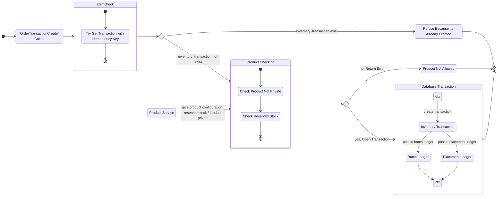
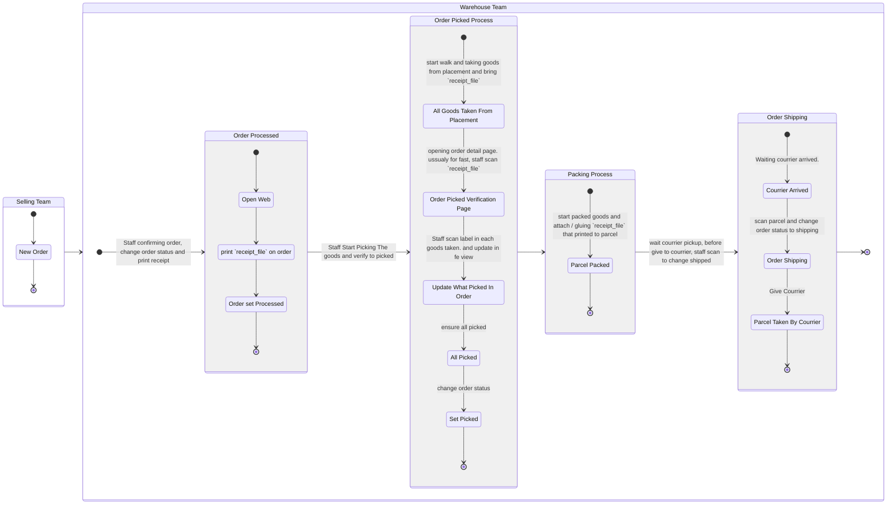

# Order & Inventory Related.

## General.
1. for order creation in Order Context. [see this](../order/order_creation.md)

## Inventory Service Flow When Order Created Called Our `OrderTransactionCreate`
### Reference.
1. for order side reference. [see this](../order/order_creation.md)

### What We Should Check When `OrderTransactionCreate` Called.
1. Product is Private.
2. Product Reserved Stock.

### Flow.

## How Warehouse Process The Order.

