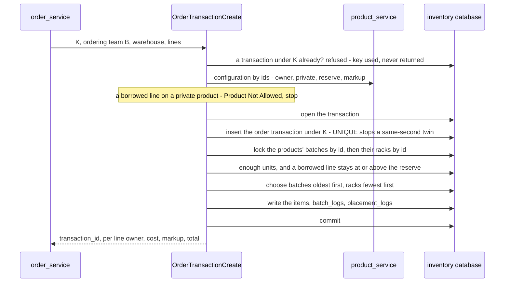
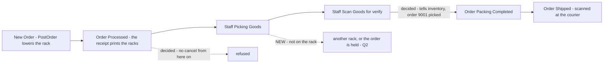
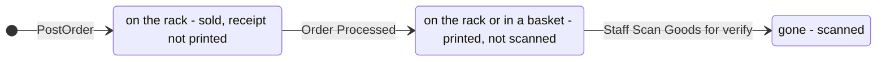
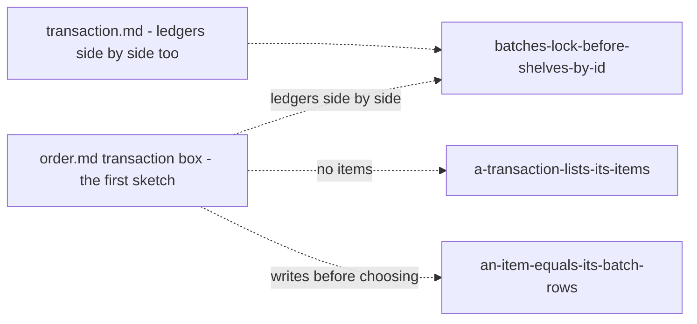
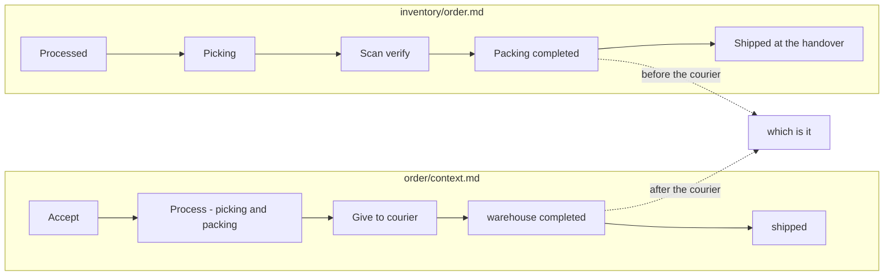

# Clarify — `inventory/order.md`

[order.md](./order.md) is yours — this one is mine. An answered point is deleted; what you settle is recorded in
[order_decision.md](./order_decision.md).

> ✅ **Answered in chat (2026-10-15, last):** own or borrowed — the request carries the ordering `team_id`, each line
> `owner_team_id` ([the-take-names-the-orderer-and-each-owner](../order/context_decision.md#the-take-names-the-orderer-and-each-owner)),
> so the private and reserve checks have something to compare. The critique row `the-check-cannot-tell-own-from-borrowed` is deleted.

> ✅ **Re-examined after your third edit of §Flow and your answer in chat (2026-10-15, later still).** A hit is now
> *"Refuse Because its Already Created"* — [a-used-key-is-refused-first](./order_decision.md#a-used-key-is-refused-first),
> answering [Q9](#question) as recommended; `the-take-replays-a-used-key` is resolved and deleted. And every submit mints
> a new key ([every-submit-mints-a-new-key](../order/context_decision.md#every-submit-mints-a-new-key)), so no two
> attempts share a take — `a-refused-take-sends-no-cancel` is answered by removing its case. Open here: Q2, Q5, Q6, Q7, Q8.

> 🔄 **Re-examined after your second edit of §Flow (2026-10-15, later).** The key is now looked up **first** — the
> position I asked for in [Q7](#question). ⛔ But a hit **returns** the existing transaction, which is the replay
> [inventory-takes-a-key-once](../order/context_decision.md#inventory-takes-a-key-once) ruled out:
> `the-take-replays-a-used-key`, asked as 🆕 [Q9](#question). Following it found a hole on
> the order's side too — a refused take still sends the cancel — asked where it can be answered:
> `a-refused-take-sends-no-cancel`. The private and
> reserve checks are now two steps; [Q6](#question) is unchanged — both still run before the transaction.

> 🔄 **Re-examined after your new §Inventory Service Flow When Order Created Called Our `OrderTransactionCreate`
> (2026-10-15).** ✅ Recorded: [the-take-checks-the-product-first](./order_decision.md#the-take-checks-the-product-first) —
> product configuration is read before the transaction, and private and the reserve are the take's to check. 🆕 Three
> opened: [Q6](#question) a reserve compared before the lock lets two borrowers past it · [Q7](#question) the take's
> refusals · [Q8](#question) where the receipt's racks come from. ⛔ One contradiction:
> [the-take-draws-the-ledgers-side-by-side](#the-take-draws-the-ledgers-side-by-side). ➡ Two points belong to other docs,
> so only a pointer is left here: the ordering team on the request, and whether *private* is the shared lock
> ([Critique](#critique)).

> **Re-examined after opname.md (2026-10-08).** ➡ [Q4](#question) re-routed to [opname_clarify Q5](./opname_clarify.md#question).
>
> **Re-examined after your Q4 answer (2026-10-08).** ⏸ [Q4](#question): a count **locks its rack**, to be designed in
> [opname.md](./opname.md) ([a-count-locks-its-rack](./order_decision.md#a-count-locks-its-rack)). It stays open until then — the
> units already in a basket when a lock starts are still unanswered.
>
> **Q4 elaborated (2026-10-08)**, on request — [the basket gap, worked](#the-basket-gap-worked). A count needs to know
> **printed** as well as **picked**: a unit sold but not printed is certainly on the rack, one printed but not scanned may be in
> a basket. So inventory also hears *Order Processed*, and a count waits for the printed-but-unscanned.
>
> **Re-examined after your answers in chat (2026-10-08).** ✅ [Q1](#question): the verify scan tells inventory *picked*
> ([the-verify-scan-tells-inventory-picked](./order_decision.md#the-verify-scan-tells-inventory-picked)) · ✅ [Q3](#question):
> no cancel after the warehouse confirms ([no-cancel-after-the-warehouse-confirms](./order_decision.md#no-cancel-after-the-warehouse-confirms)),
> instead of my put-back task. 🆕 [Q4](#question): the minutes a unit spends in a basket · [Q5](#question): a marketplace
> that cancels the order itself after the warehouse confirmed.

> **First pass (2026-10-08)**, after your §How Warehouse Process The Order. Its *"Staff Scan Goods for verify"* is the
> moment a unit has left the rack — the signal [context Q11c](./context_clarify.md#question) was missing — so that
> question is **re-routed here** as [Q1](#question). Two gaps in the flow are [Q2, Q3](#question), and the journey disagrees
> with the order context's ([Contradiction](#two-journeys-for-one-order)).

Siblings: [context_clarify](./context_clarify.md) · [restock_clarify](./restock_clarify.md) ·
[transaction_clarify](./transaction_clarify.md) · [order_creation_clarify](../order/order_creation_clarify.md).

---

## Proposed Design

### OrderTransactionCreate, with the decisions placed

Your flow, with every step the decisions have already fixed. Three steps are mine and marked *proposed*.



| step | from |
| --- | --- |
| the product read, before the transaction · private refused there | [the-take-checks-the-product-first](./order_decision.md#the-take-checks-the-product-first) |
| the key looked up first, a hit refused | [a-used-key-is-refused-first](./order_decision.md#a-used-key-is-refused-first) |
| the order transaction under K, inserted first inside the transaction | ⚠ **proposed** — the lookup is a read, and two same-second takes both find nothing; the UNIQUE insert stops the second ([transaction Q1](./transaction_clarify.md#question), option a) |
| batches, then racks, each by id | [batches-lock-before-shelves-by-id](./context_decision.md#batches-lock-before-shelves-by-id) |
| the reserve compared under the lock | ⚠ **proposed** — [Q6](#question) |
| batches oldest first · racks fewest first, unlocked first | [an-order-takes-from-the-lowest-shelf-first](./context_decision.md#an-order-takes-from-the-lowest-shelf-first) · [an-order-line-may-be-taken-from-several-racks](./placement_decision.md#an-order-line-may-be-taken-from-several-racks) |
| an item equals its batch rows · both ledgers move the same units | [an-item-equals-its-batch-rows](./transaction_decision.md#an-item-equals-its-batch-rows) · [both-ledgers-count-the-same-units](./context_decision.md#both-ledgers-count-the-same-units) |
| one transaction per order | [an-order-is-one-inventory-transaction](../order/context_decision.md#an-order-is-one-inventory-transaction) |
| the markup on the answer | [inventory-computes-the-markup](../order/context_decision.md#inventory-computes-the-markup) — it rides the same product read |

### the reserve race, worked

[Q6](#question), on the floor. Melati's *Kaos Hitam*, reserve 10, the warehouse holds 12. Teams B and C each borrow 2 in the
same second — the normal case for a product two teams sell.

| | B's take | C's take | stock |
| --- | --- | --- | --- |
| **as drawn** — compared before the transaction | 12 − 2 = 10, allowed | 12 − 2 = 10, allowed | 12 |
| | locks, takes 2, commits | waits on the lock, then takes 2 | **8 — under the reserve** |
| **compared under the lock** | locks · 12 − 2 = 10, allowed · commits | waits · 10 − 2 = 8, **Product Not Allowed** | 10 |

The reserve number is configuration and can be read early. The stock it is compared against cannot: only the lock stops it
moving.

### the flow, with what inventory hears

Your steps, plus what is decided and the one branch still missing.



| step | what inventory needs from it |
| --- | --- |
| New Order | `PostOrder` — the take, at the lowest racks first ([an-order-takes-from-the-lowest-shelf-first](./context_decision.md#an-order-takes-from-the-lowest-shelf-first)) |
| Order Processed | the receipt prints each line's racks with their counts — *"Rak A × 1, Rak B × 2"* ([Q8](#question): read from inventory at print) — and 🆕 inventory hears **printed**: from here the unit may be in a basket ([Q4](#question)) |
| Staff Scan Goods for verify | ✅ **picked** — from here on, the unit is no longer on the rack ([decided](./order_decision.md#the-verify-scan-tells-inventory-picked)) |
| the rest | nothing — packing and shipping move no stock |


### the basket gap, worked

[Q4](#question), told from the floor. Kaos Hitam, Rak A holds 2.

| time | what happens | the rack | the system | waiting to be picked |
| --- | --- | --- | --- | --- |
| 09:00 | order 9001 comes in | 2 | 2 → 1 | order 9001 |
| 13:00 | staff confirm it, the receipt prints *"Rak A × 1"* | 2 | 1 | order 9001 |
| 13:05 | the picker lifts the unit into a basket | **1** | 1 | order 9001 — **not scanned yet** |
| 13:07 | a count of Rak A: 1 counted − 1 waiting = 0, the system says 1 | 1 | **−1: a warehouse debt** | |
| 13:10 | the verify scan at the packing table | 1 | 0 | — |
| later | the next count finds 1 on a rack the system says is empty | 1 | +1 found | |

Nothing was lost — the unit was in a basket for five minutes. The count subtracted it as *waiting* while it was no longer
on the rack.

**The fix is to know where a sold unit can be.** Nobody picks before the receipt is printed, so the printing is the line:



| a sold unit is | so it is | the count |
| --- | --- | --- |
| sold, receipt not printed | certainly on the rack | subtracts it |
| printed, not scanned | on the rack **or** in a basket — nobody knows | **waits** for the scan |
| scanned | gone | ignores it |

So a count of Kaos Hitam starts once no Kaos Hitam receipt is printed-and-unscanned, and while it runs no new Kaos Hitam
receipt prints. Both waits are minutes. The count screen shows what it is waiting for — *"order 9001, printed 13:00,
not yet scanned"*.

---

## Critique

| | Problem | → Recommend |
| --- | --- | --- |
| **the-reserve-is-checked-before-the-lock** | The reserve compares **stock**, and your flow reads it before the transaction — two borrowers in the same second both pass ([worked](#the-reserve-race-worked)) | keep the configuration read where you drew it; move only the **comparison** inside, after the batch lock — [Q6](#question) |
| **private-or-shared-lock** | §What We Should Check says *private*; [product.md](../product/context.md) §Cross/Shared Products Rule says *shared lock* | ➡ asked in [product Q10](../product/context_clarify.md#question). Your check reads as *one switch*, which is what I recommend there |
| **one-error-for-every-refusal** | 🔄 The flow now names two refusals — *already created* and *Product Not Allowed*. Too few units has none drawn, and the order form must name the line it refuses ([a-blocked-line-refuses-the-whole-order](../order/context_clarify.md#a-blocked-line-refuses-the-whole-order)) | three named refusals — [Q7](#question) |
| **the-pick-list-has-no-source** | The receipt prints *"Rak A × 1, Rak B × 2"*, but the take's answer carries no racks and the order stores none | read them from inventory when the receipt prints — [Q8](#question) |
| **picking-has-no-not-there-branch** | The receipt says Rak A; Rak A is empty. The flow goes straight on to the scan | a branch, and who is told — [Q2](#question) |
| **the-marketplace-cancels-on-its-own** | No cancel after the warehouse confirms ([no-cancel-after-the-warehouse-confirms](./order_decision.md#no-cancel-after-the-warehouse-confirms)) — except where the **marketplace** cancels on its own | [Q5](#question) |

---

## Question

1. ✅ *(2026-10-08)* **Answered: yes** — [the-verify-scan-tells-inventory-picked](./order_decision.md#the-verify-scan-tells-inventory-picked).
2. **The goods are not on the printed rack — what does the picker do?**
   **→ Recommend:** take it from another rack that holds it — the count fixes the two racks, as already decided. If **no**
   rack has it, the order is held, the selling team is told, and the empty rack is flagged for a count: a unit the book
   holds and the building does not is a shortfall in custody.
3. ✅ *(2026-10-08)* **Answered: it cannot be cancelled** — [no-cancel-after-the-warehouse-confirms](./order_decision.md#no-cancel-after-the-warehouse-confirms).
4. ➡ *(2026-10-08)* **Re-routed to [opname_clarify Q5](./opname_clarify.md#question)** — opname.md now has the lock
   ([a-count-locks-its-rack](./order_decision.md#a-count-locks-its-rack)); what is left is the units already in a basket when
   it starts. The worked story stays in [the basket gap, worked](#the-basket-gap-worked).
5. 🆕 **The marketplace cancels the order itself after the warehouse confirmed** — the buyer's request accepted on the
   platform, or a ship-by deadline missed. Our system refuses the cancel, but the courier will not take a parcel the
   platform has cancelled, so the goods are packed and going nowhere.
   **→ Recommend:** the order goes to `problem` (already in [order/context.md](../order/context.md)'s journey), and a staff
   member **unpacks it back onto a rack**, which reverses the take. It is rare, and it is the one case a put-back has to
   exist for. Put back on a different rack, the count fixes it.
6. 🆕 *(2026-10-15)* **Is the reserve compared after the take has locked the batches?**
   ([the-reserve-is-checked-before-the-lock](#critique), [worked](#the-reserve-race-worked))
   **→ Recommend yes.** The configuration read stays before the transaction, as you drew it — only the comparison moves.
   It costs nothing extra: the take already holds the lock and already counts the units. *Private* stays where it is,
   because it reads no stock. ⚠ The reserve's boundary and which warehouse's stock it guards are product's to say
   ([product Q3](../product/context_clarify.md#question)).

   ```mermaid
   flowchart LR
     R["configuration - reserve 10"] -->|"before the transaction, as drawn"| T["open the transaction"]
     T --> L["lock Kaos Hitam's batches"]
     L --> C{"stock minus wanted at or above 10?"}
     C -->|"yes"| W["take"]
     C -->|"no"| N["Product Not Allowed"]
   ```
7. 🆕 *(2026-10-15)* **Does the take refuse with one error, or one per reason?**
   ([one-error-for-every-refusal](#critique))

   | refusal | when | the order form says |
   | --- | --- | --- |
   | **key used** | K is already on a transaction — a cancel that beat its take, or a bug; never the form ([every-submit-mints-a-new-key](../order/context_decision.md#every-submit-mints-a-new-key)) | nothing a person can fix — *"something went wrong, submit again"* |
   | **not enough stock** | the racks hold fewer than the line wants | *Kaos Hitam — 3 wanted, 2 in this warehouse* |
   | **not allowed** | a borrowed line on a private product, or under its reserve | *Kemeja Putih — its owner is not sharing it* |

   **→ Recommend three**, each naming its line. ✅ *(2026-10-15)* **The key goes first** is decided —
   [a-used-key-is-refused-first](./order_decision.md#a-used-key-is-refused-first). Inside the transaction the order
   transaction under K is still inserted before any lock — the lookup cannot see a same-second twin, the UNIQUE insert
   can. That amends the order of work in
   [an-item-equals-its-batch-rows](./transaction_decision.md#an-item-equals-its-batch-rows) — the header first, the items
   after the choice — and needs the key UNIQUE ([transaction Q1](./transaction_clarify.md#question), option a).
8. 🆕 *(2026-10-15)* **Does the receipt read its racks from inventory, or does the take return them?**
   ([the-pick-list-has-no-source](#critique))

   | | how | + | − |
   | --- | --- | --- | --- |
   | **a** | the receipt reads the racks from inventory by `orders.transaction_id` when it prints | one copy, kept by the service that owns racks · a print can say *"Rak A — being counted"* ([a-lock-stops-units-moving-not-sales](./opname_decision.md#a-lock-stops-units-moving-not-sales)) | a read per print — one call for a whole batch of receipts |
   | **b** | the take returns them, and the order stores them per line | the print needs no call | a second copy, in a service that does not own racks |

   **→ Recommend a.** A move leaves sold units where they are
   ([a-move-leaves-sold-units-on-their-rack](./placement_decision.md#a-move-leaves-sold-units-on-their-rack)), so the
   racks a print reads are the ones the take chose.
9. ✅ *(2026-10-15)* **Answered: refused** — [a-used-key-is-refused-first](./order_decision.md#a-used-key-is-refused-first).

---

# Contradiction

## the-take-draws-the-ledgers-side-by-side

*(2026-10-15)* Your new flow's transaction box — carried over unchanged from the first sketch — against three decisions
made since:

| [order.md](./order.md) §Flow | decided |
| --- | --- |
| *"create transaction"*, then *"post in batch ledger"* and *"post in placement ledger"* side by side | batches are locked before racks, and racks are chosen only once locked — [batches-lock-before-shelves-by-id](./context_decision.md#batches-lock-before-shelves-by-id) |
| no items | a transaction lists its items, one per product — [a-transaction-lists-its-items](./transaction_decision.md#a-transaction-lists-its-items), [an-item-names-its-product](./transaction_decision.md#an-item-names-its-product) |
| the ledgers written with nothing chosen first | an item's total is what its chosen batches give up, so the choice comes before the item — [an-item-equals-its-batch-rows](./transaction_decision.md#an-item-equals-its-batch-rows) |

**Which is wrong:** the box — it predates all three. **→ Recommend** redrawing it as the sequence in
[Proposed Design](#ordertransactioncreate-with-the-decisions-placed). [transaction.md](./transaction.md) §Transaction Flow
Related draws its ledgers side by side too (it has the items), so one redraw serves both.
🔄 *(2026-10-15, later)* Your second edit removed the box's *"Open Database Transaction"* and *"Close Database Transaction"*
states but kept their arrows, so the diagram now draws two bare boxes named `otx` and `ctx`, and the box has no start.



## two-journeys-for-one-order

*(2026-10-08)* The same order's warehouse steps are drawn twice, and they disagree:

| | [order/context.md](../order/context.md) §Complete Journey Of The Orders | [order.md](./order.md) §How Warehouse Process The Order |
| --- | --- | --- |
| first step | *"Warehouse Accept Order"* | *"Order Processed"* — confirm, change status, print the receipt |
| the work | *"Warehouse Process Order (Packing/Picking)"* — one step | picking · scan to verify · packing — three |
| when the warehouse is done | *"set status warehouse process `completed`"* — **after** *"Give to Shipping Channel"* | *"Order Packing Completed"* — **before** the courier comes |
| shipped | set after the warehouse is done | *"staff scan to change shipped"*, at the handover |

So while a parcel waits for the courier, one doc says the warehouse is done and the other says it is not.

**→ Recommend** one journey, kept where the statuses belong — [order/context.md](../order/context.md), since they are the
order's statuses — and this doc links it and adds only what inventory hears (the table above). Two copies of a status list
drift every time one is edited.


