# Decisions — `inventory/order.md`

What the owner settled, recorded before it is acted on. **Append-only** — a decision that is later reversed is renamed
and its references grepped (RULE 12), never quietly edited away. The open set is [order_clarify.md](./order_clarify.md).

| decision | says | from |
| --- | --- | --- |
| [superseded-the-verify-scan-tells-inventory-picked](#superseded-the-verify-scan-tells-inventory-picked) | ⛔ reversed — *picked* is the order's status, logged on its timeline, and inventory is not told ([picked-lives-on-the-order-timeline](./transaction_decision.md#picked-lives-on-the-order-timeline)) | chat, 2026-10-08 — answers Q1, as recommended |
| [no-cancel-after-the-warehouse-confirms](#no-cancel-after-the-warehouse-confirms) | once the warehouse confirms an order (*Order Processed*), it can no longer be cancelled | chat, 2026-10-08 — answers Q3, against my put-back task |
| [a-count-locks-its-rack](#a-count-locks-its-rack) | the basket gap is solved inside stock opname: a rack being counted is locked; [opname.md](./opname.md) will say how | chat, 2026-10-08 — answers Q4's direction, instead of my wait-for-the-scan rules |
| [the-take-checks-the-product-first](#the-take-checks-the-product-first) | `OrderTransactionCreate` reads the lines' product configuration by ids and refuses a private or reserved product before it opens the database transaction | your order.md edit, 2026-10-15 — answers *read product facts before the transaction?*, asked in chat, as recommended |
| [a-used-key-is-refused-first](#a-used-key-is-refused-first) | the take's first step looks its key up; a key already on a transaction is refused, never returned | your order.md edit, 2026-10-15 — answers Q9, as recommended, and the *key first* half of Q7 |
| [the-reserve-is-read-before-the-take](#the-reserve-is-read-before-the-take) | the reserve is checked before the transaction on a plain read of the product's total stock across every warehouse — the same-second overlap is accepted | chat, 2026-10-15 — answers Q6, against my under-the-lock |
| [a-refusal-names-its-reason-and-every-line](#a-refusal-names-its-reason-and-every-line) | one error, one of three reasons — key used · not allowed · not enough stock — naming every refused line | chat, 2026-10-15 — answers Q7, as recommended |
| [the-placement-page-reads-racks-by-transaction-id](#the-placement-page-reads-racks-by-transaction-id) | the order placement page reads its racks from inventory by `orders.transaction_id` — the receipt is the shipping label | chat, 2026-10-15 — answers Q8, as recommended |
| [missing-goods-send-the-order-back-to-pending](#missing-goods-send-the-order-back-to-pending) | goods on no rack: the warehouse sends the order back to `pending` with a note on its timeline; the selling team decides | chat, 2026-10-15 — answers Q2, instead of my loss-and-`problem` |
| [a-missing-unit-is-found-by-opname](#a-missing-unit-is-found-by-opname) | missing goods need no special inventory write — the staff count the product, and the count records the loss | chat, 2026-10-15 — answers Q10, against my loss-at-the-report |
| [a-platform-cancel-goes-back-through-pending](#a-platform-cancel-goes-back-through-pending) | a platform cancel after confirm: customer service notes it, the warehouse unpacks and hands back to `pending`, customer service cancels | chat, 2026-10-15 — answers Q5, as recommended |
| [the-item-scans-live-on-the-page](#the-item-scans-live-on-the-page) | the verification page counts the item scans itself; nothing is saved until *Set Picked* moves the order to `picked` | chat, 2026-10-16 — confirms my reading of *"update in fe view"* |
| [the-pick-page-opens-first-by-the-label](#the-pick-page-opens-first-by-the-label) | scanning the `receipt_file` opens ONE page before the walk: each line's racks for the walk, then the item scans back at the table | chat, 2026-10-16 — answers Q11, as recommended |
| [a-label-scan-reads-the-ref-or-the-receipt](#a-label-scan-reads-the-ref-or-the-receipt) | the label carries several barcodes; a scan of it finds the order by `order_external_ref_id` OR by `receipt`, whichever was scanned | chat, 2026-10-16 — the owner's note |
| [two-orders-on-one-label-are-shown-not-chosen](#two-orders-on-one-label-are-shown-not-chosen) | a label code matching several orders still in play lists them all; the staff ask the selling team or the warehouse admin which one is processed and which cancelled | chat, 2026-10-16 — answers Q12, against my *the picker chooses* |

---

## superseded-the-verify-scan-tells-inventory-picked

> ⛔ **SUPERSEDED (2026-10-16)** by [picked-lives-on-the-order-timeline](./transaction_decision.md#picked-lives-on-the-order-timeline):
> *picked* is the order's `picked` status, logged on `order_timeline_logs`; inventory is not told and keeps nothing. Its
> first reason had already gone — a count no longer subtracts waiting units
> ([expected-is-the-book-figure](./opname_decision.md#expected-is-the-book-figure)). The rack delete still needs to know, and
> how it finds out is [placement Q5](./placement_clarify.md#question). Kept below as it was decided.

> Owner, in chat *(2026-10-08)*: *"for q1, yes"*. The question was [order_clarify Q1](./order_clarify.md#question) —
> *does the verify scan tell inventory the order is picked?* — re-routed from
> [context Q11c](./context_clarify.md#question).

**The verdict.** The scan that verifies the goods is the moment a unit has left the rack, so it is the moment inventory
learns the order is **picked**. Until then, a sold unit may still be on the rack — and a stock count needs to know that,
or it adds the sold unit back and makes a ghost that is sold again and never found
([PostOrder, worked](./context_clarify.md#postorder-worked)).

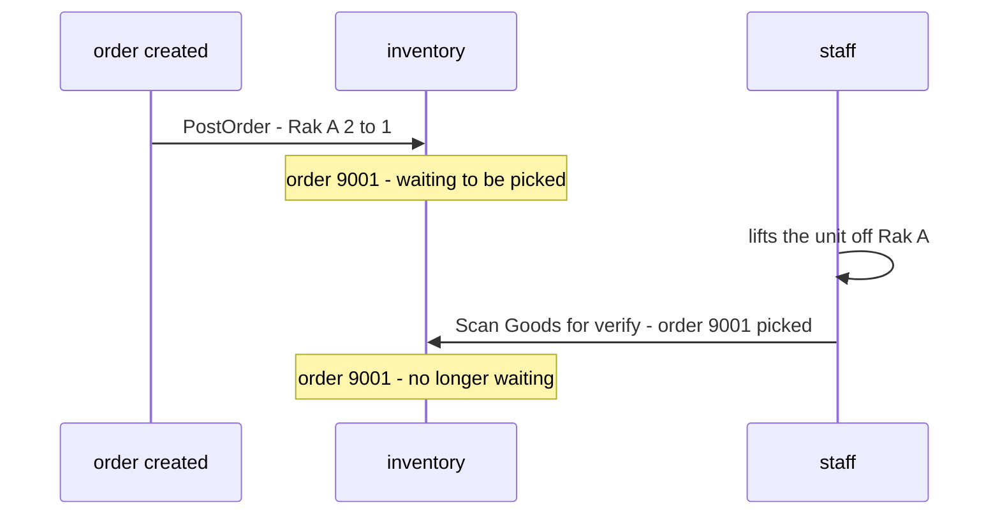

**The spec.**

| | |
| --- | --- |
| the signal | *Staff Scan Goods for verify* sends inventory *"order 9001 picked"* — the goods are scanned, **not** the rack ([a-wrong-rack-pick-waits-for-the-count](./context_decision.md#a-wrong-rack-pick-waits-for-the-count) stands) |
| waiting to be picked | an order's take with no *picked* yet |
| a stock count | compares **counted − waiting** against the book, and its screen shows *"1 here is sold, waiting for the picker"* |
| idempotent | a second *picked* for the same order changes nothing |

**What it does NOT settle:** the few minutes a unit spends in a basket between the lift and the scan
([Q4](./order_clarify.md#question)); how the scan reaches inventory — an RPC or an event — and in what record inventory
keeps it ([context Q13](./context_clarify.md#question) proposes a `pick` transaction carrying the order's `ref_id`).

🔄 *(2026-10-16)* **Redrawn in your [order.md](./order.md) §How Warehouse Process The Order:** *Staff Scan Goods for verify* is
now a scan of each good on the *Order Picked Verification Page*, followed by *Set Picked*, which moves the order to the new
`picked` status. The verdict holds, and *picked* is that status. Where inventory keeps it is
[transaction Q8](./transaction_clarify.md#question).

## no-cancel-after-the-warehouse-confirms

> Owner, in chat *(2026-10-08)*: *"for q3, order cannot cancel after warehouse confirm that"*. The question was
> [order_clarify Q3](./order_clarify.md#question) — *an order cancelled after its receipt is printed: who puts the goods
> back?* — answered by removing the case, **instead of** my put-back task.

**The verdict.** The warehouse's confirmation — *Order Processed*: the staff confirm the order, change its status and
print the receipt — is the point of no return. Before it, an order may be cancelled and its stock goes back by the Order
Cancel event ([inventory-returns-stock-on-order-cancelled](../order/context_decision.md#inventory-returns-stock-on-order-cancelled)).
After it, a cancel is refused — so a unit never has to find its way back from a basket or a parcel. It agrees with
[order/context.md](../order/context.md)'s journey, where the cancel branch comes before *"Warehouse Accept Order"*.

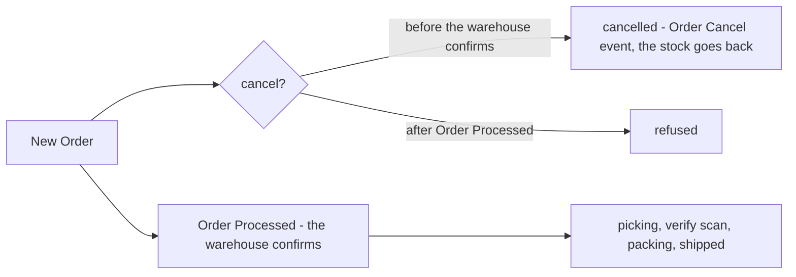

**The spec.**

| | |
| --- | --- |
| cancellable | from *New Order* until *Order Processed* |
| after *Order Processed* | the order service refuses the cancel |
| inventory | releases stock only for an order cancelled before confirmation — never from a basket or a parcel |

**What it does NOT settle:** a marketplace that cancels the order **itself** after the warehouse confirmed — the buyer's
request accepted on the platform, or a ship-by deadline missed — where refusing in our system does not stop the courier
refusing the parcel ([Q5](./order_clarify.md#question)).

🔄 *(2026-10-15)* **Amended by [missing-goods-send-the-order-back-to-pending](#missing-goods-send-the-order-back-to-pending)**:
the selling team still cannot cancel a confirmed order — but when the goods are missing, the warehouse sends it back to
`pending`, and from there it can.

🔄 *(2026-10-15)* **Its open point is settled** — a platform cancel goes back through `pending`: [a-platform-cancel-goes-back-through-pending](#a-platform-cancel-goes-back-through-pending).

## a-count-locks-its-rack

> Owner, in chat *(2026-10-08)*: *"for that case i will explain opname in opname.md, we create something that rack can
> locked"*. The question was [order_clarify Q4](./order_clarify.md#question) — *a count in the minutes a unit sits in a
> basket charges the warehouse for nothing* — answered with a **direction**, instead of my two waits (the count waits for
> printed-unscanned orders, new receipts wait for the count).

**The verdict.** Stock opname gets a **lock on the rack** being counted. While it is locked, the rack is the counter's:
picking from it stops, so the count is a statement about a rack nobody is changing. The design — what the lock blocks,
when it starts and ends — is the owner's to write in [opname.md](./opname.md).

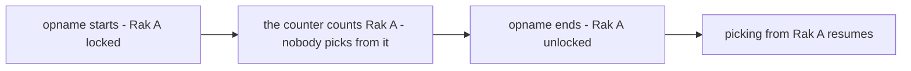

**The spec.** Only the direction — the rest waits for [opname.md](./opname.md):

| | |
| --- | --- |
| what is locked | a rack, for the length of its count |
| what a lock is for | no unit leaves or arrives while it is counted |

**What it does NOT settle** — kept open in [order_clarify Q4](./order_clarify.md#question) until opname.md answers it: what
the lock blocks (new orders choosing the rack, receipts already printed for it, moves, put-away) · the units **already**
in a basket when the lock starts · and whether a product is counted on all its racks at once, which a wrong-rack pick
needs ([context Q11e](./context_clarify.md#question)).

## the-take-checks-the-product-first

> Owner, in [order.md](./order.md) §Inventory Service Flow When Order Created Called Our `OrderTransactionCreate`
> *(2026-10-15)*: §What We Should Check — *"1. Product is Private. 2. Product Reserved Stock."* — and a flow that asks
> product_service *"config by ids"*, and returns *"Product Not Allowed"* before *"Open Transaction"*. It answers what I
> asked in chat — *are product facts read before the transaction?* — as recommended, and puts the sharing rules in
> **inventory's** take.

**The verdict.** The take checks the products before it touches stock. It reads every line's configuration from
product_service in one call, by ids, refuses the take if any line's product is not allowed, and only then opens the
database transaction. No network call runs while the take holds batch and rack locks.

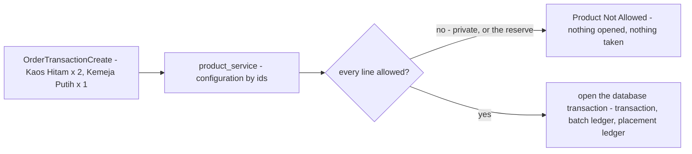

**The spec.**

| | |
| --- | --- |
| the read | one call to product_service, every line's product by id, **before** the transaction opens |
| what is checked | private · reserved stock — your §What We Should Check |
| a line not allowed | the take returns *Product Not Allowed* and writes nothing |
| where the rules live | inventory's take, beside the stock they protect — the order's finalize question is narrowed to match ([finalize-enforces-every-rule-on-both-doors](../order/context_clarify.md#finalize-enforces-every-rule-on-both-doors)) |

**What it does NOT settle** — all in [order_clarify](./order_clarify.md):

| | |
| --- | --- |
| the reserve | it compares stock, and stock read before the lock lets two borrowers past it in the same second — [Q6](./order_clarify.md#question) |
| own or borrowed | both rules bind only **another** team's order, and the request names no ordering team — [which-team-is-team-id](../order/order_creation_clarify.md#which-team-is-team-id) |
| *private* | whether it is the shared lock — [product Q10](../product/context_clarify.md#question) |
| the refusal | one error, or one per reason — [Q7](./order_clarify.md#question) |

## a-used-key-is-refused-first

> Owner, in [order.md](./order.md) §Flow *(2026-10-15, third edit)*: *"Try Get Transaction with Idempotency Key"* →
> *"inventory_transaction exist"* → *"Refuse Because its Already Created"*, replacing the *"return inventory_transaction"*
> of the edit before. It answers [order_clarify Q9](./order_clarify.md#question) — *returned, or refused?* — as
> recommended, resolves [the-take-replays-a-used-key](./order_clarify.md#contradiction), and draws the *key first* I asked
> for in Q7. Same day as [every-submit-mints-a-new-key](../order/context_decision.md#every-submit-mints-a-new-key).

**The verdict.** The take's first step is to look up its key. A key already on a transaction — taken, or released — is
refused, and nothing is returned. It is
[inventory-takes-a-key-once](../order/context_decision.md#inventory-takes-a-key-once), now drawn, and placed before the
product read and the transaction.

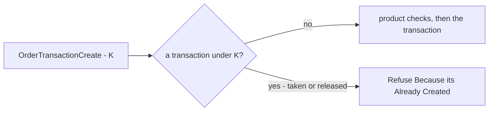

**The spec.**

| | |
| --- | --- |
| where | first — before product_service is called, before the transaction opens |
| a hit | refused; no transaction is returned, nothing is taken |
| who meets it | a take whose `InventoryTxCancel` arrived first ([inventory-takes-a-key-once](../order/context_decision.md#inventory-takes-a-key-once) keeps that cancel), or a bug — never the form, which mints a new key per submit ([every-submit-mints-a-new-key](../order/context_decision.md#every-submit-mints-a-new-key)) |

**What it does NOT settle:** the lookup is a read, so two calls under one K in the same second both find nothing — the
UNIQUE insert inside the transaction is the guard ([transaction Q1](./transaction_clarify.md#question), option a) · the
refusal's shape beside the other two ([Q7](./order_clarify.md#question)).

## the-reserve-is-read-before-the-take

> Owner, in chat (2026-10-15): *"for 1, no, make it simple. we just get the total stock of product, and check is it
> possible to order or not."* — then *"stock that checked its not only in that warehouse, but all stock"*. The question was [order_clarify Q6](./order_clarify.md#question) — *is the reserve compared
> after the take has locked the batches?* — answered **against my recommendation**. It keeps
> [the-take-checks-the-product-first](#the-take-checks-the-product-first) exactly as drawn.

**The verdict.** The reserve check stays where [order.md](./order.md) §Flow draws it — in *Product Checking*, before the
database transaction. It reads the product's total stock with a plain read, no lock, and refuses a borrowed line the stock
cannot cover beyond the reserve. Simplicity over the same-second case.

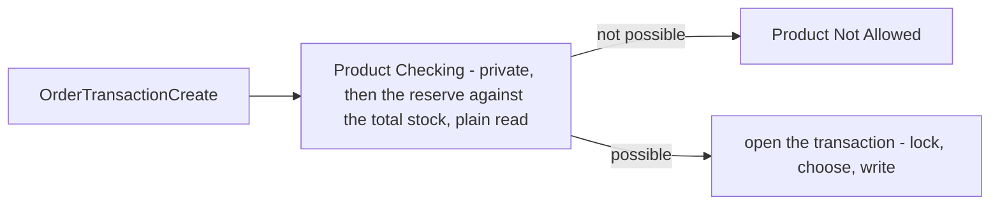

**The spec.**

| | |
| --- | --- |
| when | before the transaction, as drawn — no lock is held |
| what it reads | the product's total stock across **every** warehouse — not only the one the order ships from (owner, the same day: *"stock that checked its not only in that warehouse, but all stock"*) |
| a line that is not possible | *Product Not Allowed* — the take writes nothing |

**What it costs — accepted.** Two borrowers in the same second both read the stock before either takes. Melati's Kaos
Hitam, reserve 10, 12 in stock, teams B and C borrow 2 each:

| | B | C | stock |
| --- | --- | --- | --- |
| the check, no lock | 12 ≥ 10, possible | 12 ≥ 10, possible | 12 |
| the take | takes 2 | takes 2 | **8** — 2 under the reserve |

The reserve is a **low-stock line, not a floor** ([the-reserve-stops-other-teams-at-low-stock](../product/context_decision.md#the-reserve-stops-other-teams-at-low-stock)): one borrowed order may take stock below it, and two in one moment both pass. Stock itself never goes
below zero — that is the ledgers' own check
([both-ledgers-count-the-same-units](./context_decision.md#both-ledgers-count-the-same-units)).

**And a second cost — accepted.** Measured on the total, a borrower can empty the owner's **small** warehouse while the
total stays above the reserve. Melati's Kaos Hitam: Jakarta 3, Surabaya 20, reserve 10 — a borrowed order of 3 from
Jakarta passes (23 ≥ 10), and Melati's own Jakarta orders then ship from Surabaya or wait.

**Settled the same day** by [the-reserve-stops-other-teams-at-low-stock](../product/context_decision.md#the-reserve-stops-other-teams-at-low-stock): `stock ≥ reserve`, the quantity wanted not counted, and other teams only.

## a-refusal-names-its-reason-and-every-line

> Owner, in chat (2026-10-15): *"yes"* — answering [order_clarify Q7](./order_clarify.md#question), asked as *"these three
> names, one error with a reason, every refused line named at once?"*, as recommended.

**The verdict.** `OrderTransactionCreate` refuses with **one** error carrying a **reason** — one of three — and, for a line
refusal, **every** refused line at once, each with what it wanted and what was there. The order form can then say why and
the person fixes the whole order in one go.

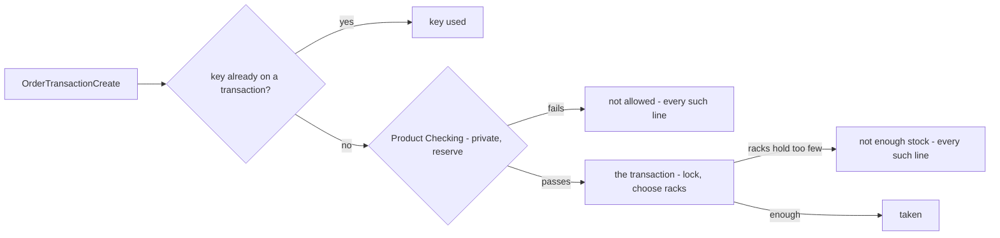

**The spec.**

| reason | when | per line | the form says |
| --- | --- | --- | --- |
| **key used** | the key is already on a transaction — a cancel that arrived first, or a bug ([a-used-key-is-refused-first](#a-used-key-is-refused-first)) | — | *"something went wrong, please submit again"* |
| **not allowed** | a borrowed line on a private product, or the owner's total stock below its reserve ([the-reserve-stops-other-teams-at-low-stock](../product/context_decision.md#the-reserve-stops-other-teams-at-low-stock)) | `product_id` | *"Kemeja Putih — its owner is not sharing it right now"* |
| **not enough stock** | this warehouse's racks hold fewer than the line wants ([an-order-line-may-be-taken-from-several-racks](./placement_decision.md#an-order-line-may-be-taken-from-several-racks)) | `product_id`, `wanted`, `available` | *"Kaos Hitam — 3 wanted, 2 in this warehouse"* |

| | |
| --- | --- |
| the shape | one error, the reason as a field, a list of refused lines — never three error types |
| every line | all lines refused for the same reason are named together; the take writes nothing |
| the order | relays the reason and the lines to the form unchanged |
| reserve vs stock | different questions: the reserve reads **every** warehouse, stock is **this** warehouse's racks — Jakarta 2 + Surabaya 20 passes the reserve and still fails an order of 3 from Jakarta |

⚠ **Not drawn yet:** *not enough stock* has no exit in [order.md](./order.md) §Flow — reported in
[order_clarify](./order_clarify.md#the-flow-has-no-stock-refusal).

## the-placement-page-reads-racks-by-transaction-id

> Owner, in chat (2026-10-15): *"for 2 yes"* — answering [order_clarify Q8](./order_clarify.md#question) as re-asked
> after the owner's correction that the receipt is the shipping label, not a pick list: *does the placement page ask
> inventory by the order's `transaction_id`?* As recommended.

**The verdict.** The warehouse's **order placement page** (`pick-order`) reads where each line was taken from — *"Rak A ×
1, Rak B × 2"* — from inventory, by the order's `transaction_id`. The take runs before the order exists and is filed
under its key, so the order's id was never a name inventory knew; the transaction id is the reference the order keeps
for exactly this ([an-order-is-one-inventory-transaction](../order/context_decision.md#an-order-is-one-inventory-transaction)).

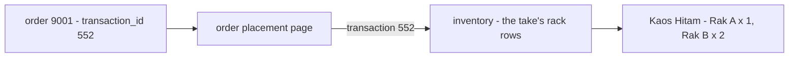

**The spec.**

| | |
| --- | --- |
| who reads | the order placement page, for the warehouse crew picking the goods |
| asks by | `warehouse_id` + `orders.transaction_id` — the take's placement log rows |
| still true later | a move leaves sold units where they are ([a-move-leaves-sold-units-on-their-rack](./placement_decision.md#a-move-leaves-sold-units-on-their-rack)) |
| the receipt | the shipping label customer service uploaded — printed for the parcel, carries no racks |
| the build | ⚠ `StockPickLocations` takes `ref = "order:<id>"` — to change when the take is built |

## missing-goods-send-the-order-back-to-pending

> Owner, in chat (2026-10-15): *"im add 4. Table `order_timeline_logs`. in order/context.md. when that happen, warehouse can
> change to `pending` again with note that goods missing on the rack. and let selling decide it to cancel."* It answers
> [order_clarify Q2](./order_clarify.md#question) — *the goods are not on the rack the placement page shows* — for the case
> where **no** rack has them, **instead of** my *a loss recorded at once and the order to `problem`*.

**The verdict.** When the picker cannot find a line's goods, the warehouse sends the order **back to `pending`** and writes
why on the order's timeline — *"Kaos Hitam missing on Rak A"*, from the warehouse. The selling team decides what happens
next, a cancel included. A unit found on **another** rack is simply taken: that case was already decided
([a-wrong-rack-pick-waits-for-the-count](./context_decision.md#a-wrong-rack-pick-waits-for-the-count)).

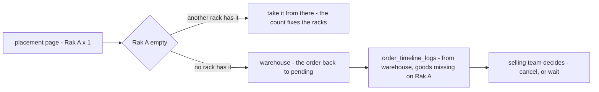

**The spec.**

| | |
| --- | --- |
| who | the warehouse, from the order it is picking |
| the order | `processed` → **`pending`** |
| the note | a row in [order_timeline_logs](../order/context.md) — `from = warehouse`, the status, what is missing |
| then | the selling team decides; from `pending` it may cancel |

**Why pending, not a cancel** — owner, in chat the same day: *"why not directly cancel? first, its make selling customerservice aware about it. and warehouse staff and customer service discuss about it. at the end of the day customer servicemore aware if there is still any order that pending that order cancel. because cancel order mean any other reason andmostly leave without aware."* A cancel can mean anything and is passed over; a `pending` order stays on customerservice's list until someone acts, and it makes the warehouse and customer service talk. So the warehouse never cancels —it hands the order back ([only-the-selling-team-cancels](../order/context_decision.md#only-the-selling-team-cancels)).

**What it amends.** [no-cancel-after-the-warehouse-confirms](#no-cancel-after-the-warehouse-confirms) — a confirmed order
still cannot be cancelled straight away, but the warehouse can now hand it back to `pending`, and from there it can.

**What it does NOT settle** — in [order_clarify](./order_clarify.md): what that cancel's release does with the unit that
was never there ([Q10](./order_clarify.md#question)) · the move `processed → pending`, which the status diagram does not
have yet ([the-status-moves-miss-the-way-back](../order/context_clarify.md#the-status-moves-miss-the-way-back)).

## a-missing-unit-is-found-by-opname

> Owner, in chat (2026-10-15): *"dont overthinking, between customer service and warehouse staff discussing, certainly
> staff doing opname first"*. It answers [order_clarify Q10](./order_clarify.md#question) — *a cancel releases a unit that
> was never there* — **against** my *the missing report reaches inventory as a loss*.

**The verdict.** Missing goods need no special write to inventory. While customer service and the warehouse talk it over,
the staff **count** the product, and the count's own loss path records whatever is short
([a-loss-in-custody-is-a-stock-problem](./opname_decision.md#a-loss-in-custody-is-a-stock-problem)). The cancel then
releases the take as any cancel does.

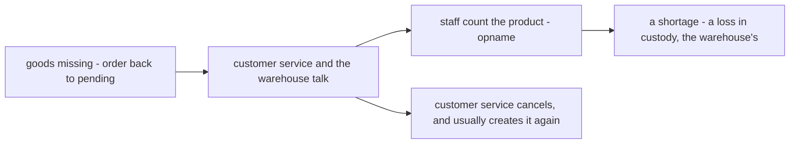

**What it costs — accepted.** A count sees a shortage only against the book, and the order's take has already lowered the
book to the empty shelf. Counted **before** the cancel, Rak A reads book 0, shelf 0 — nothing; the cancel then puts 1 back
on the book, and the shortage shows on the **next** count. Until then a re-created order can land on the same empty rack.
Counted after the cancel, it shows at once.

## a-platform-cancel-goes-back-through-pending

> Owner, in chat (2026-10-15): *"yes, i follow your recomendation"* — answering [order_clarify Q5](./order_clarify.md#question),
> *the marketplace cancels the order itself after the warehouse confirmed*, as recommended.

**The verdict.** A platform cancel after the warehouse confirmed takes the same road as missing goods — nothing new is
built. Customer service notes it on the order's timeline; the warehouse unpacks the goods, puts them back on a rack and
hands the order back to `pending`; customer service cancels. The cancel releases the take as usual — these units are
real, so putting them back on the book is right.

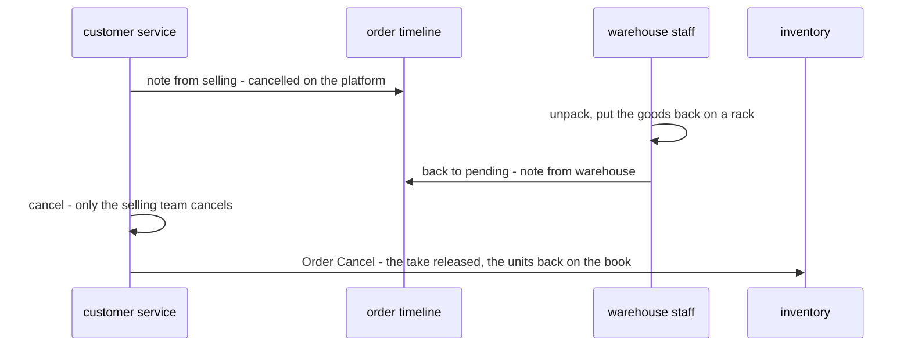

**The spec.**

| | |
| --- | --- |
| who notices | customer service, from the platform — a note on the timeline, `from = selling` |
| the goods | unpacked and put back on a rack by the staff; another rack than the take's is fixed by the next count ([a-wrong-rack-pick-waits-for-the-count](./context_decision.md#a-wrong-rack-pick-waits-for-the-count)) |
| the order | `processed` → `pending` by the warehouse ([missing-goods-send-the-order-back-to-pending](#missing-goods-send-the-order-back-to-pending)), then cancelled by customer service ([only-the-selling-team-cancels](../order/context_decision.md#only-the-selling-team-cancels)) |
| the stock | the cancel's release puts the units back on the book — they are on the rack |
| after handover | the order is `shipped`: a return, not this case |

## the-item-scans-live-on-the-page

> Owner, in chat (2026-10-16): *"for your assumtion \"update in fe view\", yes"* — confirming my reading of
> [order.md](./order.md) §How Warehouse Process The Order, *"Staff scan label in each goods taken. and update in fe view"*:
> the page keeps its own count, and nothing is saved on the order.

**The verdict.** Each item scan is counted **on the verification page only**. The order and inventory hear nothing until
*Set Picked*, which moves the order to `picked` in one write. A half-picked order does not exist anywhere but on the
screen in the picker's hand.

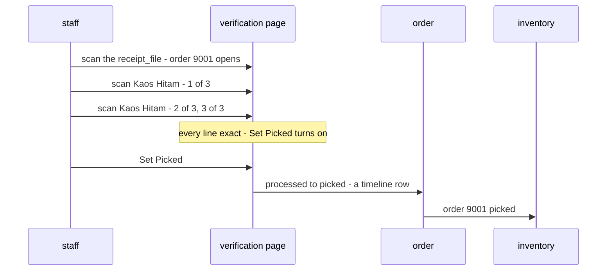

**The spec.**

| | |
| --- | --- |
| a scan | counts its line up to the ordered quantity; an unknown good or one too many is refused with the wrong sound ([scanning-is-the-crews-hands](../../technical/frontend/warehouse_order_list_decision.md#scanning-is-the-crews-hands)) |
| what is saved per scan | nothing |
| *Set Picked* | on only when every line is exact; one write: the status, one `order_timeline_logs` row, and inventory told *picked* |
| a reload or a closed page | the count is lost; the picker scans again. Accepted: the goods are in the basket, so a re-scan is seconds |
| two people on one order | each page counts its own; nothing is shared, and the second *Set Picked* changes nothing (an order already `picked` stays so) |
| what it does NOT settle | where inventory keeps *picked* — [transaction Q8](./transaction_clarify.md#question) |

🔄 *(2026-10-16)* **Amended by [picked-lives-on-the-order-timeline](./transaction_decision.md#picked-lives-on-the-order-timeline)**:
*Set Picked* writes the status and its timeline row only. Inventory is not told.

## the-pick-page-opens-first-by-the-label

> Owner, in chat (2026-10-16): *"for inventory order Q11, yes"* — answering [order_clarify Q11](./order_clarify.md#question),
> *where does the picker read the racks before the walk?*, as recommended.

**The verdict.** One page, opened **before** the walk. The picker scans the `receipt_file`; the order's page opens with
each line's racks, read from inventory by `orders.transaction_id`
([the-placement-page-reads-racks-by-transaction-id](#the-placement-page-reads-racks-by-transaction-id)). The picker walks
with it, and back at the table the same page takes the item scans
([the-item-scans-live-on-the-page](#the-item-scans-live-on-the-page)). There is no second lookup.

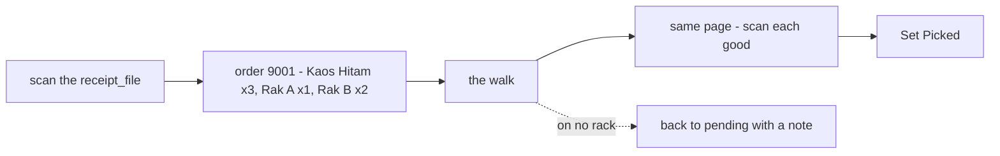

**The spec.**

| | |
| --- | --- |
| opened by | a scan of the `receipt_file` — either of its codes ([a-label-scan-reads-the-ref-or-the-receipt](#a-label-scan-reads-the-ref-or-the-receipt)) |
| shows first | each line: the product, the quantity, and its racks with the units to take from each |
| then | the item scans, counted on the page, and *Set Picked* |
| one page | the placement list and the verification scan are not two screens |
| a missing good | the way back to `pending` ([missing-goods-send-the-order-back-to-pending](#missing-goods-send-the-order-back-to-pending)) starts from this page |

## a-label-scan-reads-the-ref-or-the-receipt

> Owner, in chat (2026-10-16): *"in receipt_file, there are several barcode that can be scanned. sometimes it give
> `order_external_ref_id` or `receipt` ensure we can scan both"*.

**The verdict.** The shipping label carries several barcodes, and which one the scanner reads depends on the label and
where the gun lands. So a scan of the label finds the order by **either** code: `order_external_ref_id` (the marketplace's
order id) or `receipt` (the tracking number). Neither is required to be the one scanned.

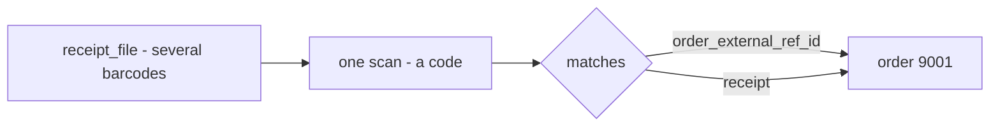

**The spec.**

| | |
| --- | --- |
| a scanned code is compared with | `orders.order_external_ref_id` and `orders.receipt`, both |
| where it applies | every scan of the label: opening the pick page, and the handover scan |
| why both | a label may carry only the order number in a barcode, and a page with several barcodes is read wherever the gun lands |
| ⚠ not unique | the ref may sit on two orders ([a-duplicate-ref-is-warned-not-refused](../order/context_decision.md#a-duplicate-ref-is-warned-not-refused)), usually one live and one cancelled — which one a scan opens is [two-orders-on-one-label-are-shown-not-chosen](#two-orders-on-one-label-are-shown-not-chosen) |

## two-orders-on-one-label-are-shown-not-chosen

> Owner, in chat (2026-10-16): *"for q12, show both, and let staff contact the selling or discuss manually warehouse
> admin which order that must be processed or canceled"* — answering [order_clarify Q12](./order_clarify.md#question),
> *a scanned code matches two orders — which one opens?*, against my *the page lists them and the picker chooses*.

**The verdict.** When a label code matches several orders that are still in play, the page **shows all of them and
picks none**. The staff do not choose. They ask the selling team, or talk it over with the warehouse admin, which order is
processed and which is cancelled. The rest of my recommendation stands: only this warehouse's orders are searched, and a
`cancel` order is skipped, so one live order and one cancelled order open the live one straight away.

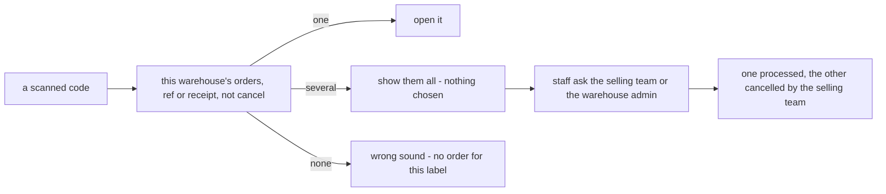

**The spec.**

| | |
| --- | --- |
| searched | this warehouse's orders, by `order_external_ref_id` or `receipt` ([a-label-scan-reads-the-ref-or-the-receipt](#a-label-scan-reads-the-ref-or-the-receipt)), `cancel` skipped |
| one match | opens the order's pick page ([the-pick-page-opens-first-by-the-label](#the-pick-page-opens-first-by-the-label)) |
| several | listed with what tells them apart (shop, status, created at, lines) and a warning: *"several orders on this label — ask the selling team or the warehouse admin"*. Nothing opens by itself |
| who decides | the selling team, or the warehouse admin talking to them — never the system and never the picker alone |
| the cancel | the selling team's, as always ([only-the-selling-team-cancels](../order/context_decision.md#only-the-selling-team-cancels)) |
| none | the wrong sound and *"no order for this label"* |
| where it applies | every scan of the label: the pick page and the handover |
| example | `SPX123` finds 9001 `processed` and 8800 `cancel`: 9001 opens. `2410ABC` finds 9001 and 9002, both `processed`: both are shown, and the staff ask |
