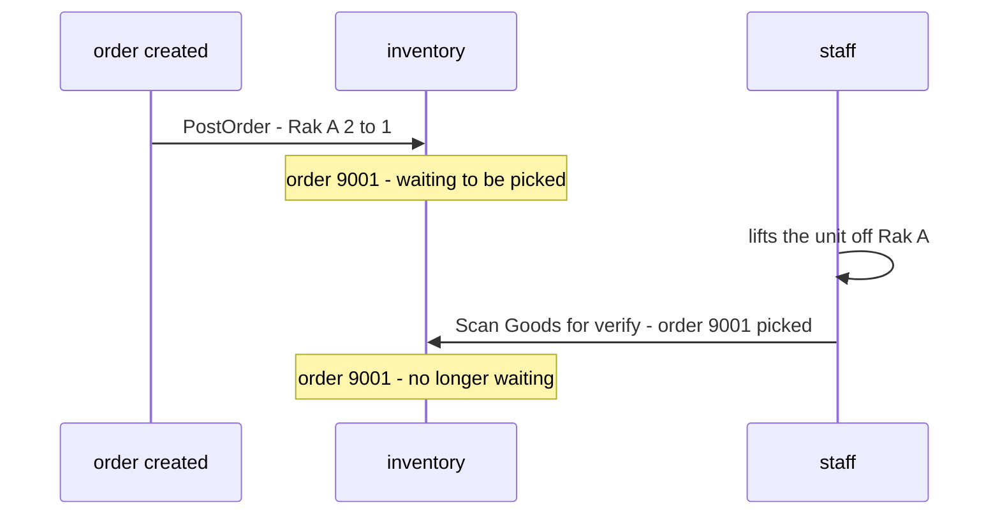
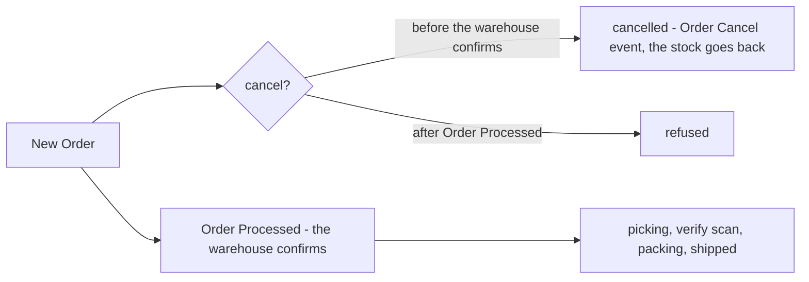
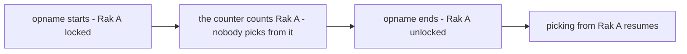
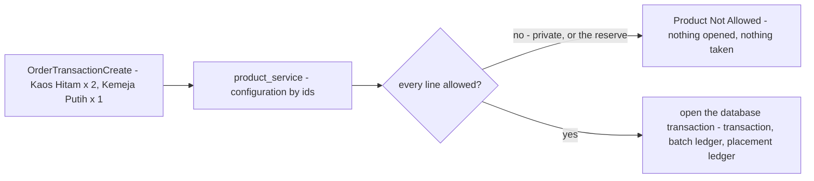
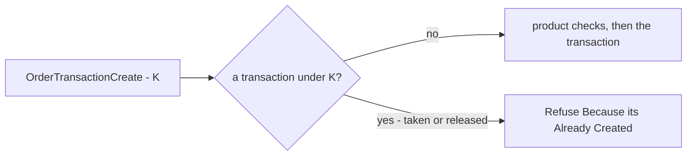

# Decisions — `inventory/order.md`

What the owner settled, recorded before it is acted on. **Append-only** — a decision that is later reversed is renamed
and its references grepped (RULE 12), never quietly edited away. The open set is [order_clarify.md](./order_clarify.md).

| decision | says | from |
| --- | --- | --- |
| [the-verify-scan-tells-inventory-picked](#the-verify-scan-tells-inventory-picked) | *Staff Scan Goods for verify* tells inventory the order is picked; a count subtracts the sold units not yet scanned | chat, 2026-10-08 — answers Q1, as recommended |
| [no-cancel-after-the-warehouse-confirms](#no-cancel-after-the-warehouse-confirms) | once the warehouse confirms an order (*Order Processed*), it can no longer be cancelled | chat, 2026-10-08 — answers Q3, against my put-back task |
| [a-count-locks-its-rack](#a-count-locks-its-rack) | the basket gap is solved inside stock opname: a rack being counted is locked; [opname.md](./opname.md) will say how | chat, 2026-10-08 — answers Q4's direction, instead of my wait-for-the-scan rules |
| [the-take-checks-the-product-first](#the-take-checks-the-product-first) | `OrderTransactionCreate` reads the lines' product configuration by ids and refuses a private or reserved product before it opens the database transaction | your order.md edit, 2026-10-15 — answers *read product facts before the transaction?*, asked in chat, as recommended |
| [a-used-key-is-refused-first](#a-used-key-is-refused-first) | the take's first step looks its key up; a key already on a transaction is refused, never returned | your order.md edit, 2026-10-15 — answers Q9, as recommended, and the *key first* half of Q7 |

---

## the-verify-scan-tells-inventory-picked

> Owner, in chat *(2026-10-08)*: *"for q1, yes"*. The question was [order_clarify Q1](./order_clarify.md#question) —
> *does the verify scan tell inventory the order is picked?* — re-routed from
> [context Q11c](./context_clarify.md#question).

**The verdict.** The scan that verifies the goods is the moment a unit has left the rack, so it is the moment inventory
learns the order is **picked**. Until then, a sold unit may still be on the rack — and a stock count needs to know that,
or it adds the sold unit back and makes a ghost that is sold again and never found
([PostOrder, worked](./context_clarify.md#postorder-worked)).

**The spec.**

| | |
| --- | --- |
| the signal | *Staff Scan Goods for verify* sends inventory *"order 9001 picked"* — the goods are scanned, **not** the rack ([a-wrong-rack-pick-waits-for-the-count](./context_decision.md#a-wrong-rack-pick-waits-for-the-count) stands) |
| waiting to be picked | an order's take with no *picked* yet |
| a stock count | compares **counted − waiting** against the book, and its screen shows *"1 here is sold, waiting for the picker"* |
| idempotent | a second *picked* for the same order changes nothing |

**What it does NOT settle:** the few minutes a unit spends in a basket between the lift and the scan
([Q4](./order_clarify.md#question)); how the scan reaches inventory — an RPC or an event — and in what record inventory
keeps it ([context Q13](./context_clarify.md#question) proposes a `pick` transaction carrying the order's `ref_id`).

## no-cancel-after-the-warehouse-confirms

> Owner, in chat *(2026-10-08)*: *"for q3, order cannot cancel after warehouse confirm that"*. The question was
> [order_clarify Q3](./order_clarify.md#question) — *an order cancelled after its receipt is printed: who puts the goods
> back?* — answered by removing the case, **instead of** my put-back task.

**The verdict.** The warehouse's confirmation — *Order Processed*: the staff confirm the order, change its status and
print the receipt — is the point of no return. Before it, an order may be cancelled and its stock goes back by the Order
Cancel event ([inventory-returns-stock-on-order-cancelled](../order/context_decision.md#inventory-returns-stock-on-order-cancelled)).
After it, a cancel is refused — so a unit never has to find its way back from a basket or a parcel. It agrees with
[order/context.md](../order/context.md)'s journey, where the cancel branch comes before *"Warehouse Accept Order"*.

**The spec.**

| | |
| --- | --- |
| cancellable | from *New Order* until *Order Processed* |
| after *Order Processed* | the order service refuses the cancel |
| inventory | releases stock only for an order cancelled before confirmation — never from a basket or a parcel |

**What it does NOT settle:** a marketplace that cancels the order **itself** after the warehouse confirmed — the buyer's
request accepted on the platform, or a ship-by deadline missed — where refusing in our system does not stop the courier
refusing the parcel ([Q5](./order_clarify.md#question)).

## a-count-locks-its-rack

> Owner, in chat *(2026-10-08)*: *"for that case i will explain opname in opname.md, we create something that rack can
> locked"*. The question was [order_clarify Q4](./order_clarify.md#question) — *a count in the minutes a unit sits in a
> basket charges the warehouse for nothing* — answered with a **direction**, instead of my two waits (the count waits for
> printed-unscanned orders, new receipts wait for the count).

**The verdict.** Stock opname gets a **lock on the rack** being counted. While it is locked, the rack is the counter's:
picking from it stops, so the count is a statement about a rack nobody is changing. The design — what the lock blocks,
when it starts and ends — is the owner's to write in [opname.md](./opname.md).

**The spec.** Only the direction — the rest waits for [opname.md](./opname.md):

| | |
| --- | --- |
| what is locked | a rack, for the length of its count |
| what a lock is for | no unit leaves or arrives while it is counted |

**What it does NOT settle** — kept open in [order_clarify Q4](./order_clarify.md#question) until opname.md answers it: what
the lock blocks (new orders choosing the rack, receipts already printed for it, moves, put-away) · the units **already**
in a basket when the lock starts · and whether a product is counted on all its racks at once, which a wrong-rack pick
needs ([context Q11e](./context_clarify.md#question)).

## the-take-checks-the-product-first

> Owner, in [order.md](./order.md) §Inventory Service Flow When Order Created Called Our `OrderTransactionCreate`
> *(2026-10-15)*: §What We Should Check — *"1. Product is Private. 2. Product Reserved Stock."* — and a flow that asks
> product_service *"config by ids"*, and returns *"Product Not Allowed"* before *"Open Transaction"*. It answers what I
> asked in chat — *are product facts read before the transaction?* — as recommended, and puts the sharing rules in
> **inventory's** take.

**The verdict.** The take checks the products before it touches stock. It reads every line's configuration from
product_service in one call, by ids, refuses the take if any line's product is not allowed, and only then opens the
database transaction. No network call runs while the take holds batch and rack locks.

**The spec.**

| | |
| --- | --- |
| the read | one call to product_service, every line's product by id, **before** the transaction opens |
| what is checked | private · reserved stock — your §What We Should Check |
| a line not allowed | the take returns *Product Not Allowed* and writes nothing |
| where the rules live | inventory's take, beside the stock they protect — the order's finalize question is narrowed to match ([finalize-enforces-every-rule-on-both-doors](../order/context_clarify.md#finalize-enforces-every-rule-on-both-doors)) |

**What it does NOT settle** — all in [order_clarify](./order_clarify.md):

| | |
| --- | --- |
| the reserve | it compares stock, and stock read before the lock lets two borrowers past it in the same second — [Q6](./order_clarify.md#question) |
| own or borrowed | both rules bind only **another** team's order, and the request names no ordering team — [which-team-is-team-id](../order/order_creation_clarify.md#which-team-is-team-id) |
| *private* | whether it is the shared lock — [product Q10](../product/context_clarify.md#question) |
| the refusal | one error, or one per reason — [Q7](./order_clarify.md#question) |

## a-used-key-is-refused-first

> Owner, in [order.md](./order.md) §Flow *(2026-10-15, third edit)*: *"Try Get Transaction with Idempotency Key"* →
> *"inventory_transaction exist"* → *"Refuse Because its Already Created"*, replacing the *"return inventory_transaction"*
> of the edit before. It answers [order_clarify Q9](./order_clarify.md#question) — *returned, or refused?* — as
> recommended, resolves [the-take-replays-a-used-key](./order_clarify.md#contradiction), and draws the *key first* I asked
> for in Q7. Same day as [every-submit-mints-a-new-key](../order/context_decision.md#every-submit-mints-a-new-key).

**The verdict.** The take's first step is to look up its key. A key already on a transaction — taken, or released — is
refused, and nothing is returned. It is
[inventory-takes-a-key-once](../order/context_decision.md#inventory-takes-a-key-once), now drawn, and placed before the
product read and the transaction.

**The spec.**

| | |
| --- | --- |
| where | first — before product_service is called, before the transaction opens |
| a hit | refused; no transaction is returned, nothing is taken |
| who meets it | a take whose `InventoryTxCancel` arrived first ([inventory-takes-a-key-once](../order/context_decision.md#inventory-takes-a-key-once) keeps that cancel), or a bug — never the form, which mints a new key per submit ([every-submit-mints-a-new-key](../order/context_decision.md#every-submit-mints-a-new-key)) |

**What it does NOT settle:** the lookup is a read, so two calls under one K in the same second both find nothing — the
UNIQUE insert inside the transaction is the guard ([transaction Q1](./transaction_clarify.md#question), option a) · the
refusal's shape beside the other two ([Q7](./order_clarify.md#question)).
