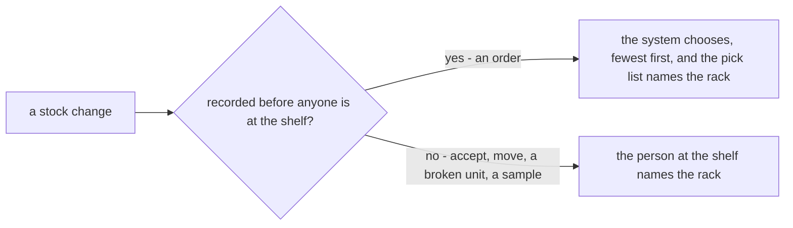
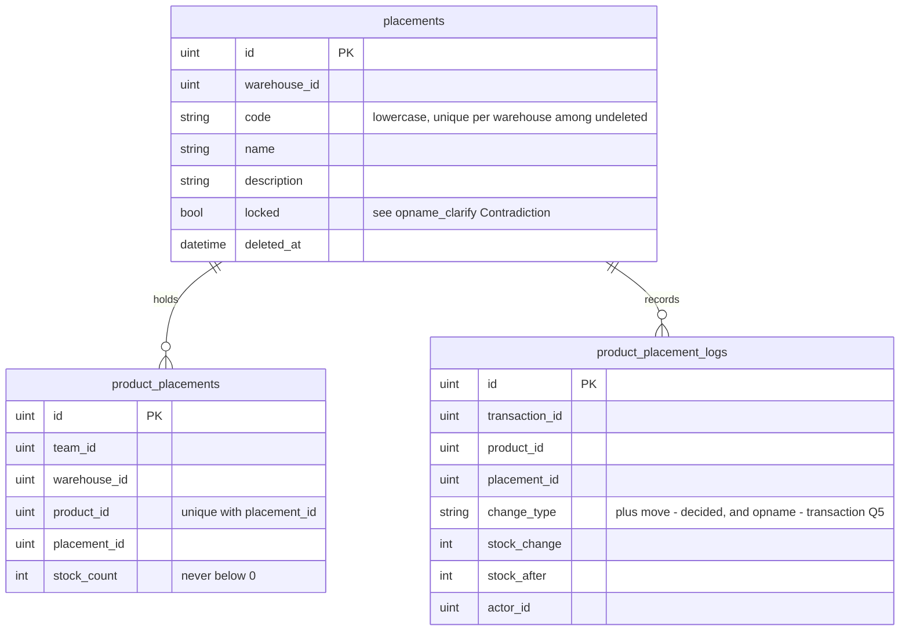
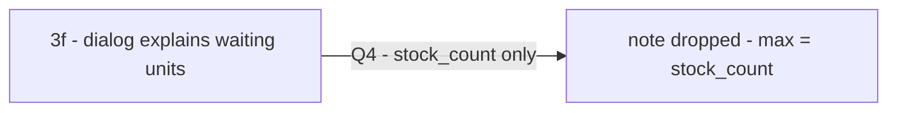
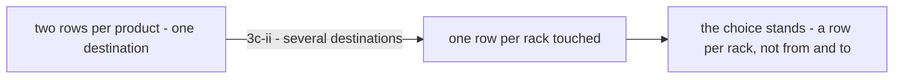

# Clarify — `inventory/placement.md`

[placement.md](./placement.md) is yours, and this file is mine. When a point is answered I delete it here, and your
answer goes in [placement_decision.md](./placement_decision.md).

> ✅ **Accepted 2026-10-12:** the prototype passed design_accept ([the-placement-prototype-is-accepted](./placement_decision.md#the-placement-prototype-is-accepted)).
> Nothing opened. *Awaiting your text* below still stands.
>
> ✅ **Resolved 2026-10-12:** [the-move-dialog-still-explains-waiting-units](#the-move-dialog-still-explains-waiting-units) — the Move dialog drops its waiting note ([the-move-dialog-shows-stock-count-only-for-now](./placement_decision.md#the-move-dialog-shows-stock-count-only-for-now));
> and a sample is recorded from Rack detail ([a-sample-is-recorded-on-rack-detail](./placement_decision.md#a-sample-is-recorded-on-rack-detail)). Both asked before the Storybook pass.
>
> ✅ **Answered 2026-10-12 and deleted:** Q4, **against my recommendation**: a rack screen shows `stock_count` only, for
> now ([a-rack-shows-its-stock-count-for-now](./placement_decision.md#a-rack-shows-its-stock-count-for-now)). 4b's finding, that a transfer out also waits, moved to
> [opname Q10b](./opname_clarify.md#question), which still needs it; 4c fell away. **Placement has no open question.**
> One contradiction opened: [the-move-dialog-still-explains-waiting-units](#the-move-dialog-still-explains-waiting-units).
>
> ✅ **Answered 2026-10-12 and deleted:** the rest of Q3, so **Q3 closes**: one transaction per owning team ([a-move-writes-one-transaction-per-owning-team](./placement_decision.md#a-move-writes-one-transaction-per-owning-team)),
> all or nothing ([a-move-is-all-or-nothing](./placement_decision.md#a-move-is-all-or-nothing)), putting away at accept is not a move
> ([putting-away-at-accept-is-not-a-move](./placement_decision.md#putting-away-at-accept-is-not-a-move)), and sold units stay on their rack ([a-move-leaves-sold-units-on-their-rack](./placement_decision.md#a-move-leaves-sold-units-on-their-rack)).
> The Proposed Design's two move sections are pruned: the decisions carry them now.
>
> ✅ **Answered 2026-10-12 and deleted:** 3c-ii: a move is staff reorganizing space in one warehouse, from one rack to one
> or more, and a product may be split ([a-move-is-one-rack-to-one-or-more-racks](./placement_decision.md#a-move-is-one-rack-to-one-or-more-racks)). My staging-rack reason is withdrawn.
>
> ✅ **Answered 2026-10-12 and deleted:** 3a, as recommended: the type is `move` ([a-move-has-its-own-type](./transaction_decision.md#a-move-has-its-own-type)), and a
> move is two ordinary rack rows with nothing in the batch ledger ([a-move-writes-two-rack-rows-and-no-batch-row](./placement_decision.md#a-move-writes-two-rack-rows-and-no-batch-row)).
>
> ✅ **Answered 2026-10-12 and deleted:** 3a-i and 3a-ii, as recommended: a move's item is the units at `total 0` ([a-move-lists-its-units-at-zero-value](./placement_decision.md#a-move-lists-its-units-at-zero-value)),
> and a wrong move is fixed by moving again, never by a rollback ([a-wrong-move-is-fixed-by-moving-again](./placement_decision.md#a-wrong-move-is-fixed-by-moving-again)).
>
> ✅ **Answered 2026-10-12 and deleted:** 3b, as recommended: any warehouse member moves, staff included ([any-warehouse-member-may-move-goods](./placement_decision.md#any-warehouse-member-may-move-goods)).
> 3a gained two parts: the item of a move (3a-i) and undoing a wrong one (3a-ii).
>
> ✅ **Answered 2026-10-12 and deleted:** Q2, as recommended: fewest first even when one line splits over several racks,
> a tie to the smaller rack id, too few across all racks fails the order
> ([an-order-line-may-be-taken-from-several-racks](./placement_decision.md#an-order-line-may-be-taken-from-several-racks)).
>
> ✅ **Answered 2026-10-12 and deleted:** Q1, the sample, all three parts, in chat. 1a: a person asks at the warehouse,
> and staff pick the goods and hand them over
> ([a-sample-is-handed-over-at-the-warehouse](./transaction_decision.md#a-sample-is-handed-over-at-the-warehouse)), so my
> *asked ahead* is withdrawn. 1b: staff name the rack they took it from
> ([a-sample-names-the-rack-it-was-taken-from](./placement_decision.md#a-sample-names-the-rack-it-was-taken-from)). 1c: it
> never comes back ([a-handed-over-sample-is-final](./placement_decision.md#a-handed-over-sample-is-final)). Who bears it
> stays open as [transaction Q6](./transaction_clarify.md#question).
>
> ✅ **Answered 2026-10-10 and deleted:** Q5 and 3e, the first screens —
> [placements-list-detail-and-move-come-first](./placement_decision.md#placements-list-detail-and-move-come-first) — and
> Q7, which that opened against the build —
> [the-racks-page-is-the-placement-list](./placement_decision.md#the-racks-page-is-the-placement-list): the built Racks
> page is the list, the Move goes on Rack detail, the screen says *Racks*, and the selling team's stub is dropped.
>
> ✅ **Answered 2026-10-10 and deleted:** Q6, both rules —
> [a-shelf-never-goes-below-zero](./placement_decision.md#a-shelf-never-goes-below-zero) and
> [rack-codes-are-saved-lowercase](./placement_decision.md#rack-codes-are-saved-lowercase) (lowercase, against my uppercase).
>
> **First pass (2026-10-09).** Your three tables hold up, and I am adding no columns. What placement.md does not say
> yet is the **rules**: §Placement Ledger Mutation covers `PostOrder` and nothing else. ➡ **Moved here:**
> [context Q11d](./context_clarify.md#question) became Q2 (answered 2026-10-12), and
> [context Critique 12](./context_clarify.md#critique) is now [3d](#question).

Siblings: [context_clarify](./context_clarify.md) · [opname_clarify](./opname_clarify.md) ·
[transaction_clarify](./transaction_clarify.md) · [order_clarify](./order_clarify.md) ·
[restock_clarify](./restock_clarify.md).

---

## Already decided

| decision | says |
| --- | --- |
| [one-shelf-row-per-product-per-placement](./context_decision.md#one-shelf-row-per-product-per-placement) | one row per product per rack · a code is unique among the warehouse's undeleted racks |
| [a-placement-deletes-only-when-nothing-waits-on-it](./context_decision.md#a-placement-deletes-only-when-nothing-waits-on-it) | a rack can be deleted only at 0 stock, and only when no sold unit on it is still waiting for the picker |
| [an-order-takes-from-the-lowest-shelf-first](./context_decision.md#an-order-takes-from-the-lowest-shelf-first) | `PostOrder` takes from the rack holding the fewest first |
| [a-wrong-rack-pick-waits-for-the-count](./context_decision.md#a-wrong-rack-pick-waits-for-the-count) | no rack scan; the next count corrects a pick from the wrong rack |
| [there-is-no-unplaced-pile](./restock_decision.md#there-is-no-unplaced-pile) | every unit is on a placement; a staging area is just another placement |
| [batches-lock-before-shelves-by-id](./context_decision.md#batches-lock-before-shelves-by-id) | batches are locked first, then shelves, each in id order |
| [the-verify-scan-tells-inventory-picked](./order_decision.md#the-verify-scan-tells-inventory-picked) | a sold unit counts as waiting on the rack until the verify scan |
| [a-count-locks-the-product-on-the-rack](./opname_decision.md#a-count-locks-the-product-on-the-rack) | a count locks one product on one rack, not the whole rack |
| [a-shelf-never-goes-below-zero](./placement_decision.md#a-shelf-never-goes-below-zero) | `stock_count` is never below 0, checked by the database; an order that would take it below fails, and order creation returns the error |
| [rack-codes-are-saved-lowercase](./placement_decision.md#rack-codes-are-saved-lowercase) | a rack code is trimmed and lowercased when saved |
| [placements-list-detail-and-move-come-first](./placement_decision.md#placements-list-detail-and-move-come-first) | the list, the detail, and a move as an action on the detail come first; *where is this product* ships with the product page |
| [the-racks-page-is-the-placement-list](./placement_decision.md#the-racks-page-is-the-placement-list) | those screens are the built Racks and Rack detail; the Move goes on Rack detail; the screen says *Racks*, the table `placements`; no placement screen for a selling team |
| [a-sample-is-handed-over-at-the-warehouse](./transaction_decision.md#a-sample-is-handed-over-at-the-warehouse) | a sample is goods going out: a person asks at the warehouse, staff pick the goods and hand them over |
| [a-sample-names-the-rack-it-was-taken-from](./placement_decision.md#a-sample-names-the-rack-it-was-taken-from) | staff record the rack they took a sample from; the system does not choose |
| [a-handed-over-sample-is-final](./placement_decision.md#a-handed-over-sample-is-final) | a sample never comes back; one that does is an `adjustment` naming the sample, into the same batch at its price |
| [an-order-line-may-be-taken-from-several-racks](./placement_decision.md#an-order-line-may-be-taken-from-several-racks) | fewest first even when one line splits over several racks; a tie to the smaller rack id; too few across all racks fails the order |
| [any-warehouse-member-may-move-goods](./placement_decision.md#any-warehouse-member-may-move-goods) | any warehouse member, staff included, may move goods; every log row names who; a selling team never moves |
| [a-move-lists-its-units-at-zero-value](./placement_decision.md#a-move-lists-its-units-at-zero-value) | a move's item is the units moved, `total 0` |
| [a-wrong-move-is-fixed-by-moving-again](./placement_decision.md#a-wrong-move-is-fixed-by-moving-again) | a wrong move is corrected by a second move, never a rollback |
| [a-move-has-its-own-type](./transaction_decision.md#a-move-has-its-own-type) | `move` is a transaction type of its own, never an `adjustment` |
| [a-move-writes-two-rack-rows-and-no-batch-row](./placement_decision.md#a-move-writes-two-rack-rows-and-no-batch-row) | a move is a row per rack touched, and nothing in the batch ledger |
| [a-move-is-one-rack-to-one-or-more-racks](./placement_decision.md#a-move-is-one-rack-to-one-or-more-racks) | a move reorganizes space in one warehouse: one rack to one or more, a product may be split |
| [a-move-writes-one-transaction-per-owning-team](./placement_decision.md#a-move-writes-one-transaction-per-owning-team) | several teams' goods in one move: one transaction per team |
| [a-move-is-all-or-nothing](./placement_decision.md#a-move-is-all-or-nothing) | a move commits whole or not at all; a product being counted starts at 0, locked |
| [putting-away-at-accept-is-not-a-move](./placement_decision.md#putting-away-at-accept-is-not-a-move) | putting goods on racks at accept is part of the accept |
| [a-move-leaves-sold-units-on-their-rack](./placement_decision.md#a-move-leaves-sold-units-on-their-rack) | a move takes only `stock_count`; sold units stay where the pick list says |
| [a-rack-shows-its-stock-count-for-now](./placement_decision.md#a-rack-shows-its-stock-count-for-now) | a rack screen shows `stock_count` only, for now |
| [a-sample-is-recorded-on-rack-detail](./placement_decision.md#a-sample-is-recorded-on-rack-detail) | a sample is recorded from Rack detail, *Record Sample* |
| [the-move-dialog-shows-stock-count-only-for-now](./placement_decision.md#the-move-dialog-shows-stock-count-only-for-now) | the Move dialog shows `stock_count`, no waiting note |

## Placement questions filed elsewhere

Each one stays in the doc that can answer it.

| question | lives in |
| --- | --- |
| `placements.locked` versus the lock on the product | [opname_clarify — Contradiction](./opname_clarify.md#the-lock-is-drawn-on-the-product-and-stored-on-the-rack) |
| what a count's lock blocks, including `PostOrder` | [opname_clarify Q4](./opname_clarify.md#question) |
| what *waits* on a rack: an order until its verify scan, a transfer out until Warehouse A processes it | [opname_clarify Q10b](./opname_clarify.md#question) |
| where *picked* is stored | [transaction_clarify Q8](./transaction_clarify.md#question) |
| an `opname` type (`move` is decided) | [transaction_clarify Q5](./transaction_clarify.md#question) |
| shelves and batches must count the same units | [context Q14a](./context_clarify.md#question) |
| does a shelf row know its batch, so picking can follow expiry | [context Q7](./context_clarify.md#question) |
| the heading's word *Mutation* | [context — Contradiction](./context_clarify.md#mutation-means-two-layers) |

---

## Proposed Design

### who chooses the rack

**The system chooses only when the act is recorded before anyone is standing at the shelf.** Otherwise the person at
the shelf names the rack, because they are the one looking at it.

| operation | `change_type` | who names the rack | rule |
| --- | --- | --- | --- |
| order | `order` | the system | fewest first ✅ · ✅ a line may split over racks — [an-order-line-may-be-taken-from-several-racks](./placement_decision.md#an-order-line-may-be-taken-from-several-racks) |
| restock or return accept | `restock` · `return` | staff, at accept | one line may go to several racks, and together they hold exactly the good units (already in the prototype) |
| move | ✅ `move` | staff | from rack to rack — [a-move-writes-two-rack-rows-and-no-batch-row](./placement_decision.md#a-move-writes-two-rack-rows-and-no-batch-row) |
| broken, lost or found on a rack | `adjustment` | staff | the rack where it happened |
| count | 🆕 `opname` | the session | per snapshot row |
| transfer out | `transfer_out` | the system | ✅ fewest first, at create — [a-transfer-takes-from-the-sender-at-create](./warehouse_transfer_decision.md#a-transfer-takes-from-the-sender-at-create) |
| sample | `sample` | staff, at the shelf | ✅ the rack they took it from — [a-sample-names-the-rack-it-was-taken-from](./placement_decision.md#a-sample-names-the-rack-it-was-taken-from) |
| transfer in | `transfer_in` | staff, at receipt | same as accept |
| undo | the original's type | nobody | the original's log rows with the sign flipped ([transaction Q3](./transaction_clarify.md#question)) |

### the move

✅ **Decided in full** on 2026-10-12: ten decisions, listed in [Already decided](#already-decided) from
[any-warehouse-member-may-move-goods](./placement_decision.md#any-warehouse-member-may-move-goods) down. The worked example, the rows it writes and
the diagrams now live in those decisions.

### the tables, unchanged

---

## Critique

| | Problem | → Recommend |
| --- | --- | --- |
| **1** | **One rule for seven kinds.** §Placement Ledger Mutation covers `PostOrder`, but `change_type` lists seven kinds of change, and each one has to say which rack it uses. | Use the principle in [who chooses the rack](#who-chooses-the-rack), and give placement.md one line per operation |
| **2** | **There is no move**, and a move is the only act that touches placements and nothing else. Without a recorded move, reshelving shows up at the next count as a loss on one rack and a find on another, and a loss is the warehouse's debt. A rack can only be deleted at 0, so emptying one also needs a move | ✅ decided: Q3 closed on 2026-10-12, see [the move](#the-move) |
| **3** | **`stock_count` is not what is physically on the shelf.** `PostOrder` lowers it when the order is created, but the unit only leaves at the verify scan. So Rak A can read 1 while 2 units are still on it | ✅ decided: accepted for now, the screen shows `stock_count` ([a-rack-shows-its-stock-count-for-now](./placement_decision.md#a-rack-shows-its-stock-count-for-now)) |

---

## Question

Nothing is open, and the contradictions below are resolved. What is left is your
text ([Awaiting your text](#awaiting-your-text)).

## Awaiting your text

Decided, and not yet in [placement.md](./placement.md):

- `change_type` gains **`move`** ([a-move-has-its-own-type](./transaction_decision.md#a-move-has-its-own-type)).
- §Placement Ledger Mutation has the `PostOrder` rule only. Decided since: a sample names its rack, a move, and an order
  line split over racks. [Critique 1](#critique) suggests one line per operation.
- The heading *Placement Ledger Mutation* → *Placement Ledger* ([mutation-means-two-layers](./context_clarify.md#mutation-means-two-layers)).

---

# Contradiction

## the-move-dialog-still-explains-waiting-units

✅ *(2026-10-12)* **Resolved: the dialog drops the note** ([the-move-dialog-shows-stock-count-only-for-now](./placement_decision.md#the-move-dialog-shows-stock-count-only-for-now)), as recommended. As found: the 3f
decision had the Move dialog explain sold units still on the shelf, an hour before
[a-rack-shows-its-stock-count-for-now](./placement_decision.md#a-rack-shows-its-stock-count-for-now) dropped that
machinery from the rack screen. **Cause:** a screen detail written into a business decision before the screen's own
question was answered. **→** a screen's wording waits for the screen question.

## a-split-move-writes-more-than-two-rows

*(2026-10-12)* Two of my decision records, a few minutes apart:

| where | says |
| --- | --- |
| [a-move-writes-two-rack-rows-and-no-batch-row](./placement_decision.md#a-move-writes-two-rack-rows-and-no-batch-row), spec | `product_placement_logs`: **2** per product |
| [a-move-is-one-rack-to-one-or-more-racks](./placement_decision.md#a-move-is-one-rack-to-one-or-more-racks) | a product may be split, Rak A → Rak B and Rak C: **3** rows |

The newer one is right. The older was written for one destination, before 3c-ii was answered. **Nothing for you to
edit**: the decisions are append-only, and the newer one says it amends the count. The older one's choice, a row per rack
rather than one row with *from* and *to*, stands.

**→ Recommend:** read *two rack rows* as *a row per rack*. Next time, a count in a spec waits until every part of the
question is answered.

## found earlier

placement.md has **no new contradictions of its own**. Three found earlier touch it, and each is recorded where it was
found:

- [the-lock-is-drawn-on-the-product-and-stored-on-the-rack](./opname_clarify.md#the-lock-is-drawn-on-the-product-and-stored-on-the-rack): the lock is on the product in opname.md and on the whole rack in `placements.locked`
- [mutation-means-two-layers](./context_clarify.md#mutation-means-two-layers): the heading should read *Placement Ledger*
- [the-two-type-lists-do-not-line-up](./transaction_clarify.md#the-two-type-lists-do-not-line-up): `change_type` has no `move` and no `opname`
