# Decisions — `inventory/placement.md`

What the owner settled, recorded before it is acted on. **Append-only** — a decision that is later reversed is renamed
and its references grepped (RULE 12), never quietly edited away. The open set is [placement_clarify.md](./placement_clarify.md).

| decision | says | from |
| --- | --- | --- |
| [a-shelf-never-goes-below-zero](#a-shelf-never-goes-below-zero) | `stock_count` is never below 0, checked by the database; a take that would go below is refused, and order creation returns the error | chat, 2026-10-10 — answers placement Q6a, as recommended |
| [rack-codes-are-saved-lowercase](#rack-codes-are-saved-lowercase) | a rack code is trimmed and lowercased when saved, so one label has one spelling | chat, 2026-10-10 — answers placement Q6b, **against** my uppercase |
| [placements-list-detail-and-move-come-first](#placements-list-detail-and-move-come-first) | the first placement screens are the list, the detail, and a move as an action on the detail; *where is this product* ships with the product page | chat, 2026-10-10 — answers placement Q5 and 3e, as recommended |
| [the-racks-page-is-the-placement-list](#the-racks-page-is-the-placement-list) | the built Racks page is the placement list and Rack detail gets the Move; the screen says *Racks* (*Rak*), the table stays `placements`; the selling team's stub is dropped | chat, 2026-10-10 — answers placement Q7, as recommended |
| [a-sample-names-the-rack-it-was-taken-from](#a-sample-names-the-rack-it-was-taken-from) | staff record the rack they took a sample from; the system does not choose | chat, 2026-10-12 — answers placement Q1b, as recommended |
| [a-handed-over-sample-is-final](#a-handed-over-sample-is-final) | a sample never comes back; one that does goes onto a rack as an `adjustment` naming the sample, into the same batch at that batch's price | chat, 2026-10-12 — answers placement Q1c, as recommended |
| [an-order-line-may-be-taken-from-several-racks](#an-order-line-may-be-taken-from-several-racks) | fewest first, even when that splits one line over several racks; a tie goes to the smaller rack id; too few across all racks fails the order and writes nothing | chat, 2026-10-12 — answers placement Q2, as recommended |
| [any-warehouse-member-may-move-goods](#any-warehouse-member-may-move-goods) | any member of the warehouse team, staff included, may move goods between racks; every log row names who did it; a selling team never moves | chat, 2026-10-12 — answers placement Q3b, as recommended |
| [a-move-lists-its-units-at-zero-value](#a-move-lists-its-units-at-zero-value) | a move's transaction has one item per product: the units moved, `total 0`, because no value changed batch | chat, 2026-10-12 — answers placement Q3a-i, as recommended |
| [a-wrong-move-is-fixed-by-moving-again](#a-wrong-move-is-fixed-by-moving-again) | a move to the wrong rack is corrected by a second move, never by rolling the first back | chat, 2026-10-12 — answers placement Q3a-ii, as recommended |
| [a-move-writes-two-rack-rows-and-no-batch-row](#a-move-writes-two-rack-rows-and-no-batch-row) | one `move` transaction; per product, an ordinary row on each rack (−4 on A, +4 on C); nothing in the batch ledger | chat, 2026-10-12 — answers placement Q3a, as recommended |
| [a-move-is-one-rack-to-one-or-more-racks](#a-move-is-one-rack-to-one-or-more-racks) | a move is staff reorganizing space in one warehouse: from one rack to one or more racks, and one product may be split over them | chat, 2026-10-12 — answers placement Q3c-ii; my staging-rack reasoning is withdrawn |
| [a-move-writes-one-transaction-per-owning-team](#a-move-writes-one-transaction-per-owning-team) | goods of several teams moved in one action write one transaction per owning team | chat, 2026-10-12 — answers placement Q3c, as recommended |
| [a-move-is-all-or-nothing](#a-move-is-all-or-nothing) | a move of many lines commits whole or not at all; a product locked by a count starts at 0 and cannot be moved | chat, 2026-10-12 — answers placement Q3c-i, as recommended |
| [putting-away-at-accept-is-not-a-move](#putting-away-at-accept-is-not-a-move) | goods put on racks at accept are part of the accept, never a move | chat, 2026-10-12 — answers placement Q3d, as recommended |
| [a-move-leaves-sold-units-on-their-rack](#a-move-leaves-sold-units-on-their-rack) | a move can take only the rack's `stock_count`; sold units waiting for the picker stay where the pick list says | chat, 2026-10-12 — answers placement Q3f, as recommended |
| [a-rack-shows-its-stock-count-for-now](#a-rack-shows-its-stock-count-for-now) | a rack screen shows `stock_count` and nothing else, for now: no physical count, no waiting line | chat, 2026-10-12 — answers placement Q4a, **against** my physical count with the waiting units under it |
| [a-sample-is-recorded-on-rack-detail](#a-sample-is-recorded-on-rack-detail) | staff record a sample with a *Record Sample* action on Rack detail, so the rack is the one they are looking at | chat, 2026-10-12 — asked before the Storybook pass, as recommended |
| [the-move-dialog-shows-stock-count-only-for-now](#the-move-dialog-shows-stock-count-only-for-now) | the Move dialog shows `stock_count` and *max = stock_count*, with no waiting note, like the rack screen | chat, 2026-10-12 — resolves [the-move-dialog-still-explains-waiting-units](./placement_clarify.md#the-move-dialog-still-explains-waiting-units), as recommended; amends the dialog row of [a-move-leaves-sold-units-on-their-rack](#a-move-leaves-sold-units-on-their-rack) |
| [the-placement-prototype-is-accepted](#the-placement-prototype-is-accepted) | the Racks page and Rack detail as prototyped, with their contract, are the design to build, including the three choices left to the review | chat, 2026-10-12 — design_accept |

---

## a-shelf-never-goes-below-zero

> Owner, in chat *(2026-10-10)*: *"for 6a, yes, in order creation, its return error"*. It answers
> [placement_clarify Q6a](./placement_clarify.md#question) — *is `stock_count` never below 0, enforced by the database?* —
> as recommended, and says what the selling team gets when an order is refused: **the error, from order creation**.

**The verdict.** A shelf never holds fewer than zero. A change that would take it below zero is refused, and nothing is
written. When the change is an order's take, the order is not created: order creation rolls back and returns the error.

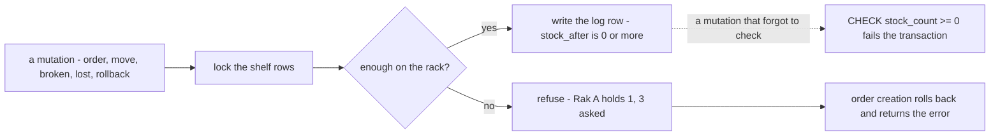

**The spec.**

| | |
| --- | --- |
| `product_placements.stock_count` | `CHECK (stock_count >= 0)` — the backstop: a future mutation that forgets to check fails instead of writing −1 |
| the mutation | locks the shelf rows ([batches-lock-before-shelves-by-id](./context_decision.md#batches-lock-before-shelves-by-id)), compares, and refuses with an error naming the rack and what it holds — before the database check would fire |
| `PostOrder`, too few across all racks | fails and writes nothing; [order creation](../order/order_creation.md) rolls back its own transaction and **returns the error** to the caller |
| a move · broken or lost · a rollback | refused the same way |
| a count | unaffected — it writes the real number, which is never negative |
| `product_placement_logs.stock_after` | 0 or more, as a consequence |

**What it does NOT settle** — the batch side: the same check on `batches.stock_count` belongs to
[batch.md](./batch.md), and sits with [context Q14a](./context_clarify.md#question) · whether a rollback that would go below
zero is refused, or corrected some other way — the rack half is now forced, the batch half is
[transaction Q4](./transaction_clarify.md#question).

## rack-codes-are-saved-lowercase

> Owner, in chat *(2026-10-10)*: *"for 6b, no, make always lowercase"*. It answers
> [placement_clarify Q6b](./placement_clarify.md#question) — *are codes compared after trimming spaces and ignoring case?* —
> by cleaning the code when it is saved, as I offered, but **lowercase, against my uppercase**.

**The verdict.** One label painted on one shelf has one spelling in the system. A code is cleaned once, when it is saved,
so every screen, pick list and lookup reads the same text, and a plain `=` compares it.

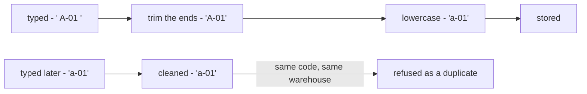

**The spec.**

| | |
| --- | --- |
| on save (create, edit) | trim the ends, then lowercase |
| on lookup (a search, a typed code) | the input is cleaned the same way, then compared with plain `=` |
| unique | `(warehouse_id, code)` among racks with no `deleted_at` — a plain index, because the stored value is already clean |
| backstop | `CHECK (code = lower(btrim(code)))`, so a writer that skips the cleaning fails instead of storing a second spelling |
| shown | as stored — `a-01` |
| untouched | the inner characters: `a 01`, `a-01` and `a01` stay three codes, because the painted label is the label · `name`, which is free text |

**What it does NOT settle** — ⚠ the build today stores codes as typed, with a case-sensitive index. Moving to this rule
lowercases the existing codes, and two that differ only by case (`A-01` and `a-01` in one warehouse) collide: they must be
merged or renamed before the migration runs.

## placements-list-detail-and-move-come-first

> Owner, in chat *(2026-10-10)*: *"for q5 yes i follow your recomendation"*. It answers
> [placement_clarify Q5](./placement_clarify.md#question) (which screens, and which come first) as recommended. The
> accepted table put the move on Placement detail, so it answers **3e** (where a move happens) too.

**The verdict.** Each placement job gets one screen, tied to the person who does it (HARD RULE 6). Three come first: the
list, the detail, and the move. A move is an action on the rack's own page, not a page of its own, because whoever
moves goods is already looking at the rack they are taking from.

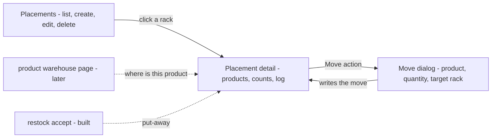

**The spec.**

| job | who | screen | when |
| --- | --- | --- | --- |
| set up racks | warehouse admin | **Placements**: a list, with create, edit and delete | **first** |
| see what is on a rack | staff | **Placement detail**: its products with their counts, and its log | **first** |
| move goods | staff | **Move**: a dialog opened from Placement detail (product, quantity, target rack). Not a page | **first** |
| find where a product is | staff, picker | a section on the product's warehouse page | ships **with the product page** |
| put goods away at accept | staff | restock-accept | ✅ already built |

**What it does NOT settle.**
- The big number on Placement detail, the book count or what is physically there: [Q4](./placement_clarify.md#question).
- What a move writes, who may do one, and moving many products at once: [Q3a–c](./placement_clarify.md#question).
- ⚠ The build already has two of the three screens, under another name: **Racks** (`inventories/racks`: list, create,
  edit, delete) and **Rack detail** (stock, plus two history tabs), both in the warehouse menu. There is no Move action
  yet. `inventories/placements` is an empty stub in the **selling** team's menu. What to call the screens, and whether
  the stub stays: [Q7](./placement_clarify.md#question).

## the-racks-page-is-the-placement-list

> Owner, in chat *(2026-10-10)*: *"i follow your recomendation"*, quoting the recommendation in full. It answers
> [placement_clarify Q7](./placement_clarify.md#question) (the decided list already exists under another name, and the
> decided name sits on an empty page for the wrong team) as recommended.

**The verdict.** The screens named in
[placements-list-detail-and-move-come-first](#placements-list-detail-and-move-come-first) are the ones already built.
Nothing new is started for the list or the detail; the Move is added to Rack detail. On screen they are called by the word
staff use at the shelf, *"Rak A"*, and the schema keeps its own word. A selling team never reads a rack, so the empty
Placements page in its menu goes.

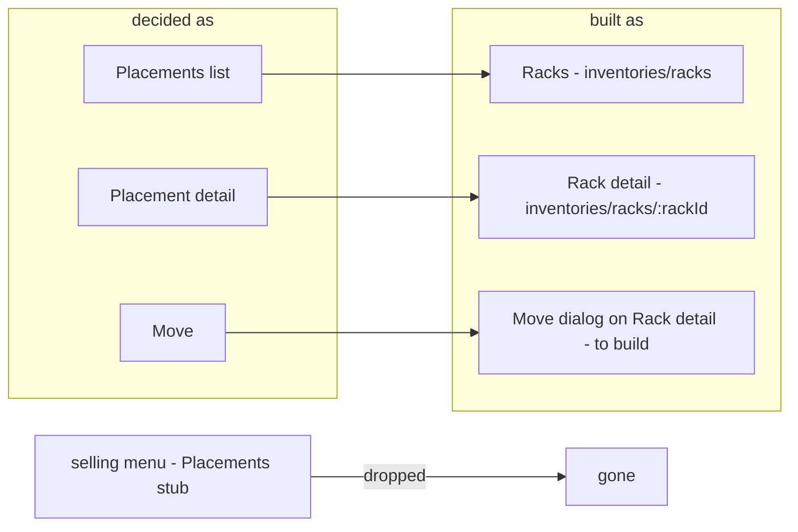

**The spec.**

| | |
| --- | --- |
| the list | `inventories/racks`, warehouse menu only, as built: list, create, edit, delete |
| the detail | `inventories/racks/:rackId`, as built; the Move is added here as a dialog (product, quantity, target rack) |
| the word on screen | **Racks** in English, **Rak** in Indonesian, for the menu, the titles and the buttons |
| the word in the schema | `placements`, `product_placements`, `product_placement_logs`, as [placement.md](./placement.md) names them |
| the selling team's `inventories/placements` | dropped: the menu entry, the route, the page and its copy |

**What it does NOT settle** — the Move's behaviour, which waits on [Q3a–c](./placement_clarify.md#question) · the count shown
on Rack detail, [Q4](./placement_clarify.md#question) · the word *placement* inside other screens (a batch's *Placements*
tab, a rack's *Placement history*), which names the act of placing rather than the screen, so it stays.

## a-sample-names-the-rack-it-was-taken-from

> Owner, in chat *(2026-10-12)*: *"for 1b and 1c follow your recomendation"*. It answers
> [placement_clarify Q1b](./placement_clarify.md#question), *which rack is a sample written against?*, as recommended. It
> follows [a-sample-is-handed-over-at-the-warehouse](./transaction_decision.md#a-sample-is-handed-over-at-the-warehouse):
> a person asks at the warehouse, and staff pick it there and then.

**The verdict.** A sample is written against **the rack staff actually took it from**. The system does not choose. Nothing
was recorded before staff reached the shelf, so there is no earlier moment at which it could have chosen; if it chose the
fewest first anyway, staff would take the nearest unit and the record would be wrong until the next count.

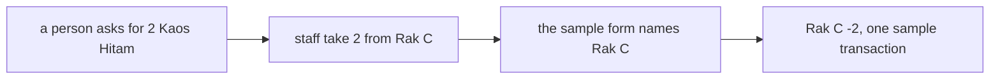

**The spec.**

| | |
| --- | --- |
| who names the rack | the staff member who picked it, on the sample form |
| the placement ledger | one `sample` row per rack taken from, minus the units; a sample taken from two racks names both |
| the batch ledger | oldest batch first, at that batch's price, the same as every take |
| too few on the named rack | refused, per [a-shelf-never-goes-below-zero](#a-shelf-never-goes-below-zero) |
| the principle | the system picks a rack only when the act is recorded before anyone is at the shelf: an order, a transfer out. Otherwise the person at the shelf names it |

**What it does NOT settle**: who bears the sample, and whether a member of the owning team must agree first
([transaction Q6](./transaction_clarify.md#question)).

✅ *(2026-10-12)* Settled: nobody pays anybody and nobody has to agree —
[a-sample-is-a-stock-out-at-batch-value](./transaction_decision.md#a-sample-is-a-stock-out-at-batch-value).

## a-handed-over-sample-is-final

> Owner, in chat *(2026-10-12)*: *"for 1b and 1c follow your recomendation"*. It answers
> [placement_clarify Q1c](./placement_clarify.md#question), *does a sample ever come back?*, as recommended.

**The verdict.** Once handed over, a sample is gone, and its transaction is final: it is never rolled back. In the rare case
a unit does come back, staff put it onto a rack as an **`adjustment` that names the sample it answers**, and it goes back
into the **same batch at that batch's price**.

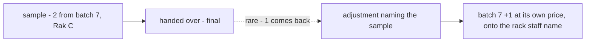

**The spec.**

| | |
| --- | --- |
| the sample transaction | never rolled back; `is_rollback` stays false |
| a unit that comes back | a new `adjustment` naming the sample, up to the units that sample took |
| its batch and price | the batch the sample took it from, at that batch's price, so its money returns at the price it left at |
| its rack | the one staff put it on, which need not be the rack it left |

**What it does NOT settle**: how an adjustment names what it answers, which is the same open point as a found unit
answering its loss ([context Q14b](./context_clarify.md#question)) and waits on your [adjustment.md](./adjustment.md).

## an-order-line-may-be-taken-from-several-racks

> Owner, in chat *(2026-10-12)*: *"for q2, follow your recomendation"*. It answers
> [placement_clarify Q2](./placement_clarify.md#question), *may one order line come from two racks?*, as recommended. It
> was [context Q11d](./context_clarify.md#question) before it moved to placement.

**The verdict.** [an-order-takes-from-the-lowest-shelf-first](./context_decision.md#an-order-takes-from-the-lowest-shelf-first)
holds **as written**, even when it splits one order line over several racks. Emptying the small leftover racks is the point
of the rule, and the price is an extra stop for the picker.

3 Kaos Hitam wanted. Rak A holds 1, Rak B 2, Rak C 5:

| | takes | stops | racks emptied |
| --- | --- | --- | --- |
| ✅ **fewest first** | 1 from A, 2 from B | 2 | 2 |
| ❌ all from one rack | 3 from C | 1 | 0 |

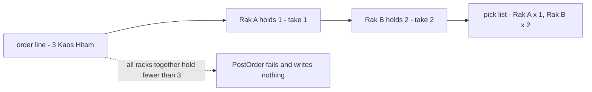

**The spec.**

| | |
| --- | --- |
| order of the racks | the fewest units of this product first |
| a tie | the smaller rack id first, so two runs over the same stock pick the same racks |
| one line over several racks | allowed: one placement log row per rack, and the pick list names each one, *"Rak A × 1, Rak B × 2"* |
| too few across all racks | `PostOrder` fails and writes nothing; order creation returns the error ([a-shelf-never-goes-below-zero](#a-shelf-never-goes-below-zero)) |
| locking | the order of the take is not the order of the locks: shelves are still locked by id ([batches-lock-before-shelves-by-id](./context_decision.md#batches-lock-before-shelves-by-id)) |

**What it does NOT settle**: whether a rack whose product is locked by a count is skipped
([opname Q4](./opname_clarify.md#question)) · what Rak A's screen shows while its unit waits for the picker
([placement Q4](./placement_clarify.md#question)).

🔄 *(2026-10-13)* **Amended by [a-lock-stops-units-moving-not-sales](./opname_decision.md#a-lock-stops-units-moving-not-sales)**: fewest first holds among the **unlocked** racks;
a rack whose product is being counted comes last, and its pick-list line waits for the count.

## any-warehouse-member-may-move-goods

> Owner, in chat *(2026-10-12)*: *"for 3b, follow your recomendation"*. It answers
> [placement_clarify Q3b](./placement_clarify.md#question), *who may move goods between racks?*, as recommended.

**The verdict.** Any member of the warehouse team may move goods from one rack to another, **staff included**: they are
the ones carrying the box. Each log row of the move names the person who did it. A selling team never moves goods: it has
no rack screen ([the-racks-page-is-the-placement-list](#the-racks-page-is-the-placement-list)).

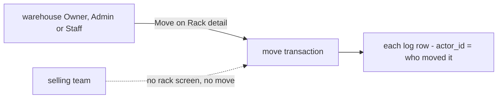

**The spec.**

| | |
| --- | --- |
| may move | warehouse Owner, Admin, Staff, and Root or the root team's Administrator |
| may not | any selling-team role |
| recorded | `inventory_transactions.create_by_user_id` and `product_placement_logs.actor_id`, the same person |
| the build | `StockMoveRequest`'s policy already lists exactly these roles |

**What it does NOT settle**: what a move writes ([Q3a](./placement_clarify.md#question)) · several products at once
(Q3c) · sold units still on the rack (Q3f).

## a-move-lists-its-units-at-zero-value

> Owner, in chat *(2026-10-12)*: *"for 3a-i adn ii, i follow your recomendation"*. It answers
> [placement_clarify Q3a-i](./placement_clarify.md#question), *what is the item of a move?*, as recommended.

**The verdict.** A transaction lists its items ([a-transaction-lists-its-items](./transaction_decision.md#a-transaction-lists-its-items)),
and a move is no exception: **one item per product moved, with the units moved and `total 0`**. The units changed rack;
no value left one batch for another, so the value moved is nothing. The history reads *"4 Kaos Hitam moved"*.

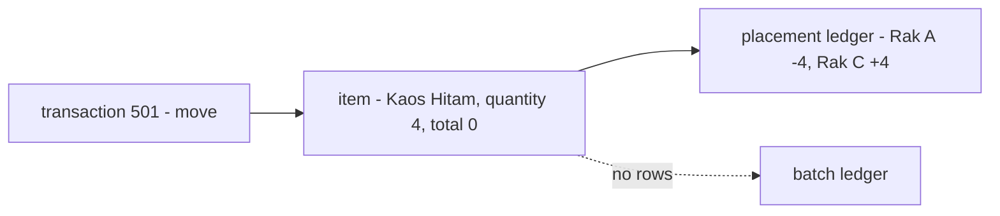

**The spec.**

| | |
| --- | --- |
| items per move | one per product moved; *"empty Rak A"* with three products writes three items |
| `quantity` | the units moved, always positive: the two log rows carry the signs |
| `total` | `0`, which is what *the sum of its batch rows* gives when there are none |

**What it does NOT settle**: whether an item carries `product_id`, which is [transaction Q2](./transaction_clarify.md#question)
and which this decision assumes.

## a-wrong-move-is-fixed-by-moving-again

> Owner, in chat *(2026-10-12)*: *"for 3a-i adn ii, i follow your recomendation"*. It answers
> [placement_clarify Q3a-ii](./placement_clarify.md#question), *how is a wrong move fixed?*, as recommended.

**The verdict.** Kaos Hitam went to Rak C and should have gone to Rak D: staff **move it again**, C → D, as a second
`move`. The first move is **never rolled back**
([an-undo-rolls-the-transaction-back-once](./transaction_decision.md#an-undo-rolls-the-transaction-back-once) is for an
act that did not happen, like a cancelled order). The box really was carried twice, and the log says so.

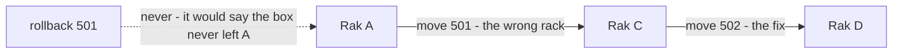

**The spec.**

| | |
| --- | --- |
| a wrong move | corrected by a new `move` from where the goods are now to where they belong |
| a move's `is_rollback` | stays false: a move is never rolled back |
| the log | shows both trips, each with its actor and time |

## a-move-writes-two-rack-rows-and-no-batch-row

> Owner, in chat *(2026-10-12)*: *"3a, use `move`, and choice 1"*, then *"Two rows"* and *"No batch row"* when asked to
> confirm the other two choices. It answers [placement_clarify Q3a](./placement_clarify.md#question), *what does a move
> write?*, as recommended. The type is recorded where the type list lives:
> [a-move-has-its-own-type](./transaction_decision.md#a-move-has-its-own-type).

**The verdict.** A move is **two ordinary rack changes under one transaction**: for each product, a minus row on the rack
it left and a plus row on the rack it reached. **Nothing is written to the batch ledger**: a batch knows its owner, cost and
count, not its rack, and a move changes none of those.

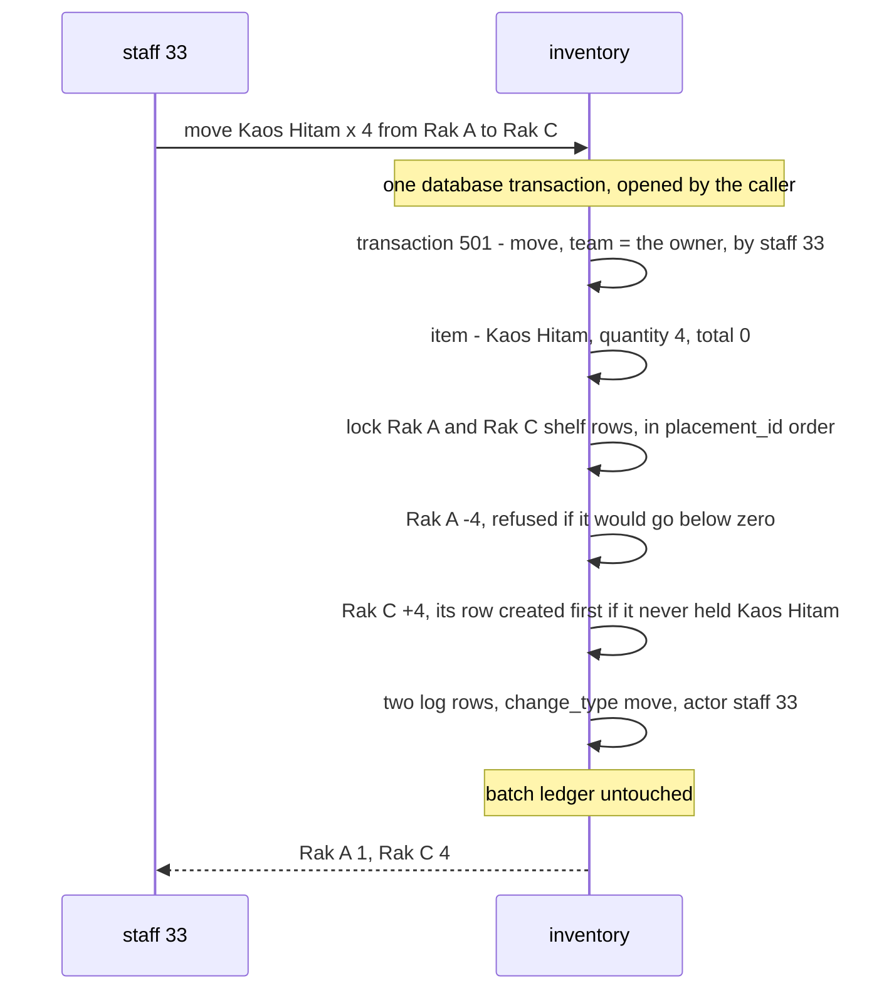

**The spec.** 4 Kaos Hitam, Rak A (5) to Rak C (0), by staff 33:

| table | rows |
| --- | --- |
| `inventory_transactions` | **1** · `tx_type move` · `team_id` the owner · `create_by_user_id` staff 33 · `description` optional |
| `inventory_transaction_items` | **1** per product · `quantity 4` · `total 0` ([a-move-lists-its-units-at-zero-value](#a-move-lists-its-units-at-zero-value)) |
| `product_placement_logs` | **2** per product · Rak A `-4`, `stock_after 1` · Rak C `+4`, `stock_after 4` · `change_type move` · `actor_id` staff 33 |
| `product_placements` | **2** updated · the destination's row is created at 0 first, if it had none |
| `batches` · `batch_logs` | **none** |
| the two ledgers agree | racks −4 + 4 = 0, batches 0 |
| refused | the same rack at both ends · more than the source rack's `stock_count` ([a-shelf-never-goes-below-zero](#a-shelf-never-goes-below-zero)) |
| never | to another warehouse (that is a transfer) · to another team (a move never changes the owner) |

Rak A's history then reads like every other change:

| when | type | Kaos Hitam | on rack after | by |
| --- | --- | --- | --- | --- |
| 09:00 | restock | +5 | 5 | staff 12 |
| 11:00 | move → Rak C | −4 | 1 | staff 33 |

**Why not the alternatives.** One row with *from* and *to* would be the only log row of its shape: two `stock_after`
columns, and every rack's history searching a second column. A −4 / +4 pair on the batch would net to nothing and would
have to name the batch on the rack, which a rack row does not record.

**What it does NOT settle**: several products and owners in one action ([Q3c](./placement_clarify.md#question)) · putting
away at accept (Q3d) · the dialog's wording for sold units still waiting (Q3f) · ⚠ the build's `StockMove` carries a batch
(#210), which goes, unless [context Q7](./context_clarify.md#question) gives a rack row its batch.

## a-move-is-one-rack-to-one-or-more-racks

> Owner, in chat *(2026-10-12)*: *"move placement used in same warehose, its used for staff for managing and
> reconditioning room in the warehouse, so no need staging place like area terima, just product move place a to b or a to
> b and c"*. It answers [placement_clarify Q3c-ii](./placement_clarify.md#question), *one destination, or several in one
> move?*: several. My reason for several, sorting a staging rack such as *Area Terima*, is **withdrawn**: a move is not
> about staging at all.

**The verdict.** A move is how warehouse staff **reorganize space inside one warehouse**: they make room, and they tidy
racks. It goes **from one rack to one or more racks**, A → B, or A → B and C, and **one product may be split** over them.

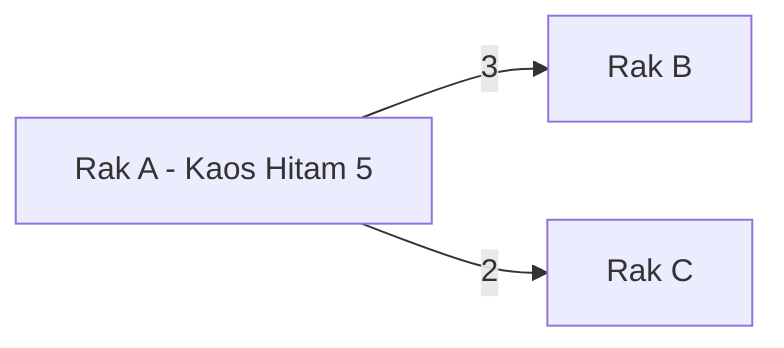

**The spec.** 5 Kaos Hitam of Toko Melati, Rak A to Rak B (3) and Rak C (2), by staff 33:

| | |
| --- | --- |
| purpose | reorganizing space in one warehouse, by its staff ([any-warehouse-member-may-move-goods](#any-warehouse-member-may-move-goods)) |
| from | **one** rack |
| to | **one or more** racks, never the rack it came from |
| a product | may be split: 3 to Rak B, 2 to Rak C |
| `product_placement_logs` | **one row per rack touched**: Rak A `-5` · Rak B `+3` · Rak C `+2` · all `move`, all by staff 33 |
| `inventory_transaction_items` | Kaos Hitam · `quantity 5` · `total 0` ([a-move-lists-its-units-at-zero-value](#a-move-lists-its-units-at-zero-value)) |
| batch ledger | nothing, as before |
| the two ledgers agree | racks −5 + 3 + 2 = 0, batches 0 |
| never | another warehouse, which is a transfer · a staging step: a move does not depend on one |

⚠ **It amends the row count of** [a-move-writes-two-rack-rows-and-no-batch-row](#a-move-writes-two-rack-rows-and-no-batch-row): that spec says *2 rows per product*, which holds for one destination. With several,
it is one row per rack touched. What that decision chose, a row per rack rather than one row with *from* and *to*, is
unchanged. Recorded as a contradiction: [a-split-move-writes-more-than-two-rows](./placement_clarify.md#a-split-move-writes-more-than-two-rows).

**What it does NOT settle**: one transaction per owning team ([Q3c](./placement_clarify.md#question)) · all or nothing
(Q3c-i) · **the dialog's exact shape**, judged at the prototype. My proposal: a default rack at the top that fills every
line, any line may change it, and *Split to Another Rack* adds a line for the same product.

## a-move-writes-one-transaction-per-owning-team

> Owner, in chat *(2026-10-12)*: *"for 3c, 3c-i, 3d, 3f i follow your recomendation"*. It answers [placement_clarify Q3c](./placement_clarify.md#question),
> *how many transactions when a move carries several teams' goods?*, as recommended.

**The verdict.** A product belongs to one selling team, and one rack can hold several teams' goods. A move that carries
goods of two teams writes **one transaction per owning team**, both in the same database transaction, by the same person,
at the same moment. A transaction keeps its one `team_id`, and each team's history shows only its own goods moving.

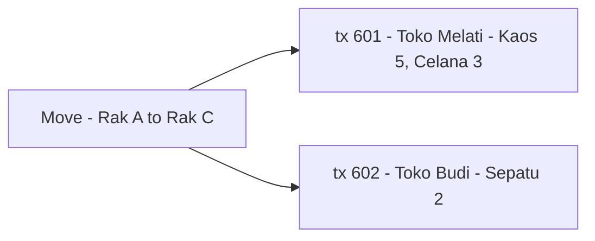

**The spec.**

| | |
| --- | --- |
| transactions per move | one per owning team among the lines |
| each transaction | `tx_type move` · its team's `team_id` · the same `create_by_user_id` · its own items and log rows |
| Rak A's history | all of them, by time and person, so the rack still reads as one act |
| a team's history | only its own transaction |

**Rejected**: one transaction for the whole action, which would need an empty or wrong `team_id` and would show one team
another team's goods · one per product, which turns *"empty a rack of 30 products"* into 30 transactions.

## a-move-is-all-or-nothing

> Owner, in chat *(2026-10-12)*: *"for 3c, 3c-i, 3d, 3f i follow your recomendation"*. It answers [placement_clarify Q3c-i](./placement_clarify.md#question),
> *what if one line of a move fails?*, as recommended.

**The verdict.** A move is **all or nothing**: every line, every team's transaction, one database transaction. If any
line no longer fits, nothing is recorded and the error names the product. A product **locked by a count** is shown as
locked in the dialog and starts at 0, so staff do not carry it, and the only error left is a race: someone took a unit
a second before the click.

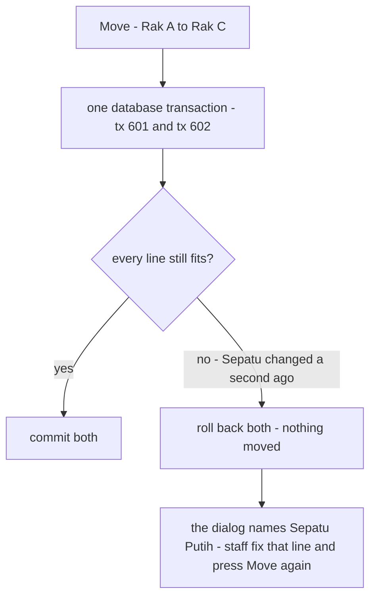

**The spec.**

| | |
| --- | --- |
| scope | every line of the action, across every team's transaction |
| a line that no longer fits | the whole move is refused; the error names the product and what the rack holds now |
| a product locked by a count | shown locked, quantity 0, not editable until the count ends |
| why not line by line | half a recorded move matches no shelf: staff carried everything, and the next count would find −2 on A and +2 on C, a loss that is the warehouse's debt |

**What it does NOT settle**: what exactly a count's lock blocks ([opname Q4](./opname_clarify.md#question)), which this
decision assumes includes a move.

## putting-away-at-accept-is-not-a-move

> Owner, in chat *(2026-10-12)*: *"for 3c, 3c-i, 3d, 3f i follow your recomendation"*. It answers [placement_clarify Q3d](./placement_clarify.md#question),
> *is putting goods away at accept a move?*, as recommended, and in line with
> [a-move-is-one-rack-to-one-or-more-racks](#a-move-is-one-rack-to-one-or-more-racks): a move is staff reorganizing
> space.

**The verdict.** Goods put on racks when a restock, return or transfer is accepted are **part of that accept**: its own
log rows, typed by the accept, under the accept's transaction. Only a later re-shelving of goods already on a rack is a
`move`.

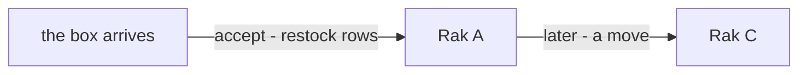

**The spec.**

| | |
| --- | --- |
| at accept | the accept's transaction writes the rack rows, typed `restock`, `return` or `transfer_in` |
| a move | always starts from a rack that already holds the goods |
| the build | `StockMove`'s *unplaced → rack* path goes, with [there-is-no-unplaced-pile](./restock_decision.md#there-is-no-unplaced-pile) |

## a-move-leaves-sold-units-on-their-rack

> Owner, in chat *(2026-10-12)*: *"for 3c, 3c-i, 3d, 3f i follow your recomendation"*. It answers [placement_clarify Q3f](./placement_clarify.md#question),
> *what about sold units still on the rack?*, as recommended.

**The verdict.** A move can take only what the rack's `stock_count` holds. Units sold and waiting for the picker **stay
on their rack**, because the printed pick list sends the picker there. The ledger already enforces it: `PostOrder`
lowered `stock_count` when the order was created, so moving them would take the rack below zero and is refused
([a-shelf-never-goes-below-zero](#a-shelf-never-goes-below-zero)). The dialog's job is to say why.

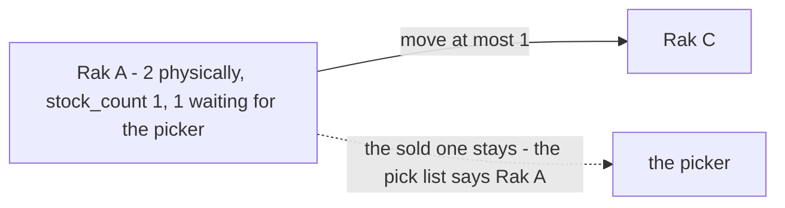

**The spec.**

| | |
| --- | --- |
| the most a line can move | the rack's `stock_count` for that product |
| the dialog | shows *"1 sold, waiting for the picker: leave it on Rak A"* beside the product |
| a move of more | refused by the zero check, as any take is |

**What it does NOT settle**: how the rack screen shows the units waiting ([Q4](./placement_clarify.md#question)).

## a-rack-shows-its-stock-count-for-now

> Owner, in chat *(2026-10-12)*: *"its good, but too overkill for now, we just need stock count is enough"*. It answers
> [placement_clarify Q4a](./placement_clarify.md#question), *what is the big number on a rack screen?*, **against my
> recommendation** of the physical count with *"1 sold, waiting for the picker"* under it.

**The verdict.** For now, a rack screen shows each product's **`stock_count`** and nothing else. It does not work out
what is physically on the shelf, and it does not list sold units waiting for the picker. Between an order's create and
its verify scan, the screen reads lower than the shelf, and that is accepted.

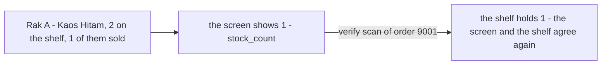

**The spec.**

| | |
| --- | --- |
| Rack detail, per product | `stock_count` |
| Racks list, per rack | the sum of `stock_count` |
| a sold unit not yet picked | not shown on any rack screen |
| a rack delete refused because a sold unit waits on it | the refusal's error says why and names the order: [a-placement-deletes-only-when-nothing-waits-on-it](./context_decision.md#a-placement-deletes-only-when-nothing-waits-on-it) still holds, so the explanation moves from the screen into the error |
| *for now* | revisit when staff report that a rack's number disagrees with its shelf |

**What it closes and moves.** Q4b, *what counts as waiting*, is no longer a rack-screen question; its finding, that a
transfer out also waits until Warehouse A processes it, moves to the count, which still needs it
([opname Q10b](./opname_clarify.md#question)). Q4c, showing a stuck pick, falls away with the waiting line.

**What it does NOT settle**: whether the Move dialog drops its waiting note too
([the-move-dialog-still-explains-waiting-units](./placement_clarify.md#the-move-dialog-still-explains-waiting-units)) · where *picked* is stored, which the count still needs
([transaction Q8](./transaction_clarify.md#question)).

## a-sample-is-recorded-on-rack-detail

> Owner, in chat *(2026-10-12)*, choosing *"Rack detail action"* when asked, before the Storybook pass, where staff record
> a sample. As recommended.

**The verdict.** A sample is recorded from **Rack detail**, with a *Record Sample* action beside *Move Goods*. Staff are
looking at the rack they took it from, so the rack is never typed: it is the page's rack
([a-sample-names-the-rack-it-was-taken-from](#a-sample-names-the-rack-it-was-taken-from)).

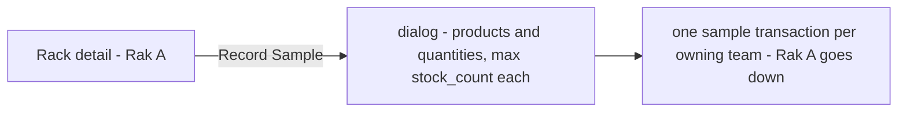

**The spec.**

| | |
| --- | --- |
| where | an action on Rack detail; on a phone, in the header's `⋯` |
| the rack | the page's rack, never chosen in the dialog |
| a line | a product on this rack and a quantity, at most its `stock_count` |
| who | any warehouse member ([any-warehouse-member-may-move-goods](#any-warehouse-member-may-move-goods) by the same reasoning: they hand it over) |

**What it does NOT settle**: who bears a sample and whether a member of the owning team must be named
([transaction Q6](./transaction_clarify.md#question)); the prototype marks that field as pending · what the dialog records
about the person who received it, judged at the prototype.

✅ *(2026-10-12)* Settled: no member is named, so the field and its pending mark are gone —
[a-sample-is-a-stock-out-at-batch-value](./transaction_decision.md#a-sample-is-a-stock-out-at-batch-value). Where the
recipient is kept is [transaction Q9](./transaction_clarify.md#question).

## the-move-dialog-shows-stock-count-only-for-now

> Owner, in chat *(2026-10-12)*, choosing *"Drop the note"* for
> [the-move-dialog-still-explains-waiting-units](./placement_clarify.md#the-move-dialog-still-explains-waiting-units). As recommended.

**The verdict.** The Move dialog follows the rack screen ([a-rack-shows-its-stock-count-for-now](#a-rack-shows-its-stock-count-for-now)): it shows each
product's `stock_count`, and a line can move at most that. It does **not** explain the sold units still on the shelf.
It amends one row of [a-move-leaves-sold-units-on-their-rack](#a-move-leaves-sold-units-on-their-rack), the dialog's
note; that decision's rule stands, and the zero check still refuses more.

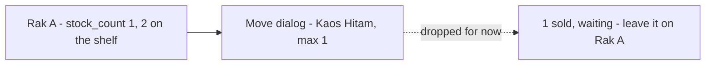

**The spec.**

| | |
| --- | --- |
| per line | the product, its `stock_count`, a quantity up to it |
| sold units waiting | not shown, for now |
| *for now* | revisited together with the rack screen |

## the-placement-prototype-is-accepted

> Owner, in chat *(2026-10-12)*: *"for 1, i have reviewed"*, answering the first of two next steps offered: review
> `Pages/Racks/RackList` and `Pages/Racks/RackDetail` in Storybook. No change was asked for, so I took it as the lifecycle's
> design_accept (docs/development_lifecycle.md), with the three choices left to the review accepted as built.

**The verdict.** The prototype is the design: the Racks page and Rack detail, and the `RackService` contract, as committed
in `556b083`. The contract is accepted with the screens
([contract-accepted-with-the-screens](../../development_lifecycle_decision.md#contract-accepted-with-the-screens)), so a
change to it from here on is a new pass, not a quiet edit.

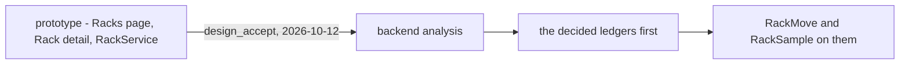

**The spec.**

| | |
| --- | --- |
| accepted | `frontend/src/pages/racks/`, `frontend/src/pages/rack-detail/` (Move Goods, Record Sample), and in `proto/warehouse/inventory/v1/rack.proto`: `RackMove`, `RackSample`, the `RackList` STOCK slice, `RackStockLine.counting` |
| the Move dialog | every product starts at 0; *Move Everything* fills them |
| the Sample dialog | `recipient` is required: who received it, as they gave it |
| the Products tab | the column keeps the label *On this rack*, now meaning the stock count |
| still pending on the screen | the count's lock ([opname Q4](./opname_clarify.md#question)) · who on the owning team agreed to a sample ([transaction Q6](./transaction_clarify.md#question)) |
| next | backend analysis, which the ledgers come before ([the-decided-ledgers-come-before-the-transfer](./warehouse_transfer_decision.md#the-decided-ledgers-come-before-the-transfer)) |

✅ *(2026-10-12)* The sample's pending mark is gone: no member of the owning team is named
([a-sample-is-a-stock-out-at-batch-value](./transaction_decision.md#a-sample-is-a-stock-out-at-batch-value)). Only the
count's lock stays pending on the screen.
