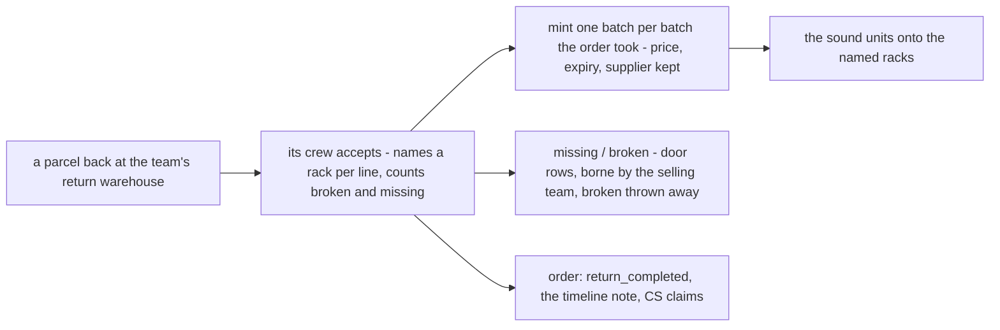

# Decisions — `inventory/return.md`

What the owner decided about a return's **stock half** — the units of a returned parcel going back onto a shelf — recorded
before it is acted on. **Append-only.** [return.md](#return-md-is-retired) said only *"unplanned"*
([return-is-unplanned](./context_decision.md#return-is-unplanned)); the order side had already decided most of the flow
(the scoping of 2026-11-09 found 30 points decided across [order/context_decision.md](../order/context_decision.md) and
this context). The points it left open are answered here, one by one.

| | |
| --- | --- |
| [only-the-return-warehouse-accepts-a-return](../order/context_decision.md#only-the-return-warehouse-accepts-a-return) | *(recorded on the order side)* only the selling team's configured return warehouse accepts a return; its crew puts the units on its own racks |
| [a-return-mints-one-batch-per-batch-the-order-took](#a-return-mints-one-batch-per-batch-the-order-took) | the return warehouse mints one batch per batch the order's take drew from, each keeping its price, expiry and supplier |
| [a-short-return-is-missing-at-the-door](#a-short-return-is-missing-at-the-door) | a unit the parcel lacks is *missing at the door*, borne by the selling team — not the warehouse's loss, payable or claim |
| [a-broken-returned-unit-is-thrown-away-at-the-door](#a-broken-returned-unit-is-thrown-away-at-the-door) | the parcel is accepted whole; a unit too damaged to sell is a *broken* door row, thrown away, borne by the selling team |
| [return-md-is-retired](#return-md-is-retired) | `return.md` is deleted — the return's stock half is decided; its links point here |
| [a-return-door-row-carries-an-optional-note](#a-return-door-row-carries-an-optional-note) | a broken or missing return line takes an optional note, copied onto the order's warehouse note for the platform claim |
| [the-return-accept-page-is-accepted](#the-return-accept-page-is-accepted) | the accept with its stock half is a page, like Restock Accept: per line missing · broken · racks, a summary, Accept once every sound unit has a rack |

---

## a-return-mints-one-batch-per-batch-the-order-took

> Owner, in chat (2026-11-09): *"A"*, as recommended — to: what does the return warehouse mint for a line the order took
> from two batches? (Refilling the order's own batches is ruled out: a batch belongs to one warehouse, a borrowed line's
> batches are the lender's, and a return mints.)

**The verdict.** At the accept, the return warehouse **mints one batch per batch the order's take drew from**, for the units
coming back from it — each keeping that batch's **price, expiry and supplier**. It is the transfer's rule
([the-receiver-mints-one-batch-per-source-batch](./warehouse_transfer_decision.md#the-receiver-mints-one-batch-per-source-batch)).

```
Kaos Hitam ×3, taken 2 from batch #7 (Rp 10.000, exp 2027-03) and 1 from batch #9 (Rp 12.000, exp 2027-06)
  → the return warehouse mints  2 × Rp 10.000 (exp 2027-03, #7's supplier)
                              + 1 × Rp 12.000 (exp 2027-06, #9's supplier)   = Rp 32.000, the order's COGS
```

| | |
| --- | --- |
| the total | equals the order's COGS — the order's cost comes back whole, wherever the parcel lands |
| a borrowed line | each minted layer carries the markup the team paid on it (at 20 %: 2 × Rp 12.000 + 1 × Rp 14.400 = Rp 38.400); the lender's batches are untouched, and the units come back as the borrower's mapped product ([a-returned-borrowed-unit-is-relabelled-at-the-accept](../order/context_decision.md#a-returned-borrowed-unit-is-relabelled-at-the-accept)) |
| units that do not come back | missing or broken units come off the **newest** layer first, as at a transfer's door — what happens to them is the next questions |
| why not one batch per line | an average price (3 × Rp 10.666,67) would give units from two batches one expiry and one supplier, and [expiry-is-a-report](./context_decision.md#expiry-is-a-report) would read wrong |

⚠ Not built.

✅ **Built 2026-11-09** — `inventory_mutations/post_return.go` (`PostReturn` on the transfer's `outboundLayers` / `splitLayers`, one batch per layer at the take's `price_unit_after`, × 1 + the markup paid on a borrowed line) through `inventory_v1/order_transaction_return.go`; tests `TestOrderTransactionReturn_MintsABatchPerBatchTheTakeDrew`, `TestOrderTransactionReturn_ABorrowedLineComesBackAsTheOwnProductAtTheMarkup`.

---

## a-short-return-is-missing-at-the-door

> Owner, in chat (2026-11-09): *"A"*, as recommended — to: confirm or reverse the inventory half of
> [a-short-return-is-accepted-and-the-gap-written-off](../order/context_decision.md#a-short-return-is-accepted-and-the-gap-written-off)
> (*3 in, then 1 written off as a `problem`, reason lost*), given what it did not know: a `problem` row is the warehouse's
> custody register ([a-loss-in-custody-is-a-stock-problem](./opname_decision.md#a-loss-in-custody-is-a-stock-problem)) —
> the warehouse would owe the team, a later surplus could claim it back, and it would count in Inventory Lost.

**The verdict.** A unit the parcel lacks never reached the warehouse, so it is recorded the way a restock's or a transfer's
door records it ([a-short-unit-at-the-door-is-missing](./restock_decision.md#a-short-unit-at-the-door-is-missing),
[broken-and-missing-at-the-door-are-problem-rows](./warehouse_transfer_decision.md#broken-and-missing-at-the-door-are-problem-rows)):

```
parcel back with 2 of 3 Kaos Hitam (taken 2 × Rp 10.000 from #7, 1 × Rp 12.000 from #9)
  → in:      the 2 in hand, minted per a-return-mints-one-batch-per-batch-the-order-took
  → missing: 1, off the newest layer — 1 × Rp 12.000, a row of the return's own door table
  → borne by the selling team; customer service claims it from the platform
```

| | |
| --- | --- |
| what goes on the shelf | only the units in hand |
| the missing unit | a `missing` row in the **return's door table** (shaped like `warehouse_transfer_problem_items`), priced from its layer — newest first |
| who bears it | the **selling team** — never the warehouse's payable, never claimable by a later surplus, not in Inventory Lost (*"a receiving problem row never posts to the warehouse's payable"*) |
| the order side | unchanged: the return stays whole, `return_completed`, the warehouse's timeline note naming what is missing, customer service claims it ([a-short-return-is-accepted-and-the-gap-written-off](../order/context_decision.md#a-short-return-is-accepted-and-the-gap-written-off)) |

**What it reverses** (HARD RULE 11): the inventory rows of
[a-short-return-is-accepted-and-the-gap-written-off](../order/context_decision.md#a-short-return-is-accepted-and-the-gap-written-off)
— *"return transaction — 3 in, the whole order"* and *"problem — 1 written off, reason lost"*: the return brings in what is
in hand, and the gap is a door row, not a custody problem. ⚠ Not built.

✅ **Built 2026-11-09** — `missing` rows of `order_return_problem_items` (inventory `00040`), off the newest layers, no payable or problem row; named on the order's warehouse note (`selling_v1/order_return_accept.go`); tests `TestOrderTransactionReturn_BrokenAndMissingAreDoorRowsNotTheWarehouses`, `TestOrderReturnAccept_BrokenAndMissingAreNamedWithTheNote`.

---

## a-broken-returned-unit-is-thrown-away-at-the-door

> Owner, in chat (2026-11-09): *"A"*, as recommended — to: what does the accept do with a returned unit too damaged to
> sell (a Kaos Hitam that arrives torn)? — accept the whole parcel and throw the unit away, shelve it as stock, or refuse
> the accept.

**The verdict.** The parcel is **accepted whole**. The crew types how many units of each line are **broken**, as at a
restock's or a transfer's door; each is a `broken` row in the return's door table
([a-short-return-is-missing-at-the-door](#a-short-return-is-missing-at-the-door)), priced from its layer (newest first),
and **thrown away** ([a-broken-unit-is-thrown-away](./context_decision.md#a-broken-unit-is-thrown-away)) — never shelved,
because the stock ledgers hold sellable units only.

| | |
| --- | --- |
| on the shelf | only the sound units in hand |
| who bears it | the **selling team** (business_level §Warehouse 6) — never the warehouse's payable, never claimable, not in Inventory Lost |
| the order side | named on the same warehouse timeline note as a missing unit, so customer service can claim it from the platform |
| not chosen | shelving it (breaks *sellable units only*); refusing the accept (the order would sit in `return` while the crew holds the parcel) |

⚠ Not built.

✅ **Built 2026-11-09** — `broken` rows of `order_return_problem_items`, never shelved, no payable; the same warehouse note; tests as above, e2e `the_return_goes_back_on_the_shelf.spec.ts`.

---

## return-md-is-retired

> Owner (Heri), in chat (2026-11-09): *"is return.md too right ?"*, then *"A"* — scope every return decision, ask only the
> open points, record them here and retire `return.md`, as [adjustment-md-is-retired](./adjustment_decision.md#adjustment-md-is-retired) did.

**The verdict.** `return.md` (*"# Return Contexts. **unplanned**"*) is **deleted**, and
[return-is-unplanned](./context_decision.md#return-is-unplanned) **ends**: the return's stock half is decided. The scoping
(2026-11-09) found 30 points already decided on the order side and in this context; the four it left open are this file's
records above. The flow, end to end:



| | decided by |
| --- | --- |
| who accepts | [only-the-return-warehouse-accepts-a-return](../order/context_decision.md#only-the-return-warehouse-accepts-a-return) |
| whole, never partial; the courier's ask; borrowed units relabelled | [a-return-is-never-partial](../order/context_decision.md#a-return-is-never-partial), [a-return-may-carry-the-couriers-ask](../balance/context_decision.md#a-return-may-carry-the-couriers-ask), [a-returned-borrowed-unit-is-relabelled-at-the-accept](../order/context_decision.md#a-returned-borrowed-unit-is-relabelled-at-the-accept) |
| the rack | named by the accepting crew, as at any accept ([there-is-no-unplaced-pile](./restock_decision.md#there-is-no-unplaced-pile)) |
| the batches | [a-return-mints-one-batch-per-batch-the-order-took](#a-return-mints-one-batch-per-batch-the-order-took) |
| short / broken | [a-short-return-is-missing-at-the-door](#a-short-return-is-missing-at-the-door), [a-broken-returned-unit-is-thrown-away-at-the-door](#a-broken-returned-unit-is-thrown-away-at-the-door) |
| money | none but the courier's ask — the sale stays open ([lost-and-return-leave-the-sale-open](../order/context_decision.md#lost-and-return-leave-the-sale-open), [a-return-keeps-both-fees](../order/context_decision.md#a-return-keeps-both-fees)) |
| a forced return | no stock effect — the units move at the accept ([a-forced-return-follows-the-status-move](../order/context_decision.md#a-forced-return-follows-the-status-move)) |

**What it ripples** (HARD RULE 11): every link into `return.md` — [context.md](./context.md), [context_clarify](./context_clarify.md),
[context_decision](./context_decision.md), [order/context_clarify](../order/context_clarify.md),
[order/context_decision](../order/context_decision.md), [order_return_clarify](../order/order_return_clarify.md),
`development_state/order/context.md`, `services/selling_service/rpc.md` — now points here; their words are kept as written.
The accept screen gains racks per line and broken / missing counts: a new screen part, so a Storybook prototype and the
owner's design accept come before the build.

✅ **Built 2026-11-09** — the flow above, end to end: selling `OrderReturnAccept` (only the return warehouse, every line counted) → inventory `OrderTransactionReturn` (once per take, `order_return_checks`) → `return_completed` with `orders.return_transaction_id` (selling `00049`); e2e `the_return_goes_back_on_the_shelf.spec.ts`.

---

## the-return-accept-page-is-accepted

> Owner, in chat (2026-11-09): *"A"*, as recommended, replying to the Storybook screenshots `return_accept/01…08`
> (`pages/order-return-accept`, `features/orders/returnAcceptPrototype.tsx`): a whole parcel, a short and broken parcel, a
> borrowed line split across racks, the wrong-warehouse refusal, Receive a Return sending a parcel elsewhere, the phone.

**The verdict.** The prototype is the design of the accept with its stock half — and it is a **page**, not the old dialog
(`/warehouse-orders/:orderId/accept-return`), because racks per line need the room Restock Accept and the transfer accept
already have ([a-counted-line-is-three-columns](../../technical/frontend/context_decision.md#a-counted-line-is-three-columns)):

| | |
| --- | --- |
| a line | three columns — what it is (the product, *Ordered N*; a borrowed line's own code to print, one label per sound unit, which old label to cover) · what came back (*Missing* and *Broken* typed, blank for a whole parcel; *sound = ordered − broken − missing*; over the line holds it) · where it goes (this warehouse's racks, Restock Accept's pattern — the first row follows the sound units, *Split to Another Rack*, the same rack twice holds the line) |
| the summary | on the shelf by rack · thrown away · missing · labels to print; when anything is broken or missing, *"N units are borne by <team>, not this warehouse — named on the order's note for customer service"* |
| the courier's ask | amount and note as today; the note required above 0 |
| Accept | sticky in the header with the progress (*"2 of 4 sound pcs on a rack · 2 lines to finish"*), disabled until every sound unit has a rack, then a confirm |
| the wrong warehouse | *"This return goes to <warehouse>"*, Open Order, no Accept — and the same sentence on Receive a Return's found order ([only-the-return-warehouse-accepts-a-return](../order/context_decision.md#only-the-return-warehouse-accepts-a-return)) |
| a phone | one-row header with Accept as its icon; a line is a block |
| the way in | the pick page, the warehouse order detail and Receive a Return open the page — the accept step of [the-return-receiving-screens-are-accepted](../order/context_decision.md#the-return-receiving-screens-are-accepted) moves from its dialog to this page |

⚠ Not built.

✅ **Built 2026-11-09** — live at `/warehouse-orders/:orderId/accept-return` (`pages/order-return-accept`, `features/orders/returnAccept.ts`); the pick page, the warehouse order detail and Receive a Return open it; `AcceptReturnDialog` and the prototype gate are deleted; e2e `the_return_goes_back_on_the_shelf.spec.ts`, `orders.spec.ts` *Return*.

---

## a-return-door-row-carries-an-optional-note

> Owner, in chat (2026-11-09): *"A"*, as recommended — to: does a broken or missing return line carry the crew's optional
> note, as restock's and the transfer's door rows do
> ([a-broken-reason-is-optional](./restock_decision.md#a-broken-reason-is-optional),
> [a-transfer-problem-row-carries-a-note](./warehouse_transfer_decision.md#a-transfer-problem-row-carries-a-note))?

**The verdict.** Each line with a broken or missing count takes **one optional note** (*"sobek di jahitan"*), shown on the
accept page under the counts once either is above 0. It is kept on the line's door row and **copied onto the order's
warehouse timeline note** beside what is missing or broken, so customer service can use it in the platform claim. A line
with neither has no note field; a blank note is fine. ⚠ Not built — the prototype
([the-return-accept-page-is-accepted](#the-return-accept-page-is-accepted)) gains the field in the build.

✅ **Built 2026-11-09** — `order_return_problem_items.note` and `OrderReturnAcceptLine.note` (≤ 200), the field on the page once broken or missing is above 0, copied onto the order's warehouse note; test `TestOrderReturnAccept_BrokenAndMissingAreNamedWithTheNote`, e2e *Note: …*.
