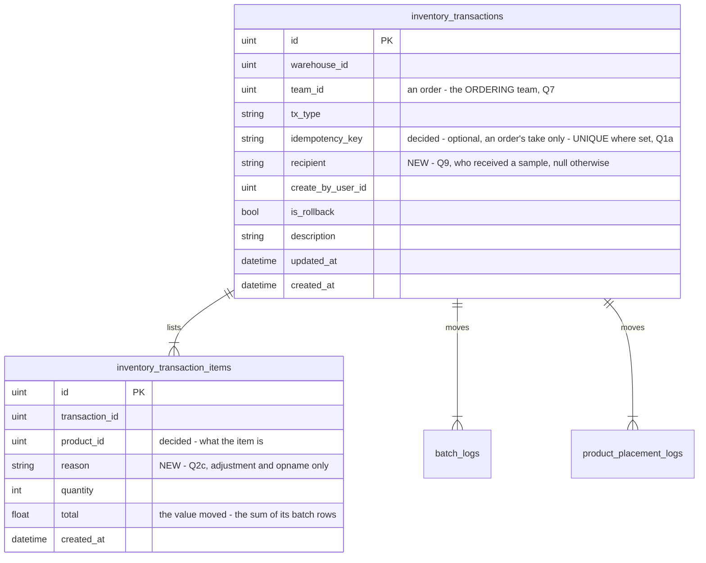
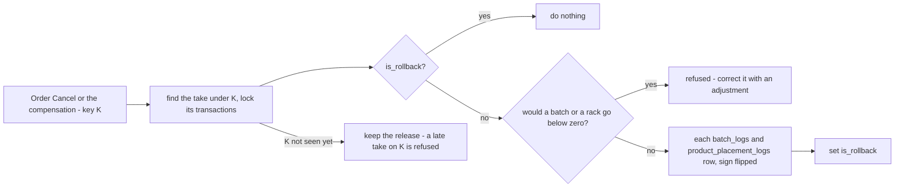

# Clarify — `inventory/transaction.md`

[transaction.md](./transaction.md) is yours — this one is mine. An answered point is deleted; what you settle is recorded
in [transaction_decision.md](./transaction_decision.md).

> ✅ **Answered in chat (2026-10-16, last):** Q2d — items are read by history, the order's line cost, the sample list,
> shared-product info and **reports** ([items-are-what-history-and-reports-read](./transaction_decision.md#items-are-what-history-and-reports-read)).
> Q2 closes, and Critique 2 with it. **No question is open here.** Left for your doc: `recipient` on `inventory_transactions`
> ([a-sample-keeps-its-recipient](./transaction_decision.md#a-sample-keeps-its-recipient)), and the rollback's *"getting item"* arrow label.

> ✅ **Answered by your design (2026-10-16):** Q2c — `opname` is replaced by `problem` and `found`, every type goes one way,
> and items stay positive and one per product ([problem-and-found-replace-opname](./transaction_decision.md#problem-and-found-replace-opname)).
> Open here: Q2d only — what reads the items.

> ✅ **Answered in chat (2026-10-16, last):** Q9 — a sample's recipient gets its own nullable column
> ([a-sample-keeps-its-recipient](./transaction_decision.md#a-sample-keeps-its-recipient)). Critiques 1 and 3 pruned — Q1 and Q3
> answered them. **Open here: Q2 only.**

> ✅ **Resolved by your batch.md edit (2026-10-16):** `sample` is in its `change_type`, so the three type lists agree —
> [the-two-type-lists-do-not-line-up](#the-two-type-lists-do-not-line-up) is closed. Open here: Q2, Q9.

> ✅ **Re-examined after your placement.md and batch.md edits (2026-10-16):** placement's `change_type` now has `move` and
> `opname`, batch's has `opname` and both transfers. [the-two-type-lists-do-not-line-up](#the-two-type-lists-do-not-line-up)
> is down to one row: batch.md lacks `sample`. Open here: Q2, Q9.

> ✅ **Written (2026-10-16):** `move` is in your `tx_type` list. What is left of
> [the-two-type-lists-do-not-line-up](#the-two-type-lists-do-not-line-up) is the ledgers' own `change_type` lists:
> placement.md lacks `move` and `opname`, batch.md lacks `opname`, `sample` and the transfers. Open here: Q2, Q9.

> ✅ **Answered by your edit (2026-10-16):** Q5 — `revaluation` and `opname` are in `tx_type`
> ([revaluation-and-opname-are-transaction-types](./transaction_decision.md#revaluation-and-opname-are-transaction-types)). ⛔ `move`,
> decided 2026-10-12, is still not in it, nor in placement's `change_type` — rows added to
> [the-two-type-lists-do-not-line-up](#the-two-type-lists-do-not-line-up). Open here: Q2, Q9.

> ✅ **Answered in chat (2026-10-16, last):** Q4 — a rollback only undoes a take (`order`, `transfer_out`), and a wrong
> stock-in is corrected by an `adjustment` ([a-rollback-only-undoes-a-take](./transaction_decision.md#a-rollback-only-undoes-a-take)),
> so no rollback can take a batch below zero. Critique 4 deleted with it. Open here: Q2, Q5, Q9.

> ✅ **Resolved by your edit (2026-10-16):** §Transaction Flow Related's rollback now reads the placement and batch logs
> by `inventory_transactions.id` and inverts each one, as decided
> ([a-rollback-reverses-its-log-rows](./transaction_decision.md#a-rollback-reverses-its-log-rows)). `the-rollback-draws-get-items`
> is deleted. One label is left over: the choice arrow still reads *"getting item"*. Open here: Q2, Q4, Q5, Q9.

> ✅ **Answered in chat (2026-10-16, later):** Q8 — *picked* is logged on `order_timeline_logs`
> ([picked-lives-on-the-order-timeline](./transaction_decision.md#picked-lives-on-the-order-timeline)), against my `picked_at`.
> It supersedes [superseded-the-verify-scan-tells-inventory-picked](./order_decision.md#superseded-the-verify-scan-tells-inventory-picked).
> 🆕 [placement Q5](./placement_clarify.md#question): how the rack delete learns a sold unit still waits. Open here: Q2, Q4, Q5, Q9.

> 🔄 **Re-examined 2026-10-16, after your order.md picking redraw:** Q8 now has its moment, *Set Picked*, the order's new
> `picked` status. The recommendation is unchanged: `picked_at`, set once there.

> ✅ **Answered in chat (2026-10-16):** Q3 — a rollback flips each log row
> ([a-rollback-reverses-its-log-rows](./transaction_decision.md#a-rollback-reverses-its-log-rows)); your rollback box still says
> *"Get Items"* — `the-rollback-draws-get-items` (✅ resolved by your redraw, deleted).

> ✅ **Answered by your edit (2026-10-15, last):** Q1 — option **b**: the key is claimed in its own table,
> `idempotency_order_check`, and `idempotency_key` leaves `inventory_transactions`
> ([the-key-is-claimed-in-its-own-table](./transaction_decision.md#the-key-is-claimed-in-its-own-table)). It supersedes
> the a I had recorded an hour earlier, and `the-key-column-does-not-say-unique` goes with it: there is no column left to
> say it, and the early cancel needs no team.
>
> 🔄 **Re-examined 2026-10-15 — the order keeps ONE `transaction_id`**
> ([an-order-is-one-inventory-transaction](../order/context_decision.md#an-order-is-one-inventory-transaction)): an order's
> take is one transaction, even when it holds two owners' goods. 🔄 **Q1:** the key can be UNIQUE on your column now, so my
> recommendation moves from b (`inventory_take_keys`) to **a**. 🔄 **Q7:** recommend the **ordering** team, reversing *the
> owner*. ⛔ One contradiction: `one-order-one-transaction-met-one-per-owner`.
> ✅ **Then your edit:** items carry `product_team_id` and `is_owned`
> ([an-item-carries-its-owning-team](./transaction_decision.md#an-item-carries-its-owning-team)) — Q7's item half. Its
> header half is left to confirm. ✅ **And confirmed in chat:** the ordering team, B
> ([an-order-transaction-is-the-ordering-teams](./transaction_decision.md#an-order-transaction-is-the-ordering-teams)) —
> Q7 closes, and `one-order-one-transaction-met-one-per-owner` is resolved by that decision's amendment and deleted.
>
> 🔄 **Narrowed by your edit (2026-10-12):** Q2. `product_id` is on `inventory_transaction_items`
> ([an-item-names-its-product](./transaction_decision.md#an-item-names-its-product)). Left: where an item's total comes
> from (2b), which way a count's item points (2c), and what else reads it (2d). ✅ Then 2b, in chat, as recommended
> ([an-item-equals-its-batch-rows](./transaction_decision.md#an-item-equals-its-batch-rows)).
>
> 🔄 **Narrowed by your edit (2026-10-12):** Q1. `idempotency_key` is on `inventory_transactions`, orders only
> ([an-orders-take-carries-its-idempotency-key](./transaction_decision.md#an-orders-take-carries-its-idempotency-key)). What
> is left is how *one take per key* is enforced when two owners' rows share the key, and where a release that arrives first
> goes. Your heading rename breaks no link.
>
> 🔄 **Re-examined after merging `dev` (2026-10-12): the idempotency key.** Order creation takes stock inside the create
> call, before the order exists, and inventory knows that take only by its key K
> ([every-release-goes-by-the-key](../order/context_decision.md#every-release-goes-by-the-key)). 🔄 **Q1 rewritten:** my
> `ref_id` is **withdrawn**. Inside inventory the record that causes a change already holds its transaction, and an order is
> found by K, so what is left is where *one take per key* lives. Q8 gains a line: the verify scan names the take by K too.
> Two contradictions recorded: [q1-ref-id-is-overtaken](#q1-ref-id-is-overtaken) and
> [the-flow-takes-on-order-created](#the-flow-takes-on-order-created). Q2–Q5, Q7 and Q9 re-checked: unchanged.
>
> ✅ **Answered 2026-10-12, in chat:** Q6, who bears a sample — nobody pays anybody: a sample is a stock-out at batch value
> from the owning team's stock, with no agreement asked
> ([a-sample-is-a-stock-out-at-batch-value](./transaction_decision.md#a-sample-is-a-stock-out-at-batch-value)), against my
> *named member, else the warehouse*. 🆕 **Opened:** Q9, where the sample's recipient is kept — the team is to see it, and no
> decided column holds it.
>
> 🆕 **Opened 2026-10-12:** Q8, where *picked* is stored, from [placement Q4](./placement_clarify.md#question).
>
> 🔄 **Narrowed 2026-10-12:** Q5. `move` was added in chat ([a-move-has-its-own-type](./transaction_decision.md#a-move-has-its-own-type)), so only `revaluation` and
> `opname` are left.
>
> 🔄 **Narrowed 2026-10-12:** Q6. What a sample is was answered in chat
> ([a-sample-is-handed-over-at-the-warehouse](./transaction_decision.md#a-sample-is-handed-over-at-the-warehouse)), so
> only who bears it is left.
>
> **First pass (2026-10-09)**, after you moved the transaction table here from context.md and added items and a rollback.
> Recorded: [a-transaction-lists-its-items](./transaction_decision.md#a-transaction-lists-its-items) (reverses the old
> *no items table*) · [a-transaction-is-made-when-the-act-happens](./transaction_decision.md#a-transaction-is-made-when-the-act-happens)
> (context Q13b) · [an-undo-rolls-the-transaction-back-once](./transaction_decision.md#an-undo-rolls-the-transaction-back-once)
> (context Q13e). ➡ **Re-routed here** from [context Q13](./context_clarify.md#question): 13a, 13c, 13d, 13f — and the
> [Contradiction](#the-two-type-lists-do-not-line-up) over `tx_type`. 🔄 **Withdrawn:** my 13g (*record the person on the
> transaction only*) — your rollback is the reason to keep `actor_id` on the log rows: under the original transaction, the
> log rows are what say **who** rolled it back and **when**.

Siblings: [context_clarify](./context_clarify.md) · [order_clarify](./order_clarify.md) · [opname_clarify](./opname_clarify.md) ·
[restock_clarify](./restock_clarify.md).

---

## Proposed Design

### the tables, with what I would add



### the rollback, reversing the log rows

Your flow, with one change: the reversal reads the **log rows**, which say which batch and which rack, instead of the
items, which do not.



---

## Critique

Nothing open — every critique was answered by a decision.

---

## Question

1. ✅ *(2026-10-15)* **Answered: a table of its own** — [the-key-is-claimed-in-its-own-table](./transaction_decision.md#the-key-is-claimed-in-its-own-table): `idempotency_order_check`, the key unique, pointing at its transaction.
2. ✅ *(2026-10-16)* **Answered** — 2a [an-item-names-its-product](./transaction_decision.md#an-item-names-its-product) · 2b [an-item-equals-its-batch-rows](./transaction_decision.md#an-item-equals-its-batch-rows) · 2c [problem-and-found-replace-opname](./transaction_decision.md#problem-and-found-replace-opname), your design · 2d [items-are-what-history-and-reports-read](./transaction_decision.md#items-are-what-history-and-reports-read), plus reports.
3. ✅ *(2026-10-16)* **Answered: the log rows** — [a-rollback-reverses-its-log-rows](./transaction_decision.md#a-rollback-reverses-its-log-rows), as recommended.
4. ✅ *(2026-10-16)* **Answered: a rollback only undoes a take** — [a-rollback-only-undoes-a-take](./transaction_decision.md#a-rollback-only-undoes-a-take), as recommended (reframed). A wrong stock-in is corrected by an `adjustment`, so no rollback reaches below zero.
5. ✅ *(2026-10-16)* **Answered: both added, as recommended** — [revaluation-and-opname-are-transaction-types](./transaction_decision.md#revaluation-and-opname-are-transaction-types). `move` is in the list too.
6. ✅ *(2026-10-12)* **Answered** — [a-sample-is-a-stock-out-at-batch-value](./transaction_decision.md#a-sample-is-a-stock-out-at-batch-value).
7. ✅ *(2026-10-15)* **Answered: the ordering team, B** — [an-order-transaction-is-the-ordering-teams](./transaction_decision.md#an-order-transaction-is-the-ordering-teams), with the item half in [an-item-carries-its-owning-team](./transaction_decision.md#an-item-carries-its-owning-team).

8. ✅ *(2026-10-16)* **Answered: on the order's timeline** — [picked-lives-on-the-order-timeline](./transaction_decision.md#picked-lives-on-the-order-timeline), against my `picked_at`. Inventory keeps nothing; the rack delete's need moves to [placement Q5](./placement_clarify.md#question).

9. ✅ *(2026-10-16)* **Answered: a, its own column** — [a-sample-keeps-its-recipient](./transaction_decision.md#a-sample-keeps-its-recipient). ⚠ `recipient` is yours to add to `inventory_transactions`.

---

# Contradiction

## the-two-type-lists-do-not-line-up

✅ *(2026-10-16)* **Resolved by your edits** — `tx_type` in [transaction.md](./transaction.md) and the `change_type` lists
in [placement.md](./placement.md) and [batch.md](./batch.md) now agree. Kept as a heading so the links into it hold.
🔄 Re-checked after `problem` and `found`: a `problem` transaction's log rows carry its reason
([problem-and-found-replace-opname](./transaction_decision.md#problem-and-found-replace-opname), amended).

| type | `tx_type` | placement | batch |
| --- | --- | --- | --- |
| `order` `restock` `return` `adjustment` `sample` `transfer_in` `transfer_out` `found` | ✅ | ✅ | ✅ |
| `problem` | ✅ | its rows say `broken` or `lost` | its rows say `broken` or `lost` |
| `broken` `lost` | — the reason | ✅ | ✅ |
| `move` | ✅ | ✅ | not needed — no batch row |
| `revaluation` | ✅ | not needed — no unit moves | ✅ |

## q1-ref-id-is-overtaken

✅ *(2026-10-16)* **Settled — a slip of mine, fixed 2026-10-12.** My one `ref_id` for every cause duplicated the links your tables already draw (`restocks.transaction_id`, the transfer's two) and could not serve an order, which inventory knows only by its key. Lesson kept: look for the link already drawn from the other side.

## the-flow-takes-on-order-created

*(2026-10-12, found when `dev` merged)*

| where | says |
| --- | --- |
| [transaction.md](./transaction.md) §Transaction Flow Related | *Order Created* → **call** → New Inventory Transaction · *Order Canceled* → rollback |
| [order_creation.md](../order/order_creation.md) | the create RPC calls inventory *"for take stock & placement, and bring idempotency key"* **inside** its database transaction; then *Order Created Event* on success, *Inventory Tx Cancel Compensate Event* on error, both with the key |
| [every-release-goes-by-the-key](../order/context_decision.md#every-release-goes-by-the-key) | K on *Order Created* is *"needed by nothing that releases stock"* |

**order_creation.md is right.** The take has to be a call: it returns the subtotal the order is priced from. Your flow names
the event that comes **after** the order commits. Read literally, it builds the take as a subscriber to *Order Created*,
which returns no subtotal and takes the stock only after the order is already saved. And the compensation, a second way to
roll back, is not drawn.

**→ Recommend:** in [transaction.md](./transaction.md), rename *Order Created* to *Order Create RPC — take, with K*, and give
the rollback two triggers, *Order Cancel* and the compensation, both carrying K. The verdict of
[a-transaction-is-made-when-the-act-happens](./transaction_decision.md#a-transaction-is-made-when-the-act-happens) still holds;
only the node it quoted is stale.

```mermaid
flowchart LR
  RPC["order create RPC"] -->|"take, K"| T["inventory transaction under K"]
  RPC -->|"success"| E["Order Created - a label only"]
  RPC -->|"error"| C["compensation - release K"]
  X["Order Cancel - K"] --> R["release K"]
