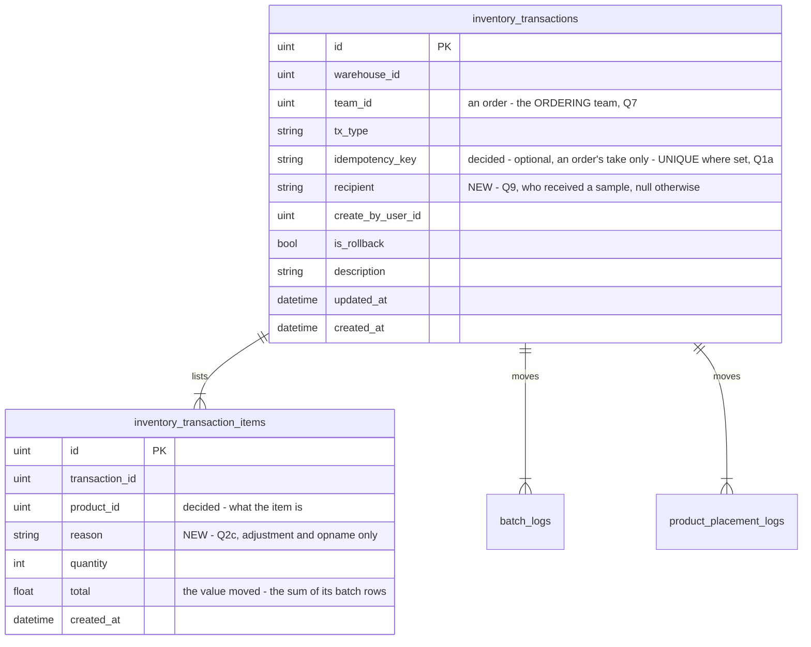
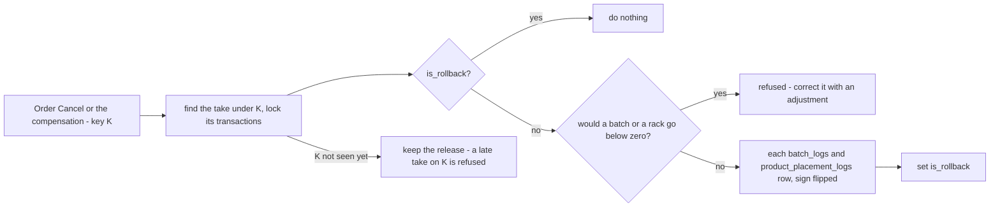
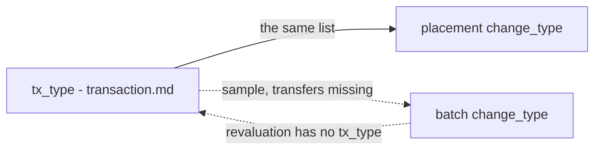
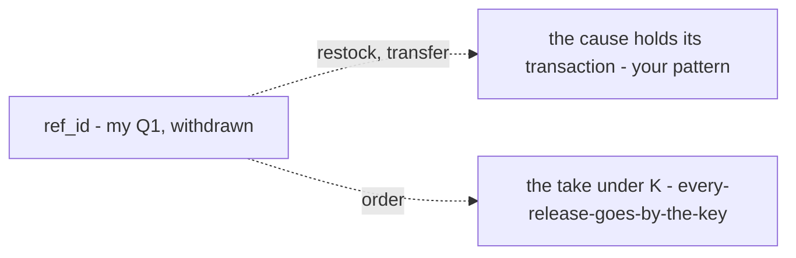
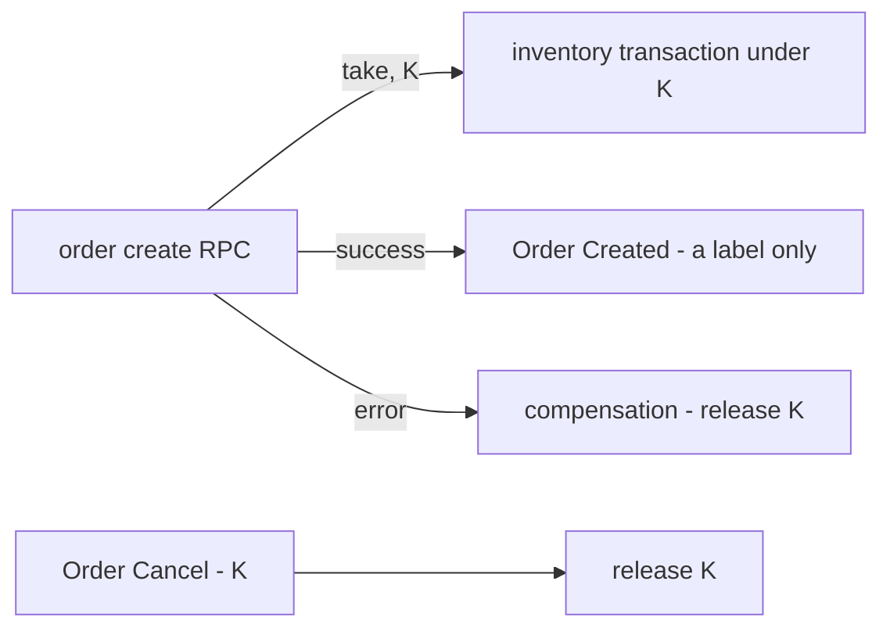

# Clarify — `inventory/transaction.md`

[transaction.md](./transaction.md) is yours — this one is mine. An answered point is deleted; what you settle is recorded
in [transaction_decision.md](./transaction_decision.md).

> 🔄 **Re-examined 2026-10-15 — the order keeps ONE `transaction_id`**
> ([an-order-is-one-inventory-transaction](../order/context_decision.md#an-order-is-one-inventory-transaction)): an order's
> take is one transaction, even when it holds two owners' goods. 🔄 **Q1:** the key can be UNIQUE on your column now, so my
> recommendation moves from b (`inventory_take_keys`) to **a**. 🔄 **Q7:** recommend the **ordering** team, reversing *the
> owner*. ⛔ One contradiction: `one-order-one-transaction-met-one-per-owner`.
> ✅ **Then your edit:** items carry `product_team_id` and `is_owned`
> ([an-item-carries-its-owning-team](./transaction_decision.md#an-item-carries-its-owning-team)) — Q7's item half. Its
> header half is left to confirm. ✅ **And confirmed in chat:** the ordering team, B
> ([an-order-transaction-is-the-ordering-teams](./transaction_decision.md#an-order-transaction-is-the-ordering-teams)) —
> Q7 closes, and `one-order-one-transaction-met-one-per-owner` is resolved by that decision's amendment and deleted.
>
> 🔄 **Narrowed by your edit (2026-10-12):** Q2. `product_id` is on `inventory_transaction_items`
> ([an-item-names-its-product](./transaction_decision.md#an-item-names-its-product)). Left: where an item's total comes
> from (2b), which way a count's item points (2c), and what else reads it (2d). ✅ Then 2b, in chat, as recommended
> ([an-item-equals-its-batch-rows](./transaction_decision.md#an-item-equals-its-batch-rows)).
>
> 🔄 **Narrowed by your edit (2026-10-12):** Q1. `idempotency_key` is on `inventory_transactions`, orders only
> ([an-orders-take-carries-its-idempotency-key](./transaction_decision.md#an-orders-take-carries-its-idempotency-key)). What
> is left is how *one take per key* is enforced when two owners' rows share the key, and where a release that arrives first
> goes. Your heading rename breaks no link.
>
> 🔄 **Re-examined after merging `dev` (2026-10-12): the idempotency key.** Order creation takes stock inside the create
> call, before the order exists, and inventory knows that take only by its key K
> ([every-release-goes-by-the-key](../order/context_decision.md#every-release-goes-by-the-key)). 🔄 **Q1 rewritten:** my
> `ref_id` is **withdrawn**. Inside inventory the record that causes a change already holds its transaction, and an order is
> found by K, so what is left is where *one take per key* lives. Q8 gains a line: the verify scan names the take by K too.
> Two contradictions recorded: [q1-ref-id-is-overtaken](#q1-ref-id-is-overtaken) and
> [the-flow-takes-on-order-created](#the-flow-takes-on-order-created). Q2–Q5, Q7 and Q9 re-checked: unchanged.
>
> ✅ **Answered 2026-10-12, in chat:** Q6, who bears a sample — nobody pays anybody: a sample is a stock-out at batch value
> from the owning team's stock, with no agreement asked
> ([a-sample-is-a-stock-out-at-batch-value](./transaction_decision.md#a-sample-is-a-stock-out-at-batch-value)), against my
> *named member, else the warehouse*. 🆕 **Opened:** Q9, where the sample's recipient is kept — the team is to see it, and no
> decided column holds it.
>
> 🆕 **Opened 2026-10-12:** Q8, where *picked* is stored, from [placement Q4](./placement_clarify.md#question).
>
> 🔄 **Narrowed 2026-10-12:** Q5. `move` was added in chat ([a-move-has-its-own-type](./transaction_decision.md#a-move-has-its-own-type)), so only `revaluation` and
> `opname` are left.
>
> 🔄 **Narrowed 2026-10-12:** Q6. What a sample is was answered in chat
> ([a-sample-is-handed-over-at-the-warehouse](./transaction_decision.md#a-sample-is-handed-over-at-the-warehouse)), so
> only who bears it is left.
>
> **First pass (2026-10-09)**, after you moved the transaction table here from context.md and added items and a rollback.
> Recorded: [a-transaction-lists-its-items](./transaction_decision.md#a-transaction-lists-its-items) (reverses the old
> *no items table*) · [a-transaction-is-made-when-the-act-happens](./transaction_decision.md#a-transaction-is-made-when-the-act-happens)
> (context Q13b) · [an-undo-rolls-the-transaction-back-once](./transaction_decision.md#an-undo-rolls-the-transaction-back-once)
> (context Q13e). ➡ **Re-routed here** from [context Q13](./context_clarify.md#question): 13a, 13c, 13d, 13f — and the
> [Contradiction](#the-two-type-lists-do-not-line-up) over `tx_type`. 🔄 **Withdrawn:** my 13g (*record the person on the
> transaction only*) — your rollback is the reason to keep `actor_id` on the log rows: under the original transaction, the
> log rows are what say **who** rolled it back and **when**.

Siblings: [context_clarify](./context_clarify.md) · [order_clarify](./order_clarify.md) · [opname_clarify](./opname_clarify.md) ·
[restock_clarify](./restock_clarify.md).

---

## Proposed Design

### the tables, with what I would add



### the rollback, reversing the log rows

Your flow, with one change: the reversal reads the **log rows**, which say which batch and which rack, instead of the
items, which do not.



---

## Critique

| | Problem | → Recommend |
| --- | --- | --- |
| **1** | 🔄 *(2026-10-12)* **The rollback cannot find an order's transaction.** Order Cancel and the compensation carry the key K, and nothing in `inventory_transactions` holds it. Inside inventory the cause already holds its transaction (`restocks.transaction_id`, `warehouse_transfers.outbound_transaction_id`), but the order is another service's, and inventory never learns its id | ✅ the key on the transaction, decided · how *once* is enforced — [Q1](#question) |
| **2** | 🔄 *(2026-10-12)* ✅ **An item names its product now.** What is left: for goods going out, the total comes from the batch choice, and an item of a count or an adjustment cannot say which way it went | the item equals its batch rows; a reason on two-way items — [Q2](#question) |
| **3** | **The rollback reverses from the items, and the items cannot say where the units came from.** An order of 3 took 2 from batch 7 and 1 from batch 9, 1 from Rak A and 2 from Rak B. Re-deriving that today, FIFO and fewest-first pick whatever is oldest and lowest **now** — a different batch at a different price, a different rack | reverse the **log rows** — [Q3](#question) |
| **4** | **A rollback can take stock below zero.** A restock of 10 is accepted, 6 are sold, then the restock is rolled back: the batch goes from 4 to −6 | refuse it — [Q4](#question) |

---

## Question

1. 🔄 *(2026-10-15, simplified by the order's one transaction)* **How is *a key buys one take, ever* enforced — and where
   does a release that arrives first go?** ✅ Where the key lives is answered: your `inventory_transactions.idempotency_key`,
   orders only ([an-orders-take-carries-its-idempotency-key](./transaction_decision.md#an-orders-take-carries-its-idempotency-key)),
   and no `ref_id` ([q1-ref-id-is-overtaken](#q1-ref-id-is-overtaken)). ➡ Was [context Q13a](./context_clarify.md#question).
   🔄 **The order keeps ONE `transaction_id`**
   ([an-order-is-one-inventory-transaction](../order/context_decision.md#an-order-is-one-inventory-transaction)), so an
   order's take is one row and the key **can be UNIQUE** here — the reason I gave against the column alone, two owners'
   rows sharing one key, is gone.

   | the order docs decided | how the column does it now |
   | --- | --- |
   | a second take on a seen key is refused ([inventory-takes-a-key-once](../order/context_decision.md#inventory-takes-a-key-once)) | `UNIQUE (idempotency_key)` where set — the second insert fails |
   | a release on an unseen key is kept, so a late take is refused | the release writes an empty, rolled-back `order` row under K — the late take's insert fails on the same index |

   **The race it has to survive.** The take call times out on the order's side, so the order gives up and sends the
   compensation, which reaches inventory before the take commits. With the index, exactly one insert under K wins: if the
   take wins, the release finds it and rolls it back; if the release wins, the take is refused. Nothing is taken for an
   order that does not exist.

   | | how | + | − |
   | --- | --- | --- | --- |
   | **a** | your column, **UNIQUE where set**; a release that comes first writes an empty, rolled-back `order` row under K, carrying the ordering team | no new table — the database holds *once* | an empty row in the history: `is_rollback`, no items |
   | **b** | your column, plus `inventory_take_keys`: the key as primary key, the ordering team, `released_at` | the same guarantee | a second table saying what the column now can |

   **→ Recommend a.** 🔄 **This reverses my b** — b existed only because two owners' rows shared one key. The empty row's
   team is the ordering team, which is what every order transaction carries ([Q7](#question)), so it is no longer the one
   row where `team_id` means something else.

   ```mermaid
   sequenceDiagram
     participant O as order service
     participant I as inventory
     participant T as inventory_transactions
     O->>I: take, key K, the ordering team
     I->>T: insert ONE order transaction under K
     Note over I,T: K already there, taken or released - refused as a used key
     O->>I: release K - Order Cancel or InventoryTxCancel
     I->>T: the take under K - reverse it, set is_rollback
     Note over I,T: K not seen - insert an empty, rolled-back row under K
   ```
2. 🔄 *(2026-10-12, narrowed by your edit)* **What is an item's total, which way does it point, and what reads it?**
   ([Critique 2](#critique)) ✅ *What it is* is answered: one per product, with `product_id`
   ([an-item-names-its-product](./transaction_decision.md#an-item-names-its-product)).

   | | Part | → Recommend |
   | --- | --- | --- |
   | **2b** | ✅ *(2026-10-12)* **Answered, as recommended** — [an-item-equals-its-batch-rows](./transaction_decision.md#an-item-equals-its-batch-rows) | — |
   | **2c** | **Which way?** The move decision keeps `quantity` positive and lets the type say the direction. That fails for the two types that go both ways in one transaction: a count finds *Kaos Hitam* 2 short and *Kaos Polos* 1 over — two positive items, and nothing says which was the loss | **positive everywhere, and `change_type` on every item** — the same field and list the log rows carry: the transaction's type, or inside an adjustment or a count, its reason. Signed quantities would break the decided move item (quantity 4, total 0). 🔄 *(2026-10-13)* The reasons now follow your stock-problem register ([a-loss-in-custody-is-a-stock-problem](./opname_decision.md#a-loss-in-custody-is-a-stock-problem)): `broken` · `lost` — counted or witnessed, told apart by the transaction type · `found` — a surplus that claimed a loss · `surplus` — one minted as new stock. My `short` / `over`, and the `shortage` / `surplus` pair from chat, are withdrawn |
   | **2d** | **What reads it** | a history line (*"3 Kaos Hitam, Rp 32.000"*) · the order's take answer, whose cost is the item's (`unit_cost = total ÷ quantity`, [inventory-computes-the-markup](../order/context_decision.md#inventory-computes-the-markup)) · the owning team's sample list · **not** the rollback, which reverses the log rows ([Q3](#question)). *Did you mean it for anything else?* |

   ```mermaid
   flowchart LR
     I["item - Kaos Hitam, 3, Rp 32.000"] -->|"equals"| B["batch_logs - batch 7 -2 -Rp 20.000, batch 9 -1 -Rp 12.000"]
     I -->|"equals, in units"| P["placement_logs - Rak A -1, Rak B -2"]
   ```
3. **Does a rollback reverse the items, or the log rows?** ([Critique 3](#critique))
   **→ Recommend: the log rows** — each `batch_logs` and `product_placement_logs` row of the transaction, sign flipped. The
   units go back to batch 7 and batch 9 at their own prices, to Rak A and Rak B, exactly as they left. The items are then
   only checked against them.
4. **What if a rollback would take a batch or a rack below zero?** ([Critique 4](#critique)) 🔄 *(2026-10-10)* **The rack
   half is forced now** — [a-shelf-never-goes-below-zero](./placement_decision.md#a-shelf-never-goes-below-zero) puts a
   database check on `stock_count`, so a rollback that would go below zero on a rack fails. What is left is the batch.
   **→ Recommend: refuse it**, and correct with an `adjustment` instead. An order's rollback never hits this — it puts units
   back, and [no-cancel-after-the-warehouse-confirms](./order_decision.md#no-cancel-after-the-warehouse-confirms) means they
   were never picked.
5. 🔄 *(2026-10-12)* **Operations with no `tx_type`.** ✅ `move` is added ([a-move-has-its-own-type](./transaction_decision.md#a-move-has-its-own-type)). ➡ Was
   [context Q13c](./context_clarify.md#question). A revaluation and a count each write ledger rows and have no type.
   **→ Recommend:** add **`revaluation`** and **`opname`**, not `adjustment` for both: a revaluation moves no units, and a
   count can create a debt that a reader must be able to tell from a broken or lost unit.
6. ✅ *(2026-10-12)* **Answered** — [a-sample-is-a-stock-out-at-batch-value](./transaction_decision.md#a-sample-is-a-stock-out-at-batch-value).
7. ✅ *(2026-10-15)* **Answered: the ordering team, B** — [an-order-transaction-is-the-ordering-teams](./transaction_decision.md#an-order-transaction-is-the-ordering-teams), with the item half in [an-item-carries-its-owning-team](./transaction_decision.md#an-item-carries-its-owning-team).

8. 🆕 *(2026-10-12, from [placement Q4](./placement_clarify.md#question))* **Where is *picked* stored?**
   [the-verify-scan-tells-inventory-picked](./order_decision.md#the-verify-scan-tells-inventory-picked) says a unit waits
   on the rack while *"an order's take has no picked yet"*, and no table holds *picked*. A count needs it to know what
   is still physically on a rack ([opname Q10b](./opname_clarify.md#question)); the rack screen does not, for now
   ([a-rack-shows-its-stock-count-for-now](./placement_decision.md#a-rack-shows-its-stock-count-for-now)). A transfer out waits the same way, until Warehouse A processes it.
   **→ Recommend: `picked_at`** on `inventory_transactions`, null while the units are still on the rack. The verify scan
   sets it for an order, and `process` for a transfer out. Every other take is at the shelf, so it is set at create.
   Waiting on a rack is then that transaction's log rows on the rack, not rolled back, with `picked_at` null.
   🔄 *(2026-10-13)* **One reason fewer:** the count no longer needs it — expected is the book figure
   ([expected-is-the-book-figure](./opname_decision.md#expected-is-the-book-figure)). What still does:
   [a-placement-deletes-only-when-nothing-waits-on-it](./context_decision.md#a-placement-deletes-only-when-nothing-waits-on-it),
   which refuses to delete a rack while a taken unit still waits on it to be picked.
   🔄 *(2026-10-12)* The verify scan names the order's take **by K** (`orders.idempotency_key`), as a release does — inventory
   never learns the order id ([Q1](#question)).

   ```mermaid
   flowchart LR
     O["order 9001 - PostOrder"] -->|"picked_at null - waiting"| S["verify scan"]
     S -->|"picked_at 13:40"| D["off the rack"]
     T["transfer out"] -->|"picked_at null - waiting"| P["Warehouse A processes"]
     P -->|"picked_at set"| D
   ```

9. 🆕 *(2026-10-12, from [a-sample-is-a-stock-out-at-batch-value](./transaction_decision.md#a-sample-is-a-stock-out-at-batch-value))*
   **Where is a sample's recipient kept?** The team is to see who received each sample of its goods, and
   `RackSample.recipient` is required on the request — but `inventory_transactions` has no column for it, so today it would
   be dropped at the ledger.

   | | where | + | − |
   | --- | --- | --- | --- |
   | **a** | 🆕 `recipient`, nullable, on `inventory_transactions`; set by a sample only | the team's history shows it as its own fact; the staff's note stays the note | a column most rows leave empty |
   | **b** | written into `description` | no new column | `RackSample` already has both a recipient and a note, so one of them is squeezed into the other, and the history cannot show *who received it* on its own |

   **→ Recommend a.** Who received the goods is the one fact the team checks a sample by — it is what makes the decision's
   guard ("the team sees it") a guard.

   ```mermaid
   flowchart LR
     D["Record Sample - recipient Budi, note for a review video"] --> T["inventory_transactions - sample"]
     T -->|"a"| R["recipient Budi - description for a review video"]
     T -.->|"b"| X["description - Budi, for a review video"]
     R --> H["Melati's history - to Budi"]
   ```

---

# Contradiction

## the-two-type-lists-do-not-line-up

➡ *(2026-10-09)* **Moved here** from [context_clarify](./context_clarify.md#the-two-type-lists-do-not-line-up), because
`tx_type` now lives in this doc.

| | `tx_type` — [transaction.md](./transaction.md) | `change_type` — [placement.md](./placement.md) | `change_type` — [batch.md](./batch.md) |
| --- | --- | --- | --- |
| `order` · `restock` · `return` · `adjustment` | ✅ | ✅ | ✅ |
| `sample` · `transfer_in` · `transfer_out` | ✅ | ✅ | ❌ — a sample's or a transfer's batch row has no valid type. 🔄 *(2026-10-10)* More pressing now: batch.md mints a batch on transfer in, and that batch's first row has no type |
| `revaluation` | ❌ — no transaction type | ❌ | ✅ |
| `broken` · `lost` | — | — | ✅ — reasons inside an `adjustment`, fine |

**→ Recommend** one list, kept here, that both ledger docs point at: every `tx_type`, plus the reasons an `adjustment`
carries (`broken`, `lost`, `found`). A log row writes its transaction's type — or, inside an adjustment, its reason. The
placement side already does exactly this.



## q1-ref-id-is-overtaken

*(2026-10-12)* My Q1 recommended one `ref_id` for every kind of cause. Two things say otherwise:

| where | says |
| --- | --- |
| my Q1, 2026-10-09 | `ref_id` = the order's, restock's, return's or transfer's id; *Order Canceled* finds `tx_type = order, ref_id = 9001` |
| your [restock.md](./restock.md) and [warehouse_transfer.md](./warehouse_transfer.md) | the cause holds its transaction: `restocks.transaction_id`, `outbound_transaction_id`, `inbound_transaction_id` — already there when I wrote Q1 |
| [every-release-goes-by-the-key](../order/context_decision.md#every-release-goes-by-the-key), 2026-10-12 | the take runs before the order exists, so inventory *"never learns an order id"*, and a release goes by K |

Your pattern and the decision are right; my recommendation duplicated the first and cannot do the second. **Fixed in
[Q1](#question)**, nothing for you to edit.

**→ Recommend:** before proposing a link column, look for the same link already drawn from the other side.



## the-flow-takes-on-order-created

*(2026-10-12, found when `dev` merged)*

| where | says |
| --- | --- |
| [transaction.md](./transaction.md) §Transaction Flow Related | *Order Created* → **call** → New Inventory Transaction · *Order Canceled* → rollback |
| [order_creation.md](../order/order_creation.md) | the create RPC calls inventory *"for take stock & placement, and bring idempotency key"* **inside** its database transaction; then *Order Created Event* on success, *Inventory Tx Cancel Compensate Event* on error, both with the key |
| [every-release-goes-by-the-key](../order/context_decision.md#every-release-goes-by-the-key) | K on *Order Created* is *"needed by nothing that releases stock"* |

**order_creation.md is right.** The take has to be a call: it returns the subtotal the order is priced from. Your flow names
the event that comes **after** the order commits. Read literally, it builds the take as a subscriber to *Order Created*,
which returns no subtotal and takes the stock only after the order is already saved. And the compensation, a second way to
roll back, is not drawn.

**→ Recommend:** in [transaction.md](./transaction.md), rename *Order Created* to *Order Create RPC — take, with K*, and give
the rollback two triggers, *Order Cancel* and the compensation, both carrying K. The verdict of
[a-transaction-is-made-when-the-act-happens](./transaction_decision.md#a-transaction-is-made-when-the-act-happens) still holds;
only the node it quoted is stale.



