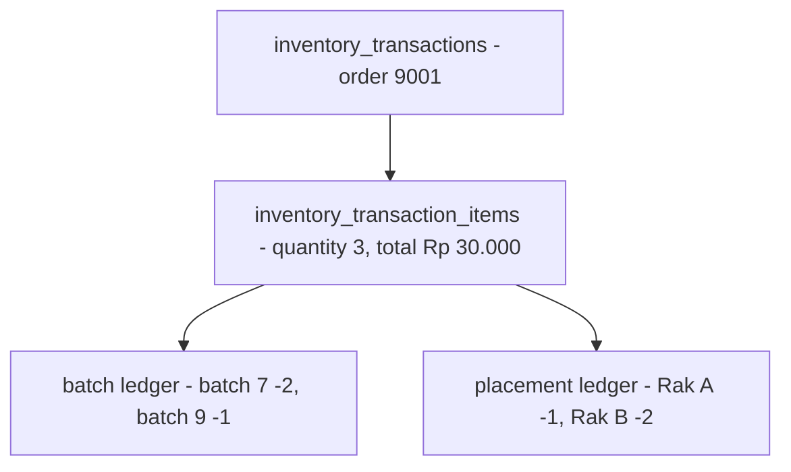
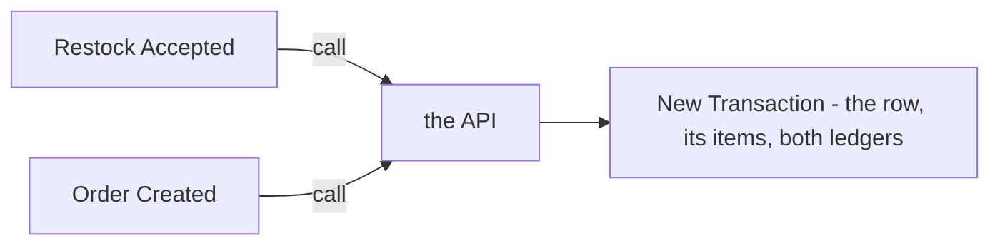
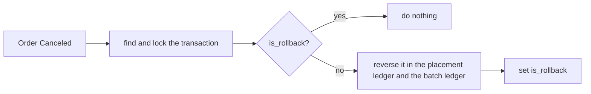
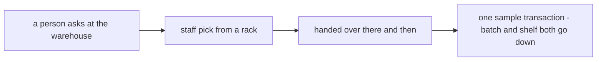
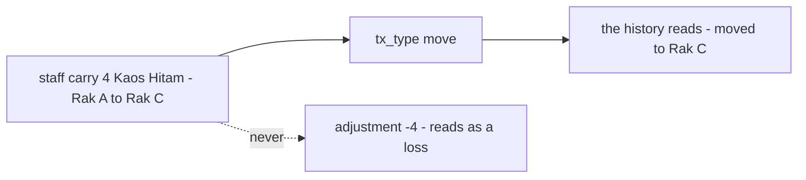
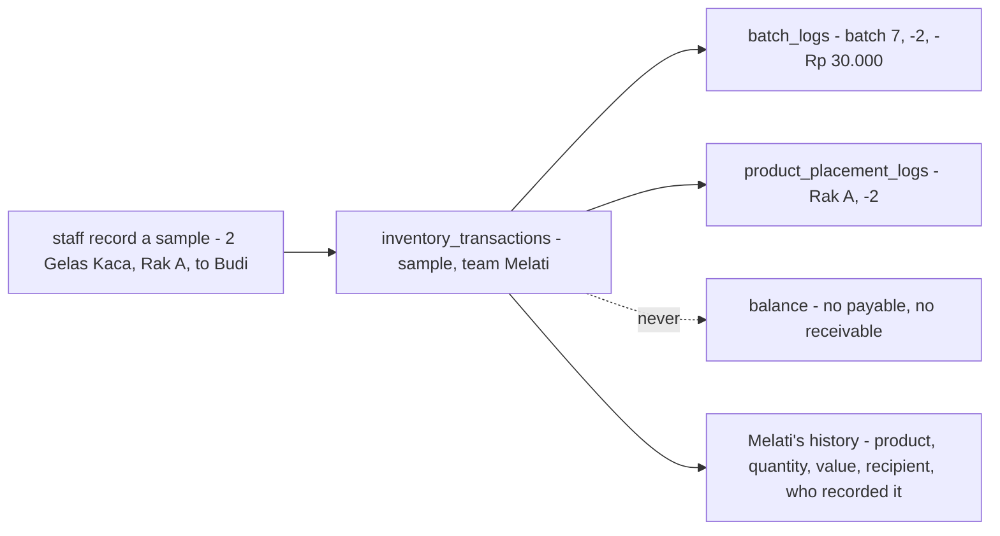
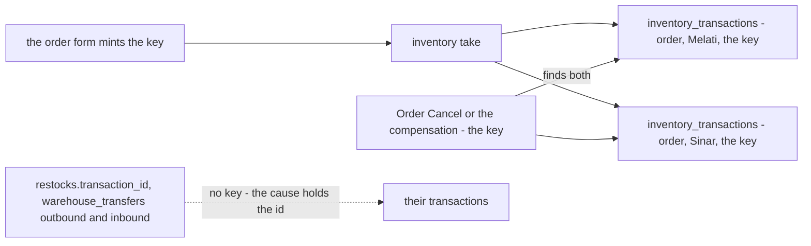
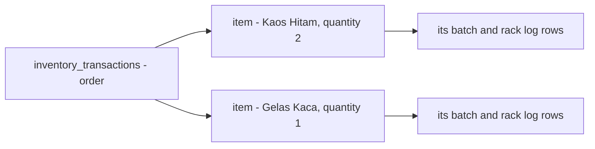
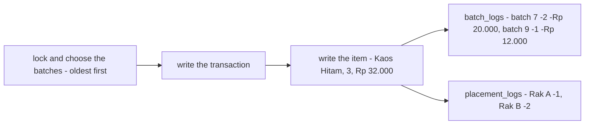

# Decisions — `inventory/transaction.md`

What the owner settled, recorded before it is acted on. **Append-only** — a decision that is later reversed is renamed
and its references grepped (RULE 12), never quietly edited away. The open set is [transaction_clarify.md](./transaction_clarify.md).

| decision | says | from |
| --- | --- | --- |
| [a-transaction-lists-its-items](#a-transaction-lists-its-items) | `inventory_transaction_items` is back — a transaction lists its items, each with a quantity and a total | your transaction.md, 2026-10-09 — **reverses** the *no items table* row of [every-stock-change-belongs-to-a-transaction](./context_decision.md#every-stock-change-belongs-to-a-transaction) |
| [a-transaction-is-made-when-the-act-happens](#a-transaction-is-made-when-the-act-happens) | *Restock Accepted* and *Order Created* each call the API, which creates a new transaction then and there | your transaction.md, 2026-10-09 — answers context Q13b, as recommended |
| [an-undo-rolls-the-transaction-back-once](#an-undo-rolls-the-transaction-back-once) | an undo finds and locks the existing transaction, reverses it in both ledgers and sets `is_rollback`; a second undo does nothing | your transaction.md, 2026-10-09 — answers context Q13e, against my new reversing transaction |
| [a-sample-is-handed-over-at-the-warehouse](#a-sample-is-handed-over-at-the-warehouse) | a sample is goods going OUT: a person asks at the warehouse, staff pick the goods and hand them over | chat, 2026-10-12 — answers placement Q1a and the *what is it* half of Q6; my *asked ahead in the app* is withdrawn |
| [a-move-has-its-own-type](#a-move-has-its-own-type) | `move` joins the `tx_type` list: goods carried between racks, never typed `adjustment` | chat, 2026-10-12 — answers placement Q3a choice 1 and the `move` part of Q5, as recommended |
| [an-orders-take-carries-its-idempotency-key](#an-orders-take-carries-its-idempotency-key) | an order's inventory transactions carry the idempotency key the order was created with — optional, orders only for now; no `ref_id` | your transaction.md edit, 2026-10-12 — answers *where the key lives* in Q1; my `ref_id` withdrawn |
| [an-item-names-its-product](#an-item-names-its-product) | `inventory_transaction_items` gains `product_id`: one item per product per transaction | your transaction.md edit, 2026-10-12 — answers 2a of Q2, as recommended |
| [an-item-equals-its-batch-rows](#an-item-equals-its-batch-rows) | an item's total is what its batch rows moved — paid for goods in, chosen oldest first for goods out — and every mutation asserts the item equals its rows | chat, 2026-10-12 — answers 2b of Q2, as recommended |
| [a-sample-is-a-stock-out-at-batch-value](#a-sample-is-a-stock-out-at-batch-value) | a sample is a stock-out and nothing more: its units and their batch value leave the owning team's stock; no money moves, nobody has to agree, and the team sees every sample of its goods | chat, 2026-10-12 — answers Q6, **against** my *the team bears it only when a named member agreed* |

---

## a-transaction-lists-its-items

> Owner, in [transaction.md](./transaction.md) §General Table That Must Have *(2026-10-09)*: `inventory_transaction_items`
> with `id`, `warehouse_id`, `transaction_id`, `quantity`, `total`, `created_at` — and the flow creates them between the
> transaction and the two ledgers. ⚠ **It reverses** the spec row *"`inventory_transaction_items` — none"* in
> [every-stock-change-belongs-to-a-transaction](./context_decision.md#every-stock-change-belongs-to-a-transaction). That
> decision's name — every stock change belongs to a transaction — still holds; only its items row is overtaken.

**The verdict.** A transaction says, in its own rows, **what** it moved — a quantity and a total per item — before the
two ledgers say **where from**: which batches, which racks.

**The spec.**

| | |
| --- | --- |
| `inventory_transaction_items` | `id` · `warehouse_id` · `transaction_id` · `quantity` · `total` · `created_at` |
| written | after the transaction row, before either ledger, in the same database transaction |

**What it does NOT settle** — [transaction_clarify Q2, Q3](./transaction_clarify.md#question): an item names no product ·
what reads the items · and that a rollback cannot reverse from them, since they do not say which batch or rack.

## a-transaction-is-made-when-the-act-happens

> Owner, in [transaction.md](./transaction.md) §Transaction Flow Related *(2026-10-09)*: *Restock Accepted* → *call* →
> *Api* → *New Transaction*; the same for *Order Created*. It answers [context Q13b](./context_clarify.md#question) — *is
> the transaction made at accept, or earlier?* — as recommended.

**The verdict.** A transaction is born when stock actually changes — the restock accepted, the order created — never when
a restock is merely planned. A restock cancelled or lost before it arrives leaves no transaction behind.

**The spec.**

| | |
| --- | --- |
| created by | the call from *Restock Accepted* or *Order Created* |
| inside one database transaction | the transaction row, its items, the placement ledger, the batch ledger |
| `restocks.transaction_id` | set at accept, when the transaction exists |

## an-undo-rolls-the-transaction-back-once

> Owner, in [transaction.md](./transaction.md) *(2026-10-09)*: `is_rollback` and `description` on
> `inventory_transactions`; *Order Canceled* → *Api* → *Rollback Transaction* — *"find and lock existing Inventory
> Transaction"*, *if not rollback* get its items and post to both ledgers, then *"update field `is_rollback`"*; *if
> rollbacked*, *"Do Nothing"*. It answers [context Q13e](./context_clarify.md#question) — *how is a mistake undone?* —
> **against my recommendation** of a new transaction with `reverses_id`.

**The verdict.** An undo is the **same transaction, rolled back**: locked, reversed in both ledgers, and marked. Because
the mark is checked under the lock, an undo runs **once** — a cancel event delivered twice does nothing the second time,
which is exactly what [inventory-returns-stock-on-order-cancelled](../order/context_decision.md#inventory-returns-stock-on-order-cancelled)
asked for.

**The spec.**

| | |
| --- | --- |
| `inventory_transactions.is_rollback` | 🆕 set once, by the rollback |
| `inventory_transactions.description` | 🆕 |
| `updated_at` | kept — the rollback is what updates a transaction |
| triggered by | *Order Canceled* (and any later undo) |
| guard | the transaction row is locked, then `is_rollback` is checked — a second rollback does nothing |

**What it does NOT settle** — [transaction_clarify.md](./transaction_clarify.md): how *Order Canceled* finds the
transaction for order 9001 (Q1) · reversing from the log rows rather than the items (Q3) · a rollback that would take a
batch or a rack below zero (Q4).

## a-sample-is-handed-over-at-the-warehouse

> Owner, in chat *(2026-10-12)*, answering [placement Q1a](./placement_clarify.md#question): *"sometimes random person
> need request sample product from warehouse. so warehouse staff pick goods and give the person."* It answers the *what is
> it* half of [transaction Q6](./transaction_clarify.md#question). My recommendation, that the selling team asks ahead in
> the app and the system picks like an order, is **withdrawn**: the request is made in person, at the warehouse.

**The verdict.** A `sample` is the owning team's units going **out** of the warehouse with no sale. A person asks at the
warehouse, warehouse staff pick the goods from a rack, and they hand them over there and then.

**The spec.**

| | |
| --- | --- |
| direction | out: the owning team's units leave the warehouse |
| who asks | a person at the warehouse |
| who picks | warehouse staff |
| how it leaves | by hand, there and then: no order, no marketplace, no courier |
| what follows | a free unit that **arrives** is not a `sample`; it stays a restock line at Rp 0, as built |

**What it does NOT settle**: which rack it is written against ([placement Q1](./placement_clarify.md#question)) · whether a
sample ever comes back (placement Q1) · who bears it, and whether the owning team has to agree first
([transaction Q6](./transaction_clarify.md#question)).

✅ *(2026-10-12)* All three are settled since: the rack and the return in
[placement_decision.md](./placement_decision.md#a-sample-names-the-rack-it-was-taken-from), who bears it in
[a-sample-is-a-stock-out-at-batch-value](#a-sample-is-a-stock-out-at-batch-value).

## a-move-has-its-own-type

> Owner, in chat *(2026-10-12)*: *"3a, use `move`, and choice 1"*, choosing the first of three choices offered for
> [placement Q3a](./placement_clarify.md#question): *a type of its own, `move`, or reuse `adjustment`?* It answers the
> `move` part of [transaction Q5](./transaction_clarify.md#question), as recommended.

**The verdict.** Carrying goods from one rack to another in the same warehouse is a transaction of its own type,
**`move`**. It is never written as an `adjustment`: a move changes where units sit and nothing else, and it never creates a
debt, while an adjustment says the count was wrong and can.

**The spec.**

| | |
| --- | --- |
| `inventory_transactions.tx_type` | gains `move` |
| `product_placement_logs.change_type` | gains `move`, the transaction's type, as for every other operation |
| `batch_logs.change_type` | does not need it: a move writes no batch row ([a-move-writes-two-rack-rows-and-no-batch-row](./placement_decision.md#a-move-writes-two-rack-rows-and-no-batch-row)) |
| money | none: a move is never a debt |

**What it does NOT settle**: `revaluation` and `opname`, the rest of [transaction Q5](./transaction_clarify.md#question) ·
⚠ the lists in [transaction.md](./transaction.md) and [placement.md](./placement.md) are yours to add `move` to.

## a-sample-is-a-stock-out-at-batch-value

> Owner, in chat *(2026-10-12)*, on [transaction Q6](./transaction_clarify.md#question): *"why selling team should pay ?
> isn't that we can just record stock out with qty and valuation out of warehouse as sample ?"* — then *"yes"* to the rule
> restated from it. **Against my recommendation**, which was that the team bears a sample only when a member of it is named
> as having agreed, and otherwise the warehouse owes the team for it.

**The verdict.** A sample is a **stock-out and nothing more**. Its units leave the rack and the batch, and its value leaves
with them, typed `sample`. No money moves between the warehouse and the team, and nobody on the team has to agree first.
The goods are the owning team's ([business_level.md](../business_level.md) §Warehouse 4: *"Ownership of stock is by selling
team"*), so the value that leaves is the team's — and **the team sees every sample of its goods** in its history.

**The spec.**

| | |
| --- | --- |
| the transaction | `tx_type` `sample`; `team_id` the owning team, one transaction per owning team ([a-sample-is-recorded-on-rack-detail](./placement_decision.md#a-sample-is-recorded-on-rack-detail)) |
| the batch side | oldest batch first, the value taken being the batch's, as for every take ([a-sample-names-the-rack-it-was-taken-from](./placement_decision.md#a-sample-names-the-rack-it-was-taken-from)) |
| the rack side | the rack staff took it from — same decision |
| the item | the quantity and the value taken ([Q2](./transaction_clarify.md#question)) |
| money | **none**: no balance entry, whoever records it and whoever receives it |
| agreement | **none required**: the Record Sample dialog has no *Agreed By* field |
| the team sees | every sample of its goods: product, quantity, value, recipient, and the staff member who recorded it (`create_by_user_id`, the log rows' `actor_id`) |
| withdrawn | my *named member, else the warehouse pays*, and with it the 7-day rejection by the team |

⚠ **The trade it accepts.** A unit lost in the warehouse's custody is the warehouse's debt
([in-custody-shortfall-is-the-warehouses](./context_clarify.md#in-custody-shortfall-is-the-warehouses)); a unit recorded as a
sample costs the warehouse nothing. So a shortfall recorded as a sample lands on the team, and the only guard is that the
team sees it. If that is ever abused, an optional *Agreed By* comes back as one nullable column — nothing stored today
changes.

**What it does NOT settle**: where the recipient is kept — `RackSample.recipient` is required on the request, and
[transaction.md](./transaction.md)'s `inventory_transactions` has no column for it ([Q9](./transaction_clarify.md#question)) ·
`batch_logs.change_type` still lacks `sample` ([the-two-type-lists-do-not-line-up](./transaction_clarify.md#the-two-type-lists-do-not-line-up)).

## an-orders-take-carries-its-idempotency-key

> Owner, in [transaction.md](./transaction.md) §General Table That Must Have in Transaction *(2026-10-12)*:
> *"`idempotency_key`, optional, its now only used for order"*, added to `inventory_transactions`. It answers *where the
> key lives* in [Q1](./transaction_clarify.md#question), after the merged order decisions made the key the only name an
> order's take has ([every-release-goes-by-the-key](../order/context_decision.md#every-release-goes-by-the-key)). **No
> `ref_id`** — my recommendation is withdrawn ([q1-ref-id-is-overtaken](./transaction_clarify.md#q1-ref-id-is-overtaken)).

**The verdict.** An order's inventory transactions carry the **idempotency key** the order was created with — the one
the browser mints, the take receives, and `orders.idempotency_key` keeps. A release (Order Cancel, the compensation) and
the verify scan find the take by it. Every other cause keeps your pattern: the record that causes the change holds its
transaction.

**The spec.**

| | |
| --- | --- |
| `inventory_transactions.idempotency_key` | optional · set on an `order` transaction only, for now |
| an order of two owners | each of its transactions carries the same key ([Q7](./transaction_clarify.md#question)) |
| `ref_id` | not added |
| restock, transfer | unchanged — `restocks.transaction_id`, `warehouse_transfers.outbound_transaction_id` / `inbound_transaction_id` |

**What it does NOT settle** — the rest of [Q1](./transaction_clarify.md#question): how *a key buys one take, ever* is
enforced, when two owners' rows share one key and so the key cannot be unique on this table · where a release that
arrives **before** its take is kept ([inventory-takes-a-key-once](../order/context_decision.md#inventory-takes-a-key-once)).

## an-item-names-its-product

> Owner, in chat *(2026-10-12)*: *"yes, i forgot `product_id` in `inventory_transaction_items`"* — and added it to
> [transaction.md](./transaction.md) §General Table That Must Have in Transaction. It answers 2a of
> [Q2](./transaction_clarify.md#question), as recommended.

**The verdict.** An item says **what** moved: one item per product per transaction, naming the product. An order of
2 *Kaos Hitam* and 1 *Gelas Kaca* is two items, each readable on its own, instead of two numbers of nothing in particular.

**The spec.**

| | |
| --- | --- |
| `inventory_transaction_items.product_id` | 🆕 required — the product the item moved |
| per transaction | one item per product; a move that empties a rack of three products writes three ([a-move-lists-its-units-at-zero-value](./placement_decision.md#a-move-lists-its-units-at-zero-value), which assumed this) |

**What it does NOT settle** — the rest of [Q2](./transaction_clarify.md#question): where an item's total comes from for goods
going out, and that it must equal its batch rows (2b) · which way a count's or an adjustment's item points (2c) · what else
reads the items (2d).

## an-item-equals-its-batch-rows

> Owner, in chat *(2026-10-12)*: *"for 2b i follow your recomedation"*. It answers 2b of
> [Q2](./transaction_clarify.md#question) — *for goods going out, the total is not known until the batches are chosen* — as
> recommended.

**The verdict.** An item's total is **what its batch rows moved**. For goods coming in it is what was paid, and the batch is
minted from it. For goods going out it is what the chosen batches give up, oldest first — a *result* of the batch choice,
not an input to it. So a mutation chooses before it writes, and the item it writes always equals its rows.

**The spec.**

| | |
| --- | --- |
| the order of work | lock and choose ([batches-lock-before-shelves-by-id](./context_decision.md#batches-lock-before-shelves-by-id)) → the transaction → the items, with their totals → the log rows; one database transaction |
| goods in | the item's total is what was paid; the batch is minted from it, `price_unit = total ÷ quantity` |
| goods out | the item's total is the value the chosen batches give up |
| the rule | per item, its **total** equals the value of its product's batch rows, and its **quantity** equals the units they moved — a move, which has no batch rows, counts the units off its source rack and totals 0 ([a-move-lists-its-units-at-zero-value](./placement_decision.md#a-move-lists-its-units-at-zero-value)) |
| proven by | each mutation's unit test asserts it |

**What it does NOT settle** — the rest of [Q2](./transaction_clarify.md#question): which way an item of a count or an
adjustment points (2c) · what else reads the items (2d).
