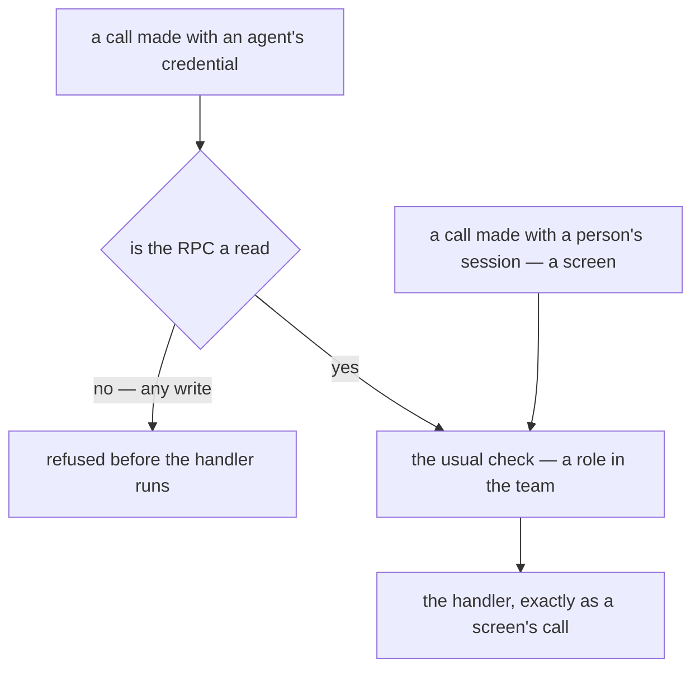
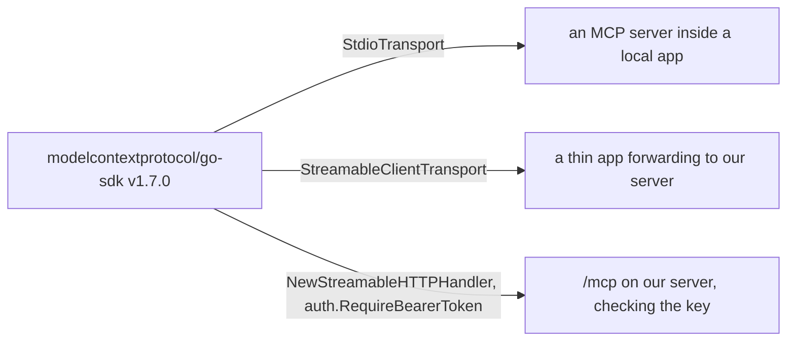
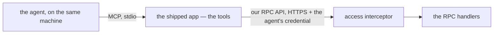
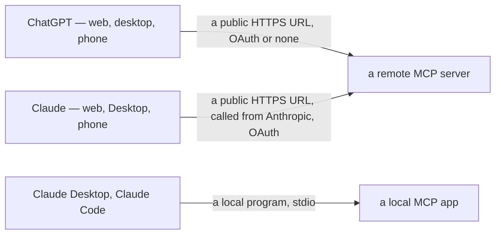
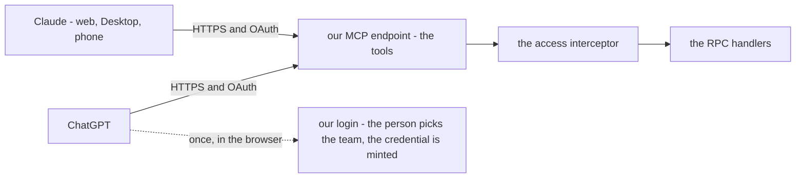
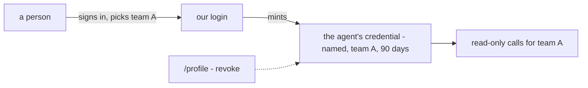
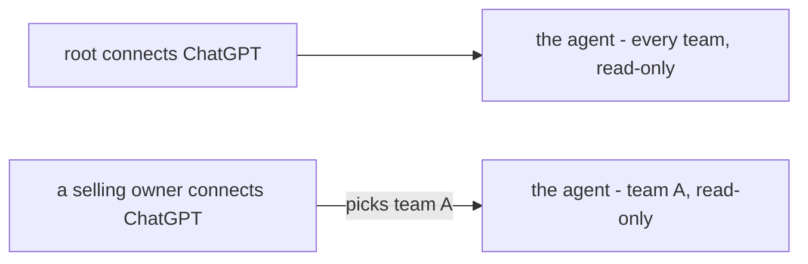
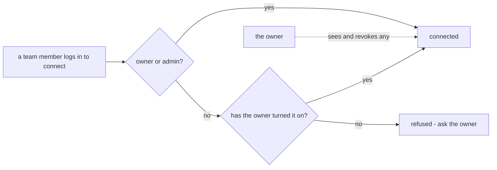
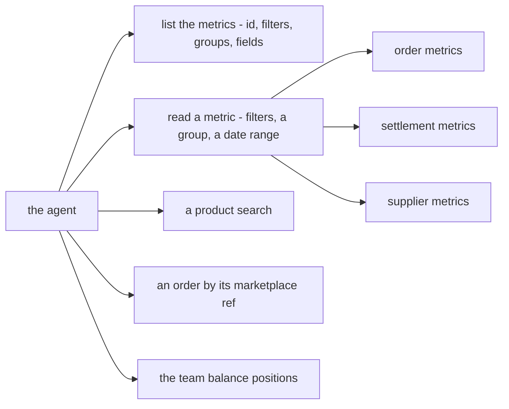
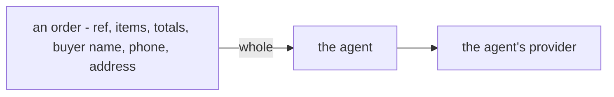

# Decisions — `mcp/context.md`

What the owner settled, recorded before it is acted on. **Append-only** — a decision that is later reversed is
renamed and its references grepped (RULE 12), never quietly edited away. The open set is
[context_clarify.md](./context_clarify.md).

| decision | what it decided | from | under review |
| --- | --- | --- | --- |
| [an-agent-only-reads-for-now](#an-agent-only-reads-for-now) | an AI agent reads and never writes — the server refuses any write made with an agent's credential | owner | [Q3](./context_clarify.md#question) — the credential · [Q6](./context_clarify.md#question) — which reads |
| [the-mcp-uses-the-official-go-sdk](#the-mcp-uses-the-official-go-sdk) | every MCP piece is built on the protocol's official Go SDK, whichever side it runs on | owner | ✅ the app's side — [the-tools-live-in-the-shipped-app](#superseded-the-tools-live-in-the-shipped-app) · [Q8](./context_clarify.md#question) may add the server's |
| [superseded-the-tools-live-in-the-shipped-app](#superseded-the-tools-live-in-the-shipped-app) | ~~the tools live in the app shipped to users~~ — reversed by [our-server-hosts-the-mcp](#our-server-hosts-the-mcp) | owner | — |
| [our-server-hosts-the-mcp](#our-server-hosts-the-mcp) | the MCP is served by our server at a public URL, behind an OAuth login; nothing is installed, and the shipped app goes | owner | — |
| [an-agent-gets-its-own-team-credential](#an-agent-gets-its-own-team-credential) | the login mints the agent its own credential — named, one team, 90 days, revoked on its own; never the password or the session token | owner | — |
| [a-roots-agent-reads-every-team](#a-roots-agent-reads-every-team) | an agent connected by root keeps root's bypass and reads every team; everyone else's agent reads one | owner | — |
| [the-owner-decides-who-connects-an-agent](#the-owner-decides-who-connects-an-agent) | the team's owner and admin may connect an agent; CS and staff only once the owner turns it on; the owner sees and revokes every connection | owner | — |
| [the-agent-reads-through-the-metric-pattern](#the-agent-reads-through-the-metric-pattern) | the first tools are the metric pattern — list the metrics, read a metric — plus a product search, an order by its ref, and the balance positions | owner | — |
| [buyer-data-reaches-the-agent](#buyer-data-reaches-the-agent) | an order reaches the agent whole, the buyer's name, phone and address included — nothing is cleared | owner | — |
| [chatgpt-and-claude-are-the-agents-for-now](#chatgpt-and-claude-are-the-agents-for-now) | the agents to serve, for now, are ChatGPT and Claude | owner | ✅ reached by [our-server-hosts-the-mcp](#our-server-hosts-the-mcp) |

## an-agent-only-reads-for-now

> Chat *(owner, 2026-09-29)* — *"for 1, for now, agent only read, cannot run destructive action"*, to
> [Q1](./context_clarify.md#question) — read-only, as recommended.

**The verdict.** For now, an agent connected through the MCP **only reads**. It runs no write at all: none of the
destructive ones your answer names (cancel, delete, a stock adjustment), and none of the harmless-looking ones
either (a draft, a note), since *only read* excludes both. ⚠ My reading of *cannot*: **the server refuses the call**.
A tool list that simply leaves writes out is not *cannot*, because anyone holding the credential can call the API
directly, around the MCP.



### The spec

| | |
| --- | --- |
| what counts as a read | ⚠ my spec: an RPC declared `option idempotency_level = NO_SIDE_EFFECTS;` — the standard proto marker. **No proto carries it today**, so each read is marked as it is offered to agents |
| where it is enforced | the access interceptor, on every call: an agent's credential on an RPC not so declared → `PermissionDenied`, before the handler runs. A person's session is unaffected |
| a read with a side effect | is not a read, and stays unmarked — `CheckAccess` renews a token · beside settlement's report reads, `AnalyticReplayCompute` rebuilds the reports and `AnalyticMaintenanceRun` prunes a table |
| what the agent is told | every tool is listed with MCP's `readOnlyHint: true`. A hint that lets the agent skip asking the person, never the enforcement |
| *for now* | a write later is its own decision, RPC by RPC, with the person confirming in the agent before it runs. Nothing is built to anticipate one |

### What it does NOT settle

- **The credential** — [Q3](./context_clarify.md#question). ⚠ But this rules out the session token: it carries every
  write the person may make, so the agent needs a credential of its own.
- **Which reads** — every read, or only those offered as tools: [Q6](./context_clarify.md#question).
- **Whose data** — one team per credential, and the root bypass: [Q4](./context_clarify.md#question).
- ⚠ **Reading is not harmless.** This limits what an agent can *do*, not what it can *send*: every row it reads goes
  to its provider. That is still [Q5](./context_clarify.md#question) and [Q7](./context_clarify.md#question).

## the-mcp-uses-the-official-go-sdk

> `context.md` §General 3 *(owner, 2026-09-29)* — *"we use `https://github.com/modelcontextprotocol/go-sdk`"*.

> 🔄 *(2026-09-29, later)* [the-tools-live-in-the-shipped-app](#superseded-the-tools-live-in-the-shipped-app) put the tools in
> the shipped app: the piece used is `StdioTransport`, and there is no `/mcp` for `auth.RequireBearerToken` to guard —
> our access interceptor checks the credential. [Q8](./context_clarify.md#question) may bring `/mcp` back.

**The verdict.** Every MCP piece of this context is built on the protocol's official Go SDK, whichever side it runs
on. It is already a dependency: [go.mod](../../../go.mod) pins it at v1.7.0 for `san remote mcp`.



### The spec

| | |
| --- | --- |
| the module | `github.com/modelcontextprotocol/go-sdk`, one version for the whole repo — the one `go.mod` pins. An upgrade for `san remote` is an upgrade for this, and the reverse |
| what it gives | both transports — stdio for a program on the user's machine, Streamable HTTP for an endpoint on ours — and the client side a thin app forwards with. **It builds every option in [Q2](./context_clarify.md#question), so it does not answer Q2** |
| auth | `auth.RequireBearerToken` checks a bearer on `/mcp` — enough for an agent key ([Q3](./context_clarify.md#question)). **It issues no token**: its OAuth code is for clients and for checking a token, so a login for web agents is a server of ours |
| ⚠ its localhost guard | a request arriving on a loopback address with a non-loopback `Host` is refused with 403 — what `san remote` met behind a tunnel ([san.md](../../tools/san.md#putting-a-tunnel-in-front)). A proxy on the same host in front of `/mcp` would meet it too; `DisableLocalhostProtection` is the switch |
| shared with `san remote` | the library only — never code, never tools ([Contradiction](./context_clarify.md#contradiction)) |

### What it does NOT settle

- **Which protocol crosses to us, and so where the tools live** — [Q2](./context_clarify.md#question). The SDK builds
  every option alike.

## superseded-the-tools-live-in-the-shipped-app

> ⚠ **Superseded 2026-10-31** by [our-server-hosts-the-mcp](#our-server-hosts-the-mcp): ChatGPT reaches only a public URL,
> so the tools moved to our server. Kept as written below.

> Chat *(owner, 2026-09-29)* — *"for 2a, we use A"*, to [Q2](./context_clarify.md#question) — against my
> recommendation, B. ⛔ It conflicts with [chatgpt-and-claude-are-the-agents-for-now](#chatgpt-and-claude-are-the-agents-for-now),
> decided in the same message — [Q8](./context_clarify.md#question).

**The verdict.** The MCP's tools live in the app shipped to users. It runs on the user's machine, speaks MCP to the
agent over stdio, and calls our RPC API directly — the way the web app does. Our server serves **no** MCP endpoint:
it stays Connect RPC only.



### The spec

| | |
| --- | --- |
| the app | a Go program on [the-mcp-uses-the-official-go-sdk](#the-mcp-uses-the-official-go-sdk) — `StdioTransport` — started by the agent |
| its calls | Connect RPCs over HTTPS, the agent's credential ([Q3](./context_clarify.md#question)) as the bearer — through the same interceptor as a screen's call, so [an-agent-only-reads-for-now](#an-agent-only-reads-for-now) holds unchanged |
| its tools | compiled in — the RPCs offered to agents ([Q6](./context_clarify.md#question)), read from the descriptors linked into the binary |
| our server | no `/mcp`, and no MCP dependency |
| ⚠ what it accepts | every installed copy speaks our proto contract: a breaking RPC change breaks every user who has not updated · a new tool reaches a user only in a new app · a build per OS |
| ⚠ what it reaches | an agent that starts a local program — Claude Desktop, Claude Code. **Not ChatGPT, and not Claude in a browser or on a phone** |

### What it does NOT settle

- ⛔ **ChatGPT** — it cannot reach the app: [Q8](./context_clarify.md#question).
- **How an old copy learns it is old** — whether the server refuses an outdated app, and how the user gets the new one.
- **How the app reaches a user** — a download, or a Claude Desktop extension.

## chatgpt-and-claude-are-the-agents-for-now

> Chat *(owner, 2026-09-29)* — *"for 2b for now we use chatgpt and claude"*, to [Q2](./context_clarify.md#question).
> ⛔ It conflicts with [the-tools-live-in-the-shipped-app](#superseded-the-tools-live-in-the-shipped-app) — [Q8](./context_clarify.md#question).

**The verdict.** For now, the agents the MCP has to serve are **ChatGPT** and **Claude**. Checked against both
vendors' docs (2026-09-29), they reach an MCP server in different ways:



### The spec

| | |
| --- | --- |
| ChatGPT | a remote server only — SSE or streaming HTTP at a public HTTPS URL, logged in with OAuth or with nothing. No stdio, and nowhere to paste a key ([OpenAI — developer mode](https://developers.openai.com/api/docs/guides/developer-mode)) |
| Claude | a *custom connector* on every surface — a public URL called from Anthropic's cloud, even from Claude Desktop, logged in with OAuth ([Claude — custom connectors](https://support.claude.com/en/articles/11175166-get-started-with-custom-connectors-using-remote-mcp)) · Claude Desktop and Claude Code can also start a local program over stdio |
| *for now* | another agent later is a new decision |

### What it does NOT settle

- ⛔ **How ChatGPT is reached** — the shipped app cannot be: [Q8](./context_clarify.md#question).

## our-server-hosts-the-mcp

> Owner, in chat (2026-10-31): *"C"* — to [Q8](./context_clarify.md#question), *ChatGPT cannot reach the shipped app —
> which gives way?* As recommended. It reverses [superseded-the-tools-live-in-the-shipped-app](#superseded-the-tools-live-in-the-shipped-app)
> and keeps [chatgpt-and-claude-are-the-agents-for-now](#chatgpt-and-claude-are-the-agents-for-now).

**The verdict.** The MCP is served by **our server**, at a public HTTPS URL, behind an **OAuth login**. ChatGPT and every
Claude surface — web, Desktop, phone — connect by that URL; nothing is installed on the user's machine. The shipped local
app goes: an agent that can only reach the internet decides where the tools live, and Claude Desktop takes the same URL.



| | |
| --- | --- |
| where the tools run | on our server, beside the RPC handlers, through the same access interceptor — read-only ([an-agent-only-reads-for-now](#an-agent-only-reads-for-now)) |
| how an agent connects | by URL; the first call sends the person to our login in the browser, which mints the agent's credential |
| the login | ours — OAuth; the SDK issues no token. The biggest piece of work here |
| the SDK | the protocol's official Go SDK, unchanged ([the-mcp-uses-the-official-go-sdk](#the-mcp-uses-the-official-go-sdk)) |
| the shipped app | not built, and now not wanted |
| still open | what the login mints and its limits ([Q3](./context_clarify.md#question)), one team or the root bypass (Q4), who may connect (Q5), the first tools (Q6), buyer data (Q7) |

**What it replaces** (HARD RULE 11): [superseded-the-tools-live-in-the-shipped-app](#superseded-the-tools-live-in-the-shipped-app);
and [context.md](./context.md) §General 1 (*"we have local mcp app that shipped to user"*) and its flow's *Local MCP* box
are now stale — reported in the clarify's [the-doc-ships-a-local-app](./context_clarify.md#the-doc-ships-a-local-app).

⛔ **Not built.** No MCP server for users exists yet (`san remote mcp` serves the checkout to a coding agent, not a team's
data).

## an-agent-gets-its-own-team-credential

> Owner, in chat (2026-10-31): *"i follow your recomendation"* — to [Q3](./context_clarify.md#question), *what does the
> login give the agent?* As recommended.

**The verdict.** The OAuth login ([our-server-hosts-the-mcp](#our-server-hosts-the-mcp)) mints the agent **its own
credential** — never the person's password, never their session token, which carries every write an agent may not
make ([an-agent-only-reads-for-now](#an-agent-only-reads-for-now)).

```
ChatGPT → "add connector" → our URL
  → the browser opens our login → the person signs in and picks a team
  → we mint the agent's own credential → ChatGPT reads that team's data
```

| | |
| --- | --- |
| whose | the agent's own — read-only, refused on any write |
| named | by the person, at the login — *"ChatGPT, Heri's laptop"* |
| scope | **one team**, picked at the login ([Q4](./context_clarify.md#question) asks about root) |
| lifetime | **90 days**, then the person logs in again |
| revoke | each one on its own, from `/profile` — revoking one agent signs the person out of nothing else |



⛔ **Not built.**

## a-roots-agent-reads-every-team

> Owner, in chat (2026-10-31): *"no, root read all team is okay"* — to [Q4](./context_clarify.md#question), *does a
> credential read one team, and never with the root bypass?* Against my recommendation, one team for everyone.

**The verdict.** An agent connected by **root** keeps root's bypass: it reads **every team**, as root does everywhere
else. Everyone else's agent reads the **one team** picked at the login
([an-agent-gets-its-own-team-credential](#an-agent-gets-its-own-team-credential)). Still read-only, for root too
([an-agent-only-reads-for-now](#an-agent-only-reads-for-now)).



| | |
| --- | --- |
| root | the login offers *every team*; the credential carries the bypass |
| ⚠ my reading — the administrator | the root team's `ADMINISTRATOR` bypasses scope beside `ROOT` everywhere, so its agent does too |
| everyone else | one team, picked at the login |
| an owner of two selling teams | two connections — one per team |
| the cost, accepted | a root agent's credential reaches the whole business; it is still read-only, expires in 90 days and is revoked on its own |

⛔ **Not built.**

## the-owner-decides-who-connects-an-agent

> Owner, in chat (2026-10-31): *"i follow your recomendation"* — to [Q5](./context_clarify.md#question), *who may connect a
> team's data to an agent?* As recommended.

**The verdict.** Connecting an agent sends the team's data to the agent's provider, so it is the **owner's** decision. The
team's **owner and admin** may connect one; **CS and staff** only once the owner turns it on for the team. The owner sees
every connection reading the team and can revoke any — a member's too.

| who | may connect an agent to the team |
| --- | --- |
| the owner | yes |
| the admin | yes |
| CS, staff | only when the owner has turned it on for the team |
| root | yes — and its agent reads every team ([a-roots-agent-reads-every-team](#a-roots-agent-reads-every-team)) |



**Why not every member**, though [every-member-reads-every-metric-of-their-team](../analytic/rpc_provide_decision.md#every-member-reads-every-metric-of-their-team):
reading on the screen keeps the data inside the system; an agent sends it to a third party.

⛔ **Not built.**

## the-agent-reads-through-the-metric-pattern

> Owner, in chat (2026-10-31): *"i follow your recomendation"* — to [Q6](./context_clarify.md#question), *which data does the
> agent read first?* As recommended, against the list of 11 reads on file.

**The verdict.** The agent asks what the Analytic screen can answer, through the same pattern: **one pair of tools** —
*list the metrics* and *read a metric* — over every service that serves `MetricSearch` / `MetricData`. A metric describes
itself (its id, filters, groups and field stat types), so a new metric reaches the agent with **no new tool**. Beside the
pair, three reads the pattern has no seat for yet.



| | |
| --- | --- |
| the metric tools | the pattern of [rpc_provide.md](../analytic/rpc_provide.md), every service that serves it — order, settlement, supplier today |
| beside them | a product search and an order by its marketplace ref — the lookups that turn a name into an id; `LiabilityPositionList` — what the team owes and is owed |
| the rules | read-only; one team, or every team for root ([a-roots-agent-reads-every-team](#a-roots-agent-reads-every-team)); a year at most per range ([a-metric-reads-at-most-a-year](../analytic/rpc_provide_decision.md#a-metric-reads-at-most-a-year)); a rate limit per credential |
| not yet | stock and expenses — they reach the agent when each has a metric |
| replaces | the 11 reads in the clarify's *The first tools* (`OrderStat`, `ProductStockSummary`, `ExpenseDaily`, …) |

⛔ **Not built.**

## buyer-data-reaches-the-agent

> Owner, in chat (2026-10-31): *"buyer data is okay. no cleared. its not public system. its company system."* — to
> [Q7](./context_clarify.md#question), *may a buyer's name, phone or address reach the agent?* Against my recommendation, to
> clear them before anything leaves.

**The verdict.** Nothing is cleared. An order reaches the agent as the order holds it — the buyer's `customer_name`,
`customer_phone` and delivery address included. The people connecting an agent are the company's own, through a
login, to its own data; the system is not public.



| | |
| --- | --- |
| what reaches the agent | the order as it is read on the screen, buyer fields included |
| who can send it | only a credential the owner allowed ([the-owner-decides-who-connects-an-agent](#the-owner-decides-who-connects-an-agent)) — read-only, revocable |
| a lookup by name | possible — *"Budi's order"* can be asked |
| the cost, accepted | the buyers' details go to the agent's provider (OpenAI, Anthropic), which the buyers did not agree to — a personal-data exposure the company carries |

⛔ **Not built.**
