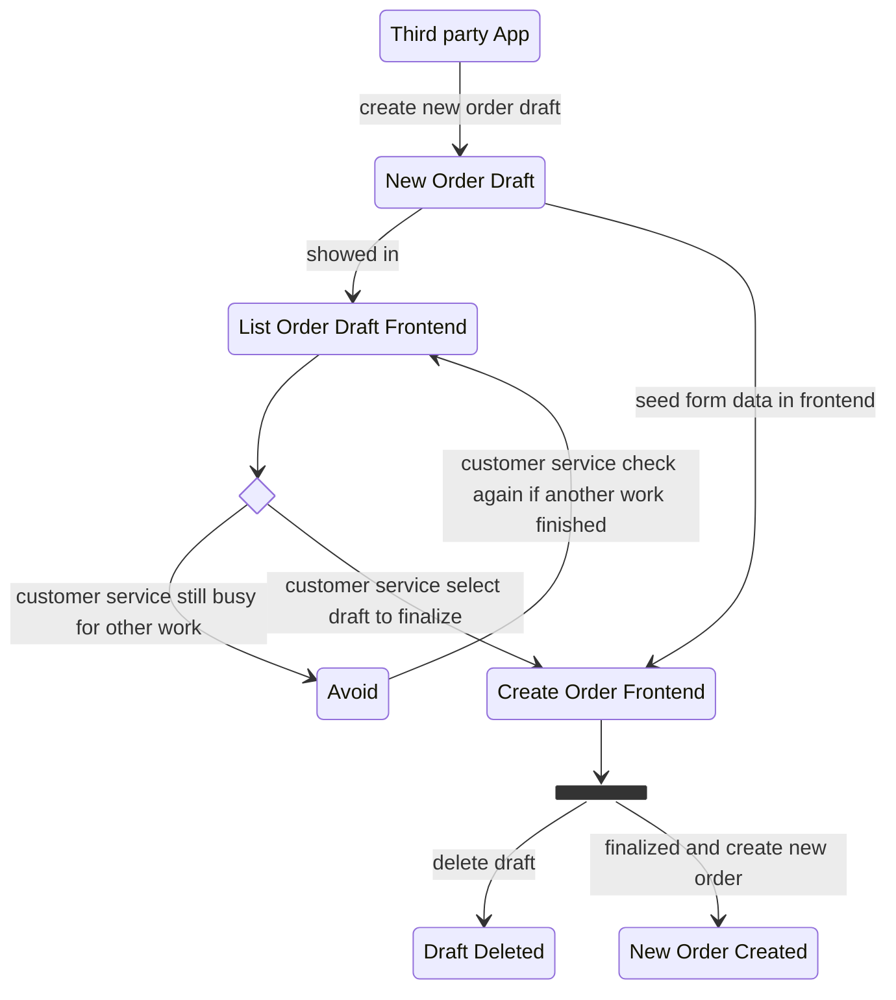
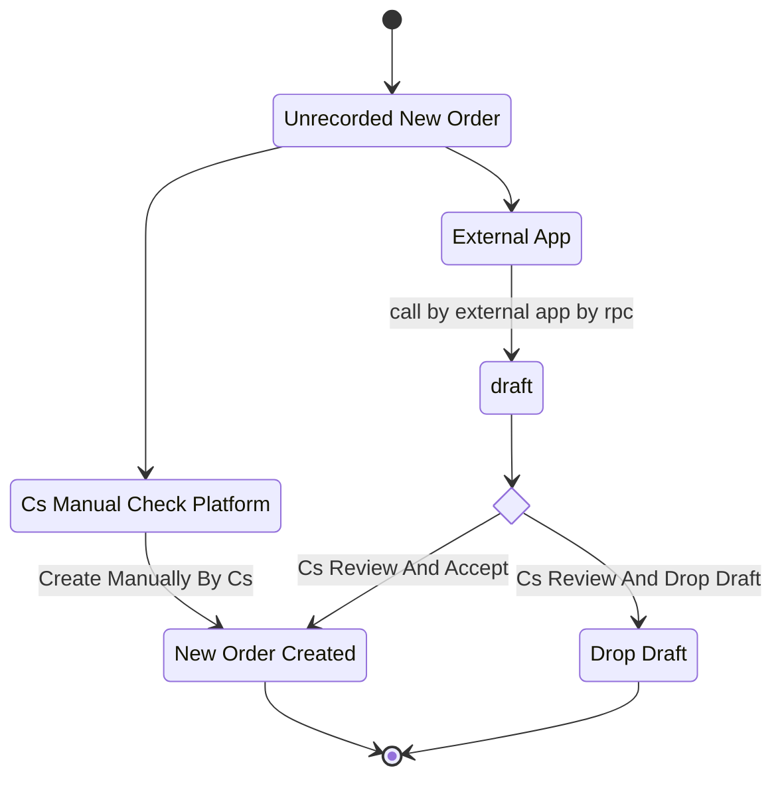
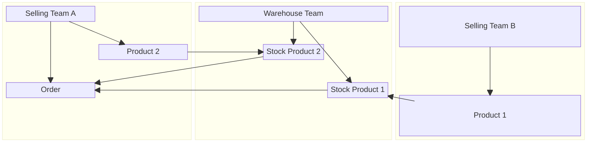

# Order Context.

## General.
1. for order settlement, its follow [this](../settlement/context.md).
2. for order event related, see [this](./event_context.md)
3. for order return related, see [this](./order_return.md)

## Whats Order Responsbility And Not.
### Responsbility.
1. Manage Orders.
2. Manage Draft Orders.

### Whats Not.
1. The Cash, about withdrawal & platform wallet. we separate in other service. for now its defer development, we think later.
2. The debt related shared/cross product. we dont manage it. we just send it as event and other service handle it.

## Order Anatomy.
when order created. its bring 4 things.
1. Shop Related.
2. Warehouse Related.
3. Marketplace Order Info Related.
4. Product Related.

## Table That Must Have.
1. `orders`,

    field that must have:
    - `id`, primary key
    - `idempotency_key`
    - `transaction_id`
    - `order_external_ref_id`, its for duplicate warning, its cannot empty
    - `shop_id`
    - `team_id`
    - `warehouse_id`
    - `shipment_channel_id`, see [this](../shipment/context.md)
    - `status`
    - `platform_type`
    - `warehouse_fee`
    - `receipt`
    - `receipt_file`
    
    - `goods_cost`, goods only, used for warehouse fee charge calculation
    - `total_cost`, goods + warehouse fee
    - `platform_total`, is total that outside platform given. Its used for post the settlement later.
    - `platform_created_at`
    - `platform_shipment_deadline`

    - `created_at`


2. `order_items`,

    field that must have:
    - `id`, primary key
    - `order_id`
    - `product_id`
    - `owner_team_id`, who team have the product 
    - `is_product_owned`, false if product cross/shared
    - `qty`
    - `unit_cost`, price product, if cross, price before markup 
    - `unit_cost_with_markup`, price product, if cross, price after markup
    - `markup_total`, total - (unit_cost * qty)  
    - `total`, unit_cost_with_markup * qty

3. `order_addresses`,

    field that must have:
    - `id`, primary key
    - `order_id`
    - `customer_name`
    - `customer_phone`
    - `provinsi_name`
    - `kabupaten_name`
    - `kecamatan_name`
    - `desa_name`
    - `postal_code`
    - `address_line`

4. Table `order_timeline_logs`.

    field that must have:
    - `id`, primary key
    - `order_id`
    - `status`
    - `note`
    - `from`
    - `actor_id`
    - `created_at`
    
    field `from` is from where log created. It contain:
    - `warehouse`. if it from warehouse side log. 
    - `selling`. if it from selling side log. 

5. `order_drafts`,

    field that must have:
    - `id`, primary key
    - `order_external_ref_id`, its for order duplicate warning, its cannot empty
    - `shop_id`
    - `team_id`
    - `shipment_channel_id`
    - `warehouse_id`
    - `platform_type`
    - `platform_total`
    - `receipt`
    - `receipt_file`
    
    - `platform_shipment_deadline`
    - `platform_created_at`
    - `created_at`

6. `order_draft_platform_items`

    field that must have:
    - `id`, primary key
    - `order_draft_id`
    - `platform_title`
    - `platform_price`
    - `qty`
    - `total`

7. `order_draft_addresses`

    field that must have:
    - `id`, primary key
    - `order_draft_id`
    - `customer_name`
    - `customer_phone`
    - `provinsi_name`
    - `kabupaten_name`
    - `kecamatan_name`
    - `desa_name`
    - `postal_code`
    - `address_line`


### Order Items Table.
1. money in columns are frozen at finalize and never recomputed.

### Whats `order_timeline_logs` Table Used For.
1. for track timeline order status change or if there note from warehouse while processing orders like picking goods but there no goods in rack.

### Order Status.
1. Status That Existed.
    - `cancel`
    - `pending`
    - `processed`
    - `picked`
    - `shipping`
    - `shipped`
    - `completed`
    - `problem`
    - `lost`
    - `return`
    - `return_completed`

2. Status Move.
    ```mermaid
    stateDiagram-v2
    [*] --> pending
    pending --> processed: warehouse - confirms, the label printed
    pending --> cancel: the selling team
    processed --> pending: warehouse - goods on no rack, a note
    processed --> picked: warehouse - Set Picked
    picked --> pending: warehouse - platform cancelled, unpacked
    picked --> shipping: warehouse - the handover scan
    shipping --> shipped: customer service - seen moving on the platform
    shipping --> return: customer service, or the warehouse forcing it
    shipped --> completed: customer service
    shipped --> problem: customer service - seen on the platform
    shipped --> lost: customer service
    shipped --> return: customer service, or the warehouse forcing it
    problem --> completed: customer service
    problem --> lost: customer service
    problem --> return: customer service, or the warehouse forcing it
    completed --> return: customer service, or the warehouse forcing it
    return --> return_completed: warehouse - accepts, the goods are here
    return --> lost: customer service - the parcel never came back
    cancel --> [*]
    lost --> [*]
    return_completed --> [*]
    ```

## Order Draft Behavior and What Used For.
1. order draft is used **only by third party app**, when manual, customer service just simple direct create order.
2. order draft exists for accomodate third party app to not create order directly. Its because third party app have incomplete data to create a proper order.
3. finalize order draft to order not doing by backend. draft is fetched by frontend and seed manually in frontend.
4. `order_draft_platform_items` data is just showed in frontend as reference.
5. create order optionally take `order_draft_id`, its used for when create order succeed, draft order is deleted



## How We Warn Duplicate Order.
1. `order_external_ref_id` + `shop_id` is not unique. same reference can be created twice, ex: cancel and create new one.
2. frontend check before create order, and in every Try Again. it look in `orders` that not `cancel`, and in `order_drafts`.
3. draft that being finalized is not warned.
4. if found, frontend show warning with that order or draft. customer service can open it, or still create.
5. backend not refuse duplicate reference.

    ```mermaid
    flowchart TD
    s(("Start"))
    e(("End"))

    s-->ordcreate["Order Need Create"]
    ordcreate-->refcheck{"same shop and ref in orders not cancel, or in drafts ?"}
    refcheck-->|no|created["Order Created"]
    refcheck-->|"yes, only the draft being finalized"|created
    refcheck-->|"yes, other order or draft"|warn["Show Warning With That Order or Draft"]
    warn-->|open it|open["Open That Order or Draft"]
    warn-->|still create|created
    open-->e
    created-->e
    ```


## How Order Enter Our System.
1. Order Draft is stored to another place. not in table `orders` but in `order_drafts`

2. Inside order creation. its have complex graph, so i separate to [this](./order_creation.md)


## Cross Product Feature.
### Preface
1. Our system have multi selling team and multi warehouse team.
2. Every selling team maybe have stock in across multiple warehouse team.
3. Every Selling team can create order with own product or cross/shared product other selling team with same warehouse team (same warehouse location). 
    Because its only can shipped and processed in single warehouse.


## Whats Charge In Order.
1. `warehouse_fee`, Order that processed by warehouse team charge fee.
2. `cross_product_cost`, when Order use product from other teams.

how we charge that 2 item is managed by balance service that explained in [balance context](../balance/context.md)


### How Fee Calculated.
[defer]


## Order Shipments.
### who change status `shipping` and `shipped`
1. `shipping` to `shipped`
    - customer service check manually to external platform and mark shipped manually.
2. `shipped` to `problem`
    - customer service check manually to external platform and mark problem manually.
3. `shipping` to `return`
    - customer service check manually to external platform and mark return manually.
4. `return` to `lost`
    - customer service check manually to external platform and mark lost manually.
