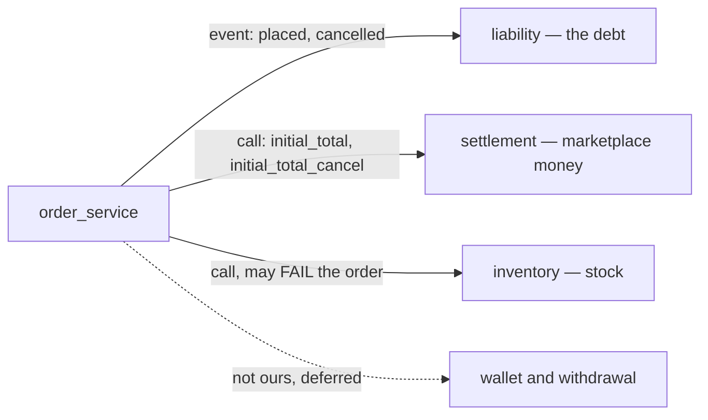
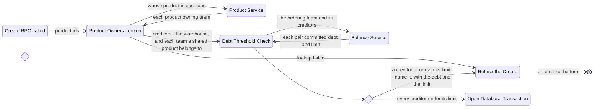
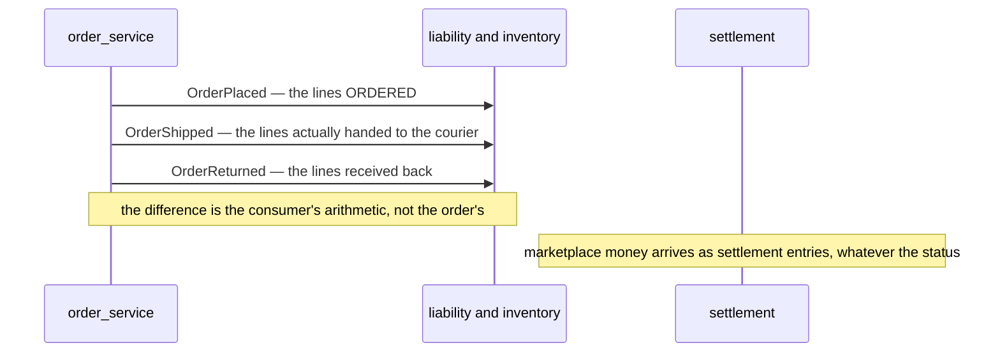
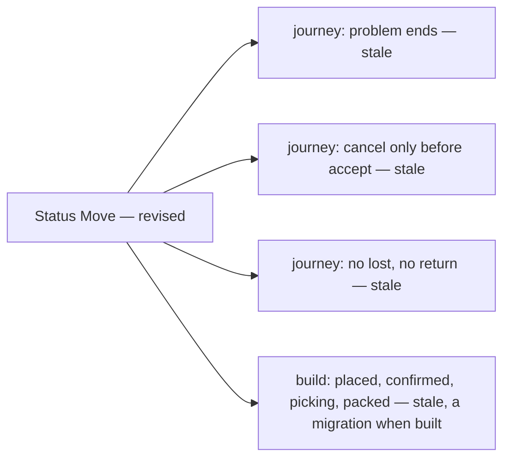
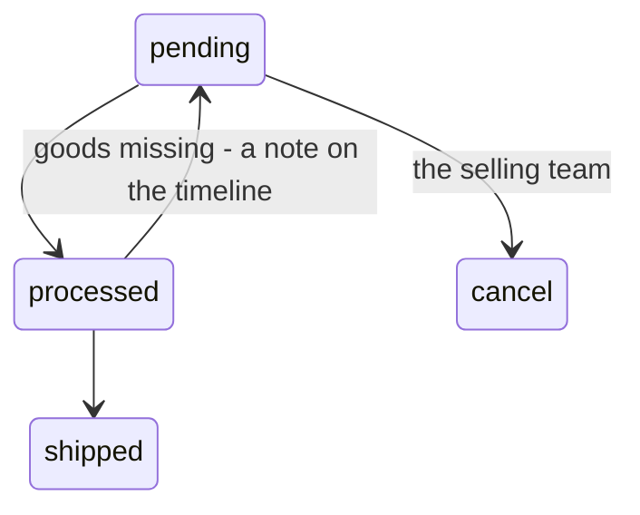
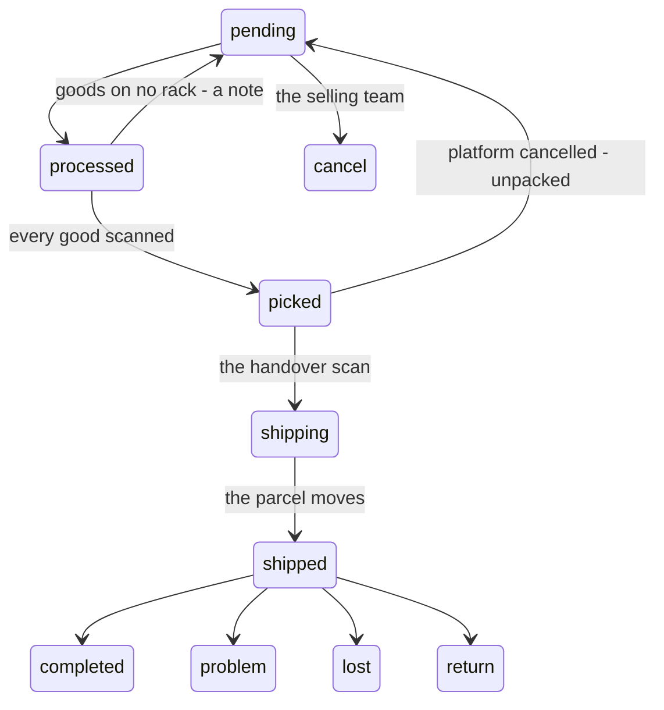
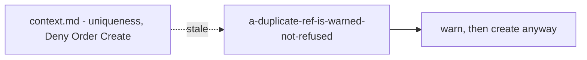
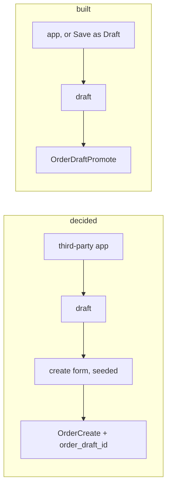
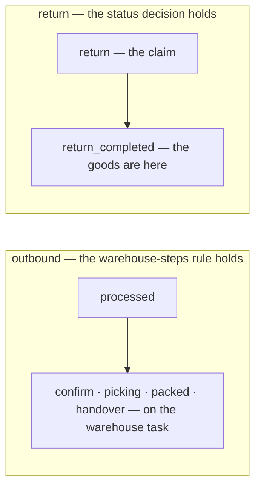
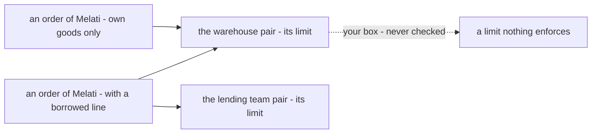

# Clarity — order `context.md`

What [context.md](./context.md) leaves open. **That doc is yours — this one is mine.** Answered points
are deleted, so this file is always the current open set; what was settled is in
[context_decision.md](./context_decision.md).

> ✅ **Answered in chat (2026-10-16, later):** [picked-and-shipping-are-order-statuses](#picked-and-shipping-are-order-statuses) —
> yes, as recommended ([picked-and-shipping-are-order-statuses](./context_decision.md#picked-and-shipping-are-order-statuses)),
> amending [the-warehouse-steps-are-not-order-statuses](./context_decision.md#the-warehouse-steps-are-not-order-statuses) and
> [order-timeline-logs-replaces-order-events](./context_decision.md#order-timeline-logs-replaces-order-events). ⛔ Your §Status Move
> and §Complete Journey still go `processed --> shipped`: [the-status-moves-miss-picked-and-shipping](#the-status-moves-miss-picked-and-shipping) stays.

> 🔄 **Re-examined 2026-10-16 — `picked` and `shipping` joined your status list**, and inventory's
> [order.md](../inventory/order.md) now sets them. 🆕 [picked-and-shipping-are-order-statuses](#picked-and-shipping-are-order-statuses):
> they reverse [the-warehouse-steps-are-not-order-statuses](./context_decision.md#the-warehouse-steps-are-not-order-statuses)
> for two steps. ⛔ [the-status-moves-miss-picked-and-shipping](#the-status-moves-miss-picked-and-shipping): the Status Move,
> the journey and the warehouse tabs still draw the old path. Its redraw also closes
> [the-status-moves-miss-the-way-back](#the-status-moves-miss-the-way-back).

> 🔄 **Re-examined 2026-10-15 — your `order_timeline_logs` and the way back to `pending`.** Missing goods send a confirmed
> order back to `pending` with a note, and the selling team decides
> ([missing-goods-send-the-order-back-to-pending](../inventory/order_decision.md#missing-goods-send-the-order-back-to-pending)).
> ⛔ The status diagram has no `processed --> pending` and still has `processed --> cancel`:
> [the-status-moves-miss-the-way-back](#the-status-moves-miss-the-way-back). 🆕
> ✅ [the-timeline-is-order-events](#the-timeline-is-order-events) — answered: `order_timeline_logs` replaces `order_events`. 🔄
> ✅ [who-may-cancel-a-pending-order](#who-may-cancel-a-pending-order) answered — only the selling team cancels ([only-the-selling-team-cancels](./context_decision.md#only-the-selling-team-cancels)).

> ✅ **Answered 2026-10-15, all three as recommended, and deleted:** `a-blocked-line-refuses-the-whole-order`
> ([over-the-limit-refuses-the-create](./context_decision.md#over-the-limit-refuses-the-create)) · `the-warehouse-is-a-creditor-too`
> ([the-warehouse-is-a-creditor-on-every-order](./context_decision.md#the-warehouse-is-a-creditor-on-every-order)) · the critique
> `the-owners-are-needed-before-the-take` ([a-failed-owner-lookup-refuses-the-create](./context_decision.md#a-failed-owner-lookup-refuses-the-create)).
> The box to draw: [the debt check, as decided](#proposed--the-debt-check-as-decided). ⛔ Until it is drawn, the box and
> balance §Balance Policy 2 still say *shared product only* — [the-debt-check-skips-the-warehouse](#the-debt-check-skips-the-warehouse).
>
> 🔄 **Re-examined 2026-10-15 — the owner drew the debt check** into [order_creation.md](./order_creation.md), before the
> transaction ([the-debt-check-runs-before-the-take](./context_decision.md#the-debt-check-runs-before-the-take)).
> ✅ `the-order-consults-the-debt-it-does-not-manage` — answered by its new §Reference line, and deleted.
> ✅ `finalize-enforces-every-rule-on-both-doors` — **nothing left in it**, deleted: the debt is the new box, the reserve and
> the shared lock are the take's ([the-take-checks-the-product-first](../inventory/order_decision.md#the-take-checks-the-product-first)),
> there is one door now (the app only drafts), and the team is the request's own scoped `team_id`.
> 🔄 [a-blocked-line-refuses-the-whole-order](#a-blocked-line-refuses-the-whole-order) — the box has no refusal branch.
> 🆕 [the-warehouse-is-a-creditor-too](#the-warehouse-is-a-creditor-too), with its
> [Contradiction](#the-debt-check-skips-the-warehouse), and the critique `the-owners-are-needed-before-the-take`.
>
> 🔄 **Re-examined 2026-10-15 — a duplicate ref is warned, not refused**
> ([a-duplicate-ref-is-warned-not-refused](./context_decision.md#a-duplicate-ref-is-warned-not-refused)), against my
> partial index. The uniqueness decision is renamed `superseded-…` and every link to it moved (RULE 12).
> [one-uniqueness-check-covers-drafts-and-orders](#one-uniqueness-check-covers-drafts-and-orders) narrows to whether the
> warning reads drafts; the uniqueness design becomes [a warning design](./context_decision.md#the-duplicate-warning-reads-drafts-too).
> ⛔ The doc's §How We Manage Order Uniqueness still denies:
> [the-uniqueness-section-still-denies](#the-uniqueness-section-still-denies), which replaces
> `the-uniqueness-flow-cannot-enforce-its-own-rule`. ✅ Later the same day: the warning reads drafts too
> ([the-duplicate-warning-reads-drafts-too](./context_decision.md#the-duplicate-warning-reads-drafts-too)) — the question
> and its design are closed. ➡ Settlement's side — a ref on two live orders — is asked in
> [settlement_importer Q15](../settlement/settlement_importer_clarify.md#question).

> **Rewritten 2026-09-15 after a session of edits to the doc.** ✅ Closed and recorded:
> [the-order-follows-settlement-for-its-money](./context_decision.md#the-order-follows-settlement-for-its-money) ·
> [superseded-an-order-is-unique-by-shop-and-marketplace-ref](./context_decision.md#superseded-an-order-is-unique-by-shop-and-marketplace-ref) ·
> [drafts-keep-their-own-table](./context_decision.md#drafts-keep-their-own-table) ·
> [superseded-the-order-has-eight-statuses](./context_decision.md#superseded-the-order-has-eight-statuses) ·
> [lost-is-final](./context_decision.md#lost-is-final). That also closes the old *"there is no lifecycle"*, the
> cancel gate, *"`problem` has no exits"*, the withdrawal double-count and the estimate-revenue contradiction.
>
> ⛔ **Found while checking the code this round:** the reconciliation report (#187) that six code comments
> name as the safety net for half-succeeded orders **does not exist** — see
> [a-lost-publish-is-not-tracked-on-the-order](./context_decision.md#a-lost-publish-is-not-tracked-on-the-order).
>
> Questions are **named, not numbered** now, so closing one no longer renumbers the rest. Old numbers are
> kept in each entry as *(was Qn)*.

> 🔄 **The doc moved again since this was written (2026-09-16), and neither edit opens a question.**
> §Whats Charge In Order landed — `warehouse_fee` and `cross_product_cost`, *"managed by balance service"* — which
> **agrees** with [warehouse-prices-balance-records](../warehouse/context_decision.md#warehouse-prices-balance-records)
> next door: balance records, `warehouse_service` prices, and the order calls. ✅ Its `### How Fee Calculated.
> [defer]` is therefore answered in the **warehouse** context, not here — the open parts of it are
> [that clarify's](../warehouse/context_clarify.md#question), not this one's. `## How Order Enter Our System` also
> gained a bare *"2. Inside order created."* — an empty heading, which per RULE 8b.11 reads as **not designed
> yet**, not as a question.

> ✅ **Pruned 2026-09-17 — six questions overtaken by the day's decisions:** draft pre-checks and SKU mapping
> ([a-draft-holds-only-the-platforms-lines](./context_decision.md#a-draft-holds-only-the-platforms-lines) — a draft holds no product) · review can reject (the
> doc's *Drop Draft* branch) · the synchronous take ([a-take-reduces-stock-and-placement](./context_decision.md#a-take-reduces-stock-and-placement),
> [the-take-is-never-retried](./context_decision.md#the-take-is-never-retried)) · the cross line's cost
> ([inventory-computes-the-markup](./context_decision.md#inventory-computes-the-markup)) · what *placement* means (the take's rack placement). Also
> gone from Critique: *two doors* (there is one create) and *one warehouse per order* (§Cross Product Feature).

> ✅ **Answered 2026-09-17 and deleted:** how a half-finished order is found — it is not tracked on the order
> ([a-lost-publish-is-not-tracked-on-the-order](./context_decision.md#a-lost-publish-is-not-tracked-on-the-order)).

> ✅ **Answered 2026-09-21 and deleted:** what `return` means — it is a **claim**, not a receipt. The owner added a
> ninth status, `return_completed`, for the moment the warehouse person actually has the goods
> ([the-accept-is-the-status-return-completed](./context_decision.md#the-accept-is-the-status-return-completed),
> superseding [the eight-status decision](./context_decision.md#superseded-the-order-has-eight-statuses)).
> 🔄 **It reverses my recommendation**, which was that `return` should mean *received*. ⚠ **It also makes
> [the-journey-still-sets-the-old-statuses](#the-journey-still-sets-the-old-statuses) worse**: §Complete Journey
> now omits three statuses, not two.

> ⛔ **Found at the `hfrada → dev` merge (2026-10-02):** a decision made on that branch still reasons from eight
> statuses and a return RECORD — [the-warehouse-steps-rule-met-the-return-status](#the-warehouse-steps-rule-met-the-return-status).

Siblings: [business_level](../business_level_clarify.md) · [user_context](../user/context_clarify.md) ·
[product_context](../product/context_clarify.md) · [balance_context](../balance/context_clarify.md) ·
[inventory_context](../inventory/context_clarify.md) · [settlement_context](../settlement/context_clarify.md).

---

## Proposed Design

### The rules already in the doc, named

#### an-order-mixes-own-and-borrowed-lines
One order carries own **and** borrowed lines at once *(§What Make Our Order Unique 1)*, so every rule about
cross/shared goods is a rule about a **line**, never about an order. The diagram's three obligations land in
three teams: `COGS` (the seller), `Warehouse Fee` (the warehouse), `Loan` (the lending team).

#### every-line-debits-cogs-the-credit-differs
| the line | debit | credit | mirror on the owner's side |
| --- | --- | --- | --- |
| own | COGS | assets | — |
| cross | COGS | payable to the cross team | receivable from the ordering team |

The payable is the credit side of the COGS, never a fourth thing subtracted from margin.

#### a-draft-holds-facts-not-commitments
A draft holds marketplace, warehouse, shipping, customer and **external** product info — a SKU, not our
product — and no stock *(§Order Draft)*. With no mapped product there is no owner and no cost, so nothing
about money can be checked at draft; **every check lands on finalize, and finalize may refuse.**

#### order-emits-it-never-posts
The order does not hold the cash and does not manage the cross debt *(§Whats Not)* — it **announces** and
another service computes. Marketplace money is settlement's
([the-order-follows-settlement-for-its-money](./context_decision.md#the-order-follows-settlement-for-its-money)).

### Proposed — the debt check, as decided

For your box in [order_creation.md](./order_creation.md) — it draws
[the-debt-check-runs-before-the-take](./context_decision.md#the-debt-check-runs-before-the-take),
[a-failed-owner-lookup-refuses-the-create](./context_decision.md#a-failed-owner-lookup-refuses-the-create),
[the-warehouse-is-a-creditor-on-every-order](./context_decision.md#the-warehouse-is-a-creditor-on-every-order) and
[over-the-limit-refuses-the-create](./context_decision.md#over-the-limit-refuses-the-create). It replaces the lines from
`state "Create RPC called" as rpc` to `ordcheck-->tx`; the rest of your diagram is unchanged.

| | |
| --- | --- |
| `owners` | new — the take returns the owners too, but only after this check |
| `ordcheck` | now a named state; your box was the bare id `ordcheck` |
| the label | *the warehouse, and each team a shared product belongs to* — replaces *if order contain shared product* |
| `refuse` | both refusals end the create before the transaction, so nothing is taken and nothing is compensated |

### Proposed — the order announces what shipped and what came back

For [the-order-announces-what-shipped-and-what-came-back](#the-order-announces-what-shipped-and-what-came-back).

---

## Critique

| | Problem | → Recommend |
| --- | --- | --- |
| **the-uniqueness-section-still-denies** | 🔄 §How We Manage Order Uniqueness is titled *uniqueness* and ends in *Deny Order Create*, while a duplicate is now warned and created ([a-duplicate-ref-is-warned-not-refused](./context_decision.md#a-duplicate-ref-is-warned-not-refused)). See [Contradiction](#the-uniqueness-section-still-denies) | a *duplicate warning* section, whose flow ends in *warn, then create anyway* |
| **short-pick-and-return-are-silent** | only *placed* and *cancelled* are announced. A short pick leaves another team charged for units that never left; a return never reverses COGS | [two more events](#proposed--the-order-announces-what-shipped-and-what-came-back) |
| **the-empty-ref-lives-on-in-the-build** | the doc says the ref *"cannot empty"*; the build says `''` is *"the ordinary state of an order taken over the phone"* and skips the settlement account when the platform total is 0 — both now forbidden by [platform-total-is-required-at-finalize](./context_decision.md#platform-total-is-required-at-finalize). See [Contradiction](#the-build-still-treats-an-empty-ref-as-a-phone-order) | a `selling_service` migration + handler check when this is built |
| **what-an-order-must-prove** | nothing lists what the business must be able to show about an order later: who took it, by which door, what shipped, who picked | frozen at finalize: shop, warehouse, lines, owners, cost, source. Recorded as it moves: picker, packer, handover time |

---

## Question

### picked-and-shipping-are-order-statuses
✅ *(2026-10-16)* **Answered: yes, and in your status list** — [picked-and-shipping-are-order-statuses](./context_decision.md#picked-and-shipping-are-order-statuses), as recommended. It amends [the-warehouse-steps-are-not-order-statuses](./context_decision.md#the-warehouse-steps-are-not-order-statuses). Kept as a heading so the links into it hold.

### one-uniqueness-check-covers-drafts-and-orders
✅ *(2026-10-15)* **Answered: yes, the warning reads drafts too, never the draft being finalized** — [the-duplicate-warning-reads-drafts-too](./context_decision.md#the-duplicate-warning-reads-drafts-too). Kept as a heading so the links into it hold.

### the-order-announces-what-shipped-and-what-came-back
*(was Q6)* Does the order emit the lines **actually shipped** at handover, and the lines **received back** on a
return? Today it emits neither, the fee is posted from the ordered quantity, and ledger entries are immutable.
**→ Yes, both.** The business half is yours: **is a short-picked borrowed line charged at what shipped, or at
what was ordered?** There is a case for *ordered* — the owner lost that stock to this order.

### lost-and-return-do-not-reverse-initial-total
*(new)* Settlement names `initial_total_cancel` as the only reversal. Should `lost` and `return` also cancel the
sale on the settlement account? **→ No.** The marketplace decides what a lost or returned parcel is worth, and
settlement records exactly that — a residual balance is already normal
([a-residual-balance-is-normal](../settlement/context_decision.md#a-residual-balance-is-normal)).

### the-journey-stops-setting-statuses
*(new)* §Complete Journey still sets statuses by the old rules — see
[Contradiction](#the-journey-still-sets-the-old-statuses). **→ Take the `set status …` boxes out of the journey**
so the status diagram is the only place a status is defined.

### who-may-cancel-a-pending-order
✅ *(2026-10-15)* **Answered: only the selling team cancels** — the warehouse hands the order back to `pending` with a note, so customer service chases it ([only-the-selling-team-cancels](./context_decision.md#only-the-selling-team-cancels)). Against my *both may*.

### the-timeline-is-order-events
✅ *(2026-10-15)* **Answered: drop `order_events`, create `order_timeline_logs`** — [order-timeline-logs-replaces-order-events](./context_decision.md#order-timeline-logs-replaces-order-events). Simpler than my keep-`kind`.

### an-order-cannot-be-created-without-a-channel
*(re-routed from [shipment](../shipment/context_clarify.md))* The third-party app converts the platform's
courier text to our id ([the-app-converts-the-courier-to-a-channel-id](../shipment/context_decision.md#the-app-converts-the-courier-to-a-channel-id)).
When it cannot — a courier we have no channel for — the draft's `shipment_channel_id` stays empty. May an order
be created from that draft? **→ No.** The person picks the channel on the create form, or root adds it first —
an order with no courier cannot be handed over.

---

# Contradiction

## the-journey-still-sets-the-old-statuses

| §Order Status — Status Move (revised) | §Complete Journey Of The Orders (not revised) |
| --- | --- |
| `problem --> completed`, `problem --> lost`, `problem --> return` | `set status problem --> e` — a problem simply ends |
| `processed --> cancel` | cancel only at `Is Cancel ?`, before `Warehouse Accept Order` — 🔄 *the journey was right on this row*: [the-status-moves-miss-the-way-back](#the-status-moves-miss-the-way-back) |
| `lost`, `return`, `return_completed` exist | none of the three appears |

**Which is wrong:** the journey — the status diagram is the newer statement and was revised deliberately.
**→ Recommend** removing statuses from the journey entirely
([the-journey-stops-setting-statuses](#the-journey-stops-setting-statuses)). ⚠ **The pattern:** a status written
in two diagrams has to be changed in two diagrams, and only one was.

## the-status-moves-miss-the-way-back

*(2026-10-15)* §Order Status — Status Move against
[missing-goods-send-the-order-back-to-pending](../inventory/order_decision.md#missing-goods-send-the-order-back-to-pending)
and [no-cancel-after-the-warehouse-confirms](../inventory/order_decision.md#no-cancel-after-the-warehouse-confirms):

| §Status Move | decided |
| --- | --- |
| no `processed --> pending` | the warehouse sends a confirmed order back to `pending` when its goods are missing |
| `processed --> cancel` | a confirmed order is not cancelled directly — it goes back to `pending` first, and the selling team cancels from there |

**Which is wrong:** the diagram — both decisions are newer than its `processed` row. **→ Recommend** adding
`processed --> pending` and removing `processed --> cancel`. 🔄 This reverses my verdict on that one row of
[the-journey-still-sets-the-old-statuses](#the-journey-still-sets-the-old-statuses): there, the journey was right.

## the-status-moves-miss-picked-and-shipping

*(2026-10-16)* Your §Order Status list against the places that still draw the old path. One cause, four sites:

| site | says |
| --- | --- |
| §Order Status, the list | `processed`, `picked`, `shipping`, `shipped` |
| §Status Move | `processed --> shipped`, with no `picked` and no `shipping` |
| §Complete Journey | one *"Process Order (Packing/Picking)"* step, and `shipped` set after the handover |
| [the-warehouse-steps-are-not-order-statuses](./context_decision.md#the-warehouse-steps-are-not-order-statuses) | picking and the handover are steps inside `processed`, not statuses — ✅ amended 2026-10-16 |
| [the-warehouse-tabs-are-the-processed-steps](../../technical/frontend/warehouse_order_list_decision.md#the-warehouse-tabs-are-the-processed-steps) | *Sedang diambil, Sudah diambil, Dikemas, Sudah diserahkan* as steps of `processed` |

**Which is wrong:** everything except the list — now decided ([picked-and-shipping-are-order-statuses](./context_decision.md#picked-and-shipping-are-order-statuses)). **→ Recommend**
this Status Move. It also carries the way back ([the-status-moves-miss-the-way-back](#the-status-moves-miss-the-way-back)),
so one redraw closes both. The journey follows [the-journey-stops-setting-statuses](#the-journey-stops-setting-statuses),
and the warehouse tabs are redrawn with the two statuses.

## the-uniqueness-section-still-denies

*(2026-10-15, replacing `the-uniqueness-flow-cannot-enforce-its-own-rule`)* Your doc against your answer in chat:

| [context.md](./context.md) | [a-duplicate-ref-is-warned-not-refused](./context_decision.md#a-duplicate-ref-is-warned-not-refused) |
| --- | --- |
| §Table That Must Have — *"`order_external_ref_id`, its for order uniqueness"*, on `orders` and `order_drafts` | the ref is required, not unique |
| §How We Manage Order Uniqueness — *"Order uniqueness manage by code"*, ending in *"Deny Order Create"* | warn, then create anyway |

**Which is wrong:** the section — the chat answer is newer. (Its flow never reached *Deny* anyway: it fetches only orders
*"that not canceled"*, then asks whether the one it fetched is cancelled.) **→ Recommend** a *duplicate warning* section,
drawn as [the warning design](./context_decision.md#the-duplicate-warning-reads-drafts-too), and *"its for order uniqueness"* on
the two columns read as *"its for the duplicate warning"*.

## the-build-still-treats-an-empty-ref-as-a-phone-order

*"its cannot empty"* (§Table That Must Have) — while
[00012_order_external_ref.sql](../../../backend/services/selling_service/db_migrations/00012_order_external_ref.sql)
says *"'' = there is NO marketplace reference. That is the ordinary state of an order taken over the phone"*, the
reversed [every-marketplace-order-carries-a-unique-platform-ref](../settlement/context_decision.md#every-marketplace-order-carries-a-unique-platform-ref)
allowed `""` for a phone order, and `openSettlement` skips a platform total of 0 for the same reason. ⚠ The column itself is renamed to `platform_total` ([the-total-is-ours-the-platform-total-is-theirs](./context_decision.md#the-total-is-ours-the-platform-total-is-theirs)).
**Which is wrong:** the build — the doc is the owner's current statement. **→ Recommend** a `CHECK` + handler
check when this context is built, and deciding
[a-lost-publish-is-not-tracked-on-the-order](./context_decision.md#a-lost-publish-is-not-tracked-on-the-order) item 3 in the same
pass, since it is the same assumption.

## the-build-lets-a-person-draft-and-promotes-on-the-server

[drafts-exist-only-for-the-third-party-app](./context_decision.md#drafts-exist-only-for-the-third-party-app) — *a person
never drafts* — and [the-frontend-finalizes-a-draft-not-the-backend](./context_decision.md#the-frontend-finalizes-a-draft-not-the-backend)
— *the draft seeds the create form, there is no promote RPC* — while the build has **Save as Draft** on the order
form (source `manual`) and an `OrderDraftPromote` RPC that the draft detail's Promote button calls. Found while
aligning the draft list to the order list (2026-09-30); the list is unaffected, since every column on it holds
either way.

| | decided | built |
| --- | --- | --- |
| who creates a draft | the third-party app only | the app, **and** a person from the order form |
| how a draft becomes an order | the create form, seeded from the draft, sends `order_draft_id` | `OrderDraftPromote` on the server |

**Which is wrong:** the build — the decisions are the owner's current statement.
**→ Recommend** removing Save as Draft and replacing Promote with *Open in the order form* (the form seeded from
the draft, `OrderCreate` deleting it), in one pass with a migration of any `manual` drafts. ⚠ Until then the
draft screens carry the build's behaviour, and the list's intro text still says drafts are *"saved from the
order form"*.

⚠ **Tried and reverted (2026-09-30):** the draft was opened IN the order create form for one round; the owner
asked for the separate draft page back at `/order-drafts/:id`. The contradiction therefore stands as written.

## the-warehouse-steps-rule-met-the-return-status

Two decisions made on two branches, which met at the `hfrada → dev` merge (2026-10-02). Neither saw the other.

| [the-warehouse-steps-are-not-order-statuses](./context_decision.md#the-warehouse-steps-are-not-order-statuses) (2026-09-24) | [the-accept-is-the-status-return-completed](./context_decision.md#the-accept-is-the-status-return-completed) (2026-09-21) |
| --- | --- |
| its diagram puts *"return — being processed, received"* on **the record that owns the work** | the accept is a **status**, `return_completed` — *"a return record: **not built**"* |
| cites *return-means-received-by-the-warehouse* as precedent: a return's transit lives on a return record | answered that same question the other way: `return` is the claim, *received* is the ninth status |
| *"the set of eight"* | nine statuses |

**Which is wrong:** the RETURN half of the warehouse-steps decision, not its verdict. The owner's answer on
2026-09-24 was about `confirm · picking · packed · handover` folding into `processed` — the return line and the
precedent were reasoning around it, and the precedent was overturned three days earlier.
**→ Recommend:** scope the warehouse-steps verdict to the OUTBOUND steps, and let `return_completed` stand as a
status. Then the order list's tabs ([design_clarify](../../technical/order/design_clarify.md)) need a ninth pile —
I would give `return_completed` its own tab, because it is the warehouse's queue (`WHERE status = 'return'`) emptied,
and a seller reads *"it is back"* differently from *"it is coming back"*.
⚠ Its link to `./context_clarify.md#return-means-received-by-the-warehouse` is dead — the question was answered
and deleted on dev.

## the-debt-check-skips-the-warehouse

*(2026-10-15)* Who the debt check asks about, in three places:

| where | checks |
| --- | --- |
| your box in [order_creation.md](./order_creation.md) | *"if order contain shared product"* — the lending teams, and only then |
| [balance/context.md](../balance/context.md) §Balance Policy 2 | *"when customer service finalizes order that contain cross products"* — the same |
| [the-block-stops-orders-only](../balance/context_decision.md#the-block-stops-orders-only), and the build (`credit_checker.go`) | *"the fulfilling warehouse **and** every team whose goods it sells, each creditor checked independently"* — on every order |

**Which is wrong:** the two docs — ✅ decided *(2026-10-15)*: the warehouse is checked on every order
([the-warehouse-is-a-creditor-on-every-order](./context_decision.md#the-warehouse-is-a-creditor-on-every-order)).
**→ Recommend** the box is redrawn as [the debt check, as decided](#proposed--the-debt-check-as-decided), and
[balance/context.md](../balance/context.md) §Balance Policy 2 reads *"when customer service creates an order, the fulfilling
warehouse and each team a cross product belongs to are compared to their committed pair rows"*.

---

# Awaiting

- **The money of a return** beyond settlement: COGS reversed into inventory at the frozen cost, and the payable
  to a borrowed line's owner standing, since the unit becomes the borrower's own (§Stock Ownership When Order Return).
- **A parcel found after `lost`** — [lost-is-final](./context_decision.md#lost-is-final) means it does not come
  back through its order; how its goods re-enter stock is unwritten.
- **Buyer shipping and COD** — still unmentioned.
