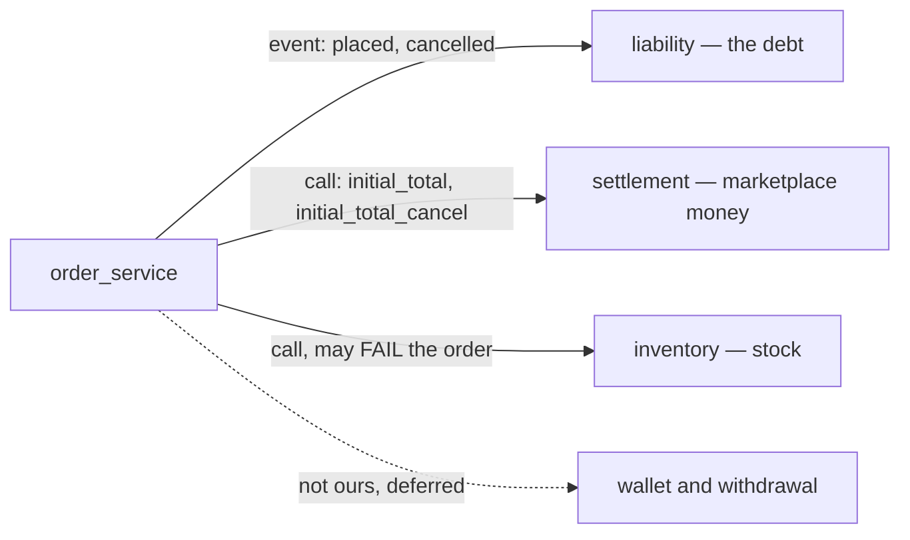
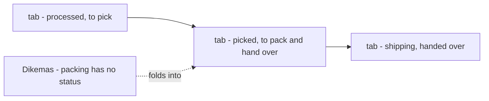
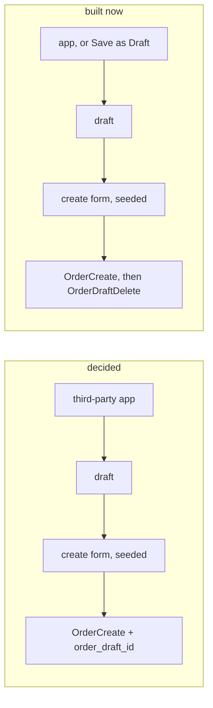

# Clarity — order `context.md`

What [context.md](./context.md) leaves open. **That doc is yours — this one is mine.** Answered points
are deleted, so this file is always the current open set; what was settled is in
[context_decision.md](./context_decision.md).

> ✅ **Your edits (2026-10-19):** both column notes, §Order Shipments item 4 (*mark lost*), and §Stock Ownership When Order Return
> deleted — [the-uniqueness-section-still-denies](#the-uniqueness-section-still-denies) and
> [the-stock-ownership-section-still-clones](#the-stock-ownership-section-still-clones) resolved. **No open question.**

> ⛔ **From order return (2026-10-19):** a return never clones a product now, so §Stock Ownership When Order Return is
> stale — [the-stock-ownership-section-still-clones](#the-stock-ownership-section-still-clones). **No open question.**

> 🔄 **Re-examined 2026-10-17 — your redrawn [order_creation.md](./order_creation.md).** The debt box is drawn as
> [proposed](#proposed--the-debt-check-as-decided); [the-debt-check-skips-the-warehouse](#the-debt-check-skips-the-warehouse)
> is left with only balance §Balance Policy 2. *Delete Draft Order* moved inside the transaction —
> [the-draft-is-deleted-in-the-orders-transaction](./context_decision.md#the-draft-is-deleted-in-the-orders-transaction).
> **No open question.**

> 🔄 **Re-examined 2026-10-17 — your §How We Warn Duplicate Order** replaces §How We Manage Order Uniqueness, as drawn.
> [the-uniqueness-section-still-denies](#the-uniqueness-section-still-denies) shrinks to the two column notes that still
> say *"for order uniqueness"*. ⚠ §Order Shipments item 4 still reads *"mark **return** manually"*. **No open question.**

> 🔄 **Re-examined 2026-10-17, last — your §Status Move redraw and §Complete Journey deleted.** ✅
> [the-journey-stops-setting-statuses](#the-journey-stops-setting-statuses) answered
> ([the-status-move-is-the-only-journey](./context_decision.md#the-status-move-is-the-only-journey)). Resolved with it:
> [the-journey-still-sets-the-old-statuses](#the-journey-still-sets-the-old-statuses),
> [the-status-moves-miss-the-way-back](#the-status-moves-miss-the-way-back), and
> [the-status-moves-miss-picked-and-shipping](#the-status-moves-miss-picked-and-shipping) but for the warehouse tabs.
> The menu contradiction is down to one row (`return --> completed`). ⚠ A slip in your §Order Shipments item 4:
> `return` to `lost` reads *"mark **return** manually"* — *lost* meant, I think. **No open question.**

> ✅ **Answered in chat (2026-10-17), all as recommended:** `return → lost` exists
> ([a-return-that-never-arrives-goes-lost](./context_decision.md#a-return-that-never-arrives-goes-lost)) ·
> [lost-and-return-do-not-reverse-initial-total](#lost-and-return-do-not-reverse-initial-total) — only a cancel reverses
> the sale ([lost-and-return-leave-the-sale-open](./context_decision.md#lost-and-return-leave-the-sale-open)) ·
> [an-order-cannot-be-created-without-a-channel](#an-order-cannot-be-created-without-a-channel) — the courier is required
> ([no-order-without-a-courier](./context_decision.md#no-order-without-a-courier)). The §Status Move redraw gains
> `return --> lost`. **1 open:** [the-journey-stops-setting-statuses](#the-journey-stops-setting-statuses).

> 🔄 **Re-examined 2026-10-17, later — your §Order Shipments item 3.** ✅ [an-unmarked-order-can-leave-shipping](#an-unmarked-order-can-leave-shipping)
> answered: `shipping → return` exists, set by customer service, and the warehouse's force takes the same edge
> ([shipping-can-go-straight-to-return](./context_decision.md#shipping-can-go-straight-to-return)). The proposed
> [§Status Move redraw](#the-status-moves-miss-picked-and-shipping) is now drawn whole, with who makes each move. **3 open.**

> 🔄 **Re-examined 2026-10-17 — your §Order Shipments.** ✅ [nobody-is-named-after-the-handover](#nobody-is-named-after-the-handover)
> answered: customer service marks `shipped` and `problem` by hand ([customer-service-sets-shipped-and-problem-by-hand](./context_decision.md#customer-service-sets-shipped-and-problem-by-hand)),
> against my merge. 🆕 [an-unmarked-order-can-leave-shipping](#an-unmarked-order-can-leave-shipping) — a parcel back
> before anyone marked it `shipped`. Your §General item 3 (the return link) raises nothing. **Still 4 open.**

> 🆕 **Opened 2026-10-17:** [nobody-is-named-after-the-handover](#nobody-is-named-after-the-handover) — nothing sets
> `shipped` or `problem`. Its [Contradiction](#the-order-menu-and-the-status-move-disagree-after-the-handover): your order-list
> menu offers three moves §Status Move does not have, one of them a real hole (`return --> lost`). **4 open.**

> ✅ **Answered in chat (2026-10-17):** [the-order-announces-what-shipped-and-what-came-back](#the-order-announces-what-shipped-and-what-came-back) —
> no new events, both fees stay on a return, as recommended ([what-shipped-is-what-was-ordered](./context_decision.md#what-shipped-is-what-was-ordered),
> [a-return-keeps-both-fees](./context_decision.md#a-return-keeps-both-fees)). Also decided, asked in chat only: a cancel refunds the
> warehouse fee in full, after `picked` too ([a-cancel-refunds-the-warehouse-fee-in-full](./context_decision.md#a-cancel-refunds-the-warehouse-fee-in-full)),
> against my *keep it once picked*. No contradictions — the one older decision that leaned on the question,
> [a-lines-money-is-frozen-at-finalize](./context_decision.md#a-lines-money-is-frozen-at-finalize), carries a note. **3 open.**

> ✅ **Answered in chat (2026-10-16, later):** [picked-and-shipping-are-order-statuses](#picked-and-shipping-are-order-statuses) —
> yes, as recommended ([picked-and-shipping-are-order-statuses](./context_decision.md#picked-and-shipping-are-order-statuses)),
> amending [the-warehouse-steps-are-not-order-statuses](./context_decision.md#the-warehouse-steps-are-not-order-statuses) and
> [order-timeline-logs-replaces-order-events](./context_decision.md#order-timeline-logs-replaces-order-events). ⛔ Your §Status Move
> and §Complete Journey still go `processed --> shipped`: [the-status-moves-miss-picked-and-shipping](#the-status-moves-miss-picked-and-shipping) stays.

> 🔄 **Re-examined 2026-10-16 — `picked` and `shipping` joined your status list**, and inventory's
> [order.md](../inventory/order.md) now sets them. 🆕 [picked-and-shipping-are-order-statuses](#picked-and-shipping-are-order-statuses):
> they reverse [the-warehouse-steps-are-not-order-statuses](./context_decision.md#the-warehouse-steps-are-not-order-statuses)
> for two steps. ⛔ [the-status-moves-miss-picked-and-shipping](#the-status-moves-miss-picked-and-shipping): the Status Move,
> the journey and the warehouse tabs still draw the old path. Its redraw also closes
> [the-status-moves-miss-the-way-back](#the-status-moves-miss-the-way-back).

> 🔄 **Re-examined 2026-10-15 — your `order_timeline_logs` and the way back to `pending`.** Missing goods send a confirmed
> order back to `pending` with a note, and the selling team decides
> ([missing-goods-send-the-order-back-to-pending](../inventory/order_decision.md#missing-goods-send-the-order-back-to-pending)).
> ⛔ The status diagram has no `processed --> pending` and still has `processed --> cancel`:
> [the-status-moves-miss-the-way-back](#the-status-moves-miss-the-way-back). 🆕
> ✅ [the-timeline-is-order-events](#the-timeline-is-order-events) — answered: `order_timeline_logs` replaces `order_events`. 🔄
> ✅ [who-may-cancel-a-pending-order](#who-may-cancel-a-pending-order) answered — only the selling team cancels ([only-the-selling-team-cancels](./context_decision.md#only-the-selling-team-cancels)).

> ✅ **Answered 2026-10-15, all three as recommended, and deleted:** `a-blocked-line-refuses-the-whole-order`
> ([over-the-limit-refuses-the-create](./context_decision.md#over-the-limit-refuses-the-create)) · `the-warehouse-is-a-creditor-too`
> ([the-warehouse-is-a-creditor-on-every-order](./context_decision.md#the-warehouse-is-a-creditor-on-every-order)) · the critique
> `the-owners-are-needed-before-the-take` ([a-failed-owner-lookup-refuses-the-create](./context_decision.md#a-failed-owner-lookup-refuses-the-create)).
> The box to draw: [the debt check, as decided](#proposed--the-debt-check-as-decided). ✅ *(2026-10-21)* Both are drawn now: the box
> and balance §Balance Policy 2 — [the-debt-check-skips-the-warehouse](#the-debt-check-skips-the-warehouse).
>
> 🔄 **Re-examined 2026-10-15 — the owner drew the debt check** into [order_creation.md](./order_creation.md), before the
> transaction ([the-debt-check-runs-before-the-take](./context_decision.md#the-debt-check-runs-before-the-take)).
> ✅ `the-order-consults-the-debt-it-does-not-manage` — answered by its new §Reference line, and deleted.
> ✅ `finalize-enforces-every-rule-on-both-doors` — **nothing left in it**, deleted: the debt is the new box, the reserve and
> the shared lock are the take's ([the-take-checks-the-product-first](../inventory/order_decision.md#the-take-checks-the-product-first)),
> there is one door now (the app only drafts), and the team is the request's own scoped `team_id`.
> 🔄 [a-blocked-line-refuses-the-whole-order](#a-blocked-line-refuses-the-whole-order) — the box has no refusal branch.
> 🆕 [the-warehouse-is-a-creditor-too](#the-warehouse-is-a-creditor-too), with its
> [Contradiction](#the-debt-check-skips-the-warehouse), and the critique `the-owners-are-needed-before-the-take`.
>
> 🔄 **Re-examined 2026-10-15 — a duplicate ref is warned, not refused**
> ([a-duplicate-ref-is-warned-not-refused](./context_decision.md#a-duplicate-ref-is-warned-not-refused)), against my
> partial index. The uniqueness decision is renamed `superseded-…` and every link to it moved (RULE 12).
> [one-uniqueness-check-covers-drafts-and-orders](#one-uniqueness-check-covers-drafts-and-orders) narrows to whether the
> warning reads drafts; the uniqueness design becomes [a warning design](./context_decision.md#the-duplicate-warning-reads-drafts-too).
> ⛔ The doc's §How We Manage Order Uniqueness still denies:
> [the-uniqueness-section-still-denies](#the-uniqueness-section-still-denies), which replaces
> `the-uniqueness-flow-cannot-enforce-its-own-rule`. ✅ Later the same day: the warning reads drafts too
> ([the-duplicate-warning-reads-drafts-too](./context_decision.md#the-duplicate-warning-reads-drafts-too)) — the question
> and its design are closed. ➡ Settlement's side — a ref on two live orders — is asked in
> [settlement_importer Q15](../settlement/settlement_importer_clarify.md#question).

> **Rewritten 2026-09-15 after a session of edits to the doc.** ✅ Closed and recorded:
> [the-order-follows-settlement-for-its-money](./context_decision.md#the-order-follows-settlement-for-its-money) ·
> [superseded-an-order-is-unique-by-shop-and-marketplace-ref](./context_decision.md#superseded-an-order-is-unique-by-shop-and-marketplace-ref) ·
> [drafts-keep-their-own-table](./context_decision.md#drafts-keep-their-own-table) ·
> [superseded-the-order-has-eight-statuses](./context_decision.md#superseded-the-order-has-eight-statuses) ·
> [lost-is-final](./context_decision.md#lost-is-final). That also closes the old *"there is no lifecycle"*, the
> cancel gate, *"`problem` has no exits"*, the withdrawal double-count and the estimate-revenue contradiction.
>
> ⛔ **Found while checking the code this round:** the reconciliation report (#187) that six code comments
> name as the safety net for half-succeeded orders **does not exist** — see
> [a-lost-publish-is-not-tracked-on-the-order](./context_decision.md#a-lost-publish-is-not-tracked-on-the-order).
>
> Questions are **named, not numbered** now, so closing one no longer renumbers the rest. Old numbers are
> kept in each entry as *(was Qn)*.

> 🔄 **The doc moved again since this was written (2026-09-16), and neither edit opens a question.**
> §Whats Charge In Order landed — `warehouse_fee` and `cross_product_cost`, *"managed by balance service"* — which
> **agrees** with [warehouse-prices-balance-records](../teams/warehouse/context_decision.md#warehouse-prices-balance-records)
> next door: balance records, `warehouse_service` prices, and the order calls. ✅ Its `### How Fee Calculated.
> [defer]` is therefore answered in the **warehouse** context, not here — the open parts of it are
> [that clarify's](../teams/warehouse/context_clarify.md#question), not this one's. `## How Order Enter Our System` also
> gained a bare *"2. Inside order created."* — an empty heading, which per RULE 8b.11 reads as **not designed
> yet**, not as a question.

> ✅ **Pruned 2026-09-17 — six questions overtaken by the day's decisions:** draft pre-checks and SKU mapping
> ([a-draft-holds-only-the-platforms-lines](./context_decision.md#a-draft-holds-only-the-platforms-lines) — a draft holds no product) · review can reject (the
> doc's *Drop Draft* branch) · the synchronous take ([a-take-reduces-stock-and-placement](./context_decision.md#a-take-reduces-stock-and-placement),
> [the-take-is-never-retried](./context_decision.md#the-take-is-never-retried)) · the cross line's cost
> ([inventory-computes-the-markup](./context_decision.md#inventory-computes-the-markup)) · what *placement* means (the take's rack placement). Also
> gone from Critique: *two doors* (there is one create) and *one warehouse per order* (§Cross Product Feature).

> ✅ **Answered 2026-09-17 and deleted:** how a half-finished order is found — it is not tracked on the order
> ([a-lost-publish-is-not-tracked-on-the-order](./context_decision.md#a-lost-publish-is-not-tracked-on-the-order)).

> ✅ **Answered 2026-09-21 and deleted:** what `return` means — it is a **claim**, not a receipt. The owner added a
> ninth status, `return_completed`, for the moment the warehouse person actually has the goods
> ([the-accept-is-the-status-return-completed](./context_decision.md#the-accept-is-the-status-return-completed),
> superseding [the eight-status decision](./context_decision.md#superseded-the-order-has-eight-statuses)).
> 🔄 **It reverses my recommendation**, which was that `return` should mean *received*. ⚠ **It also makes
> [the-journey-still-sets-the-old-statuses](#the-journey-still-sets-the-old-statuses) worse**: §Complete Journey
> now omits three statuses, not two.

> ⛔ **Found at the `hfrada → dev` merge (2026-10-02):** a decision made on that branch still reasons from eight
> statuses and a return RECORD — [the-warehouse-steps-rule-met-the-return-status](#the-warehouse-steps-rule-met-the-return-status).

Siblings: [business_level](../business_level_clarify.md) · [user_context](../user/context_clarify.md) ·
[product_context](../product/context_clarify.md) · [balance_context](../balance/context_clarify.md) ·
[inventory_context](../inventory/context_clarify.md) · [settlement_context](../settlement/context_clarify.md).

---

## Proposed Design

### The rules already in the doc, named

#### an-order-mixes-own-and-borrowed-lines
One order carries own **and** borrowed lines at once *(§What Make Our Order Unique 1)*, so every rule about
cross/shared goods is a rule about a **line**, never about an order. The diagram's three obligations land in
three teams: `COGS` (the seller), `Warehouse Fee` (the warehouse), `Loan` (the lending team).

#### every-line-debits-cogs-the-credit-differs
| the line | debit | credit | mirror on the owner's side |
| --- | --- | --- | --- |
| own | COGS | assets | — |
| cross | COGS | payable to the cross team | receivable from the ordering team |

The payable is the credit side of the COGS, never a fourth thing subtracted from margin.

#### a-draft-holds-facts-not-commitments
A draft holds marketplace, warehouse, shipping, customer and **external** product info — a SKU, not our
product — and no stock *(§Order Draft)*. With no mapped product there is no owner and no cost, so nothing
about money can be checked at draft; **every check lands on finalize, and finalize may refuse.**

#### order-emits-it-never-posts
The order does not hold the cash and does not manage the cross debt *(§Whats Not)* — it **announces** and
another service computes. Marketplace money is settlement's
([the-order-follows-settlement-for-its-money](./context_decision.md#the-order-follows-settlement-for-its-money)).

### Proposed — the debt check, as decided

✅ *(2026-10-17)* **Drawn** — your pasted [order_creation.md](./order_creation.md) diagram carries it as proposed: the owners
lookup, the warehouse and each lending team checked, both refusals before the transaction. Kept as a heading so the links
into it hold.

---

## Critique

> ✅ *(2026-10-21)* **Closed: what-an-order-must-prove** — already kept ([what-an-order-proves-is-already-kept](./context_decision.md#what-an-order-proves-is-already-kept)).

| | Problem | → Recommend |
| --- | --- | --- |
| **the-empty-ref-lives-on-in-the-build** | the doc says the ref *"cannot empty"*; the build says `''` is *"the ordinary state of an order taken over the phone"* and skips the settlement account when the platform total is 0 — both now forbidden by [platform-total-is-required-at-finalize](./context_decision.md#platform-total-is-required-at-finalize). See [Contradiction](#the-build-still-treats-an-empty-ref-as-a-phone-order) | a `selling_service` migration + handler check when this is built |

---

## Question

### picked-and-shipping-are-order-statuses
✅ *(2026-10-16)* **Answered: yes, and in your status list** — [picked-and-shipping-are-order-statuses](./context_decision.md#picked-and-shipping-are-order-statuses), as recommended. It amends [the-warehouse-steps-are-not-order-statuses](./context_decision.md#the-warehouse-steps-are-not-order-statuses). Kept as a heading so the links into it hold.

### one-uniqueness-check-covers-drafts-and-orders
✅ *(2026-10-15)* **Answered: yes, the warning reads drafts too, never the draft being finalized** — [the-duplicate-warning-reads-drafts-too](./context_decision.md#the-duplicate-warning-reads-drafts-too). Kept as a heading so the links into it hold.

### the-order-announces-what-shipped-and-what-came-back
✅ *(2026-10-17)* **Answered: no new events, and both fees stay on a return** — [what-shipped-is-what-was-ordered](./context_decision.md#what-shipped-is-what-was-ordered), [a-return-keeps-both-fees](./context_decision.md#a-return-keeps-both-fees). A short pick never ships and a return is whole, so the question's two cases are gone. Kept as a heading so the links into it hold.

### lost-and-return-do-not-reverse-initial-total
✅ *(2026-10-17)* **Answered: no — only a cancel reverses the sale** — [lost-and-return-leave-the-sale-open](./context_decision.md#lost-and-return-leave-the-sale-open), as recommended. Kept as a heading so the links into it hold.

### the-journey-stops-setting-statuses
✅ *(2026-10-17)* **Answered by your edit: §Complete Journey is deleted, and §Status Move — with who makes each move — is the one journey** — [the-status-move-is-the-only-journey](./context_decision.md#the-status-move-is-the-only-journey). My revised recommendation; the first one (*take the boxes out*) would have left the journey almost empty. Kept as a heading so the links into it hold.

### who-may-cancel-a-pending-order
✅ *(2026-10-15)* **Answered: only the selling team cancels** — the warehouse hands the order back to `pending` with a note, so customer service chases it ([only-the-selling-team-cancels](./context_decision.md#only-the-selling-team-cancels)). Against my *both may*.

### the-timeline-is-order-events
✅ *(2026-10-15)* **Answered: drop `order_events`, create `order_timeline_logs`** — [order-timeline-logs-replaces-order-events](./context_decision.md#order-timeline-logs-replaces-order-events). Simpler than my keep-`kind`.

### an-order-cannot-be-created-without-a-channel
✅ *(2026-10-17)* **Answered: no — the courier is required, picked on the form when the draft has none** — [no-order-without-a-courier](./context_decision.md#no-order-without-a-courier), as recommended. Kept as a heading so the links into it hold.

### nobody-is-named-after-the-handover
✅ *(2026-10-17)* **Answered by your §Order Shipments: customer service marks `shipped` and `problem` by hand, from the platform** — [customer-service-sets-shipped-and-problem-by-hand](./context_decision.md#customer-service-sets-shipped-and-problem-by-hand). Against my *merge them if the app cannot see the platform*. Kept as a heading so the links into it hold.

### an-unmarked-order-can-leave-shipping
✅ *(2026-10-17)* **Answered by your §Order Shipments item 3: `shipping → return` exists** — [shipping-can-go-straight-to-return](./context_decision.md#shipping-can-go-straight-to-return). Customer service sets it from the platform, and the warehouse's force takes the same edge. Kept as a heading so the links into it hold.

---

# Contradiction

## the-journey-still-sets-the-old-statuses

✅ *(2026-10-17)* **Resolved — you deleted §Complete Journey** ([the-status-move-is-the-only-journey](./context_decision.md#the-status-move-is-the-only-journey)).
⚠ What it also named and is still true: the build's statuses (*placed, confirmed, picking, packed*) need a migration when
this context is built. Kept as a heading so the links into it hold.

## the-status-moves-miss-the-way-back

✅ *(2026-10-17)* **Resolved — your §Status Move has `processed --> pending` and no `processed --> cancel`.** Kept as a
heading so the links into it hold.

## the-status-moves-miss-picked-and-shipping

✅ *(2026-10-17)* **Resolved in your doc** — §Status Move is the full redraw, with who makes each move, and §Complete
Journey is gone. One site is left, outside your doc:

| site | says |
| --- | --- |
| [the-warehouse-tabs-are-the-processed-steps](../../technical/frontend/warehouse_order_list_decision.md#the-warehouse-tabs-are-the-processed-steps) | *Sedang diambil, Sudah diambil, Dikemas, Sudah diserahkan* as steps of `processed` |

**→ Recommend** the warehouse order list's tabs follow the statuses when that screen is next touched — `processed` (to
pick), `picked` (to pack and hand over), `shipping` (handed over). Packing has no status, so *Dikemas* has no tab of its own.

## the-uniqueness-section-still-denies

✅ *(2026-10-19)* **Resolved** — §How We Warn Duplicate Order is redrawn, and both column notes say *duplicate warning*. Kept as a heading so the links into it hold.

## the-build-still-treats-an-empty-ref-as-a-phone-order

*"its cannot empty"* (§Table That Must Have) — while
[00012_order_external_ref.sql](../../../backend/services/selling_service/db_migrations/00012_order_external_ref.sql)
says *"'' = there is NO marketplace reference. That is the ordinary state of an order taken over the phone"*, the
reversed [every-marketplace-order-carries-a-unique-platform-ref](../settlement/context_decision.md#every-marketplace-order-carries-a-unique-platform-ref)
allowed `""` for a phone order, and `openSettlement` skips a platform total of 0 for the same reason. ⚠ The column itself is renamed to `platform_total` ([the-total-is-ours-the-platform-total-is-theirs](./context_decision.md#the-total-is-ours-the-platform-total-is-theirs)).
**Which is wrong:** the build — the doc is the owner's current statement. **→ Recommend** a `CHECK` + handler
check when this context is built, and deciding
[a-lost-publish-is-not-tracked-on-the-order](./context_decision.md#a-lost-publish-is-not-tracked-on-the-order) item 3 in the same
pass, since it is the same assumption.

## the-build-lets-a-person-draft-and-promotes-on-the-server

[drafts-exist-only-for-the-third-party-app](./context_decision.md#drafts-exist-only-for-the-third-party-app) — *a person
never drafts* — and [the-frontend-finalizes-a-draft-not-the-backend](./context_decision.md#the-frontend-finalizes-a-draft-not-the-backend)
— *the draft seeds the create form, there is no promote RPC*. Found while aligning the draft list to the order list
(2026-09-30). **Half of it is closed** (2026-10-15): a draft now opens IN the order form, seeded, and creating the
order deletes it — the draft page and its Promote are gone
([the-draft-opens-in-the-order-form](../../technical/frontend/order_draft_decision.md#the-draft-opens-in-the-order-form)).

| | decided | built now |
| --- | --- | --- |
| how a draft becomes an order | the create form, seeded from the draft, sends `order_draft_id` | ✅ the create form, seeded — then `OrderCreate` **and a second call**, `OrderDraftDelete`: `OrderCreate` takes no `order_draft_id`, so the two are not one transaction |
| who creates a draft | the third-party app only | the app, **and** a person, from the order form's **Save as Draft** (source `manual`) |

**Which is wrong:** the build, in what is left.
**→ Recommend:**
- **remove Save as Draft** from the order form, with a migration of any `manual` drafts — the only open half of the
  contradiction. The drafts list's intro still says drafts are *"saved from the order form"*;
- **add `order_draft_id` to `OrderCreateRequest`**, so the draft is deleted in the order's own transaction — a contract
  change, and the API is frozen for now, so it waits. `OrderDraftPromote` then has no caller and can go with it.

## the-warehouse-steps-rule-met-the-return-status

✅ *(2026-10-21)* **Resolved** — `return_completed` stands as a status in your §Status Move, the warehouse-steps verdict was
amended for the outbound steps ([picked-and-shipping-are-order-statuses](./context_decision.md#picked-and-shipping-are-order-statuses)),
and the order list gives every status its own tab ([one-tab-per-status](../../technical/frontend/order_list_decision.md#one-tab-per-status)).
Kept as a heading so the links into it hold.

## the-debt-check-skips-the-warehouse

✅ *(2026-10-21)* **Resolved** — your [order_creation.md](./order_creation.md) box and [balance/context.md](../balance/context.md)
§Balance Policy 2 both read *the fulfilling warehouse and each team a cross product belongs to*, on every order
([the-warehouse-is-a-creditor-on-every-order](./context_decision.md#the-warehouse-is-a-creditor-on-every-order)). Kept as a heading so
the links into it hold.

## the-order-menu-and-the-status-move-disagree-after-the-handover

✅ *(2026-10-21)* **Resolved** — the last row is closed: a `return` order's menu drops *Selesaikan Order* until settlement can show
the withdrawal ([finish-order-on-a-return-waits-for-the-withdrawal](../../technical/frontend/order_list_decision.md#finish-order-on-a-return-waits-for-the-withdrawal)).
The other two rows were closed by your §Status Move redraw. Kept as a heading so the links into it hold.

## the-stock-ownership-section-still-clones

✅ *(2026-10-19)* **Resolved** — you deleted §Stock Ownership When Order Return and §What Is Product LinkMap; [order_return.md](./order_return.md) is the one drawing. Kept as a heading so the links into it hold.

# Awaiting

- ✅ **The money of a return** beyond settlement: balance reverses nothing ([a-return-keeps-both-fees](./context_decision.md#a-return-keeps-both-fees)).
  ➡ The value the units re-enter stock at is inventory's ([order-returns-calls-are-return-mds-brief](../inventory/context_decision.md#order-returns-calls-are-return-mds-brief), [return.md](../inventory/return.md)).
- ✅ *(2026-10-21)* **A parcel found after `lost`** — a `found` stock-in naming the order
  ([a-found-lost-parcel-is-a-found-stock-in](./context_decision.md#a-found-lost-parcel-is-a-found-stock-in)).
- ✅ *(2026-10-21)* **Buyer shipping and COD** — nothing on the order; COD is only ever the marketplace's
  ([cod-and-shipping-are-the-platforms](./context_decision.md#cod-and-shipping-are-the-platforms)).

**Nothing is awaiting in order context.**
