# Decisions — `order_context.md`

What the owner settled, recorded before it is acted on. **Append-only** — a decision that is later
reversed is renamed and its references grepped (RULE 12), never quietly edited away.

| decision | what it decided |
| --- | --- |
| [order-created-is-finalize](#order-created-is-finalize) | the two flows share one vertex — `finalize the order` **is** `Order Created` |
| [a-draft-carries-its-shop](#a-draft-carries-its-shop) | a draft has its shop, and therefore its owning team, from the moment it exists |
| [ensuring-an-order-is-whole-is-order-services-job](#ensuring-an-order-is-whole-is-order-services-job) | finding and repairing a half-succeeded order is `order_service`'s job |
| [the-order-follows-settlement-for-its-money](#the-order-follows-settlement-for-its-money) | marketplace money is described by the settlement doc — the order only opens and cancels the sale |
| [superseded-an-order-is-unique-by-shop-and-marketplace-ref](#superseded-an-order-is-unique-by-shop-and-marketplace-ref) | ⛔ uniqueness reversed — [a-duplicate-ref-is-warned-not-refused](#a-duplicate-ref-is-warned-not-refused) · the ref is still never empty |
| [drafts-keep-their-own-table](#drafts-keep-their-own-table) | `order_drafts` stays apart from `orders`, carrying the same ref and shop |
| [superseded-the-order-has-eight-statuses](#superseded-the-order-has-eight-statuses) | ⛔ reversed — a ninth status `return_completed` was added |
| [the-warehouse-steps-are-not-order-statuses](#the-warehouse-steps-are-not-order-statuses) | the order carries the milestone, the record that owns the work carries its steps |
| [picked-is-a-warehouse-step](#picked-is-a-warehouse-step) | `processed` covers five steps — **picked** joins between picking and packed |
| [the-accept-is-the-status-return-completed](#the-accept-is-the-status-return-completed) | the warehouse accepting a return is a STATUS, not a record — nine statuses now |
| [an-own-line-never-touches-the-map](#an-own-line-never-touches-the-map) | a line the team already owns goes straight to the item list — it neither reads nor writes `product_return_maps` |
| [lost-is-final](#lost-is-final) | an order marked `lost` never moves again |
| [the-total-is-ours-the-platform-total-is-theirs](#the-total-is-ours-the-platform-total-is-theirs) | the buyer-paid figure is `platform_total` everywhere — the build's `marketplace_total` is renamed |
| [superseded-the-warehouse-fee-is-a-percentage-of-our-total](#superseded-the-warehouse-fee-is-a-percentage-of-our-total) | ⛔ reversed — the basis became `sub_total` |
| [the-warehouse-fee-is-a-percentage-of-the-goods](#the-warehouse-fee-is-a-percentage-of-the-goods) | the fee is a percent of `sub_total`, the goods alone — never the shipping, never `platform_total` |
| [platform-is-the-word-for-the-outside-marketplace](#platform-is-the-word-for-the-outside-marketplace) | one vocabulary: `platform_type`, `platform_total` |
| [an-order-records-no-shipping-cost](#an-order-records-no-shipping-cost) | shipping is the platform's money — the order never stores what it cost |
| [the-cross-charge-lives-on-the-line](#the-cross-charge-lives-on-the-line) | each line carries its owner and its markup — there is no order-level cross cost |
| [a-lines-money-is-frozen-at-finalize](#a-lines-money-is-frozen-at-finalize) | the money columns are written once and never recomputed |
| [superseded-the-two-draft-line-tables-are-not-linked](#superseded-the-two-draft-line-tables-are-not-linked) | ⛔ reversed — there is only one line table now |
| [a-draft-holds-only-the-platforms-lines](#a-draft-holds-only-the-platforms-lines) | a draft is the header plus what the platform said — nothing of ours |
| [superseded-finalizing-deletes-the-draft-from-the-frontend](#superseded-finalizing-deletes-the-draft-from-the-frontend) | ⛔ reversed — the create call deletes it now |
| [create-order-takes-the-draft-id-and-deletes-it](#create-order-takes-the-draft-id-and-deletes-it) | `order_draft_id` is optional on create — on success the draft goes |
| [an-address-is-plain-names](#an-address-is-plain-names) | no region codes — an order address is the text it will be shipped to |
| [a-draft-carries-the-scraped-address](#a-draft-carries-the-scraped-address) | the draft mirrors the order's address table, so the buyer is never retyped |
| [one-address-per-order-and-per-draft](#one-address-per-order-and-per-draft) | exactly one address row each — unique on the parent id |
| [shipment-channel-is-an-id-into-shipment-service](#shipment-channel-is-an-id-into-shipment-service) | the order stores an opaque id, resolved by a future `shipment_service` |
| [the-channel-name-is-not-frozen](#the-channel-name-is-not-frozen) | the order keeps only the id — the name is always resolved live |
| [inventory-returns-stock-on-order-cancelled](#inventory-returns-stock-on-order-cancelled) | a cancel puts provisioned stock back by event, not by a call |
| [a-take-reduces-stock-and-placement](#a-take-reduces-stock-and-placement) | create takes stock directly — shelves and counts are inventory's to design |
| [rupiah-is-floating-point](#rupiah-is-floating-point) | every rupiah amount is `double`/`float`, system-wide |
| [the-take-is-never-retried](#the-take-is-never-retried) | one call to inventory — any failure fails the create |
| [the-frontend-mints-the-idempotency-key](#the-frontend-mints-the-idempotency-key) | one key from the form names the take, *Order Created* and the compensation |
| [the-order-stores-its-idempotency-key](#the-order-stores-its-idempotency-key) | the order keeps the key it was created with — a resend gets that order back |
| [the-idempotency-key-is-unique](#the-idempotency-key-is-unique) | `orders.idempotency_key`, UNIQUE — a key, not an `_id` |
| [inventory-takes-a-key-once](#inventory-takes-a-key-once) | a second take on a used key is refused, never replayed · an early cancel is kept |
| [a-key-is-spent-by-any-answer](#a-key-is-spent-by-any-answer) | the form mints a new key after any answer — 🔄 its *same key on no answer* exception is gone: [every-submit-mints-a-new-key](#every-submit-mints-a-new-key) |
| [every-release-goes-by-the-key](#every-release-goes-by-the-key) | Order Cancel carries the key · inventory has ONE release, by key, for the cancel and the compensation · a second release does nothing |
| [the-take-id-rides-only-the-compensation](#the-take-id-rides-only-the-compensation) | `transaction_id` rides the compensation alone, when the take answered — *Order Created* carries K only |
| [the-take-request-carries-the-ordering-team](#the-take-request-carries-the-ordering-team) | `OrderTransactionCreateRequest.team_id` is the ordering team — inventory compares it with each line's owner, own or cross |
| [the-line-team-is-the-owner](#the-line-team-is-the-owner) | `TransactionItem.team_id` is the product's owner — the comment on line 137 says so; the name stays |
| [the-compensation-event-is-inventory-tx-cancel](#the-compensation-event-is-inventory-tx-cancel) | the failed create's event is `InventoryTxCancel`, carrying the key — one name in both docs |
| [the-form-locks-until-it-is-answered](#the-form-locks-until-it-is-answered) | after Create the form waits locked · the order opens it · an error mints a new key · no answer offers *Try Again* — 🔄 under a new key ([every-submit-mints-a-new-key](#every-submit-mints-a-new-key)) |
| [an-order-is-one-inventory-transaction](#an-order-is-one-inventory-transaction) | the take is ONE inventory transaction, even across owners · `orders.transaction_id` keeps it as a reference · releases still go by the key |
| [every-submit-mints-a-new-key](#every-submit-mints-a-new-key) | a key belongs to one submit — *Try Again* included — so two attempts never share a take; the shop + ref check alone recognises a resend |
| [a-duplicate-ref-is-warned-not-refused](#a-duplicate-ref-is-warned-not-refused) | two live orders may share a shop and ref — the form warns before Create, the server refuses nothing |
| [a-try-again-always-warns](#a-try-again-always-warns) | *Try Again* re-checks the shop and ref and always warns — naming the order, or saying the last Create may still be finishing |
| [the-duplicate-warning-reads-drafts-too](#the-duplicate-warning-reads-drafts-too) | the warning reads live orders AND drafts on the same shop and ref, never the draft being finalized |
| [the-debt-check-runs-before-the-take](#the-debt-check-runs-before-the-take) | before the transaction, the order asks balance for the limits of the teams it borrows from — consulted, never managed |
| [over-the-limit-refuses-the-create](#over-the-limit-refuses-the-create) | a creditor at or over its limit refuses the whole create, naming the creditor, the debt and the limit |
| [the-warehouse-is-a-creditor-on-every-order](#the-warehouse-is-a-creditor-on-every-order) | the debt check asks about the fulfilling warehouse always, plus each team a shared product is borrowed from |
| [a-failed-owner-lookup-refuses-the-create](#a-failed-owner-lookup-refuses-the-create) | the products' owning teams are looked up before the check — if that fails, the create is refused |
| [the-take-names-the-orderer-and-each-owner](#the-take-names-the-orderer-and-each-owner) | the request carries the ordering `team_id`; each line carries `owner_team_id` — own or borrowed is the two compared |
| [superseded-the-order-key-is-unique-within-its-team](#superseded-the-order-key-is-unique-within-its-team) | ⛔ withdrawn the same hour — the key's uniqueness lives in inventory's `idempotency_order_check` |
| [only-the-selling-team-cancels](#only-the-selling-team-cancels) | only the selling team cancels; the warehouse declines by handing the order back to `pending` with a note |
| [order-timeline-logs-replaces-order-events](#order-timeline-logs-replaces-order-events) | one history table, `order_timeline_logs` (status, note, from, actor); the built `order_events` is dropped |
| [the-order-refuses-a-used-key](#the-order-refuses-a-used-key) | a key already on an order is refused as a used key — never answered with that order, by the lookup or the unique index |
| [inventory-computes-the-markup](#inventory-computes-the-markup) | the take returns owner, cost and markup — the order applies nothing |
| [the-product-fee-is-the-line-total](#the-product-fee-is-the-line-total) | the owning team is paid Σ `total` of its lines — the goods plus the markup |
| [a-lost-publish-is-not-tracked-on-the-order](#a-lost-publish-is-not-tracked-on-the-order) | no sent-at stamps, no incomplete-orders list, no retry button |
| [a-lost-parcel-is-settled-by-hand](#a-lost-parcel-is-settled-by-hand) | `lost` triggers nothing — Customer Service adjusts the settlement account manually |
| [drafts-exist-only-for-the-third-party-app](#drafts-exist-only-for-the-third-party-app) | a person never drafts — Customer Service creates the order directly |
| [the-frontend-finalizes-a-draft-not-the-backend](#the-frontend-finalizes-a-draft-not-the-backend) | the draft seeds the create-order form in the browser; there is no promote RPC |
| [a-return-map-is-written-once](#a-return-map-is-written-once) | a `product_return_maps` row is never re-pointed at a different own product |
| [the-map-is-unique-on-its-source](#the-map-is-unique-on-its-source) | unique on `(team_id, shared_product_id)` · `to_product_id` never existed · `warehouse_id` is dropped |
| [a-return-may-land-in-another-warehouse](#a-return-may-land-in-another-warehouse) | a return need not come back to the warehouse that shipped it — the drift is accepted |
| [the-return-warehouse-is-per-team](#the-return-warehouse-is-per-team) | one return warehouse per selling team, for all its shops — no per-shop override |
| [the-return-warehouse-is-read-when-the-return-happens](#the-return-warehouse-is-read-when-the-return-happens) | the order carries no return warehouse — the configuration is read at the moment of the return |
| [a-stale-return-location-is-accepted](#a-stale-return-location-is-accepted) | the configuration is trusted over the printed label — the operator never picks a warehouse |
| [both-cs-and-the-warehouse-can-return-an-order](#both-cs-and-the-warehouse-can-return-an-order) | either may set `return` — but the warehouse person always ACCEPTS, and that is when stock moves |
| [a-return-is-never-partial](#a-return-is-never-partial) | a return is the whole order or nothing — no line comes back on its own |
| [platform-total-is-required-at-finalize](#platform-total-is-required-at-finalize) | an order cannot be finalized without the buyer-paid figure — it is what settlement opens on |
| [picked-and-shipping-are-order-statuses](#picked-and-shipping-are-order-statuses) | `picked` (Set Picked, every good scanned) and `shipping` (the handover scan) are order statuses; packing stays a step | chat and your §Order Status, 2026-10-16 — as recommended |
| [a-cancel-refunds-the-warehouse-fee-in-full](#a-cancel-refunds-the-warehouse-fee-in-full) | a cancel reverses the whole warehouse fee, however far the warehouse got — nothing kept once `picked`, no cancel fee |
| [what-shipped-is-what-was-ordered](#what-shipped-is-what-was-ordered) | no OrderShipped or OrderReturned lines — a short pick never ships and a return is whole, so the ordered lines are the answer |
| [a-return-keeps-both-fees](#a-return-keeps-both-fees) | `return` reverses nothing in balance — the warehouse fee and the product fee both stay |
| [customer-service-sets-shipped-and-problem-by-hand](#customer-service-sets-shipped-and-problem-by-hand) | customer service reads the platform and marks `shipped` and `problem` by hand — `shipping` and `shipped` stay apart |
| [shipping-can-go-straight-to-return](#shipping-can-go-straight-to-return) | `shipping → return` without `shipped` first — customer service from the platform, or the warehouse forcing it |
| [a-return-that-never-arrives-goes-lost](#a-return-that-never-arrives-goes-lost) | `return → lost`, by customer service, when the parcel never reaches the warehouse — nothing moves in stock or money |
| [lost-and-return-leave-the-sale-open](#lost-and-return-leave-the-sale-open) | only a cancel reverses the sale — `lost` and `return` leave it open for the platform's own entries |
| [no-order-without-a-courier](#no-order-without-a-courier) | `shipment_channel_id` is required to create an order — picked on the form when the draft has none |
| [the-status-move-is-the-only-journey](#the-status-move-is-the-only-journey) | §Complete Journey is deleted — §Status Move, each edge naming who, is the one drawing of an order's statuses |
| [the-draft-is-deleted-in-the-orders-transaction](#the-draft-is-deleted-in-the-orders-transaction) | a finalized draft is deleted inside the order's transaction — both commit, or neither |
| [the-return-warehouse-lives-in-team-return-configurations](#the-return-warehouse-lives-in-team-return-configurations) | a team's return warehouse is a `team_return_configurations` row in the order context — `team_infos.return_warehouse_id` is dropped |
| [create-refuses-a-team-with-no-return-warehouse](#create-refuses-a-team-with-no-return-warehouse) | order create refuses a team with no `team_return_configurations` row — turned on only after every team has one |
| [a-team-may-pick-any-return-warehouse](#a-team-may-pick-any-return-warehouse) | the return warehouse may be any warehouse — one with no fee agreement takes the returns uncharged, accepted |
| [each-team-sets-its-own-return-warehouse](#each-team-sets-its-own-return-warehouse) | no backfill: every selling team sets its own return warehouse on Settings, then the create check turns on |
| [root-sees-which-teams-have-no-return-warehouse](#root-sees-which-teams-have-no-return-warehouse) | root's Teams list badges every selling team with no return warehouse; none left = turn the check on |
| [stock-in-the-return-warehouse-is-not-drift](#stock-in-the-return-warehouse-is-not-drift) | stock in several warehouses is normal — the team moves it by warehouse transfer if it wants; no report, nothing automatic |
| [a-forced-return-follows-the-status-move](#a-forced-return-follows-the-status-move) | the warehouse forces `return` only from `shipping`, `shipped`, `problem`, `completed` — never from an order whose goods never left |
| [the-accept-records-where-it-was-accepted](#the-accept-records-where-it-was-accepted) | the accept records the warehouse it happened in, automatically — the stock still goes to the configured one |
| [return-user-id-is-dropped](#return-user-id-is-dropped) | `team_infos.return_user_id` is dropped with `return_warehouse_id` — a return is addressed to a warehouse, not a person |
| [a-short-return-is-accepted-and-the-gap-written-off](#a-short-return-is-accepted-and-the-gap-written-off) | a short return parcel is accepted whole, and each missing unit is written off as a `problem`, reason lost, at the same moment |
| [a-returned-borrowed-unit-is-relabelled-at-the-accept](#a-returned-borrowed-unit-is-relabelled-at-the-accept) | at the accept, each borrowed unit gets the mapped product's label over the lender's — own units keep theirs |
| [a-borrowed-line-needs-its-map-at-create](#a-borrowed-line-needs-its-map-at-create) | create refuses a borrowed line the team has not mapped for returns — mapped once per product; the return's error is a backstop |
| [a-return-never-clones-a-product](#a-return-never-clones-a-product) | a borrowed line returns as the team's own mapped product — no map is an error, nothing is cloned |
| [what-an-order-proves-is-already-kept](#what-an-order-proves-is-already-kept) | an order's history needs nothing new: its creator, door, frozen lines and timeline already show it |
| [a-found-lost-parcel-is-a-found-stock-in](#a-found-lost-parcel-is-a-found-stock-in) | a parcel back after `lost` is a `found` stock-in naming the order; the order stays lost, the money is settled by hand |
| [cod-and-shipping-are-the-platforms](#cod-and-shipping-are-the-platforms) | buyer shipping and COD need nothing on the order: COD is only ever the marketplace's, paid out like any order |
| [platform-created-at-is-required-at-finalize](#platform-created-at-is-required-at-finalize) | an order cannot be finalized without the buyer's order time on the platform; a draft may hold it empty |
| [the-shipment-deadline-is-the-platforms-and-optional](#the-shipment-deadline-is-the-platforms-and-optional) | the ship-by is the marketplace's, stored on the order and the draft; optional — none means no urgency shown |

---

## order-created-is-finalize

> Asked as *"Is `Order Created` the same moment as `finalized`?"* — the seam between §How New Order
> Processed, which ends at *"finalize the order"*, and §Complete Journey Of The Orders, which begins at
> *"Order Created"*. **Owner: yes.**

**The verdict.** They are **one moment under two names**. `finalize` is the act; `Order Created` is the
state it produces. There is no gap between them and nothing happens in between.

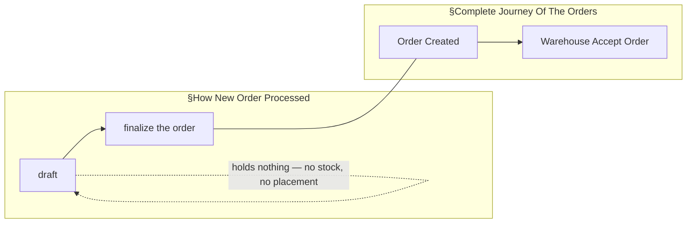

**The spec this makes buildable.**

| | |
| --- | --- |
| **before** | a **draft**. Facts only — marketplace, warehouse, shipping, customer, **external** product info. No stock, no rack placement. *(§Order Draft)* |
| **at** | **one atomic act.** Map each external SKU to our product · resolve each line's owner · commit stock · write the money · publish `Order Created`. All of it, or none. |
| **after** | the journey. The order is the warehouse's to accept. |
| **therefore** | **finalize may REFUSE.** Availability seen while drafting can go stale, and every check runs here — so a refusal is an ordinary outcome, not an error path. |

🔄 *(2026-10-17)* §Complete Journey is deleted ([the-status-move-is-the-only-journey](#the-status-move-is-the-only-journey)).
The verdict holds — *Order Created* is now `[*] --> pending` in §Status Move.

**What it closes.** The seam is gone, so *"when is stock committed?"* has one answer: **at finalize, which
is creation**. The words *"at creation"* are no longer ambiguous, and the diagrams now join.

**What it leaves open.** Only the **money** half of the same question — whether a draft posts a ledger
entry or trips the debt threshold, the shared lock or the reserve. §Order Draft names two physical things
and no financial one. See [Question 4](./context_clarify.md#question).


---

## a-draft-carries-its-shop

> Asked as *"Does a draft carry its shop?"* — the §Responsbility list names marketplace, warehouse,
> shipping, customer and external product info, and not the shop. **Owner: yes.**

**The verdict.** A draft carries its **shop** from the moment it exists. Since a shop belongs to a selling
team, a draft therefore has an **owning team** from the moment it exists. **There is no unowned draft.**

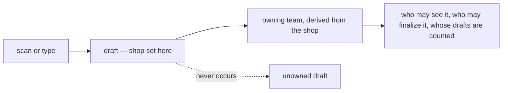

**Why it matters more than it looks.** Every other rule about a draft needs a team to point at: which
team's list it appears in, who may open it, whose [debt threshold](../balance/context_clarify.md#debt-threshold-limits-liability)
would be consulted if one ever were, and who is accountable for a bad one. *"Unowned"* is a state nothing
else in this system can handle, and this decision means it never arises.

**The spec.** `shop` is set at draft creation — the scanner knows which storefront it read, and a person
typing one picks it. A draft with no shop is refused at creation, not carried and resolved later.

**What it closes.** Critique 15, deleted from the clarify file. **What it does not touch:** the shop is not
in the owner's §Responsbility list, so the list and this decision have to be read together until the
list gains it.

---

## ensuring-an-order-is-whole-is-order-services-job

> Owner, in chat (2026-09-10) — *"this question should be in order context section, not in settlement,
> for ensure order half success or not its order service responsbility"*.

**The verdict.** Detecting and repairing a **half-succeeded order** belongs to `order_service`. The
question *"how is a half-succeeded order found afterwards"* is asked here, not in the settlement or
architecture clarifies.

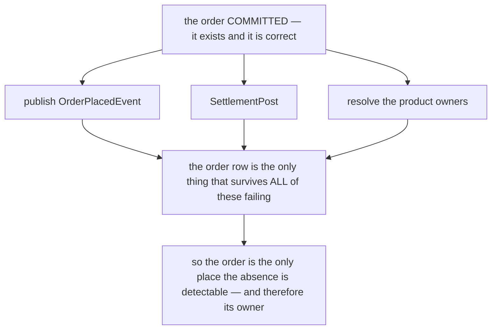

### Why the order, and not the consumers

Each downstream service can only see what it **received**. None of them can see what it **should have**
received and did not — settlement cannot enumerate the orders that never opened an account, because it
never learned they existed. **The order row is the one record that survives every one of these failures**,
which makes it both the only detector and the right owner.

### Where the question moved

| from | to |
| --- | --- |
| `technical/architecture/context_clarify.md` Q2 | a pointer |
| `business/settlement/context_clarify.md` Awaiting | a pointer |
| — | **[order Q14](./context_clarify.md#question)** |

### ⚠ What the routing exposed, which the split had hidden

Asked in three places it read as three problems. In one place it is **one gap at three sites**, and the
third is the worst — and had gone unremarked while it sat in settlement's file:

| site | what is lost | does it look like a failure? |
| --- | --- | --- |
| `OrderPlacedEvent` not published | liability never charges the order fee | a log line |
| `SettlementPost` fails | no settlement account opens | a log line ([the-order-commits-without-settlement](../settlement/context_decision.md#the-order-commits-without-settlement) flagged the finding as its own open half) |
| ⛔ **product owners unresolved** | the product fee, permanently | ⛔ **no** — `0` is written and read downstream as *"nobody to pay"*, so a transient catalogue blip is indistinguishable from a legitimately unowned line |

### ⛔ What is NOT decided by this

**How** the finder works. The recommendation in [order Q14](./context_clarify.md#question) is a nullable
timestamp per leg on the order's own row (`WHERE settlement_posted_at IS NULL`), chosen because it needs
no RPC from another service and over-reports only in the safe direction — a false positive costs one
idempotent retry. **That is a recommendation, not this decision.**

⚠ And it carries one precondition the stamp alone does not meet: `0` must stop meaning both *unresolved*
and *nobody to pay*, or the finder reports every legitimate case forever.

---

## the-order-follows-settlement-for-its-money

> Owner, in the doc (2026-09-15): §General — *"for order settlement, its follow [this](../settlement/context.md)"*
> — and §About Customer Pays & Order Revenue, §How Withdrawal/Revenue entered or left the business and §True
> Revenue removed as *"irrelevant for settlement"*.

**The verdict.** The order doc no longer describes marketplace money. The settlement doc is the authority, and
what the order owes it is **two calls**.

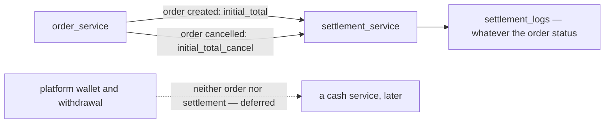

**The spec.**

| the order moves to | the order calls settlement |
| --- | --- |
| created (finalize) | `initial_total` |
| `cancel` | `initial_total_cancel` |
| any other status | nothing — fund, fees and adjustments are settlement entries, independent of status ([settlement-ignores-our-order-status](../settlement/context_decision.md#settlement-ignores-our-order-status)) |

**What it closes.** *"Estimate Revenue … doesn't affect the ledger"*, which contradicted `initial_total` being a
ledger row · a withdrawal written into the same revenue ledger as true revenue, which counted the money twice ·
and a return after `completed` no longer needs `completed` to be final for the marketplace money.
**What it leaves open:** whether `lost` and `return` also cancel the sale —
[lost-and-return-do-not-reverse-initial-total](./context_clarify.md#lost-and-return-do-not-reverse-initial-total).

---

## superseded-an-order-is-unique-by-shop-and-marketplace-ref

> ⛔ **SUPERSEDED IN PART (2026-10-15)** by [a-duplicate-ref-is-warned-not-refused](#a-duplicate-ref-is-warned-not-refused):
> two live orders **may** share a shop and ref — the form warns, the server refuses nothing. The ref is still
> **required** on every order; that half stands. Kept as the record, per the header.

> Owner, in the doc (2026-09-15): §Table That Must Have — *"`order_external_ref_id`, its for order uniqueness,
> its cannot empty"* · §How We Manage Order Uniqueness — *"Order uniqueness manage by code"*, *"Unique Scope by
> `order_external_ref_id` + `shop_id`"*, and a fetch of the existing order *"that not canceled"*.

**The verdict.** No two live orders share **`(shop_id, order_external_ref_id)`**. The ref is **required on
every order** — every order comes from a marketplace, so there is no phone-order exception. A cancelled order
does not hold its ref. The check is **in code**.

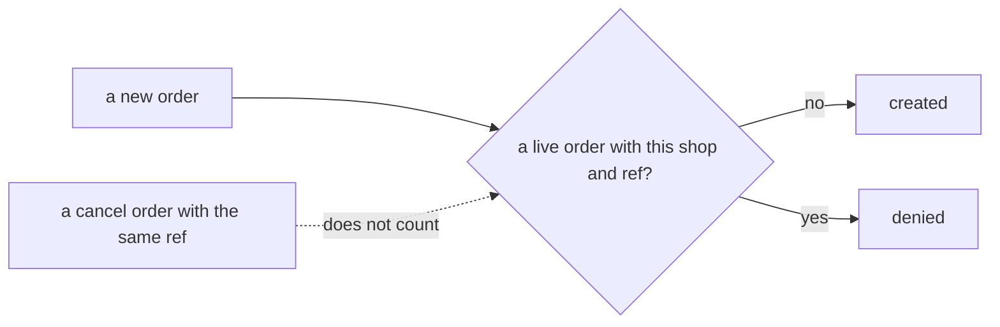

**The spec.**

| | |
| --- | --- |
| scope | `shop_id` + `order_external_ref_id` — a marketplace issues its ids per storefront |
| required | always. `""` is refused |
| cancelled orders | excluded, so a mistaken order can be cancelled and re-recorded |
| enforced | a handler check on create |

⚠ **What it reverses in the build.** `orders.order_external_ref_id` is `NOT NULL DEFAULT ''` and deliberately not
unique ([00012](../../../backend/services/selling_service/db_migrations/00012_order_external_ref.sql)), and
`openSettlement` skips a `marketplace_total` of 0 as a phone order. ⚠ **And it re-homes a rule settlement once
held:** [every-marketplace-order-carries-a-unique-platform-ref](../settlement/context_decision.md#every-marketplace-order-carries-a-unique-platform-ref)
was reversed when settlement moved to keying on our `order_id`
([settlement-keys-on-our-order-id](../settlement/context_decision.md#settlement-keys-on-our-order-id)) — and it had
allowed `""` for phone orders. Uniqueness is now the **order's** rule, and stricter.

**What it leaves open.** The drawn flow never reaches its deny branch, drafts versus orders, and the same-second
race — [one-uniqueness-check-covers-drafts-and-orders](./context_clarify.md#one-uniqueness-check-covers-drafts-and-orders).

---

## drafts-keep-their-own-table

> Owner, in the doc (2026-09-15): §Table That Must Have 2 — `order_drafts`, with `id`, `order_external_ref_id`
> (*"its for order uniqueness, its cannot empty"*) and `shop_id`. A `draft` status on `orders` was written and
> then removed in the same session.

**The verdict.** A draft is **not** an `orders` row. It lives in `order_drafts`, carrying the same ref and shop
as the order it will become.

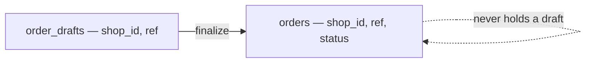

**Why it holds up.** Every reader of `orders` — the pick queue, lists, counts — stays free of unfinished scans
without remembering to exclude them, and `orders` keeps its required fields. **What it costs:** the ref's
uniqueness now spans two tables.

**The spec.** `order_drafts.shop_id` is set at creation
([a-draft-carries-its-shop](#a-draft-carries-its-shop)); its ref is never empty. ⚠ The build keys a draft on
`(team_id, source, external_id)` — that moves to `shop_id` + the ref.

**What it leaves open.** [one-uniqueness-check-covers-drafts-and-orders](./context_clarify.md#one-uniqueness-check-covers-drafts-and-orders).

---

## superseded-the-order-has-eight-statuses

> ⛔ **SUPERSEDED 2026-09-21** by [the-accept-is-the-status-return-completed](#the-accept-is-the-status-return-completed):
> a ninth status `return_completed` was added, with the move `return --> return_completed`. Everything below
> still holds for the other eight — only the count and that one edge changed.

> Owner, in the doc (2026-09-15): §Order Status — *Status That Existed* and *Status Move*, revised over the
> session to the form below.

**The verdict.** Eight statuses, and only these moves.

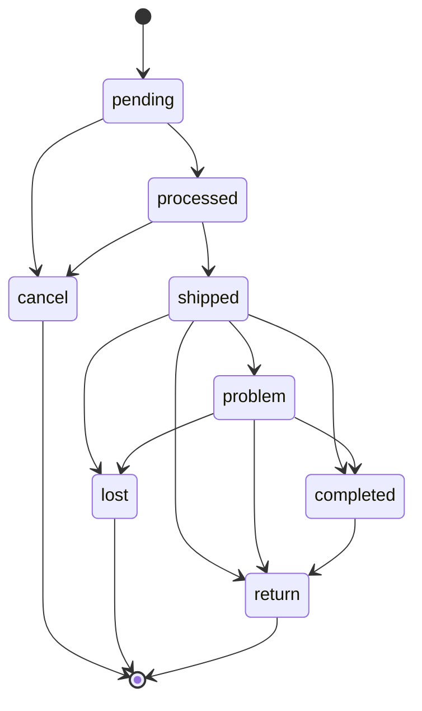

**The spec.**

| from | may move to |
| --- | --- |
| `pending` | `processed` · `cancel` |
| `processed` | `shipped` · `cancel` |
| `shipped` | `completed` · `problem` · `lost` · `return` |
| `problem` | `completed` · `lost` · `return` |
| `completed` | `return` |
| `cancel` · `lost` · `return` | nothing — final |

**What it settles.** An order can be **cancelled until it ships** · `problem` is a **holding state** that must
end · `completed` is **not final** — a return can follow it. **What it leaves stale:** §Complete Journey still
sets the old statuses ([Contradiction](./context_clarify.md#the-journey-still-sets-the-old-statuses)), and the
build's proto (`placed, confirmed, picking, packed, shipped, cancelled`) needs a migration when built.

---

## lost-is-final

> Asked: *"a lost parcel that turns up has nowhere to go — `lost --> return`, or is `lost` final?"*
> **Owner: "lost is final".** Against my recommendation, which was the edge.

**The verdict.** Nothing moves out of `lost`.

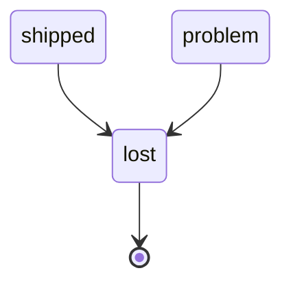

**The spec.** Every move out of `lost` is refused. **The consequence, stated so it is not rediscovered:** a
parcel found after being declared lost does **not** come back through its order — its goods re-enter stock by
some other path, which no doc describes yet (clarify *Awaiting*). 🔄 *(2026-10-21)* Described now:
[a-found-lost-parcel-is-a-found-stock-in](#a-found-lost-parcel-is-a-found-stock-in).

---

## the-warehouse-steps-are-not-order-statuses

> Asked (2026-09-24), while building the order list's tabs: `processed` folds `confirm · picking ·
> packed`, and the proto carries all three today — *"kru gudang kehilangan langkahnya, itu memang
> maunya?"*
> **Owner: yes — the warehouse's steps are not order statuses.**

**The verdict.** The ORDER carries the milestone. The record that owns the work carries its steps.

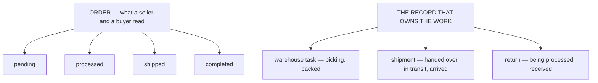

**The spec.** `processed` is one status covering **four** steps of work — `confirm · picking · packed ·
sudah diserahkan`. The last one is **HANDED OVER**, not "ready to hand over": the parcel has already
changed hands, and `shipped` begins when it starts MOVING. So the handover is the warehouse's last
step rather than the shipment's first. The build sees only three of the four — `OrderStatus` ends at
`PACKED` and has no value for the handover.

The four are a way to NARROW the pile, not a set of figures to read (owner, 2026-09-24): the order
list offers them as a filter under the `processed` tab. A per-step count line was built and taken
out — what a seller does with these is pick one.

**Why this is the same rule twice already recorded.**
[return-means-received-by-the-warehouse](./context_clarify.md#return-means-received-by-the-warehouse)
put a return's transit on a return record rather than on the order, and shipment tracking was
deferred to the shipment. Picking and packed are the third instance, so the set of eight
([superseded-the-order-has-eight-statuses](#superseded-the-order-has-eight-statuses)) is not a simplification for its own
sake — it is one boundary applied consistently.

⚠ **The old system had already reached the same place by hand.** Its eleven statuses sat under a
"diproses gudang" umbrella tab that hid exactly those four — somebody had found the leaves too
granular to browse by and built a control to fold them. This makes that permanent.

⚠ **What it does NOT settle:** where the warehouse's own QUEUE lives. Filtering by the four on the
order list lets a seller find *which* orders are still being packed; it does not give the crew a
screen to work from, and no doc describes that screen or that record yet.

🔄 *(2026-10-16)* **Amended by [picked-and-shipping-are-order-statuses](#picked-and-shipping-are-order-statuses)**: two of the four
steps are order statuses now — picking ends in `picked`, and the handover sets `shipping`. Packing stays a step with no
status, and `shipped` keeps its meaning here: the parcel moving.

---

## the-total-is-ours-the-platform-total-is-theirs

> Owner (2026-09-16): **"platform_total win"** — asked as whether the buyer-paid figure keeps the build's
> name `marketplace_total` or the doc's new `platform_total`. Written into §Different `total` and
> `platform_total`.

**The verdict.** Two figures, never mixed, and the buyer-paid one is **`platform_total`** in every doc,
proto, column and screen.

| | what it is | who computes it | what reads it |
| --- | --- | --- | --- |
| `total` | **our** price for the order, as the system calculates it | us | the **warehouse fee** basis is `sub_total`, not this ([the-warehouse-fee-is-a-percentage-of-the-goods](#the-warehouse-fee-is-a-percentage-of-the-goods)), margin |
| `platform_total` | what the **storefront actually took** from the buyer, after its vouchers and subsidies | the marketplace | settlement's `initial_total` |

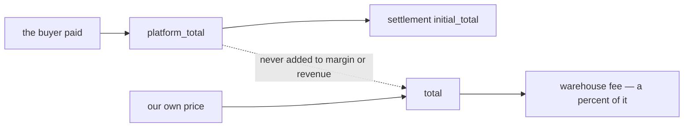

**What changes.** The shipped column is `orders.marketplace_total`, so this is a rename, not a new field —
and it stays a **fact, not an estimate**
([marketplace-total-is-a-fact-not-an-estimate](../settlement/context_decision.md#marketplace-total-is-a-fact-not-an-estimate),
whose own name now reads against the vocabulary it described).

| where | roughly |
| --- | --- |
| `proto/` — `selling/v1/order.proto`, `settlement/v1/settlement.proto` | 5 sites, then regenerate |
| `backend/` — the model, `order_place.go`, the settlement poster, tests | 25 |
| `frontend/src/` — the order form, the detail panel, the settlement screens, both locale files | 35 |
| `docs/` — settlement's context and decisions, the schema doc | 64 |
| a migration renaming the column added by `00008_order_marketplace_total.sql` | 1 |

⚠ **What it leaves open:** `marketplace_type` still says *marketplace*, so one doc now uses both words.
Settlement's append-only decisions keep the old name in their text and are renamed by reference, not edited.

---

## superseded-the-warehouse-fee-is-a-percentage-of-our-total

> ⛔ **REVERSED — NOT IN FORCE.** Superseded by [the-warehouse-fee-is-a-percentage-of-the-goods](#the-warehouse-fee-is-a-percentage-of-the-goods):
> the owner made the basis `sub_total`, *"goods only"*, the same day. Kept because this file is append-only.
> **Do not build from it.**

> Owner (2026-09-16): **"yes"** to *"Is the warehouse fee a percentage of `total` (our price), not
> `platform_total`?"*

**The verdict.** `WarehouseFeeCalculate`'s `order_total` is **`orders.total`** — our own figure. The
platform's discounting never changes what the warehouse is paid.

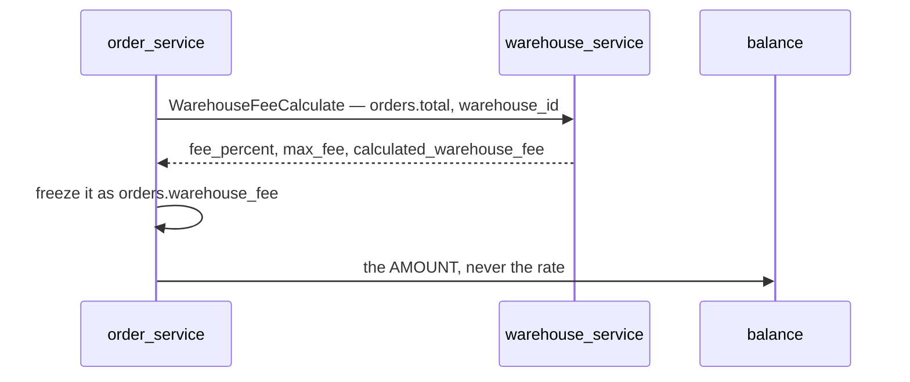

**The spec.**

| | |
| --- | --- |
| basis | `orders.total` — never `platform_total`, which can be missing and would compute a fee of 0 |
| rate | `fee_percent`, capped by `max_fee`, both from the warehouse's own config |
| frozen | when the order calls, per [warehouse-prices-balance-records](../teams/warehouse/context_decision.md#warehouse-prices-balance-records) |
| stored | `orders.warehouse_fee`, the frozen copy |
| balance | is told the amount and records it; it computes nothing |

**Why it holds up.** The work of picking and packing is the same whether the marketplace discounted the
sale or not, so the warehouse should not absorb a promotion it had no part in.

⚠ **What it leaves open:** `total` includes **shipping cost**, so the warehouse earns a percentage of the
courier's fee as well as of the goods. If that is not intended the basis is `subtotal`, not `total`.
⚠ And the build still charges a **flat** `liability_terms.handling_fee`, which this supersedes —
see [is-the-old-flat-rate-column-dropped](../teams/warehouse/context_clarify.md#question).

🔄 *(2026-10-19)* **Both settled:** the basis is `goods_cost` ([the-fee-is-priced-on-goods-cost](../teams/warehouse/context_decision.md#the-fee-is-priced-on-goods-cost)),
never shipping, and the flat rate is dropped last ([the-flat-rate-is-dropped-last](../teams/warehouse/context_decision.md#the-flat-rate-is-dropped-last)).

---

## platform-total-is-required-at-finalize

> Owner (2026-09-16): **"yes"** to *"Is `platform_total` required at finalize?"*

**The verdict.** An order cannot be finalized without `platform_total`. It is the figure settlement opens
the account on, so an order missing it can never be settled.

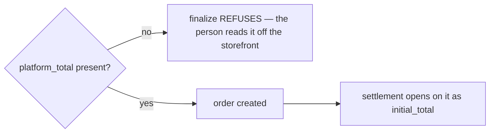

**The spec.** Checked at finalize, on **both** doors — the typed order and the promoted draft. A draft may
hold it empty while it is still being worked on; finalize is where it becomes required.

⚠ **What must change in the build.** `openSettlement` today **returns early when the figure is 0**, treating
0 as *"an order taken over the phone"* — silently, with no log line. With this decision that case cannot
arise, so the early return becomes dead code and should be replaced by the finalize check. ⚠ And
`OrderDraftPromote` passes no total at all, so **every promoted draft is currently a 0** — the draft must
carry `platform_total` and finalize must copy it.

---

## the-warehouse-fee-is-a-percentage-of-the-goods

> Owner (2026-09-16), in §Table That Must Have: *"`sub_total`, goods only, used for warehouse fee charge
> calculation"* — reversing [superseded-the-warehouse-fee-is-a-percentage-of-our-total](#superseded-the-warehouse-fee-is-a-percentage-of-our-total)
> the same day, in the direction I recommended.

**The verdict.** The fee is a percentage of **`sub_total`** — the goods alone. Shipping is not in the basis,
and neither is `platform_total`.

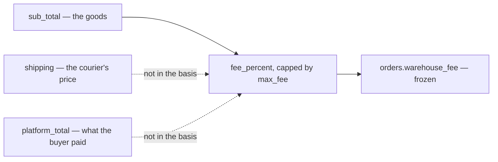

**Why it beats the alternative.** Shipping is a proxy for the **courier's** cost, not the warehouse's: the
same box, same picking and same packing, priced 80% apart because one buyer lives further away or because a
free-shipping promotion was running. Basing the fee on the goods asks the one question the warehouse can
answer — *what were the goods worth?*

**The spec.**

| | |
| --- | --- |
| basis | `orders.sub_total` |
| rate | `fee_percent`, capped by `max_fee`, from the warehouse's own config |
| frozen | when the order calls, per [warehouse-prices-balance-records](../teams/warehouse/context_decision.md#warehouse-prices-balance-records) |
| stored | `orders.warehouse_fee` |
| balance | is told the amount; it computes nothing |

⚠ **It costs nothing today** — `warehouse_service` does not exist yet, so `WarehouseFeeCalculate`'s
`order_total` payload field is renamed to the goods figure before anything is built against it.

---

## platform-is-the-word-for-the-outside-marketplace

> Owner (2026-09-16): **"platform_total win"**, then `marketplace_type` → **`platform_type`** in
> §Table That Must Have.

**The verdict.** One vocabulary for the storefront outside our system: **platform**. `platform_type`,
`platform_total`.

| ours | theirs |
| --- | --- |
| `sub_total` · `total` · `warehouse_fee` | `platform_type` · `platform_total` |

⚠ **What still says *marketplace*** and is now inconsistent: the shipped `orders.marketplace_total` column
and `order.proto`, `shops.marketplace` and its enum, settlement's `context.md` and its append-only decisions
(renamed by reference, never edited), and the frontend's `MarketplaceInfoForm` plus both locale files. The
rename lands as one change per side, not gradually — a half-renamed vocabulary is worse than either name.

---

## an-order-records-no-shipping-cost

> Owner (2026-09-16): **"no"** to *"Does an order record shipping cost?"* — asked because the field vanished
> from §Table That Must Have while the journey still hands parcels to a shipping channel.

**The verdict.** An order stores **no shipping cost**. The buyer pays the platform, the platform pays the
courier, and none of that money passes through us — so there is nothing for the order to record.

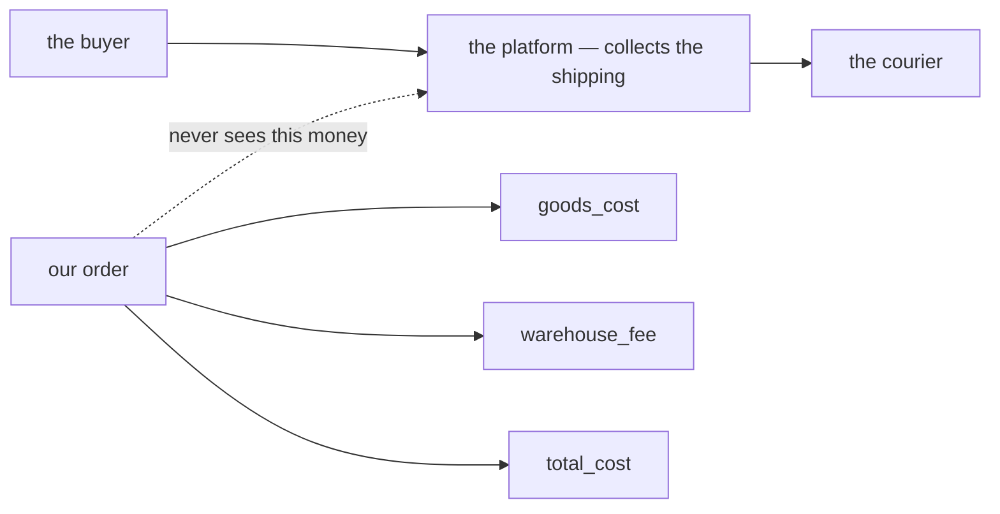

**What the order still records about shipping** — the facts, never the money: which **courier**
(`shipping_code`), the **receipt** (`receipt`, `receipt_file`), and the draft's *"shipping info"*.

**What changes in the build.** `orders.shipping_cost` is dropped, `total` stops being
`subtotal + shipping_cost`, and **`margin = total − cogs − shipping_cost` no longer holds** — with shipping
gone it becomes `platform_total − total_cost`. The order form's shipping-cost input and the detail panel's
row go with it.

⚠ **It does not touch inbound shipping.** `shipping_fee` and `cod_fee` on a restock or return are the
warehouse's real outlay and stay exactly as the balance doc describes them — a different journey, in the
opposite direction.

---

## the-cross-charge-lives-on-the-line

> Owner (2026-09-16), in §Table That Must Have: a third table, `order_items`, carrying `owner_team_id`,
> `price` (*"if cross, price before markup"*), `markup_price`, `markup_total` and `total`.

**The verdict.** The cross/shared charge is a fact about a **line**, not about an order. One order may borrow
from several teams, and each line names the team it is owed to.

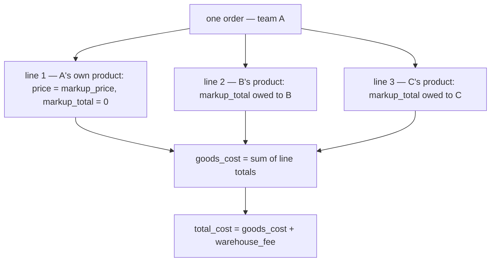

**What it settles beyond the grain.** `goods_cost` is a **cost**, not a sale figure: a line's `price` is the
figure *before* markup, so the sum of `markup_price × qty` is what the goods cost the selling team — own
lines at their own cost, borrowed lines at the owner's cost plus that owner's markup. That is the same
arithmetic the product doc states as `COGS = UnitPrice + fee`, now written per line.

**The spec.**

| | |
| --- | --- |
| `owner_team_id` | the team whose goods this line sold. Equal to the order's team on an own line |
| `price` | the unit figure before markup |
| `markup_price` | the unit figure after the owner's markup. On an own line, the same as `price` |
| `markup_total` | `(markup_price − price) × qty` — **what is owed to `owner_team_id`** |
| `total` | `markup_price × qty` — this line's cost |
| the order | `goods_cost = Σ total` · `total_cost = goods_cost + warehouse_fee` |

⚠ **Corrected 2026-09-17:** the row above calling `markup_total` *"what is owed to `owner_team_id`"* was my error. The owning
team is owed the whole line `total` — the goods **and** the markup — per
[the-product-fee-is-the-line-total](#the-product-fee-is-the-line-total). `markup_total` is what that team **earns**.

⚠ **Renamed the same day** (owner, 2026-09-16): `price` → **`unit_cost`**, `markup_price` → **`unit_cost_with_markup`**
— the figures and the verdict are unchanged, and the names now match `goods_cost` and `total_cost` beside them,
and the build's own `order_items.unit_cost`.

**What it closes.** §Whats Charge In Order's `cross_product_cost` needs no order-level field: it is
`Σ markup_total`, per owner. And the half-finished-order design's *"frozen owner per line"* now has a home —
`owner_team_id` on the line rather than a `0` riding on an event.

---

## a-lines-money-is-frozen-at-finalize

> Owner (2026-09-16), §Order Items Table: *"money in columns are frozen at finalize and never recomputed."*

**The verdict.** Every money column on a line — and the order totals summed from them — is written **once**,
at finalize, and never recalculated afterwards.

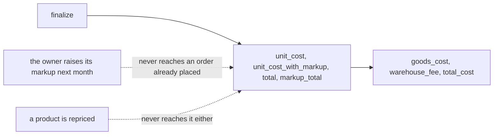

**Why it matters more than it reads.** A markup, a fee percentage and a product's cost all change over time.
Recomputing would rewrite what a team was charged for a sale that already happened, and two teams would then
disagree about a debt neither of them changed. It is the same rule the ledger's reversal already follows —
`ReverseOrder` reads back what was charged rather than deriving it, *"a rate changed between placement and
cancellation would make it disagree by design"*.

**The spec.**

| | |
| --- | --- |
| frozen | `unit_cost` · `unit_cost_with_markup` · `total` · `markup_total` · `goods_cost` · `warehouse_fee` · `total_cost` |
| written | at finalize, in the order's own transaction |
| never | recomputed on read, on a rate change, or on a repricing |
| a correction | is a new fact — a reversal or an adjustment — never an edit of these columns |

⚠ **What it makes sharper, not smaller.** If the picked quantity differs from the ordered one, these figures
stay as written — so the difference can only be carried by a **new** fact, which is why the order still has to
announce what actually shipped
([the-order-announces-what-shipped-and-what-came-back](./context_clarify.md#the-order-announces-what-shipped-and-what-came-back)).

🔄 *(2026-10-17)* **No longer so.** The picked quantity cannot differ any more — a short pick never ships
([what-shipped-is-what-was-ordered](#what-shipped-is-what-was-ordered)) — so the frozen figures are always the shipped
ones, and no new fact is needed.

---

## superseded-the-two-draft-line-tables-are-not-linked

> ⛔ **REVERSED — NOT IN FORCE.** Superseded by [a-draft-holds-only-the-platforms-lines](#a-draft-holds-only-the-platforms-lines)
> the same day: `order_draft_items` was removed, so there are no longer two line tables to link. Kept because
> this file is append-only. **Do not build from it.**

> Asked as *"add a nullable `platform_item_id` to `order_draft_items`, so a mapped line names the platform
> line it came from?"* — **Owner: "no need, we dont have that."** Against my recommendation.

**The verdict.** A draft holds two line tables that **do not reference each other**.
`order_draft_platform_items` is what the platform said; `order_draft_items` is what a person decided we will
ship. They sit side by side and are read together by eye.

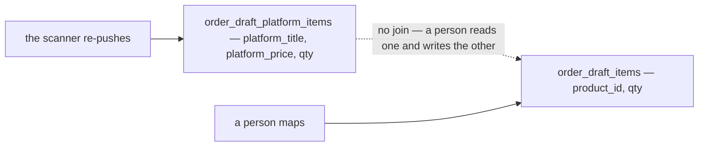

**Why it is defensible.** The relationship often is not one-to-one — a platform line can be a bundle of two
of our products, and two lines can be one — so a per-line link would be a claim the data cannot always
support. The split still buys the thing that matters: **the push owns one table and the person owns the
other**, so a re-scrape can replace the platform's lines wholesale and never destroy someone's work.

**What follows from it, recorded so it is not rediscovered as a bug:**

| | |
| --- | --- |
| progress | a draft cannot say *"5 of 8 mapped"* — only that both tables have lines. Counts can match while the wrong products are mapped |
| review | the reviewer compares the two lists **by eye**. That is the control, so the screen must show them side by side |
| auto-mapping | nothing records *this platform SKU became that product*, so repeat products cannot arrive pre-mapped from the draft's own history |
| bundles | a bundle is expressible precisely because no link is claimed |

⚠ **The review screen carries the weight this design gives up.** With no link and no progress count, the only
thing standing between a mis-scrape and a real order is a person reading two lists — so finalize must show
them together, and quantities must be easy to compare.

---

## drafts-exist-only-for-the-third-party-app

> Owner (2026-09-16), §Order Draft Behavior and What Used For 1–2: *"order draft is used **only by third
> party app**, when manual, customer service just simple direct create order"* · *"order draft exists for
> accomodate third party app to not create order directly. Its because third party app have incomplete data
> to create a proper order."*

**The verdict.** A draft is the **app's inbox**, nothing else. A person never drafts: Customer Service types
an order and creates it.

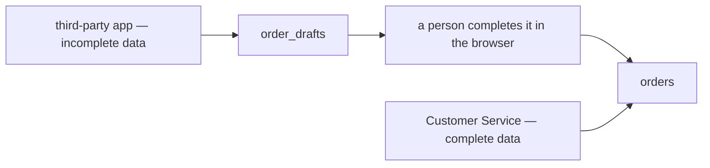

**Why the draft exists at all.** Not as a save-for-later: an app **cannot** produce a valid order, because it
does not know our products, our warehouse or the rest. The draft is the shape that holds an incomplete scrape
until a person finishes it — which is why *"nothing at draft"* is structural, and why a draft can never be
what a hurried person uses to postpone typing an order properly.

**What it closes.** The form's minted `form-…` external ids disappear with the person-drafting path.

---

## the-frontend-finalizes-a-draft-not-the-backend

> Owner (2026-09-16), §Order Draft Behavior and What Used For 3–4: *"finalize order draft to order not doing
> by backend. draft is fetched by frontend and seed manually in frontend"* · *"`order_draft_platform_items`
> data is just showed in frontend as reference."*

**The verdict.** There is **no promote RPC**. The browser fetches the draft, seeds the create-order form from
it, a person completes it, and the ordinary create-order call runs. The platform's lines are shown beside the
form as reference and are never submitted.

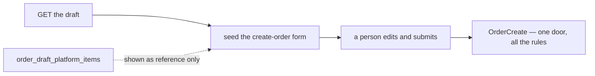

**What it buys.** One door into `orders`, so the rules cannot differ between a typed order and a finalized
draft — the reason the build gave for sharing a code path, now achieved by having only one path.

⚠ **What it costs, recorded so it is not rediscovered.** The build deletes the draft **inside the order's
transaction**, so *"the order exists and the draft is gone"* is one fact. Two separate calls cannot be atomic:
if the create succeeds and the draft is not removed, the draft stays in the queue and can be finalized again.

| | |
| --- | --- |
| the safety net that already exists | [superseded-an-order-is-unique-by-shop-and-marketplace-ref](#superseded-an-order-is-unique-by-shop-and-marketplace-ref) — the second attempt carries the same ref and is refused |
| what the net does not fix | a **stale draft** sitting in the queue, which a person will open and work on again |
| 🔄 *(2026-10-15)* | **amended by [a-duplicate-ref-is-warned-not-refused](#a-duplicate-ref-is-warned-not-refused)** — the second attempt is now **warned**, not refused. The net is the person reading the warning |
| ⚠ **→ Recommend** | the create-order request carries `order_draft_id`, and the backend removes the draft in the same transaction. The seeding stays in the browser; only the cleanup moves back |

⚠ **And it reopens who writes `order_draft_items`.** [the-two-draft-line-tables-are-not-linked](#the-two-draft-line-tables-are-not-linked)
assumed the push owns the platform lines and a **person** owns ours. With finalize happening entirely in the
browser, nobody saves a mapping back to the draft — so either the **app** writes `order_draft_items` too, or
that table has no writer at all. Asked in the clarify.

---

## a-draft-holds-only-the-platforms-lines

> Owner (2026-09-16): **"im remove `order_draft_items`, its no sense"** — asked as *"who writes
> `order_draft_items` — the app, or nobody?"*

**The verdict.** A draft is an `order_drafts` header plus `order_draft_platform_items`. **Nothing of ours is
stored on a draft** — no product, no owner, no cost, no mapped line.

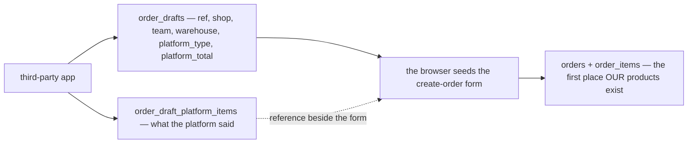

**Why it is right.** The table had **no writer**. With
[the-frontend-finalizes-a-draft-not-the-backend](#the-frontend-finalizes-a-draft-not-the-backend), mapping
happens in the create-order form and goes straight to `orders`; nothing ever saved a mapping back to a draft.
A table nobody writes is a table that reads as a promise the system does not keep.

**What it completes.** *"Nothing at draft"* is now total rather than nearly true: a draft cannot know whose
goods a line is, what they cost, or whether a limit is breached — because it holds no product at all. Every
check therefore lands at create, which is the one door.

⚠ **The cost, stated plainly:** mapping progress is **not saved**. A person who maps six lines of an
eight-line scrape and closes the tab starts again — the form is browser state until it is submitted. That is
acceptable while an order is minutes of work, and is the thing to revisit if drafts ever get large.

⚠ **It also corrects the ownership note** in the superseded decision above: the app owns **everything** a
draft contains. A person writes nothing to a draft — they read it, and write an order.

---

## superseded-finalizing-deletes-the-draft-from-the-frontend

> ⛔ **REVERSED — NOT IN FORCE.** Superseded by [create-order-takes-the-draft-id-and-deletes-it](#create-order-takes-the-draft-id-and-deletes-it)
> the same day: the create call now carries `order_draft_id` and removes the draft itself, so the browser no
> longer makes two calls. Kept because this file is append-only. **Do not build from it.**

> Owner (2026-09-16), §Order Draft Behavior diagram: a fork out of *"Create Order Frontend"* to both
> *"Draft Deleted"* and *"New Order Created"* — answering *"what removes the draft?"*

**The verdict.** The browser does both: it creates the order and deletes the draft. There is no backend
promote, so the two are **separate calls**.

```mermaid
flowchart LR
  F["the create-order screen, seeded from the draft"] --> C["OrderCreate"]
  C --> D["OrderDraftDelete"]
  D --> Q["the draft leaves the queue"]
```

⚠ **The fork draws them as one act; they are two, and the order between them decides which failure you get.**

| sequence | if the second call fails |
| --- | --- |
| **create, then delete** | the order exists, the draft stays in the queue. Someone opens it again — and the duplicate order is refused by [superseded-an-order-is-unique-by-shop-and-marketplace-ref](#superseded-an-order-is-unique-by-shop-and-marketplace-ref). **Wasted work, nothing lost** |
| ⛔ **delete, then create** | the draft is gone and **no order exists**. The scrape is lost, and nobody is told |

**→ Recommend, in order of preference:**

1. **`OrderCreate` takes `order_draft_id` and removes the draft in its own transaction.** One call, one fact,
   nothing to sequence. The seeding stays in the browser — only the cleanup moves back.
2. Failing that: **create first, delete second, never the reverse**, with the delete retried on failure.

⚠ **And a re-scrape can resurrect a finalized draft.** The app's push is create-or-update on the reference,
so a deleted draft reappears the next time the app reads that order. **→ A push whose reference already
belongs to a live order should be refused**, which is the same check the uniqueness rule already defines.

⚠ **Drafts nobody finalizes have no ending.** *"Avoid — customer service still busy"* loops back to the list,
and nothing ages a draft out, so the queue only grows. Not a question for this decision; worth a rule of its
own.

---

## create-order-takes-the-draft-id-and-deletes-it

> Owner (2026-09-16), §Order Draft Behavior 5: *"create order optionally take `order_draft_id`, its used for
> when create order succeed, draft order is deleted"* — and [order_creation.md](./order_creation.md) draws
> `if success → Delete Draft Order`. As recommended.

**The verdict.** `order_draft_id` is an **optional** field on create. A typed order omits it; an order
finalized from a draft carries it, and a successful create removes that draft. The browser makes **one call**.

```mermaid
flowchart LR
  D["the draft seeds the form in the browser"] --> C["OrderCreate — with order_draft_id"]
  C -->|"success"| X["the draft is deleted"]
  C -->|"refused"| K["the draft is still there, and can be retried"]
  T["a typed order"] --> C2["OrderCreate — no draft id"]
```

**What it removes.** The ordering hazard the two-call version had: there is no sequence in which the draft can
be deleted while the order fails, so a scrape can never be lost. A refused create leaves the draft exactly
where it was.

**The spec.**

| | |
| --- | --- |
| the field | `order_draft_id`, optional. Absent = a typed order |
| on success | the draft is deleted |
| on refusal | nothing is deleted — the person fixes the form and submits again |
| a draft id that does not exist, or belongs to another team | the create is refused, rather than silently ignoring it |

⚠ **Still outside the transaction, as drawn.** [order_creation.md](./order_creation.md) puts the delete on the
`if success` branch **after** the commit, so a failed delete still leaves a finalized draft in the queue —
the benign failure, but an avoidable one. Drafts and orders are the same service and the same database, so
**→ recommend the delete run inside the order's transaction**, which makes *"the order exists and the draft is
gone"* one fact. ✅ *(2026-10-17)* Taken — [the-draft-is-deleted-in-the-orders-transaction](#the-draft-is-deleted-in-the-orders-transaction).

⚠ **And a re-scrape can still resurrect it.** The app's push is create-or-update on the reference, so a
deleted draft returns the next time the app reads that platform order. **→ A push whose reference already
belongs to a live order should be refused** — the same check the uniqueness rule already defines.

---

## an-address-is-plain-names

> Owner (2026-09-16): **"use plain names in addresses"** — asked as *"keep the region codes beside the
> names?"*. **Against my recommendation.**

**The verdict.** `order_addresses` stores **names only**: `provinsi_name`, `kabupaten_name`,
`kecamatan_name`, `desa_name`, `postal_code`, `address_line`, plus `customer_name` and `customer_phone`. No
`region_service` codes are kept on the order.

```mermaid
flowchart LR
  P["region_service — 91.599 rows keyed by kode wilayah"] --> PICK["the person picks a place"]
  PICK --> A["order_addresses — the NAMES only"]
  PICK -.->|"the code is not kept"| A
  A --> LABEL["what gets printed on the parcel"]
```

**Why it holds up.** An order's address is read by a **courier**, not by a query. We no longer price
shipping at all ([an-order-records-no-shipping-cost](#an-order-records-no-shipping-cost)), so the one thing
the codes were needed for — rate calculation by region — is not ours to do. What remains is a label that
must still read correctly in five years, and a frozen name does that without `region_service` existing.

**What it gives up, recorded so it is not rediscovered as a bug:**

| | |
| --- | --- |
| grouping by region | *"how many orders to Cikarang Utara"* is unanswerable — the name repeats across the country, and nothing says which one this was |
| re-validating an old address | the stored text cannot be matched back to the current region list once a name changes upstream |
| the picker's own answer | `AddressPicker` selects a coded row and the code is discarded on write |

**→ If region analytics are ever wanted**, this is the decision to revisit first — the cheapest fix is
adding the four codes back at write time, not deriving them later from text.

⚠ **The build stores codes today** — `provinsi_code`, `kabupaten_code`, `kecamatan_code`, `desa_code` on
`orders` — so this is a column drop, and `kode_pos` becomes `postal_code` in the same move.

---

## a-draft-carries-the-scraped-address

> Owner (2026-09-16): `order_draft_addresses` added, mirroring `order_addresses` field for field — asked as
> *"should a draft hold the scraped address?"*. As recommended, and in a stronger shape than I proposed.

**The verdict.** A draft carries the buyer: `customer_name`, `customer_phone`, the four region **names**,
`postal_code` and `address_line` — the same columns an order's address has.

```mermaid
flowchart LR
  APP["third-party app scrapes the platform"] --> DA["order_draft_addresses"]
  DA --> F["seeds the create-order form"]
  F --> OA["order_addresses — frozen on the order"]
```

**Why mirroring beats free text.** I had proposed one raw blob, on the grounds that a scrape cannot be
trusted to split an address. Mirroring is better: whatever the app **can** split arrives in the right box and
needs no re-reading, and whatever it cannot is simply left empty for the person to fill. A blob would have
made every draft need the same manual work, including the ones the app got right.

**The spec.**

| | |
| --- | --- |
| written by | the app, on push — like everything else on a draft ([a-draft-holds-only-the-platforms-lines](#a-draft-holds-only-the-platforms-lines)) |
| completeness | **best effort.** Every field may be empty; a draft is defined by being incomplete |
| what completes it | the person, in the create-order form — the draft itself is never corrected |
| what is frozen | only `order_addresses`, written at create. A draft's copy is working material |

⚠ **Where an unsplittable address should land:** `address_line`, holding whatever text the platform gave,
so nothing is lost when the app cannot parse the region tiers.

---

## one-address-per-order-and-per-draft

> Owner (2026-09-16): **"yes"** to *"one address row per order and per draft — unique on `order_id` /
> `order_draft_id`?"*

**The verdict.** `order_addresses.order_id` and `order_draft_addresses.order_draft_id` are **unique**. An
order has exactly one address, and so does a draft.

```mermaid
erDiagram
  orders ||--|| order_addresses : "exactly one"
  order_drafts ||--|| order_draft_addresses : "exactly one"
```

**What it buys.** Nothing that reads an address has to choose between rows or define what "the current one"
means — the join is total, and an order detail can read it as if it were columns.

**The spec.**

| | |
| --- | --- |
| the constraint | `UNIQUE (order_id)` · `UNIQUE (order_draft_id)` |
| written | in the **same transaction** as its parent — an order without an address must not be reachable |
| corrections | update the one row. There is no second address and no history of addresses |
| a later billing address | would be a **new decision**, not a second row in this table |

⚠ **The build's `customer_name` is required** (`orders_customer_present CHECK`). Splitting the table moves
that rule: the address row must exist and carry a name, or the same guarantee is quietly lost.

---

## shipment-channel-is-an-id-into-shipment-service

> Owner (2026-09-16): *"we later have shipment_service and have id mapped to shipment channel"* — asked as
> *"`shipment_channel_id` or the courier code, as the build has it?"*

**The verdict.** `orders.shipment_channel_id` and `order_drafts.shipment_channel_id` hold an **opaque id**
owned by a `shipment_service` that does not exist yet. Not a code, not a name.

```mermaid
flowchart LR
  O["orders.shipment_channel_id"] -->|"opaque id, no FK — HARD RULE 3"| S["shipment_service (planned)"]
  S --> N["the channel's name, for a screen"]
  D["order_drafts.shipment_channel_id"] --> S
```

**The spec.**

| | |
| --- | --- |
| type | an id, opaque to `order_service`, **no cross-service FK** |
| who resolves it | `shipment_service`, by RPC, when a screen needs the name |
| on a draft | the app sets it when it knows the channel; empty otherwise |

⚠ **It replaces the build's `orders.shipping_code`** — an opaque courier code resolved against
`shipping_service`'s `shippings` table. Two services cannot both own the courier catalogue, so when
`shipment_service` arrives, `shipping_service`'s role in the order path ends.

⚠ **This is the opposite habit from the address beside it.** [an-address-is-plain-names](#an-address-is-plain-names)
freezes text so a past order renders alone; this stores a reference that must be resolved every time. So a
renamed or retired channel changes what an old order appears to have shipped by — and a deleted one leaves a
blank. **→ Recommend freezing the channel's NAME beside the id**, the way the receipt already freezes its
filename. Open, not decided.

---

## the-channel-name-is-not-frozen

> Owner (2026-09-16): **"no, we use id no channel name/code"** — closing the open half of
> [shipment-channel-is-an-id-into-shipment-service](#shipment-channel-is-an-id-into-shipment-service).
> **Against my recommendation.**

**The verdict.** The order stores `shipment_channel_id` and **nothing else** about the channel. Every screen
that shows a courier resolves the name from `shipment_service` at read time.

```mermaid
flowchart LR
  O["orders.shipment_channel_id"] --> R["resolve at read time"]
  R --> S["shipment_service"]
  S --> N["the channel's CURRENT name"]
```

**Why it is coherent.** A courier is a **live counterparty**, not a historical fact the way an address is: if
a channel is renamed, the current name is the useful one — it is what support, the tracking page and the
courier themselves use. Freezing a superseded label would make an old order harder to act on, not easier.
It also keeps one name in one place, so a correction reaches every order at once.

**What it costs:**

| | |
| --- | --- |
| a renamed channel | rewrites what **every past order** appears to have shipped by |
| a **deleted** channel | leaves old orders pointing at nothing, with no text to fall back on |
| rendering | an order detail cannot show a courier without calling `shipment_service` |

**→ The mitigation belongs to `shipment_service`, not here: a channel is RETIRED, never deleted.** Orders
reference it forever, so a hard delete breaks history that this decision has no fallback for. Worth writing
into that context when it is designed.

---

## inventory-returns-stock-on-order-cancelled

> Owner (2026-09-17), [event_context.md](./event_context.md) §Order Cancel: `inventory_service` subscribes,
> *"to canceling stock that provisioned"* — asked as *"on cancel, who puts the stock back?"*

**The verdict.** Cancelling an order releases its stock through the **Order Cancel** event. Inventory is one of
three subscribers, beside settlement and balance.

```mermaid
flowchart LR
  C["order moves to cancel"] --> E["Order Cancel event"]
  E --> S["settlement_service — initial_total_cancel"]
  E --> B["balance_service — reverse warehouse_fee and product_fee"]
  E --> I["inventory_service — release the provisioned stock"]
```

**What it changes in the build.** `order_cancel.go` returns stock with a **synchronous** `stock.Return` call
today, and fails the cancel if that call fails. With a subscriber, the cancel commits on its own and the stock
comes back when the event is consumed — so a cancelled order's goods are briefly still held.

⚠ **What it makes load-bearing.** A lost Order Cancel publish now strands stock as well as leaving fees
charged, which is why the publish needs its sent-at stamp
([half-finished-orders-are-found-from-the-order](./context_clarify.md#half-finished-orders-are-found-from-the-order)).
And inventory must release **idempotently**, keyed on the order — a redelivered cancel must not return the
same units twice.

---

## a-take-reduces-stock-and-placement

> Owner (2026-09-17): *"its reduce stock and placement, shelf and other its inventory service responsbility"*
> — asked as *"does a take at create reduce the free-to-sell quantity, or the quantity physically on the
> shelf?"*, after *"provision"* was corrected to a direct **take**.

**The verdict.** Creating an order **takes stock directly**: the call to inventory reduces stock and placement
at once. How that is represented inside inventory — shelves, racks, counts, what is free to sell versus
physically present — is **inventory's** to design, not the order's.

```mermaid
flowchart LR
  O["order created"] -->|"take — reduces stock and placement"| I["inventory_service"]
  I --> X["shelves, racks, counts, available versus on-hand — inventory's own design"]
  C["order cancelled"] -->|"Order Cancel event"| I
```

**The spec, from the order's side.**

| | |
| --- | --- |
| when | at create, inside the create flow — not a hold, not a reservation |
| reversed | by the Order Cancel event ([inventory-returns-stock-on-order-cancelled](#inventory-returns-stock-on-order-cancelled)) |
| not the order's to decide | which quantity a take lowers, and how a stock count treats units taken but not yet picked |

⚠ **Re-routed, not dropped.** A stock count between create and pick can re-add a unit that was already taken,
because the build keeps one `on_hand` per shelf. That is now asked in
[inventory Q11](../inventory/context_clarify.md#question), where it can be answered.

---

## rupiah-is-floating-point

> Owner (2026-09-17): **"all rupiah using double or float"** — asked as *"`int64` rupiah instead of
> `double`?"* **Against my recommendation.**

**The verdict.** Rupiah amounts are floating point — `double`/`float` — across the system, not whole-rupiah
integers.

```mermaid
flowchart LR
  P["percent fee and markup"] --> F["fractions of a rupiah"]
  F --> D["carried as double"]
  D --> R["summed into orders, fees and balances"]
```

**Why it is defensible.** Every charge here is a percentage — the warehouse fee, the owner's markup — and a
percentage of a price produces fractions. A floating-point amount carries them without deciding a rounding
rule at every step.

**What it costs, recorded so it is not rediscovered as a bug:**

| | example |
| --- | --- |
| equality fails | `0.1 + 0.2 != 0.3` — a check that a balance *equals* zero, or two totals *match*, can fail on correct data |
| sums drift | adding thousands of lines accumulates error, so a report's total and the ledger's total can differ by a fraction |
| deduplication | anything comparing amounts to recognise a repeat can miss one |

**→ Mitigations, not decided:** round to whole rupiah at the moment a figure is **frozen** (finalize, posting)
so drift cannot accumulate past that point · compare with a tolerance, never `==` · store as Postgres
`numeric` so the database holds the exact value even when the wire is `double`.

⚠ **It reverses the build everywhere.** `orders`, `liability_service` and `settlement_service` all store money
as `BIGINT` whole rupiah, and `liability.proto` argues the opposite in a comment — *"a percentage that cannot
be represented exactly is a fee that drifts"*. Recorded here because it was asked here; it is a system-wide
change.

---

## the-take-is-never-retried

> Owner (2026-09-17): **"for 2 dont allow retry"** — asked as *"is the order row inserted before the take, so
> the take names a real order id and a retried call cannot take twice?"*

**The verdict.** `order_service` calls inventory's take **once**. A refusal, an error or a timeout fails the
create, and the person sees it. Nothing retries the call automatically.

```mermaid
flowchart TD
  C["create order"] --> T["take stock — one call"]
  T -->|"refused or error"| F["create fails, nothing taken"]
  T -->|"timeout"| U{"did inventory commit?"}
  U -->|"no"| F
  U -->|"yes"| O["stock taken, no order"]
  T -->|"success"| OK["order committed"]
```

**What it settles.** A take can never be doubled by the system retrying — so inventory does not need to be
idempotent against a **retry**.

⚠ **What it does not settle — the timeout that succeeded.** A call can time out *after* inventory committed.
Not retrying means the order fails while the stock is already gone, and the compensation has to release a take
whose response never arrived. **The take still needs a reference the order knows before it calls** — not to
make a retry safe, but so the compensation can name what to return.

⚠ **And a person can still resubmit.** A failed create leaves the form filled in, and pressing Create again
is a second attempt. If the first attempt's take was orphaned, the goods are taken twice until the
compensation lands — which is why the compensation must be reliable rather than best-effort.

> 🔄 **Amended 2026-10-12** by [inventory-takes-a-key-once](#inventory-takes-a-key-once): *"inventory does not need to be
> idempotent against a retry"* still holds for the system's own retry — there is none. But inventory now recognises every
> key it has seen, so a person's resend on the same key is refused as well. The verdict — one call, never retried
> automatically — stands.

---

## inventory-computes-the-markup

> Owner (2026-09-17): *"3 its inventory context responsbility"* and *"3 no"* — asked as *"does inventory return
> the owner and cost only, with the order applying the markup?"* Both answers labelled 3 read the same way.
> **Against my recommendation.**

**The verdict.** The take returns everything a line's money needs — owner, `unit_cost`,
`unit_cost_with_markup`, `markup_total`, `total`. The order applies nothing; it freezes what inventory
returned.

```mermaid
flowchart LR
  O["order_service"] -->|"take — lines"| I["inventory_service"]
  I -->|"reads the owner's markup rate"| P["the product's rate"]
  I -->|"owner, cost, cost with markup, totals"| O
  O --> F["frozen onto order_items as returned"]
```

**Why it holds up.** One service produces every figure of a line, from the same draw, in one answer — the
order cannot combine a cost from one moment with a markup read at another.

**What it costs:**

| | |
| --- | --- |
| a dependency inside the take | inventory must read the owning team's markup rate while taking stock, so if that read fails, the take fails and so does the order |
| which rate | the markup is stored twice today — `products.cross_markup_bps` and `liability_terms.product_markup_bp` — so inventory has to be told which one is the rate |

---

## the-product-fee-is-the-line-total

> Owner (2026-09-17): **"product fee is using total"** — asked as *"is the product fee Σ `total` of the owner's
> lines, or `markup_total`?"*. As recommended.

**The verdict.** For each owning team, the product fee is the **sum of `total`** over that team's lines in the
order — `unit_cost_with_markup × qty`. The lending team is paid for the goods it gave up **and** its markup.

```mermaid
flowchart LR
  L["B's lines in A's order"] --> T["sum of total — goods plus markup"]
  T --> F["product_fee — A owes B"]
  L --> M["sum of markup_total"]
  M --> E["what B earned — reporting only, never charged"]
```

**The example.**

| B's line: 3 units, cost 60.000, markup 20% | amount |
| --- | ---: |
| `unit_cost × qty` — the goods | 180.000 |
| `markup_total` — what B earns | 36.000 |
| **`total` — the product fee A owes B** | **216.000** |

**The spec.**

| | |
| --- | --- |
| grain | **one fee per owning team per order** — two lines of B's goods are one debt |
| own lines | never charged — `owner_team_id` equals the order's team |
| posted by | balance, from the Order Created event, exactly as frozen |
| reversed | on Order Cancel, by reading back what was posted |

**What it corrects.** [the-cross-charge-lives-on-the-line](#the-cross-charge-lives-on-the-line) described
`markup_total` as *"what is owed to `owner_team_id`"*. That was my wording, not the owner's, and it would have
paid a lending team 36.000 for goods worth 216.000. A correction note sits in that entry.

---

## a-lost-publish-is-not-tracked-on-the-order

> Owner (2026-09-17): **"for 1, no"** — asked as *"two sent-at stamps on the order, an incomplete-orders list
> and a Retry button: is that the design?"* **Against my recommendation.**

**The verdict.** The order records nothing about whether its events were published. There is no
`created_event_sent_at` or `cancelled_event_sent_at`, no list of incomplete orders, and no retry button.

```mermaid
flowchart LR
  C["order committed"] --> P["publish the event"]
  P -->|"accepted"| OK["consumers act"]
  P -->|"lost"| L["no row records it — only the service's own log"]
```

**Why it is coherent.** It is the same stance as
[no-outbox-the-publish-is-trusted](../../technical/event_architecture/context_decision.md#no-outbox-the-publish-is-trusted):
the broker is trusted to accept a publish, and a mechanism built for its rare failure is weight carried on
every order for an event that almost never happens.

**What it costs, recorded so it is not rediscovered as a bug:**

| a lost publish of | leaves | noticed by |
| --- | --- | --- |
| Order Created | no warehouse fee, no product fee, no settlement account | a team noticing a missing charge, or a report that does not add up |
| Order Cancel | fees still charged, the settlement sale still open, stock never returned | a team disputing a charge, or a stock count |
| a crash between commit and publish | the same, **with no log line at all** | the same — later, by someone |

⚠ **It leaves [ensuring-an-order-is-whole-is-order-services-job](#ensuring-an-order-is-whole-is-order-services-job)
with a responsibility and no mechanism.** The order still owns being whole; this decision says the order does
not check it. Recorded together so neither is read without the other.

---

## a-lost-parcel-is-settled-by-hand

> Owner (2026-09-17): **"for 4, no action needed, settlement can adjust manually by cs"** — asked as *"a
> parcel lost by the courier carries no money on our side — the platform's claim shows up in settlement?"*

**The verdict.** Moving an order to `lost` sets off nothing in any other service. Whatever the platform pays or
deducts for a lost parcel is entered **by hand** by Customer Service on the order's settlement account.

```mermaid
flowchart LR
  L["order moves to lost"] --> N["no event consumer acts"]
  P["the platform reimburses or refunds"] --> CS["Customer Service"]
  CS -->|"a manual entry on the order detail page"| S["settlement account"]
```

**Why nothing else moves.**

| | |
| --- | --- |
| stock | already taken at create — there is nothing to return |
| balance | the warehouse's custody ended at handover, so no `lost_good` is owed between teams |
| settlement | the platform's decision about the money arrives on its own schedule, and is recorded as it happens |

**It rests on decisions settlement already made:** entries arrive by API or by hand
([entries-arrive-by-api-or-by-hand](../settlement/context_decision.md#entries-arrive-by-api-or-by-hand)), from the
order detail page ([order-detail-manages-the-ledger](../../technical/frontend/order_settlement_decision.md#order-detail-manages-the-ledger)),
and an account that never fully settles is normal
([a-residual-balance-is-normal](../settlement/context_decision.md#a-residual-balance-is-normal)). No change to
settlement is needed.

---

## a-return-map-is-written-once

🔄 *(2026-10-19)* A map is now made ahead and never by a clone ([a-return-never-clones-a-product](#a-return-never-clones-a-product)). The rule here holds.

> Asked as *"Is a map ever re-pointed, or written once?"* — [order_return.md](./order_return.md)
> §Table Must Have gives `product_return_maps` an `updated_at`, which says a row is expected to change.
> **Owner: written once.**

**The verdict.** A `product_return_maps` row is created the first time a borrowed product comes back to a
team, and is **never re-pointed** at a different own product afterwards. The pair it records is permanent.

```mermaid
flowchart LR
  B["team B's product, borrowed"] -->|"first return — cloned, then mapped"| A["team A's own product"]
  A --> S["every later return of B's product lands on this same row"]
  X["re-point the map at a different own product"] -.->|"never"| A
```

**Why it matters more than it looks.** Stock already on a shelf was put there *under the old mapping*. Change
the map and those units sit under a product the map no longer names — findable by nobody, and reconcilable only
by hand.

| | |
| --- | --- |
| the map's key | `(team_id, shared_product_id)` — see [the-map-is-unique-on-its-source](#the-map-is-unique-on-its-source) |
| `updated_at` | kept for uniformity, but it can only ever mirror `created_at`. Nothing updates the row |
| if a team ever must move | that is a **stock transfer** between two of its own products, not an `UPDATE` to this table — the units have to move with the name |

## a-return-is-never-partial

> Asked as *"Does a return always cover the whole order, or can one line come back partially?"* — the flow
> iterates over order items and carries no quantity anywhere. **Owner: return never partials.**

**The verdict.** A return is **the whole order or nothing**. Every line comes back, each at the quantity it
left with, and the order's status moves to `return`. There is no partial return and no per-line return
quantity.

```mermaid
flowchart LR
  O["order — 3 lines"] --> R{"returned?"}
  R -->|"yes"| ALL["all 3 lines come back, each at its ordered qty — status becomes return"]
  R -->|"no"| NONE["nothing comes back — the status does not move"]
  P["one line back on its own"] -.->|"does not exist"| O
```

⚠ **This reverses my recommendation, and the doc was right.** I had argued for a per-line returned quantity
([was `can-part-of-an-order-return`](./order_return_clarify.md)) and read the missing quantity in the owner's
flow as an omission. It was not: with the whole order returning, **the ordered quantity IS the returned
quantity**, so the flow's line-by-line iteration with no qty is exactly correct as drawn.

**What it settles, in one stroke.**

| the worry | why it is gone |
| --- | --- |
| *no line carries a returned quantity* | there is none to carry — each line returns in full |
| *a partial return has no status to be in* | there are no partial returns, so the status is always `return` |
| *the payload needs a qty per line* | the take's own quantities are what go back |

**What it leaves open.** A parcel that arrives with one item missing is now **not a return** — it is a
discrepancy with no home in this design, and `problem` is the only status that comes close. That is a
different question from this one and is not settled here.

## the-map-is-unique-on-its-source

🔄 *(2026-10-19)* A map is now made ahead and never by a clone ([a-return-never-clones-a-product](#a-return-never-clones-a-product)). The rule here holds.

> Asked as *"the field list says `shared_product_id` is composite unique with `to_product_id`, and the column
> beneath it is `own_product_id` — which name is stale? And what is `warehouse_id` doing in a catalogue map?"*
> **Owner: all three of the recommendation.**

**The verdict.** `to_product_id` does not exist — `own_product_id` is the column. The map is unique on the
**source**, not the pair. And `warehouse_id` comes out of the table: a map from one team's product to another's
is a **catalogue** fact, and has no location in it.

```
product_return_maps
  id                 PK
  team_id            the team that owns the map
  shared_product_id  the borrowed product
  own_product_id     the clone in this team's catalogue
  created_at
  updated_at         mirrors created_at — the row is written once

  UNIQUE (team_id, shared_product_id)
```

```mermaid
flowchart LR
  SRC["team B's product — shared_product_id"] -->|"exactly one row per team"| ROW["product_return_maps"]
  ROW --> OWN["team A's own_product_id"]
  TWO["a second own product for the same source"] -.->|"refused by the unique key"| ROW
  WH["warehouse_id"] -.->|"dropped — a map is not a location"| ROW
```

**Why the source and not the pair.** A pair-unique index says *"this exact mapping appears once"*, which is
true of two rows pointing the same borrowed product at two different own products. That is two clones, two
stock piles and one physical thing — the duplication the map exists to prevent.

| | |
| --- | --- |
| `to_product_id` | never existed. The doc's uniqueness line is the stale half |
| `warehouse_id` | dropped. In the key it would fork a clone per warehouse, out of the key nothing reads it |
| `updated_at` | kept for uniformity only — [a-return-map-is-written-once](#a-return-map-is-written-once) |
| ⚠ the owner's doc | [order_return.md](./order_return.md) §Table Must Have still lists `warehouse_id` and still names `to_product_id`. That is the owner's to amend (RULE 7b) |

## a-return-may-land-in-another-warehouse

> Asked as *"Can a return land in a warehouse the order did not ship from — yes or no?"*
> **Owner: yes, it can go to another warehouse.**

**The verdict.** The warehouse that receives a return is **independent of the one that fulfilled the order**.
The courier delivers to the address printed on the platform's label, and we do not overrule it. An order
therefore touches **two** warehouses in its life: it ships from `orders.warehouse_id` and comes back to the
configured return warehouse.

```mermaid
flowchart LR
  O["order — fulfilled from warehouse X"] -->|"take at create: X on_hand minus 1"| X["stock_levels (X, product)"]
  O -->|"return at receipt: Y on_hand plus 1"| Y["stock_levels (Y, product)"]
  X --> D["X drains, Y accumulates"]
  Y --> D
  D --> T["nothing moves it back — that is accepted, not solved"]
```

**What it keeps alive.** The alternative — *a return must land where the order shipped from* — would have
turned the whole configuration into a validation and deleted §General's gate. It does not:

| | |
| --- | --- |
| the configuration | real, and the gate on create is real |
| freezing it on the order | still required — a parcel in transit must not be re-pointed |
| per shop or per team | still a live question, because the platform prints the address per shop |
| stock is two piles | `stock_levels` is keyed `(warehouse_id, product_id)`, so X and Y are genuinely separate |

**The drift is ACCEPTED, not solved.** Every return moves a unit from a fulfilling warehouse to the return
warehouse and nothing moves it back. A team that fulfils from three warehouses and returns to one pools its
entire return volume where it may not sell from. That is a known operational cost of following the label, and
it leaves two successors open — who moves the stock back, and how the receiving warehouse knows what is coming
([order_return_clarify](./order_return_clarify.md#question)).

**Checked for contradiction, and there is none.** [context.md](./context.md) §Cross Product Feature says an
order *"only can shipped and processed in single warehouse"* — that rule is about **sourcing the lines at
create**, so that cross lines can be picked together. It says nothing about where the goods come back to, and
this decision does not weaken it: an order is still fulfilled from exactly one warehouse.

```mermaid
flowchart LR
  R["one warehouse SOURCES and SHIPS the order — unchanged"] --> C["cross lines can still be picked together"]
  R2["a different warehouse may RECEIVE the return — new"] --> C2["the two rules do not meet"]
```

## the-return-warehouse-is-per-team

> Asked as *"Do the shops of one selling team print DIFFERENT return addresses on their labels, or do they all
> resolve to the same building?"* **Owner: per team only.**

**The verdict.** One return warehouse per selling team, for all of its shops. There is **no per-shop override**
and no new configuration table — the column already exists as `team_infos.return_warehouse_id` in
`team_service`, beside its outbound twin `default_warehouse_id`.

🔄 *(2026-10-17)* **Where it lives is reversed; per team holds.** The return warehouse is a row of
`team_return_configurations` (`team_id` unique), and `team_infos.return_warehouse_id` is dropped —
[the-return-warehouse-lives-in-team-return-configurations](#the-return-warehouse-lives-in-team-return-configurations).
Every `team_infos` mention below is the old location.

```mermaid
flowchart LR
  S1["shop 1"] --> T["team_infos.return_warehouse_id"]
  S2["shop 2"] --> T
  S3["shop 3"] --> T
  T -->|"copied at create"| O["orders.return_warehouse_id — frozen"]
  X["a per-shop override"] -.->|"not built"| T
```

**What is built, and what is not.**

| | |
| --- | --- |
| the configuration | `team_infos.return_warehouse_id` — **already shipped**, nullable, opaque id |
| what it still lacks | a **screen that sets it** and a **server that reads it**. Today it is written by `TeamInfoUpdate` and read by nobody |
| `shops.return_warehouse_id` | **not built** |
| `team_return_configurations` | **not built** — [order_return.md](./order_return.md) §Table Must Have asks for it, and the owner's doc is theirs to amend (RULE 7b) |
| on the order | `orders.return_warehouse_id`, resolved from the team at create — its freezing is [still open](./order_return_clarify.md#frozen-on-the-order) |

⚠ **This reverses my recommendation, and the reasoning I lost on is worth keeping.** I argued the platform
prints the return address **per shop**, so a team with three shops could have three of them and a parcel would
arrive where nobody expected it. The owner's answer says the shops resolve to one building in practice, so the
per-shop column would have been a nullable override that is always NULL — a migration and a form field paying
for a case that does not occur.

**The limit of this decision, recorded so it is not rediscovered.** It holds only while a team's shops share a
return address. The day a team configures a shop on a platform to return somewhere else, parcels arrive at a
warehouse that was never told to expect them and nothing in the system can express it. That is a **reversal
trigger**, not a defect: if it happens, this decision is renamed and a per-shop override is added.

```mermaid
flowchart LR
  OK["every shop returns to the same building"] -->|"holds today"| D["one warehouse per team is enough"]
  NEW["a shop is set to return elsewhere on the platform"] -.->|"reversal trigger"| D
```

## the-return-warehouse-is-read-when-the-return-happens

> Asked as *"Is the return warehouse copied onto the order at create?"*
> **Owner: no — `return_warehouse_id` is read from the configuration when the return happens.**

**The verdict.** The order does **not** carry a return warehouse. When a parcel comes back, the flow reads
`team_infos.return_warehouse_id` **at that moment**, as [order_return.md](./order_return.md)'s first box
(`Get Team Return Configuration`) already draws it. There is no `orders.return_warehouse_id` column.

🔄 *(2026-10-17)* The configuration it reads is now `team_return_configurations`, not `team_infos` —
[the-return-warehouse-lives-in-team-return-configurations](#the-return-warehouse-lives-in-team-return-configurations).
The verdict holds.

```mermaid
flowchart LR
  C["team_infos.return_warehouse_id — read NOW"] --> R["the return being received"]
  R --> M["the inventory return movement records the warehouse"]
  O["orders — carries no return warehouse"] -.->|"not built"| R
```

⚠ **This reverses my recommendation, and the flaw in my argument is worth keeping.** I argued from
`orders.warehouse_id`, which is frozen because *"what an order says happened must stay what happened"*. That
column freezes a **fact** — the order shipped from there. A return warehouse on the order would have frozen an
**expectation**, which is a different kind of thing, and the fact itself is recorded anyway by the return
movement in inventory (`stock_movements` carries `warehouse_id`). Freezing would have bought auditability that
already exists somewhere better.

**What it removes.**

| | |
| --- | --- |
| `orders.return_warehouse_id` | **not built** |
| the resolve-at-create step | gone — nothing about returns happens at order create except the gate |
| the gate | unaffected. §General still refuses an order from a team with no configuration |

⚠ **It also settles which half of the flow's two readings is authoritative.** The diagram reads the warehouse
twice — `Get Team Return Configuration` at the top and *"Set Team Return Configuration, `warehouse_id` from
order"* inside the loop. **The top one is right**; the `from order` box is the stale half, and is the owner's to
amend (RULE 7b).

**The successor this opens, and it is a real one.** Our `return_warehouse_id` does not route the parcel — the
**address printed on the platform's label** does. Change the configuration and parcels already in transit still
arrive at the OLD building, while the configuration now names the new one, so a return received during the
change is recorded in a warehouse it never physically reached
([order_return_clarify](./order_return_clarify.md#question)).

```mermaid
flowchart LR
  L["label printed with the OLD address"] --> P["parcel physically arrives at warehouse X"]
  CFG["configuration changed to Y"] --> REC["the return is recorded into warehouse Y"]
  P --> BAD["stock is on X's shelf and in Y's numbers"]
  REC --> BAD
```

## a-stale-return-location-is-accepted

> Asked as *"the configuration does not route the parcel, the printed label does — so a parcel posted last week
> arrives at the old building while the configuration names the new one. What breaks if the scanner decides?"*
> **Owner: yes, it is okay. Selling teams do not change their return warehouse often, and in our business it
> happens nearly zero. It provides better ops — fast to create a return, without thinking about the return
> location again.**

**The verdict.** The configuration is read at the moment of the return and is **trusted**, even though it can
in principle disagree with where the parcel physically arrived. The window only exists between a configuration
change and the last parcel printed with the old address, and that window is close to never.

```mermaid
flowchart LR
  OP["the person creating the return"] --> F["the form already knows the warehouse"]
  F --> FAST["no location to choose, no decision to make"]
  RARE["a configuration change with parcels in flight"] -.->|"near zero, and corrected by hand if it ever lands"| F
```

**The reason is OPERATIONAL, and it is the point of the decision.** Creating a return is a repetitive job done
under time pressure. A form that asks *"which warehouse did this arrive at?"* asks a question whose answer is
the same every time, and a question asked a hundred times is a question answered wrongly eventually. Removing
the field is worth more than the accuracy it theoretically costs.

| | |
| --- | --- |
| what the operator sees | no warehouse picker — the location is already resolved |
| the stale window | accepted. If a mismatch ever lands, it is corrected by a manual stock transfer |
| no safeguard is built | no warning on configuration change, no reconciliation job. The frequency does not justify the machinery |
| 🔄 *(2026-10-19)* amended | the accept now records the warehouse it happened in — asked of nobody — [the-accept-records-where-it-was-accepted](#the-accept-records-where-it-was-accepted) |

⚠ **My counter-proposal is withdrawn, and the flaw in it is worth keeping.** I argued the receiving warehouse
should be *whoever scanned the parcel*, because a person standing in a building cannot be wrong about which
building they are in. That assumes the return is created **by someone in the receiving warehouse** — which is
an assumption about who does this job, and it was never established. If Customer Service creates returns from
an office, there is no building to read, and the proposal has nothing to stand on. **That is now the open
question** ([who-creates-the-return](./order_return_clarify.md#who-creates-the-return)).

```mermaid
flowchart LR
  Q{"who creates the return?"} -->|"the receiving warehouse"| A["the building could have been read from the person"]
  Q -->|"Customer Service, from an office"| B["there is no building to read — the configuration is the only source"]
  B --> D["which is what was decided"]
```

## both-cs-and-the-warehouse-can-return-an-order

> Asked as *"who creates the return — Customer Service from an office, or the receiving warehouse?"*
> **Owner: both**, written directly into [order_return.md](./order_return.md) §Who Change The Returns.

**The verdict.** Either side may notice first, and the return converges on one final act: **the warehouse
person accepting it**. Neither of my two options was right — I offered an either/or and the answer is a race
with a join.

```mermaid
flowchart TD
  H["a return happens"] --> CS["Customer Service notices first"]
  H --> W["the warehouse person receives the parcel first"]
  CS --> SET["CS changes the order to return"]
  SET --> WAIT["waiting for the warehouse person to accept"]
  WAIT --> ACC["warehouse person ACCEPTS the return"]
  W --> S{"warehouse searches for the order"}
  S -->|"already return"| ACC
  S -->|"not return"| F["warehouse FORCES the order to return"]
  F --> ACC
  ACC --> E["done"]
```

**A return is therefore TWO acts, not one.**

| act | who | what it means |
| --- | --- | --- |
| set `return` | CS, or the warehouse forcing it | *we believe this order is coming back* |
| **accept** | always the warehouse person | *the goods are physically here* |

⚠ **The accept is the one that matters to stock**, because it is the only step at which somebody is holding the
goods. The two paths differ only in who moves first — they do not produce different outcomes.

⚠ **It reopens what `return` MEANS.** [order_context](./context_clarify.md) still carries
*return-means-received-by-the-warehouse* with my recommendation of **received**. This design says otherwise: CS
sets `return` while the parcel is still in transit, so `return` is a **claim**, and *received* is the accept.
That question is now answered by this section rather than by me, and the pair needs one name each.

```mermaid
flowchart LR
  R["status: return"] --> M1["a claim that it is coming back — set by CS or forced"]
  A["accept"] --> M2["the goods are here — the only step that moves stock"]
  M1 -.->|"not the same moment"| M2
```

## the-accept-is-the-status-return-completed

> Owner, in the doc (2026-09-21): §Order Status gains a ninth status `return_completed` and the single move
> `return --> return_completed`. It answers *"the accept has no state"* — it does, and it is a status.

**The verdict.** The warehouse person accepting a return is recorded as a **status transition**, not as a
separate record. `return` is the **claim**; `return_completed` is the **goods being here**.

```mermaid
stateDiagram-v2
  shipped --> return
  problem --> return
  completed --> return
  return --> return_completed
  return_completed --> [*]
```

⚠ **This reverses my recommendation.** I argued the accept should be a return RECORD, on the grounds that a
status cannot carry who accepted, when and where. It still cannot — but the owner's answer is that the *state*
is what matters, and the who/when/where is a detail that can hang off the transition later if it is ever needed.
One status is one column, and it makes the warehouse's queue a plain `WHERE status = 'return'`.

**What it settles, beyond its own question.**

| | |
| --- | --- |
| what `return` means | a **claim** that goods are coming back — NOT that they have arrived |
| what `return_completed` means | the warehouse person has them |
| the warehouse's working queue | orders in `return` — claimed, not yet in hand. It is now listable |
| a return record | **not built**. The two states are the whole model |
| [superseded-the-order-has-eight-statuses](#superseded-the-order-has-eight-statuses) | renamed — there are nine |

⚠ **It also answers a question asked in the other clarify.** *return-means-received-by-the-warehouse* asked
whether `return` means *in transit* or *received*, and I recommended **received**. It means **in transit**;
*received* is the new status.

```mermaid
flowchart LR
  A["return"] --> A2["a claim — the parcel may still be in transit"]
  B["return_completed"] --> B2["received — the only step where somebody holds the goods"]
  OLD["my recommendation: return means received"] -.->|"wrong"| A2
```

## an-own-line-never-touches-the-map

> Asked as *"is the `no` branch routing own products into the product map deliberate, or the slip it looks
> like?"* **Owner: a slip — fixed in two passes in [order_return.md](./order_return.md) §Order Return Flow.**

**The verdict.** A line whose product the team already owns goes **straight to the item list**. It does not read
`product_return_maps` and it does not write to it. The map exists for one purpose — remembering which own
product a **borrowed** product became — and an own product was never borrowed.

```mermaid
flowchart TD
  IT{"is the line cross or shared?"} -->|"no — we own it"| ADD["add it to the item list payload"]
  IT -->|"yes — borrowed"| M{"is it mapped?"}
  M -->|"yes"| USE["use the mapped own product"]
  USE --> ADD
  M -->|"no"| C["clone it, then record the map"]
  C --> ADD
```

**It was fixed in two steps, and the intermediate state is worth recording.** The first pass re-pointed the
branch from `Get Product Map` to `Add Product Map`, which removed the clone — the expensive half — but left a
**write**: an own product would have got a map row pointing at itself. Because
[the-map-is-unique-on-its-source](#the-map-is-unique-on-its-source) keys the map on
`(team_id, shared_product_id)`, that junk row would have **occupied the only slot** a genuine mapping needed
later, so the first real cross return of that product could not have recorded its map. The second pass points
it at the item list and the branch is clean.

| | |
| --- | --- |
| an own line | item list, directly |
| a borrowed line, mapped | the mapped own product, then the item list |
| a borrowed line, unmapped | clone, record the map, then the item list |

⚠ **What survives, and is still the owner's to amend:** the `Set Team Return Configuration, warehouse_id from
order` box is still on the own branch. It is stale twice —
[the-return-warehouse-is-read-when-the-return-happens](#the-return-warehouse-is-read-when-the-return-happens)
put the warehouse in the configuration rather than the order, and the diagram's own first box already read it.

## picked-is-a-warehouse-step

> Owner, in chat (2026-10-01), on the old warehouse system's statuses (`waiting · picking · picked ·
> packing_completed · completed`): *"kalau belum ada bisa ditambahkan"*.

`processed` covers **five** steps of work, not four: `confirm · picking · picked · packed · sudah diserahkan`.
**Picked** is the goods off the shelves and not yet packed — the queue at the packing table when the person who
picks is not the person who packs. It amends
[the-warehouse-steps-are-not-order-statuses](#the-warehouse-steps-are-not-order-statuses), which listed four.

```mermaid
flowchart LR
  C["confirm"] --> PI["picking"] --> PD["picked — new"] --> PK["packed"] --> H["sudah diserahkan"]
```

The contract has no status for it yet (nor for the handover); both are asked for in
[design_clarify.md](../../technical/order/design_clarify.md#question).

---

## the-frontend-mints-the-idempotency-key

> Owner (2026-10-12), written into [order_creation.md](./order_creation.md): the frontend **creates an idempotency
> key** before the form is filled, and the key rides the whole create — into the RPC, into the take, onto *Order
> Created* on success and onto the compensation on error. It answers the open ⚠ of
> [the-take-is-never-retried](#the-take-is-never-retried): *the take still needs a reference the order knows before
> it calls*. Its purpose, in the owner's words the same day: *"if we call inventory service and timeout, we can
> publish cancel inv transaction"*.

**The verdict.** One key, minted in the browser before anything is sent, names the create everywhere it goes. It
exists before the take, so the compensation can name a take whose response never arrived.

```mermaid
sequenceDiagram
  participant F as frontend
  participant O as order_service
  participant I as inventory_service
  participant B as broker
  F->>F: open the form, mint key K
  F->>O: OrderCreate with K
  O->>I: take stock with K
  I-->>O: lines, owner, cost
  alt the transaction commits
    O->>B: Order Created with K
  else any step fails
    O->>B: compensation with K
    B->>I: release the take named K
  end
```

**The spec.**

| | |
| --- | --- |
| minted by | the frontend, at *Order Need Created* — before the form is filled |
| carried on | the create request · the take request · *Order Created* · the compensation event |
| what it names | the TAKE — the take runs before the order row exists, so the key is its only reference |
| what it fixes | a take that committed after its call timed out can still be released — the compensation carries K, not the lost response |

**What it amends.** [the-take-is-never-retried](#the-take-is-never-retried) says inventory *"does not need to be
idempotent against a retry"*. Minted when the form opens, K is the same on a second submit of the same form, so
inventory must recognise it — a second take on one K must not take twice. The verdict there stands: `order_service`
never retries the call by itself.

**What it left open, settled the same day:** the order stores K
([the-order-stores-its-idempotency-key](#the-order-stores-its-idempotency-key),
[the-idempotency-key-is-unique](#the-idempotency-key-is-unique)) · a key buys one take
([inventory-takes-a-key-once](#inventory-takes-a-key-once)) · a new K after any answer
([a-key-is-spent-by-any-answer](#a-key-is-spent-by-any-answer)).

🔄 *(2026-10-15)* **Amended by [every-submit-mints-a-new-key](#every-submit-mints-a-new-key)**: K is minted at each
submit, not when the form opens, so a second submit never carries the first one's K.

---

## the-order-stores-its-idempotency-key

> Owner (2026-10-12), in [context.md](./context.md) §Table That Must Have: `orders` gains **`idempotency_id`** —
> answering *"does the order keep the key?"*
> ([order_creation_clarify](./order_creation_clarify.md#question)), as recommended.

**The verdict.** The order keeps the key it was created with, so a create can tell **its own resend** from a new
order.

```mermaid
flowchart TD
  R["OrderCreate with K"] --> Q{"an order already has idempotency_key K?"}
  Q -->|"yes"| S["return that order — success, no stock taken"]
  Q -->|"no"| N["a new create — the take runs"]
```

**The spec.**

| | |
| --- | --- |
| column | `orders.idempotency_key` — the key minted by the frontend ([the-frontend-mints-the-idempotency-key](#the-frontend-mints-the-idempotency-key)). The doc wrote `idempotency_id`, renamed by [the-idempotency-key-is-unique](#the-idempotency-key-is-unique) |
| what it prevents | a resend of an order that DID commit, whose reply was lost, being refused by the uniqueness check as a duplicate of itself |
| unique | yes — [the-idempotency-key-is-unique](#the-idempotency-key-is-unique) |

🔄 *(2026-10-15)* **Amended by [every-submit-mints-a-new-key](#every-submit-mints-a-new-key)**: no resend carries the key
any more, so *what it prevents* no longer happens — a resend of a committed order **is** refused by the shop + ref check,
by design. The column stays: the Order Cancel reads K from it. Whether the resend shortcut stays is
[a-key-returns-only-its-own-teams-order](./context_decision.md#the-order-refuses-a-used-key).
🔄 *(2026-10-15, later)* **And by [a-duplicate-ref-is-warned-not-refused](#a-duplicate-ref-is-warned-not-refused)**: that
resend is **warned**, not refused — the person may create it.

---

## the-idempotency-key-is-unique

> Owner (2026-10-12): *"yes, i follow the recommendation of the critique"* — accepting
> `the-idempotency-id-is-unique` as recommended.

**The verdict.** The order's key is **UNIQUE**, and the column is named **`idempotency_key`** — it is a value the
frontend minted, not a reference to another row, and the diagram already calls it a key.

```mermaid
flowchart LR
  A["submit 1 with K"] --> IX["UNIQUE index on idempotency_key"]
  B["submit 2 with K, the same second"] --> IX
  IX --> W["one row is written"]
  IX --> L["the other fails, and is answered with the order that won"]
```

**The spec.**

| | |
| --- | --- |
| column | `orders.idempotency_key` — renames the `idempotency_id` written in [context.md](./context.md) §Table That Must Have |
| constraint | `UNIQUE`. A check in code alone lets two submits in the same second both pass — the same race as the ref's |
| the loser | a unique violation on this column is a resend that lost the race, so it is answered with the order that won, never as an error |

⚠ **The owner's table still says `idempotency_id`** — reported in
[order_creation_clarify](./order_creation_clarify.md#contradiction), not edited (RULE 7b).

---

## inventory-takes-a-key-once

> Owner (2026-10-12): *"yes, i follow the recommendation of the critique"* — accepting it as recommended. It
> **reverses my own earlier spec**, written the same morning, in which inventory REPLAYED a second take on the same
> key by returning the first take's answer.

**The verdict.** A key buys **one take, ever.** A second take on a key inventory has already seen — as a take or
as a cancel — is refused, never replayed.

```mermaid
flowchart TD
  T["a take arrives with K"] --> Q{"has inventory seen K before?"}
  Q -->|"no"| D["take the stock under K"]
  Q -->|"yes — a take or a cancel"| X["refuse — K is used"]
  C["a cancel arrives with K"] --> Q2{"is there a take under K?"}
  Q2 -->|"yes"| R["release it"]
  Q2 -->|"no — the take is still on its way"| TS["keep the cancel, so the late take is refused"]
```

**Why replay was wrong.** A timeout publishes the cancel for K. If the form resends on K and inventory replays,
the resend is handed the very take being cancelled — the order commits, the cancel lands, and the stock goes back
on the shelf under a live order. Refusing makes that impossible, so the release needs no check against the order.

**The spec.**

| | |
| --- | --- |
| a take on an unseen K | takes the stock, recorded under K |
| a take on a seen K | refused as a used key |
| a cancel on a K with a take | releases it |
| a cancel on an unseen K | **kept** — the take may still be committing after its call timed out — and a later take on K is refused |
| the order's own resend | never reaches inventory: [the-order-stores-its-idempotency-key](#the-order-stores-its-idempotency-key) answers it first |

⚠ **Accepted, not solved:** `order_service` dies after the take and before it publishes the cancel. The take under
K is then held with nothing to release it — the lost-publish case
[a-lost-publish-is-not-tracked-on-the-order](#a-lost-publish-is-not-tracked-on-the-order) already accepts.

---

## a-key-is-spent-by-any-answer

> Owner (2026-10-12): *"yes, i follow the recommendation of the critique"* — accepting it as recommended.

**The verdict.** The form mints a **new key after any answer** from the server, success or error. It keeps the
same key only for a resend that got **no answer at all** — the one case where the person cannot know whether the
first attempt happened.

```mermaid
flowchart TD
  O["open the form, mint K"] --> S["submit with K"]
  S --> A{"did the server answer?"}
  A -->|"no answer"| S
  A -->|"an error"| N["mint a new K, the person fixes the form"]
  N --> S
  A -->|"success"| D(("done — K is spent"))
```

**Why it is needed.** With [inventory-takes-a-key-once](#inventory-takes-a-key-once), a form that keeps K after an
error is **locked**: every later submit is refused as a used key, even after the line is fixed.

⚠ **The owner's frontend box does not draw this loop yet** — it ends at *Create Order*. Reported in
[order_creation_clarify](./order_creation_clarify.md#critique).

🔄 *(2026-10-15)* **Amended by [every-submit-mints-a-new-key](#every-submit-mints-a-new-key)**: the *no answer*
exception is gone — every submit, a resend included, gets a new key.

---

## every-release-goes-by-the-key

> Owner (2026-10-12), on `the-cancel-finds-the-take-by-key`: *"One way to release stock in inventory: release the
> take under K. Both events use it … Releasing an already-released take does nothing … yes, its i mean"* — as
> recommended.

**The verdict.** Inventory has **one** way to give stock back: *release the take under K*. The compensation and
the Order Cancel both use it — they differ only in **why** they were sent — so the Order Cancel carries K. A release
on a take already released does nothing.

**Why.** The take runs before the order row exists, so inventory files it under K and never learns an order id.
An Order Cancel naming only the order finds no take, and the stock stays taken forever — silently, until a count
shows a shortage nobody can explain.

```mermaid
flowchart LR
  CMP["compensation — the create failed"] -->|"K"| R["release the take under K"]
  CAN["Order Cancel — the order was cancelled"] -->|"K, and the order id"| R
  R --> Q{"the take under K?"}
  Q -->|"taken"| B["give the stock back, mark it released"]
  Q -->|"already released"| N["do nothing, acknowledge"]
  Q -->|"not seen yet"| TS["keep the release — inventory-takes-a-key-once"]
```

**The spec.**

| | |
| --- | --- |
| Order Cancel | carries `idempotency_key` beside the order id — read from `orders.idempotency_key` ([the-order-stores-its-idempotency-key](#the-order-stores-its-idempotency-key)) |
| the compensation | carries K, as already drawn ([the-frontend-mints-the-idempotency-key](#the-frontend-mints-the-idempotency-key)) |
| inventory | one release, by K. Taken → released · released → nothing · unseen → kept, so a late take is refused ([inventory-takes-a-key-once](#inventory-takes-a-key-once)) |
| a redelivered cancel | finds the take released, acknowledges, gives nothing back twice |
| K on *Order Created* | needed by nothing that releases stock — inventory may read it to label a take with its order, for display only |

**What it amends.** [inventory-returns-stock-on-order-cancelled](#inventory-returns-stock-on-order-cancelled) says the
release is *"keyed on the order"* — it is keyed on K. Its verdict, that a cancel releases stock **by event**, stands.
[event_context.md](./event_context.md) §Order Cancel lists subscribers and no fields, so nothing in it is stale —
the key is a field the event gains.

---

## the-take-id-rides-only-the-compensation

> Owner (2026-10-12 17:22–17:26), on `who-reads-the-transaction-id`: *"penggunaannya ada di order_creation_provide"* —
> inventory's compensation webhook reads it ([order_creation_provide.md](../stock_thoni/order_creation_provide.md) lines
> 80–82) — and line 109 of [order_creation.md](./order_creation.md) no longer puts it on *Order Created*. As recommended.

**The verdict.** The take's `transaction_id` travels on **one** event: the compensation, and only when the take
answered. *Order Created* carries K alone, and the order stores no `transaction_id`.

```mermaid
flowchart LR
  T["take K-77"] -->|"answered — take 5, then the fee call fails"| C1["compensation — K-77 and 5"]
  T -->|"timed out, or refused"| C2["compensation — K-77 only"]
  T -->|"answered, order committed"| OC["Order Created — K-77 only"]
  C1 --> I["inventory — the take under K-77"]
  C2 --> I
```

| event | K | `transaction_id` |
| --- | --- | --- |
| *Order Created* | ✅ | — nobody downstream needs a take id |
| compensation | ✅ | when the take answered |
| Order Cancel | ✅ — [every-release-goes-by-the-key](#every-release-goes-by-the-key) | — `orders` does not store it |

⚠ **Not decided here:** how inventory uses the id beside K — the inventory doc's, asked as
[keduanya-dipakai-bagaimana](../stock_thoni/order_creation_provide_clarify.md#critique). Inventory's line 66 still has the
Order Cancel sending it (`pembatalan-lewat-id-atau-kunci` (✅ [transaction-id-opsional-di-event-batal](../stock_thoni/context_decision.md#transaction-id-opsional-di-event-batal))).

---

## the-take-request-carries-the-ordering-team

> Owner (2026-10-13 16:04), line 129 of [order_creation.md](./order_creation.md): `uint64 team_id` on
> `OrderTransactionCreateRequest`. The request half of `team-id-is-ambiguous` (✅ [the-line-team-is-the-owner](#the-line-team-is-the-owner)), as
> recommended. Read as the **ordering** team, since the request is made for that team's order — if it means another team,
> say so and this is reversed. Inventory asked the same thing from its side, as `sendiri-atau-silang-diketahui-dari-mana`
> ([tim-pemesan-dikirim-di-permintaan-take](../stock_thoni/context_decision.md#tim-pemesan-dikirim-di-permintaan-take)).

**The verdict.** The take request names the team that is ordering. Inventory compares it, line by line, with the
product's owner: the same team is an **own** line; another team is **cross**, and only a cross line meets the cross lock,
the reserve and the markup. One order can hold both.

```mermaid
flowchart LR
  O["order 77 — team 5"] --> R["OrderTransactionCreateRequest — team_id 5, K-77, warehouse 3"]
  R --> I["inventory — each line's owner, from Product Service"]
  I -->|"cap owned by team 5"| OWN["own — no lock, no reserve, no markup"]
  I -->|"shirt owned by team 2"| X["cross — lock, reserve, markup 20%"]
```

| field | which team |
| --- | --- |
| `OrderTransactionCreateRequest.team_id` (line 129) | the ordering team — decided here |
| `TransactionItem.team_id` (line 137) | ⚠ not decided — `which-team-is-team-id` (✅ 16:58 [the-line-team-is-the-owner](#the-line-team-is-the-owner)) |

⚠ **Not decided here:** the line's `team_id`, which now shares its name with a different team in the same contract.

---

## the-line-team-is-the-owner

> Owner (2026-10-13 16:58), line 137 of [order_creation.md](./order_creation.md): `uint64 team_id // item owner team_id`.
> Answers `which-team-is-team-id` — the owner, as recommended — and closes `team-id-is-ambiguous`. The field keeps the
> name `team_id` with a comment saying which team, instead of my `owner_team_id`: accepted — the comment sits where the
> programmer reads the field.

**The verdict.** `TransactionItem.team_id` is the product's **owner**. With the request's `team_id` the orderer
([the-take-request-carries-the-ordering-team](#the-take-request-carries-the-ordering-team)), one answer shows both: an own
line has the two equal, a cross line has them different — and a cross line's product fee is owed to its `team_id`
([the-product-fee-is-the-line-total](#the-product-fee-is-the-line-total)).

```mermaid
flowchart LR
  R["request — team_id 5, the orderer"] --> I["inventory"]
  I --> L1["line — cap, team_id 5, the owner — own"]
  I --> L2["line — shirt x3, team_id 2, the owner — cross, total 41,520"]
  L2 --> F["product fee 41,520 — team 5 owes team 2"]
```

| field | which team |
| --- | --- |
| `OrderTransactionCreateRequest.team_id` (line 129) | the orderer |
| `TransactionItem.team_id` (line 137) | the owner — *"item owner team_id"* |

⚠ **Carry it forward:** when this sketch becomes a real `.proto`, the comment goes with the field — the generated code is
where a programmer meets it.

> 🔄 **2026-10-17 (merge of `backup/inventory`)** — the line field is now named `owner_team_id`, the request keeps `team_id` for
> the orderer: [the-take-names-the-orderer-and-each-owner](#the-take-names-the-orderer-and-each-owner). The meaning of this
> decision stands; only the name changed.

---

## the-compensation-event-is-inventory-tx-cancel

> Owner (2026-10-15), in chat: *"event name we use 'InventoryTxCancel"* — and in [order_creation.md](./order_creation.md)
> the diagram's *"Inventory Tx Cancel Compensate Event"* became *"InventoryTxCancel Compensate Event"*. Answers
> `the-compensation-event-has-two-names` ([order_creation_clarify](./order_creation_clarify.md)).

**The verdict.** The event `order_service` publishes when a create fails after asking inventory for stock is
**`InventoryTxCancel`** — the name [event_context.md](./event_context.md) already used. The two docs now say one name.

```mermaid
flowchart LR
  F["the create fails or times out, after the take was asked for"] -->|"InventoryTxCancel, with K"| I["inventory_service"]
  I --> R["release the take under K"]
```

**The spec.**

| | |
| --- | --- |
| name | `InventoryTxCancel` — the message, and the label in both docs |
| published by | `order_service`, on any failure after the take was called, a timeout included |
| carries | `idempotency_key` ([the-frontend-mints-the-idempotency-key](#the-frontend-mints-the-idempotency-key)) |
| heard by | `inventory_service` — the one release by key ([every-release-goes-by-the-key](#every-release-goes-by-the-key)) |

⚠ **Not the name I recommended.** I proposed naming it as a fact — the take was returned because the order was never
created. The owner kept the existing name; nothing structural rides on it, since what the event means is in its spec.

---

## the-form-locks-until-it-is-answered

> Owner (2026-10-15): drew the proposed loop into [order_creation.md](./order_creation.md)'s frontend box, as
> recommended — *"okay im edited order_creation.md"*. Answers `the-form-locks-until-it-is-answered`
> ([order_creation_clarify](./order_creation_clarify.md)).

**The verdict.** After *Create Order* the form waits, **locked**, for one of three answers. The order opens it; an error
mints a new key and gives the form back as typed; **no answer** keeps the key and offers *Try Again*, which resends
exactly what was sent. It draws [a-key-is-spent-by-any-answer](#a-key-is-spent-by-any-answer), which until now was in no
diagram.

```mermaid
stateDiagram-v2
  direction LR
  state "Create Order" as cre
  state "Waiting for the Answer, Form Locked" as wait
  state answer <<choice>>
  state "Open the Created Order" as done
  state "Create Idempotency Key" as idem
  cre-->wait
  wait-->answer
  answer-->done: the order
  answer-->idem: an error, new key, the form keeps what was typed
  answer-->cre: no answer, Try Again with the same key
```

**The spec.**

| the answer | the key | the form |
| --- | --- | --- |
| the order | spent | opens the order |
| an error | a new key | stays filled and editable |
| none — the connection dropped, or the browser gave up waiting | the same key | locked to what was sent · *Try Again* resends exactly that |

| | |
| --- | --- |
| why locked | an edited form resent under the same key, after the first attempt committed, is handed the FIRST order back — the edit lost without a word |
| no answer | nothing came back. Anything the server sent is an answer, even an error about its own timeout to inventory — that one has already published `InventoryTxCancel` |
| the resend | a person presses *Try Again* — never an automatic resend, the browser's side of [the-take-is-never-retried](#the-take-is-never-retried) |
| leaving the page with no answer | the key is lost, and nothing more is needed — retyping the order is refused by the shop + ref check |

⚠ **Left open:** whether *"key already used"* gets its own message — it is not in the diagram
([order_creation_clarify](./order_creation_clarify.md#key-already-used-gets-its-own-message)).

🔄 *(2026-10-15)* **Amended by [every-submit-mints-a-new-key](#every-submit-mints-a-new-key)**: *Try Again* sends under
a **new** key. The form still locks while it waits; what a *Try Again* meets when the first submit did commit is the
shop + ref refusal, not a used key.
🔄 *(2026-10-15, later)* **And by [a-duplicate-ref-is-warned-not-refused](#a-duplicate-ref-is-warned-not-refused)**: it
meets a **warning**, not a refusal — and *leaving the page with no answer* is no longer covered by a refusal either.

---

## an-order-is-one-inventory-transaction

> Owner (2026-10-15): *"transaction id still need for reference later"*, then added **`transaction_id`** to `orders` in
> [context.md](./context.md) §Table That Must Have — choosing, of the two shapes offered, **one id on the order** over one
> id per line. **Against my recommendation** (per line), and chosen knowing that it settles inventory's side too.

**The verdict.** An order's stock take is **one** inventory transaction, and the order keeps its id as a reference. The
take's response keeps its single `transaction_id`. The key still names the take for every release — the id is for
reading it later.

```mermaid
flowchart LR
  OC["OrderCreate - Melati, team B"] -->|"take with K"| T["ONE inventory transaction - B's own Kaos Hitam, and A's Kemeja Putih"]
  T -->|"transaction_id"| O["orders.transaction_id"]
  R["Order Cancel or InventoryTxCancel"] -->|"by K, unchanged"| T
```

**The spec.**

| | |
| --- | --- |
| `orders.transaction_id` | the inventory transaction that took the order's stock — written at create, never changed |
| the response | `OrderTransactionCreateResponse.transaction_id` — one |
| an order mixing owners | still one transaction. Each line's owner comes back on its line — [which-team-is-team-id](./order_creation_clarify.md#which-team-is-team-id) |
| the release | still by K — [every-release-goes-by-the-key](#every-release-goes-by-the-key) is unchanged |

**What it settles on inventory's side** — recorded there as open points, not decided here:

| | |
| --- | --- |
| the key can be UNIQUE | one order is one row, so `inventory_transactions.idempotency_key` can carry *a key buys one take, ever* itself ([transaction Q1](../inventory/transaction_clarify.md#question)) |
| the transaction's `team_id` | it cannot be the stock owner when an order holds two owners' goods ([transaction Q7](../inventory/transaction_clarify.md#question)) |
| a stale spec row | [an-orders-take-carries-its-idempotency-key](../inventory/transaction_decision.md#an-orders-take-carries-its-idempotency-key) says *"each of its transactions"* — reported, and since amended by [an-order-transaction-is-the-ordering-teams](../inventory/transaction_decision.md#an-order-transaction-is-the-ordering-teams) |

---

## every-submit-mints-a-new-key

> Owner, in chat (2026-10-15): *"for 'twin' every frontend must generate new idempotency_key when submitting form"* —
> answering the **twin** case of `the-take-replays-a-used-key` (resolved by [a-used-key-is-refused-first](../inventory/order_decision.md#a-used-key-is-refused-first)):
> a *Try Again* with no answer resent the same key while the first submit was still running, so two attempts shared one
> take and the loser's compensation released the winner's stock. **It reverses** the *same key on no answer* exception of
> [a-key-is-spent-by-any-answer](#a-key-is-spent-by-any-answer) — which I had recommended.

**The verdict.** A key belongs to exactly **one submit**. The form mints a fresh one every time it sends — the first
*Create*, a resubmit after an error, and *Try Again* after no answer alike. Two attempts never share a key, so they
never share a take, and a compensation can only ever release its own attempt's stock. The key is now purely **the take's
name**; recognising a resend is the shop + ref check's job alone.

```mermaid
flowchart LR
  F["the form"] -->|"Create - K1"| S1["submit 1 - take under K1"]
  F -->|"no answer, Try Again - K2"| S2["submit 2 - take under K2"]
  S2 -->|"submit 1 already committed"| D["refused - this shop and ref already have an order"]
  S2 -->|"submit 1 failed"| C["created under K2"]
```

**The spec.**

| | |
| --- | --- |
| minted | at every submit — never when the form opens, never reused |
| no answer | *Try Again* sends under a new key |
| what the key names | the take — for `InventoryTxCancel`, the Order Cancel and the verify scan ([every-release-goes-by-the-key](#every-release-goes-by-the-key)) |
| what recognises a resend | the shop + ref check ([superseded-an-order-is-unique-by-shop-and-marketplace-ref](#superseded-an-order-is-unique-by-shop-and-marketplace-ref)) — a *Try Again* after the order committed is refused as a duplicate of it |
| a used key at inventory | only a cancel that beat its take, or a bug — refused ([a-used-key-is-refused-first](../inventory/order_decision.md#a-used-key-is-refused-first)) |

**What it amends.**

| decision | said | now |
| --- | --- | --- |
| [the-frontend-mints-the-idempotency-key](#the-frontend-mints-the-idempotency-key) | minted at *Order Need Created*, before the form is filled | minted at each submit |
| [a-key-is-spent-by-any-answer](#a-key-is-spent-by-any-answer) | the same key only for a resend with no answer | no exception |
| [the-form-locks-until-it-is-answered](#the-form-locks-until-it-is-answered) | *no answer, Try Again with the same key* | *Try Again* with a new key |
| [the-order-stores-its-idempotency-key](#the-order-stores-its-idempotency-key) | *"a resend gets that order back"* | no resend carries the key — the column stays, for the cancel; the shortcut has no honest caller ([a-key-returns-only-its-own-teams-order](./context_decision.md#the-order-refuses-a-used-key)) |

**What it does NOT settle.** A *Try Again* while submit 1 is **still running** passes the shop + ref check, which is in
code — so nothing but a unique index stops a second order
([one-uniqueness-check-covers-drafts-and-orders](./context_clarify.md#one-uniqueness-check-covers-drafts-and-orders)).
And what the form shows when *Try Again* meets its own order
([key-already-used-gets-its-own-message](./order_creation_clarify.md#key-already-used-gets-its-own-message)).

🔄 *(2026-10-15)* **Amended by [a-duplicate-ref-is-warned-not-refused](#a-duplicate-ref-is-warned-not-refused)**: nothing
*refuses* a resend now — the form **warns** that the shop and ref already have an order, and the person may go on. A
*Try Again* while submit 1 is still running finds nothing to warn about.

---

## a-duplicate-ref-is-warned-not-refused

> Owner, in chat (2026-10-15), asked whether `(shop_id, order_external_ref_id)` gets a partial unique index:
> *"no need unique, its reference order id from external platform, and maybe customer service can cancel and create new
> one for same reference"* · *"we guard it in frontend as warning, for some reason it must can create double"* · *"we just
> give warning in frontend before order creation that we already create that order, but order still can be created"*.
> **Against my recommendation** (the partial index), and it **reverses the uniqueness half** of
> [superseded-an-order-is-unique-by-shop-and-marketplace-ref](#superseded-an-order-is-unique-by-shop-and-marketplace-ref).

**The verdict.** A marketplace ref may be on **two live orders** of one shop. Before *Create*, the form looks for a live
order with the same shop and ref and, if it finds one, **warns** — naming it — and the person may create anyway. The
server refuses nothing for a repeated ref: no unique index, no handler check.

```mermaid
flowchart LR
  F["the form - shop Melati, ref SHP-123"] --> Q{"a live order with this shop and ref?"}
  Q -->|"no"| C["Create"]
  Q -->|"yes - order 9001"| W["warning - SHP-123 is already order 9001"]
  W -->|"open it"| O["order 9001"]
  W -->|"create anyway"| C
```

**The spec.**

| | |
| --- | --- |
| the ref | still **required** on every order — that half of the superseded decision stands |
| the check | the frontend's, before *Create* — a warning naming the order, never a refusal |
| the server | creates the order whatever its ref — no unique index, no handler check |
| a cancelled order | not warned about, as before — cancel and re-create stays the normal path |
| why doubles must be possible | the owner's business case — not yet written down |

**What it amends.**

| decision | said | now |
| --- | --- | --- |
| [the-frontend-finalizes-a-draft-not-the-backend](#the-frontend-finalizes-a-draft-not-the-backend) | the safety net: *"the second attempt carries the same ref and is refused"* | warned, not refused |
| [every-submit-mints-a-new-key](#every-submit-mints-a-new-key) | a *Try Again* after the order committed is refused by the shop + ref check | warned, not refused |
| [the-form-locks-until-it-is-answered](#the-form-locks-until-it-is-answered) | *"retyping the order is refused by the shop + ref check"* | warned |
| [the-order-stores-its-idempotency-key](#the-order-stores-its-idempotency-key) | its amendment: a resend of a committed order is refused by the shop + ref check | warned |

**What it does NOT settle:**

| | |
| --- | --- |
| a *Try Again* while submit 1 is still running | the warning finds nothing yet, so the double is silent — [key-already-used-gets-its-own-message](./order_creation_clarify.md#key-already-used-gets-its-own-message) |
| drafts | whether the warning looks at drafts with the same ref too — [one-uniqueness-check-covers-drafts-and-orders](./context_clarify.md#one-uniqueness-check-covers-drafts-and-orders) |
| settlement | a statement line names a ref, not an order. With two live orders, the shipped importer posts it to the **newest** — [settlement_importer Q15](../settlement/settlement_importer_clarify.md#question) |

🔄 *(2026-10-15, later)* **Why doubles exist**, answered in chat: *"for most case, one live and one canceled. and other
reason that we cannot talk here"*. So the common case is cancel-and-re-create — one **live** order on the ref, which the
warning does not even fire for. Two **live** orders are the rare case, and **its reason is deliberately not recorded** in
this repository. What the settlement importer does with that rare case is
[settlement_importer Q15](../settlement/settlement_importer_clarify.md#question).

---

## a-try-again-always-warns

> Owner, in chat (2026-10-15): *"for 'Does Try Again always warn?' yes"* — answering
> [key-already-used-gets-its-own-message](./order_creation_clarify.md#key-already-used-gets-its-own-message) in its last
> form, as recommended. The successor of [the-form-locks-until-it-is-answered](#the-form-locks-until-it-is-answered), after
> [every-submit-mints-a-new-key](#every-submit-mints-a-new-key) and
> [a-duplicate-ref-is-warned-not-refused](#a-duplicate-ref-is-warned-not-refused).

**The verdict.** *Try Again* never sends straight away. It first re-runs the duplicate check for this shop and ref, and
**always** warns: naming the order when it finds one, and saying the last *Create* may still be finishing when it finds
none. The duplicate warning can only see an order that has committed, and *Try Again* exists for exactly the moment when
the first submit may not have committed yet.

```mermaid
flowchart LR
  T["no answer - Try Again"] --> R["re-check this shop and ref"]
  R -->|"found - order 9001"| W1["already created as order 9001 - open it, or create anyway"]
  R -->|"nothing yet"| W2["your last Create got no answer and may still be finishing - check the order list, or send again"]
  W1 -->|"create anyway"| S["send under a new key"]
  W2 -->|"send again"| S
```

**The spec.**

| | |
| --- | --- |
| when | every *Try Again* — the one way to resend after no answer |
| the read | the duplicate warning's own lookup ([the-duplicate-warning-reads-drafts-too](#the-duplicate-warning-reads-drafts-too)) |
| found | the duplicate warning, naming the order, with a way to open it |
| nothing found | *"your last Create got no answer and may still be finishing"* — check the order list, or send again |
| sending | under a new key ([every-submit-mints-a-new-key](#every-submit-mints-a-new-key)); the server refuses nothing ([a-duplicate-ref-is-warned-not-refused](#a-duplicate-ref-is-warned-not-refused)) |

---

## the-duplicate-warning-reads-drafts-too

> Owner, in chat (2026-10-15): *"for 'Does the warning also read drafts with the same ref, but stay quiet about the draft
> being finalized?' yes"* — answering
> [one-uniqueness-check-covers-drafts-and-orders](./context_clarify.md#one-uniqueness-check-covers-drafts-and-orders) in
> its last form, as recommended.

**The verdict.** The duplicate warning of
[a-duplicate-ref-is-warned-not-refused](#a-duplicate-ref-is-warned-not-refused) looks in **both** tables — live orders
and drafts — for the same shop and ref, and never names the draft the person is finalizing. A draft already scraped for
this ref is the likeliest double; a warning about the very draft they opened would teach people to click past every
warning.

```mermaid
flowchart TD
  IN["about to Create an order, or finalize a draft"] --> Q{"a draft, or a live order, already with this shop and ref?"}
  Q -->|"no"| W["create"]
  Q -->|"yes - the very draft being finalized"| W
  Q -->|"yes - anything else"| D["warn, naming the order or draft"]
  D -->|"open it"| O["that order or draft"]
  D -->|"create anyway"| W
```

**The spec.**

| | |
| --- | --- |
| shown on | the order form before *Create*, a draft's *finalize*, and every *Try Again* ([a-try-again-always-warns](#a-try-again-always-warns)) |
| looks at | `orders` where `status <> 'cancel'`, and `order_drafts` — both on `(shop_id, order_external_ref_id)` |
| stays quiet about | the draft being finalized |
| finalize | writes the order and deletes the draft in **one transaction**, so a finished finalize leaves no draft behind to warn about |
| the server | refuses nothing ([a-duplicate-ref-is-warned-not-refused](#a-duplicate-ref-is-warned-not-refused)) |

## the-debt-check-runs-before-the-take

> Owner (2026-10-15), in [order_creation.md](./order_creation.md): a new **§Reference** — *"before create order, order
> service check dept threeshold"*, linking [balance/context.md](../balance/context.md) — and a new box between the RPC and
> the transaction: *"checking debt threshold limit if order contain shared product"*, which gives Balance Service *"team
> ids data that product shared"* and gets back *"threshold limit data"*. Answers
> `the-order-consults-the-debt-it-does-not-manage` (the §Reference line **is** the line asked for) and the debt half of
> `finalize-enforces-every-rule-on-both-doors` ([context_clarify](./context_clarify.md)).

**The verdict.** The order does not manage the debt, but it **consults** it: before the database transaction opens —
so before any stock is taken — `order_service` asks balance for the limits of the teams it would borrow from, and checks
them. Nothing is taken, and nothing has to be compensated, for an order the check stops.

```mermaid
flowchart LR
  R["OrderCreate"] --> C["debt check - the teams this order borrows from"]
  C -->|"their limits"| B["balance"]
  C --> T["open the transaction - the take, the order rows"]
```

**The spec.**

| | |
| --- | --- |
| where | after the RPC is called, **before** the transaction and the take |
| asks | balance — the threshold data for the borrowing team against each lending team |
| when | the order contains a shared (cross) product — as drawn |
| what it compares | the debt already **committed** on the pair against its limit ([balance §Balance Policy 2](../balance/context.md)) — this order's own charge is not added; the order that crosses the limit posts truthfully and the **next** one is stopped ([the-block-stops-orders-only](../balance/context_decision.md#the-block-stops-orders-only)) |

**What it does NOT settle** — asked in [context_clarify](./context_clarify.md):

| | |
| --- | --- |
| the refusal | the box has no *over the limit* branch — [a-blocked-line-refuses-the-whole-order](./context_clarify.md#a-blocked-line-refuses-the-whole-order) |
| the warehouse | checked only when a shared product is present, while the build and balance check the fulfilling warehouse on every order — [the-warehouse-is-a-creditor-too](./context_clarify.md#the-warehouse-is-a-creditor-too) |
| where the owners come from | the take returns them, but it runs after the check — [the-owners-are-needed-before-the-take](./context_clarify.md#critique) |

---

## the-take-names-the-orderer-and-each-owner

> Owner, in chat (2026-10-15): *"yes, i rename it to owner_team_id"* — answering
> [which-team-is-team-id](./order_creation_clarify.md#which-team-is-team-id), asked as *"does the request carry `team_id`
> (the orderer), and does `TransactionItem.team_id` become `owner_team_id`? → yes, both"*, with *"it also settles
> transaction Q7: the order's single transaction carries the ordering team"*. As recommended. In
> [order_creation.md](./order_creation.md) the line's field is renamed; the request's field is not drawn yet.

**The verdict.** The take names the two teams apart. The **request** carries the ordering team; each **line** of the
answer carries the team that owns its stock. Inventory decides own or borrowed per line by comparing the two — which is
what the markup, the private check and the reserve all bind on.

```mermaid
flowchart LR
  R["OrderTransactionCreateRequest - team_id B, the orderer"] --> I["inventory - per line, owner equals orderer?"]
  I -->|"Kaos Hitam - owner B"| O["own - no markup, no private or reserve check"]
  I -->|"Kemeja Putih - owner A"| X["borrowed - A's markup, private and reserve checked"]
  O --> L["TransactionItem.owner_team_id B"]
  X --> M["TransactionItem.owner_team_id A"]
```

**The spec.**

| | |
| --- | --- |
| `OrderTransactionCreateRequest.team_id` | the ordering team — the request's `use_scope` field, so the access interceptor scopes the call to it |
| `TransactionItem.owner_team_id` | the team whose stock the line was taken from — renamed from `team_id`; `order_items.owner_team_id` freezes it |
| inventory's own names | `inventory_transaction_items.product_team_id` and `is_owned` ([an-item-carries-its-owning-team](../inventory/transaction_decision.md#an-item-carries-its-owning-team)) — the contract's `owner_team_id` is `product_team_id` |
| the inventory transaction | carries the ordering team ([an-order-transaction-is-the-ordering-teams](../inventory/transaction_decision.md#an-order-transaction-is-the-ordering-teams)) |

✅ *(2026-10-17)* **Drawn:** `team_id` on `OrderTransactionCreateRequest` in [order_creation.md](./order_creation.md) —
was reported in [order_creation_clarify](./order_creation_clarify.md#the-request-still-names-no-orderer).

---

## over-the-limit-refuses-the-create

> Owner (2026-10-15), in chat: *"yes"* — to all three of *draw the refusal, check the warehouse too, and refuse if the
> product owners cannot be looked up*, each as recommended. The diagram to draw is in
> [context_clarify](./context_clarify.md#proposed--the-debt-check-as-decided).
> Answers `a-blocked-line-refuses-the-whole-order`.

**The verdict.** When any creditor of the order is at or over its limit, the create is **refused** — before the
transaction, so nothing is taken. One create is one order, so the refusal is all-or-nothing; it names **which** creditor,
what is owed and the limit, because the person who hits it is customer service, who cannot look the numbers up.

```mermaid
flowchart LR
  C{"every creditor under its limit?"} -->|"yes"| T["open the transaction"]
  C -->|"no"| R["refused - Toko Sinar, you owe 52.000.000 of a 50.000.000 limit"]
```

| | |
| --- | --- |
| refused when | a creditor's committed debt is at or over its limit ([the-debt-check-runs-before-the-take](#the-debt-check-runs-before-the-take)) |
| the answer | an error naming the creditor, the debt and the limit — the form shows it and the person decides (remove the line, or wait) |
| partial order | never — the whole create is refused |

---

## the-warehouse-is-a-creditor-on-every-order

> Owner (2026-10-15), in chat: *"yes"* — to all three of *draw the refusal, check the warehouse too, and refuse if the
> product owners cannot be looked up*, each as recommended. The diagram to draw is in
> [context_clarify](./context_clarify.md#proposed--the-debt-check-as-decided).
> Answers `the-warehouse-is-a-creditor-too`, and resolves the contradiction `the-debt-check-skips-the-warehouse`.

**The verdict.** The debt check asks about the **fulfilling warehouse on every order**, plus **each team a shared product
is borrowed from**. The warehouse fee puts the seller in debt to the warehouse on every order, and the threshold is per
pair — so a limit on the warehouse pair is enforced, not a number nothing reads.

```mermaid
flowchart LR
  O1["an order - own goods only"] --> W["the warehouse pair"]
  O2["an order - with a borrowed line"] --> W
  O2 --> A["the lending team pair"]
```

| | |
| --- | --- |
| creditors | `warehouse_id` of the order, always · the owning team of each shared product |
| the build | already checks exactly these (`credit_checker.go`) |
| ⚠ still saying *shared product only* | the box in [order_creation.md](./order_creation.md) and [balance/context.md](../balance/context.md) §Balance Policy 2 — the owner's to amend. 🔄 *(2026-10-21)* both amended |

---

## a-failed-owner-lookup-refuses-the-create

> Owner (2026-10-15), in chat: *"yes"* — to all three of *draw the refusal, check the warehouse too, and refuse if the
> product owners cannot be looked up*, each as recommended. The diagram to draw is in
> [context_clarify](./context_clarify.md#proposed--the-debt-check-as-decided).
> Answers the critique `the-owners-are-needed-before-the-take`.

**The verdict.** Before the debt check, the order looks up **each product's owning team** — the take, which also returns it,
runs only after the check. If that lookup fails, the create is **refused**, never let through with only the warehouse
checked — the same way the take fails when it cannot read a product's rate
([inventory-computes-the-markup](#inventory-computes-the-markup)).

```mermaid
flowchart LR
  R["OrderCreate"] --> L["product ids - their owning teams"]
  L -->|"looked up"| C["the debt check"]
  L -->|"lookup failed"| X["refused - try again"]
```

| | |
| --- | --- |
| asks | `product_service` — product id → owning team |
| on failure | refuse the create. ⚠ **The build does the opposite** (fails open, `orderCreditors`) — to change when this is built |

---

## the-order-refuses-a-used-key

> Owner (2026-10-15), in chat: *"yes"* — to *"close the key shortcut"*, whose one proposal was **drop it**: a key already
> on an order is refused as a used key, the answer inventory gives. Answers `a-key-returns-only-its-own-teams-order`
> ([order_creation_clarify](./order_creation_clarify.md)) — **against** my first recommendation there (*match K and the
> team*), which [every-submit-mints-a-new-key](#every-submit-mints-a-new-key) made unnecessary.

**The verdict.** `OrderCreate` never answers with an existing order. A key that is already on an order is **refused as a
used key** — whether the lookup finds it before the take, or the unique index catches it at the insert. Since every
submit mints its own key, no honest caller ever sends a used one; the only callers left are a bug and a hostile one, and
neither is handed another team's order.

```mermaid
flowchart LR
  R["OrderCreate with K"] --> Q{"an order already has K?"}
  Q -->|"no"| T["the debt check, then the take"]
  Q -->|"yes"| X["refused - a used key"]
  T --> I{"unique index on the insert"}
  I -->|"violation"| X
  I -->|"ok"| O["the order"]
```

| | |
| --- | --- |
| a used key | refused, as an error — never answered with the order that holds it |
| the unique index | stays on `orders.idempotency_key`, as the backstop; a violation is the same refusal |
| the team match | not needed — nothing is ever returned by key |
| inventory | gives the same answer for a used key ([a-used-key-is-refused-first](../inventory/order_decision.md#a-used-key-is-refused-first)) |

**What it amends.**

| decision | said | now |
| --- | --- | --- |
| [the-order-stores-its-idempotency-key](#the-order-stores-its-idempotency-key) | *"an order already has K? return that order"* | refused |
| [the-idempotency-key-is-unique](#the-idempotency-key-is-unique) | *"the loser … is answered with the order that won, never as an error"* | an error — resolves the contradiction `a-same-key-resend-never-reaches-the-unique-index` |

---

## superseded-the-order-key-is-unique-within-its-team

> ⛔ **SUPERSEDED (2026-10-15, the same hour)** — the owner removed the edit from [context.md](./context.md) (*"sorry, i
> remove from order. and i have better"*) and put the key's uniqueness in inventory's `idempotency_order_check`
> ([the-key-is-claimed-in-its-own-table](../inventory/transaction_decision.md#the-key-is-claimed-in-its-own-table)).
> `orders.idempotency_key` falls back to [the-idempotency-key-is-unique](#the-idempotency-key-is-unique) — my reading.
> Kept as the record.

> Owner, in [context.md](./context.md) §Table That Must Have *(2026-10-15)*: *"`idempotency_key`, its unique together with
> `team_id`"* — written while answering inventory's [transaction Q1](../inventory/transaction_clarify.md#question) in chat
> (*"for 1 yes i edited …"*). It narrows the scope of
> [the-idempotency-key-is-unique](#the-idempotency-key-is-unique) from the whole table to one team.

**The verdict.** On `orders`, an idempotency key is unique **within its team**: `UNIQUE (team_id, idempotency_key)`. The
lookup *"an order already has K?"* and the index both ask it of the request's own team, and a hit is refused as a used key
([the-order-refuses-a-used-key](#the-order-refuses-a-used-key)).

```mermaid
flowchart LR
  R["OrderCreate - team B, K"] --> Q{"team B already has an order with K?"}
  Q -->|"yes"| X["refused - a used key"]
  Q -->|"no"| T["the take - inventory's own index refuses K if ANY team used it"]
```

**The spec.**

| | |
| --- | --- |
| `orders` | `UNIQUE (team_id, idempotency_key)` — replaces the whole-table `UNIQUE (idempotency_key)` |
| a K another team used | not caught here — inventory's index is on the key alone and refuses it ([superseded-a-key-buys-one-take-by-its-unique-index](../inventory/transaction_decision.md#superseded-a-key-buys-one-take-by-its-unique-index)) |
| why inventory stays global | a release goes by K alone ([every-release-goes-by-the-key](#every-release-goes-by-the-key)) — two takes under one K in two teams would leave a cancel not knowing which to release |

**What it amends.** [the-idempotency-key-is-unique](#the-idempotency-key-is-unique) — `UNIQUE` on the column alone → per
team. [the-order-refuses-a-used-key](#the-order-refuses-a-used-key) — its *"the unique index stays on
`orders.idempotency_key`"* reads `(team_id, idempotency_key)`.

---

## only-the-selling-team-cancels

> Owner, in chat (2026-10-15): *"why not directly cancel? first, its make selling customer service aware about it. and
> warehouse staff and customer service discuss about it. at the end of the day customer service more aware if there is
> still any order that pending that order cancel. because cancel order mean any other reason and mostly leave without
> aware."* It answers [who-may-cancel-a-pending-order](./context_clarify.md#who-may-cancel-a-pending-order) — *is cancel
> also how the warehouse declines an order it cannot fulfil?* — **against** my *both may, with a reason*.

**The verdict.** Only the **selling team** cancels an order. When the warehouse cannot fulfil one, it does not cancel: it
hands the order back to `pending` with a note on the order's timeline
([missing-goods-send-the-order-back-to-pending](../inventory/order_decision.md#missing-goods-send-the-order-back-to-pending)).
A cancel can mean anything and is passed over; a `pending` order stays on customer service's list until somebody acts,
and it makes the warehouse and customer service talk.

```mermaid
flowchart LR
  W["warehouse cannot fulfil"] --> P["back to pending - a note on the timeline, from warehouse"]
  P --> CS["customer service sees it on its list - talks to the warehouse"]
  CS -->|"decides"| C["cancel - the selling team's act"]
  CS -->|"or"| K["keeps it - waits for stock"]
```

**The spec.**

| | |
| --- | --- |
| who cancels | the selling team — never the warehouse |
| the warehouse declines by | `processed` → `pending`, with a note in `order_timeline_logs`, `from = warehouse` |
| why | a `pending` order is chased; a cancel is not |
| the usual ending | customer service cancels it and creates a new order — owner: *"although at the ending, thats order canceled by customer service and create one"*. That is the common one-live-one-cancelled double of [a-duplicate-ref-is-warned-not-refused](#a-duplicate-ref-is-warned-not-refused) |

**What it does NOT settle:** the move `processed → pending` in the status diagram
([the-status-moves-miss-the-way-back](./context_clarify.md#the-status-moves-miss-the-way-back)).

## order-timeline-logs-replaces-order-events

> Owner, in chat (2026-10-15): *"simple, drop order_events and create new order_timeline_logs"* — answering
> [the-timeline-is-order-events](./context_clarify.md#the-timeline-is-order-events). Simpler than my *one table, keep the
> event-style `kind`*.

**The verdict.** An order's history is **one** table, `order_timeline_logs`, as written in [context.md](./context.md)
§Table That Must Have — `order_id`, `status`, `note`, `from` (`warehouse` / `selling`), `actor_id`, `created_at`. The built
`order_events` is dropped, not migrated into it.

```mermaid
flowchart LR
  E["order_events - built, dropped"] -.->|"replaced"| T["order_timeline_logs"]
  S["a status change"] --> T
  N["a note - goods missing on Rak A, from warehouse"] --> T
  T --> UI["the order's Timeline tab"]
```

**The spec.**

| | |
| --- | --- |
| a row | a status change, or a note — with who wrote it and from which side |
| `from` | `warehouse` or `selling` |
| `order_events` | dropped — nothing is carried over |
| picking, packed | not statuses: on the timeline only when someone writes them as a note |
| the build | ⚠ `order_events` still backs the Timeline tab (selling_service `00011`) — replaced when this is built |
| ✅ built *(2026-10-21)* | selling `00017` creates `order_timeline_logs` and drops `order_events`; every move and the placement write a row with its `from` side; `OrderDetail` returns `timeline_logs`, and the Timeline tab and the seller's rail show the side. ⚠ The status-move build earlier the same day had extended `order_events` instead (00015's `note` column) — found and corrected by 00017. Nothing writes a note-only row yet |

🔄 *(2026-10-16)* **Amended by [picked-and-shipping-are-order-statuses](#picked-and-shipping-are-order-statuses)**: `picked` is a
status now, so its row is a status change, not a note. Packing is still a note when someone writes it.

## picked-and-shipping-are-order-statuses

> Owner, in chat (2026-10-16): *"for \"Are picked and shipping order statuses?\" yes, i add it to status"* — answering
> [picked-and-shipping-are-order-statuses](./context_clarify.md#picked-and-shipping-are-order-statuses), as recommended.
> Your §Order Status list carries both.

**The verdict.** Two of the warehouse's steps are order statuses: `picked`, when every good is scanned and the staff press
*Set Picked*, and `shipping`, when the parcel is scanned at the courier. `shipped` keeps its meaning, the parcel moving.
Packing stays a step with no status. It amends
[the-warehouse-steps-are-not-order-statuses](#the-warehouse-steps-are-not-order-statuses).

```mermaid
stateDiagram-v2
  direction LR
  pending --> processed: the warehouse confirms, the label printed
  processed --> picked: Set Picked, every good scanned
  picked --> shipping: the handover scan, packing in between
  shipping --> shipped: the parcel moves
```

**The spec.**

| status | set by | means |
| --- | --- | --- |
| `processed` | the warehouse confirms and prints the label | the warehouse took the job |
| `picked` | *Set Picked* on the pick page ([the-item-scans-live-on-the-page](../inventory/order_decision.md#the-item-scans-live-on-the-page)) | the goods are off the racks |
| `shipping` | the handover scan ([a-label-scan-reads-the-ref-or-the-receipt](../inventory/order_decision.md#a-label-scan-reads-the-ref-or-the-receipt)) | the courier has the parcel; the warehouse is done |
| `shipped` | the parcel starts moving | as before — *problem, lost, return, completed* run from here |

| | |
| --- | --- |
| each move | one `order_timeline_logs` row, `from = warehouse` ([order-timeline-logs-replaces-order-events](#order-timeline-logs-replaces-order-events)) |
| packing | no status; a note on the timeline only if someone writes one |
| ✅ drawn *(2026-10-17)* | was: §Status Move and §Complete Journey still go `processed --> shipped`. §Status Move is redrawn and the journey deleted — [the-status-move-is-the-only-journey](#the-status-move-is-the-only-journey) |
| ⚠ the warehouse tabs | [the-warehouse-tabs-are-the-processed-steps](../../technical/frontend/warehouse_order_list_decision.md#the-warehouse-tabs-are-the-processed-steps) still lists them as steps of `processed` |
| ⚠ the build | `OrderStatus` is placed · confirmed · picking · packed · shipped — a migration when this is built |

---

## a-cancel-refunds-the-warehouse-fee-in-full

> Owner, in chat (2026-10-17): *"full refund is fine, that our policy in work, and its fair"* — asked as *"an order
> cancelled after `picked` refunds the whole warehouse fee, though the staff picked, packed and unpacked it — should the
> fee stay once picked?"*. Against my *the fee stays once `picked`*.

**The verdict.** A cancel refunds the warehouse fee **in full**, however far the warehouse got — from `pending`, or
handed back to `pending` from `processed` or `picked`
([a-platform-cancel-goes-back-through-pending](../inventory/order_decision.md#a-platform-cancel-goes-back-through-pending)).
It is the policy the business already works by, and the owner holds it fair.
[inventory-returns-stock-on-order-cancelled](#inventory-returns-stock-on-order-cancelled) stands unchanged.

```mermaid
flowchart LR
  P["pending - nothing done yet"] --> C["cancel - by the selling team"]
  PR["processed - handed back to pending"] --> C
  PK["picked - unpacked, handed back to pending"] --> C
  C --> B["balance - warehouse fee and product fee reversed in full"]
```

**The spec.**

| | |
| --- | --- |
| warehouse fee | reversed in full on every cancel |
| product fee | reversed in full — the unit is back on the rack and back to its owner |
| Order Cancel | carries nothing about how far the warehouse got; balance reads back what was posted |
| the staff's work | picking, packing and unpacking a cancelled order is not charged |

**What it rules out.** A fee kept once `picked`, a separate cancel fee, and a cancel that reads the timeline for a past
`picked`. Nothing new is built.

---

## what-shipped-is-what-was-ordered

> Owner, in chat (2026-10-17): **"yes"** — to closing
> [the-order-announces-what-shipped-and-what-came-back](./context_clarify.md#the-order-announces-what-shipped-and-what-came-back)
> as recommended: no new events, both fees stay on a return. The fee half is
> [a-return-keeps-both-fees](#a-return-keeps-both-fees).

**The verdict.** The order announces no *OrderShipped* and no *OrderReturned* lines. Two later decisions made both
redundant: a short pick never ships, and a return is never partial — so what left and what came back are always the
ordered lines. **Order Status Change** ([event_context.md](./event_context.md)) is all a consumer needs.

```mermaid
flowchart LR
  S["picker short"] -->|"another rack has it"| T["taken from there"]
  S -->|"no rack has it"| P["back to pending - cancel or wait"]
  R["return"] --> W["always the whole order"]
  T --> E["what shipped = what was ordered"]
  W --> E2["what came back = what was ordered"]
```

**The spec.**

| | |
| --- | --- |
| a short pick | never ships — [missing-goods-send-the-order-back-to-pending](../inventory/order_decision.md#missing-goods-send-the-order-back-to-pending) |
| a return | the whole order — [a-return-is-never-partial](#a-return-is-never-partial) |
| events | Order Created, Order Cancel, Order Status Change, InventoryTxCancel — unchanged |
| a parcel back with an item missing | the one case where what came back differs; asked in [a-short-delivered-parcel-has-no-home](./order_return_clarify.md#a-short-delivered-parcel-has-no-home) |

---

## a-return-keeps-both-fees

> Owner, in chat (2026-10-17): **"yes"** — the money half of the same answer, as recommended.

**The verdict.** Moving an order to `return` reverses nothing in balance. The warehouse fee stays, because the
warehouse picked, packed and handed over. The product fee stays, because the borrowed unit becomes the borrower's own
product (§Stock Ownership When Order Return) — a refund would give the borrower the unit for free. Same shape as
[a-lost-parcel-is-settled-by-hand](#a-lost-parcel-is-settled-by-hand).

| Melati's order, B's unit borrowed | at create | on return |
| --- | ---: | --- |
| warehouse fee — Melati to the warehouse | 8.600 | **stays** |
| product fee — Melati to Toko B | 72.000 | **stays** — the unit is Melati's now |

```mermaid
flowchart LR
  R["order moves to return"] --> B["balance - nothing reversed"]
  R --> I["inventory - the units come back, the borrowed one as Melati's own"]
  A["the return warehouse accepts"] -.->|"may ADD a cod_fee"| B
```

**The spec.**

| | |
| --- | --- |
| warehouse fee | stays |
| product fee | stays |
| a return may | **add** a charge — a `cod_fee` when the warehouse accepts ([balance context](../balance/context.md)) — never remove one |
| the unit's value back in stock | inventory return's brief, not the order's ([order-returns-calls-are-return-mds-brief](../inventory/context_decision.md#order-returns-calls-are-return-mds-brief)) |

---

## customer-service-sets-shipped-and-problem-by-hand

> Owner, in [context.md](./context.md) §Order Shipments (2026-10-17): *"`shipping` to `shipped` — customer service check
> manually to external platform and mark shipped manually"*, and the same words for `shipped` to `problem` — answering
> [nobody-is-named-after-the-handover](./context_clarify.md#nobody-is-named-after-the-handover). Against my *merge
> `shipping` and `shipped` if the third-party app cannot see the platform*.

**The verdict.** Customer service reads the platform and sets `shipped` and `problem` by hand. `shipping` and `shipped`
stay two statuses — `shipping` is the warehouse handing the parcel over, `shipped` is customer service seeing it move on
the platform. Every move after the handover is now a person's; none comes from the third-party app.

```mermaid
stateDiagram-v2
  direction LR
  picked --> shipping: warehouse - the handover scan
  shipping --> shipped: customer service - seen moving on the platform
  shipped --> problem: customer service - seen on the platform
  shipped --> completed: customer service
```

**The spec.**

| move | who | from what |
| --- | --- | --- |
| `picked → shipping` | the warehouse | the handover scan ([picked-and-shipping-are-order-statuses](#picked-and-shipping-are-order-statuses)) |
| `shipping → shipped` | customer service | the platform, checked by hand |
| `shipped → problem` | customer service | the platform, checked by hand |
| each move | one `order_timeline_logs` row, `from = selling` | |
| ⚠ the menu | [the-action-menu-is-a-table-keyed-by-status](../../technical/frontend/order_list_decision.md#the-action-menu-is-a-table-keyed-by-status) has no *mark shipped* on `shipping` and no way into `problem` — both are needed | |

**What it leaves open.** An order nobody has marked yet, when the parcel is already back —
[an-unmarked-order-can-leave-shipping](./context_clarify.md#an-unmarked-order-can-leave-shipping).

---

## shipping-can-go-straight-to-return

> Owner, in [context.md](./context.md) §Order Shipments item 3 (2026-10-17): *"`shipping` to `return` — customer service
> check manually to external platform and mark return manually"* — answering
> [an-unmarked-order-can-leave-shipping](./context_clarify.md#an-unmarked-order-can-leave-shipping). The edge as
> recommended; I had named only the warehouse, you named customer service.

**The verdict.** An order may move `shipping → return` without being marked `shipped` first. Customer service sets it
from the platform. The warehouse's force — a parcel back that nobody marked — takes the same edge, since
[both-cs-and-the-warehouse-can-return-an-order](#both-cs-and-the-warehouse-can-return-an-order) forces any order not
yet `return`. No other move leaves `shipping` but `shipped`.

```mermaid
stateDiagram-v2
  direction LR
  shipping --> shipped: customer service - seen moving
  shipping --> return: customer service from the platform, or the warehouse forcing it
  shipped --> return: customer service or the warehouse
  return --> return_completed: the warehouse accepts
```

**The spec.**

| | |
| --- | --- |
| `shipping → return` | customer service, from the platform · the warehouse, forcing it with the parcel in hand |
| `shipping → completed`, `→ problem`, `→ lost` | not allowed — customer service marks `shipped` first |
| the timeline | one `return` row; no *shipped* row is written on the way |
| ✅ drawn *(2026-10-17)* | in §Status Move — [the-status-move-is-the-only-journey](#the-status-move-is-the-only-journey) |

---

## a-return-that-never-arrives-goes-lost

> Owner, in chat (2026-10-17): **"for a yes"** — to *"if a return parcel never arrives, can the order go to `lost`?"*,
> from [the-order-menu-and-the-status-move-disagree-after-the-handover](./context_clarify.md#the-order-menu-and-the-status-move-disagree-after-the-handover).
> As recommended.

**The verdict.** `return → lost` is a move. Customer service sets it when a parcel claimed as coming back never reaches
the warehouse — the order no longer waits in `return` forever. It is the menu's *Jadikan Lost*
([the-action-menu-is-a-table-keyed-by-status](../../technical/frontend/order_list_decision.md#the-action-menu-is-a-table-keyed-by-status)).

```mermaid
stateDiagram-v2
  direction LR
  return --> return_completed: the warehouse accepts - the goods are here
  return --> lost: customer service - the parcel never came back
  lost --> [*]
```

**The spec.**

| | |
| --- | --- |
| who | customer service, from the platform |
| stock | nothing moves — the goods left at create and were never accepted back ([both-cs-and-the-warehouse-can-return-an-order](#both-cs-and-the-warehouse-can-return-an-order): only the accept moves stock) |
| money | nothing moves — as [a-lost-parcel-is-settled-by-hand](#a-lost-parcel-is-settled-by-hand) |
| after | `lost` is final ([lost-is-final](#lost-is-final)) |
| ✅ drawn *(2026-10-17)* | in §Status Move |

---

## lost-and-return-leave-the-sale-open

> Owner, in chat (2026-10-17): **"b no"** — to *"when an order goes `lost` or `return`, should it cancel the sale in
> settlement?"*, [lost-and-return-do-not-reverse-initial-total](./context_clarify.md#lost-and-return-do-not-reverse-initial-total).
> As recommended.

**The verdict.** Only a cancel reverses the sale (`initial_total_cancel`). `lost` and `return` leave it open: what the
platform pays, deducts or refunds for the parcel arrives as settlement entries, by API or by hand, and an account left
with a residual is normal ([a-residual-balance-is-normal](../settlement/context_decision.md#a-residual-balance-is-normal)).

```mermaid
flowchart LR
  C["cancel"] --> X["initial_total_cancel - the sale reversed"]
  L["lost"] --> N["the sale stays open"]
  R["return"] --> N
  P["the platform - refund, deduction, claim"] --> S["settlement entries - by API or by hand"]
```

| status | the sale on the settlement account |
| --- | --- |
| `cancel` | reversed |
| `lost` · `return` · `return_completed` | open — the platform's own entries say what it was worth |

---

## no-order-without-a-courier

> Owner, in chat (2026-10-17): **"for d no"** — to *"can an order be created without a courier?"*,
> [an-order-cannot-be-created-without-a-channel](./context_clarify.md#an-order-cannot-be-created-without-a-channel)
> (re-routed from shipment). As recommended.

**The verdict.** `shipment_channel_id` is required to create an order. A draft whose courier the app could not convert
arrives with it empty, and the person picks the courier on the create form — or root adds the missing channel first.
An order with no courier cannot be handed over.

```mermaid
flowchart LR
  D["draft - shipment_channel_id empty"] --> F["create form - the courier field required"]
  F -->|"picked"| O["order created"]
  F -->|"no channel exists"| R["root adds the channel first"]
  R --> F
```

| | |
| --- | --- |
| `orders.shipment_channel_id` | required — the create refuses without it |
| `order_drafts.shipment_channel_id` | may be empty — the app could not convert the platform's courier |
| the form | the courier field is required, seeded from the draft when it has one |

---

## the-status-move-is-the-only-journey

> Owner, in [context.md](./context.md) (2026-10-17): §Complete Journey Of The Orders deleted, and §Status Move replaced
> by the redraw with who makes each move — answering
> [the-journey-stops-setting-statuses](./context_clarify.md#the-journey-stops-setting-statuses) by my revised
> recommendation (*delete it*), not my first (*take the status boxes out*).

**The verdict.** An order's statuses are drawn in **one** place: §Status Move. Each edge names who makes the move, so
the diagram is the journey too — there is no second drawing to fall behind. Since `picked` and `shipping` became
statuses, every journey box was a status move; a journey without statuses would have been nearly empty.

```mermaid
flowchart LR
  J["§Complete Journey - deleted"] -.->|"every box was a status move"| SM["§Status Move - each edge names who"]
  SM --> W["warehouse - confirm, Set Picked, handover scan, accept a return"]
  SM --> CS["customer service - cancel, shipped, problem, completed, lost, return"]
```

**The spec.**

| | |
| --- | --- |
| the statuses | §Order Status 1, the list — 11 |
| the moves, and who | §Status Move — the one diagram |
| who changes `shipping` onwards | §Order Shipments, in words |
| a new move | drawn in §Status Move only |

**What it closes.** [the-journey-still-sets-the-old-statuses](./context_clarify.md#the-journey-still-sets-the-old-statuses),
[the-status-moves-miss-the-way-back](./context_clarify.md#the-status-moves-miss-the-way-back) and, but for the warehouse
tabs, [the-status-moves-miss-picked-and-shipping](./context_clarify.md#the-status-moves-miss-picked-and-shipping).
[order-created-is-finalize](#order-created-is-finalize) drew its seam against the journey; the seam is now `[*] --> pending`.

✅ *(2026-10-21)* **Built**: the eleven are the `OrderStatus` enum (00015 migrated every order and history row by the
mapping the owner agreed), and every plain move goes through `OrderStatusChange`
([one-status-change-for-every-plain-move](../../technical/frontend/warehouse_order_list_decision.md#one-status-change-for-every-plain-move)).
Not built: the return accept (`return → return_completed`).

---

## the-draft-is-deleted-in-the-orders-transaction

> Owner, in [order_creation.md](./order_creation.md) (2026-10-17): the pasted diagram puts *"Delete Draft Order, if from a
> draft"* inside *Open Database Transaction*, after *Insert Order Item Table* — taking the recommendation made in
> [create-order-takes-the-draft-id-and-deletes-it](#create-order-takes-the-draft-id-and-deletes-it) (2026-09-16), and the
> spec of [the-duplicate-warning-reads-drafts-too](#the-duplicate-warning-reads-drafts-too). It was flagged before the paste.

**The verdict.** When an order is created from a draft, the draft is deleted **in the order's own transaction**. *"The
order exists"* and *"the draft is gone"* are one fact: both commit, or neither does.

```mermaid
stateDiagram-v2
  direction LR
  state "Insert Order Table" as o
  state "Insert Order Item Table" as i
  state "Delete Draft Order, if from a draft" as d
  state "Order Created" as c
  [*] --> o
  o --> i
  i --> d
  d --> c
  c --> [*]
```

**The spec.**

| | |
| --- | --- |
| when | inside the order's transaction, after its lines |
| a typed order | no `order_draft_id`, nothing deleted |
| the create fails | the draft stays, unchanged — the person fixes the form and sends again |
| the duplicate warning | never meets the finalized draft afterwards ([the-duplicate-warning-reads-drafts-too](#the-duplicate-warning-reads-drafts-too)) |

---

## the-return-warehouse-lives-in-team-return-configurations

> Owner, in chat (2026-10-17): *"we use team_return_configurations, return_warehouse_id in team_infos stale, drop it"* —
> asked as *"drop `team_return_configurations` and use `team_infos.return_warehouse_id`?"*. **Against my recommendation**
> (no new table).

**The verdict.** A team's return warehouse is a row of **`team_return_configurations`** — the table
[order_return.md](./order_return.md) §Table Must Have asks for, in the order context. `team_infos.return_warehouse_id` is
stale and is **dropped**. One place holds the fact, so the two can never disagree. What it gains over my option: the order's
create check reads its own table, with no call to team service.

```mermaid
flowchart LR
  T["team_return_configurations - team_id unique, warehouse_id"] -->|"read when the return happens"| R["the return"]
  T -->|"read by the create check"| C["order create"]
  X["team_infos.return_warehouse_id"] -.->|"stale - dropped"| D["a team_service migration"]
```

**The spec.**

| | |
| --- | --- |
| the table | `team_return_configurations` — `id`, `team_id` (unique), `warehouse_id` — in the order context |
| per team | unchanged — [the-return-warehouse-is-per-team](#the-return-warehouse-is-per-team) |
| read | when the return happens — [the-return-warehouse-is-read-when-the-return-happens](#the-return-warehouse-is-read-when-the-return-happens), now from this table |
| `team_infos.return_warehouse_id` | dropped: a `team_service` migration, the `TeamInfoUpdate` field, its handler and test, the frontend hook's parameter, and [database-schema.md](../../database-schema.md) in the same commit |
| `team_infos.return_user_id` | 🔄 *(2026-10-19)* dropped too — [return-user-id-is-dropped](#return-user-id-is-dropped) |
| what create checks | still open — [the-gate-is-on-the-order-not-the-config](./order_return_clarify.md#the-gate-is-on-the-order-not-the-config). 🔄 *(2026-10-21)* Answered 2026-10-17 and this row was missed: the team's row — [create-refuses-a-team-with-no-return-warehouse](#create-refuses-a-team-with-no-return-warehouse) |
| ✅ built *(2026-10-21)* | selling `00016` creates the table; `TeamReturnConfigurationDetail` / `TeamReturnConfigurationSet` ([return_configuration.proto](../../../proto/warehouse/selling/v1/return_configuration.proto)) read it and upsert it on the unique `team_id`; the Settings screen's **Return Warehouse** card sets it. team `00009` drops both `team_infos` columns, with `TeamInfo`/`TeamInfoUpdateRequest` fields 6–7 reserved. The table starts empty |

---

## create-refuses-a-team-with-no-return-warehouse

> Owner, in chat (2026-10-17): *"yes b i follow your recomendation, choose 1"* — to
> [the-gate-is-on-the-order-not-the-config](./order_return_clarify.md#the-gate-is-on-the-order-not-the-config), reframed as
> *"create refuses when the team has no `team_return_configurations` row, with the check turned on only after every team has
> one?"*. As recommended — which reversed my own earlier *gate the request*.

**The verdict.** Order create refuses a team that has **no `team_return_configurations` row**. The request names no return
warehouse — the order carries nothing about returns
([the-return-warehouse-is-read-when-the-return-happens](#the-return-warehouse-is-read-when-the-return-happens)). The check
is turned on **last**, after every team has a row.

```mermaid
flowchart LR
  C["order create"] --> Q{"this team has a team_return_configurations row?"}
  Q -->|"yes"| OK["continue - the request, the debt, the take"]
  Q -->|"no"| R["refuse - set the return warehouse first"]
```

**The spec.**

| | |
| --- | --- |
| where | before the transaction, beside *Check the Request* in [order_creation.md](./order_creation.md) |
| reads | the order context's own `team_return_configurations` — no call to another service |
| the refusal | names the team, and says the return warehouse is not set |
| the rollout | 1. the table and a screen to set it · 2. a row for every team · 3. the check — never in one commit |
| ✅ drawn *(2026-10-19)* | in [order_creation.md](./order_creation.md)'s *Check the Request* |
| 🔄 *(2026-10-21)* step 1 built | the table and the Settings card ([the-return-warehouse-lives-in-team-return-configurations](#the-return-warehouse-lives-in-team-return-configurations)). Steps 2 and 3 are not: no team has a row yet, and create does not check |
| 🔄 *(2026-10-21)* step 2 | each team sets its own, no backfill — [each-team-sets-its-own-return-warehouse](#each-team-sets-its-own-return-warehouse) |

---

## a-team-may-pick-any-return-warehouse

> Owner, in chat (2026-10-17): **"i choose 1"** — to *"which warehouses may a team pick for returns?"*
> ([which-warehouses-may-be-named](./order_return_clarify.md#which-warehouses-may-be-named)), option 1, every warehouse.
> **Against my recommendation** (only a warehouse the team has a fee agreement with).

**The verdict.** A team's `team_return_configurations` row may name **any** warehouse. The settings screen lists every
warehouse, and the server checks nothing about the pair.

```mermaid
flowchart LR
  M["Melati picks a return warehouse"] --> ANY["any warehouse - saved"]
  ANY --> T{"Melati and that warehouse have a fee agreement?"}
  T -->|"yes"| C["returns are charged as agreed"]
  T -->|"no"| F["returns are received and shelved without a charge - accepted"]
```

**The spec.**

| | |
| --- | --- |
| the screen | lists every warehouse |
| the server | refuses only a warehouse that does not exist |
| a warehouse with no fee agreement with the team | receives, checks and shelves its returns, and nothing is charged — `liability_terms` means *no row, no charge*. An accepted cost, stated so it is not rediscovered |

---

## stock-in-the-return-warehouse-is-not-drift

> Owner, in chat (2026-10-17): *"no drifted stock back, and its okay selling team have stock on multiple warehouse, if
> selling team decide manage their stock, they can move with warehouse transfer"* — answering
> [who-moves-the-drifted-stock-back](./order_return_clarify.md#who-moves-the-drifted-stock-back). Against my *a report of
> the drift*; the transfer half as recommended.

**The verdict.** A returned unit that lands in the return warehouse is **not drift** — a selling team holding stock in several
warehouses is normal. Nothing moves it back. If the team wants it elsewhere, it moves it with a warehouse transfer, when it
decides. No report is built for it.

```mermaid
flowchart LR
  A["Gudang A - Melati ships from here"] -->|"order"| B["buyer"]
  B -->|"return"| C["Gudang C - Melati's return warehouse"]
  C -->|"only if Melati decides - a warehouse transfer"| A
```

**The spec.**

| | |
| --- | --- |
| after a return | the unit stays in the return warehouse, as Melati's stock there |
| moving it | Melati's choice — a warehouse transfer, the existing flow |
| automatic transfer | none |
| a drift report | none |

---

## a-forced-return-follows-the-status-move

> Owner, in chat (2026-10-17): **"yes"** — to closing
> [what-bounds-a-forced-return](./order_return_clarify.md#what-bounds-a-forced-return) as answered by the redrawn §Status
> Move: the warehouse cannot force a `pending`, `processed` or `picked` order to `return`. As recommended.

**The verdict.** *Warehouse Force Order To Return* ([order_return.md](./order_return.md) §Who Change The Returns) skips the
customer-service step, **not** the status rules. It is allowed only from the statuses §Status Move gives a `return` edge —
`shipping`, `shipped`, `problem`, `completed`. A parcel in the warehouse person's hands can only be one that left.

```mermaid
stateDiagram-v2
  direction LR
  shipping --> return: forced, or customer service
  shipped --> return: forced, or customer service
  problem --> return: forced, or customer service
  completed --> return: forced, or customer service
```

| | |
| --- | --- |
| allowed from | `shipping` · `shipped` · `problem` · `completed` |
| refused from | `pending` · `processed` · `picked` — the goods never left — and every final status |
| the source | [the-status-move-is-the-only-journey](#the-status-move-is-the-only-journey) |

---

## the-accept-records-where-it-was-accepted

> Owner, in chat (2026-10-19): **"yes"** — to *"record the accepting person's warehouse on the return?"*
> ([does-the-accept-record-where-it-was-accepted](./order_return_clarify.md#does-the-accept-record-where-it-was-accepted)).
> As recommended.

**The verdict.** When a warehouse person accepts a return (`return → return_completed`), the warehouse they accept it **in**
is recorded, automatically — from the warehouse team they are working in. Nobody is asked anything, so the speed
[a-stale-return-location-is-accepted](#a-stale-return-location-is-accepted) protects is kept. The stock still goes into the
configured return warehouse; the record only makes a mismatch visible, to be fixed by a warehouse transfer.

```mermaid
flowchart LR
  P["parcel at Gudang B - an old label"] --> A["staff of Gudang B accept it"]
  A --> S["stock into Gudang C - the configured one, unchanged"]
  A --> R["recorded - accepted at Gudang B"]
  R --> V["the mismatch is visible - fixed by a transfer"]
```

**The spec.**

| | |
| --- | --- |
| recorded | the accepting warehouse, at `return_completed`, from the person's working warehouse team |
| asked | nothing — no picker, no question |
| the stock | into the configured warehouse ([the-return-warehouse-lives-in-team-return-configurations](#the-return-warehouse-lives-in-team-return-configurations)) |
| where it is stored | ⚠ **proposed, not decided** — the `return_completed` row of `order_timeline_logs`, which already marks that moment with its actor and `from = warehouse` |

---

## a-return-never-clones-a-product

> Owner, in [order_return.md](./order_return.md) (2026-10-19): *"i change my mind"* — §Order Return Flow drops *Clone Product*
> and *Add Product Map*; a cross line that is not mapped goes to **Error**. It reverses the clone of §Stock Ownership When
> Order Return, and makes
> [who-names-a-cloned-product](./order_return_clarify.md#who-names-a-cloned-product) moot.

**The verdict.** A return never creates a product. A borrowed line comes back as the borrowing team's **own, already mapped**
product; when no map exists for it, the return is refused with an error. The map is made ahead, by the team, in the return
mapper.

```mermaid
flowchart LR
  L["a borrowed line - Toko B's TKB-KAOS-01"] --> M{"Melati has a map for it?"}
  M -->|"yes - to MLT-KAOS-01"| OK["comes back as Melati's MLT-KAOS-01"]
  M -->|"no"| E["Error - the return is refused, nothing is cloned"]
  O["an own line"] --> OK2["comes back as itself - never reads the map"]
```

**The spec.**

| | |
| --- | --- |
| `product_return_maps` | as §Table Must Have item 2, with [the-map-is-unique-on-its-source](#the-map-is-unique-on-its-source) — unique `(team_id, shared_product_id)`, no `warehouse_id` |
| 🔄 corrected the same day | a §Product Return Mapper redefining the table (`parent_team_id`, `parent_product_id`, `team_id`, `product_id`) was drafted in the doc and removed by the owner; this entry first recorded it |
| written once | still — [a-return-map-is-written-once](#a-return-map-is-written-once); the table has `created_at` only |
| an own line | never reads the map — [an-own-line-never-touches-the-map](#an-own-line-never-touches-the-map) |
| an unmapped borrowed line | the whole return is refused — a return is never partial ([a-return-is-never-partial](#a-return-is-never-partial)) — and the order stays `return` |
| who makes a map, and when | open — [when-must-the-map-exist](./order_return_clarify.md#when-must-the-map-exist) |

---

## a-borrowed-line-needs-its-map-at-create

> Owner, in chat (2026-10-19): **"yes 2"** — to [when-must-the-map-exist](./order_return_clarify.md#when-must-the-map-exist),
> option 2: the map is required at order create. As recommended.

**The verdict.** Order create refuses a **borrowed** line whose product the ordering team has not mapped for returns, naming
the product. The selling team maps it then — **once per borrowed product**, the first time it sells it — to one of its own
products. The return's *Error* branch ([a-return-never-clones-a-product](#a-return-never-clones-a-product)) stays as a
backstop that, in practice, never fires.

```mermaid
flowchart LR
  C["order create - Melati, borrowed TKB-KAOS-01"] --> Q{"Melati maps TKB-KAOS-01 for returns?"}
  Q -->|"yes"| OK["create goes on"]
  Q -->|"no"| R["refuse - map TKB-KAOS-01 for returns first"]
  R --> MAP["Melati maps it to her MLT-KAOS-01 - once, never re-pointed"]
  MAP --> C
```

**The spec.**

| | |
| --- | --- |
| checked | each line whose owner is not the ordering team — after the owners lookup, before the transaction |
| an own line | never checked ([an-own-line-never-touches-the-map](#an-own-line-never-touches-the-map)) |
| the refusal | names every unmapped product — the create is refused whole |
| who maps | the selling team, to one of its own products; a map is written once ([a-return-map-is-written-once](#a-return-map-is-written-once)) |
| where it is mapped | ⚠ not designed — a screen, or an action from the refusal |
| the return | still refuses an unmapped line — a backstop, e.g. for orders created before this check |
| ✅ drawn *(2026-10-19)* | in [order_creation.md](./order_creation.md), after the owners lookup |

---

## a-returned-borrowed-unit-is-relabelled-at-the-accept

> Owner, in chat (2026-10-19): **"yes"** — to *"relabel borrowed units at the accept?"*
> ([the-returned-unit-keeps-the-lenders-label](./order_return_clarify.md#the-returned-unit-keeps-the-lenders-label)). As
> recommended.

**The verdict.** When a return is accepted, each unit of a **borrowed** line gets the mapped product's label printed and
stuck over the lender's — `TKB-KAOS-01` becomes `MLT-KAOS-01` — so a later pick scan matches. Own units keep their label.

```mermaid
flowchart LR
  U["returned unit - TKB-KAOS-01"] --> A["the accept - mapped to Melati's MLT-KAOS-01"]
  A --> P["print MLT-KAOS-01, stick it over the old label"]
  P --> OK["a later pick scan matches"]
  O["own unit"] --> K["keeps its label"]
```

**The spec.**

| | |
| --- | --- |
| when | at the accept (`return → return_completed`), while the staff hold the units |
| which units | every unit of a borrowed line — its quantity is the line's ordered quantity ([a-return-is-never-partial](#a-return-is-never-partial)) |
| the label | the mapped own product's code ([a-borrowed-line-needs-its-map-at-create](#a-borrowed-line-needs-its-map-at-create)) |
| own units | unchanged |

---

## a-short-return-is-accepted-and-the-gap-written-off

> Owner, in chat (2026-10-19): *"yes, it 1"* — to
> [a-short-delivered-parcel-has-no-home](./order_return_clarify.md#a-short-delivered-parcel-has-no-home), option 1. As
> recommended.

**The verdict.** A return parcel that comes back short is **accepted** (`return → return_completed`). The return stays whole —
every line at its ordered quantity — and **at the same moment** each missing unit is written off as an inventory `problem`,
reason *lost*. A timeline note says what was missing, so customer service can claim it from the platform.

```mermaid
flowchart LR
  P["parcel back - 2 of 3 Kaos Hitam"] --> A["accept - return_completed"]
  A --> IN["return transaction - 3 in, the whole order"]
  A --> W["problem - 1 written off, reason lost"]
  A --> N["timeline note, from warehouse - 1 Kaos Hitam missing"]
  N --> CS["customer service claims it from the platform"]
```

**The spec.**

| | |
| --- | --- |
| the order | `return_completed`, as any accepted return |
| the return transaction | whole — [a-return-is-never-partial](#a-return-is-never-partial) |
| the missing units | an inventory `problem`, reason *lost*, in the same act — the shelf count is right at once |
| the note | an `order_timeline_logs` row, `from = warehouse`, naming each missing product and how many |
| the money | customer service's claim on the platform, entered in settlement by hand ([a-lost-parcel-is-settled-by-hand](#a-lost-parcel-is-settled-by-hand)) |
| inventory's side | part of the brief [inventory return.md](../inventory/return.md) answers ([order-returns-calls-are-return-mds-brief](../inventory/context_decision.md#order-returns-calls-are-return-mds-brief)) |

---

## return-user-id-is-dropped

> Owner, in chat (2026-10-19): *"remove it"* — to [return_user_id-is-unread](./order_return_clarify.md#return_user_id-is-unread),
> after *"is return_user_id useless right ?"*. As recommended.

**The verdict.** `team_infos.return_user_id` is dropped. A return is addressed to a warehouse, and any of its staff accepts it
([both-cs-and-the-warehouse-can-return-an-order](#both-cs-and-the-warehouse-can-return-an-order)); no named person is kept,
here or in `team_return_configurations`.

```mermaid
flowchart LR
  T["team_infos"] -.->|"dropped"| W["return_warehouse_id"]
  T -.->|"dropped"| U["return_user_id"]
  W --> C["team_return_configurations - the return warehouse, no person"]
```

| | |
| --- | --- |
| dropped | `team_infos.return_user_id` — in the same `team_service` migration as `return_warehouse_id` ([the-return-warehouse-lives-in-team-return-configurations](#the-return-warehouse-lives-in-team-return-configurations)) |
| with it | the `TeamInfoUpdate` field 7, its handler and test, the frontend hook's parameter, and [database-schema.md](../../database-schema.md) |
| ✅ built *(2026-10-21)* | team `00009` drops it with `return_warehouse_id`; field 7 is reserved |

---

## what-an-order-proves-is-already-kept

> Owner, in chat (2026-10-21): *"yes, i follow your recomendation"* — to *"can `what-an-order-must-prove` be closed as
> covered?"*, the critique in [context_clarify.md](./context_clarify.md#critique). As recommended.

**The verdict.** Nothing new is needed to show an order's history months later. Each fact already has one home, written
when it happens and never edited.

```mermaid
flowchart LR
  O["order 1042, months later"] --> W["who took it - created_by_user_id"]
  O --> D["by which door - the draft's source, then the form"]
  O --> M["what, at what cost - the lines, frozen at create"]
  O --> T["who picked, who handed over, when - order_timeline_logs"]
```

**The spec.**

| must show | kept in |
| --- | --- |
| who took the order | `orders.created_by_user_id` |
| by which door | the draft's source ([drafts-exist-only-for-the-third-party-app](#drafts-exist-only-for-the-third-party-app)) |
| what was ordered, at what cost | the lines and their money, frozen at create ([a-lines-money-is-frozen-at-finalize](#a-lines-money-is-frozen-at-finalize)) |
| who moved it, and when | a row per move in `order_timeline_logs`, with its actor ([picked-lives-on-the-order-timeline](../inventory/transaction_decision.md#picked-lives-on-the-order-timeline), [one-status-change-for-every-plain-move](../../technical/frontend/warehouse_order_list_decision.md#one-status-change-for-every-plain-move)) |

---

## a-found-lost-parcel-is-a-found-stock-in

> Owner, in chat (2026-10-21): *"okay, i follow your recomendation"* — to *"when a parcel marked `lost` turns up at the
> warehouse, how do its goods get back into stock?"*, the gap [lost-is-final](#lost-is-final) left open (clarify *Awaiting*).
> As recommended.

**The verdict.** A parcel that comes back after its order went `lost` is entered by the warehouse as a **`found` stock-in
that names the order**. The order stays `lost`, because [lost-is-final](#lost-is-final). The units go back on a rack under their
owning team. Any money the platform already paid for the loss is settled by hand by customer service
([a-lost-parcel-is-settled-by-hand](#a-lost-parcel-is-settled-by-hand)).

```mermaid
flowchart LR
  L["order 1042 - lost"] -.->|"stays lost"| L
  P["the courier brings the parcel back"] --> F["warehouse - Found Stock, from lost order 1042"]
  F --> I["inventory - found, Sabun x 2, Melati's, rack A-3"]
  F --> M["customer service - settles any platform payout by hand"]
```

**The spec.**

| | |
| --- | --- |
| who enters it | the warehouse that receives the parcel |
| the transaction | `found` ([problem-and-found-replace-opname](../inventory/transaction_decision.md#problem-and-found-replace-opname)), outside a count. It names the lost order |
| the units | back under their owning team, on the rack the warehouse picks |
| their value | proposed: the cost the order took them at. The order's take already names its batches |
| the order | stays `lost`. No status move |
| the money | settled by hand by customer service, as for any lost parcel |
| inventory's to build | a `found` stock-in outside an opname session, carrying an optional order reference |

---

## cod-and-shipping-are-the-platforms

> Owner, in chat (2026-10-21): *"we never take order cod outside platform marketplace"* — to *"can buyer shipping and COD
> be closed: does the order need anything for them?"*, the last item of the clarify's *Awaiting*. As recommended.

**The verdict.** Neither buyer shipping nor COD needs anything on the order. Every order is a marketplace order, so a COD
buyer's cash goes to the courier, then to the platform. The seller is paid in the platform's normal payout, the same as
a prepaid order. The money never passes through us.

```mermaid
flowchart LR
  B["the buyer - cash at the door"] --> C["the courier"] --> P["the platform"]
  P -->|"the payout - 92.000"| S["settlement records it"]
  O["order 1042 - goods_cost, warehouse_fee, status"] -.->|"no COD, no shipping field"| P
```

**The spec.**

| | |
| --- | --- |
| buyer shipping | not recorded ([an-order-records-no-shipping-cost](#an-order-records-no-shipping-cost)) |
| COD | not recorded. The platform's money until its payout, which settlement already records |
| COD outside a marketplace | never taken, and excluded: every order needs a platform ref and total ([platform-total-is-required-at-finalize](#platform-total-is-required-at-finalize)) |
| a COD parcel refused at the door | `shipping → return`, and the sale stays open with no payout ([lost-and-return-leave-the-sale-open](#lost-and-return-leave-the-sale-open)) |

---

## each-team-sets-its-own-return-warehouse

> Owner, in chat (2026-10-21): **"i choose B"** — to *"before order create can refuse a team with no return warehouse, every
> selling team needs one. Fill them from each team's default warehouse, or let each team set it itself?"*, option B. **Against
> my recommendation** (fill once from the default warehouse, then set the rest by hand).

**The verdict.** Nothing is filled in for a team. Every selling team's manager sets the return warehouse on **Settings → Return
Warehouse**, and the create check of [create-refuses-a-team-with-no-return-warehouse](#create-refuses-a-team-with-no-return-warehouse)
is turned on once every selling team has done so. A return warehouse is always a choice somebody in the team made, never a value
the system guessed for it.

```mermaid
flowchart LR
  T["each selling team's manager"] -->|"Settings - Return Warehouse"| R["team_return_configurations row"]
  R --> Q{"every selling team has a row?"}
  Q -->|"no"| W["the card warns - not set yet"]
  Q -->|"yes"| C["turn on the create check - rollout step 3"]
```

**The spec.**

| | |
| --- | --- |
| rollout step 2 | each team sets its own, on the card built in step 1. No backfill and no `san` command |
| what a team without one sees | the card's warning: *no return warehouse is set, orders will require one soon* |
| the default warehouse | not read. It may be where the team ships from, but returns can be sent elsewhere ([a-team-may-pick-any-return-warehouse](#a-team-may-pick-any-return-warehouse)), so it is not a stand-in for the choice |
| what I gave up | the teams with a default set would have been done at once; now every team, those included, waits on a person |
| ⚠ not settled | how anyone sees that every team is done — no screen lists the teams still missing one, so step 3's trigger is only visible to a database query today. 🔄 *(2026-10-21)* settled — [root-sees-which-teams-have-no-return-warehouse](#root-sees-which-teams-have-no-return-warehouse) |

---

## root-sees-which-teams-have-no-return-warehouse

> Owner, in chat (2026-10-21): *"i follow your recomendation"* — to *"nothing on screen shows which selling teams have not set
> a return warehouse yet, so the moment to turn on the create check is only visible through a database query. A badge on
> root's Teams list, like the shops' No primary CS?"*. As recommended. It closes the gap
> [each-team-sets-its-own-return-warehouse](#each-team-sets-its-own-return-warehouse) left open.

**The verdict.** On root's **Teams** list, every selling team that has not set a return warehouse carries a **No return
warehouse** badge. When no selling team carries one, step 3 of
[create-refuses-a-team-with-no-return-warehouse](#create-refuses-a-team-with-no-return-warehouse) can be turned on.

```mermaid
flowchart LR
  L["root's Teams list - a page of teams"] --> B["TeamReturnConfigurationByIds - the selling teams' ids"]
  B -->|"a team is absent"| M["badge - No return warehouse"]
  B -->|"a team is answered"| N["no badge"]
  M -.->|"none left"| C["turn on the create check"]
```

**The spec.**

| | |
| --- | --- |
| where | the name cell of [TeamTable](../../../frontend/src/pages/teams/components/TeamTable.tsx), selling teams only, in the warning tone |
| who sees it | root and the Administrator. The read is unscoped, so its policy is theirs alone, and the list does not ask for anybody else |
| the read | `TeamReturnConfigurationByIds(filter.ids = team ids)` — the guideline's ByIds shape; a team that has set none is **absent**. One indexed query: 0.7 ms for 200 teams |
| no flash | nothing is marked until the answer is in, so a slow read never marks a team that has one |
| ✅ built *(2026-10-21)* | pinned by `team_return_configuration_by_ids_test.go` and the story *Pages/Teams/TeamTable* |

---

## platform-created-at-is-required-at-finalize

> Owner (2026-10-22): **"Required"** to *"is `platform_created_at` required when an order is created?"* — after adding
> `platform_created_at` beside `created_at` on `orders` and on `order_drafts` (§Table That Must Have). As recommended.

**The verdict.** An order cannot be finalized without `platform_created_at` — when the buyer ordered on the storefront.
Every order comes from a platform (the ref and `platform_total` are never empty), so every order has one, and the person
reads it off the same storefront page as the ref and the total. Same rule as
[platform-total-is-required-at-finalize](#platform-total-is-required-at-finalize).

```mermaid
flowchart LR
  A["the app's push"] --> D["order_drafts.platform_created_at - may be empty"]
  T["the typed form"] --> F{"platform_created_at present?"}
  D -->|"Promote"| F
  F -->|"no"| R["finalize REFUSES"]
  F -->|"yes"| O["orders.platform_created_at - beside created_at"]
```

**The spec.**

| | |
| --- | --- |
| the two dates | `platform_created_at` is the buyer's order time on the storefront; `created_at` is when we wrote the row. An order taken on Saturday and typed in on Monday carries both |
| checked at | finalize, on **both** doors — the typed order and the promoted draft |
| a draft | may hold it empty while it is being worked on. The app pushes it with the ref and the total; Promote copies it |
| on screen | the order list's **Tgl MP** column ([every-date-gets-its-own-column](../../technical/frontend/order_list_decision.md#every-date-gets-its-own-column)) and the create form's order date — both `sample`/`dropped` marks until it is built |
| not decided here | which date the order list's date filter reads |
| ✅ built *(2026-10-22)* | `orders.platform_created_at` and `order_drafts.platform_created_at` (selling `00020`), `platform_created_at_unix` on `Order`, `OrderCreateRequest`, `OrderDraft`, `OrderDraftPush` and `OrderDraftUpdate`. `placeOrder`'s shared rule refuses an order without it — *"an order must say when the buyer ordered it on the marketplace"* — so OrderCreate and Promote meet the same check. The form's order date is required (Create off until set); the draft page stores it and lists it among Promote's reasons when empty. The Tgl MP column, the warehouse row and the order detail read it, and the export carries it. Orders before 00020 have none |

---

## the-shipment-deadline-is-the-platforms-and-optional

> Owner (2026-10-22): added `platform_shipment_deadline` to `orders` and `order_drafts` (§Table That Must Have), then
> **"Optional"** to *"is it required at finalize, like `platform_total` and `platform_created_at`?"* — against my
> *required*.

**The verdict.** An order's ship-by deadline is the **marketplace's own** — its *"kirim sebelum"*, stored as
`platform_shipment_deadline` on the order and on the draft. Nothing computes it. It is **optional**: finalize does not
refuse without it, and an order that has none shows no urgency.

```mermaid
flowchart LR
  A["the app's push"] --> D["order_drafts.platform_shipment_deadline"]
  T["the typed form"] --> O["orders.platform_shipment_deadline"]
  D -->|"Promote copies it"| O
  O -->|"set"| U["the list's urgency bands"]
  O -->|"empty"| N["no deadline shown"]
```

**The spec.**

| | |
| --- | --- |
| the source | the marketplace — pushed by the app, or read off the storefront by the CS. Never derived from the channel or from `platform_created_at` |
| empty | allowed at finalize. The row shows nothing, as [a-deadline-is-loud-or-it-is-nothing](../../technical/frontend/order_list_decision.md#a-deadline-is-loud-or-it-is-nothing) allows |
| the clock stops | at handover (`shipping`) — an order already out of the building shows no deadline |
| unlike the other two | `platform_total` and `platform_created_at` are required at finalize; this one is not |
| ✅ built *(2026-10-22)* | `orders.platform_shipment_deadline` and `order_drafts.platform_shipment_deadline` (selling `00020`), `platform_shipment_deadline_unix` on the same five messages, optional everywhere. The form's ship-by field sends it; the app's push and the draft page store it; Promote copies it. The list's urgency badge, the warehouse row and the order detail read it through `orderDeadline`, which stops the clock from `shipping` on; the export carries it |
