# Inside Order Creation.
## Reference.
1. before create order, order service check dept threeshold. for reference [read this](../balance/context.md)

```mermaid
stateDiagram-v2
direction LR

fe: Frontend
state fe{
    state "Order Need Created" as needc
    state "Filling Order Form" as fill
    state "Duplicate Warning Check" as dup
    state dupfound <<choice>>
    state "Show Warning, Open It or Still Create" as warn
    state "Create Idempotency Key" as idem
    state "Create Order" as cre
    state "Waiting for the Answer, Form Locked" as wait
    state answer <<choice>>
    state "Open the Created Order" as done

    [*]-->needc
    needc-->fill
    fill-->dup
    dup-->dupfound
    dupfound-->idem: nothing found
    dupfound-->warn: found an order or a draft
    warn-->idem: still create
    warn-->[*]: open that order or draft
    idem-->cre
    cre-->wait
    wait-->answer
    answer-->done: the order
    answer-->fill: an error, the form keeps what was typed
    answer-->warn: no answer, Try Again re-checks and always warns
    done-->[*]
}

fe-->rpc: bring idempotency key

state "Create RPC called" as rpc
state "Check the Request" as reqcheck
state "Product Owners Lookup" as owners
state "Product Service" as prod
state "Debt Threshold Check" as ordcheck
state "Balance Service" as bal
state limit_ok <<choice>>
state "Refuse the Create" as refuse
state create_err <<choice>>

rpc-->reqcheck
reqcheck-->refuse: ref, platform_total or courier missing
reqcheck-->owners: product ids
owners-->prod: whose product is each one
prod-->owners: each product owning team
owners-->refuse: lookup failed
owners-->ordcheck: creditors - the warehouse, and each team a shared product belongs to
ordcheck-->bal: the ordering team and its creditors
bal-->ordcheck: each pair committed debt and limit
ordcheck-->limit_ok
limit_ok-->refuse: a creditor at or over its limit - name it, the debt and the limit
limit_ok-->tx: every creditor under its limit
refuse-->[*]: an error to the form

tx: Open Database Transaction

note right of tx
    If Any Step Fails, Rollback Transaction and Return Error
end note

state tx {
    direction TB

    state "Order Created" as create
    state "Insert Order Table" as ordtable
    state "Insert Order Item Table" as orditem
    state "Delete Draft Order, if from a draft" as draft
    state "Warehouse Fee" as whfee
    state "Lines and goods_cost" as sub
    state "Inventory Service" as inv
    state "Warehouse Service" as wh

    [*]-->inv: take stock and placement - idempotency key, team_id, warehouse_id, lines
    inv-->sub: each line - owner_team_id, unit_cost, markup, total
    sub-->wh: goods_cost, for the warehouse fee
    wh-->whfee
    whfee-->ordtable: warehouse_fee, and total_cost is goods_cost plus warehouse_fee
    sub-->ordtable: goods_cost
    ordtable-->orditem: bring order_id
    sub-->orditem: the lines
    orditem-->draft
    draft-->create
    create-->[*]
}

srv: Other Service
state srv {

    invsrv: Inventory Service
    state invsrv {
        state "Inventory Webhook" as invwebhook
        state "Tx Cancel Event" as evtcom
        state "Cancel Transction" as txcancel

        [*]-->invwebhook: receiving event by push subscribe
        invwebhook-->evtcom: receive compensating event
        evtcom-->txcancel: do cancel
    }

    balance: Balance Service
    state balance {
        state "Balance Webhook" as bwebhook
        state "Order Created Event" as bocreate
        state "Balance Ledger" as b

        [*]-->bwebhook: receiving event by push subscribe
        bwebhook-->bocreate: receive order create event
        bocreate-->b: Post Balance
    }

    settle: Settlement Service
    state settle {
        state "Settlement Webhook" as swebhook
        state "Order Created Event" as socreate
        state "Settlement Ledger" as s

        [*]-->swebhook: receiving event by push subscribe
        swebhook-->socreate: receive order create event
        socreate-->s: Post Settlement
    }
}

tx-->create_err
state "Order Created Event" as createdevt
state "InventoryTxCancel Compensate Event" as cominvevt

create_err-->createdevt: if success, and bring idempotency key
create_err-->cominvevt: if error, and bring idempotency key
createdevt-->srv
cominvevt-->srv
```



## How We Call Inventory Service to Take Stock.
Propossed Contracts.
```proto
message ProductItem {
    uint64 product_id
    uint32 qty
}

message OrderTransactionCreateRequest {
    string                  idempotency_key
    uint64                  team_id          // the ordering team
    uint64                  warehouse_id
    repeated ProductItem    items
}


message TransactionItem {
    uint64 product_id
    uint64 owner_team_id         
    uint32 qty
    double unit_cost                // price product, if cross, price before markup
    double unit_cost_with_markup    // price product, if cross, price after markup
    double markup_total             // total - (unit_cost * qty)
    double total                    // unit_cost_with_markup * qty
}


message OrderTransactionCreateResponse {
    uint64                      transaction_id
    uint64                      warehouse_id
    double                      total
    repeated TransactionItem    items
}
```