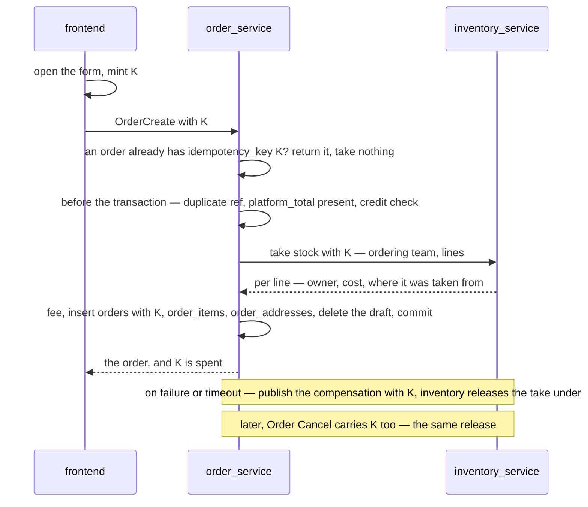
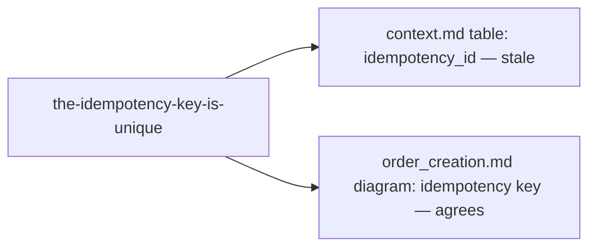
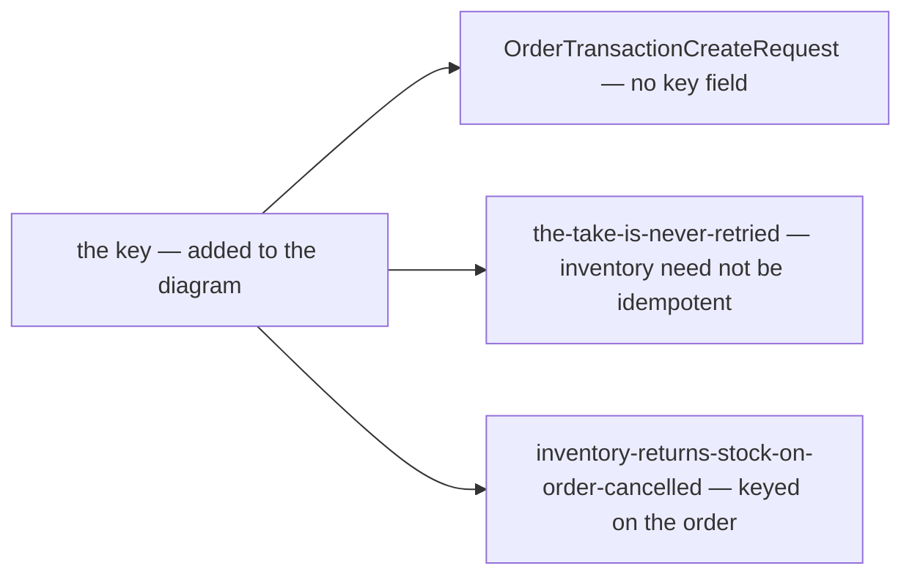
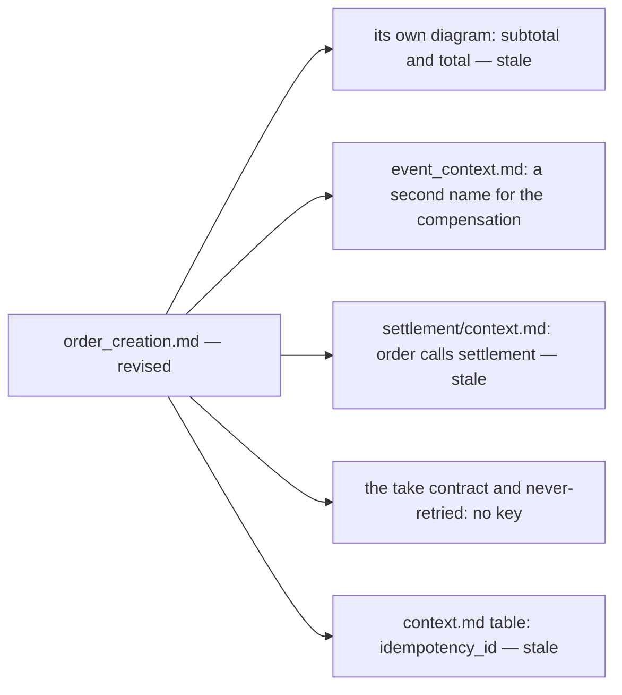

# Clarity — order `order_creation.md`

What [order_creation.md](./order_creation.md) leaves open. **That doc is yours — this one is mine.** Answered
points are deleted, so this file is always the current open set. Decisions land in
[context_decision.md](./context_decision.md).

> **Opened 2026-09-17**, re-examining the whole flow after the owner's correction: *"provision"* was the wrong
> word — **calling inventory takes the stock directly.** That withdraws two of my earlier recommendations (a
> confirm call, and an expiry on unconfirmed holds): a take has nothing to confirm and nothing to expire.

> ✅ **Answered 2026-09-17 and deleted:** what a take reduces ([a-take-reduces-stock-and-placement](./context_decision.md#a-take-reduces-stock-and-placement), its shelf half
> re-routed to inventory) · money as `double` ([rupiah-is-floating-point](./context_decision.md#rupiah-is-floating-point)) · retries ([the-take-is-never-retried](./context_decision.md#the-take-is-never-retried)) · who computes the markup ([inventory-computes-the-markup](./context_decision.md#inventory-computes-the-markup)).

> 🔄 **Re-examined 2026-10-12 — the owner added an idempotency key**
> ([the-frontend-mints-the-idempotency-key](./context_decision.md#the-frontend-mints-the-idempotency-key)) and then
> `orders.idempotency_id` ([the-order-stores-its-idempotency-key](./context_decision.md#the-order-stores-its-idempotency-key)).
> ✅ It answers `a-timed-out-take-cannot-be-named` — a timeout publishes the cancel by key. 🔄 It replaces my
> order-row-first proposal, and the owner's *"if we call inventory service and timeout, we can publish cancel inv
> transaction"* withdrew my own replay spec, which was what let a resend sell stock twice.
> ✅ **Answered the same day, all three as recommended, and deleted:**
> [the-idempotency-key-is-unique](./context_decision.md#the-idempotency-key-is-unique) ·
> [inventory-takes-a-key-once](./context_decision.md#inventory-takes-a-key-once) ·
> [a-key-is-spent-by-any-answer](./context_decision.md#a-key-is-spent-by-any-answer).
> ⛔ **Left for the owner's doc:** the table's column name and the form's loop — under Contradiction and Critique.
> 🆕 **Two more found on a second look the same day.** ✅ `the-cancel-finds-the-take-by-key` is answered as
> recommended and deleted — [every-release-goes-by-the-key](./context_decision.md#every-release-goes-by-the-key).
> Still open: [a-key-returns-only-its-own-teams-order](#a-key-returns-only-its-own-teams-order).

Siblings: [order context](./context_clarify.md) · [event_context](./event_context.md) ·
[warehouse](../warehouse/context_clarify.md) · [inventory](../inventory/context_clarify.md).

---

## Proposed Design

### The key, end to end — as decided

| | |
| --- | --- |
| format | a UUID from `crypto.randomUUID()` — **required** on the request and checked by `protovalidate`. The server never invents one: a create with no key has nothing to name its take by |
| on the order | `orders.idempotency_key`, UNIQUE — [the-order-stores-its-idempotency-key](./context_decision.md#the-order-stores-its-idempotency-key), [the-idempotency-key-is-unique](./context_decision.md#the-idempotency-key-is-unique) |
| the take | one take per K, ever — [inventory-takes-a-key-once](./context_decision.md#inventory-takes-a-key-once) |
| spent | by any answer — [a-key-is-spent-by-any-answer](./context_decision.md#a-key-is-spent-by-any-answer) |
| the release | one path, by K, for the compensation and the Order Cancel — [every-release-goes-by-the-key](./context_decision.md#every-release-goes-by-the-key) |
| the resend shortcut | ⚠ open — matched on K alone today: [a-key-returns-only-its-own-teams-order](#a-key-returns-only-its-own-teams-order) |

### What a take reduces — moved to inventory

Decided: a take **reduces stock and placement**, and shelves, counts and available-versus-on-hand are **inventory's** to
design ([a-take-reduces-stock-and-placement](./context_decision.md#a-take-reduces-stock-and-placement)). The shelf-count
hazard is re-routed to [inventory Q11](../inventory/context_clarify.md#question).

---

## Critique

| | Problem | → Recommend |
| --- | --- | --- |
| **one-line-many-batches** | FIFO can draw one line from two batches at different costs, so a single `unit_cost` × `qty` only approximates `total` | `total` is authoritative; `unit_cost` is informational |
| **team-id-is-ambiguous** | `TransactionItem.team_id` could be the product's **owner** or the **ordering** team, and inventory needs both — own-or-cross and the reserve check are decided against the orderer | name them: `owner_team_id` per line, `team_id` (the orderer) on the request |
| **the-checks-are-not-drawn** | nothing checks the duplicate ref, a present `platform_total` or the debt threshold before stock is taken | a pre-transaction block — see the sequence |
| **the-draft-delete-is-outside-the-transaction** | *"Delete Draft Order"* hangs off `if success`, after the commit | delete inside the transaction — same service, same database |
| **the-fee-call-is-inside-the-transaction** | `WarehouseFeeCalculate` holds the order's transaction open across a network call | acceptable, since its basis only exists after the take — but it is a pure calculation, so reading the rate before the transaction and computing locally removes the call |
| **the-form-loop-is-not-drawn** | the frontend box ends at *Create Order*, so the decided [a-key-is-spent-by-any-answer](./context_decision.md#a-key-is-spent-by-any-answer) is nowhere in the doc | draw it — no answer: resend with K · an error: mint a new K, back to the form |

---

## Question

### which-team-is-team-id
Is `TransactionItem.team_id` the product's owner or the ordering team? **→ Both are needed**, named apart.

### a-key-returns-only-its-own-teams-order
The resend shortcut — *"an order already has K? return it"* — looks up K alone. The key comes from the browser, so a
bug or a hostile caller sending another team's K would be handed **another team's order**. The access check passes,
because it checks the request's `team_id`, not the order found.
**→ Match K and the request's team.** A K found under another team is refused as a used key, never returned.

---

# Contradiction

## the-table-still-says-idempotency-id

*"`idempotency_id`"* ([context.md](./context.md) §Table That Must Have, line 28) — while
[the-idempotency-key-is-unique](./context_decision.md#the-idempotency-key-is-unique) names the column
`idempotency_key`, UNIQUE, and this doc's own diagram says *"idempotency key"* at every step.
**Which is wrong:** the table — the decision is newer. **→ Recommend** `idempotency_key`, its uniqueness written
beside it the way `order_external_ref_id` carries *"for order uniqueness"*.

## the-key-reached-the-diagram-and-nothing-else

One cause, three places it did not reach — the key replaced the order id as the take's name, and what was written before still names the take some other way (RULE 11).

| site | says | now |
| --- | --- | --- |
| §How We Call Inventory, `OrderTransactionCreateRequest` | `warehouse_id` and `items` — no key | the diagram's line 47: *"call for take stock & placement, and bring idempotency key"* |
| [the-take-is-never-retried](./context_decision.md#the-take-is-never-retried) | *"inventory does not need to be idempotent against a retry"* | [inventory-takes-a-key-once](./context_decision.md#inventory-takes-a-key-once) — it recognises every key it has seen |
| [inventory-returns-stock-on-order-cancelled](./context_decision.md#inventory-returns-stock-on-order-cancelled) | the release is *"keyed on the order"* | [every-release-goes-by-the-key](./context_decision.md#every-release-goes-by-the-key) — keyed on K |

**Which is wrong:** the contract and the two sentences — the diagram is the newer statement. Both decisions'
verdicts still hold: `order_service` never retries by itself, and a cancel releases stock by event.
**→ Recommend** `string idempotency_key` and the ordering team (`which-team-is-team-id`) on the request. The
decision log is append-only, so each sentence is marked amended by the later decision that replaces it, not edited.

## the-diagram-still-names-the-old-totals

*"Subtotal info Product"* and *"bring total & subtotal"* (lines 42, 48, 54) — while §Table That Must Have in
[context.md](./context.md) replaced both with `goods_cost` and `total_cost`
([the-warehouse-fee-is-a-percentage-of-the-goods](./context_decision.md#the-warehouse-fee-is-a-percentage-of-the-goods)).
**Which is wrong:** the diagram. **→ Recommend** the take returns lines, the order sums `goods_cost`, the fee is
taken on it, and `total_cost = goods_cost + warehouse_fee`.

## the-compensation-event-has-two-names

*"Inventory Tx Cancel Compensate Event"* (line 106) and `InventoryTxCancel` in
[event_context.md](./event_context.md). It now also carries the key, so it is an event inventory will match on.
**→ Recommend** one name, as a fact — the take was **returned** because the order was never created.

## settlement-subscribes-here-and-is-called-in-its-own-doc

Settlement is a push subscriber of *Order Created Event* here (lines 92–101), while
[settlement/context.md](../settlement/context.md) §Type `initial_total` says *"`order_service` calling -->
`settlement_service`"*. **→ Recommend** the settlement doc changes, and its reversal is recorded there.

