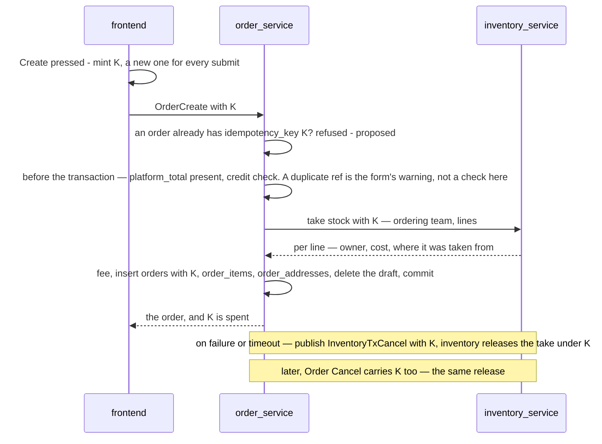

# Clarity — order `order_creation.md`

What [order_creation.md](./order_creation.md) leaves open. **That doc is yours — this one is mine.** Answered
points are deleted, so this file is always the current open set. Decisions land in
[context_decision.md](./context_decision.md).

> ✅ **Your edits (2026-10-19):** both return refusals are drawn —
> [the-request-check-misses-the-return-warehouse](#the-request-check-misses-the-return-warehouse),
> [the-create-does-not-check-the-return-map](#the-create-does-not-check-the-return-map). Left: the settlement doc's
> [settlement-subscribes-here-and-is-called-in-its-own-doc](#settlement-subscribes-here-and-is-called-in-its-own-doc).

> 🆕 **2026-10-19:** [the-create-does-not-check-the-return-map](#the-create-does-not-check-the-return-map) — create now also refuses a
> borrowed line with no return map; one label after the owners lookup. Still no open question.

> 🆕 **2026-10-17, later:** [the-request-check-misses-the-return-warehouse](#the-request-check-misses-the-return-warehouse) —
> create now also refuses a team with no return warehouse; one label in *Check the Request*. Still no open question.

> ✅ **2026-10-17 — you pasted [the whole diagram](#the-whole-diagram-ready-to-paste)** and `team_id` into the request.
> Resolved: [the-request-still-names-no-orderer](#the-request-still-names-no-orderer),
> [the-form-diagram-still-reuses-the-key](#the-form-diagram-still-reuses-the-key),
> [the-diagram-still-names-the-old-totals](#the-diagram-still-names-the-old-totals), the critiques `the-checks-are-not-drawn`
> and `the-draft-delete-is-outside-the-transaction` (deleted), and order context's debt box. *Delete Draft Order* inside the
> transaction is recorded as [the-draft-is-deleted-in-the-orders-transaction](./context_decision.md#the-draft-is-deleted-in-the-orders-transaction).
> Left: [settlement-subscribes-here-and-is-called-in-its-own-doc](#settlement-subscribes-here-and-is-called-in-its-own-doc) —
> the settlement doc's to change. Still no open question.

> **Opened 2026-09-17**, re-examining the whole flow after the owner's correction: *"provision"* was the wrong
> word — **calling inventory takes the stock directly.** That withdraws two of my earlier recommendations (a
> confirm call, and an expiry on unconfirmed holds): a take has nothing to confirm and nothing to expire.

> ✅ **Answered 2026-09-17 and deleted:** what a take reduces ([a-take-reduces-stock-and-placement](./context_decision.md#a-take-reduces-stock-and-placement), its shelf half
> re-routed to inventory) · money as `double` ([rupiah-is-floating-point](./context_decision.md#rupiah-is-floating-point)) · retries ([the-take-is-never-retried](./context_decision.md#the-take-is-never-retried)) · who computes the markup ([inventory-computes-the-markup](./context_decision.md#inventory-computes-the-markup)).

> 🔄 **Re-examined 2026-10-12 — the owner added an idempotency key**
> ([the-frontend-mints-the-idempotency-key](./context_decision.md#the-frontend-mints-the-idempotency-key)) and then
> `orders.idempotency_id` ([the-order-stores-its-idempotency-key](./context_decision.md#the-order-stores-its-idempotency-key)).
> ✅ It answers `a-timed-out-take-cannot-be-named` — a timeout publishes the cancel by key. 🔄 It replaces my
> order-row-first proposal, and the owner's *"if we call inventory service and timeout, we can publish cancel inv
> transaction"* withdrew my own replay spec, which was what let a resend sell stock twice.
> ✅ **Answered the same day, all three as recommended, and deleted:**
> [the-idempotency-key-is-unique](./context_decision.md#the-idempotency-key-is-unique) ·
> [inventory-takes-a-key-once](./context_decision.md#inventory-takes-a-key-once) ·
> [a-key-is-spent-by-any-answer](./context_decision.md#a-key-is-spent-by-any-answer).
> 🆕 **Two more found on a second look the same day.** ✅ `the-cancel-finds-the-take-by-key` is answered as
> recommended and deleted — [every-release-goes-by-the-key](./context_decision.md#every-release-goes-by-the-key).

> 🔄 **Re-examined 2026-10-15 — the owner edited both docs.** ✅ Three contradictions resolved and deleted:
> `the-table-still-says-idempotency-id` (the column is `idempotency_key` now) · `the-key-reached-the-diagram-and-nothing-else`
> (`OrderTransactionCreateRequest` carries `idempotency_key`; the two decision sentences were already amended by the later
> decisions' *What it amends*) · `the-compensation-event-has-two-names` — decided as
> [the-compensation-event-is-inventory-tx-cancel](./context_decision.md#the-compensation-event-is-inventory-tx-cancel).
> 🆕 The form's loop was proposed — and drawn by the owner the same day: [the-form-locks-until-it-is-answered](./context_decision.md#the-form-locks-until-it-is-answered).
> ⛔ **Found while summarising the key:** two decisions of 2026-10-12 disagree about two submits in the same second —
> [Contradiction](./context_decision.md#the-order-refuses-a-used-key).
> ⚠ **Corrected:** this file's key table was headed *"as decided"* while its format row — a UUID — and *"the server never
> invents one"* were only ever my proposal. Both are now marked as proposals.
> ✅ **And later still:** the order keeps ONE `transaction_id`
> ([an-order-is-one-inventory-transaction](./context_decision.md#an-order-is-one-inventory-transaction)) — against my
> one-per-line. [which-team-is-team-id](#which-team-is-team-id) keeps its two team parts; inventory's Q1 and Q7 move with it.
> ✅ **Answered later the same day and deleted:** the owner drew the loop into the frontend box as proposed —
> [the-form-locks-until-it-is-answered](./context_decision.md#the-form-locks-until-it-is-answered). One part did not make
> the diagram: [key-already-used-gets-its-own-message](#key-already-used-gets-its-own-message).
> 🔄 **Re-examined 2026-10-15, last — every submit mints a new key**
> ([every-submit-mints-a-new-key](./context_decision.md#every-submit-mints-a-new-key)), the owner's answer to inventory's
> *twin* case. ✅ `a-refused-take-sends-no-cancel` and its contradiction `a-refusal-fires-the-compensation` — found from
> inventory's side an hour earlier — are **answered by removing the case** and deleted: no two submits share a key, so a
> *key used* refusal never comes from the form, and a cancel for any other refusal releases nothing. 🔄 Two questions move
> with it: [a-key-returns-only-its-own-teams-order](./context_decision.md#the-order-refuses-a-used-key) — the shortcut has no honest
> caller now — and [key-already-used-gets-its-own-message](#key-already-used-gets-its-own-message), which becomes the
> message for a *Try Again* that meets its own order. ⛔ Your diagram still mints once and resends the same key:
> [the-form-diagram-still-reuses-the-key](#the-form-diagram-still-reuses-the-key).
> 🔄 **And later: a duplicate ref is warned, not refused**
> ([a-duplicate-ref-is-warned-not-refused](./context_decision.md#a-duplicate-ref-is-warned-not-refused)). The *Try Again*
> design and [key-already-used-gets-its-own-message](#key-already-used-gets-its-own-message) are rewritten around a
> warning: it sees only a committed order, so a *Try Again* should always warn. ✅ **Answered in chat, as recommended**
> — [a-try-again-always-warns](./context_decision.md#a-try-again-always-warns); the question is a stub and its design
> moved into the decision.
> ✅ **And:** [which-team-is-team-id](#which-team-is-team-id) — both teams, named apart
> ([the-take-names-the-orderer-and-each-owner](./context_decision.md#the-take-names-the-orderer-and-each-owner)); the
> request's field is not drawn yet ([the-request-still-names-no-orderer](#the-request-still-names-no-orderer)).

> ✅ **Answered 2026-10-15, last, and deleted:** `a-key-returns-only-its-own-teams-order` — the shortcut is dropped
> ([the-order-refuses-a-used-key](./context_decision.md#the-order-refuses-a-used-key)), which also resolves the contradiction
> `a-same-key-resend-never-reaches-the-unique-index`: a unique violation is an error, never an order. **No question is open
> here now** — what is left is your doc: the contradictions below, and the debt-check box
> ([the drawing](./context_clarify.md#proposed--the-debt-check-as-decided)).

> ✅ **Answered and deleted (2026-10-12 16:38):** `does-the-order-keep-the-take-id` — the Order Cancel carries K
> ([every-release-goes-by-the-key](./context_decision.md#every-release-goes-by-the-key)), so the order needs no
> `transaction_id` from inventory; inventory stores K as `ORDER_TAKES.take_ref`
> ([take-ref-dari-idempotency-key](../stock_thoni/context_decision.md#take-ref-dari-idempotency-key)). Inventory's own flow
> still says Order Cancel sends `transaction_id` — reported there as a contradiction.

> 🔄 **Re-examined 2026-10-12 17:12** — lines 109 and 111: *Order Created* now carries `transaction_id` beside K, and
> the compensation carries it *"if exist"*. 🆕 `who-reads-the-transaction-id` (✅ [the-take-id-rides-only-the-compensation](./context_decision.md#the-take-id-rides-only-the-compensation)) and the
> critique `the-compensation-names-the-take-twice`. ✅ Closed — mine, left stale since 16:38:
> `the-key-reached-the-diagram-and-nothing-else`. The contract has carried `idempotency_key` since then (line 129), and
> both sentences it named are now marked amended in the decision log
> ([the-take-is-never-retried](./context_decision.md#the-take-is-never-retried) ·
> [every-release-goes-by-the-key](./context_decision.md#every-release-goes-by-the-key) §What it amends).

> ✅ **2026-10-12 17:22–17:26 — answered and deleted:** `who-reads-the-transaction-id`. Inventory's compensation webhook
> reads it beside K ([provide](../stock_thoni/order_creation_provide.md) lines 80–82), and line 109 dropped it from
> *Order Created* — [the-take-id-rides-only-the-compensation](./context_decision.md#the-take-id-rides-only-the-compensation).
> How the two are used together is the inventory doc's to say, so `the-compensation-names-the-take-twice` is re-routed
> there as [keduanya-dipakai-bagaimana](../stock_thoni/order_creation_provide_clarify.md#critique).

> 🔄 **Re-examined 2026-10-13 16:04** — line 129: `team_id` on the take request, the ordering team
> ([the-take-request-carries-the-ordering-team](./context_decision.md#the-take-request-carries-the-ordering-team)) — the
> request half of `team-id-is-ambiguous`, as recommended, and the answer to inventory's
> `sendiri-atau-silang-diketahui-dari-mana`. Left: `TransactionItem.team_id` (line 137) — now the **same name** for a
> **different team** in one contract, which makes `which-team-is-team-id` sharper, not smaller.

> ✅ **2026-10-13 16:58 — answered and deleted:** `which-team-is-team-id` and `team-id-is-ambiguous`. Line 137 now reads
> *"item owner team_id"* — the owner, as recommended; the name stays, the comment says which team ([the-line-team-is-the-owner](./context_decision.md#the-line-team-is-the-owner)).

Siblings: [order context](./context_clarify.md) · [event_context](./event_context.md) ·
[warehouse](../teams/warehouse/context_clarify.md) · [inventory](../inventory/context_clarify.md).

---

## Proposed Design

### The key, end to end

Decided except where a row says *proposed*.

| | |
| --- | --- |
| format | ⚠ **proposed, never decided** — a UUID from `crypto.randomUUID()`, **required** on the request and checked by `protovalidate`, so the server never invents one: a create with no key has nothing to name its take by |
| on the order | `orders.idempotency_key`, UNIQUE — [the-order-stores-its-idempotency-key](./context_decision.md#the-order-stores-its-idempotency-key), [the-idempotency-key-is-unique](./context_decision.md#the-idempotency-key-is-unique) |
| the take | one take per K, ever — [inventory-takes-a-key-once](./context_decision.md#inventory-takes-a-key-once) |
| spent | by its one submit — [every-submit-mints-a-new-key](./context_decision.md#every-submit-mints-a-new-key) |
| the release | one path, by K, for `InventoryTxCancel` and the Order Cancel — [every-release-goes-by-the-key](./context_decision.md#every-release-goes-by-the-key) |
| the pre-transaction checks | ✅ drawn *(2026-10-17)* — *Check the Request*, the owners lookup, the debt check |
| the resend shortcut | ✅ **gone** — a used key is refused, never answered with an order: [the-order-refuses-a-used-key](./context_decision.md#the-order-refuses-a-used-key) |
| `transaction_id` | on the compensation only, when the take answered — [the-take-id-rides-only-the-compensation](./context_decision.md#the-take-id-rides-only-the-compensation) |

### The whole diagram, ready to paste

✅ *(2026-10-17)* **Pasted into [order_creation.md](./order_creation.md) as drawn**, with `team_id` on
`OrderTransactionCreateRequest`. It closed three Contradictions below and the debt box, and moved *Delete Draft Order*
inside the transaction ([the-draft-is-deleted-in-the-orders-transaction](./context_decision.md#the-draft-is-deleted-in-the-orders-transaction)).
Kept as a heading so the links into it hold.

### What a take reduces — moved to inventory

Decided: a take **reduces stock and placement**, and shelves, counts and available-versus-on-hand are **inventory's** to
design ([a-take-reduces-stock-and-placement](./context_decision.md#a-take-reduces-stock-and-placement)). The shelf-count
hazard is re-routed to [inventory Q11](../inventory/context_clarify.md#question).

---

## Critique

| | Problem | → Recommend |
| --- | --- | --- |
| **the-request-names-the-key-twice** 🆕 | *(2026-10-17, found testing the merge of `backup/inventory`; widened 2026-10-20 by the next merge)* `OrderTransactionCreateRequest` in [order_creation.md](./order_creation.md) now declares **both** fields twice — `idempotency_key` on lines 154 and 158, `team_id` on lines 155 and 157. Each branch added the same two fields, and the merge kept both copies. A message with two fields of one name does not compile, and a reader cannot tell whether the second pair was meant to be different fields | delete lines 157–158 — keep the pair on 154–155, which carries the comment *the ordering team* |
| **one-line-many-batches** | FIFO can draw one line from two batches at different costs, so a single `unit_cost` × `qty` only approximates `total` | `total` is authoritative; `unit_cost` is informational |
| **the-fee-call-is-inside-the-transaction** | `WarehouseFeeCalculate` holds the order's transaction open across a network call | acceptable, since its basis only exists after the take — but it is a pure calculation, so reading the rate before the transaction and computing locally removes the call. 🔄 *(2026-10-19)* The call can now refuse, for a warehouse with no rate ([a-warehouse-with-no-rate-takes-no-orders](../teams/warehouse/context_decision.md#a-warehouse-with-no-rate-takes-no-orders)): your rollback undoes the take, so no new box. Rare once every warehouse has a rate |

---

## Question

### which-team-is-team-id
✅ *(2026-10-15)* **Answered: both, named apart** — the request carries the ordering `team_id`, each line `owner_team_id`: [the-take-names-the-orderer-and-each-owner](./context_decision.md#the-take-names-the-orderer-and-each-owner). The inventory transaction carries the orderer too ([an-order-transaction-is-the-ordering-teams](../inventory/transaction_decision.md#an-order-transaction-is-the-ordering-teams)). ⚠ The request's field is not drawn yet — [the-request-still-names-no-orderer](#the-request-still-names-no-orderer).

### key-already-used-gets-its-own-message
✅ *(2026-10-15)* **Answered: yes, a *Try Again* always warns** — [a-try-again-always-warns](./context_decision.md#a-try-again-always-warns). Kept as a heading so the links into it hold.

---

# Contradiction

## the-request-still-names-no-orderer

✅ *(2026-10-17)* **Resolved by your pasted diagram** — `OrderTransactionCreateRequest` carries `team_id`, the ordering team. Kept as a heading so the links into it hold.

## the-form-diagram-still-reuses-the-key

✅ *(2026-10-17)* **Resolved by your pasted diagram** — the key is made right before each *Create*, and *Try Again* gets a new one ([every-submit-mints-a-new-key](./context_decision.md#every-submit-mints-a-new-key)). Kept as a heading so the links into it hold.

## the-diagram-still-names-the-old-totals

✅ *(2026-10-17)* **Resolved by your pasted diagram** — the transaction box names the lines, `goods_cost`, `warehouse_fee` and `total_cost`. Kept as a heading so the links into it hold.

## settlement-subscribes-here-and-is-called-in-its-own-doc

✅ *(2026-10-21)* **Resolved by your edit** — [settlement/context.md](../settlement/context.md) now has settlement receive the order
events ([settlement-opens-the-sale-from-the-order-event](../settlement/context_decision.md#settlement-opens-the-sale-from-the-order-event)).
Kept as a heading so the links into it hold.

## the-request-check-misses-the-return-warehouse

✅ *(2026-10-19)* **Resolved** — *Check the Request* refuses *"or the team has no return warehouse"*. Kept as a heading so the links into it hold.

## the-create-does-not-check-the-return-map

✅ *(2026-10-19)* **Resolved** — the owners lookup refuses *"or a borrowed product has no return map"*. Kept as a heading so the links into it hold.

