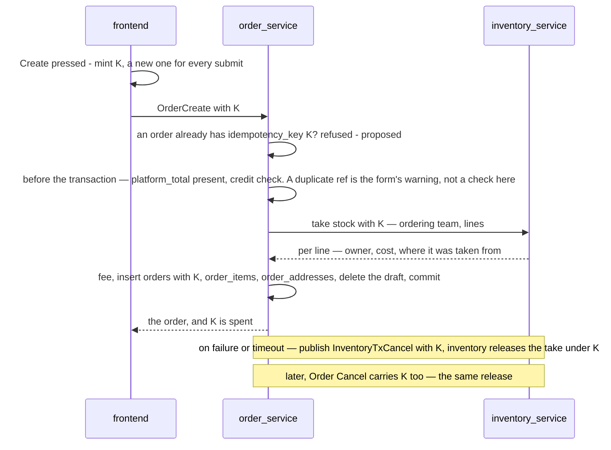
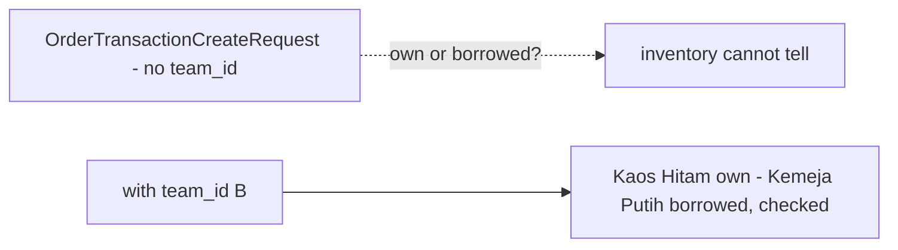
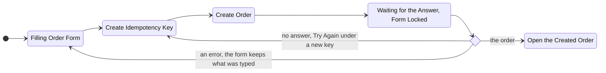
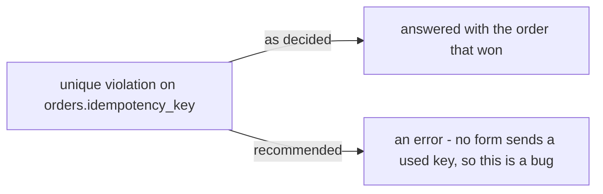
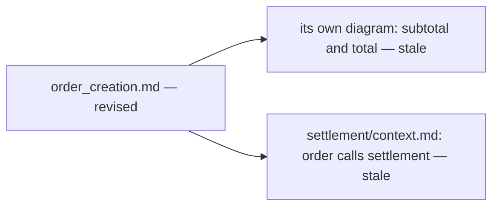

# Clarity — order `order_creation.md`

What [order_creation.md](./order_creation.md) leaves open. **That doc is yours — this one is mine.** Answered
points are deleted, so this file is always the current open set. Decisions land in
[context_decision.md](./context_decision.md).

> **Opened 2026-09-17**, re-examining the whole flow after the owner's correction: *"provision"* was the wrong
> word — **calling inventory takes the stock directly.** That withdraws two of my earlier recommendations (a
> confirm call, and an expiry on unconfirmed holds): a take has nothing to confirm and nothing to expire.

> ✅ **Answered 2026-09-17 and deleted:** what a take reduces ([a-take-reduces-stock-and-placement](./context_decision.md#a-take-reduces-stock-and-placement), its shelf half
> re-routed to inventory) · money as `double` ([rupiah-is-floating-point](./context_decision.md#rupiah-is-floating-point)) · retries ([the-take-is-never-retried](./context_decision.md#the-take-is-never-retried)) · who computes the markup ([inventory-computes-the-markup](./context_decision.md#inventory-computes-the-markup)).

> 🔄 **Re-examined 2026-10-12 — the owner added an idempotency key**
> ([the-frontend-mints-the-idempotency-key](./context_decision.md#the-frontend-mints-the-idempotency-key)) and then
> `orders.idempotency_id` ([the-order-stores-its-idempotency-key](./context_decision.md#the-order-stores-its-idempotency-key)).
> ✅ It answers `a-timed-out-take-cannot-be-named` — a timeout publishes the cancel by key. 🔄 It replaces my
> order-row-first proposal, and the owner's *"if we call inventory service and timeout, we can publish cancel inv
> transaction"* withdrew my own replay spec, which was what let a resend sell stock twice.
> ✅ **Answered the same day, all three as recommended, and deleted:**
> [the-idempotency-key-is-unique](./context_decision.md#the-idempotency-key-is-unique) ·
> [inventory-takes-a-key-once](./context_decision.md#inventory-takes-a-key-once) ·
> [a-key-is-spent-by-any-answer](./context_decision.md#a-key-is-spent-by-any-answer).
> 🆕 **Two more found on a second look the same day.** ✅ `the-cancel-finds-the-take-by-key` is answered as
> recommended and deleted — [every-release-goes-by-the-key](./context_decision.md#every-release-goes-by-the-key).

> 🔄 **Re-examined 2026-10-15 — the owner edited both docs.** ✅ Three contradictions resolved and deleted:
> `the-table-still-says-idempotency-id` (the column is `idempotency_key` now) · `the-key-reached-the-diagram-and-nothing-else`
> (`OrderTransactionCreateRequest` carries `idempotency_key`; the two decision sentences were already amended by the later
> decisions' *What it amends*) · `the-compensation-event-has-two-names` — decided as
> [the-compensation-event-is-inventory-tx-cancel](./context_decision.md#the-compensation-event-is-inventory-tx-cancel).
> 🆕 The form's loop was proposed — and drawn by the owner the same day: [the-form-locks-until-it-is-answered](./context_decision.md#the-form-locks-until-it-is-answered).
> ⛔ **Found while summarising the key:** two decisions of 2026-10-12 disagree about two submits in the same second —
> [Contradiction](#a-same-key-resend-never-reaches-the-unique-index).
> ⚠ **Corrected:** this file's key table was headed *"as decided"* while its format row — a UUID — and *"the server never
> invents one"* were only ever my proposal. Both are now marked as proposals.
> ✅ **And later still:** the order keeps ONE `transaction_id`
> ([an-order-is-one-inventory-transaction](./context_decision.md#an-order-is-one-inventory-transaction)) — against my
> one-per-line. [which-team-is-team-id](#which-team-is-team-id) keeps its two team parts; inventory's Q1 and Q7 move with it.
> ✅ **Answered later the same day and deleted:** the owner drew the loop into the frontend box as proposed —
> [the-form-locks-until-it-is-answered](./context_decision.md#the-form-locks-until-it-is-answered). One part did not make
> the diagram: [key-already-used-gets-its-own-message](#key-already-used-gets-its-own-message).
> 🔄 **Re-examined 2026-10-15, last — every submit mints a new key**
> ([every-submit-mints-a-new-key](./context_decision.md#every-submit-mints-a-new-key)), the owner's answer to inventory's
> *twin* case. ✅ `a-refused-take-sends-no-cancel` and its contradiction `a-refusal-fires-the-compensation` — found from
> inventory's side an hour earlier — are **answered by removing the case** and deleted: no two submits share a key, so a
> *key used* refusal never comes from the form, and a cancel for any other refusal releases nothing. 🔄 Two questions move
> with it: [a-key-returns-only-its-own-teams-order](#a-key-returns-only-its-own-teams-order) — the shortcut has no honest
> caller now — and [key-already-used-gets-its-own-message](#key-already-used-gets-its-own-message), which becomes the
> message for a *Try Again* that meets its own order. ⛔ Your diagram still mints once and resends the same key:
> [the-form-diagram-still-reuses-the-key](#the-form-diagram-still-reuses-the-key).
> 🔄 **And later: a duplicate ref is warned, not refused**
> ([a-duplicate-ref-is-warned-not-refused](./context_decision.md#a-duplicate-ref-is-warned-not-refused)). The *Try Again*
> design and [key-already-used-gets-its-own-message](#key-already-used-gets-its-own-message) are rewritten around a
> warning: it sees only a committed order, so a *Try Again* should always warn. ✅ **Answered in chat, as recommended**
> — [a-try-again-always-warns](./context_decision.md#a-try-again-always-warns); the question is a stub and its design
> moved into the decision.
> ✅ **And:** [which-team-is-team-id](#which-team-is-team-id) — both teams, named apart
> ([the-take-names-the-orderer-and-each-owner](./context_decision.md#the-take-names-the-orderer-and-each-owner)); the
> request's field is not drawn yet ([the-request-still-names-no-orderer](#the-request-still-names-no-orderer)).

Siblings: [order context](./context_clarify.md) · [event_context](./event_context.md) ·
[warehouse](../warehouse/context_clarify.md) · [inventory](../inventory/context_clarify.md).

---

## Proposed Design

### The key, end to end

Decided except where a row says *proposed*.

| | |
| --- | --- |
| format | ⚠ **proposed, never decided** — a UUID from `crypto.randomUUID()`, **required** on the request and checked by `protovalidate`, so the server never invents one: a create with no key has nothing to name its take by |
| on the order | `orders.idempotency_key`, UNIQUE — [the-order-stores-its-idempotency-key](./context_decision.md#the-order-stores-its-idempotency-key), [the-idempotency-key-is-unique](./context_decision.md#the-idempotency-key-is-unique) |
| the take | one take per K, ever — [inventory-takes-a-key-once](./context_decision.md#inventory-takes-a-key-once) |
| spent | by its one submit — [every-submit-mints-a-new-key](./context_decision.md#every-submit-mints-a-new-key) |
| the release | one path, by K, for `InventoryTxCancel` and the Order Cancel — [every-release-goes-by-the-key](./context_decision.md#every-release-goes-by-the-key) |
| the pre-transaction checks | ⚠ **proposed** — [the-checks-are-not-drawn](#critique) |
| the resend shortcut | ⚠ **proposed: gone** — no resend carries K any more, so a hit is refused, as inventory's is: [a-key-returns-only-its-own-teams-order](#a-key-returns-only-its-own-teams-order) |

### What a take reduces — moved to inventory

Decided: a take **reduces stock and placement**, and shelves, counts and available-versus-on-hand are **inventory's** to
design ([a-take-reduces-stock-and-placement](./context_decision.md#a-take-reduces-stock-and-placement)). The shelf-count
hazard is re-routed to [inventory Q11](../inventory/context_clarify.md#question).

---

## Critique

| | Problem | → Recommend |
| --- | --- | --- |
| **one-line-many-batches** | FIFO can draw one line from two batches at different costs, so a single `unit_cost` × `qty` only approximates `total` | `total` is authoritative; `unit_cost` is informational |
| **the-checks-are-not-drawn** | nothing checks a present `platform_total` before stock is taken. 🔄 The duplicate ref left this list — it is the form's warning now ([a-duplicate-ref-is-warned-not-refused](./context_decision.md#a-duplicate-ref-is-warned-not-refused)). ✅ *(2026-10-15)* The debt threshold is drawn — [the-debt-check-runs-before-the-take](./context_decision.md#the-debt-check-runs-before-the-take) | `platform_total` present ([platform-total-is-required-at-finalize](./context_decision.md#platform-total-is-required-at-finalize)) — beside the debt check, before the transaction |
| **the-draft-delete-is-outside-the-transaction** | *"Delete Draft Order"* hangs off `if success`, after the commit | delete inside the transaction — same service, same database |
| **the-fee-call-is-inside-the-transaction** | `WarehouseFeeCalculate` holds the order's transaction open across a network call | acceptable, since its basis only exists after the take — but it is a pure calculation, so reading the rate before the transaction and computing locally removes the call |

---

## Question

### which-team-is-team-id
✅ *(2026-10-15)* **Answered: both, named apart** — the request carries the ordering `team_id`, each line `owner_team_id`: [the-take-names-the-orderer-and-each-owner](./context_decision.md#the-take-names-the-orderer-and-each-owner). The inventory transaction carries the orderer too ([an-order-transaction-is-the-ordering-teams](../inventory/transaction_decision.md#an-order-transaction-is-the-ordering-teams)). ⚠ The request's field is not drawn yet — [the-request-still-names-no-orderer](#the-request-still-names-no-orderer).

### a-key-returns-only-its-own-teams-order
The resend shortcut — *"an order already has K? return it"* — looks up K alone. The key comes from the browser, so a
bug or a hostile caller sending another team's K would be handed **another team's order**. The access check passes,
because it checks the request's `team_id`, not the order found.
🔄 *(2026-10-15)* [every-submit-mints-a-new-key](./context_decision.md#every-submit-mints-a-new-key) removed the
shortcut's honest caller — no resend carries an earlier submit's K. A hit now comes **only** from a bug or a hostile
caller, which is exactly the caller the leak serves.
**→ Drop the shortcut.** A K already on an order is refused as a used key — the answer inventory now gives
([a-used-key-is-refused-first](../inventory/order_decision.md#a-used-key-is-refused-first)). The leak goes with it, and
no team match is needed. *(Was: match K and the request's team.)*

### key-already-used-gets-its-own-message
✅ *(2026-10-15)* **Answered: yes, a *Try Again* always warns** — [a-try-again-always-warns](./context_decision.md#a-try-again-always-warns). Kept as a heading so the links into it hold.

---

# Contradiction

## the-request-still-names-no-orderer

*(2026-10-15)* Your §How We Call Inventory Service to Take Stock against your answer the same day:

| [order_creation.md](./order_creation.md) | [the-take-names-the-orderer-and-each-owner](./context_decision.md#the-take-names-the-orderer-and-each-owner) |
| --- | --- |
| `TransactionItem.owner_team_id` | ✅ agrees |
| `OrderTransactionCreateRequest { idempotency_key, warehouse_id, items }` | the request carries `team_id`, the ordering team |

**Which is wrong:** the proto — the rename landed, its other half did not. **→ Recommend** one line in the request,
`uint64 team_id // the ordering team`, beside `idempotency_key`. Without it inventory cannot tell own from borrowed, so the
private and reserve checks of [inventory order.md](../inventory/order.md) have nothing to compare against.

## the-form-diagram-still-reuses-the-key

*(2026-10-15)* Your frontend box in [order_creation.md](./order_creation.md) against your answer in chat the same day:

| order_creation.md, the frontend box | [every-submit-mints-a-new-key](./context_decision.md#every-submit-mints-a-new-key) |
| --- | --- |
| *"Order Need Created"* → *"Create Idempotency Key"* → *"Filling Order Form"* — minted once, before filling | minted at each submit |
| *"no answer, Try Again with the same key"* | *Try Again* under a new key |
| *"an error, new key, the form keeps what was typed"* | ✅ agrees |

**Which is wrong:** the diagram — the chat answer is newer, and it is what closes the twin case.
**→ Recommend** minting inside the loop, right before *Create Order*, so every arrow back into *Create* passes through it:

## a-same-key-resend-never-reaches-the-unique-index

*(2026-10-15)* [the-idempotency-key-is-unique](./context_decision.md#the-idempotency-key-is-unique) says *"a unique
violation on this column is a resend that lost the race, so it is answered with the order that won"*. Two submits with
one K never reached the insert — inventory refused the second first
([inventory-takes-a-key-once](./context_decision.md#inventory-takes-a-key-once)).
🔄 *(2026-10-15, later)* **And now there is no such resend at all** —
[every-submit-mints-a-new-key](./context_decision.md#every-submit-mints-a-new-key). A violation on
`orders.idempotency_key` can only be a bug.

**Which is wrong:** the unique decision's last line. **→ Recommend** keeping UNIQUE as the backstop, and a violation is an
**error, never an order**.

## the-diagram-still-names-the-old-totals

*"Subtotal info Product"* and *"bring total & subtotal"* (lines 42, 48, 54) — while §Table That Must Have in
[context.md](./context.md) replaced both with `goods_cost` and `total_cost`
([the-warehouse-fee-is-a-percentage-of-the-goods](./context_decision.md#the-warehouse-fee-is-a-percentage-of-the-goods)).
**Which is wrong:** the diagram. **→ Recommend** the take returns lines, the order sums `goods_cost`, the fee is
taken on it, and `total_cost = goods_cost + warehouse_fee`.

## settlement-subscribes-here-and-is-called-in-its-own-doc

Settlement is a push subscriber of *Order Created Event* here (lines 92–101), while
[settlement/context.md](../settlement/context.md) §Type `initial_total` says *"`order_service` calling -->
`settlement_service`"*. **→ Recommend** the settlement doc changes, and its reversal is recorded there.

