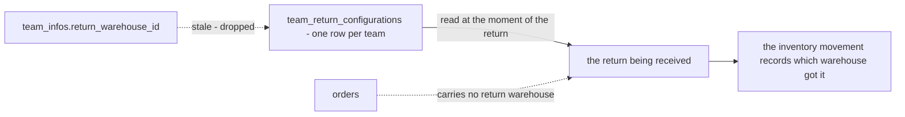
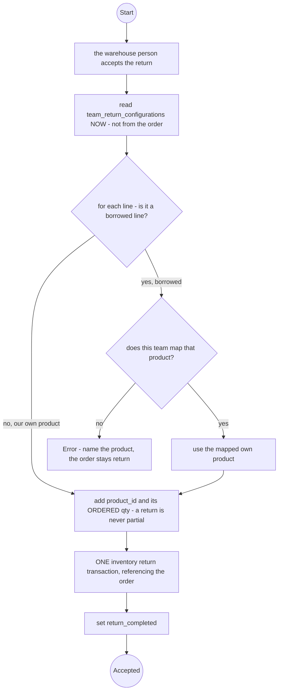
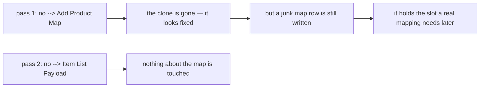
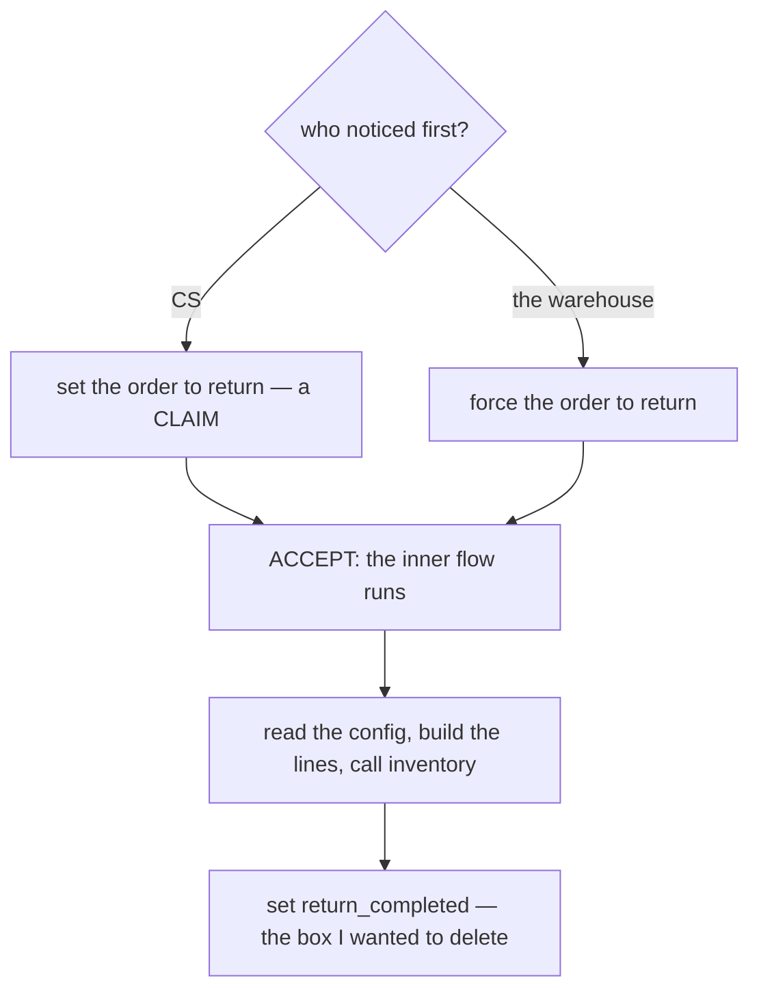
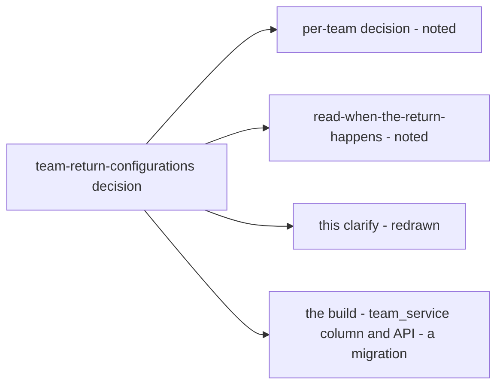

# Clarity — order `order_return.md`

What [order_return.md](./order_return.md) leaves open. **That doc is yours — this one is mine.** Answered points
are deleted, so this file is always the current open set. Decisions land in
[context_decision.md](./context_decision.md).

> ✅ **Built (2026-10-21):** the table, its editor (Settings → Return Warehouse) and the `team_infos` drop — the
> [Contradiction](#the-return-warehouse-moved-out-of-team-infos) is resolved. Create does not check yet (rollout steps 2–3).
> **Nothing is open here.**

> ✅ **Your edits (2026-10-19):** item 2 of §Table Must Have and the own branch of §Order Return Flow —
> [the-map-table-still-has-warehouse-and-to-product](#the-map-table-still-has-warehouse-and-to-product) and the last critique resolved.
> **Nothing is open here.**

> ✅ **Answered in chat (2026-10-19), last:** [return_user_id-is-unread](#return_user_id-is-unread) — dropped
> ([return-user-id-is-dropped](./context_decision.md#return-user-id-is-dropped)). **No question is open here.** Left: the
> Contradictions below and the one critique — all yours to draw.

> ✅ **Answered in chat (2026-10-19), after that:** [a-short-delivered-parcel-has-no-home](#a-short-delivered-parcel-has-no-home) —
> accepted, the gap written off ([a-short-return-is-accepted-and-the-gap-written-off](./context_decision.md#a-short-return-is-accepted-and-the-gap-written-off)). **1 open.**

> ✅ **Answered in chat (2026-10-19), later still:** [the-returned-unit-keeps-the-lenders-label](#the-returned-unit-keeps-the-lenders-label) —
> relabel at the accept ([a-returned-borrowed-unit-is-relabelled-at-the-accept](./context_decision.md#a-returned-borrowed-unit-is-relabelled-at-the-accept)). **2 open.**

> ✅ **Answered in chat (2026-10-19), later:** [when-must-the-map-exist](#when-must-the-map-exist) — at order create
> ([a-borrowed-line-needs-its-map-at-create](./context_decision.md#a-borrowed-line-needs-its-map-at-create)). **3 open.**

> 🔄 **Re-examined 2026-10-19 — your new §Order Return Flow** (a §Product Return Mapper was drafted and removed the same day). Nothing is cloned; an unmapped
> borrowed line is an error ([a-return-never-clones-a-product](./context_decision.md#a-return-never-clones-a-product)).
> ✅ [who-names-a-cloned-product](#who-names-a-cloned-product) is moot. 🆕 [when-must-the-map-exist](#when-must-the-map-exist) ·
> [the-returned-unit-keeps-the-lenders-label](#the-returned-unit-keeps-the-lenders-label). ⛔ [the-map-table-still-has-warehouse-and-to-product](#the-map-table-still-has-warehouse-and-to-product),
> and in order context [the-stock-ownership-section-still-clones](./context_clarify.md#the-stock-ownership-section-still-clones).
> Four settled critiques pruned. **4 open.**

> ✅ **Answered in chat (2026-10-19):** [does-the-accept-record-where-it-was-accepted](#does-the-accept-record-where-it-was-accepted) — yes,
> automatically ([the-accept-records-where-it-was-accepted](./context_decision.md#the-accept-records-where-it-was-accepted)). **3 open.**

> ✅ **Closed in chat (2026-10-17), after:** [what-bounds-a-forced-return](#what-bounds-a-forced-return) — no, it follows §Status Move
> ([a-forced-return-follows-the-status-move](./context_decision.md#a-forced-return-follows-the-status-move)) · [a-claimed-return-that-never-arrives](#a-claimed-return-that-never-arrives)
> — `return → lost` ([a-return-that-never-arrives-goes-lost](./context_decision.md#a-return-that-never-arrives-goes-lost)). **4 open.**

> ✅ **Answered in chat (2026-10-17), last:** [who-moves-the-drifted-stock-back](#who-moves-the-drifted-stock-back) — not drift; the team
> transfers it if it wants ([stock-in-the-return-warehouse-is-not-drift](./context_decision.md#stock-in-the-return-warehouse-is-not-drift)). **6 open.**

> ✅ **Answered in chat (2026-10-17), later still:** [which-warehouses-may-be-named](#which-warehouses-may-be-named) — any
> warehouse ([a-team-may-pick-any-return-warehouse](./context_decision.md#a-team-may-pick-any-return-warehouse)), against my
> *only one it works with*; one with no fee agreement takes the returns uncharged. **7 open.**

> ✅ **Answered in chat (2026-10-17), later:** [the-gate-is-on-the-order-not-the-config](#the-gate-is-on-the-order-not-the-config) —
> the team's row, turned on after every team has one ([create-refuses-a-team-with-no-return-warehouse](./context_decision.md#create-refuses-a-team-with-no-return-warehouse)).
> The critiques `the-gate-contradicts-its-own-twin` and `every-team-stops-at-rollout` are deleted — the decision carries the
> rollout order. **8 open.**

> ✅ **Answered in chat (2026-10-17):** the return warehouse lives in `team_return_configurations`, and
> `team_infos.return_warehouse_id` is dropped as stale
> ([the-return-warehouse-lives-in-team-return-configurations](./context_decision.md#the-return-warehouse-lives-in-team-return-configurations)),
> against my *no new table*. The critique `the-config-already-ships-elsewhere` is deleted; its
> [Contradiction](#the-return-warehouse-moved-out-of-team-infos) lists what still names `team_infos`. Questions unchanged — 9 open.

> 🔄 **From inventory (2026-10-16):** this doc is **not** parked — only inventory's half of a return is
> ([order-returns-calls-are-return-mds-brief](../inventory/context_decision.md#order-returns-calls-are-return-mds-brief)). Your three
> calls into inventory are the brief [return.md](../inventory/return.md) will answer. Nothing here changes.

> **Opened 2026-09-17** with the doc's first two sections: a selling team configures one return warehouse, and
> cannot create orders without one.

> 🔄 **Re-examined 2026-09-21 — the owner added `## Order Return Flow.` and a second table, `product_return_maps`.**
> ✅ **The new diagram parses** (`npm run lint:mermaid`) — nothing to report under RULE 3.
> ⛔ **What is still open in it:** the own-product branch is routed through the cross-product machinery, and the
> flow reads the return warehouse **two contradictory ways in one picture** (✅ now settled — the top box wins).
> ⛔ **And checked against the build this round:** `team_return_configurations` **already exists as a column**, in
> another service — see [the-config-already-ships-elsewhere](#critique).

> 🔄 **The doc moved again while this was being written (14:11).** `Change Order Status` now follows the
> inventory call, so the order no longer stays `shipped` after its goods are back on a shelf.

> ✅ **Answered 2026-09-21 and deleted:** the map's key, its stale column name and its `warehouse_id`
> ([the-map-is-unique-on-its-source](./context_decision.md#the-map-is-unique-on-its-source)) · a map is written once
> ([a-return-map-is-written-once](./context_decision.md#a-return-map-is-written-once)) · a return is never partial,
> so the status is always `return` and no line carries a returned quantity
> ([a-return-is-never-partial](./context_decision.md#a-return-is-never-partial)).
> 🔄 **The second reverses my recommendation and vindicates the doc**: I read the missing per-line quantity as an
> omission, and with the whole order returning it is not one — the ordered quantity **is** the returned quantity,
> so the flow's line-by-line iteration is correct as drawn. ⛔ **One successor**: a parcel that comes back with an
> item missing is now not a return at all, and has no home.

> ✅ **And the cluster's fork is settled** —
> [a-return-may-land-in-another-warehouse](./context_decision.md#a-return-may-land-in-another-warehouse). A return
> need not come back where it shipped from, so the configuration and the gate stay real.
> ⛔ **The stock drift is ACCEPTED, not solved**: every return moves a unit from a fulfilling warehouse to the
> return warehouse and nothing moves it back. One successor: who notices the drift.

> ✅ **And the grain is settled: per TEAM, not per shop** —
> [the-return-warehouse-is-per-team](./context_decision.md#the-return-warehouse-is-per-team). 🔄 **This reverses my
> recommendation.** I argued the platform prints the return address per shop, so three shops could mean three
> addresses; the owner's shops resolve to one building, which would have made a `shops.return_warehouse_id`
> override permanently NULL. ✅ **The whole configuration is therefore already built** — `team_infos.return_warehouse_id` —
> and what remains is an **editor** and a **reader**. ⚠ Recorded with its **reversal trigger**: the day a
> shop is set to return elsewhere on a platform, this decision is renamed and the override is added.

> ✅ **And the order carries nothing about returns** —
> [the-return-warehouse-is-read-when-the-return-happens](./context_decision.md#the-return-warehouse-is-read-when-the-return-happens),
> which also makes the flow's top box the authoritative one. 🔄 **A second reversal of mine, and my argument was
> the weaker one**: `orders.warehouse_id` is frozen because it records a **fact**, while a return warehouse on the
> order would have frozen an **expectation** — and the fact is recorded anyway by the inventory movement.
> ⛔ **And its successor is settled too** — [a-stale-return-location-is-accepted](./context_decision.md#a-stale-return-location-is-accepted).
> The configuration is trusted over the printed label, because a return is a repetitive job and a form that asks
> *"which warehouse?"* asks a question whose answer never changes.
> ⛔ **The scanner proposal is withdrawn** — it assumed the receiving warehouse creates the return, which was
> never established.

> 🆕 **The owner added `## Who Change The Returns.` (2026-09-21), and it answers who creates a return with a THIRD
> option: BOTH** ([both-cs-and-the-warehouse-can-return-an-order](./context_decision.md#both-cs-and-the-warehouse-can-return-an-order)).
> ✅ Its diagram parses. ⛔ **A return is now TWO acts** — somebody sets `return`, and the warehouse person
> **accepts** — and the accept is the only step at which anybody holds the goods.

> 🆕 **And the owner added a NINTH STATUS, `return_completed` (2026-09-21)** —
> [the-accept-is-the-status-return-completed](./context_decision.md#the-accept-is-the-status-return-completed),
> which supersedes [the eight-status decision](./context_decision.md#superseded-the-order-has-eight-statuses).
> 🔄 **It reverses my recommendation** that the accept be a return RECORD, and ✅ **it dissolves a contradiction I
> had raised an hour earlier** — the inner flow’s `Change Order Status` box, which I wanted deleted as redundant,
> is the box that sets `return_completed`. The two sections were different ALTITUDES, not rival sequences
> ([resolved](#resolved-the-two-return-sections-order-the-steps-differently)).

> ✅ **And §Order Return Flow is now CORRECT on the own branch** —
> [an-own-line-never-touches-the-map](./context_decision.md#an-own-line-never-touches-the-map). Fixed in two
> passes: `setretconf --> prodlink` became `setretconf --> mapadd` (the clone gone, a junk map WRITE remaining),
> then `setretconf --> itemlist`. ⚠ The intermediate state is recorded because **a half-fixed branch reads as a
> fixed one** ([resolved](#resolved-the-own-line-goes-through-the-cross-product-machinery)).
> ⛔ **What survives:** the `Set Team Return Configuration, warehouse_id from order` box is still on the branch,
> and is stale twice over — the warehouse comes from the configuration, and the diagram’s own first box already
> read it.

> 🔄 **2026-10-14 — from the inventory side (stock_thoni).** Inventory proposes that the return transaction is created at the
> **claim** (`return`, or the warehouse's *force*), and that the warehouse person **accepts in inventory's receiving page**,
> the same page a restock uses — racks, broken and lost are inventory's. Inventory then tells order service, which sets
> `return_completed`. That moves §Order Return Flow's *"Call Inventory Service to Create Return Transaction"* from the
> accept to the claim. Argued, with the step-by-step, at
> `retur-dibuat-saat-klaim-atau-saat-diterima`. ✅ **The stock owner chose it the same day** —
> [retur-berjalan-seperti-restock](../stock_thoni/context_decision.md#retur-berjalan-seperti-restock) — but it changes this doc, so it still needs the order service developer.

Siblings: [order context](./context_clarify.md) · [order_creation](./order_creation_clarify.md) ·
[inventory](../inventory/context_clarify.md) · [product](../product/context_clarify.md).

---

## Proposed Design

### the-return-warehouse-as-decided

✅ Settled in four answers: **one per team**, **read when the return happens**, it **need not be the warehouse that
shipped the order**, and it **lives in `team_return_configurations`**
([the-return-warehouse-lives-in-team-return-configurations](./context_decision.md#the-return-warehouse-lives-in-team-return-configurations)).
The order carries nothing about returns.

| | | |
| --- | --- | --- |
| the configuration | `team_return_configurations` — `team_id` unique, `warehouse_id` | ✅ built *(2026-10-21)* — selling `00016` |
| `team_infos.return_warehouse_id` | **dropped** | ✅ team `00009` *(2026-10-21)* |
| `shops.return_warehouse_id` | not built | [the-return-warehouse-is-per-team](./context_decision.md#the-return-warehouse-is-per-team) |
| `orders.return_warehouse_id` | not built | [the-return-warehouse-is-read-when-the-return-happens](./context_decision.md#the-return-warehouse-is-read-when-the-return-happens) |
| **an editor** | ✅ *(2026-10-21)* the Settings screen's **Return Warehouse** card | a selling team's managers set it |
| the gate | create refuses a team with no configuration ([create-refuses-a-team-with-no-return-warehouse](./context_decision.md#create-refuses-a-team-with-no-return-warehouse)) | not on — after every team has a row |

### the-return-flow-corrected

🔄 *(2026-10-19)* Redrawn for your new §Order Return Flow — no clone, an unmapped borrowed line is an error
([a-return-never-clones-a-product](./context_decision.md#a-return-never-clones-a-product)). ✅ *(2026-10-19)* Your diagram now matches it —
the own branch goes straight to *Item List Payload*.

### the-map-as-decided

✅ Settled — [the-map-is-unique-on-its-source](./context_decision.md#the-map-is-unique-on-its-source) and
[a-return-map-is-written-once](./context_decision.md#a-return-map-is-written-once); a map is made ahead, never by a clone
([a-return-never-clones-a-product](./context_decision.md#a-return-never-clones-a-product)). ✅ *(2026-10-19)* Your §Table Must Have
item 2 now matches it ([the-map-table-still-has-warehouse-and-to-product](#the-map-table-still-has-warehouse-and-to-product)).

| column | | |
| --- | --- | --- |
| `team_id` | the borrower, who owns the map | |
| `shared_product_id` | the lender's product | |
| `own_product_id` | the borrower's own product | `to_product_id` never existed |
| `created_at` / `updated_at` | | `updated_at` can only mirror `created_at` — the row is written once |
| **unique** | `(team_id, shared_product_id)` | the SOURCE, not the pair |
| ~~`warehouse_id`~~ | **dropped** | a map is a catalogue fact, not a location |

---

## Critique

✅ *(2026-10-19)* None open — `the-own-branch-still-reads-the-order-for-its-warehouse` resolved: your own branch goes straight to *Item List Payload*.

✅ *(2026-10-19)* Pruned as settled: `a-clone-needs-a-code-nobody-generates` (nothing is cloned), `the-return-warehouse-is-a-SECOND-warehouse` ([a-return-may-land-in-another-warehouse](./context_decision.md#a-return-may-land-in-another-warehouse), [stock-in-the-return-warehouse-is-not-drift](./context_decision.md#stock-in-the-return-warehouse-is-not-drift)), `the-accept-is-not-in-the-other-flow` ([resolved](#resolved-the-two-return-sections-order-the-steps-differently)), `the-money-still-does-not-move` ([a-return-keeps-both-fees](./context_decision.md#a-return-keeps-both-fees)).

---

## Question

### the-gate-is-on-the-order-not-the-config
✅ *(2026-10-17)* **Answered: the team's row** — create refuses a team with no `team_return_configurations` row, turned on after every team has one ([create-refuses-a-team-with-no-return-warehouse](./context_decision.md#create-refuses-a-team-with-no-return-warehouse)). As my revised recommendation; the heading's *on the order* was my first one. Kept as a heading so the links into it hold.

### which-warehouses-may-be-named
✅ *(2026-10-17)* **Answered: any warehouse** — [a-team-may-pick-any-return-warehouse](./context_decision.md#a-team-may-pick-any-return-warehouse), against my *only one it works with*. A warehouse with no fee agreement takes the returns uncharged — accepted. The critiques `a-return-warehouse-may-have-no-terms` and `any-warehouse-can-be-named` are deleted. Kept as a heading so the links into it hold.

### who-moves-the-drifted-stock-back
✅ *(2026-10-17)* **Answered: it is not drift** — stock in several warehouses is normal, and the team moves it by warehouse transfer if it decides to ([stock-in-the-return-warehouse-is-not-drift](./context_decision.md#stock-in-the-return-warehouse-is-not-drift)). Against my *a report of the drift*. Kept as a heading so the links into it hold.

### what-bounds-a-forced-return
✅ *(2026-10-17)* **Answered: no** — a forced return follows §Status Move, so only from `shipping`, `shipped`, `problem`, `completed` ([a-forced-return-follows-the-status-move](./context_decision.md#a-forced-return-follows-the-status-move)). As recommended. Kept as a heading so the links into it hold.

### a-claimed-return-that-never-arrives
✅ *(2026-10-17)* **Answered: `return → lost`** — [a-return-that-never-arrives-goes-lost](./context_decision.md#a-return-that-never-arrives-goes-lost), decided from the order context the same day. Kept as a heading so the links into it hold.

### does-the-accept-record-where-it-was-accepted
✅ *(2026-10-19)* **Answered: yes, automatically** — [the-accept-records-where-it-was-accepted](./context_decision.md#the-accept-records-where-it-was-accepted), as recommended. ⚠ Where it is stored is proposed, not decided: the `return_completed` row of `order_timeline_logs`. Kept as a heading so the links into it hold.

### who-names-a-cloned-product
✅ *(2026-10-19)* **Moot — nothing is cloned any more** ([a-return-never-clones-a-product](./context_decision.md#a-return-never-clones-a-product)). The team maps the lender's product to one of its own, which it named itself. Its one surviving part is [the-returned-unit-keeps-the-lenders-label](#the-returned-unit-keeps-the-lenders-label). Kept as a heading so the links into it hold.

### when-must-the-map-exist
✅ *(2026-10-19)* **Answered: at order create** — a borrowed line with no map refuses the create, and the team maps it once ([a-borrowed-line-needs-its-map-at-create](./context_decision.md#a-borrowed-line-needs-its-map-at-create)). As recommended. The return's error stays as a backstop. Kept as a heading so the links into it hold.

### the-returned-unit-keeps-the-lenders-label
✅ *(2026-10-19)* **Answered: relabel at the accept** — [a-returned-borrowed-unit-is-relabelled-at-the-accept](./context_decision.md#a-returned-borrowed-unit-is-relabelled-at-the-accept). As recommended. Kept as a heading so the links into it hold.

### a-short-delivered-parcel-has-no-home
✅ *(2026-10-19)* **Answered: accept it, and write off the missing units at the same moment** — [a-short-return-is-accepted-and-the-gap-written-off](./context_decision.md#a-short-return-is-accepted-and-the-gap-written-off). As my revised recommendation. Kept as a heading so the links into it hold.

### return_user_id-is-unread
✅ *(2026-10-19)* **Answered: dropped**, with `return_warehouse_id` — [return-user-id-is-dropped](./context_decision.md#return-user-id-is-dropped). As recommended. Kept as a heading so the links into it hold.

## resolved-the-own-line-goes-through-the-cross-product-machinery

✅ **RESOLVED 2026-09-21, in two passes** —
[an-own-line-never-touches-the-map](./context_decision.md#an-own-line-never-touches-the-map). The own branch now
goes `is cross --> no --> Set Team Return Configuration --> Item List Payload`, agreeing with
[context.md](./context.md) §Stock Ownership When Order Return.

⚠ **The intermediate state is why this stays recorded.** The first pass moved the branch from `Get Product Map`
to `Add Product Map` — the clone disappeared, so it *looked* fixed, while a write remained that would have put a
self-referential row in `product_return_maps` and **occupied the unique slot** a genuine mapping needed later.
**A half-fixed branch reads as a fixed one**, and the damage it does is invisible until the first real cross
return of that product months afterwards.

⚠ **The pattern:** the same return rule was drawn in **two** files and only one was revised — the same way
§Complete Journey went stale against the status diagram
([the-journey-still-sets-the-old-statuses](./context_clarify.md#the-journey-still-sets-the-old-statuses)).

## resolved-the-two-return-sections-order-the-steps-differently

✅ **RESOLVED by the ninth status, hours after it was raised** — and my recommendation was wrong.

I reported that §Order Return Flow moves stock and *then* changes the status, while §Who Change The Returns
changes the status and *then* accepts, and that only one contained the accept. **→ I recommended deleting the
inner flow's `Change Order Status` box as redundant.** It is not redundant: with
[the-accept-is-the-status-return-completed](./context_decision.md#the-accept-is-the-status-return-completed),
that box sets **`return_completed`**, and the two sections stop competing — one is the outer flow, the other is
what happens inside its final step.

⚠ **The lesson, per HARD RULE 11:** two diagrams disagreeing is not always one of them being stale. Here they
were describing **different altitudes** of the same act, and the missing piece was a status neither of them had
yet. **Deleting a box because it looks duplicated is how the newer statement gets destroyed** — the right move
was the one the owner made, adding the state that made both readings true at once.

# Contradiction

## the-return-warehouse-moved-out-of-team-infos

✅ *(2026-10-21)* **Resolved** — every site below is done; the build was the last. Kept as a heading so the links into it hold.

*(2026-10-17)* [the-return-warehouse-lives-in-team-return-configurations](./context_decision.md#the-return-warehouse-lives-in-team-return-configurations)
moves the return warehouse out of `team_infos`. One cause, these sites:

| site | said | now |
| --- | --- | --- |
| [the-return-warehouse-is-per-team](./context_decision.md#the-return-warehouse-is-per-team) | *"no new configuration table — the column already exists"* | ✅ noted — per team holds, the location moved |
| [the-return-warehouse-is-read-when-the-return-happens](./context_decision.md#the-return-warehouse-is-read-when-the-return-happens) | reads `team_infos.return_warehouse_id` | ✅ noted — reads `team_return_configurations` |
| this file's Proposed Design and the corrected flow | `team_infos.return_warehouse_id` | ✅ redrawn |
| the build — `team_service` columns `return_warehouse_id` and `return_user_id` ([return-user-id-is-dropped](./context_decision.md#return-user-id-is-dropped)), `TeamInfoUpdate` fields 6 and 7, their handler and test, the frontend hook, the `00006` comment | the columns are live | ✅ *(2026-10-21)* team `00009` drops both, fields 6–7 reserved, handler/test/hook and [database-schema.md](../../database-schema.md) updated. `00006`'s comment stays: it describes the table as it was when it ran |

**Which is wrong:** everything that names `team_infos` — your answer is the newer statement. **→ Recommend** the drop is
its own `team_service` commit, so nothing that still writes the field is left behind.

## the-map-table-still-has-warehouse-and-to-product

✅ *(2026-10-19)* **Resolved** — item 2 has no `warehouse_id`, and `shared_product_id` is *composite unique with `team_id`*. Kept as a heading so the links into it hold.

