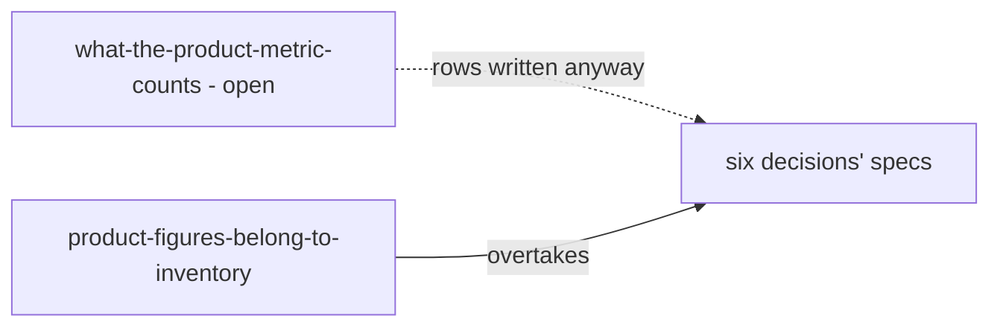
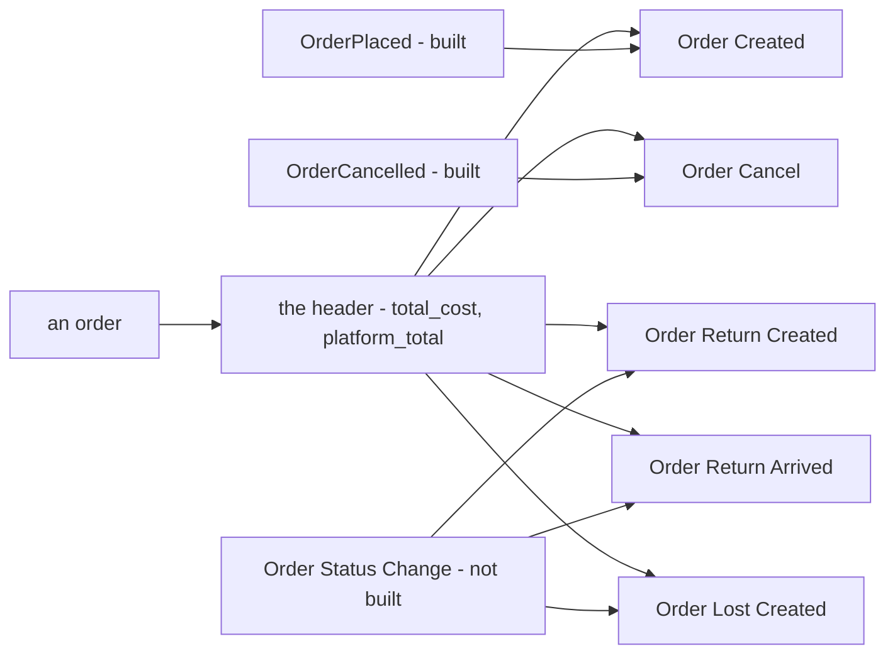

# Clarity — order `order_statistic_metric.md`

Critique, questions and a proposed design for [order_statistic_metric.md](./order_statistic_metric.md). That doc is
yours, and this one is mine. Answered points are **deleted**, so this file is always the current open set.

> **State (2026-10-29).** 10 decisions in [order_statistic_metric_decision.md](./order_statistic_metric_decision.md).
> There are five order metrics, each counting whole orders on the day of its own move: Created, Cancel, Return Created,
> Return Arrived and Lost Created
> ([lost-is-a-metric-and-completed-is-not](./order_statistic_metric_decision.md#lost-is-a-metric-and-completed-is-not)).
> Product figures are inventory's, for later, and two questions are [parked](#parked).
> **No question is open.** Still waiting on you: two slips under [Contradiction](#contradiction). Still to build: the
> event three of the metrics need ([the-status-changes-publish-nothing](#the-status-changes-publish-nothing)).
>
> ✅ The diagrams parse (`npm run lint:mermaid`).

Siblings: [rpc_provide.md](../analytic/rpc_provide.md), the pattern these metrics follow ·
[context.md](./context.md), the order's tables · [event_context.md](./event_context.md), the events that feed the
reports.

> ➡ **Moved here from [rpc_provide_clarify.md](../analytic/rpc_provide_clarify.md)** when the order metrics moved out of
> `rpc_provide.md`: the `fiter` and `mp_total` slips, and the missing filters, which your doc now lists.

---

# Contradiction

✅ Resolved by your edit of 2026-10-29: the four no longer filter by product
([product-is-its-own-line-metric](./order_statistic_metric_decision.md#product-is-its-own-line-metric)). Small slips
left in §Metric That Must Exists:

| line | says | → Recommend |
| --- | --- | --- |
| 20, 44, 68, 92, 116 | `fiter :` | `filter :` |
| 30, 54 | `mp_total` | `created_mp_total`, `cancel_mp_total`. The other three already prefix theirs, and two metrics in one table cannot both have a column called `mp_total` |

## order-product-left-the-order-metrics

**The example.** Six decisions recorded today carry an *Order Product* row, and two say *"all five"*. Then
[product-figures-belong-to-inventory](./order_statistic_metric_decision.md#product-figures-belong-to-inventory) moved
product figures to inventory. One cause, eight sites, all in the decision file, which is append-only, so they are listed
in that entry's *overtaken rows* rather than edited. Since
[lost-is-a-metric-and-completed-is-not](./order_statistic_metric_decision.md#lost-is-a-metric-and-completed-is-not),
*"five"* is right again, but for a different fifth metric.

**→ Recommend:** nothing for you to do. To stop it recurring: a metric still under question gets no row in a decided
entry's spec. I wrote Order Product into six specs while its own question was open.

---

# Critique

## the-status-changes-publish-nothing

[a-report-is-fed-by-events-only-for-now](../analytic/context_decision.md#a-report-is-fed-by-events-only-for-now) says a
report is filled by events and nothing else. Created and Cancel have their events: `OrderPlaced` and `OrderCancelled` are
built. A move to `return`, `return_completed` or `lost` publishes nothing, so three of the five metrics have no feed. The
**Order Status Change** event in [event_context.md](./event_context.md) is written down but not built.

**→ Recommend:** build Order Status Change before those three metrics. It carries the order, the status it moved to, who
moved it and when. The fold runs in the service that owns the orders, so it reads everything else off the order.

---

# Proposed Design

## the-order-metrics

Each metric is one `metric_id`, served by `selling_service`, which owns the orders, in the shape `metrics/suppliers`
already has. Everything here is decided except the ids.

| metric | proposed id | counts on the day of | fields | fed by |
| --- | --- | --- | --- | --- |
| Order Created | `metrics/orders/created` | `created_at` | `created_count` · `created_total` · `created_mp_total` | `OrderPlaced` ✅ |
| Order Cancel | `metrics/orders/cancelled` | the move to `cancel` | `cancel_count` · `cancel_total` · `cancel_mp_total` | `OrderCancelled` ✅ |
| Order Return Created | `metrics/orders/return_created` | the move to `return` | `return_created_count` · `_total` · `_mp_total` | Order Status Change ⛔ |
| Order Return Arrived | `metrics/orders/return_arrived` | the move to `return_completed` | `return_arrived_count` · `_total` · `_mp_total` | Order Status Change ⛔ |
| Order Lost Created | `metrics/orders/lost_created` | the move to `lost` | `lost_created_count` · `_total` · `_mp_total` | Order Status Change ⛔ |

| on every metric | | decided by |
| --- | --- | --- |
| one row per | a whole order. No product filter or group | [product-is-its-own-line-metric](./order_statistic_metric_decision.md#product-is-its-own-line-metric), [product-figures-belong-to-inventory](./order_statistic_metric_decision.md#product-figures-belong-to-inventory) |
| the day | the day of the metric's own move | [a-fact-counts-on-the-day-it-happened](./order_statistic_metric_decision.md#a-fact-counts-on-the-day-it-happened) |
| `*_total` · `*_mp_total` | the order's `total_cost` · its `platform_total` | [a-total-is-the-total-cost](./order_statistic_metric_decision.md#a-total-is-the-total-cost) |
| user | the order's creator, `created_by_user_id` | [a-metrics-user-is-the-orders-creator](./order_statistic_metric_decision.md#a-metrics-user-is-the-orders-creator) |
| `TEAM` · `WAREHOUSE` | the seller (`team_id`) · the warehouse (`warehouse_id`), for every reader | [the-team-group-is-the-seller](./order_statistic_metric_decision.md#the-team-group-is-the-seller) |
| groups | summary, daily to yearly, shop, team, warehouse, user | [the-four-group-by-team-shop-warehouse-user-and-time](./order_statistic_metric_decision.md#the-four-group-by-team-shop-warehouse-user-and-time) |
| filters | team, shop, warehouse, user, date range | your doc |
| who reads | a seller its own orders, a warehouse the orders it ships, root every order | [a-warehouse-reads-the-orders-it-ships](./order_statistic_metric_decision.md#a-warehouse-reads-the-orders-it-ships) |
| a warehouse gets | counts only. Money fields are `optional` and left unset | [a-warehouse-sees-no-seller-money](./order_statistic_metric_decision.md#a-warehouse-sees-no-seller-money) |
| stat types | a count is `QTY`, every total is `CURRENCY` | [every-number-field-carries-a-stat-type](../analytic/rpc_provide_decision.md#every-number-field-carries-a-stat-type) |
| Completed | not a metric: settlement reports what was paid | [lost-is-a-metric-and-completed-is-not](./order_statistic_metric_decision.md#lost-is-a-metric-and-completed-is-not) |

---

# Parked

⏸ *Parked by the owner (2026-10-29): "it on inventory and we talk later"*
([product-figures-belong-to-inventory](./order_statistic_metric_decision.md#product-figures-belong-to-inventory)). Not
counted as open. Both move to the clarify of inventory's metric doc when that doc exists. Until then they wait here as
input for that talk, not as a spec.

| was asked | the proposal it carried |
| --- | --- |
| what-the-product-metric-counts | one row per order line, `*_qty` and `*_goods_total` for each status change (created, cancel, return created, return arrived, and now lost). Groups: the order metrics' plus product. No order count, because an order with two products would count in both rows. No fee or platform money, because both belong to the whole order |
| a-borrowed-line-counts-for-the-seller | a line borrowed from another selling team counts for the seller who sold it, at its frozen `total` with the markup. A lender reading its product's sales through other sellers would be a second scope, by `owner_team_id` |

Why product was taken off the order metrics in the first place, with order #501 worked through, is in
[product-is-its-own-line-metric](./order_statistic_metric_decision.md#product-is-its-own-line-metric).

---

# Question

Every question is closed, each one in [order_statistic_metric_decision.md](./order_statistic_metric_decision.md). The
last was lost-is-not-a-metric, now
[lost-is-a-metric-and-completed-is-not](./order_statistic_metric_decision.md#lost-is-a-metric-and-completed-is-not).

✅ **No question is open.**
