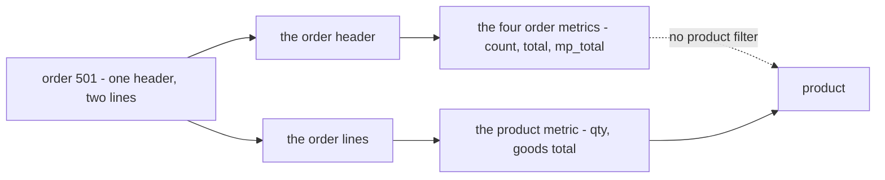
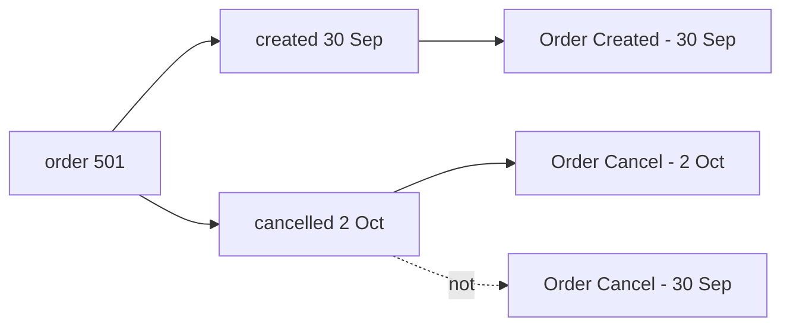
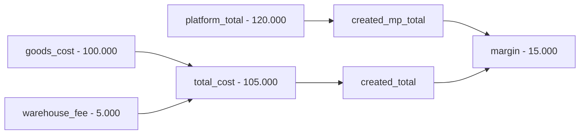
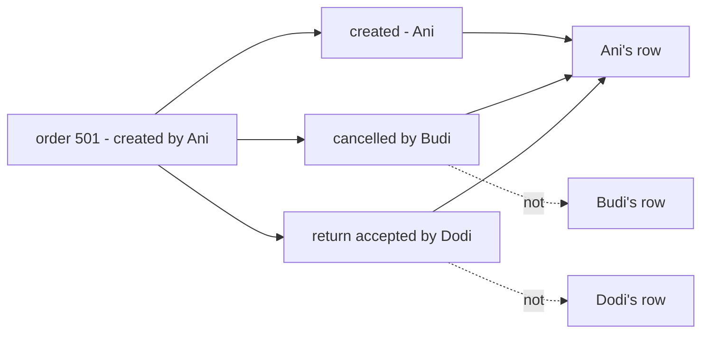
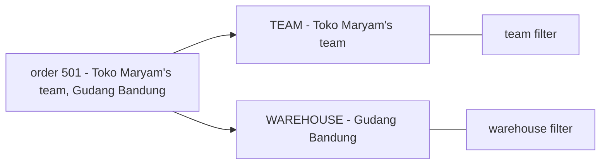
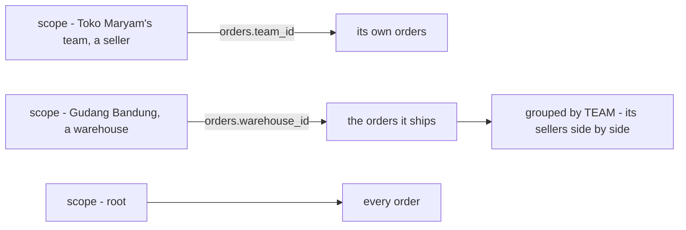
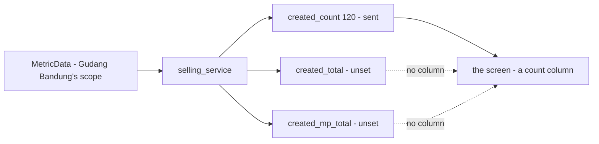
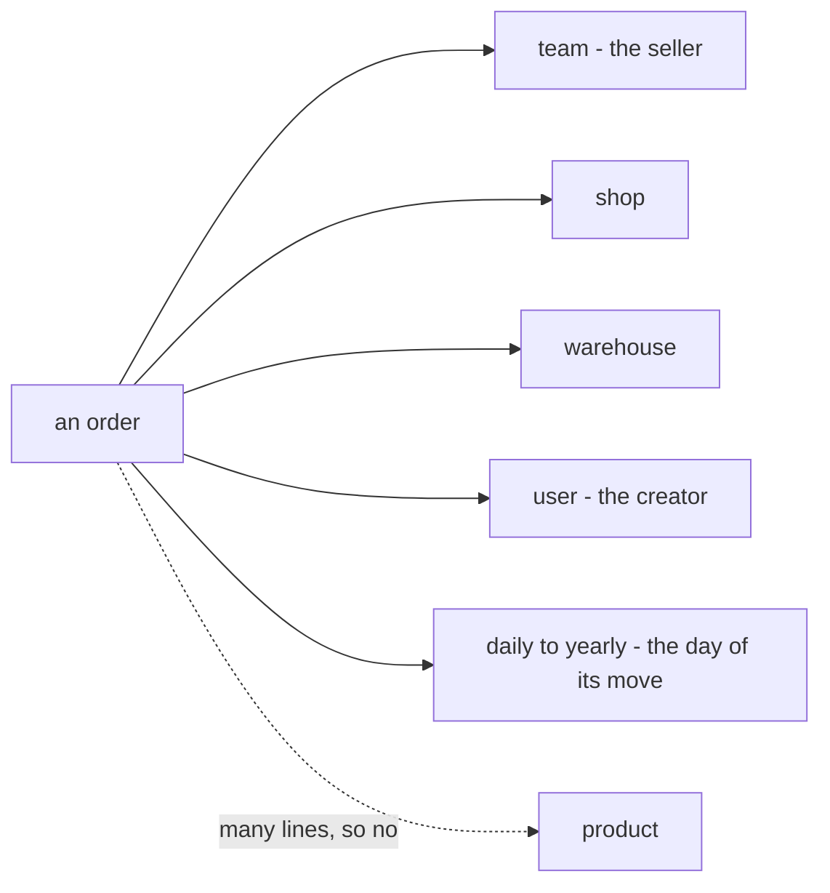
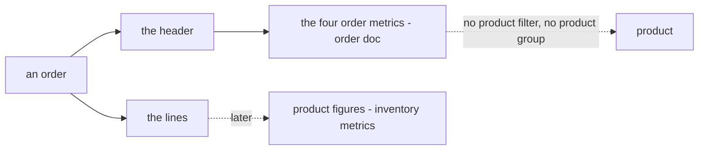
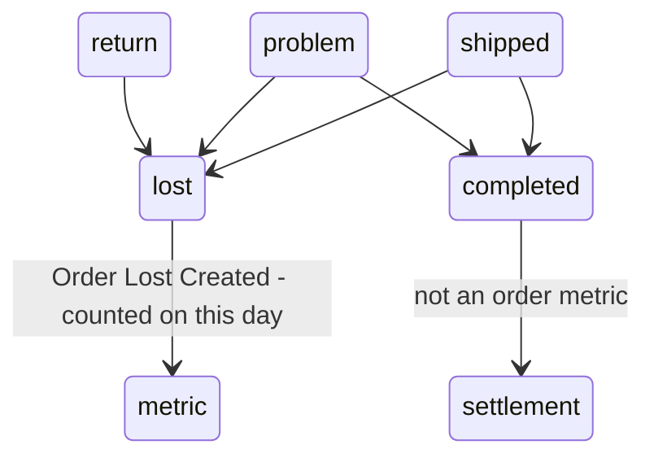

# Decisions — `order/order_statistic_metric.md`

What the owner decided about [order_statistic_metric.md](./order_statistic_metric.md), with the reasoning that produced it.
**Append-only** — a decision is added here before it is acted on, and it is never edited away.
The open set lives in [order_statistic_metric_clarify.md](./order_statistic_metric_clarify.md).

---

## product-is-its-own-line-metric

> Owner, in chat (2026-10-29): *"yes Keep the four metrics at order level, each with one rule for its day, its user and
> its team. Handle product in its own line-level metric."* — to *"drop product from the four metrics and add a product
> metric beside them?"*. As recommended.

**The verdict.** Order Created, Order Cancel, Order Return Created and Order Return Arrived count **whole orders**, and
none of them takes a product filter. Product gets **its own metric, one row per order line**. Each of the four has one
fixed rule for which day it counts on, which user it belongs to and which team its team group means. Which rule each one
uses is still open ([the open set](./order_statistic_metric_clarify.md#question)).

**Why.** Every field on the four is a number for the whole order, but a product belongs to a line. Order #501 has
product 77 at Rp 40.000 and product 88 at Rp 60.000, and the buyer paid Rp 120.000 on the platform:

| product 77, read as | count | total | mp_total |
| --- | --- | --- | --- |
| the whole order | 1 | 100.000, of which 60.000 is product 88 | 120.000 |
| the line only | 1 | 40.000 | none: an order line stores no platform price |

Grouped by product, #501 lands in two rows, so the rows add up to 2 against a headline of 1. That breaks
[the-headline-is-the-sum-of-its-rows](../analytic/rpc_provide_decision.md#the-headline-is-the-sum-of-its-rows).

**The spec.**

| | |
| --- | --- |
| the four | one row per order. Filters: team, shop, warehouse, user, date range. **No product** |
| the product metric | one row per order line. Filterable and groupable by product |
| its numbers | `qty` and the lines' frozen `total`, which add up to the order's `goods_cost`. No order count, because an order with two products would be counted in both rows. No platform money and no warehouse fee, because both belong to the whole order |
| one rule each | each metric fixes its day, its user and its team group. A filter never changes what a field means |
| still open | which day, which total, which user, which team, the groups, and what the product metric counts: [the open set](./order_statistic_metric_clarify.md#question) |
| your doc | §Metric That Must Exists loses `- product` from all four and gains the product metric. That edit is yours to make |

---

## a-fact-counts-on-the-day-it-happened

> Owner, in chat (2026-10-29): *"yes the day as hapened"* — to
> [which-day-a-fact-falls-on](./order_statistic_metric_clarify.md#question), *"an order created on 30 Sep and cancelled
> on 2 Oct: does the cancel count on 2 Oct or on 30 Sep?"*. As recommended.

**The verdict.** Each metric counts an order on the day **its own move** happened, not on the day the order was created.
Created counts on `created_at`, our own clock, never `platform_created_at`. A day that is over never changes again.

**The spec.**

| metric | counts on |
| --- | --- |
| Order Created | `orders.created_at`, as a Jakarta date ([a-day-is-a-jakarta-date-string](../analytic/rpc_provide_decision.md#a-day-is-a-jakarta-date-string)) |
| Order Cancel | the time on the timeline row that moved it to `cancel` |
| Order Return Created | the time on the timeline row that moved it to `return` |
| Order Return Arrived | the time on the timeline row that moved it to `return_completed` |
| Order Product | each move's lines on that move's day, the same as its order metric |
| why not the order's day | September would keep changing for weeks as late cancels and returns arrive, so a report printed yesterday would disagree with today's |
| why not `platform_created_at` | a draft finalised on 2 Oct would change 30 Sep, and old orders have no platform date |
| what it gives up | a cancel *rate* for one day's orders. Cancels on 2 Oct ÷ orders created on 2 Oct mixes orders from different days. A rate per order cohort would be a metric of its own, not proposed |

---

## a-total-is-the-total-cost

> Owner, in chat (2026-10-29): *"yes i follow your recomendation"* — to
> [which-total](./order_statistic_metric_clarify.md#question), *"is `created_total`, `cancel_total` … the order's
> `goods_cost`, `total_cost` or `platform_total`?"*. As recommended.

**The verdict.** Every `*_total` on the four order metrics is the order's frozen `total_cost`: goods plus the warehouse
fee, what the order cost the seller. Every `*_mp_total` is its `platform_total`. Then `mp_total − total` is the margin,
which is how the order already defines it.

**The spec.**

| field | reads | order 501 |
| --- | --- | ---: |
| `created_total`, `cancel_total`, `return_created_total`, `return_arrived_total` | `orders.total_cost`, frozen at create | 105.000 |
| `created_mp_total`, `cancel_mp_total`, `return_created_mp_total`, `return_arrived_mp_total` | `orders.platform_total` | 120.000 |
| a never-priced fee (`warehouse_fee` nil) | counts as nothing, as `total_cost` already does | |
| `platform_total` 0 (an order from before it was required) | counts as 0, so that day's margin reads high | |
| a warehouse reading the metric | sees its own fee inside the total. Accepted: the total is the seller's cost | |
| Order Product | unchanged: `goods_total`, the lines' `total`, which add up to `goods_cost`, because the fee belongs to the whole order ([product-is-its-own-line-metric](#product-is-its-own-line-metric)) | 100.000 |

---

## a-metrics-user-is-the-orders-creator

> Owner, in chat (2026-10-29): *"yes"* — to [which-user](./order_statistic_metric_clarify.md#question), *"grouped by
> user, does order 501's cancel go in Ani's row (who created it) or Budi's (who cancelled it)? Recommend the creator on
> all four."*. As recommended.

**The verdict.** On every order metric, the user an order belongs to is **the person who created it**,
`orders.created_by_user_id`, whoever made the later status change. A row grouped by user reads as *"Ani's orders"*. Who
made each change stays on the order's timeline.

**The spec.**

| | |
| --- | --- |
| the user, on all five metrics | `orders.created_by_user_id`, set at create, never updated |
| the `user` filter | orders that person created |
| `GROUP_TYPE_USER` | one row per creator. A warehouse crew member who only accepts returns never gets a row |
| `created_by_user_id` 0 (an order from before it was recorded) | its own row, *no user*, so the rows still add up to the headline ([the-headline-is-the-sum-of-its-rows](../analytic/rpc_provide_decision.md#the-headline-is-the-sum-of-its-rows)) |
| who made a change | not in these metrics. The order's timeline (`order_timeline_logs.actor_id`) answers it |
| a draft finalised by CS | the CS who finalised it, the user `created_by_user_id` already records. The app that pushed the draft is not a user |

---

## the-team-group-is-the-seller

> Owner (2026-10-29): *"I ADD GROUP_TYPE_WAREHOUSE in group type"*, in [rpc_provide.md](../analytic/rpc_provide.md), to
> [which-team-the-team-group-means](./order_statistic_metric_clarify.md#question), after *"is we have grouped by
> warehouse ?"*. Recorded for the pattern as
> [the-warehouse-is-its-own-group](../analytic/rpc_provide_decision.md#the-warehouse-is-its-own-group). This entry is
> what it means for an order.

**The verdict.** An order's two teams each get their own group. `TEAM` is the seller, `orders.team_id`, and `WAREHOUSE`
is the warehouse that ships it, `orders.warehouse_id`. Both mean the same thing whoever reads the report. My earlier
"other side from the reader" rule is dropped.

**The spec.**

| | group | filter |
| --- | --- | --- |
| the seller | `GROUP_TYPE_TEAM` on `orders.team_id` | `team` |
| the warehouse | `GROUP_TYPE_WAREHOUSE` on `orders.warehouse_id` | `warehouse` |
| applies to | all five order metrics | |
| root | can group by either, so it can put sellers or warehouses side by side | |

---

## a-warehouse-reads-the-orders-it-ships

> Owner, in chat (2026-10-29): *"yes"* — to [a-warehouse-reads-the-orders-it-ships](./order_statistic_metric_clarify.md#question),
> *"does a warehouse's scope read the orders it ships, matched on `warehouse_id`?"*. As recommended.

**The verdict.** An order metric called with a team's scope reads the orders where that team is the seller **or** the
warehouse. A seller sees its own orders, and a warehouse sees the orders it ships, the same ones its order list shows.
Root reads every team.

**The spec.**

| scope | reads orders where | grouped by `TEAM` | grouped by `WAREHOUSE` |
| --- | --- | --- | --- |
| a selling team | `team_id` = the scope | one row, itself | its warehouses |
| a warehouse team | `warehouse_id` = the scope | its sellers | one row, itself |
| root | every order ([root-reads-every-teams-orders](../../technical/frontend/order_list_decision.md#root-reads-every-teams-orders)) | every seller | every warehouse |
| applies to | all five order metrics, Order Product too | | |
| who may call | every member of the scoped team ([every-member-reads-every-metric-of-their-team](../analytic/rpc_provide_decision.md#every-member-reads-every-metric-of-their-team)) | | |
| what a warehouse sees | ⚠ **not settled by this answer.** Its order list shows no money, because a seller's margin is somebody else's business ([the-two-ends-are-two-screens](../../technical/frontend/warehouse_order_list_decision.md#the-two-ends-are-two-screens)). Decided as [a-warehouse-sees-no-seller-money](#a-warehouse-sees-no-seller-money) | | |

---

## a-warehouse-sees-no-seller-money

> Owner, in chat (2026-10-29): *"yes"* — to [a-warehouse-sees-no-seller-money](./order_statistic_metric_clarify.md#question),
> *"a warehouse gets counts and quantities only, the money fields left unset by the service?"*. As recommended.

**The verdict.** A warehouse reading order metrics gets the counts and quantities of the orders it ships, never the
seller's money. The **service** leaves every money field unset for a warehouse scope, so it never crosses the network.
This keeps the rule of the warehouse's order list
([the-two-ends-are-two-screens](../../technical/frontend/warehouse_order_list_decision.md#the-two-ends-are-two-screens)):
a seller's margin is somebody else's business.

**Why it was asked.** [a-warehouse-reads-the-orders-it-ships](#a-warehouse-reads-the-orders-it-ships) was recommended
from *"the same orders its order list already shows it"*, missing that the list shows them without money. As first
decided, a warehouse could have read each seller's `total` and `mp_total` and worked out its margin. This entry closes
that gap. To stop it recurring: when a scope widens to a second kind of team, check what the existing screens already
hide from that kind of team before recommending.

**The spec.**

| field | seller · root | warehouse |
| --- | --- | --- |
| `*_count`, Order Product's `*_qty` | sent | sent |
| `*_total`, `*_mp_total`, Order Product's `*_goods_total` | sent | **unset**, never 0 |
| a sort on a money field | allowed | refused, `InvalidArgument` |
| a money filter | none exists | none exists |

| | |
| --- | --- |
| the contract | every money field is `optional`, so unset ("not yours") is told apart from 0 |
| who decides | the service, from the scope's team type. The screen only drops a column that came back unset |
| why not the screen | a hidden column still crosses the network, and any member of the warehouse team can call the RPC |
| the warehouse's own money | Warehouse Fee, a metric of its own |

---

## the-four-group-by-team-shop-warehouse-user-and-time

> Owner (2026-10-29), in [order_statistic_metric.md](./order_statistic_metric.md) §Metric That Must Exists — each of
> the four gained a `group by :` list — and in chat: *"i edited ## Metric That Must Exists."*. That answered
> [which-groups](./order_statistic_metric_clarify.md#question) for the four. As recommended.

**The verdict.** Order Created, Order Cancel, Order Return Created and Order Return Arrived each group by **team, shop,
warehouse, user, daily, weekly, monthly and yearly**, and by summary for the headline. None of them groups by product or
supplier. Every row adds up to the headline, because an order has exactly one of each key.

**The spec.**

| | |
| --- | --- |
| `supported_group_by` | `SUMMARY`, `DAILY`, `WEEKLY`, `MONTHLY`, `YEARLY`, `SHOP`, `TEAM`, `WAREHOUSE`, `USER` |
| summary | not in your list, but every metric has it ([every-metric-has-a-summary](../analytic/rpc_provide_decision.md#every-metric-has-a-summary)) |
| what each key means | team the seller, warehouse the warehouse ([the-team-group-is-the-seller](#the-team-group-is-the-seller)), user the creator ([a-metrics-user-is-the-orders-creator](#a-metrics-user-is-the-orders-creator)), the day of its move ([a-fact-counts-on-the-day-it-happened](#a-fact-counts-on-the-day-it-happened)) |
| a warehouse's view | groups the same way, counts only ([a-warehouse-sees-no-seller-money](#a-warehouse-sees-no-seller-money)) |
| Order Product's groups | not answered by this edit, since the doc has no Order Product entry yet. Asked in [what-the-product-metric-counts](./order_statistic_metric_clarify.md#question) |

---

## product-figures-belong-to-inventory

> Owner, in chat (2026-10-29): *"it on inventory and we talk later"* — to
> [what-the-product-metric-counts](./order_statistic_metric_clarify.md#parked), *"which status changes does Order
> Product count, and what does it group by?"*.

**The verdict.** There is **no product metric among the order metrics**. Figures per product (units sold, cancelled,
returned) are inventory's, and are designed with inventory's metrics, later. The order metrics are the four, each counting
whole orders. The first half of [product-is-its-own-line-metric](#product-is-its-own-line-metric) stands: the four take
no product filter and no product group. Its second half, *"product gets its own metric"*, now means an inventory metric,
not an order one.

**The spec.**

| | |
| --- | --- |
| the order metrics | Order Created, Order Cancel, Order Return Created, Order Return Arrived. Nothing per product |
| product figures | inventory's, not designed. The parked proposal (fields per status change, groups, the borrowed line) is input for that talk, not a spec: [parked](./order_statistic_metric_clarify.md#parked) |
| your doc | the four `- product` filter lines still go. No fifth entry |
| overtaken rows | the Order Product rows in [product-is-its-own-line-metric](#product-is-its-own-line-metric), [a-fact-counts-on-the-day-it-happened](#a-fact-counts-on-the-day-it-happened), [a-total-is-the-total-cost](#a-total-is-the-total-cost), [a-warehouse-reads-the-orders-it-ships](#a-warehouse-reads-the-orders-it-ships), [a-warehouse-sees-no-seller-money](#a-warehouse-sees-no-seller-money) and [the-four-group-by-team-shop-warehouse-user-and-time](#the-four-group-by-team-shop-warehouse-user-and-time), and *"all five"* in [a-metrics-user-is-the-orders-creator](#a-metrics-user-is-the-orders-creator) and [the-team-group-is-the-seller](#the-team-group-is-the-seller), which now means all four. Left as written, because this file is append-only, and read through this entry |

---

## lost-is-a-metric-and-completed-is-not

> Owner (2026-10-29), in [order_statistic_metric.md](./order_statistic_metric.md) §Metric That Must Exists — gained
> *5. Order Lost Created*, and the four lost their `- product` filter lines — and in chat: *"im edited ## Metric That
> Must Exists. section"*. That answered [lost-is-not-a-metric](./order_statistic_metric_clarify.md#question). As
> recommended: Lost is added, and Completed stays out of the list.

**The verdict.** **Order Lost Created** is the fifth order metric, in the same shape as the four: it counts an order on
the day it was marked `lost`. Completed is not a metric. A completed order is one the platform pays out on, and
settlement already reports what was paid, so a Completed count would be a second answer to *"what did we sell"*, from a
different source.

**The spec.**

| | |
| --- | --- |
| metric | Order Lost Created, proposed id `metrics/orders/lost_created` |
| fields | `lost_created_count` (`QTY`), `lost_created_total` and `lost_created_mp_total` (`CURRENCY`), your names |
| counts on | the time on the timeline row that moved the order to `lost` ([a-fact-counts-on-the-day-it-happened](#a-fact-counts-on-the-day-it-happened)) |
| total · user · team · warehouse | as the four: `total_cost` and `platform_total`, the creator, the seller, the warehouse |
| groups · filters | as the four: team, shop, warehouse, user, daily to yearly · team, shop, warehouse, user, date range |
| a warehouse | counts only ([a-warehouse-sees-no-seller-money](#a-warehouse-sees-no-seller-money)) |
| an order lost after a return | it stays counted in Order Return Created and is also counted here. They are different metrics, so nothing is counted twice within one |
| fed by | the Order Status Change event, which is not built yet, the same as the two returns |
| Completed | not a metric. The *"four"* in earlier entries now means these five order metrics |
