# Decisions — `product_context.md`

What the owner decided about [context.md](./context.md), recorded before it is acted on.
**Append-only** — the opposite lifecycle to [context_clarify.md](./context_clarify.md), which holds only
what is still open. Each entry carries what it decided, why, and the spec that makes it buildable
(RULE 8b.11).

Siblings: [balance](../balance/context_decision.md) · [analytic](../analytic/context_decision.md) ·
[project/member](../project/member_decision.md).

---

## only-a-selling-team-owns-a-catalogue

> *"warehouse cannot have own product"* (owner, 2026-09-12)

`## General.` 1 stands exactly as written: **a product belongs to a selling team, and to no other kind
of team.** A warehouse team holds stock — it never owns the catalogue entry that stock is counted
against.

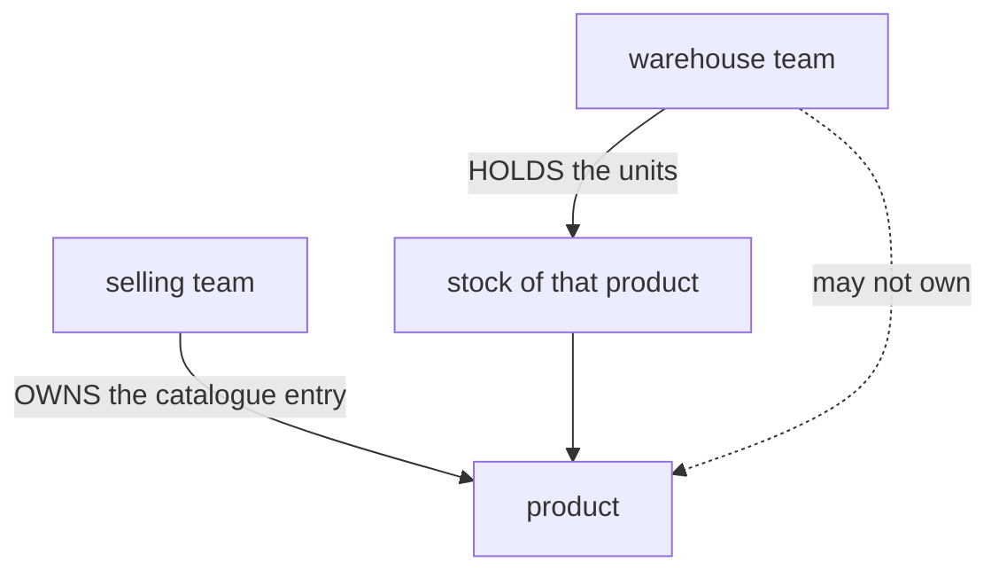

**Why it matters beyond the ACL.** §Pricing Behavior splits every line into *the ordering team owns this
product* → `COGS = UnitPrice`, or *another selling team owns it* → `COGS = UnitPrice + fee`. A
warehouse-owned product would be a third case, and a warehouse team places no orders — so it could never
be the *own team* of anything it owned. This decision makes that split total: every product has an owner
that can also be a buyer.

### The spec

**1. Four WRITE requests lose the two warehouse roles** — [product.proto](../../../proto/warehouse/product/v1/product.proto):

| request | roles today | roles after |
| --- | --- | --- |
| `ProductCreateRequest` | ROOT, ADMIN, TEAM_OWNER, TEAM_ADMIN, **WAREHOUSE_OWNER, WAREHOUSE_ADMIN** | ROOT, ADMIN, TEAM_OWNER, TEAM_ADMIN |
| `ProductUpdateRequest` | same | same |
| `ProductDeleteRequest` | same | same |
| `ProductRestoreRequest` | same | same |

**2. Every READ keeps them.** `ProductList`, `ProductByIds` and `ProductDetail` stay open to
`WAREHOUSE_OWNER`/`ADMIN`/`STAFF` — a packer holding a physical unit must be able to read its name. Not
owning a catalogue is not the same as not being allowed to look at one.

**3. `product.proto`'s service comment is corrected.** It currently reads *"a selling/warehouse team owns
its own catalogue"*, which is now wrong on the second word.

**4. ⚠ The ACL narrowing does NOT enforce this on its own — the handler must check the TEAM TYPE.**
Roles are granted per team and **nothing forbids granting `ROLE_TEAM_OWNER` inside a warehouse team**
(no grant path validates a role against `teams.type`). So after the four edits above, a `TEAM_OWNER` of a
warehouse team still passes the policy and still creates a product there.

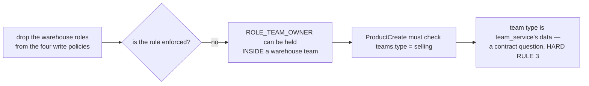

**What is decided** is the business rule. **What is not decided** is how product_service learns a team's
type — it has no read path to `team_service` today, and HARD RULE 3 makes that an RPC rather than a
shared model. That successor question is open in
[context_clarify.md](./context_clarify.md#question).

---

## superseded-a-product-files-under-many-categories

> ⚠ **Superseded 2026-10-31** by [a-product-has-one-category](#a-product-has-one-category): a product has exactly one
> category. Kept as written below.

> *"categories is plural"* (owner, 2026-09-12)

`## Attribute / Field That Product Must Have` 4 is right and the schema is wrong: **a product is filed
under SEVERAL taxonomy nodes, not one.** `products.category_id` — a single `BIGINT` — becomes a link
table owned by product_service.

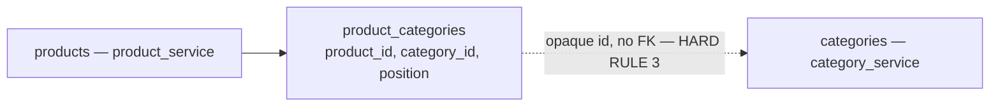

⚠ **I had recommended one node and was wrong about the direction of the risk.** My argument was that
one → many is additive later — true of the *schema* and false of the *contract*, because `buf breaking`
now runs in CI and the proto change is breaking whenever it happens. The cheap moment is therefore now,
not later, which is the opposite of what I said.

### The spec

**1. A new table, in product_service's own migrations** (HARD RULE 3):

| column | | |
| --- | --- | --- |
| `product_id` | `BIGINT NOT NULL` | |
| `category_id` | `BIGINT NOT NULL` | opaque id from category_service — **no FK** |
| `position` | `INT NOT NULL DEFAULT 0` | the order they were filed, first = primary (see the open question) |
| | `UNIQUE (product_id, category_id)` | a product files under a node once |
| | `INDEX (category_id)` | *"what is in this node"* is the read that needs it |

**Backfill and drop in the SAME migration** — one row per product with `category_id > 0`, then
`products.category_id` goes. Leaving both is two sources of truth for one fact, which is the drift the
model comment already says this project exists to avoid.

**2. Four proto sites, and the change is BREAKING** — field 7 is reserved and a `repeated` one added
beside it, rather than changing 7's cardinality in place (a singular `uint64` is a varint on the wire and
a `repeated` one is length-delimited — same number, different encoding):

| message | today | after |
| --- | --- | --- |
| `Product` | `uint64 category_id = 7` | `reserved 7` · `repeated uint64 category_ids = 14` |
| `ProductCreateRequest` | `uint64 category_id = 5`, `gt = 0` | `repeated uint64 category_ids`, `min_items: 1` |
| `ProductRowItem` | `uint64 category_id = 6` | `repeated uint64 category_ids` |
| `ProductUpdateRequest` | `optional uint64 category_id = 6` | a **`ProductCategories` wrapper**, exactly like `ProductImages` — a message field has presence, so nil = *leave alone* and present = *replace with exactly these* |

⚠ `buf breaking` fires on that commit. That is the accepted situation, not a surprise — same shape as
[breaking-the-old-protos-is-accepted](../../technical/event_architecture/context_decision.md#breaking-the-old-protos-is-accepted).

**3. ✅ Nothing FILTERS by category today**, which is most of why this is cheap: `category_id` is carried
on the row and read by nobody. `ProductList` and `ProductDiscover` have no category filter to rewrite as
an `EXISTS`. When one is added it is a subquery, not a join — a join multiplies rows per category and
silently breaks the page count.

**4. ⚠ The list read must not become N+1.** One `WHERE product_id IN (…)` for the whole page, grouped in
memory — not a lookup per row. `ProductDetail` may read its own.

**5. The picker stays SINGLE, and is not forked.** `CategorySelect` has four callers and **three of them
pick a parent node**, not a product's categories (`CreateCategoryDialog`, `EditCategoryDialog`,
`AddressPicker`). Only [product-edit](../../../frontend/src/pages/product-edit/index.tsx) files a product. So the multi-value control is a
**chips wrapper that composes `CategorySelect`** for adding and renders removable tags — the tree logic
stays in one place.

---

## the-code-is-composed-from-the-team-code

> *"composed"* (owner, 2026-09-12)

`product_code` is **globally unique** (`### Whats is \`product_code\`` 2) and the stored string is
**composed on write** from the owning team's code and the team's own part:

```
product_code = <team_code>-<the team's own code>
```

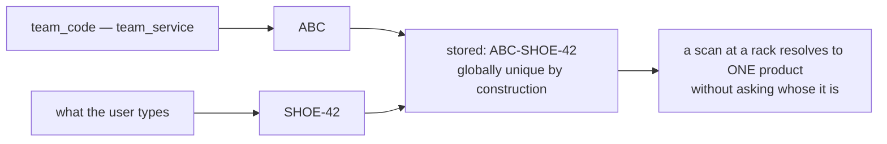

**What it buys.** Global uniqueness stops being a namespace two teams compete for. Two teams selling one
supplier's item can both carry that supplier's code as their own part, no create is ever refused because
of another team's row, and no refusal can leak that another team holds a code.

### The spec

**1. The user types their part only.** The prefix is a static adornment in the form, not an editable
field — a user who can type the prefix can collide with another team again.

**2. The prefix is FROZEN at write time, not recomputed on read.** ⚠ Teams can be renamed
(`TeamInfoUpdate`), and a prefix recomputed from the current `team_code` would silently rewrite every
printed label a team ever produced. The composed string is stored whole, exactly as it was composed.
*(→ Recommended, not stated by the owner — say so if it should follow the team instead.)*

**3. ⚠ It needs the same cross-service read as
[only-a-selling-team-owns-a-catalogue](#only-a-selling-team-owns-a-catalogue), and that is a reason to build ONE.** Composing the code needs
`teams.team_code`, and enforcing the ownership rule needs `teams.type` — both team_service's, neither
reachable from product_service today (HARD RULE 3). One cached team read at write time serves both.
Open as [Q8](./context_clarify.md#question).

**4. The uniqueness constraint is on the composed string**, one index over `product_code`. Whether it
excludes soft-deleted rows is the still-open [Q11](./context_clarify.md#question).

---

## a-deleted-product-is-unfindable

> *"deleted product is cannot search anywhere"* (owner, 2026-09-12)

A deleted product **leaves every search surface**. It is not in `ProductList`, not in `ProductDiscover`,
not in a typeahead, and not reachable by its code.

⚠ **Recorded with its boundary, because the rule and the shipped code disagree about one case.**
`ProductByIds` — a lookup by an id the caller ALREADY HOLDS, not a search — deliberately **does** return
soft-deleted products, and its comment says why: *"stock outlives a catalogue entry, and a shelf holding a
deleted product should name it rather than show a blank."* Whether this decision overrides that is the
open [Q11](./context_clarify.md#question); the contradiction is written up in
[context_clarify.md](./context_clarify.md#a-deleted-product-is-unfindable-and-a-shelf-of-its-units-still-needs-its-name).

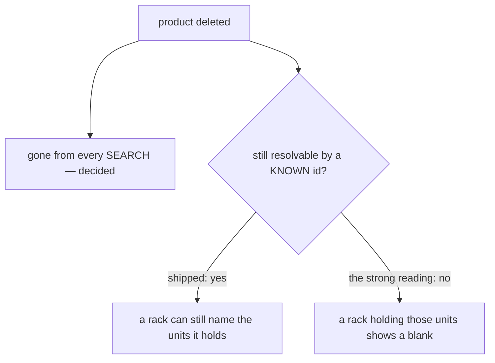

---

## superseded-deleting-a-product-requires-zero-stock

> ⚠ **Superseded 2026-10-31** by [a-used-product-is-archived-never-deleted](#a-used-product-is-archived-never-deleted): a
> product that ever had stock is archived, never deleted. Kept as written below.

> *"for \"Can a product be deleted while it still has stock?\" no"* (owner, 2026-09-12)

A product **cannot be deleted while it still has stock.** `ProductDelete` checks the quantity first and
refuses — today it checks nothing, so this is a new guard, not a restatement.

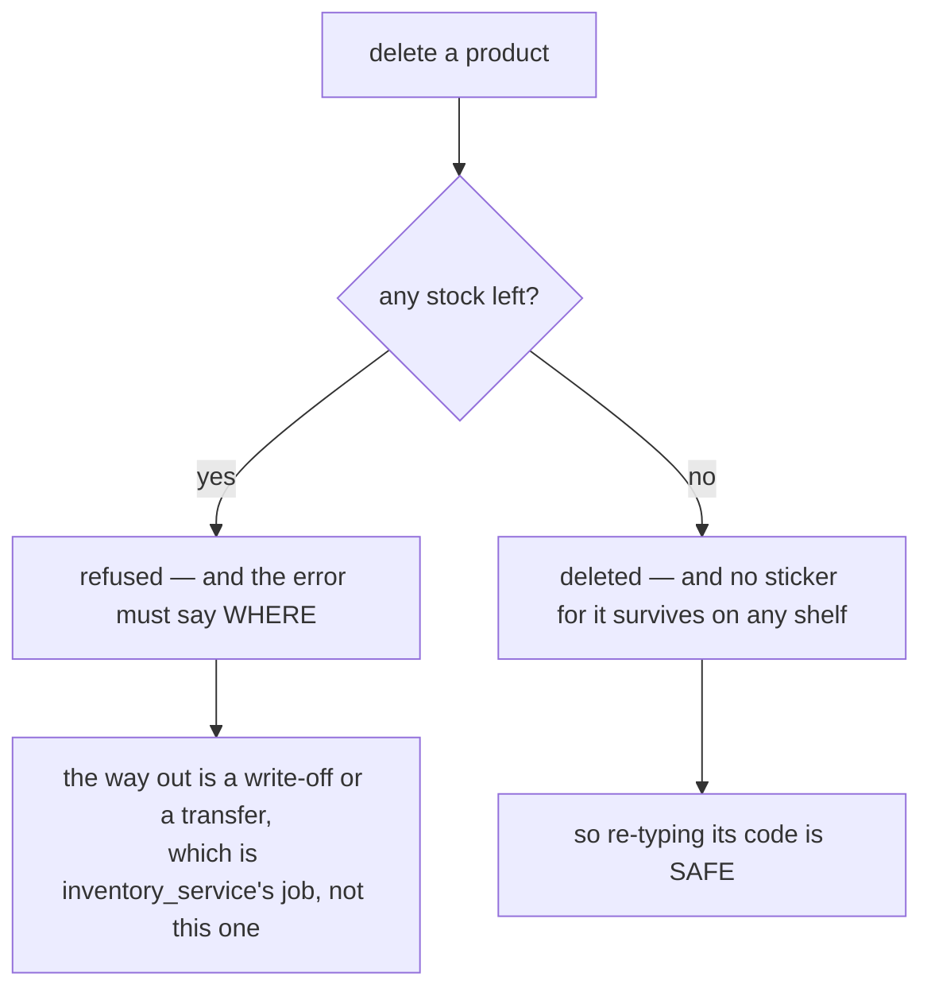

**It resolves the contradiction with `ProductByIds`** — there is no longer a shelf holding a deleted
product's units, so *unfindable anywhere* and *a rack should name what it holds* stop competing
([the contradiction](./context_clarify.md#a-deleted-product-is-unfindable-and-a-shelf-of-its-units-still-needs-its-name)).

### The spec

**1. The check is cross-service and must NOT be cached.** Stock is inventory_service's, so this is an RPC
(HARD RULE 3) — and unlike the team read that
[the-code-is-composed-from-the-team-code](#the-code-is-composed-from-the-team-code) needs, a quantity served from a cache would wave
through the very delete it exists to stop.

**2. ⚠ The refusal must NAME the stock, not just refuse.** *"This product still has stock"* leaves an
operator with nowhere to go. The error carries the warehouses and quantities holding it, because the way
out — a write-off or a transfer — happens somewhere else and the person needs to know where to go.

**3. ⚠ It makes delete BLOCKABLE, and that is the accepted cost.** A product with units nobody can find
can never be archived until those units are written off. That is the correct trade — the alternative is
archiving a catalogue entry while the warehouse still physically holds it — but it means the write-off
path has to exist and be reachable, or this rule turns into a permanently stuck row.

**4. ✅ It makes code reuse SAFE, and that retires my own argument against it.** I had recommended burning
a deleted code because a re-typed one would make an old sticker scan as a new product. With zero stock
required, no sticker for a deleted product survives, so the argument falls with it. Recorded rather than
quietly dropped.

**5. ⚠ The `[code]_deleted_ts` rename is still not needed for that.** A partial unique index
(`WHERE deleted = FALSE`) frees the code without mutating a string somebody printed — and the rename
collides with itself when a code is created and deleted twice inside one `ts` tick, which fails the
**delete**. If a rename is wanted anyway, suffix the row **id**.

---

## the-couriers-ask-is-in-the-unit-price

> Owner, in chat *(2026-10-07)*: *"for 2, yes"*, confirmed as the literal question: *"should the courier's tip at the
> door be part of a batch's unit price?"* It answers [Q6](./context_clarify.md#question) **against my recommendation**
> (tip out, freight in). It was #4 of [biggest_question.md](../../biggest_question.md).

**The verdict.** §Unit Price Components stands as written. What the warehouse hands the courier at the door
(`AdditionalWarehouseFee`, the incidental ask of
[cod-fee-is-the-couriers-incidental-ask](../balance/context_decision.md#cod-fee-is-the-couriers-incidental-ask)) is
spread over the units with the freight and frozen into the batch's unit price. It is **also** still owed by the selling team, in full.

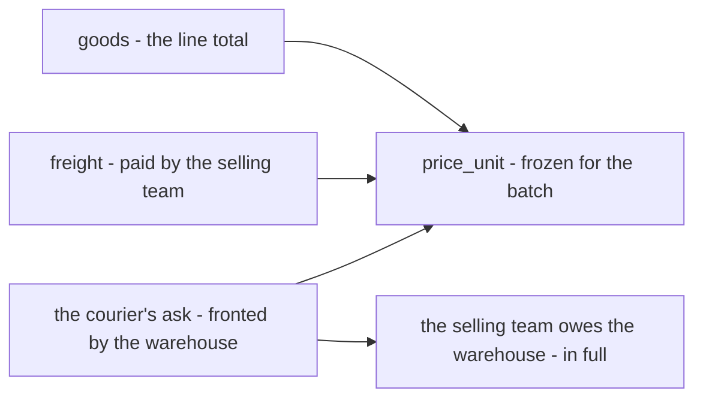

**The spec.**

| | |
| --- | --- |
| the formula | §Unit Price Components, unchanged — the same as [technical stock §COGS](../../technical/stock/design.md#cogs-price-of-stock) |
| when | at accept, inside its transaction ([accept-is-one-transaction-then-an-event](../inventory/restock_decision.md#accept-is-one-transaction-then-an-event)) — so the ask is entered at accept, before the price is computed |
| the balance | unchanged — a warehouse receivable ([the-warehouse-receivable-is-order-fee-cod-fee-and-found](../balance/context_decision.md#the-warehouse-receivable-is-order-fee-cod-fee-and-found)) |
| the arithmetic | floating point ([rupiah-is-floating-point](../order/context_decision.md#rupiah-is-floating-point)) |
| a mistyped ask | corrected by revaluing the batch — [batch.md §Change Price Flow](../inventory/batch.md#change-price-flow-example) |
| the build | already includes it — `freight := rr.ShippingCost + costLineTotal` (`restock_request_fulfill.go:206` then; ✅ *(2026-11-02)* now [restock_request_accept.go:165](../../../backend/services/inventory_service/inventory_v1/restock_request_accept.go#L165), `freight := rr.ShipmentCost + courierCharge`, and money is `float64`, so the integer division below is gone). ⚠ But `freightPerUnit` is **integer** division, so a Rp 5.000 ask over 1.000 units adds **0** — against the arithmetic row |

**What it does NOT settle:** whether the divisor is the ordered or the arrived quantity ([Q2](./context_clarify.md#question)),
and how freight and the ask split across a restock's lines — by quantity or by value
([stock Q3](../../technical/stock/design_clarify.md#question)).

---

## the-reserve-stops-other-teams-at-low-stock

> Owner, in chat (2026-10-15): *"for 1., simple stock >= reserve, for 2., it only stops other teams, and that reserved mainly
> used for. to prevent other team create order with our stock if we have few stock left"* — answering
> [Q3](./context_clarify.md#question), *what is the reserve, and does it bind the owner's own orders?* Binding only other
> teams is as recommended; the boundary is **against** my `stock − wanted ≥ reserve`. Earlier the same day: the stock is
> the total across every warehouse, checked by inventory before its take
> ([the-reserve-is-read-before-the-take](../inventory/order_decision.md#the-reserve-is-read-before-the-take)).

**The verdict.** The reserve is a **low-stock line**, not a floor. While the product's total stock is at or above it,
another team may borrow; once it is below, only the owner may sell. The quantity wanted is not part of the test, and the
owner's own orders are never stopped by it. It exists so that when the owner is down to its last few units, those units
go to its own orders.

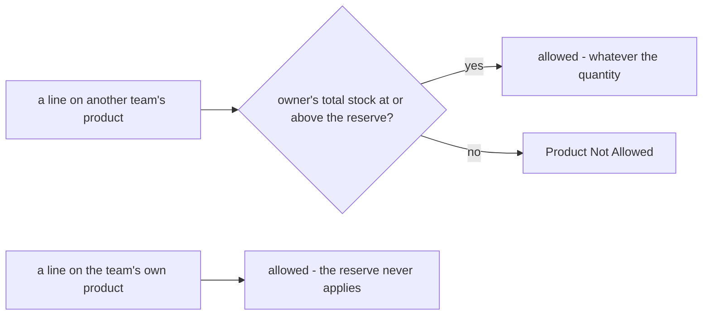

**The spec.**

| | |
| --- | --- |
| the test | `total stock ≥ reserve` — allowed; below it, refused |
| total stock | the product's stock in every warehouse ([the-reserve-is-read-before-the-take](../inventory/order_decision.md#the-reserve-is-read-before-the-take)) |
| the quantity wanted | not counted — stock 11, reserve 10, a borrowed 5 is allowed and leaves 6 |
| who it stops | other teams only; the owner sells its own stock to zero |
| who sets it | the selling Owner and Admin ([the-selling-owner-and-admin-set-markup-reserve-and-lock](../user/context_decision.md#the-selling-owner-and-admin-set-markup-reserve-and-lock)) |
| where it is checked | inventory's take, before its transaction ([the-take-checks-the-product-first](../inventory/order_decision.md#the-take-checks-the-product-first)) |

**What it costs — accepted.** A borrowed order can end below the reserve — by its own quantity, or by another borrower's in
the same moment. The line stops the **next** borrower, not this one.

## exactly-the-reserve-stays-open

> Owner, in chat (2026-10-31): *"follow your recomendation"* — answering [Q13](./context_clarify.md#question), *at
> exactly the minimum, may another team still order?* Yes, as recommended — which reversed my own earlier ≤ in the clarify.

**The verdict.** A product whose total stock is **exactly** its reserve is still **open** to other teams; it closes only
**under** it. This keeps [the-reserve-stops-other-teams-at-low-stock](#the-reserve-stops-other-teams-at-low-stock)'s
`total stock ≥ reserve` and [context.md](./context.md) §Cross/Shared Products Rule 1 (*"when stock < several, its cannot
be shared"*) as written, and the screens follow them.

**Why.** The reserve is a low-stock **line**, not a floor — the quantity wanted is not counted, so a borrower at 20 against
20 may take 15 and leave 5 either way. *"The minimum is what the owner keeps"* was the floor argument again, and it is the
one the line already refused.

```
reserve 20      total 19 → closed      total 20 → OPEN      total 21 → open
```

| | |
| --- | --- |
| the test | `total stock ≥ reserve` — open; `<` — closed. Unchanged |
| the order take | already `>=` ([order_transaction_create.go](../../../backend/services/inventory_service/inventory_v1/order_transaction_create.go)) — unchanged |
| the screens | `lockedByMinimumNow` ([ProductLock.tsx](../../../frontend/src/features/products/ProductLock.tsx)) goes from `<=` back to `<` — the **Terkunci** badge on the product list and the product's page, and Discover's **Kunci** filter, which reads the same comparison |
| what it replaces | the screens' [superseded-the-minimum-closes-at-the-minimum](../../technical/frontend/products_decision.md#superseded-the-minimum-closes-at-the-minimum) (≤, 2026-10-30) |

**What it resolved** (HARD RULE 11): the clarify's contradiction *the screens close a product at its minimum, the business
rule opens it there* — the badge said *Terkunci* on a product the take still let another team order.

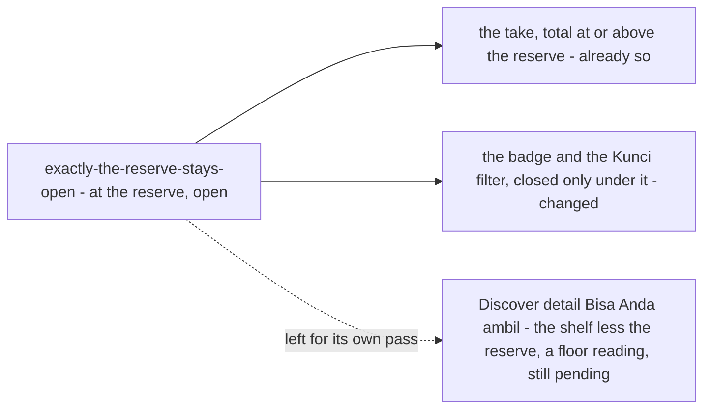

⚠ **Left standing:** Discover detail's *can take* column subtracts the reserve from each shelf
([product-discover-detail/index.tsx](../../../frontend/src/pages/product-discover-detail/index.tsx), pending `canTake`) —
a floor reading of what is a line. It was already marked an unsettled rule and is not changed by this.

## superseded-a-delete-waits-until-nothing-needs-the-product

> ⚠ **Superseded the same day** by [a-used-product-is-archived-never-deleted](#a-used-product-is-archived-never-deleted) —
> the owner: *"im rethink its lead to over enginered"*. Kept as written below.

> Owner, in chat (2026-10-31): *"yes, i follow your recomendation"* — answering [Q11](./context_clarify.md#question),
> *does "zero stock" mean zero on hand, or no references at all?* As recommended.

**The verdict.** [deleting-a-product-requires-zero-stock](#superseded-deleting-a-product-requires-zero-stock)'s *"zero stock"*
means **nothing on hand AND nothing on the way**: a product is deleted only when no shelf holds it, no restock is still
bringing it, and no order that carries it is unfinished. A shelf can be empty while units are still coming to it, and
those units need the product exactly as much as a full shelf does.

| SKU-1, 0 on the shelf, and… | the delete |
| --- | --- |
| a restock of 50 arriving tomorrow | **refused** — *"restock #812 is still coming"* |
| 2 units shipped, the order not finished | **refused** — *"order #5521 is still open"* |
| nothing on the way | deleted |

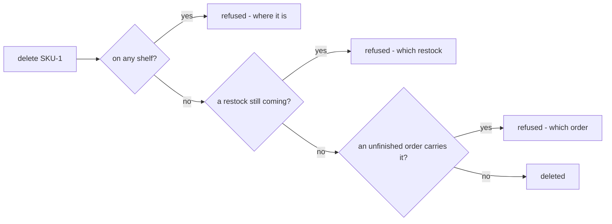

**The spec.**

| | |
| --- | --- |
| on hand | any unit of it on any shelf, every warehouse — inventory's count |
| a restock still coming | a restock with a line of it, still `ONGOING` or `ARRIVED` — on its way, or in the building and not yet counted |
| an unfinished order | an order with a line of it, of **any** team — a borrowed line names the owner's product — whose status is not finished |
| finished | `CANCEL`, `LOST`, `RETURN_COMPLETED` are terminal. ⚠ **`COMPLETED` is open** — it can still become a `RETURN` ([order_transition.go](../../../backend/services/selling_service/selling_v1/order_transition.go)), asked in [Q14](./context_clarify.md#question) |
| the reads | inventory (stock, restocks) and the order side (open orders) — RPCs, **never cached**, as [deleting-a-product-requires-zero-stock](#superseded-deleting-a-product-requires-zero-stock) already says |
| the refusal | names every blocker — where the stock is, which restock, which order — so the person knows what to finish first |
| a bundle | never blocks — a deleted product leaves its bundle line unavailable ([a-borrowed-product-never-blocks-its-owner](./product_bundle_decision.md#a-borrowed-product-never-blocks-its-owner)) |

⛔ **Not built.** [product_delete.go](../../../backend/services/product_service/product_v1/product_delete.go) checks nothing
today.

## a-used-product-is-archived-never-deleted

> Owner, in chat (2026-10-31): *"im rethink its lead to over enginered, what about product just can be deleted if there is
> no stock, order and other ops before. and if its happen, product only can be archived and unarchived"*, then *"yes"*
> to *"can a product be archived while it still has stock on a shelf?"*. The owner's own design, against my
> [superseded-a-delete-waits-until-nothing-needs-the-product](#superseded-a-delete-waits-until-nothing-needs-the-product).

**The verdict.** Two actions, split by whether the product has a **history**:

```
never used — a typo, a duplicate   → Delete     gone for good; its code is free again
has any history                    → Archive    out of lists and pickers; Unarchive brings it back, same id and code
```

**Delete** strands nothing, because nothing ever pointed at the product. **Archive** needs no guard, because it can be
undone: it stops anything NEW from using the product, while everything already on its way still lands. This replaces
both earlier delete rules — there is no "is that order finished yet" to answer, and no [Q14](./context_clarify.md#question).

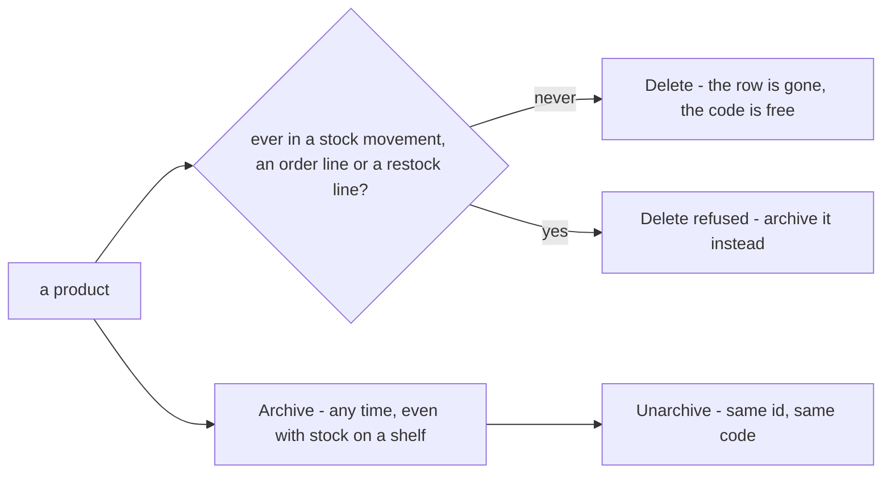

**The spec.**

| | |
| --- | --- |
| history | any stock movement of it (restock, transfer, count, adjustment, order take), any order line of it in any team's order — a borrowed line names the owner's product — and any restock line of it, ever. Read from inventory and the order side at delete time |
| Delete | only with no history; the product's row and its own data go. Refused otherwise, the refusal pointing at Archive |
| Archive | any time, **even with stock on a shelf** — out of the product list and every picker, so no new order, restock or transfer takes it |
| what is on its way | still lands: an open order ships, a restock is accepted, a return comes back — on the archived product |
| an archived product, read by id | resolves, with its name and an archived mark — a shelf, an old order and a report all still name it ([Q12](./context_clarify.md#question)) |
| the archive page | lists and searches archived products, and offers **Unarchive** ([the-archive-is-a-page-of-its-own](../../technical/frontend/products_decision.md#the-archive-is-a-page-of-its-own)) |
| the code | an archived product **keeps** its code, so Unarchive needs nothing; a deleted one frees it. No `[code]_deleted_ts` rename |
| a bundle | an archived or deleted product leaves its bundle line unavailable, as before ([a-borrowed-product-never-blocks-its-owner](./product_bundle_decision.md#a-borrowed-product-never-blocks-its-owner)) |

**What it replaces** (HARD RULE 11):

| was | now |
| --- | --- |
| [superseded-deleting-a-product-requires-zero-stock](#superseded-deleting-a-product-requires-zero-stock) — no delete while stock is left | a product that ever had stock has history, so it is archived, never deleted |
| [superseded-a-delete-waits-until-nothing-needs-the-product](#superseded-a-delete-waits-until-nothing-needs-the-product) — on hand, restocks, unfinished orders | one question, *ever used?* |
| [a-deleted-product-is-unfindable](#a-deleted-product-is-unfindable) — *"not in ProductList"* | an ARCHIVED product is out of the list and the pickers, and on the archive page; a deleted one is gone |
| [context.md](./context.md) line 26 — *"the code is updated to `[code]_deleted_ts`"* | stale — reported in the clarify's [the-doc-renames-the-code-of-a-product-it-only-archives](./context_clarify.md#the-doc-renames-the-code-of-a-product-it-only-archives) |

**Built today, and what changes.** Today's **Delete** is already a soft delete (`deleted = true`) and the archive page
already has **Restore** — that IS archive under another name. ✅ **Built 2026-11-02:**

| | |
| --- | --- |
| the contract | `ProductArchive` / `ProductUnarchive` (yesterday's Delete / Restore) and a new `ProductDelete`; `Product.archived`, was `deleted`, same field numbers |
| the column | `products.archived`, renamed from `deleted` (product migration `00007`) — a row that is merely archived no longer says "deleted" |
| the history | asked at the delete, under the product row's lock: inventory's restock lines and problem units, batches, placements and their log, stock transactions, transfer lines and problem units, warehouse registrations; selling's order lines (any team's), draft lines, return maps. Each service answers for its own rows through a plain function; the composition root joins them (`product_history.go`) |
| ⚠ my build detail — a bundle | a product a bundle still names is refused too: the line holds it by a foreign key, and taking it out of the bundle is the owner's choice, never a side effect |
| ⚠ my build detail — where Delete is | the Archived view (beside Unarchive) and an archived product's own page — a typo is archived, then deleted. The active list keeps its two inline actions |
| the code | unchanged by this build; [the-field-is-product-code-composed-on-write](#the-field-is-product-code-composed-on-write), built the same day, made it `product_code`, unique over every row |
| tests | delete of a never-used product (active or archived) and its code freed; a used one, a bundled one and another team's refused; the real history adapter against inventory's and selling's tables; the `DeleteRemovesOnlyANeverUsedProduct` story |

## a-product-has-one-category

> Owner, in chat (2026-10-31): *"product just have 1 category"* — to [Q9](./context_clarify.md#question), *with several
> categories, which is the primary, and how many may a product have?* It reverses the owner's own *"categories is
> plural"* (2026-09-12), [superseded-a-product-files-under-many-categories](#superseded-a-product-files-under-many-categories).

**The verdict.** A product is filed under **exactly one** category — a node anywhere in the category tree. There is no
primary to choose and no cap to set: the one category IS the breadcrumb, the card's label and the report's group.

```
SKU-1   Fashion › Kaos      ← its one category: the breadcrumb, the card, the report group
```

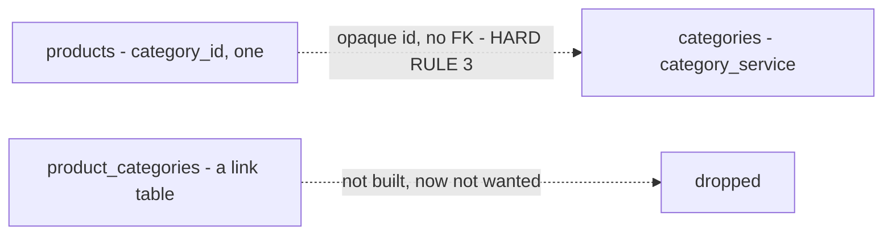

| | |
| --- | --- |
| the column | `products.category_id`, one `BIGINT` — as built today |
| required | yes, on create and update, as today (`category_id` > 0 in the proto) |
| the link table | `product_categories` is **not** built — the decided migration is cancelled |
| the proto | unchanged — `category_id` stays singular; no `repeated` |
| the category screen's product count | a count of products by their one `category_id`; whether a branch includes its sub-categories stays the screen's question |
| ✅ built | nothing to build — this is what runs today |

**What it replaces** (HARD RULE 11): [superseded-a-product-files-under-many-categories](#superseded-a-product-files-under-many-categories);
and [context.md](./context.md) line 16, *"4. `categories`"*, is now stale — reported in the clarify's
[the-field-list-says-categories](./context_clarify.md#the-field-list-says-categories).

## the-product-writes-drop-the-warehouse-roles

> Owner, in chat (2026-10-31): *"yes"* — to [Q8](./context_clarify.md#question), *how does product_service make sure only a
> selling team owns products?*, on my recommendation to build the narrowing [only-a-selling-team-owns-a-catalogue](#only-a-selling-team-owns-a-catalogue)
> already decided, and nothing more. Against my first recommendation, a team-type read at write time.

**The verdict.** No warehouse role may write a product. `ProductCreate`, `ProductUpdate`, `ProductDelete` and
`ProductRestore` drop `ROLE_WAREHOUSE_OWNER` and `ROLE_WAREHOUSE_ADMIN`. That is the whole enforcement: a selling role is
held only inside a selling team, so a team-scoped product write can only land in a selling team. No team-type read is
added.

| who | may write a product into… |
| --- | --- |
| a selling owner / admin | their selling team — the only kind of team a selling role exists in ([member_rules.go](../../../backend/services/user_service/user_v1/member_rules.go)) |
| a warehouse owner / admin | nothing — refused by the policy |
| root / administrator | any team — the bypass every team-scoped write has |

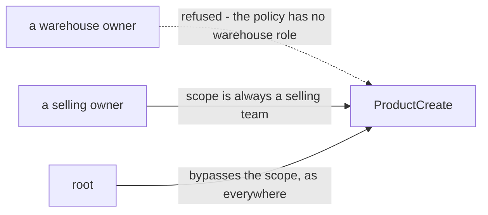

| | |
| --- | --- |
| the writes | Create, Update, Delete, Restore: `ROOT`, `ADMINISTRATOR`, `SELLING_OWNER`, `SELLING_ADMIN` |
| the reads | List, Detail, ByIds keep the warehouse roles — a warehouse sees the products it stocks |
| the screen | unchanged — the products page already gives a warehouse no create, archive or figures |
| accepted | root may still file a product under a warehouse team; it is trusted, as for every other write |
| ✅ built *(2026-10-31)* | [product.proto](../../../proto/warehouse/product/v1/product.proto); pinned by `TestProductWrites_AreTheSellingTeamsAlone` ([product_writes_selling_only_test.go](../../../backend/services/user_service/access_interceptors/product_writes_selling_only_test.go)), which fails eight ways on the old policy |

## a-lock-stops-new-orders-only

> Owner, in chat (2026-10-31): *"i follow your recomendation"* — to [Q4](./context_clarify.md#question), *does turning the
> shared lock on affect orders already placed?* As recommended.

**The verdict.** A lock — the owner's *always locked*, or a minimum it falls under — stops **new** orders from other
teams. An order another team placed before the lock goes on: its units were taken when it was placed. A lock says *do
not sell me any more*, never *take back what is sold*.

```
Mon 10:00  Team B orders 5 of SKU-1 → stock taken
Mon 14:00  the owner locks SKU-1
           → Team B's order goes on; Team C's new order is refused
```

| | |
| --- | --- |
| where the lock is read | at the take, when an order is placed ([order_transaction_create.go](../../../backend/services/inventory_service/inventory_v1/order_transaction_create.go)) |
| an order already placed | untouched — picked, shipped and finished as usual |
| ✅ built | nothing changes — this is what runs |

## the-field-is-product-code-composed-on-write

> Owner, in chat (2026-10-31): *"yes"* — to [Q7](./context_clarify.md#question), *should `sku` become `product_code`,
> composed on write as `ABC-SHOE-42`, as your doc says?* As recommended — the second time; I had first recommended
> keeping `sku` beside it.

**The verdict.** A product has **one** code, named **`product_code`**, as [context.md](./context.md) names it. It is
**composed on write** ([the-code-is-composed-from-the-team-code](#the-code-is-composed-from-the-team-code)): the team
types its own part, and what is stored — on the sticker, at the scan, everywhere — is `<team_code>-<that part>`.
`sku` goes, from the wire, the database and the code.

```
team ABC types   SHOE-42
stored           product_code = ABC-SHOE-42      globally unique, one code everywhere
```

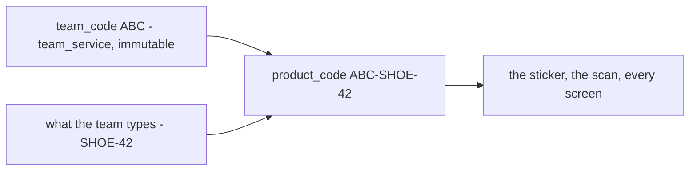

| | |
| --- | --- |
| the field | `product_code`, replacing `sku` in the proto, the `products` table, Go and TypeScript |
| composed | `<team_code>-<the team's part>`, on create, by product_service — `team_code` read from team_service; it is immutable, so a composed code never goes stale |
| unique | **globally**, every row — an archived product keeps its code ([a-used-product-is-archived-never-deleted](#a-used-product-is-archived-never-deleted)), so today's partial index (`WHERE deleted = FALSE`, per team) becomes one unique index over all rows |
| freed | only by a Delete, which removes a never-used product's row |
| the form | the team prefix shown fixed, the team typing the rest |
| ⚠ my spec — editing it | the team's part may be corrected only while the product has no history, the same line Delete uses — once a sticker can exist, the code is fixed |
| ⚠ my spec — today's rows | dev data only: re-entered, or recomposed once by a `san` command that reads each team's code through team_service — no migration reads another service's table (HARD RULE 3) |
| the screen | already says *Product code* ([the-screen-says-product-code](../../technical/frontend/products_decision.md#the-screen-says-product-code)) |

✅ **Built 2026-11-02:**

| | |
| --- | --- |
| the contract | `product_code` replaces `sku` on `Product`, `ProductRowItem`, the order, restock, transfer, batch and opname lines (same field numbers); `ProductCreateRequest.product_code_part` and `ProductUpdateRequest.product_code_part` carry the team's part; the sort is `PRODUCT_ROW_SORT_PRODUCT_CODE`; `ProductUnarchiveRequest` lost its code (field 3 reserved) |
| the columns | `products.product_code` (product `00008`), `order_items.product_code` (selling `00032`), `restock_items.product_code` and `warehouse_transfer_items.product_code` (inventory `00033`) — each renamed in its own service |
| unique | `products_product_code_unique`, over every row, replacing `(team_id, sku) WHERE archived = FALSE` |
| composed | by ProductCreate: `<team_code>-<part>`, the team code read from team_service through `product_v1.TeamCodes` — TeamByIds asked as the caller ([product_team_codes.go](../../../backend/cmd/app_development/product_team_codes.go)) |
| a correction | ProductUpdate re-composes the part under the row's lock, only when the history reader says there is none; FailedPrecondition otherwise |
| Unarchive | takes no code and cannot collide — the restore-conflict dialog is gone |
| the form | the team code an addon in front of the field, the box takes the part; an untouched part is not sent |
| today's rows | [`san product recompose-codes`](../../tools/san.md#product-recompose-codes), the team codes read through team_service's TeamByIds handler; `dev setup` runs it |
| ⚠ my build detail — the part is trimmed | `" SHOE-42 "` composes as `ABC-SHOE-42`; a part of only spaces is InvalidArgument |
| ⚠ my build detail — the same part is no correction | ProductUpdate with the part the product already has changes nothing and is not refused, so a form that always sends it can still save a used product's name |
| ⚠ my build detail — shared codes before the index | `00008` suffixes `-<id>` onto every row but the oldest of a code two rows shared (an active and an archived product of one team, or two teams), so the global index can be built on any dev database |
| ⚠ my build detail — line limits | an order line's and a restock line's `product_code` take up to 75 characters — a team code (10), the dash, the part (64) |
| ⚠ my build detail — dev setup | runs the recompose after the supplier steps; it changes nothing on a database already recomposed |
| ⚠ my build detail — a team code with a dash | `AB` + `C-1` and `AB-C` + `1` compose alike; the index refuses the second as AlreadyExists, and the recompose refuses it with both named |
| tests | create composes, trims, refuses a blank part, a team with no code and a missing reader; an archived product's code stays taken; the same part in two teams is two codes; a correction of a never-used product lands, of a used one is refused with nothing else landing, the same part is no correction, a taken one is AlreadyExists; Unarchive keeps the code; the recompose (once, idempotent, a collision writes nothing) in `product_v1` and through team_service in `tools/san`; the stories `TheTeamsCodeStandsInFront`, `AUsedProductsCodeIsFixed`, `ATakenCodeIsSaidUnderTheCode`, `UnarchiveComesBackUnderTheCodeItKept` |

## the-shared-lock-is-cross-locked

> Owner, in chat (2026-11-02): *"i follow your recomendation"* — confirming the overtaken list, which named [Q10](./context_clarify.md#question), *is `is_private`
> the shared lock, or a second switch?*

**The verdict.** There is no `is_private`. The one switch that keeps a product from other teams is **`cross_locked`**,
one setting with three ways ([one-lock-three-ways](../../technical/frontend/products_decision.md#one-lock-three-ways)).
Nothing in the proto, the services or the screens carries `is_private`.

```
is_private      nowhere — not in the proto, the schema or the screens
cross_locked    the product's one sharing lock
```

| | |
| --- | --- |
| ✅ built | nothing changes |
