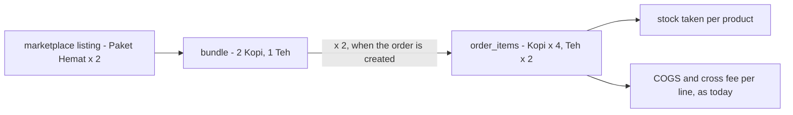
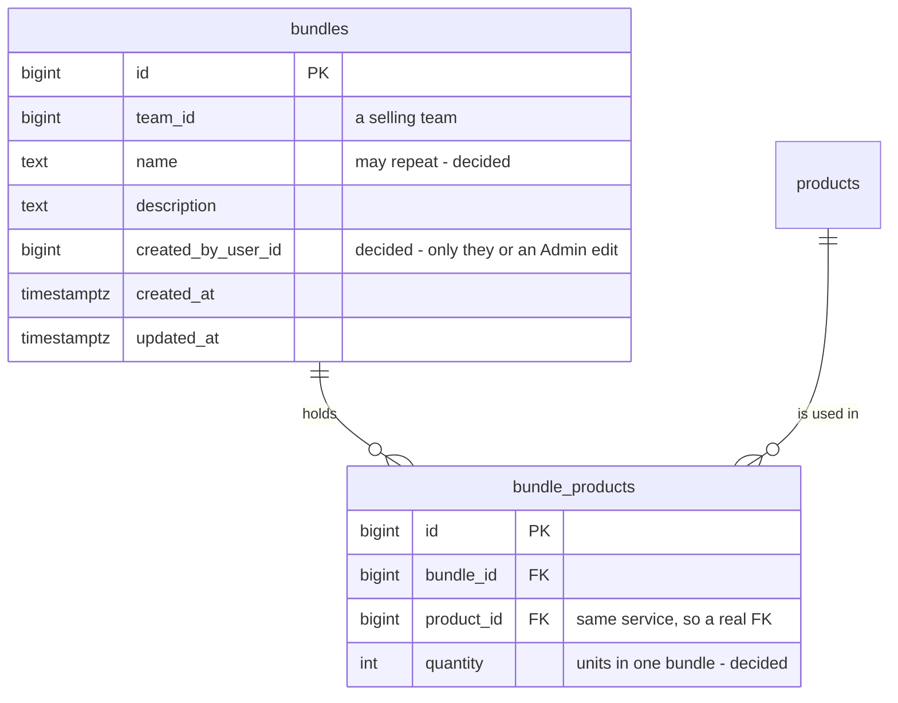
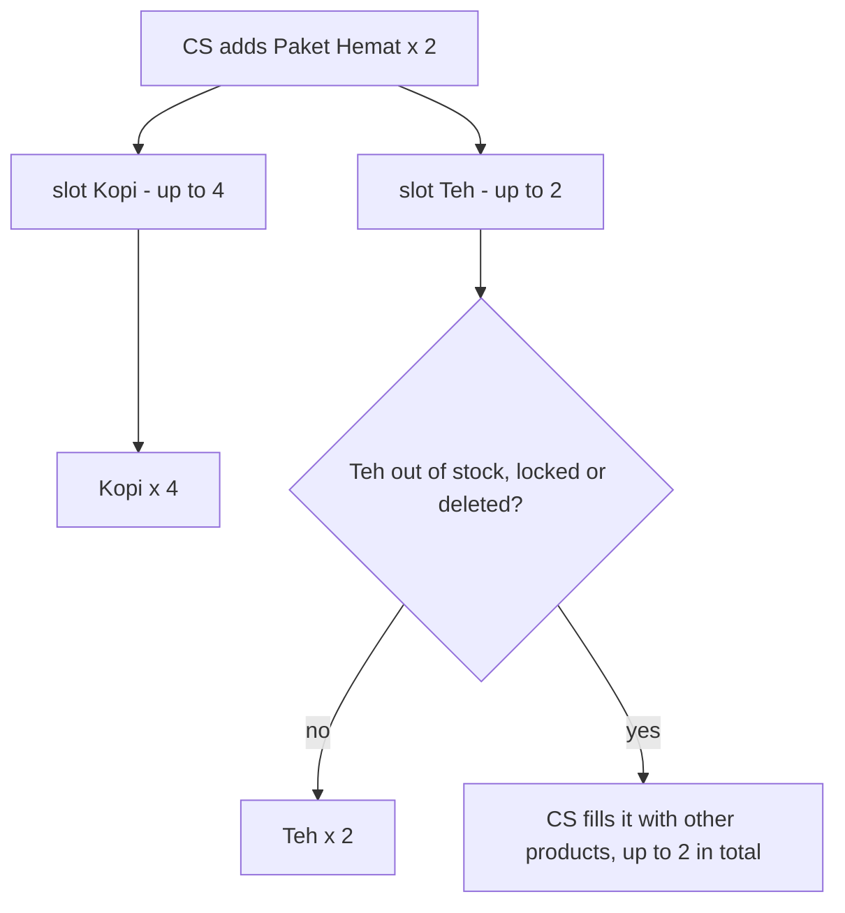

# Clarity — `product_bundle.md`

What I read in [product_bundle.md](./product_bundle.md), and what it does not decide yet. **That doc is yours, and this
one is mine.** When a point is answered, I delete it here and record it in
[product_bundle_decision.md](./product_bundle_decision.md).

> **Re-examined after you added `quantity` (2026-10-22).** ✅ Closed: *does a line carry a quantity?* Yes —
> [a-bundle-line-carries-its-quantity](./product_bundle_decision.md#a-bundle-line-carries-its-quantity).
>
> **Re-examined after your answer in chat (2026-10-22).** ✅ Closed: *does the order remember the bundle?* No —
> [the-order-keeps-only-product-lines](./product_bundle_decision.md#the-order-keeps-only-product-lines).
>
> **Re-examined after your answer in chat (2026-10-22).** ✅ Closed: *a borrowed product locked or deleted?* The line goes
> unavailable and the owner is never blocked — [a-borrowed-product-never-blocks-its-owner](./product_bundle_decision.md#a-borrowed-product-never-blocks-its-owner).
>
> **Re-examined after you added `created_by_user_id` (2026-10-22).** ✅ Closed: *who may write a bundle?* Anyone may
> create, and only the creator or an Admin and above may change it — [the-creator-or-an-admin-edits-a-bundle](./product_bundle_decision.md#the-creator-or-an-admin-edits-a-bundle).
>
> **Re-examined after you dropped `owner_team_id` (2026-10-22).** ✅ Closed — [a-bundle-line-reads-its-owner-from-the-product](./product_bundle_decision.md#a-bundle-line-reads-its-owner-from-the-product).
>
> **Re-examined after your answer in chat (2026-10-22).** ✅ Closed, against my recommendation: names may repeat —
> [bundle-names-may-repeat](./product_bundle_decision.md#bundle-names-may-repeat).
>
> **Re-examined after your answer in chat (2026-10-22).** ✅ Closed — [a-bundle-has-at-least-one-line](./product_bundle_decision.md#a-bundle-has-at-least-one-line).
> **Nothing is open in this file now.**
>
> **Re-examined after you added `## General.` 1 (2026-10-22)** — *"this bundle used in creating order"*. Consistent with
> [a-bundle-is-a-picking-recipe](#a-bundle-is-a-picking-recipe): a bundle is used only while an order is being filled in.
> Nothing new opens.

Siblings: [product context](./context_clarify.md) ·
[a draft row maps to a product, a bundle or a split](../../technical/frontend/order_draft_decision.md#a-draft-row-maps-to-a-product-a-bundle-or-a-split).

---

## What is already built

**Implemented** (2026-10-22) — accepted as designed
([the-bundle-prototype-is-accepted](./product_bundle_decision.md#the-bundle-prototype-is-accepted)), built and audited. The
state is in [development_state/product/bundle.md](../../development_state/product/bundle.md).

| | |
| --- | --- |
| the screens | **Bundles** (`/products/bundles`), the bundle's page (`…/:id`, [a-bundle-has-a-detail-page-that-counts-what-stock-can-make](../../technical/frontend/bundles_decision.md#a-bundle-has-a-detail-page-that-counts-what-stock-can-make)) and its form (`…/new`, `…/:id/edit`); under Products in the menu |
| the backend | `00006_create_bundles` and `BundleService` on product_service — [rpc.md](../../services/product_service/rpc.md) |
| the order form | its Bundles card searches the team's bundles; the draft page's **Make It a Bundle** opens the form prefilled |
| ⚠ waiting on you | the search's product half reads every team's lines — [the audit](../../../audits/services/product_service/performances/BundleList.md) recommends leaving it for now |

---

## Proposed Design

### a-bundle-is-a-picking-recipe

This is how I read your two tables. A bundle is a **recipe**: which products, and how many of each. It never sits on a
shelf, so it has no stock, no batch and no price. When an order uses it, the bundle becomes ordinary product lines. Stock,
COGS and the cross fee are then worked out per line, exactly as they are today.

### the-tables-as-i-would-write-them

These are your two tables as they now stand.

| constraint | why |
| --- | --- |
| `UNIQUE (bundle_id, product_id)`, `CHECK (quantity >= 1)` | decided — [a-bundle-line-carries-its-quantity](./product_bundle_decision.md#a-bundle-line-carries-its-quantity) |
| at least one line | decided — [a-bundle-has-at-least-one-line](./product_bundle_decision.md#a-bundle-has-at-least-one-line) |

### what-happens-on-the-order

This keeps your rule from 2026-09-30, which the screen already follows. Each line of the recipe becomes a **slot**. If a
product cannot be used, the CS fills its slot with other products, up to `quantity × bundles ordered`. Nothing about
substitution is stored on the bundle.

### screens-and-rpcs

| | |
| --- | --- |
| **Bundles** page | the selling team's list, searched by name and paginated (RULE 9) — `BundleList` |
| **Bundle** page | the recipe, and what one warehouse's stock can make — `BundleByIds`, `ProductByIds`, `StockAvailability` per warehouse ([decided](../../technical/frontend/bundles_decision.md#a-bundle-has-a-detail-page-that-counts-what-stock-can-make)) |
| **Bundle** form | name, description and the lines (product picker + `QuantityInput`) — `BundleCreate`, `BundleUpdate`. A save replaces all the lines |
| the order form's bundle search | `BundleList` alone — each row carries its lines. `BundleByIds` feeds the bundle page |
| delete | `BundleDelete`, a hard delete — decided, [the-order-keeps-only-product-lines](./product_bundle_decision.md#the-order-keeps-only-product-lines) |

---

## Critique

Nothing open — every point is decided.

---

## Question

Nothing open — all four are answered.

---

# Contradiction

**None found.** What I checked:

| against | result |
| --- | --- |
| [only-a-selling-team-owns-a-catalogue](./context_decision.md#only-a-selling-team-owns-a-catalogue) | consistent — `bundles.team_id` is a selling team |
| [order context](../order/context.md) `order_items` | consistent with the recipe reading — product lines, no bundle |
| [a-draft-stores-no-mapping](../../technical/frontend/order_draft_decision.md#a-draft-stores-no-mapping) | it sent "how a bundle lands on `order_items`" here — decided, [the-order-keeps-only-product-lines](./product_bundle_decision.md#the-order-keeps-only-product-lines) |
