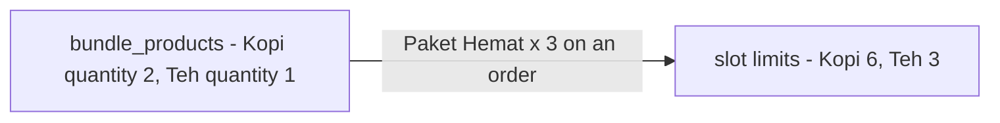
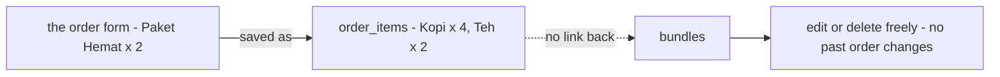
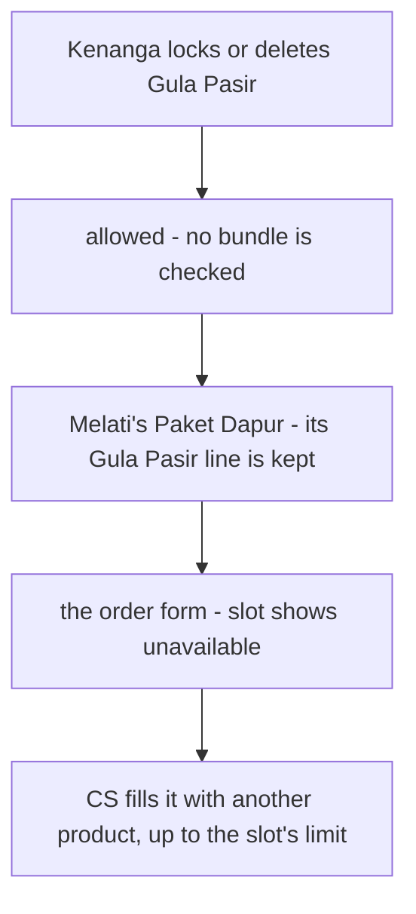
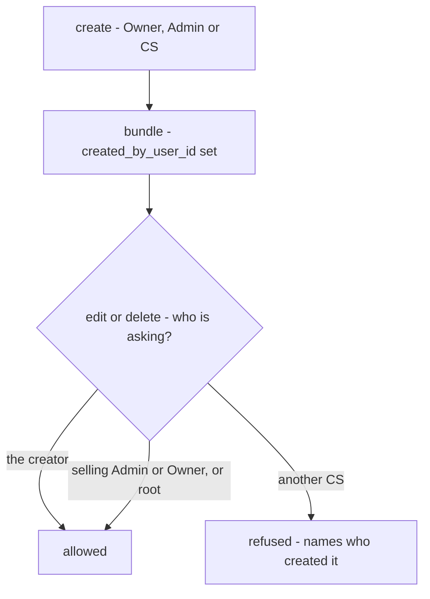
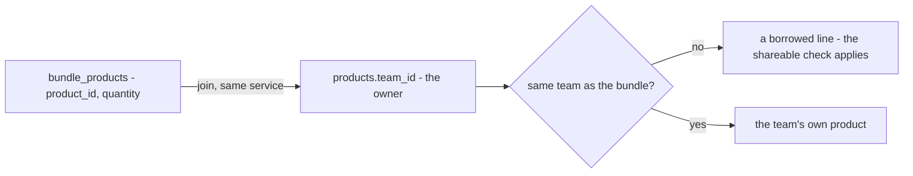
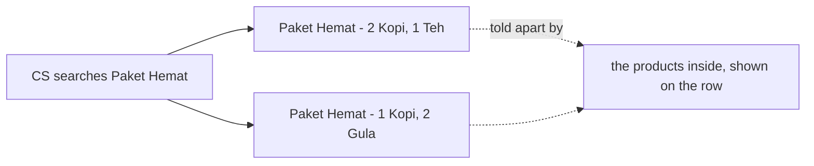
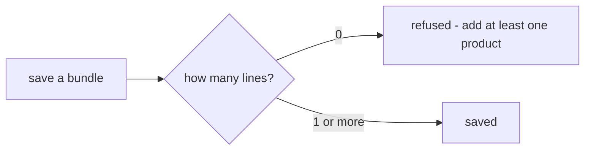
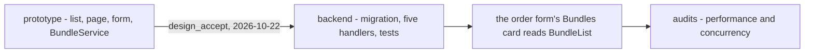

# Decisions — `product_bundle.md`

What the owner decided about [product_bundle.md](./product_bundle.md), recorded before it is acted on. **Append-only.**
This is the opposite of [product_bundle_clarify.md](./product_bundle_clarify.md), which holds only what is still open.

---

## a-bundle-line-carries-its-quantity

> Owner, 2026-10-22: added `` - `quantity` `` to `bundle_products` in [product_bundle.md](./product_bundle.md), answering
> *"how does a bundle say 2 Kopi?"* with option A. As recommended.

**The verdict.** Each line of a bundle is one product plus how many units of it go into **one** bundle. "Paket Hemat =
2 Kopi + 1 Teh" is two rows, not three.

**The spec.**

| | |
| --- | --- |
| the column | `quantity INT NOT NULL`, named as in your doc |
| at least 1 | `CHECK (quantity >= 1)` |
| each product once | `UNIQUE (bundle_id, product_id)`, so the quantity is the only place the count lives |
| on the order | a slot's limit is `quantity × bundles ordered`, as the order form's card already does it ([bundles.ts](../../../frontend/src/features/orders/form/bundles.ts) `slotCap`, where it is called `ruleQty`) |

⚠ The check and the uniqueness were part of option A as it was asked. They are not written in your doc. Say so if
either should not hold.

---

## the-order-keeps-only-product-lines

> Owner, in chat (2026-10-22): *"a enough"* — answering *"does the order remember which bundle a line came from?"* with
> option A. As recommended.

**The verdict.** A bundle is used only while the order is being filled in. What the order saves is product lines, and
nothing on the order records that a bundle was involved. [order context](../order/context.md)'s `order_items` stays as
you wrote it.

**The spec.**

| | |
| --- | --- |
| `order_items` | no bundle column |
| deleting a bundle | a hard delete — no order refers to it |
| editing a bundle | changes only the orders created after the edit |
| a "bundles sold" report | not built — the marketplace's listing stats cover it |
| the order form's pending mark `bundle` | stops being `dropped`, since the grouping is not stored **by design**. It stays on the card as `sample` until the bundles come from the backend instead of [mockData.ts](../../../frontend/src/features/orders/form/mockData.ts) |

---

## a-borrowed-product-never-blocks-its-owner

> Owner, in chat (2026-10-22): *"yes A"* — answering *"what happens when another team's product in my bundle gets
> locked or deleted?"* with option A and its two rules. As recommended.

**The verdict.** A bundle may hold another team's product, but it never limits what that team does with it. If the owner
locks or deletes the product, the bundle's line just becomes unavailable. The CS fills the slot with something else on
the order form, the same way as when a product is out of stock.

**The spec.**

| | |
| --- | --- |
| adding another team's product to a bundle | only while it is shareable: not cross-locked and not private. Whether those are one flag or two is still open ([product context Q10](./context_clarify.md#question)) — the check covers whichever exist |
| the reserve | not checked when adding. It is checked when an order takes the stock ([the-reserve-stops-other-teams-at-low-stock](./context_decision.md#the-reserve-stops-other-teams-at-low-stock)) |
| the owner locks, makes private, or deletes | never refused because of a bundle. The bundle is not changed |
| on the order form | the line's slot shows as unavailable. Substituting it is the existing slot rule, up to `quantity × bundles ordered` |
| a deleted product | its line shows the name as *(archived)*. ⚠ This needs a lookup by id to keep returning deleted products — open as [product context Q12](./context_clarify.md#question) |

⚠ **Not asked, my reading:** a team deleting **its own** product that sits in its own bundle follows the same rule. The
delete is not blocked, and the line shows *(archived)*. A lock never affects the owner's own bundles. Say if either is
wrong.

---

## the-creator-or-an-admin-edits-a-bundle

> Owner, 2026-10-22: added `` - `created_by_user_id` `` to `bundles` in [product_bundle.md](./product_bundle.md), and in
> chat: *"its only edit by who created it/team admin up"* — answering *"who can create and edit bundles?"*. Beyond my
> option A: anyone may create, but only the creator or an Admin and above may change it.

**The verdict.** Any selling role may create a bundle, the CS included. After that, it can be changed only by the person
who created it, or by the team's Admin or Owner.

**The spec.**

| | |
| --- | --- |
| `created_by_user_id` | `BIGINT NOT NULL`, set from the caller's token on create and never changed. It is user_service's id, so no FK (HARD RULE 3) |
| create | `ROOT`, `ADMINISTRATOR`, `SELLING_OWNER`, `SELLING_ADMIN`, `SELLING_CS` — so **Make It a Bundle** works for the CS |
| edit and delete | the same roles in the proto policy. ⚠ The proto cannot say "only your own", so the **handler** checks it: a caller whose only role in the team is `SELLING_CS` must be the creator, or it is refused with `PermissionDenied` |
| read | every selling role of the team. Warehouse roles get no access, since they only see product lines |
| the creator leaves the team | their bundles stay. From then on only an Admin or Owner can change them |

⚠ **My reading, say if wrong:** *"edit"* includes **delete**. And *"team admin up"* means the selling Admin and Owner,
plus root and administrator, who bypass every team check anyway.

---

## a-bundle-line-reads-its-owner-from-the-product

> Owner, 2026-10-22: removed `owner_team_id` from `bundle_products` in [product_bundle.md](./product_bundle.md), and in
> chat: *"yes, i drop it"*. As recommended.

**The verdict.** A bundle line stores only the product and its quantity. Whose product it is comes from
`products.team_id`, which is in the same service.

**The spec.**

| | |
| --- | --- |
| `bundle_products` | `id`, `bundle_id`, `product_id`, `quantity` — no owner column |
| *"is this line borrowed?"* | `products.team_id <> bundles.team_id`, read by a join |
| why it is safe | a product never changes team, and both tables are product_service's |
| ✅ `order_items.owner_team_id` stays | the order is in selling_service and cannot join to products, and the line records that moment |

---

## bundle-names-may-repeat

> Owner, in chat (2026-10-22): *"i choose B"* — answering *"can two bundles in one team have the same name?"*.
> **Against my recommendation** (unique within the team).

**The verdict.** Bundle names are not unique. One team can have two bundles called "Paket Hemat".

**The spec.**

| | |
| --- | --- |
| the database | no unique index on the name |
| create and edit | never refused because of a name |
| ⚠ what follows on the screen | a name alone cannot tell two bundles apart, so every place a bundle is picked shows its **products and quantities** under the name. That covers the order form's bundle search and the Bundles list. This is a screen detail and mine to build |

---

## a-bundle-has-at-least-one-line

> Owner, in chat (2026-10-22): *"yes, A"* — answering *"can a bundle have no products?"*. As recommended.

**The verdict.** A bundle is saved only with at least one product line. A single line is fine: a "3-pack" is one
product with `quantity` 3.

**The spec.**

| | |
| --- | --- |
| where it is checked | `BundleCreate` and `BundleUpdate`, in the request's validation (`min_items: 1` on the lines), since the database cannot check it |
| the error | `InvalidArgument` — *add at least one product* |
| removing the last line on edit | refused the same way. To get rid of a bundle, delete it |

---

## the-bundle-prototype-is-accepted

> Owner, in chat (2026-10-22): *"i accept design bundle, can we make it fully impemented ?"* — the lifecycle's
> design_accept (docs/development_lifecycle.md), with the choices the prototype proposed accepted as built.

**The verdict.** The prototype is the design: the Bundles list, the bundle's page, its form, and the `BundleService`
contract. The contract is accepted with the screens
([contract-accepted-with-the-screens](../../development_lifecycle_decision.md#contract-accepted-with-the-screens)), so a
change to it from here on is a new pass, not a quiet edit.

**The spec — accepted as proposed.**

| | |
| --- | --- |
| screens | `frontend/src/pages/bundles/`, `pages/bundle-detail/`, `pages/bundle-edit/`; **Bundles** under Products in the menu |
| contract | `proto/warehouse/product/v1/bundle.proto` — List, ByIds, Create, Update, Delete |
| only an ADDED line must be shareable | a line already in the bundle whose product has since been locked or archived is kept by an update |
| the search | over a bundle's name and its products' names and codes |
| the list's order | last changed first; name and changed sort from their headings |
| rails | name ≤ 100, description ≤ 2000, 1–50 lines, quantity 1–9999 |
| after a save | the bundle's page |
| next | the backend, then the order form's Bundles card on `BundleList` in place of its samples |
