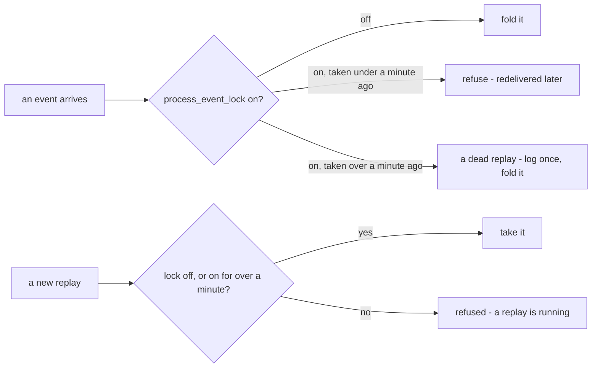

# Decisions — `meta_context.md`

What the owner decided about [meta_context.md](./meta_context.md), recorded before it is acted on.
**Append-only** — the opposite lifecycle to [meta_context_clarify.md](./meta_context_clarify.md), which holds only what
is still open. The first answer about this doc, [only-the-replay-holds-the-lock](./context_decision.md#only-the-replay-holds-the-lock),
was recorded in settlement's own decision file before this one existed, and stays there.

| | |
| --- | --- |
| [a-dead-replays-lock-expires-after-a-minute](#a-dead-replays-lock-expires-after-a-minute) | `process_event_lock` is a one-minute lease: older than a minute, it is released — for the fold and for the next replay |

---

## a-dead-replays-lock-expires-after-a-minute

> Owner, in chat (2026-10-31): *"make it 5 minute"*, then — told that five attempts from a 10 s backoff dead-letter an
> event after about 2½ minutes, before a 5-minute lease runs out — *"i change my mind, one minute is enough"*. As first
> recommended, [Q2](./meta_context_clarify.md#question).

**The verdict.** The lock is a **lease of one minute**. A replay that dies while holding it — a deploy, a crash, a
restart — no longer stops the reports for good: a minute after it was taken, the lock counts as released, and nobody has
to reset it by hand. [only-the-replay-holds-the-lock](./context_decision.md#only-the-replay-holds-the-lock) stays true:
nothing but a replay ever writes the row.

```
replay takes the lock (updated_at = now) → process killed
  0s     event refused (attempt 1)
  ~10s   refused (2)
  ~30s   refused (3)
  60s    lease expires — logged once, loudly
  ~70s   attempt 4 folds          ← inside the retries, so nothing reaches the dead-letter topic
```



**The spec.**

| | |
| --- | --- |
| the lease | one minute, read from the row's `updated_at` — the swap already stamps it `NOW()` when it takes the lock, so no new field |
| why a minute is enough | a replay holds the lock only for its delete and its seek — seconds; the redelivered events arrive after it lets go |
| the fold | an `on` lock older than a minute is treated as released, and the event is folded |
| the next replay | takes an `on` lock older than a minute as if it were `off` — else a dead replay would also refuse every replay after it |
| the log | an expired lock is logged at error level, naming when it was taken — **once per lock**, not once per event |
| who writes the row | still only a replay ([only-the-replay-holds-the-lock](./context_decision.md#only-the-replay-holds-the-lock)) — the fold only reads it |
| the retries | unchanged — 5 attempts from a 10 s backoff ([setup.go](../../../backend/pkgs/event_source/setup.go)) reach past the minute |
| `supplier_service` | the same lock, the same `updated_at`, the same lease |

⛔ **Not built.** Both [settlement](../../../backend/services/settlement_service/settlement_v1/analytic_replay_compute.go)'s
and [supplier](../../../backend/services/supplier_service/supplier_v1/analytic_replay_compute.go)'s replay take the
lock only when it is `off`, and both folds refuse any `on`.
