# Clarity — `stock_thoni/context.md`

Kritik, pertanyaan dan peringatan untuk [context.md](./context.md) dan ERD-nya, [model.md](./model.md).
**Kedua dokumen itu milik Anda; file ini milik saya.** Poin yang sudah dijawab **dihapus**. Keputusan dicatat di
[context_decision.md](./context_decision.md) — daftar di atasnya adalah indeks semua yang sudah diputuskan.

Tetangga: [order_creation](../order/order_creation_clarify.md) · [order_return](../order/order_return_clarify.md) ·
[inventory (Heri)](../inventory/context_clarify.md) · [product](../product/context_clarify.md) ·
[technical/stock](../../technical/stock/design_clarify.md).

> **Uji keempatpuluh delapan, 2026-10-03 14:20** — alur: restock dibuat kini mengunci statement lalu memeriksa resi, dan
> resi tiap jasa kirim pasti berbeda (chat). ✅ Dicatat:
> [kunci-statement-lalu-periksa-resi](./context_decision.md#kunci-statement-lalu-periksa-resi) ·
> [resi-unik-lintas-jasa-kirim](./context_decision.md#resi-unik-lintas-jasa-kirim). Alur restock tidak punya pertanyaan
> terbuka lagi. Rinciannya di [restock_flow_clarify](./restock_flow_clarify.md).
>
> **Uji keempatpuluh tujuh, 2026-10-03 14:09** — alur: penerimaan dan pembatalan kini *"Kunci baris `SKU_STATEMENT`, periksa
> transaksi masih ongoing (kalau bukan, tolak)"*. ✅ Dicatat:
> [kunci-statement-lalu-periksa-ongoing](./context_decision.md#kunci-statement-lalu-periksa-ongoing). Alur restock tidak
> punya penghalang lagi; [status-akhir-dua-kali](#critique) kembali menjadi **cadangan**. Pemilik lanjut ke return.
>
> **Uji keempatpuluh enam, 2026-10-03 14:05** — alur: penerimaan mengunci baris `SKU_STATEMENT` lebih dulu — sesuai
> rekomendasi *statement dikunci lebih dulu* di bawah. ✅ Dicatat:
> [penerimaan-mengunci-statement-lebih-dulu](./context_decision.md#penerimaan-mengunci-statement-lebih-dulu). Pemeriksaan
> `ongoing` sesudah kunci belum tertulis, jadi [status-akhir-dua-kali](#critique) masih satu-satunya penjaga.
>
> **Uji keempatpuluh lima, 2026-10-03 13:54** — alur: *Check Approver Access* dan *Kirim Kabar Penagihan* kini di luar
> kotak transaksi DB. ✅ Dicatat: [service-lain-di-luar-transaksi-db](./context_decision.md#service-lain-di-luar-transaksi-db).
> ⛔ Butir kunci kini **dihapus** — [status-akhir-dua-kali](#critique) tetap satu-satunya penjaga; ditanyakan di
> [ongoing-diperiksa-server](./restock_flow_clarify.md#ongoing-diperiksa-server).
>
> **Uji keempatpuluh empat, 2026-10-03 13:42** — alur: dua kotak *DB Transaction* digambar; butir *kunci, lalu periksa
> `ongoing`* **dikomentari**; paket yang tiba setelah batal → restock baru. ✅ Empat putusan dicatat, dari
> [restock-dibuat-dalam-satu-transaksi-db](./context_decision.md#restock-dibuat-dalam-satu-transaksi-db) sampai
> [paket-tiba-setelah-batal-dibuat-restock-baru](./context_decision.md#paket-tiba-setelah-batal-dibuat-restock-baru).
> ⛔ Tanpa butir kunci, [status-akhir-dua-kali](#critique) kembali menjadi satu-satunya penjaga, bukan cadangan. Rinciannya
> di [restock_flow_clarify](./restock_flow_clarify.md).
>
> **Uji keempatpuluh tiga, 2026-10-03 12:54** — alur: penerimaan dan pembatalan mengunci baris transaksi lalu memeriksa
> `ongoing`. ✅ Dicatat: [kunci-transaksi-lalu-periksa-ongoing](./context_decision.md#kunci-transaksi-lalu-periksa-ongoing).
> [status-akhir-dua-kali](#critique) menyempit menjadi penjaga cadangan di database. Rinciannya di
> [restock_flow_clarify](./restock_flow_clarify.md).
>
> **Uji keempatpuluh dua, 2026-10-03 12:45–12:46** — ERD: tanda `"unique"` per kolom dihapus dari `SKU_STATEMENT`, dan
> baris 136 *"baris statement selalu ditulis urut `sku_id`"*. Alur baris 145: `item_id` yang tidak terkait ditolak. ✅
> Dicatat: [statement-ditulis-urut-sku-id](./context_decision.md#statement-ditulis-urut-sku-id) ·
> [item-dari-transaksi-lain-ditolak](./context_decision.md#item-dari-transaksi-lain-ditolak). Selesai: kritik
> *unik-terbaca-dua-aturan* dan *urutan-kunci-statement* — tidak ada lagi kritik terbuka soal `SKU_STATEMENT`.
>
> **Uji keempatpuluh satu, 2026-10-03 12:36** — ERD baris 135 kini `UNIQUE (sku_id, warehouse_id)`, dan kalimat *lock
> insert* dihapus — antreannya kini dijalankan `UNIQUE` itu sendiri. Sesuai rekomendasi. ✅ Catatan ditambahkan di
> [statement-unik-per-sku-per-gudang](./context_decision.md#statement-unik-per-sku-per-gudang) dan
> [tulis-statement-bersamaan-antre](./context_decision.md#tulis-statement-bersamaan-antre). Selesai: kritik
> *lock-insert-mengunci-apa*. Tersisa: `"unique"` per kolom di kotak ERD, dan urutan tulis
> ([urutan-kunci-statement](#critique)).
>
> **Uji keempatpuluh, 2026-10-03 12:21–12:25** — ERD: `team_id` keluar dari `SKU_STATEMENT`, kuncinya kembali *"kombinasi
> keduanya"*, dan baris 137 baru: *"req ke-2 harus menunggu req ke-1 selesai"*. Alur: server memeriksa staff penerima dari
> token. context.md: User Service dan Team Service. ✅ Dicatat:
> [statement-tanpa-kolom-tim](./context_decision.md#statement-tanpa-kolom-tim) ·
> [tulis-statement-bersamaan-antre](./context_decision.md#tulis-statement-bersamaan-antre) ·
> [penerima-dicek-anggota-gudang-tujuan](./context_decision.md#penerima-dicek-anggota-gudang-tujuan). Selesai:
> *tim-di-kunci-statement*. 🆕 *lock-insert-mengunci-apa* (✅ selesai 12:36) · [urutan-kunci-statement](#critique).
>
> **Uji ketigapuluh sembilan, 2026-10-03 12:00–12:01** — ERD baris 136: statement *"jika kombinasi ketiganya belum ada
> maka buat baru, jika sudah ada maka tambahkan"*, dengan `team_id` kini di kombinasinya. Alur baris 80: halaman gudang
> hanya menampilkan restock gudang itu. ✅ Dicatat:
> [statement-dibuat-atau-ditambah](./context_decision.md#statement-dibuat-atau-ditambah) ·
> [restock-tampil-hanya-di-gudang-tujuan](./context_decision.md#restock-tampil-hanya-di-gudang-tujuan). 🆕
> *tim-di-kunci-statement* — tiga kolom, padahal satu SKU hanya punya satu tim — ✅ dijawab 12:25.
>
> **Uji ketigapuluh delapan, 2026-10-02 16:02** — alur: penerimaan menunjuk `item_id`, *Pencatatan Penerimaan* lima butir,
> statement disebut di ketiga langkah. ✅ Dicatat:
> [penempatan-menunjuk-item-id](./context_decision.md#penempatan-menunjuk-item-id) ·
> [penerimaan-dicatat-dalam-satu-transaksi-db](./context_decision.md#penerimaan-dicatat-dalam-satu-transaksi-db) ·
> [statement-diperbarui-di-setiap-langkah](./context_decision.md#statement-diperbarui-di-setiap-langkah). Rinciannya di
> [restock_flow_clarify](./restock_flow_clarify.md).
>
> **Uji ketigapuluh tujuh, 2026-10-02 15:34–15:50** — alur restock **lengkap**. ERD: harga rusak dan hilang tanpa
> *default 0*. ✅ Dicatat:
> [harga-rusak-dan-hilang-dihitung-seperti-slot](./context_decision.md#harga-rusak-dan-hilang-dihitung-seperti-slot) ·
> [ongkir-dibagi-ke-unit-yang-dikirim](./context_decision.md#ongkir-dibagi-ke-unit-yang-dikirim) —
> *harga-landed-dibagi-qty-dikirim* terjawab dan dihapus · dan dari alur,
> [jumlah-dicocokkan-per-item](./context_decision.md#jumlah-dicocokkan-per-item) ·
> [pembatalan-oleh-cs-atau-admin](./context_decision.md#pembatalan-oleh-cs-atau-admin). ⏸ Pembatalan tidak lagi ditunda —
> sisanya kini pertanyaan di [restock_flow_clarify](./restock_flow_clarify.md#question).
>
> **Uji ketigapuluh enam, 2026-10-02 15:27–15:30** — ERD: `supplier_id` di `SKU_LOST_SLOT` dan `SKU_BROKEN_SLOT`. Alur:
> kiriman penerimaan menolak nilai kosong. ✅ Dicatat:
> [supplier-ikut-ke-rusak-dan-hilang](./context_decision.md#supplier-ikut-ke-rusak-dan-hilang) ·
> [penerimaan-menolak-nilai-kosong](./context_decision.md#penerimaan-menolak-nilai-kosong). Tersisa di ERD: harga rusak
> dan hilang *default 0* ([harga-rusak-dan-hilang-dihitung-seperti-slot](./context_decision.md#harga-rusak-dan-hilang-dihitung-seperti-slot)).
>
> **Uji ketigapuluh lima, 2026-10-02 15:03–15:17** — ERD: `SKU_ANOMALY_SLOT` dipisah lagi menjadi `SKU_LOST_SLOT` (tanpa
> rak) dan `SKU_BROKEN_SLOT` (dengan rak dan foto); `ADJUSTMENTS` keluar — *"Todo mekanisme `adjustment`, sedang saya
> pikirkan dulu."* Alur: tiga varian penempatan, dan barang rusak **wajib** di rak, boleh rak khusus rusak. ✅ Dicatat:
> [rusak-dan-hilang-tabel-terpisah](./context_decision.md#rusak-dan-hilang-tabel-terpisah) ·
> [barang-rusak-wajib-di-rak](./context_decision.md#barang-rusak-wajib-di-rak) ·
> [penempatan-tiga-varian](./context_decision.md#penempatan-tiga-varian) — dua di antaranya membalik keputusan lama. ⏸
> Empat pertanyaan adjustment **ditunda** ([ditunda — mekanisme adjustment](#ditunda--mekanisme-adjustment)), tidak
> dihitung. 🆕 Supplier tidak ikut ke tabel rusak dan hilang, dan harganya *default 0*
> ([supplier-hilang-dari-rusak-dan-hilang](#critique) · [harga-rusak-dan-hilang-dihitung-seperti-slot](./context_decision.md#harga-rusak-dan-hilang-dihitung-seperti-slot)). 🔧 Dua baris kritik
> saya — *unik-terbaca-dua-aturan* dan kritik `team_id` di item — terhapus tidak sengaja oleh suntingan saya pukul 14:12,
> dan kini dikembalikan.
>
> **Uji ketigapuluh empat, 2026-10-02 14:46** — alur: barang rusak saat diterima boleh disimpan di rak atau langsung
> dibuang, pilihan staff. ✅ Dicatat: [rak-barang-rusak-pilihan-staff](./context_decision.md#rak-barang-rusak-pilihan-staff)
> — `CHECK` *rusak wajib punya rak* tidak diperlukan lagi. ERD belum berubah sejak 14:36.
>
> **Uji ketigapuluh tiga, 2026-10-02 14:43** — alur: rak dan foto barang rusak kini dikirim, dan ketentuan resi ditulis
> ulang. ✅ Dicatat: [rak-dan-foto-barang-rusak-dikirim](./context_decision.md#rak-dan-foto-barang-rusak-dikirim). ERD belum
> berubah sejak 14:36 — `CHECK` *rusak wajib punya rak* belum ada (*rak-rusak-dijaga-database* (selesai 14:46)).
>
> **Uji ketigapuluh dua, 2026-10-02 14:32–14:36** — ERD: `SKU_ANOMALY_SLOT.rack_id` boleh kosong lagi. Alur: jenis
> anomali `0` ditolak. ✅ Kontradiksi *hilang-kini-punya-kolom-rak* selesai — ERD dan kiriman kini sejalan · ✅ Dicatat:
> [jenis-anomali-wajib-diisi](./context_decision.md#jenis-anomali-wajib-diisi). Tersisa di alur: rak barang **rusak**
> tidak dikirim (*rak-rusak-dijaga-database* (selesai 14:46)).
>
> **Uji ketigapuluh satu, 2026-10-02 14:29** — alur: rusak dan hilang dikirim saat diterima, dalam satu daftar dengan
> penempatan rak. ✅ Dicatat:
> [rusak-dan-hilang-dikirim-bersama-penempatan](./context_decision.md#rusak-dan-hilang-dikirim-bersama-penempatan) —
> *penerimaan-tiga-angka* terjawab dan dihapus. ⛔ Kiriman anomali tanpa rak, ERD mewajibkan rak — kontradiksinya kini
> antara dua dokumen Anda (*hilang-kini-punya-kolom-rak* — selesai 14:36). ERD belum berubah sejak 14:12.
>
> **Uji ketigapuluh, 2026-10-02 14:12–14:14** — kasus restock dan clarify-nya **dihapus**; alur kini hanya di
> [restock_flow.md](./restock_flow.md) (permintaan Anda). Pertanyaan dan kritik penerimaan pindah ke
> [restock_flow_clarify](./restock_flow_clarify.md); rujukan lama di file ini dan di keputusan sudah diarahkan ke sana. ERD:
> garis kini ke `SKU_ANOMALY_SLOT`, `team_id` di item, slot dan anomali, `rack_id` anomali wajib, `CHECK` foto nota dihapus.
> ✅ Dicatat: [tim-pemilik-ikut-di-item-dan-slot](./context_decision.md#tim-pemilik-ikut-di-item-dan-slot) · 🔄
> [foto-nota-ongkir-tambahan-opsional](./context_decision.md#foto-nota-ongkir-tambahan-opsional) — ⚠ melawan saran saya ·
> dan dari alur, [tim-sku-dari-kiriman-untuk-sementara](./context_decision.md#tim-sku-dari-kiriman-untuk-sementara) ·
> [resi-dipakai-lagi-hanya-setelah-cancelled](./context_decision.md#resi-dipakai-lagi-hanya-setelah-cancelled). ⛔ `rack_id`
> wajib, padahal yang hilang di jalan tidak punya rak (*hilang-kini-punya-kolom-rak* — selesai 14:36).
>
> **Uji keduapuluh sembilan, 2026-10-02 14:06** — 🆕 [restock_flow.md](./restock_flow.md): alur restock dalam satu gambar,
> dan context.md kini menunjuk ke sana, bukan ke daftar kasus. ✅ Dicatat empat:
> [restock-dibuat-cs-atau-admin-tim](./context_decision.md#restock-dibuat-cs-atau-admin-tim) ·
> [sku-tim-lain-ditolak-saat-dibuat](./context_decision.md#sku-tim-lain-ditolak-saat-dibuat) ·
> [restock-boleh-diterima-sebagian](./context_decision.md#restock-boleh-diterima-sebagian) ·
> [satu-resi-satu-restock-berjalan](./context_decision.md#satu-resi-satu-restock-berjalan). Kritik dan pertanyaannya di
> [restock_flow_clarify](./restock_flow_clarify.md) — dua pertanyaan, dan satu kontradiksi: foto nota opsional, padahal
> ERD mewajibkannya.
>
> **Uji keduapuluh delapan, 2026-10-01 13:28** — kasus: baris 1 dihapus. Kontradiksi *baris-1-bilang-tanpa-tim* selesai.
> Tidak ada pertanyaan yang terjawab atau bertambah.
>
> **Uji keduapuluh tujuh, 2026-10-01 12:45** — ERD: `TRANSACTIONS.team_id`. Kasus: CS mengirim `team_id: 2` lagi. ✅
> Dicatat: [tim-dikirim-dan-disimpan-di-transaksi](./context_decision.md#tim-dikirim-dan-disimpan-di-transaksi) — 🔄
> membalik 18:04; *satu-restock-satu-tim-pemilik* terjawab dan dihapus. Satu kontradiksi baru di kasus: baris 1 masih
> menulis *"`team_id` tidak diperlukan"* (*baris-1-bilang-tanpa-tim* — selesai 13:28, barisnya dihapus).
>
> **Uji keduapuluh enam, 2026-10-01 10:32** — ERD: `"unique"` kini juga di `SKU_STATEMENT.warehouse_id`; garis adjustment
> `||--o{`. ✅ Dicatat: [statement-unik-per-sku-per-gudang](./context_decision.md#statement-unik-per-sku-per-gudang) —
> kontradiksi *sku-unik-padahal-per-gudang* selesai ·
> [adjustment-boleh-tanpa-baris-anomali](./context_decision.md#adjustment-boleh-tanpa-baris-anomali). ⚠ Tersisa dua soal
> **tulisan**, bukan isi: dua tanda `unique` terbaca dua aturan terpisah ([unik-terbaca-dua-aturan](#critique)), dan sisi
> kiri garis adjustment melawan `adjustment_id "nullable"` Anda sendiri ([garis-ke-tabel-lama](#critique)).
>
> **Uji keduapuluh lima, 2026-09-30 17:49–18:04** — context.md: `cancelled`, final. ERD: `SKU_STATEMENT.sku_id "unique"`,
> garis adjustment `||--|{`. Kasus: CS dari token, `team_id` dihapus. ✅ Dicatat:
> [cancelled-juga-final](./context_decision.md#cancelled-juga-final) ·
> [satu-adjustment-banyak-baris-anomali](./context_decision.md#satu-adjustment-banyak-baris-anomali) ·
> [pembuat-restock-dari-token](./context_decision.md#pembuat-restock-dari-token) · 🔄
> [tim-dibaca-dari-keanggotaan-cs](./context_decision.md#tim-dibaca-dari-keanggotaan-cs), membalik 17:34. 🆕 Satu
> kontradiksi di sini (*sku-unik-padahal-per-gudang* — selesai 10-01 10:32), satu di kasus
> (*tim-dihapus-padahal-scope* — selesai 10-01 12:45).
>
> **Uji keduapuluh empat, 2026-09-30 17:44** — context.md: status `cancel` ditambahkan, dan transaksi yang sudah diterima
> tidak bisa dibatalkan. ✅ Dicatat: [diterima-tidak-bisa-dibatalkan](./context_decision.md#diterima-tidak-bisa-dibatalkan).
> Kontradiksi *restock-dibatalkan-tanpa-status* selesai. ⏸ **Detail batal ditunda** sampai kasusnya Anda tulis — atas
> permintaan Anda; daftarnya di awal [Question](#question), tidak dihitung sebagai pertanyaan terbuka.
>
> **Uji keduapuluh tiga, 2026-09-30 17:27–17:34** — context.md: catatan status — urut, tidak ganda, `approved` final;
> blok komentar lama dihapus. Kasus: CS mengirim `team_id` dan `cs_id`, dan langkah server kasus 2 ditulis. ✅ Dicatat:
> [approved-sekali-dan-final](./context_decision.md#approved-sekali-dan-final) ·
> [tim-pemilik-dikirim-saat-restock-dibuat](./context_decision.md#tim-pemilik-dikirim-saat-restock-dibuat). Satu
> kontradiksi, selesai 17:44: *restock-dibatalkan-tanpa-status*.
>
> **Uji keduapuluh dua, 2026-09-30 17:00–17:20** — kasus 1: isi kabar ke penagihan. 🆕 Kasus 2: satu item dipecah ke dua
> rak. ✅ Dicatat: [kabar-membawa-tx-tim-jumlah-dan-foto](./context_decision.md#kabar-membawa-tx-tim-jumlah-dan-foto) ·
> [penerimaan-boleh-dipecah-ke-beberapa-rak](./context_decision.md#penerimaan-boleh-dipecah-ke-beberapa-rak). Satu
> pertanyaan baru di sini: `team_id` di kabar belum punya kolom. Rinciannya di
> [clarify alur](./restock_flow_clarify.md).
>
> **Uji keduapuluh satu, 2026-09-30 16:52–16:53** — context.md: *"cuma mencatat tagihan. Untuk penagihan akan diurus oleh
> service lain"*. Kasus: foto nota di kiriman petugas, kabar sesudah semua tulis selesai. ✅ Dicatat:
> [ongkir-tambahan-dicatat-lalu-dikabarkan](./context_decision.md#ongkir-tambahan-dicatat-lalu-dikabarkan) — alur ongkir
> tambahan selesai. Hasil uji: [uji-erd-terbaru](#uji-erd-terbaru).
>
> **Uji keduapuluh, 2026-09-30 16:34–16:46** — context.md: *"dia cuma mencatat tagihan"*. Kasus baris 61: kabar ke
> service penagihan. ✅ Dicatat:
> [ongkir-tambahan-dikabarkan-ke-penagihan](./context_decision.md#ongkir-tambahan-dikabarkan-ke-penagihan), dan catatan
> di [tagihan-di-luar-inventory](./context_decision.md#tagihan-di-luar-inventory). Hasil uji: [uji-erd-terbaru](#uji-erd-terbaru).
>
> **Uji kesembilanbelas, 2026-09-30 16:33** — context.md: §Batasan Service — *"service ini tidak menangani tagihan apa
> pun."* ✅ Dicatat: [tagihan-di-luar-inventory](./context_decision.md#tagihan-di-luar-inventory) — sejalan dengan batas
> balance. Diuji terhadap balance dan product: [uji-erd-terbaru](#uji-erd-terbaru) · satu pertanyaan baru, satu
> kontradiksi baru.
>
> **Uji kedelapanbelas, 2026-09-30 15:41–16:23** — kasus: cabang *ada ongkir tambahan* ditulis, tanpa tambahan = 0, dan
> (16:08) ongkir tambahan disimpan ke transaksi. ERD: kolom foto nota kurir di `TRANSACTIONS` (16:19), wajib lewat
> `CHECK` di bawah diagram (16:23). ✅ Lolos parse. ✅ Dicatat:
> [tanpa-ongkir-tambahan-berarti-nol](./context_decision.md#tanpa-ongkir-tambahan-berarti-nol) ·
> [foto-nota-ongkir-tambahan-di-transaksi](./context_decision.md#foto-nota-ongkir-tambahan-di-transaksi) ·
> [foto-nota-wajib-kalau-ada-ongkir-tambahan](./context_decision.md#foto-nota-wajib-kalau-ada-ongkir-tambahan). Hasil uji:
> [uji-erd-terbaru](#uji-erd-terbaru).
>
> **Uji ketujuhbelas, 2026-09-30 14:38–15:30** — ERD: `SKU` dan gambarnya keluar · item membawa `supplier_id` dan
> `total` · slot dan anomali membawa tiga harga per unit · `TRANSACTIONS.additional_shipping_fee`. Kasus: CS mengirim
> total belanja, server menghitung harga dan ongkir per unit saat diterima. ✅ Lolos parse. ✅ Dicatat lima:
> [inventory-hanya-merujuk-sku](./context_decision.md#inventory-hanya-merujuk-sku) ·
> [supplier-dan-total-disimpan-di-item](./context_decision.md#supplier-dan-total-disimpan-di-item) ·
> [ongkir-per-unit-dihitung-saat-diterima](./context_decision.md#ongkir-per-unit-dihitung-saat-diterima) ·
> [ongkir-dibagi-rata-ke-semua-unit](./context_decision.md#ongkir-dibagi-rata-ke-semua-unit) — ⚠ melawan saran saya ·
> [ongkir-tambahan-punya-kolom-sendiri](./context_decision.md#ongkir-tambahan-punya-kolom-sendiri). Hasil uji:
> [uji-erd-terbaru](#uji-erd-terbaru).
>
> Sebelumnya: 14:15–14:18 [ongkir-per-unit-bernama-unit-shipping-cost](./context_decision.md#ongkir-per-unit-bernama-unit-shipping-cost),
> [penerimaan-hanya-mengirim-rak-dan-jumlah](./context_decision.md#penerimaan-hanya-mengirim-rak-dan-jumlah),
> [ongkir-tambahan-dilaporkan-saat-diterima](./context_decision.md#ongkir-tambahan-dilaporkan-saat-diterima) · 14:02
> [ongkir-per-unit-disimpan-terpisah](./context_decision.md#ongkir-per-unit-disimpan-terpisah) · 13:55
> [harga-beli-disimpan-di-item](./context_decision.md#harga-beli-disimpan-di-item) · 13:14–13:44 statement per gudang,
> gudang tujuan, *on the way* — semuanya di [context_decision](./context_decision.md). Kasusnya:
> [restock_flow_clarify](./restock_flow_clarify.md).
>
> Istilah saya mengikuti ERD Anda, supaya beda antara ERD dan usulan saya hanya beda yang sungguhan.

---

## Alur yang dibutuhkan

> 2026-10-02: Anda memilih **alur** sebagai satu-satunya acuan — [restock_flow.md](./restock_flow.md) — dan kasus
> dihapus. Alur menjawab hal yang sama dengan kasus — data apa yang dikirim, oleh siapa, ke kolom mana — tanpa menulis
> langkah yang sama dua kali. Yang ikut hilang bersama kasus: **angka contoh** dan **isi tabel sesudahnya**.

| saran untuk alur berikutnya | kenapa |
| --- | --- |
| setiap langkah menyebut **tabel yang ditulis** dan **yang ditolak** | yang ditolak adalah separuh desainnya |
| satu **contoh angka** di akhir alur — SKU 1, 10 unit, gudang 3 — dengan isi tabel sesudahnya | menggantikan kasus, dan selisih langsung kelihatan |

| alur | yang diuji | menjawab |
| --- | --- | --- |
| ✅ restock — lengkap 2026-10-02, pencatatannya 16:02 | rusak dan hilang di jalan, ongkir per unit, batal | ✅ [rusak-dan-hilang-dikirim-bersama-penempatan](./context_decision.md#rusak-dan-hilang-dikirim-bersama-penempatan) · ✅ [ongkir-dibagi-ke-unit-yang-dikirim](./context_decision.md#ongkir-dibagi-ke-unit-yang-dikirim) · ✅ [penerimaan-dicatat-dalam-satu-transaksi-db](./context_decision.md#penerimaan-dicatat-dalam-satu-transaksi-db) |
| ⛔ order — take, dan release saat dibatalkan | take dan release per slot | [take-dicatat-di-mana](#take-dicatat-di-mana) — satu-satunya penghalang OrderCreation |
| return — utuh, lalu dengan 1 rusak | harga dari COGS order, satu retur per order | [jalan-balik-masih-berlaku](#jalan-balik-masih-berlaku) |
| ⏸ opname — kurang 2, seminggu kemudian 1 ketemu — mekanismenya sedang Anda pikirkan | `ADJUSTMENTS`, baris hilang, `found` | [bentuk-adjustment](#bentuk-adjustment) · [ketemu-dicocokkan-ke-kehilangan-tertua](#ketemu-dicocokkan-ke-kehilangan-tertua) |

**→ Rekomendasi:** ✅ alur restock lengkap (2026-10-02 16:02). Berikutnya alur order: tanpa take, OrderCreation tidak
bisa dibangun.

---

## Uji ERD terbaru

| yang berubah (2026-09-30 13:29 – 2026-10-01 10:32) | penilaian |
| --- | --- |
| context.md §Batasan Service — tidak menangani tagihan (16:33), *"dia cuma mencatat tagihan"* (16:34) · kasus: kabar ke penagihan (16:46) | ✅ [tagihan-di-luar-inventory](./context_decision.md#tagihan-di-luar-inventory) — balance memang sudah memegang `incidental_fee`, `broken_good`, `lost_good`, `found` · ✅ [ongkir-tambahan-dikabarkan-ke-penagihan](./context_decision.md#ongkir-tambahan-dikabarkan-ke-penagihan) · ✅ 17:00: isi kabarnya ([kabar-membawa-tx-tim-jumlah-dan-foto](./context_decision.md#kabar-membawa-tx-tim-jumlah-dan-foto)) · ✅ 10-01 12:45: `team_id` di kabar kini punya kolom ([tim-dikirim-dan-disimpan-di-transaksi](./context_decision.md#tim-dikirim-dan-disimpan-di-transaksi)) · ⚠ *tagihan* dipakai untuk dua hal — biaya yang ditagih kurir, dan utang antar-tim · ⚠ isi kabar, dan kabar untuk rusak/hilang/ketemu ([inventory-mengumumkan-fakta-uang](#inventory-mengumumkan-fakta-uang)) · ⚠ ongkir tambahan punya tiga nama di tiga dokumen ([satu-ongkir-tambahan-tiga-nama](#satu-ongkir-tambahan-tiga-nama)) |
| `SKU` dan `SKU_IMAGES` keluar dari ERD (14:38) | ✅ [inventory-hanya-merujuk-sku](./context_decision.md#inventory-hanya-merujuk-sku) — garis *tepat satu* ke statement ikut hilang |
| item: `supplier_id` + `total`, tanpa harga per unit (14:38) · kasus menulisnya (15:30) | ✅ [supplier-dan-total-disimpan-di-item](./context_decision.md#supplier-dan-total-disimpan-di-item) · ⚠ petugas mengirim `supplier_id` lagi ([jumlah-dicocokkan-per-item](./context_decision.md#jumlah-dicocokkan-per-item)) |
| slot dan anomali: `unit_price`, `unit_shipping_cost`, `unit_additional_shipping_cost` (14:38) · dihitung saat diterima (15:30) | ✅ [ongkir-per-unit-dihitung-saat-diterima](./context_decision.md#ongkir-per-unit-dihitung-saat-diterima) · ✅ [ongkir-dibagi-rata-ke-semua-unit](./context_decision.md#ongkir-dibagi-rata-ke-semua-unit) — melawan saran saya · ✅ 15:41: tanpa tambahan = 0 ([tanpa-ongkir-tambahan-berarti-nol](./context_decision.md#tanpa-ongkir-tambahan-berarti-nol)) · ⚠ ERD belum `NOT NULL DEFAULT 0`, dan tiga kolom untuk satu nilai ([nilai-unit-satu-kolom](#nilai-unit-satu-kolom)) |
| `additional_shipping_fee` di `TRANSACTIONS` · `shipping_fee` jadi `float` — keduanya default 0 (14:38) | ✅ [ongkir-tambahan-punya-kolom-sendiri](./context_decision.md#ongkir-tambahan-punya-kolom-sendiri) · ✅ 15:41–16:08: cabangnya ditulis, dan ongkir tambahan disimpan ke transaksi · ✅ 16:19: kolom foto nota ([foto-nota-ongkir-tambahan-di-transaksi](./context_decision.md#foto-nota-ongkir-tambahan-di-transaksi)) · ✅ 16:23: wajib kalau lebih dari 0, dijaga `CHECK` ([foto-nota-wajib-kalau-ada-ongkir-tambahan](./context_decision.md#foto-nota-wajib-kalau-ada-ongkir-tambahan)) · ✅ 16:53: foto dikirim bersama penerimaan, penagihan dikabari sesudah tulis selesai — alurnya lengkap ([ongkir-tambahan-dicatat-lalu-dikabarkan](./context_decision.md#ongkir-tambahan-dicatat-lalu-dikabarkan)) |
| *composite index* `(sku_id, warehouse_id)` · `"unique"` di `sku_id` (18:02), lalu juga di `warehouse_id` (10-01 10:32) · 🔄 10-03 12:01: *"kombinasi ketiganya"*, dengan `team_id` · 🔄 12:25: kembali *"kombinasi keduanya"*, `team_id` keluar dari statement, dan *"req ke-2 menunggu req ke-1"* | ✅ [statement-unik-per-sku-per-gudang](./context_decision.md#statement-unik-per-sku-per-gudang) — dibaca sebagai **pasangan** · ✅ 10-03: [statement-dibuat-atau-ditambah](./context_decision.md#statement-dibuat-atau-ditambah) · ✅ 12:25: [statement-tanpa-kolom-tim](./context_decision.md#statement-tanpa-kolom-tim) · [tulis-statement-bersamaan-antre](./context_decision.md#tulis-statement-bersamaan-antre) · ✅ 12:36: `UNIQUE (sku_id, warehouse_id)` di catatan, *lock insert* dihapus — antrean dari UNIQUE · ✅ 12:45: tanda per kolom dihapus, ditulis urut `sku_id` ([statement-ditulis-urut-sku-id](./context_decision.md#statement-ditulis-urut-sku-id)) |
| context.md Notes — `ongoing` lalu `approved`, tidak ganda, `approved` final (17:27) | ✅ [approved-sekali-dan-final](./context_decision.md#approved-sekali-dan-final) · ⚠ yang menjaga belum database — `UNIQUE (tx_id, status)` ([status-akhir-dua-kali](#critique)) · ✅ 17:44: `cancel` ada, yang sudah diterima tidak bisa dibatalkan ([diterima-tidak-bisa-dibatalkan](./context_decision.md#diterima-tidak-bisa-dibatalkan)) · ⏸ detail batal ditunda |
| context.md: batal bernama `cancelled`, final (17:49) | ✅ [cancelled-juga-final](./context_decision.md#cancelled-juga-final) · ⏸ sisa batal ditunda |
| ERD: garis adjustment `\|\|--\|{` (18:02), lalu `\|\|--o{` (10-01 10:32), lalu ke `SKU_ANOMALY_SLOT` (10-02 14:12) · ⏸ `ADJUSTMENTS` keluar dari ERD (15:17) | ✅ [satu-adjustment-banyak-baris-anomali](./context_decision.md#satu-adjustment-banyak-baris-anomali) · ✅ [adjustment-boleh-tanpa-baris-anomali](./context_decision.md#adjustment-boleh-tanpa-baris-anomali) · ✅ tabel lama hilang dari garis · ⚠ sisi kiri `\|\|` melawan `adjustment_id "nullable"`, dan `SKU_SLOT.adjustment_id` tanpa garis ([garis-adjustment-terlalu-ketat](#critique)) |
| ERD: `team_id` di item, slot, anomali (10-02 14:12) — kini juga di tabel rusak dan hilang (15:17) | ✅ [tim-pemilik-ikut-di-item-dan-slot](./context_decision.md#tim-pemilik-ikut-di-item-dan-slot) · ⚠ salinan di item selalu sama dengan transaksinya ([tim-di-item-berlebih](#critique)) |
| ERD: `SKU_ANOMALY_SLOT` dipisah lagi — `SKU_LOST_SLOT` dan `SKU_BROKEN_SLOT` (15:17) | 🔄 [rusak-dan-hilang-tabel-terpisah](./context_decision.md#rusak-dan-hilang-tabel-terpisah) · ✅ hilang tanpa rak, rusak dengan rak dan foto — sejalan dengan alur · ✅ 15:27: supplier ikut ([supplier-ikut-ke-rusak-dan-hilang](./context_decision.md#supplier-ikut-ke-rusak-dan-hilang)) · ✅ 15:34: harga tanpa *default 0* ([harga-rusak-dan-hilang-dihitung-seperti-slot](./context_decision.md#harga-rusak-dan-hilang-dihitung-seperti-slot)) |
| ERD: `SKU_ANOMALY_SLOT.rack_id` wajib (10-02 14:12) · 🔄 boleh kosong lagi (14:36) | ✅ sejalan dengan kiriman alur dan [rusak-dan-hilang-satu-tabel](./context_decision.md#rusak-dan-hilang-satu-tabel) · ✅ 14:43: rak barang rusak dikirim ([rak-dan-foto-barang-rusak-dikirim](./context_decision.md#rak-dan-foto-barang-rusak-dikirim)) · ✅ 14:46: rak barang rusak pilihan staff, tanpa `CHECK` ([rak-barang-rusak-pilihan-staff](./context_decision.md#rak-barang-rusak-pilihan-staff)) · 🔄 15:03–15:17: rusak wajib di rak, rusak dan hilang dua tabel ([barang-rusak-wajib-di-rak](./context_decision.md#barang-rusak-wajib-di-rak) · [rusak-dan-hilang-tabel-terpisah](./context_decision.md#rusak-dan-hilang-tabel-terpisah)) |
| ERD: `CHECK` foto nota dihapus (10-02 14:12) | 🔄 [foto-nota-ongkir-tambahan-opsional](./context_decision.md#foto-nota-ongkir-tambahan-opsional) — ⚠ melawan saran saya |
| kasus: `team_id` dan `cs_id` dikirim (17:34) · 🔄 18:04: CS dari token, `team_id` dihapus · 🔄 10-01 12:45: `team_id` kembali, dan `TRANSACTIONS.team_id` | ✅ [pembuat-restock-dari-token](./context_decision.md#pembuat-restock-dari-token) · ✅ [tim-dikirim-dan-disimpan-di-transaksi](./context_decision.md#tim-dikirim-dan-disimpan-di-transaksi) · ✅ 13:28: baris 1 kasus, *"`team_id` tidak diperlukan"*, dihapus · ✅ 10-02: SKU tim lain ditolak ([sku-tim-lain-ditolak-saat-dibuat](./context_decision.md#sku-tim-lain-ditolak-saat-dibuat)) |
| kasus: gudang tujuan dikirim saat dibuat | ✅ [gudang-tujuan-dipilih-saat-dibuat](./context_decision.md#gudang-tujuan-dipilih-saat-dibuat) · ✅ 10-03 12:23: penerima dicek dari gudang itu ([penerima-dicek-anggota-gudang-tujuan](./context_decision.md#penerima-dicek-anggota-gudang-tujuan)) |
| belum berubah | `count` beku atau sisa — [di bawah](#count-di-slot--beku-atau-sisa) · alur: terima dua kali — [clarify alur](./restock_flow_clarify.md#critique) |

### count di slot — beku atau sisa?

`updated_at` hilang dari `SKU_SLOT`, dan jumlahnya kini bernama `count`. Dua bacaan, dan desainnya bercabang di sini:

| | `count` **beku** — jumlah yang tiba | `count` **sisa** — turun saat take |
| --- | --- | --- |
| tandanya di ERD | `updated_at` dihapus | *"ERD dibuat untuk mendukung mekanisme FIFO"* |
| stok sekarang | hanya di `SKU_STATEMENT` | slot dan statement |
| FIFO — slot mana yang dipotong take | ⚠ hanya dengan menjumlah catatan keluar per slot, di setiap take | ✅ dibaca langsung, dikunci per baris |
| riwayat | setengah — masuk tercatat, keluar tidak | ⛔ ditimpa |
| yang masih kurang | catatan keluar per slot | log perubahan |

Dua-duanya berujung di tempat yang sama: **satu tabel lagi untuk barang keluar per slot** —
[take-dicatat-di-mana](#take-dicatat-di-mana). **→ Rekomendasi: sisa**, dan `updated_at` kembali. Jumlah yang tiba sudah
beku di `transaction_items.count`, jadi slot tidak perlu menyimpannya dua kali; yang belum ada di mana pun adalah
**sisa per slot yang bisa dikunci** — dan FIFO membutuhkannya di setiap take.

### Critique — SKU_STATEMENT

✅ 13:29: kini per gudang — kritik pertama di sini selesai dan dihapus. ✅ **Ringkasannya layak dipertahankan.** Daftar produk dan pemilih produk menampilkan stok puluhan SKU sekaligus — satu
baris dibaca tanpa menjumlah slot. Dan ia bisa lebih dari baca cepat: **gerbang** *cukup atau tidak* untuk take
([usulan-angka-sekarang-dan-riwayat](#usulan-angka-sekarang-dan-riwayat)). Yang perlu dibetulkan:

| | Masalah | → Rekomendasi |
| --- | --- | --- |
| **statement-bukan-riwayat** | Ini angka sekarang yang **kedua** — menjawab *berapa* lebih cepat, bukan *kenapa*. Take, batal dan ketemu tetap tidak meninggalkan jejak: [uji kartu stok](#uji-kartu-stok), **2 dari 5**. | Tetap `SLOT_LOGS` — [tiga lapis, tiga pertanyaan](#tiga-lapis-tiga-pertanyaan). |
| **statement-bisa-beda-dengan-slot** | Statement = jumlah slot. Cukup satu jalan yang mengubah slot tapi **lupa** statement, dan keduanya beda — tanpa log, tidak ada yang bisa bilang mana yang benar. | Satu jalan tulis, satu transaksi DB, statement dikunci **lebih dulu** · `CHECK (>= 0)` · tiap malam: statement = jumlah slot. |
| **satu-angka-dua-nama** | Slot kini menyebutnya `count`, statement `stock_ready` — dan `stock_broken`/`stock_lost` di statement adalah `count` baris anomali. Dan *baik* dan *siap jual* **memang** dua angka: setelah order 77 mengambil 2 unit, unitnya masih di rak dan masih baik — tapi sudah terjual. | Satu pola nama di semua tabel · dua angka **per slot**, dengan nama Anda sendiri — [stock-ready-berarti-apa](#stock-ready-berarti-apa). |

#### uji kartu stok

SKU A, slot 1 — kejadian yang sama dengan [kartu stok usulan](#seperti-apa-kartu-stoknya), ditambah satu unit yang ketemu:

| kejadian | bisa dibaca dari ERD 13:15? |
| --- | --- |
| restock T5 tiba, 90 unit | ✅ `TRANSACTION_ITEMS.count` + `SKU_SLOT.created_at` |
| order 77 mengambil 90 | ⛔ slot dan statement turun — tidak ada yang menyebut order 77 |
| order 77 batal | ⛔ naik lagi — dari mana, tidak ada yang tahu |
| opname: 2 unit hilang | ✅ baris `SKU_ANOMALY_SLOT` `lost`, `count` 2, dengan `adjustment_id` |
| 1 unit ketemu di Rak C (`found`) | ⚠ 🆕 slot baru di Rak C kini menunjuk adjustment-nya · ⛔ tapi `count` baris hilang 2 → 1 **menimpa** fakta *hilang 2*, dan kehilangan mana yang ditutup tidak tercatat |

#### tiga lapis, tiga pertanyaan

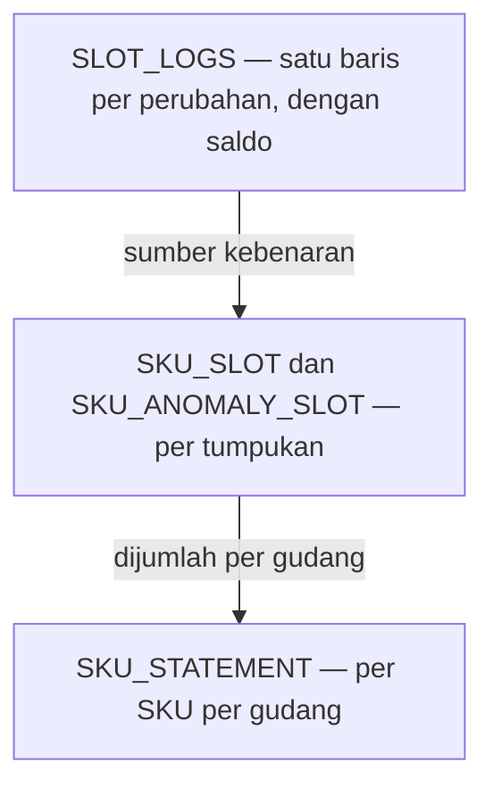

| lapis | menjawab | dibaca oleh |
| --- | --- | --- |
| `SLOT_LOGS` | *kenapa angkanya segini* | opname, audit, klaim ke gudang |
| slot dan anomali | *di rak mana, asalnya apa, harganya berapa* | take (FIFO), instruksi petik |
| `SKU_STATEMENT` | *berapa, di gudang ini* | daftar produk, CS, gerbang take |

**OrderCreation tetap 7 dari 10** — ronde ini menyentuh penerimaan, bukan take. Statement
per gudang bisa jadi gerbang *menolak kalau stok kurang*, tapi §Penyediaan masih kosong
([uji](#uji-ulang-terhadap-ordercreation)).

**Kontradiksi: tiga selesai, satu baru.** Selesai: *teks-tertinggal-dari-model* di sini — supplier dan harga kini
disimpan saat dibuat, seperti tertulis di context.md — dan di kasus, *kasus-dan-erd-tidak-sejalan* dan
*statement-lahir-kapan*. Baru, di kasus: petugas mengirim `supplier_id` lagi, melawan keputusan 14:18 —
[jumlah-dicocokkan-per-item](./context_decision.md#jumlah-dicocokkan-per-item).

---

## Usulan: angka sekarang dan riwayat

> Pertanyaan Anda (2026-09-29): *"beri saya saran pencatatan stok count enaknya dibuat historical atau bentuk statement?"*
> Jawaban Anda di ERD 13:52: `SKU_STATEMENT` — [stok-diringkas-per-sku](./context_decision.md#stok-diringkas-per-sku).
> Separuh riwayatnya belum.

| | isinya | di ERD 13:52 |
| --- | --- | --- |
| **statement** | angka **sekarang**, ditimpa setiap berubah | ✅ slot, dan kini `SKU_STATEMENT` |
| **historical** | satu baris per **perubahan** | ⛔ belum ada — `SLOT_LOGS` yang saya usulkan |
| **keduanya** | angka sekarang **dan** satu baris per perubahan yang membawa **saldo sesudahnya** — persis mutasi rekening, atau kartu stok | ✅ saran saya |

### Critique — kalau hanya salah satu

| | kelemahannya di gudang |
| --- | --- |
| **hanya statement** | selisih opname tidak bisa dijelaskan — angka 88 tidak bilang ke mana 2 unit pergi, dan salah tulis menimpa angka yang benar tanpa jejak. Uang gudang dipertaruhkan pada angka yang tidak bisa diaudit |
| **hanya historical** | stok = `SUM` dari baris yang terus bertambah — makin lama makin lambat, justru di take yang harus cepat. Lebih parah: **`SUM` tidak bisa dikunci**. Dua CS menjual unit terakhir di detik yang sama, keduanya membaca `SUM = 1`, keduanya menulis `−1` — **stok minus satu, terjual dua kali**. Dan tidak ada `CHECK` untuk `SUM` |

### Rekomendasi — keduanya, dalam satu transaksi DB

Angka sekarang untuk **dibaca dan dikunci**; riwayat untuk **dipercaya**. Log adalah sumber kebenaran — slot dan
statement hanyalah salinan cepatnya, dan bisa dibangun ulang dari log.

```sql
-- 1. gerbang: satu baris per SKU per gudang — dua CS di detik yang sama antre di sini
UPDATE sku_statement
SET ready_stock = ready_stock - 3, updated_at = now()
WHERE sku_id = $1 AND warehouse_id = $2 AND ready_stock >= 3
RETURNING ready_stock;            -- 0 baris = stok kurang di gudang ini, tolak

-- 2. slot tertua dulu, pola yang sama: mengecek dan mengurangi sekaligus
UPDATE sku_slot
SET ready_stock = ready_stock - 2, updated_at = now()
WHERE id = $3 AND ready_stock >= 2
RETURNING ready_stock;

-- 3. satu baris log per slot yang dipotong, saldonya dari RETURNING
INSERT INTO slot_logs (slot_id, ready_change, ready_after, reason, take_id, created_by)
VALUES ($3, -2, <hasil RETURNING>, 'take', $4, $5);
```

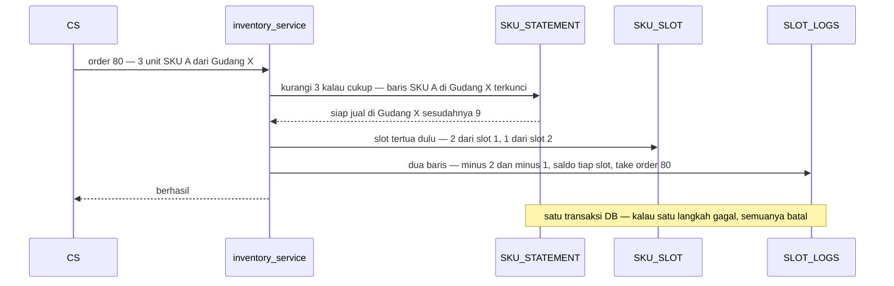

| aturan | alasannya dari gudang |
| --- | --- |
| **satu jalan tulis** — tidak ada `UPDATE` stok di luar itu | angka yang berubah tanpa baris log adalah angka yang tidak bisa dijelaskan |
| statement dikunci **lebih dulu**, lalu slot urut `created_at`, `id` · beberapa SKU urut `sku_id` | semua penulis antre di pintu yang sama — dua take tidak bisa saling menunggu selamanya |
| `CHECK (>= 0)` di setiap angka stok — statement, slot, rusak, hilang | satu baris menjaga stok tidak pernah minus — `SUM` tidak punya padanannya |
| saldo di log diambil dari `RETURNING` | saldo di log selalu saldo yang benar-benar terjadi, bahkan saat dua orang menulis di detik yang sama |
| baris statement lahir lewat `INSERT … ON CONFLICT DO UPDATE` | dua penerimaan pertama di gudang yang sama, di detik yang sama, tidak saling menggagalkan |
| log **tidak pernah** di-`UPDATE` atau di-`DELETE` | salah catat dibetulkan dengan baris baru yang membalik, bukan dengan menghapus |
| tiap malam: saldo terakhir di log = slot · jumlah slot = statement | kalau beda, salinannya yang salah — dibangun ulang dari log |

#### seperti apa kartu stoknya

SKU A, slot 1, dibaca dari `SLOT_LOGS` — terbaru di atas. Dua saldo, karena setelah take unitnya masih di rak
([stock-ready-berarti-apa](#stock-ready-berarti-apa)):

| waktu | keterangan | fisik baik — `count` | siap jual — `ready_stock` |
| --- | --- | ---: | ---: |
| 29/09 14:10 | opname, dihitung 88 — 2 hilang | −2 → **88** | −2 → **88** |
| 29/09 10:02 | order 77 batal (`release`) | 90 | +90 → 90 |
| 29/09 09:15 | order 77 (`take`) | 90 | −90 → 0 |
| 28/09 16:40 | restock T5 diterima (`approved`) | +90 → 90 | +90 → 90 |

Opname jam 09:30 menghitung 90 dan **cocok** dengan `count`. Dengan satu angka saja, ia membandingkan dengan 0 dan
menemukan 90 unit *lebih*.

Untuk kartu stok **per SKU per gudang** — yang biasanya diminta pemilik — log juga membawa `sku_id` dan `warehouse_id`,
dan saldonya dihitung **mundur** dari `SKU_STATEMENT` gudang itu, dikurangi perubahan yang lebih baru. Halaman terbaru
tidak perlu menjumlah dari awal waktu.

✅ **Sejalan dengan template repo ini** — [technical/ledger/mutation_and_ledger.md](../../technical/ledger/mutation_and_ledger.md):
*state* + *ledger log* dengan `after_balance`, ditulis dalam satu transaksi, dan *"cannot change the State without log
recorded"*. Itu bukan alasan memilihnya — alasannya di tabel di atas — tapi berarti stok tidak butuh pola sendiri.

---

## Usulan: barang hilang ditemukan saat opname

> ⏸ 2026-10-02 15:17: `ADJUSTMENTS` keluar dari ERD — usulan ini menunggu mekanisme adjustment Anda
> ([ditunda — mekanisme adjustment](#ditunda--mekanisme-adjustment)).

> Pertanyaan Anda (2026-09-29): *"bagaimana jika adjustment terjadi ketika opname, barang hilang ditemukan kembali?"*

### Critique — barang ketemu

| | Masalah | → Rekomendasi |
| --- | --- | --- |
| **unit-tidak-berlabel** | Barang yang ditemukan tidak membawa label *"saya yang hilang tanggal 3"*. Kalau ada dua kehilangan terbuka untuk SKU yang sama — beda harga, beda penanggung — sistem harus **memilih** mana yang ditutup. | Aturan mekanis: **kehilangan terbuka tertua**, SKU sama, gudang sama. Bukan pilihan petugas: yang menghitung adalah gudang, dan kehilangan di gudang adalah uang gudang — kalau boleh memilih, pilihannya akan menguntungkan gudang. |
| **ketemu-di-rak-lain** | Slot asalnya di Rak A, barangnya ditemukan di Rak C. Menaruhnya di slot asal membuat sistem bilang Rak A, dan opname berikutnya menemukan selisih baru. 🔄 Saya sempat menulis sebaliknya. | Masuk ke slot **di rak tempat ditemukan**. Asal (`tx_id`), supplier dan harga diambil dari baris `SKU_ANOMALY_SLOT` `lost`. Kalau di rak itu sudah ada slot dengan asal yang sama, tambahkan ke slot itu. |
| **ketemu-sebagian** | Hilang 3, ketemu 1. | `count` baris hilang 3 → 2 — pola yang sama dengan slot, asal jumlahnya memang boleh berubah ([angka-sekarang-dan-riwayat](#angka-sekarang-dan-riwayat)). 🔄 Ini menggantikan usulan `qty_found` saya: pola Anda sudah cukup. |
| **uang-ikut-penanggung** | Yang dibalik tergantung siapa yang dulu menanggung. | `adjustment_id` **terisi** → balance `found`, gudang dikembalikan · **kosong** → tanpa balance; tim pemilik mendapat barangnya kembali ([penanggung-dibaca-dari-adjustment-id](./context_decision.md#penanggung-dibaca-dari-adjustment-id)). |
| **lebih-tanpa-kehilangan** | Hitungan lebih, tapi tidak ada kehilangan terbuka untuk SKU itu. Asalnya tidak diketahui. | Pemiliknya **jelas** — satu SKU satu tim ([pemilik-adalah-tim-di-sku](./context_decision.md#pemilik-adalah-tim-di-sku)). Yang tidak jelas harganya — [lebih-tanpa-kehilangan](#lebih-tanpa-kehilangan). |
| **adjustment-satu-sku** | `ADJUSTMENTS` di model: `id`, `sku_id`, `type`. Opname satu rak = puluhan SKU = puluhan baris tanpa kaitan — tidak ada *"dihitung bersama, oleh siapa, jam berapa"*. Dan sekarang `SKU_ANOMALY_SLOT` dan `SKU_SLOT` **menunjuk** ke sana lewat `adjustment_id`, sementara barisnya tidak bilang **berapa**, **dari slot mana**, atau **oleh siapa**. 🆕 Garisnya kini digambar **nol atau satu**: satu adjustment paling banyak satu baris hilang — padahal SKU A yang kurang 2 di slot 1 (@ 12.000) dan 1 di slot 3 (@ 13.000) butuh **dua** baris, karena harga ikut asalnya. Dan adjustment `found` tidak ditunjuk baris mana pun. | Kepala + baris: `ADJUSTMENTS` (satu sesi opname atau satu kejadian) + `ADJUSTMENT_ITEMS` per slot, garisnya **nol atau banyak** — [kolom yang diusulkan](#kolom-adjustments-yang-diusulkan). |

### Rekomendasi

Opname adalah **satu dokumen**, dan setiap selisihnya diterjemahkan otomatis: **kurang** → baris `SKU_ANOMALY_SLOT` `lost` baru;
**lebih** → tutup kehilangan terbuka tertua dulu, sisanya temuan. Dengan aturan ini opname bergilir per rak **membetulkan
dirinya sendiri**: barang yang salah taruh terbaca *hilang* di Rak A minggu ini dan *ketemu* di Rak C minggu depan —
dan uang gudang ikut kembali.

### Proposed Design

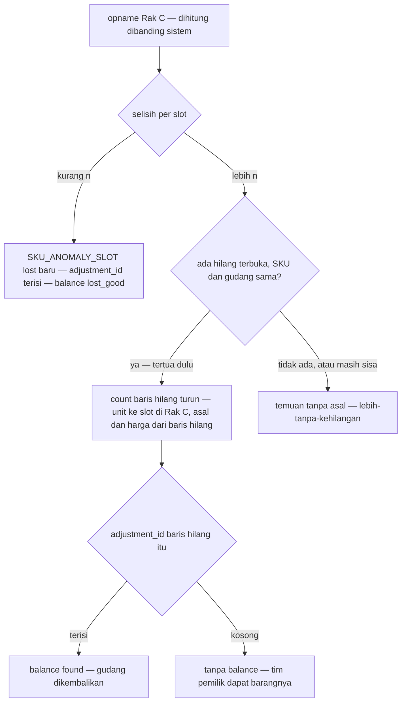

#### contoh — hilang di Rak A, ketemu di Rak C

| kapan | kejadian | yang ditulis | uang |
| --- | --- | --- | --- |
| hari 1 — opname Rak A | SKU A di slot 1 (T5 @ 12.000): sistem 90, dihitung 88 | `SKU_ANOMALY_SLOT` `lost` L1: `count` 2, `adjustment_id` diisi · slot 1 → 88 | gudang `lost_good` 24.000 |
| hari 8 — opname Rak C | SKU A di slot 3 (T6 @ 13.000): sistem 10, dihitung 11 | cocok ke L1, yang tertua → L1 `count` 2 → 1 · **slot 7 baru di Rak C, T5 @ 12.000, isi 1** | gudang `found` 12.000 |

Unit yang ditemukan dinilai **12.000**, harga L1 — bukan 13.000, harga slot yang kebetulan ada di rak itu — karena yang
ditutup adalah L1.

#### kolom ADJUSTMENTS yang diusulkan

| tabel | kolom |
| --- | --- |
| `ADJUSTMENTS` | `id` · `warehouse_id` · `type` (`opname`, `broken`, `lost`, `found` — [adjustment-punya-empat-type](./context_decision.md#adjustment-punya-empat-type)) · `status` (`draft` → `final`) · `created_by` · `confirmed_by` · `created_at` |
| `ADJUSTMENT_ITEMS` | `adjustment_id` · `slot_id` · `sku_id` — pindah dari kepala, karena satu opname banyak SKU · `system_qty` · `counted_qty` · `change` |
| akibatnya | **hanya saat `final`**: satu `SLOT_LOGS` per perubahan · baris `SKU_ANOMALY_SLOT` baru dengan `adjustment_id` = kepala ini · `count` baris hilang turun untuk yang ketemu |

| aturan | alasannya dari gudang |
| --- | --- |
| akibat baru ditulis saat `final` | ada kesempatan hitung ulang sebelum selisih jadi uang gudang ([inventory Q4](../inventory/context_clarify.md#question)) |
| `confirmed_by` ≠ `created_by` | selisih opname adalah uang gudang — satu orang tidak mengesahkan hitungannya sendiri ([inventory Critique 2](../inventory/context_clarify.md#critique)) |
| selama `draft`, take melewati slot di rak itu | satu orang menghitung, satu memetik di rak yang sama — hitungannya benar, catatannya salah ([inventory Critique 7](../inventory/context_clarify.md#critique)) |
| `system_qty` dibekukan saat mulai menghitung | selisih dihitung terhadap angka saat itu, bukan angka saat difinalkan |

---

## Usulan: penerimaan sebagian

> Pertanyaan Anda (2026-09-29): *"gimana cara agar penerimaan barang restock atau return bisa sebagian, jika ada
> kasus misal barang rusak sebagian atau barang hilang sebagian dalam pengiriman?"*

### Critique — penerimaan sebagian

| | Masalah | → Rekomendasi |
| --- | --- | --- |
| **sebagian-itu-tiga-kejadian** | *"Sebagian"* menyatukan tiga kejadian yang akibatnya berbeda: **rusak** — barangnya ada, tidak bisa dijual · **hilang** — barangnya tidak ada · **menyusul** — belum ada, tapi akan datang. Satu angka *"diterima"* tidak bisa membedakannya, dan yang ketiga bukan kerugian sama sekali. | **Tiga angka per baris**: `qty_baik`, `qty_rusak`, `qty_hilang`. *Menyusul* bukan angka — baris berikut. |
| **menyusul-atau-hilang** | Kalau sisa ditunggu, transaksi tidak pernah selesai dan *on the way* membengkak selamanya. Kalau langsung ditutup, barang yang telat datang tidak punya transaksi. | **Satu transaksi = satu resi = satu paket, diterima sekali.** Resi sudah diisi saat restock dibuat, jadi supplier yang mengirim dua paket = dua transaksi. Yang tidak ada di paket = **hilang, final**. |
| **kerugian-jangan-diratakan** | Cara termudah — total bayar dibagi ke unit yang baik — membuat kerugian **tidak terlihat**. Lebih buruk: tim lain yang meminjam barang ini membayar markup di atas harga yang sudah menanggung kerugian pemilik. Padahal kerugian saat terima milik **tim pemilik sendiri** ([selling-team-bears-the-receiving-loss](../inventory/context_clarify.md#selling-team-bears-the-receiving-loss)). | Semua unit **harganya sama** — harga beli + ongkir ÷ qty **dikirim**. Unit rusak dan hilang membawa harga itu sebagai **kerugian** — [contoh](#contoh-restock--10-dikirim-8-baik). |
| **retur-utuh-penerimaannya-tidak** | Retur selalu seluruh order ([a-return-is-never-partial](../order/context_decision.md#a-return-is-never-partial)) — jadi *retur sebagian* tidak ada. | **Dua lapis**: order diretur utuh dan jadi `return_completed`; **penerimaan** di inventory mencatat apa yang benar-benar datang. Keduanya benar sekaligus. |

### Rekomendasi

Petugas gudang menghitung **tiga angka** per baris, sistem menolak kalau jumlahnya tidak sama dengan yang dikirim, dan
**harga per unit tidak berubah** — kerugian muncul sebagai angka sendiri, tidak disembunyikan di harga barang yang baik.

### Proposed Design

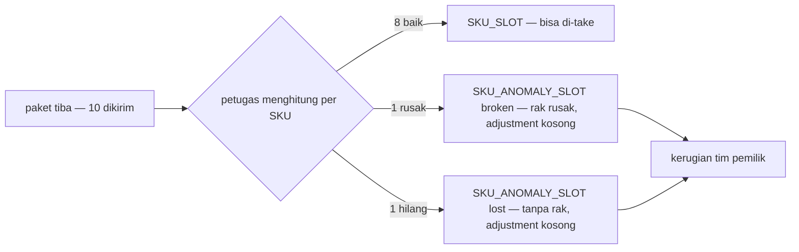

| aturan | alasannya dari gudang |
| --- | --- |
| `qty_baik + qty_rusak + qty_hilang = count`, ditolak kalau tidak | petugas mengonfirmasi hitungannya — salah ketik tertangkap di pintu, bukan di opname |
| satu status akhir per transaksi | dua petugas menekan *terima* — slot tidak lahir dua kali ([status-akhir-dua-kali](#critique)) |
| nilai per unit = `unit_price` + `unit_shipping_cost` + `unit_additional_shipping_cost`, ongkir ÷ `count` dikirim | sama untuk baik, rusak, hilang — kerugian = (rusak + hilang) × nilai itu |
| foto bukti untuk rusak **dan** hilang | supplier dan marketplace meminta foto atau video buka paket untuk klaim — ✅ `image_of_proof_url` kini ada untuk keduanya |
| tidak ada catatan balance | kerugian saat terima milik pemilik sendiri — gudang tidak menanggung ([business_level §Warehouse 6](../business_level.md#warehouse-team)), jadi tidak ada utang antar-tim |

#### contoh restock — 10 dikirim, 8 baik

SKU A: 10 unit @ 10.000, ongkir 20.000 → **12.000 per unit** — `unit_price` 10.000 + ongkir per unit 2.000. Tiba: 8 baik,
1 rusak, 1 hilang.

| | diratakan ke unit baik | **disarankan** |
| --- | ---: | ---: |
| `SKU_SLOT` | 8 @ 15.000 | 8 @ 12.000 |
| `SKU_ANOMALY_SLOT` `broken` | — | 1 @ 12.000 |
| `SKU_ANOMALY_SLOT` `lost` | — | 1 @ 12.000 |
| kerugian tercatat | 0 — tidak terlihat | **24.000** |
| total, harus sama dengan yang dibayar | 120.000 ✅ | 120.000 ✅ |
| tim B meminjam 1 unit, markup 20% | 18.000 — **ikut menanggung kerugian A** | 14.400 |

Keduanya cocok dengan uang yang keluar. Bedanya hanya: siapa yang melihat kerugiannya, dan siapa yang membayarnya.

#### contoh retur — order 3 unit, 1 rusak

Order 78: 3 unit SKU B, COGS 15.000 (dibaca lewat `ref_order_id`). Tiba: 2 baik, 1 rusak.

| lapis | hasil |
| --- | --- |
| order 78 | `return` → `return_completed` — **utuh** |
| penerimaan | `SKU_SLOT` 2 @ 15.000 · `SKU_ANOMALY_SLOT` `broken` 1 @ 15.000 · kerugian 15.000, tim yang meretur |

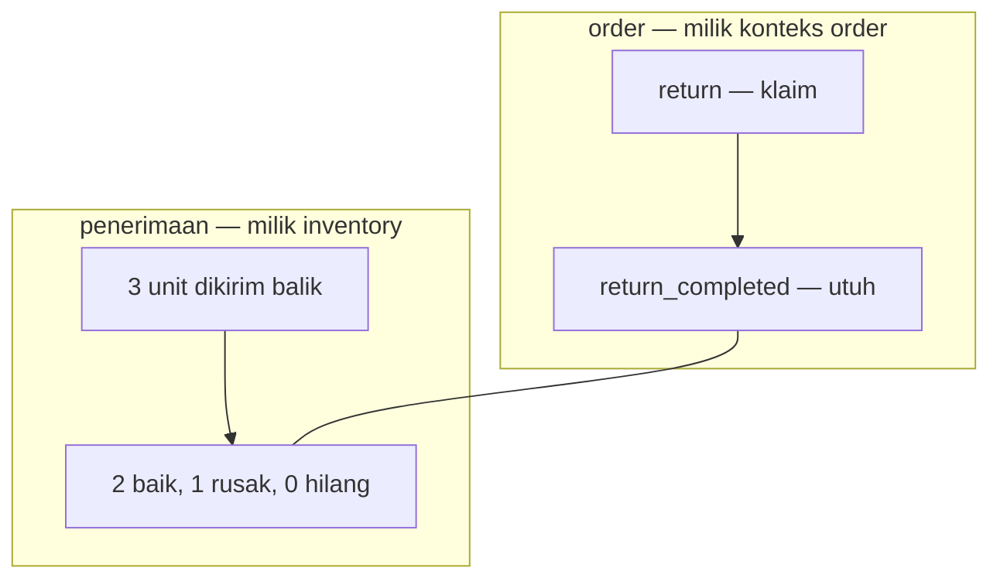

⚠ Ini berbeda dengan rekomendasi yang dulu terbuka di sisi order —
[a-short-delivered-parcel-has-no-home](../order/order_return_clarify.md#a-short-delivered-parcel-has-no-home) mengusulkan
`problem`, dan sudah saya revisi di sana. Dan ia membalik rekomendasi saya di
[inventory Q1](../inventory/context_clarify.md#question) (bagi ongkir ke qty *diterima*), yang hanya benar kalau
kerugian diratakan. Catatan sudah ditambahkan di sana.

### pindah-antar-tiga-tabel

✅ Tabelnya sudah diputuskan — [rusak-dan-hilang-satu-tabel](./context_decision.md#rusak-dan-hilang-satu-tabel) ·
[penanggung-dibaca-dari-adjustment-id](./context_decision.md#penanggung-dibaca-dari-adjustment-id). Yang tersisa:
bagaimana unit **berpindah** antara slot dan anomali.

| kapan | rusak → `SKU_ANOMALY_SLOT` `broken` | hilang → `SKU_ANOMALY_SLOT` `lost` | yang menanggung |
| --- | --- | --- | --- |
| saat terima | baris baru, `adjustment_id` kosong | baris baru, `adjustment_id` kosong | tim pemilik |
| sudah di gudang | `SKU_SLOT −n` → baris baru, `adjustment_id` terisi, `tx_id` dan harga dari slot asal | `SKU_SLOT −n` → baris baru, `adjustment_id` terisi | gudang |
| ketemu lagi | — | `count` baris hilang turun · slot **di rak tempat ditemukan**, asal dan harga dari baris hilang | uangnya balik, kalau `adjustment_id` terisi |

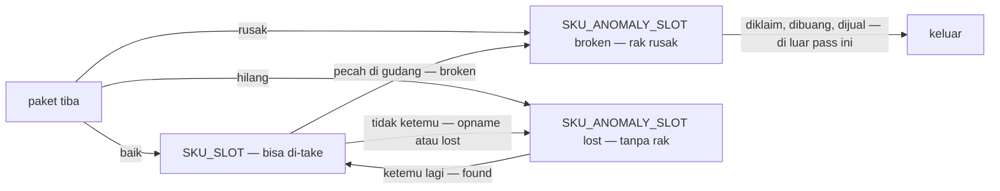

| aturan | kenapa |
| --- | --- |
| pindah antar-tabel dalam **satu transaksi DB**, slot asal dikunci dulu | dua petugas di rak yang sama — satu unit tidak boleh ada di dua tabel, atau tidak di mana pun |
| setiap pindah menulis **dua** baris `SLOT_LOGS`, satu di tiap tabel | tanpa itu, `−2` di slot dan `+2` di rak rusak adalah dua angka yang kebetulan sama ([satu-log-untuk-semua](#critique)) |
| `qty_baik/rusak/hilang` di item **tetap ada** | item = apa yang tiba, dibekukan; slot dan anomali = di mana unit itu **sekarang**. Riwayat dan keadaan — bukan dua sumber untuk satu angka |
| type `broken` · `lost` · `found` → balance `broken_good` · `lost_good` · `found` | type menamai kejadiannya, balance menamai uangnya ([the-ledger-speaks-the-business-words](../balance/context_decision.md#the-ledger-speaks-the-business-words)) — terjemahannya satu tabel, di [adjustment-punya-empat-type](./context_decision.md#adjustment-punya-empat-type) |
| hilang tanpa rak di `SKU_LOST_SLOT`, rusak wajib di rak di `SKU_BROKEN_SLOT` | ✅ [rusak-dan-hilang-tabel-terpisah](./context_decision.md#rusak-dan-hilang-tabel-terpisah) · ✅ [barang-rusak-wajib-di-rak](./context_decision.md#barang-rusak-wajib-di-rak) |

---

## Uji ulang terhadap OrderCreation

| OrderCreation butuh | sumber | sekarang |
| --- | --- | --- |
| hanya stok di satu gudang | `OrderTransactionCreateRequest.warehouse_id` | ✅ `SKU_SLOT.warehouse_id` · ✅ `SKU_STATEMENT` per gudang ([stok-diringkas-per-sku-per-gudang](./context_decision.md#stok-diringkas-per-sku-per-gudang)) |
| dari rak mana — instruksi petik | [order_creation](../order/order_creation_clarify.md#a-take-is-a-stock-movement-that-names-its-order) | ✅ slot membawa raknya |
| per baris: tim pemilik | `TransactionItem.team_id` | ✅ tim product — SKU = product |
| `unit_cost` | `TransactionItem.unit_cost` | ✅ jumlah tiga harga slot · ⚠ saran: satu kolom yang menjumlahkannya ([nilai-unit-satu-kolom](#nilai-unit-satu-kolom)) |
| `unit_cost_with_markup` | [inventory-computes-the-markup](../order/context_decision.md#inventory-computes-the-markup) | ✅ `cross_markup_percent` product |
| retur masuk saat `return_completed` | [the-accept-is-the-status-return-completed](../order/context_decision.md#the-accept-is-the-status-return-completed) | ✅ `type` `return` + `ref_order_id` |
| take **tercatat**, sekali per order | [a-take-reduces-stock-and-placement](../order/context_decision.md#a-take-reduces-stock-and-placement) | ⛔ take bukan `TRANSACTIONS` — lalu di mana? |
| mengembalikan take ke slot asalnya | [inventory-returns-stock-on-order-cancelled](../order/context_decision.md#inventory-returns-stock-on-order-cancelled) | ⛔ ikut baris di atas |
| `reserved_stock` dan *shared lock* | [product §Cross/Shared Products Rule](../product/context.md) | ✅ 🆕 milik product — [sku-adalah-product](./context_decision.md#sku-adalah-product) — dibaca dari Product Service saat take |
| menolak kalau stok kurang | [order-created-is-finalize](../order/context_decision.md#order-created-is-finalize) | ⛔ §Penyediaan masih kosong — statement per gudang bisa jadi gerbangnya |

**Vonis: 7 dari 10 ✅.** Yang tersisa hampir seluruhnya satu hal: **take tidak punya tempat dicatat**
([take-dicatat-di-mana](#take-dicatat-di-mana)).

---

## Proposed Design

### ERD Anda, ditambah log dan catatan take

```mermaid
erDiagram
  TRANSACTIONS ||--|{ TRANSACTION_ITEMS : "memiliki beberapa"
  TRANSACTIONS ||--|{ TRANSACTION_STATUS_LOGS : "riwayat status"
  TRANSACTIONS ||--o{ SKU_SLOT : "melahirkan"
  TRANSACTIONS ||--o{ SKU_ANOMALY_SLOT : "asal barang"
  ADJUSTMENTS ||--|{ ADJUSTMENT_ITEMS : "baris per slot"
  ADJUSTMENTS ||--o{ SKU_ANOMALY_SLOT : "rusak atau hilang di gudang"
  ADJUSTMENTS ||--o{ SKU_SLOT : "slot dari found"
  SKU_SLOT ||--o{ SLOT_LOGS : "perubahan count dan ready_stock"
  SKU_ANOMALY_SLOT ||--o{ SLOT_LOGS : "perubahan count"
  TRANSACTIONS ||--o{ SLOT_LOGS : "approved"
  ORDER_TAKES ||--|{ SLOT_LOGS : "take dan release"
  ADJUSTMENTS ||--o{ SLOT_LOGS : "akibat adjustment"
  TRANSACTIONS {
    int id PK
    string type "restock atau return"
    int ref_order_id "return, order kita, UNIK untuk return"
    int team_id "BARU, tim pemilik"
    int warehouse_id "gudang tujuan, dipakai saat menerima"
    int created_by FK
    int shipping_id FK
    string receipt "satu resi, satu paket"
    float shipping_fee "default 0"
    float additional_shipping_fee "ditagih kurir saat tiba, dibayar gudang, default 0"
    string additional_shipping_proof_url "foto nota kurir, CHECK wajib kalau ongkir tambahan lebih dari 0"
    string order_id "restock, nomor pesanan di supplier"
    string payment_method
    string notes
    date created_at
  }
  TRANSACTION_STATUS_LOGS {
    int id PK
    int tx_id FK
    string status "ongoing, approved, cancel, satu status akhir per tx"
    int created_by FK
    date created_at
  }
  TRANSACTION_ITEMS {
    int id PK
    int tx_id FK
    int sku_id FK
    int supplier_id FK "restock, milik Supplier Service"
    int count "dikirim"
    float total "belanja baris tanpa ongkir, atau COGS order kali qty untuk retur"
    int qty_baik "BARU, saat terima, beku"
    int qty_rusak "BARU, saat terima, beku"
    int qty_hilang "BARU, saat terima, beku"
  }
  SKU_SLOT {
    int id PK
    int sku_id FK
    int supplier_id FK
    int tx_id FK
    int adjustment_id FK "kosong kecuali lahir dari found"
    int warehouse_id FK
    int rack_id FK
    int count "sisa fisik baik di rak, turun saat dipetik"
    int ready_stock "BARU, siap jual, turun saat order dibuat, antara 0 dan count"
    float unit_price "total item dibagi count item"
    float unit_shipping_cost "ongkir dibagi semua count, NOT NULL DEFAULT 0"
    float unit_additional_shipping_cost "ongkir tambahan dibagi semua count, NOT NULL DEFAULT 0"
    float unit_cost "BARU, GENERATED, jumlah ketiganya, dibaca take dan nilai kerugian"
    date created_at "urutan FIFO"
    date updated_at "kembali"
  }
  SKU_STATEMENT {
    int id PK
    int sku_id FK
    int warehouse_id FK "UNIQUE bersama sku_id, bukan index biasa"
    int ongoing_stock "dulu stock_ongoing, salinan dari status, per gudang tujuan"
    int ready_stock "dulu stock_ready, jumlah slot, gerbang take"
    int broken_stock "dulu stock_broken"
    int lost_stock "dulu stock_lost"
    date created_at
    date updated_at
  }
  SKU_ANOMALY_SLOT {
    int id PK
    int sku_id FK
    int supplier_id FK
    int tx_id FK
    int adjustment_id FK "kosong kalau terjadi saat terima"
    int warehouse_id FK
    int rack_id FK "wajib untuk broken, kosong untuk lost, dijaga CHECK"
    string type "broken atau lost"
    int count "baris hilang turun saat ketemu"
    float unit_price "sama dengan slot asalnya"
    float unit_shipping_cost "sama dengan slot asalnya"
    float unit_additional_shipping_cost "sama dengan slot asalnya"
    float unit_cost "BARU, GENERATED, jumlah ketiganya"
    string image_of_proof_url
    string notes
    date created_at
    date updated_at "BARU, kalau jumlahnya boleh berubah"
  }
  ADJUSTMENTS {
    int id PK
    int warehouse_id "BARU"
    string type "opname, broken, lost, found"
    string status "BARU, draft atau final"
    int created_by FK "BARU"
    int confirmed_by FK "BARU, bukan pencatat"
    date created_at
  }
  ADJUSTMENT_ITEMS {
    int id PK "BARU"
    int adjustment_id FK
    int slot_id FK
    int sku_id FK "pindah dari ADJUSTMENTS"
    int system_qty "dibekukan saat mulai"
    int counted_qty
    int change
  }
  ORDER_TAKES {
    int id PK "BARU"
    int order_id "UNIK, take kedua ditolak"
    int ordering_team_id
    int warehouse_id
    string status "taken atau released"
    date created_at
  }
  SLOT_LOGS {
    int id PK "BARU"
    int slot_id FK "salah satu dari dua ini terisi"
    int anomaly_slot_id FK
    int change "count tabelnya"
    int after_balance "saldo sesudahnya, seperti mutasi rekening"
    int ready_change "BARU, hanya slot baik"
    int ready_after "BARU, hanya slot baik"
    int sku_id FK "disalin dari slot, untuk kartu stok per SKU"
    int warehouse_id FK "disalin dari slot"
    string reason "approved, take, release, pick, opname, broken, lost, found, move kalau ada"
    int tx_id FK "kalau approved"
    int take_id FK "kalau take atau release"
    int adjustment_id FK "kalau akibat adjustment"
    int created_by FK
    date created_at
  }
```

| perubahan | kenapa |
| --- | --- |
| **`SLOT_LOGS`** — satu log untuk slot dan anomali | [satu-log-untuk-semua](#critique) |
| **`ORDER_TAKES`** — `order_id` unik | take sekali per order: panggilan kedua untuk order yang sama **ditolak oleh database** — bukan oleh cek `exists` yang bisa lolos dua-duanya di detik yang sama |
| **`ADJUSTMENTS`** kepala + **`ADJUSTMENT_ITEMS`**, garis ke anomali nol atau banyak | [adjustment-satu-sku](#critique--barang-ketemu) |
| `SKU_SLOT.count` = sisa · `ready_stock` · `updated_at` kembali | [count-slot-beku-atau-sisa](#count-slot-beku-atau-sisa) · [stock-ready-berarti-apa](#stock-ready-berarti-apa) |
| `SKU_LOST_SLOT` dan `SKU_BROKEN_SLOT` · `updated_at` | ✅ `supplier_id` ([supplier-ikut-ke-rusak-dan-hilang](./context_decision.md#supplier-ikut-ke-rusak-dan-hilang)) · ✅ harga tanpa *default* ([harga-rusak-dan-hilang-dihitung-seperti-slot](./context_decision.md#harga-rusak-dan-hilang-dihitung-seperti-slot)) · [angka-sekarang-dan-riwayat](#angka-sekarang-dan-riwayat) |
| `SLOT_LOGS.after_balance` + `sku_id` + `warehouse_id` · stok tidak pernah minus | [usulan-angka-sekarang-dan-riwayat](#usulan-angka-sekarang-dan-riwayat) |
| **`SKU_STATEMENT`** `UNIQUE (sku_id, warehouse_id)`, nama kolomnya sama dengan slot · ditulis dengan tambah dan kurang | [statement-ditulis-atomik](./context_decision.md#statement-dibuat-atau-ditambah) · [satu-angka-dua-nama](#critique--sku_statement) |
| `qty_baik/rusak/hilang` di item | [usulan-penerimaan-sebagian](#usulan-penerimaan-sebagian) |
| `ref_order_id` **unik** untuk `return` | [ref-order-id-belum-unik](#critique) |
| ✅ `TRANSACTIONS.team_id` · penerimaan memakai `warehouse_id` transaksi | [tim-dikirim-dan-disimpan-di-transaksi](./context_decision.md#tim-dikirim-dan-disimpan-di-transaksi) · [penerima-dari-gudang-tujuan](./context_decision.md#penerima-dicek-anggota-gudang-tujuan) — dan retur tahu gudang tujuannya sejak diklaim ([the-return-warehouse-is-per-team](../order/context_decision.md#the-return-warehouse-is-per-team)) |
| log status: **satu status akhir per transaksi** | [status-akhir-dua-kali](#critique) · [daftar-status-hilang](#critique) |
| `unit_cost` **generated** di slot dan anomali · tiga harga per unit `NOT NULL DEFAULT 0` | [nilai-unit-satu-kolom](#nilai-unit-satu-kolom) |
| event saat restock `approved` dan saat adjustment `final` — balance yang menagih | [inventory-mengumumkan-fakta-uang](#inventory-mengumumkan-fakta-uang) |
| `additional_shipping_*` → `incidental_fee`, `incidental_fee_proof_url`, `unit_incidental_cost` | [satu-ongkir-tambahan-tiga-nama](#satu-ongkir-tambahan-tiga-nama) |
| `supplier_order_ref` | [nama-kolom](#critique) |

### Contoh — restock, order, batal, retur

Angka di kolom slot = `ready_stock`.

| langkah | yang ditulis | slot 1 — Rak A | slot 2 — Rak B | slot 3 — Rak C |
| --- | --- | --- | --- | --- |
| T5 `restock`, SKU A × 113 @ 10.000 | `TRANSACTIONS` + item · log `ongoing` | — | — | — |
| T5 log `approved`: 113 baik, dua rak | 2 slot · `SLOT_LOGS` `+90`, `+23` `approved` | 90 | 23 | — |
| order 77 mengambil 100 | `ORDER_TAKES` K1 · `SLOT_LOGS` `−90`, `−10` `take` | 0 | 13 | — |
| order 77 batal | K1 → `released` · `SLOT_LOGS` `+90`, `+10` `release` — dibaca dari log K1 | 90 | 23 | — |
| order 78 (2 unit) dikirim, lalu diretur utuh | T8 `return`, `ref_order_id` 78, item @ COGS order 78 | | | |
| T8 log `approved`: 2 baik | slot 3 · `SLOT_LOGS` `+2` `approved` | 90 | 23 | 2 @ COGS |

### Isi §Penyediaan data OrderCreation — take

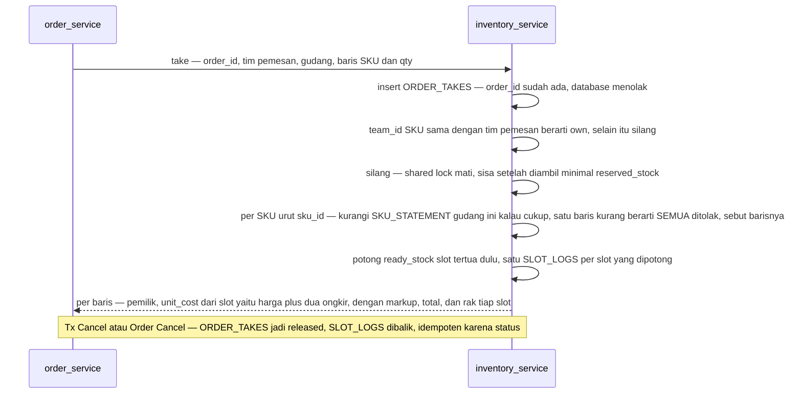

| aturan | alasannya dari gudang |
| --- | --- |
| cek dan potong dalam **satu kunci** | dua CS menjual SKU yang sama di detik yang sama — tanpa kunci, 1 unit terjual 2 kali |
| **semua atau tidak sama sekali** | order setengah terambil tidak bisa dikirim dari satu gudang |
| release hanya dari `taken` | event batal bisa datang dua kali — yang kedua tidak mengembalikan stok lagi |
| `total` yang otoritatif | satu baris dari dua slot berbeda harga ([one-line-many-batches](../order/order_creation_clarify.md#critique)) |

⚠ Kontrak di order_creation.md belum membawa `order_id` dan tim pemesan — terbuka di
[which-team-is-team-id](../order/order_creation_clarify.md#which-team-is-team-id).

---

## Critique

| | Masalah | → Rekomendasi |
| --- | --- | --- |
| **satu-log-untuk-semua** | Slot dan anomali sama-sama menyimpan **jumlah** — `count` — tanpa satu baris pun yang bilang **kenapa jumlah itu berubah, oleh siapa, dari slot mana**. Take, pecah di rak, dan ketemu saat opname semuanya tersandung di lubang yang sama ([uji-erd-terbaru](#uji-erd-terbaru)). Dan opname yang menemukan selisih tidak punya apa pun untuk dibaca selain angka. | **`SLOT_LOGS`**: satu baris per perubahan jumlah di slot atau anomali, dengan alasan dan rujukannya — transaksi, take, atau adjustment. Satu keputusan menutup tiga pertanyaan. |
| **tim-di-item-berlebih** | 10-02 14:12: `team_id` kini di `TRANSACTIONS`, `TRANSACTION_ITEMS` (baris 60), `SKU_SLOT` (baris 75), dan sejak 15:17 `SKU_LOST_SLOT` (baris 87) dan `SKU_BROKEN_SLOT` (baris 106). Di item ia **selalu** sama dengan transaksinya — SKU tim lain ditolak ([sku-tim-lain-ditolak-saat-dibuat](./context_decision.md#sku-tim-lain-ditolak-saat-dibuat)) — jadi tidak menambah apa pun, hanya satu tempat lagi yang bisa berbeda. Di slot, rusak dan hilang ia berguna — *stok tim 2 di gudang 3* terbaca tanpa melewati transaksi — asal diisi dari transaksi, bukan dari kiriman staff. | Hapus dari `TRANSACTION_ITEMS`. Di slot, rusak dan hilang, komentar `"dari TRANSACTIONS.team_id"`. |
| **pindah-rak-tanpa-jejak** | ⏸ ditunda bersama mekanisme adjustment. `move` tidak masuk daftar type. Slot membawa `rack_id`, jadi memindah tumpukan = mengubah `rack_id` — tanpa jejak. Memindah **sebagian** (30 dari 90 ke Rak B) butuh slot baru dengan asal yang sama — [slot-lahir-saat-barang-tiba](./context_decision.md#slot-lahir-saat-barang-tiba) sudah menulis *slot dipecah jadi dua baris* — dan tidak ada type yang mencatatnya. Kalau dipindah tanpa dicatat: instruksi petik tetap menunjuk Rak A, pemetik tidak menemukan barangnya, dan opname Rak A mencatat **kurang 30** — uang gudang — sampai Rak B dihitung. | Kalau pindah rak memang terjadi: `move` kembali — tanpa uang, tanpa konfirmasi. Kalau tidak pernah: satu kalimat di dokumen — *slot tidak pernah pindah rak*. |
| **take-tanpa-catatan** | Take bukan `TRANSACTIONS` — benar, take bukan paket datang. Tapi ia tidak punya tempat lain: order yang sama bisa mengambil dua kali, dan batal tidak tahu slot asalnya. | `ORDER_TAKES` (`order_id` unik) + `SLOT_LOGS` yang sama. |
| **status-akhir-dua-kali** | ✅ 17:27: aturannya tertulis — *"tidak boleh status log nya double"* ([approved-sekali-dan-final](./context_decision.md#approved-sekali-dan-final)). ✅ 10-03 12:54: alur kini **mengunci** baris transaksi dan memeriksa `ongoing` sebelum menerima atau membatalkan ([kunci-transaksi-lalu-periksa-ongoing](./context_decision.md#kunci-transaksi-lalu-periksa-ongoing)) — dua petugas yang menekan *terima* bersamaan tidak lagi melahirkan slot dua kali. Yang tersisa hanya cadangan: kunci itu dijaga **kode** di dua tempat, dan kelak return serta adjustment juga menulis log status — satu jalur baru yang lupa mengunci membuka lubang yang sama. ✅ 10-03 14:09: setelah sempat dihapus 13:54, kunci dan periksa `ongoing` kembali — kini pada baris statement ([kunci-statement-lalu-periksa-ongoing](./context_decision.md#kunci-statement-lalu-periksa-ongoing)). Penjaga di bawah ini kembali menjadi **cadangan**. | **Penjaga cadangan di database**, ditulis di bawah ERD: satu status akhir per `tx_id` — indeks unik parsial `UNIQUE (tx_id) WHERE status IN (approved, cancelled)` di `TRANSACTION_STATUS_LOGS`. Jalur yang lupa mengunci ditolak database, bukan diam-diam menulis dua kali. |
| **ref-order-id-belum-unik** | Sama polanya, untuk retur: CS mengklaim retur order 78, gudang juga ([both-cs-and-the-warehouse-can-return-an-order](../order/context_decision.md#both-cs-and-the-warehouse-can-return-an-order)) — dua transaksi `return` untuk satu order, dan barangnya **masuk stok dua kali**. | `ref_order_id` **unik** untuk `type = return`. |
| **nama-kolom** | ✅ `shipping_fee` kini `float` (14:38). Tersisa: `order_id` di sistem yang punya tabel `orders` akan dibaca *order kita* — catatan di bawah ERD menjelaskannya, tapi kolom dibaca di kode dan query, bukan di catatan. | `supplier_order_ref`. |
| **folder-di-luar-inventory** | *"Service ini bernama `Inventory Service`"* — service yang **sama** dengan [inventory/context.md](../inventory/context.md) Heri. Dua proposal untuk satu service, di dua folder. | Pindah ke `business/inventory/`, dinamai sebagai proposal Toni. |

### di-luar-pass-ini

Jadwal opname — siapa memanggil, seberapa sering · transfer antar gudang — **bukan** adjustment, barangnya di jalan
berhari-hari · **nasib unit rusak** (klaim, buang, jual murah — kelak type baru, karena mengurangi `count` baris rusak) ·
barang **kedaluwarsa** · barang **salah kirim** (SKU lain dari yang dipesan). `SLOT_LOGS` sudah memberi mereka tempat —
aturannya belum ada. **→ Rekomendasi:** satu kalimat di dokumen — *"di luar pass ini"*.

---

## Ditunda — mekanisme adjustment

> ⏸ 2026-10-02 15:17: `ADJUSTMENTS` keluar dari ERD — *"Todo mekanisme `adjustment`, sedang saya pikirkan dulu."* Empat
> pertanyaan ini menunggu sampai mekanismenya Anda tulis, dan **tidak dihitung** sebagai pertanyaan terbuka. Yang sudah
> diputuskan tentang adjustment tetap di [context_decision](./context_decision.md) sebagai bahan.

### bentuk-adjustment
Satu adjustment boleh melahirkan nol, satu, atau banyak baris rusak dan hilang
([satu-adjustment-banyak-baris-anomali](./context_decision.md#satu-adjustment-banyak-baris-anomali) ·
[adjustment-boleh-tanpa-baris-anomali](./context_decision.md#adjustment-boleh-tanpa-baris-anomali)). Sisanya:
`ADJUSTMENTS` jadi **kepala**, barisnya per **slot** di `ADJUSTMENT_ITEMS`, dan akibatnya baru ditulis saat `final`?
**→ Saran: ya** ([adjustment-satu-sku](#critique--barang-ketemu)).

### pindah-rak-dicatat
Kalau tumpukan pernah dipindah rak, seluruhnya atau sebagian, di mana dicatat? **→ Saran:** `move` sebagai jenis
adjustment, tanpa uang dan tanpa konfirmasi · kalau tidak pernah terjadi, tulis *slot tidak pernah pindah rak*
([pindah-rak-tanpa-jejak](#critique)).

### ketemu-dicocokkan-ke-kehilangan-tertua
Hitungan lebih menutup kehilangan terbuka **tertua** untuk SKU dan gudang yang sama — bukan dipilih petugas — dan
unitnya masuk slot di rak tempat ditemukan, dengan harga baris hilang itu? **→ Saran: ya** ([unit-tidak-berlabel](#critique--barang-ketemu)).

### lebih-tanpa-kehilangan
Hitungan lebih dan tidak ada kehilangan terbuka — masuk stok dengan harga berapa? **→ Saran:** slot baru berasal
`opname`, harga = harga slot terbaru SKU itu di gudang itu. Harga 0 membuat marginnya terlihat bagus saat terjual, dan
itu bohong.

---

## Question

> ✅ Dijawab dan dihapus (2026-10-03 12:25): *tim-di-kunci-statement* —
> [statement-tanpa-kolom-tim](./context_decision.md#statement-tanpa-kolom-tim). Kunci kembali `(sku_id, warehouse_id)`.
>
> ✅ **Tidak lagi ditunda** (2026-10-02 15:50) — *Pencatatan Pembatalan* kini ditulis di [alur](./restock_flow.md). Siapa
> yang boleh membatalkan dan sampai kapan: diputuskan
> ([pembatalan-oleh-cs-atau-admin](./context_decision.md#pembatalan-oleh-cs-atau-admin) ·
> [cancelled-juga-final](./context_decision.md#cancelled-juga-final)). Berapa `stock_ongoing` turun, dan paket yang tetap
> tiba sesudah `cancelled`: kini di [restock_flow_clarify](./restock_flow_clarify.md#question).
>
> ✅ Dijawab dan dihapus (2026-10-02 15:50): *harga-landed-dibagi-qty-dikirim* —
> [ongkir-dibagi-ke-unit-yang-dikirim](./context_decision.md#ongkir-dibagi-ke-unit-yang-dikirim).
>
> ✅ Dijawab dan dihapus (2026-10-02 14:29): *penerimaan-tiga-angka* —
> [rusak-dan-hilang-dikirim-bersama-penempatan](./context_decision.md#rusak-dan-hilang-dikirim-bersama-penempatan). Aturan
> cocoknya per item tetap di [jumlah-dicocokkan-per-item](./context_decision.md#jumlah-dicocokkan-per-item).
>
> ✅ Dijawab dan dihapus (2026-10-01 12:45): *satu-restock-satu-tim-pemilik* —
> [tim-dikirim-dan-disimpan-di-transaksi](./context_decision.md#tim-dikirim-dan-disimpan-di-transaksi). Sisanya, SKU tim
> lain ditolak saat dibuat, pindah ke kasus: *sku-tim-lain-belum-ditolak* — ✅ 10-02 diputuskan:
> [sku-tim-lain-ditolak-saat-dibuat](./context_decision.md#sku-tim-lain-ditolak-saat-dibuat).
>
> ➡ Dipindah ke clarify kasus pertama, karena kasus itulah yang menjawabnya: *harga-diisi-di-item* →
> [harga-disimpan-di-item](./context_decision.md#supplier-dan-total-disimpan-di-item) — kini diputuskan.

### take-dicatat-di-mana
Take bukan baris `TRANSACTIONS` — lalu dicatat di mana? ⚠ Sejak ERD 13:20 pertanyaannya lebih lebar: pecah di rak dan
barang yang ketemu butuh jejak yang **sama** ([satu-log-untuk-semua](#critique)).
**→ Saran: `ORDER_TAKES` + `SLOT_LOGS`**, dengan baris statement gudang itu dikunci lebih dulu sebagai gerbang *cukup
atau tidak*, dan `SLOT_LOGS` yang sama dipakai adjustment. Ini yang tersisa antara ERD dan
OrderCreation. ⚠ Sejak 15:24: kalau `count` slot beku, hanya catatan ini yang bisa bilang sisa per slot
([count-slot-beku-atau-sisa](#count-slot-beku-atau-sisa)).

### angka-sekarang-dan-riwayat
⚠ Separuhnya terjawab di 13:52: angka sekarang ada di slot **dan** di `SKU_STATEMENT`. Separuh lainnya — **riwayat** —
belum: tetap tambah satu baris `SLOT_LOGS` per perubahan dengan saldo sesudahnya, di transaksi DB yang sama, dan log
jadi sumber kebenaran? Ini juga menjawab apakah jumlah rusak dan hilang boleh berubah: **boleh**, riwayatnya di log.
**→ Saran: ya** — tanpa log, [uji kartu stok](#uji-kartu-stok) hanya 2 dari 5
([usulan-angka-sekarang-dan-riwayat](#usulan-angka-sekarang-dan-riwayat)).

### count-slot-beku-atau-sisa
🆕 `SKU_SLOT.count` = jumlah yang **tiba** (beku) atau **sisa** yang turun saat take? `updated_at` yang dihapus mengarah
ke beku; FIFO butuh sisa per slot. **→ Saran: sisa**, dan `updated_at` kembali — jumlah yang tiba sudah beku di
`transaction_items.count` ([count di slot](#count-di-slot--beku-atau-sisa)).


### barang-ditarik-pemilik
🆕 Bisakah tim jualan **menarik** barangnya keluar dari gudang tanpa order — dipindah ke tempat lain, dipakai untuk foto
produk, dikirim ke kantornya? Sekarang satu-satunya jalan keluar adalah order, jadi tarikan seperti itu akan terbaca
`lost_good` — **uang gudang** untuk barang yang diambil pemiliknya sendiri. **→ Saran:** kalau terjadi, beri alurnya
sendiri — seperti order tanpa pembeli — bukan type adjustment. Tapi putuskan dulu **apakah** terjadi.

### satu-transaksi-satu-paket
🆕 10-02: satu resi hanya untuk satu restock `ongoing`
([satu-resi-satu-restock-berjalan](./context_decision.md#satu-resi-satu-restock-berjalan)) — separuh jawabannya. Sisanya:
satu transaksi = satu resi = satu paket, diterima **sekali** — yang tidak ada di paket = hilang, final? Kalau supplier
sering mengirim satu pesanan dalam beberapa paket dengan **satu** resi, jawabannya tidak, dan penerimaan butuh tabel
sendiri yang bisa lebih dari satu per transaksi. **→ Saran: ya** ([menyusul-atau-hilang](#critique--penerimaan-sebagian)).

### barang-lebih
Paket berisi **lebih** dari yang dikirim — 12 untuk 10. Aturan `= count` menolaknya. **→ Saran:** tetap ditolak di
pintu; petugas melapor, pemilik menambah `count` di transaksi yang masih `ongoing`, lalu diterima. Pemilik yang tahu
apakah itu bonus atau salah kirim.

### nilai-unit-satu-kolom
Nilai satu unit kini tersebar di **tiga** kolom slot. Setiap pembaca — take, nilai kerugian, laporan margin — harus
menjumlah ketiganya; yang lupa kolom ketiga (baru sejak 14:38) menilai unit dengan ongkir tambahan terlalu murah. ✅ 15:41:
kasusnya menulis *"tetap 0"*, bukan kosong ([tanpa-ongkir-tambahan-berarti-nol](./context_decision.md#tanpa-ongkir-tambahan-berarti-nol))
— sisanya di ERD. Tiga kolom `NOT NULL DEFAULT 0` — supaya 0 dijaga database, bukan diingat setiap jalan tulis — ditambah
satu kolom `unit_cost` **generated** — `unit_price + unit_shipping_cost + unit_additional_shipping_cost`, dihitung
database — yang dibaca semua pembaca? **→ Saran: ya** — rinciannya tetap terbaca, dan tidak ada yang bisa lupa
menjumlah. Namanya sama dengan `unit_cost` order, dengan arti yang sama
([ongkir-per-unit-bernama-unit-shipping-cost](./context_decision.md#ongkir-per-unit-bernama-unit-shipping-cost)).

### inventory-mengumumkan-fakta-uang
✅ Sebagian besar terjawab: penerimaan dengan ongkir tambahan dikabarkan ke penagihan (16:46), inventory hanya mencatat
biayanya (16:52), dan isi kabarnya ditulis (17:00 —
[kabar-membawa-tx-tim-jumlah-dan-foto](./context_decision.md#kabar-membawa-tx-tim-jumlah-dan-foto)). Sisanya: kabar yang
sama untuk barang **rusak, hilang dan ketemu** saat adjustment `final` — dengan nilai per unit dan siapa yang menanggung?
**→ Saran: ya** — akan terlihat di kasus opname.

### stock-ready-berarti-apa
⚠ Slot kini menyebut angkanya `count` (15:24), statement `stock_ready`. Setelah take, unitnya
**masih di rak dan masih baik**, tapi **sudah terjual** — dua angka itu berbeda. **→ Saran: dua angka per slot, dengan
nama Anda sendiri** — `count` = sisa fisik baik di rak, turun saat **dipetik** · `ready_stock` = siap jual, turun saat
order dibuat · `CHECK (ready_stock BETWEEN 0 AND count)`. Opname membandingkan `count`, take membaca
`ready_stock`. Harus per slot, bukan hanya di statement: FIFO memilih slot **saat order dibuat**, jadi slot yang isinya
sudah terjual tidak boleh terpilih lagi. 🔄 Dulu saya tulis *"turun saat diserahkan ke ekspedisi"* — yang benar
*dipetik*: opname menghitung rak, dan unit yang sudah dipetik tidak di rak lagi. ⚠ Sama dengan
[inventory Q11](../inventory/context_clarify.md#question).

### jalan-balik-masih-berlaku
Dua keputusan lama masih berlaku dengan kosakata yang kini diputuskan —
[approved-sekali-dan-final](./context_decision.md#approved-sekali-dan-final) ·
[diterima-tidak-bisa-dibatalkan](./context_decision.md#diterima-tidak-bisa-dibatalkan) — dan
`return` dibaca `return_completed`? **→ Saran: ya** ([dua-keputusan-kehilangan-teksnya](#dua-keputusan-kehilangan-teksnya)).

### sisanya-ditunda
Jadwal opname, transfer antar gudang, nasib unit rusak, kedaluwarsa — ditunda, atau dibuang? **→ Saran: ditunda, dan ditulis begitu.**

### pindah-ke-inventory
Proposal ini pindah ke `business/inventory/`? **→ Saran: ya** ([folder-di-luar-inventory](#critique)).

---

# Contradiction

✅ Selesai dan dihapus (2026-09-30 15:30): *teks-tertinggal-dari-model* — supplier dan harga kini disimpan saat restock
dibuat, seperti tertulis di [context.md](./context.md) baris 37–38 (kini 41–43).

## satu-ongkir-tambahan-tiga-nama

> [model.md](./model.md) — `additional_shipping_fee` · `additional_shipping_proof_url` · `unit_additional_shipping_cost`
> [balance](../balance/context_decision.md#the-ledger-speaks-the-business-words) — **`incidental_fee`**, diputuskan; dulu
> `cod_fee`: *"ask accidental fee … for the cost like coffe tip or other"*
> [product](../product/context.md) — `AdditionalWarehouseFee`, di `UnitPrice = ProductPrice + ((ShipmentFee +
> AdditionalWarehouseFee) / AllProductQtyRestock)`

Satu uang — yang diminta kurir di pintu, dibayar gudang, diganti pemilik — punya tiga nama di tiga dokumen. Dan
*shipping* menyempitkannya: balance sengaja membiarkannya **terbuka** — tip, atau lainnya
([cod-fee-is-the-couriers-incidental-ask](../balance/context_decision.md#cod-fee-is-the-couriers-incidental-ask)). Kalau
namanya beda, setiap pengumuman dari inventory harus diterjemahkan di balance, dan setiap terjemahan adalah tempat angka
salah pasang. **Isinya sudah sejalan:** rumus product membaginya ke semua unit restock, sama dengan kasus Anda.

**→ Rekomendasi:** inventory memakai kata balance, yang sudah diputuskan dengan alasannya — `incidental_fee`,
`incidental_fee_proof_url`, `unit_incidental_cost`. 🔄 Dan satu koreksi saya sendiri: di
[product Q6](../product/context_clarify.md#question) saya menyarankan uang ini **dikeluarkan** dari nilai unit, karena
dibulatkan ke bawah jadi 0 per unit dan karena ia *penggantian*. Kolom terpisah Anda — `float`, tanpa pembulatan —
menjawab alasan pertama, dan penggantian adalah cara uangnya kembali ke gudang, bukan bukti ia bukan biaya barang. Saran
itu saya cabut di sana.

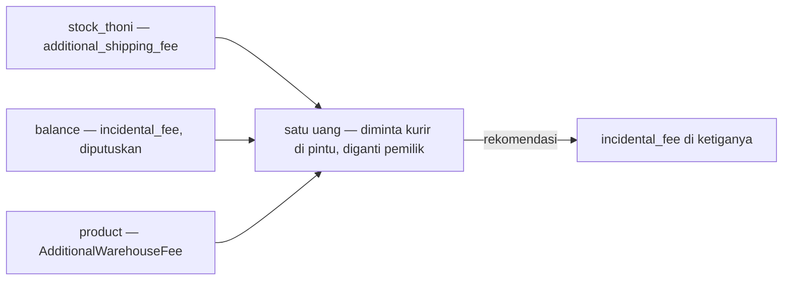

✅ Selesai dan dihapus (2026-09-30 17:44): *restock-dibatalkan-tanpa-status* — status `cancel` kini ada
([diterima-tidak-bisa-dibatalkan](./context_decision.md#diterima-tidak-bisa-dibatalkan)).

✅ Selesai dan dihapus (2026-10-01 10:32): *sku-unik-padahal-per-gudang* — `"unique"` kini di kedua kolom, dibaca
berpasangan ([statement-unik-per-sku-per-gudang](./context_decision.md#statement-unik-per-sku-per-gudang)). Cara
menulisnya tersisa di *unik-terbaca-dua-aturan* — ✅ selesai 2026-10-03 12:45
([statement-ditulis-urut-sku-id](./context_decision.md#statement-ditulis-urut-sku-id)).

## slot-vs-batch-dan-rak-teknis

> [model.md](./model.md) — `SKU_SLOT`, **diputuskan**: [slot-lahir-saat-barang-tiba](./context_decision.md#slot-lahir-saat-barang-tiba)
> [technical/stock/design.md](../../technical/stock/design.md) — `batches` untuk harga, `product_placements` untuk rak, terpisah

Dua model stok untuk **satu service**. `technical/stock` di-commit dari mesin Heri, jadi ini perbedaan
**antar-proposal**, dan siapa yang memutus masih terbuka di [member_clarify Q4](../project/member_clarify.md#question).
**→ Rekomendasi:** `technical/stock` mengikuti slot. Sudah dilaporkan di
[design_clarify](../../technical/stock/design_clarify.md#the-business-proposal-decided-one-row-per-pile).

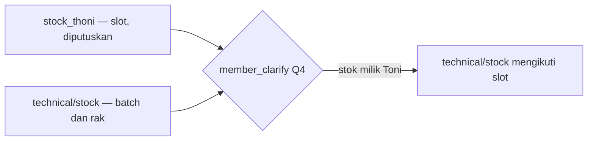

## dua-keputusan-kehilangan-teksnya

[stok-berkurang-saat-order-dibuat](./context_decision.md#stok-berkurang-saat-order-dibuat) dan
[stok-bertambah-saat-restock-completed](./context_decision.md#stok-bertambah-saat-restock-completed) mengutip
baris yang sudah dihapus, dan **kosakatanya kini beda dengan ERD**:

| yang tercatat | sekarang | → yang benar |
| --- | --- | --- |
| restock `pending` · `approved` · `completed` · `cancel` — dan *`approved`: tidak ada efek ke stok* | 🆕 kasus pertama: `ongoing` → `approved`, dan **`approved` = diterima gudang, slot lahir** | momennya sama — barang mendarat — **katanya berbalik**. Dicatat [diterima-gudang-berstatus-approved](./context_decision.md#diterima-gudang-berstatus-approved), entri lama diberi catatan · sisa daftarnya: ✅ [diterima-tidak-bisa-dibatalkan](./context_decision.md#diterima-tidak-bisa-dibatalkan) |
| *`Order - return` → `+` balik* | `return` hanya **klaim** — [the-accept-is-the-status-return-completed](../order/context_decision.md#the-accept-is-the-status-return-completed) | stok bertambah saat transaksi `return` tiba — **hanya unit baik** ([usulan-penerimaan-sebagian](#usulan-penerimaan-sebagian)) |

**→ Rekomendasi:** setelah [jalan-balik-masih-berlaku](#jalan-balik-masih-berlaku) dijawab, saya catat keputusan
pengganti bernama baru dan menandai yang lama *superseded* (RULE 12).

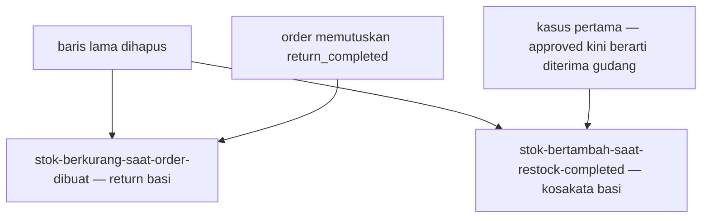

## ready-stock-diganti-nama

> [slot-lahir-saat-barang-tiba](./context_decision.md#slot-lahir-saat-barang-tiba) — *"Stok ready sebuah SKU adalah
> jumlah `ready_stock` semua slotnya"*
> [model.md](./model.md) — slot: `good_stock` (13:52), lalu `count` (15:24) · ringkasan: `SKU_STATEMENT.stock_ready`

Keputusan itu mengutip kolom yang sudah tidak ada. Mana yang benar tergantung satu jawaban: kalau `count` dan
`stock_ready` **satu** angka, kalimatnya cukup diganti namanya · kalau **dua**, stok ready bukan lagi jumlah
`count`. **→ Rekomendasi:** dua angka per slot ([stock-ready-berarti-apa](#stock-ready-berarti-apa)) — maka
kalimat itu tetap benar, dengan `ready_stock` di samping `count`. Catatan sudah ditambahkan di entri keputusannya.

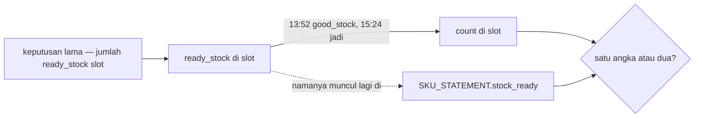

✅ Selesai dan dihapus (2026-10-02 14:36): *hilang-kini-punya-kolom-rak* — `rack_id` anomali boleh kosong lagi, sejalan
dengan kiriman alur; hilang boleh di rak tempat ia hilang, atau tanpa rak kalau hilang di jalan. Yang tersisa — rusak
wajib punya rak — di *rak-rusak-dijaga-database* (selesai 14:46).
