# Decisions — `stock_thoni/context.md`

Apa yang sudah diputuskan pemilik dokumen, dicatat sebelum dikerjakan. **Append-only** — keputusan yang
kelak dibalik diganti namanya dan referensinya di-grep (RULE 12), tidak pernah dihapus diam-diam.

> ⚠ **2026-10-02 14:12 — kasus restock dihapus.** `restock_full_approved.md`, `restock_half_approved.md`,
> `restock_canceled.md` dan clarify kasus tidak ada lagi; alur restock kini hanya di [restock_flow.md](./restock_flow.md).
> ⚠ **2026-10-02 15:17 — ERD berubah lagi.** `SKU_ANOMALY_SLOT` dipisah kembali menjadi `SKU_LOST_SLOT` dan
> `SKU_BROKEN_SLOT` ([rusak-dan-hilang-tabel-terpisah](#rusak-dan-hilang-tabel-terpisah)). ⏸ `ADJUSTMENTS` keluar dari ERD
> — *"Todo mekanisme `adjustment`, sedang saya pikirkan dulu"*. Keputusan tentang adjustment di bawah tetap sebagai bahan,
> menunggu mekanisme barunya.
>
> Rujukan ke `restock_full_approved.md` di bawah dibiarkan sebagai teks — kutipannya tetap catatan yang benar tentang
> apa yang diputuskan saat itu.
>
> ⚠ **Nama berubah di ERD 2026-09-29 15:24** — `SKU_BROKEN_SLOT` + `SKU_LOST_SLOT` → `SKU_ANOMALY_SLOT` (`type` `broken`
> atau `lost`), dan `SKU_SLOT.good_stock` → `count`. Entri yang ditulis sebelumnya memakai nama lama; putusannya tetap,
> kecuali entri yang diberi catatannya sendiri.
>
> ⚠ **Nama berubah di ERD 2026-09-30 13:15** — `ADJUSTMENT` → `ADJUSTMENTS`. Entri sebelumnya memakai nama lama.
>
> ⚠ **Nama berubah di ERD 2026-09-30 13:55** — `price` → `unit_price` di `SKU_SLOT` dan `SKU_ANOMALY_SLOT`.
>
> ⚠ **Kolom baru di ERD 2026-09-30 14:02** — `unit_cost` di `TRANSACTION_ITEMS`, `SKU_SLOT` dan `SKU_ANOMALY_SLOT`: ongkir
> per unit, **bukan** harga barang seluruhnya seperti `unit_cost` di order —
> [ongkir-per-unit-disimpan-terpisah](#ongkir-per-unit-disimpan-terpisah).
>
> ⚠ **Nama berubah di ERD 2026-09-30 14:15** — `unit_cost` → `unit_shipping_cost`, tidak lagi `nullable` —
> [ongkir-per-unit-bernama-unit-shipping-cost](#ongkir-per-unit-bernama-unit-shipping-cost).

| keputusan | isinya |
| --- | --- |
| [stok-berkurang-saat-order-dibuat](#stok-berkurang-saat-order-dibuat) | stok turun di `Order - pending`, dikembalikan oleh `cancel` dan `return` — dan ini **sejalan** dengan konteks order |
| [stok-bertambah-saat-restock-completed](#stok-bertambah-saat-restock-completed) | yang menambah stok adalah `completed`, yaitu saat barang mendarat — bukan saat disetujui |
| [slot-lahir-saat-barang-tiba](#slot-lahir-saat-barang-tiba) | stok tinggal di `SKU_SLOT` — satu tumpukan, satu restock, satu rak — dan slot baru ada saat barang tiba |
| [pemilik-adalah-tim-di-sku](#pemilik-adalah-tim-di-sku) | pemilik barang adalah **tim jualan**, disimpan di SKU — bukan orangnya |
| [harga-silang-dihitung-dari-persen](#harga-silang-dihitung-dari-persen) | tidak ada harga kedua yang disimpan — harga untuk tim lain dihitung dari persen di SKU |
| [harga-dan-supplier-per-slot](#harga-dan-supplier-per-slot) | harga dan supplier milik slot, bukan SKU — FIFO membacanya per tumpukan |
| [transaksi-adalah-barang-masuk](#transaksi-adalah-barang-masuk) | `TRANSACTIONS` = dokumen barang **masuk**, `restock` atau `return` — ⚠ bagian status-di-baris **dicabut** empat menit kemudian, lihat entrinya |
| [order-id-adalah-nomor-pesanan-restock](#order-id-adalah-nomor-pesanan-restock) | `TRANSACTIONS.order_id` = nomor pesanan saat membeli barang restock — **bukan** order kita, dan tidak merujuk order mana pun |
| [retur-merujuk-order-lewat-ref-order-id](#retur-merujuk-order-lewat-ref-order-id) | transaksi `return` menyebut order kita yang diretur di `ref_order_id` — terpisah dari `order_id` milik restock |
| [adjustment-terpisah-dari-barang-masuk](#adjustment-terpisah-dari-barang-masuk) | `ADJUSTMENT` punya tabel sendiri; `TRANSACTIONS` tetap restock + retur — rencana memecah jadi tiga tidak diambil |
| [rusak-punya-tabel-sendiri](#rusak-punya-tabel-sendiri) | unit rusak tinggal di `SKU_BROKEN_SLOT`, tidak di `SKU_SLOT` — pembaca stok tidak bisa menjualnya |
| [transaksi-lahir-dengan-item-dan-status](#transaksi-lahir-dengan-item-dan-status) | transaksi tanpa item atau tanpa baris status tidak boleh ada |
| [sku-wajib-bergambar](#sku-wajib-bergambar) | setiap SKU punya minimal satu gambar — dikonfirmasi di chat |
| [broken-slot-membawa-asal-dan-bukti](#broken-slot-membawa-asal-dan-bukti) | baris rusak membawa asal (SKU, supplier, transaksi), tempat, jumlah, harga, dan foto bukti |
| [penanggung-dibaca-dari-adjustment-id](#penanggung-dibaca-dari-adjustment-id) | rusak atau hilang **tanpa** adjustment = terjadi saat terima, tim pemilik menanggung · **dengan** adjustment = terjadi di gudang, gudang menanggung |
| [hilang-punya-tabel-tanpa-rak](#hilang-punya-tabel-tanpa-rak) | unit hilang tinggal di `SKU_LOST_SLOT` — asalnya lengkap, tapi **tanpa rak**, karena ia tidak ada di rak mana pun |
| [ongoing-dihitung-dari-status](#ongoing-dihitung-dari-status) | stok *on the way* = item transaksi yang belum tiba — tidak disimpan di mana pun · ⚠ *belum tiba* kini dibaca dari log |
| [adjustment-punya-empat-type](#adjustment-punya-empat-type) | type adjustment: `opname`, `broken`, `lost`, `found` — `move` tidak diambil |
| [stok-diringkas-per-sku](#stok-diringkas-per-sku) | `SKU_STATEMENT`: satu baris ringkasan per SKU — siap jual, rusak, hilang — di samping angka per tumpukan · ⚠ **digantikan** oleh [stok-diringkas-per-sku-per-gudang](#stok-diringkas-per-sku-per-gudang) |
| [sku-adalah-product](#sku-adalah-product) | SKU dan product satu hal — datanya milik Product Service, inventory menyimpan stoknya dan merujuk lewat id |
| [rusak-dan-hilang-satu-tabel](#rusak-dan-hilang-satu-tabel) | unit rusak dan hilang tinggal di `SKU_ANOMALY_SLOT`, dibedakan `type` — tetap di luar `SKU_SLOT` — 🔄 **dibalik 10-02 15:17**: [rusak-dan-hilang-tabel-terpisah](#rusak-dan-hilang-tabel-terpisah) |
| [diterima-gudang-berstatus-approved](#diterima-gudang-berstatus-approved) | restock `ongoing` saat dibuat CS, `approved` saat diterima petugas gudang — slot lahir di `approved` · ⚠ kata `approved` berbalik arti |
| [statement-bertambah-saat-diterima](#statement-bertambah-saat-diterima) | penerimaan menambah `stock_ready` di statement, barisnya dibuat kalau belum ada |
| [ongoing-diringkas-di-statement](#ongoing-diringkas-di-statement) | *on the way* kini **disimpan** di statement — ⚠ membalik separuh `ongoing-dihitung-dari-status` |
| [stok-diringkas-per-sku-per-gudang](#stok-diringkas-per-sku-per-gudang) | `SKU_STATEMENT` satu baris per SKU **per gudang** — menggantikan yang per SKU |
| [gudang-tujuan-dipilih-saat-dibuat](#gudang-tujuan-dipilih-saat-dibuat) | CS memilih gudang tujuan saat restock dibuat; *on the way* tercatat di gudang itu sejak awal |
| [ongoing-berubah-bersama-status](#ongoing-berubah-bersama-status) | *on the way* naik saat restock dibuat, turun — dan pindah ke siap jual — saat diterima, bersama log statusnya |
| [statement-ditambah-bukan-diisi](#statement-ditambah-bukan-diisi) | angka di statement selalu ditambah atau dikurangi, tidak pernah diisi dengan angka satu transaksi |
| [ongoing-turun-sebanyak-dikirim](#ongoing-turun-sebanyak-dikirim) | saat diterima, *on the way* turun sebanyak yang **dikirim** — bukan yang datang |
| [harga-beli-disimpan-di-item](#harga-beli-disimpan-di-item) | harga beli per unit tinggal di `TRANSACTION_ITEMS`, diisi saat restock dibuat |
| [ongkir-per-unit-disimpan-terpisah](#ongkir-per-unit-disimpan-terpisah) | ongkir dibagi per unit dan disimpan di kolom sendiri, di samping harga beli — nilai unit = keduanya dijumlah |
| [ongkir-per-unit-bernama-unit-shipping-cost](#ongkir-per-unit-bernama-unit-shipping-cost) | kolom ongkir per unit bernama `unit_shipping_cost`, tidak boleh kosong — `unit_cost` tetap berarti harga barang seluruhnya, seperti di order |
| [penerimaan-hanya-mengirim-rak-dan-jumlah](#penerimaan-hanya-mengirim-rak-dan-jumlah) | petugas gudang mengirim `sku_id`, `count`, `rack_id` saja — harga tidak lagi diketik di pintu |
| [ongkir-tambahan-dilaporkan-saat-diterima](#ongkir-tambahan-dilaporkan-saat-diterima) | kurir bisa menagih ongkir tambahan saat barang tiba, dan petugas gudang melaporkannya bersama penerimaan |
| [inventory-hanya-merujuk-sku](#inventory-hanya-merujuk-sku) | `SKU` dan gambarnya keluar dari ERD inventory — inventory hanya membawa `sku_id`, datanya dari Product Service |
| [supplier-dan-total-disimpan-di-item](#supplier-dan-total-disimpan-di-item) | item menyimpan supplier dan **total** belanja baris tanpa ongkir, saat dibuat — harga per unit tidak disimpan di item |
| [ongkir-per-unit-dihitung-saat-diterima](#ongkir-per-unit-dihitung-saat-diterima) | CS mengirim angka di nota; harga dan ongkir per unit dihitung server saat barang diterima, disimpan di slot |
| [ongkir-dibagi-rata-ke-semua-unit](#ongkir-dibagi-rata-ke-semua-unit) | ongkir dibagi rata ke semua unit transaksi, apa pun SKU dan harganya — ⚠ melawan saran saya |
| [ongkir-tambahan-punya-kolom-sendiri](#ongkir-tambahan-punya-kolom-sendiri) | ongkir tambahan disimpan di transaksi, dan bagian per unitnya punya kolom sendiri di slot dan anomali |
| [tanpa-ongkir-tambahan-berarti-nol](#tanpa-ongkir-tambahan-berarti-nol) | kalau kurir tidak menagih lagi, ongkir tambahan per unit ditulis **0**, bukan kosong — nilai unit selalu bisa dijumlah |
| [foto-nota-ongkir-tambahan-di-transaksi](#foto-nota-ongkir-tambahan-di-transaksi) | foto nota kurir disimpan di `TRANSACTIONS`, di samping ongkir tambahan yang dibuktikannya |
| [foto-nota-wajib-kalau-ada-ongkir-tambahan](#foto-nota-wajib-kalau-ada-ongkir-tambahan) | ongkir tambahan lebih dari 0 tanpa foto nota ditolak **database** — `CHECK` |
| [tagihan-di-luar-inventory](#tagihan-di-luar-inventory) | inventory mencatat fakta dan nilainya, tapi tidak pernah *siapa berutang ke siapa* — tagihan milik balance |
| [ongkir-tambahan-dikabarkan-ke-penagihan](#ongkir-tambahan-dikabarkan-ke-penagihan) | penerimaan yang membawa ongkir tambahan dikabarkan ke service penagihan — inventory memberi tahu, tidak menagih |
| [ongkir-tambahan-dicatat-lalu-dikabarkan](#ongkir-tambahan-dicatat-lalu-dikabarkan) | alur lengkapnya: petugas mengirim ongkir tambahan **dan** fotonya, disimpan, dibagi per unit, lalu dikabarkan sesudah semua tulis selesai |
| [kabar-membawa-tx-tim-jumlah-dan-foto](#kabar-membawa-tx-tim-jumlah-dan-foto) | kabar ke penagihan membawa transaksi, gudang, tim, CS, jumlah ongkir tambahan dan fotonya |
| [penerimaan-boleh-dipecah-ke-beberapa-rak](#penerimaan-boleh-dipecah-ke-beberapa-rak) | petugas boleh membagi satu item ke beberapa rak saat menerima — satu slot per rak, harganya sama |
| [approved-sekali-dan-final](#approved-sekali-dan-final) | status berjalan `ongoing` lalu `approved`, masing-masing sekali — sesudah `approved`, transaksinya tidak berubah lagi · ⚠ 10-16 kini lewat `arrived` |
| [tim-pemilik-dikirim-saat-restock-dibuat](#tim-pemilik-dikirim-saat-restock-dibuat) | CS mengirim satu `team_id` untuk seluruh restock, saat membuatnya — 🔄 **dibalik 18:04**: [tim-dibaca-dari-keanggotaan-cs](#tim-dibaca-dari-keanggotaan-cs) |
| [diterima-tidak-bisa-dibatalkan](#diterima-tidak-bisa-dibatalkan) | status batal ada — `cancel` — dan transaksi yang sudah `approved` tidak bisa dibatalkan |
| [cancelled-juga-final](#cancelled-juga-final) | batal bernama `cancelled`, dan final — tidak bisa jadi `approved` |
| [satu-adjustment-banyak-baris-anomali](#satu-adjustment-banyak-baris-anomali) | satu adjustment boleh melahirkan beberapa baris rusak atau hilang |
| [pembuat-restock-dari-token](#pembuat-restock-dari-token) | pembuat restock dibaca dari token login, tidak dikirim |
| [tim-dibaca-dari-keanggotaan-cs](#tim-dibaca-dari-keanggotaan-cs) | restock tidak membawa `team_id`; tim dibaca dari tim CS-nya — ⚠ melawan saran saya, dan membalik 17:34 — 🔄 **dibalik 10-01 12:45**: [tim-dikirim-dan-disimpan-di-transaksi](#tim-dikirim-dan-disimpan-di-transaksi) |
| [statement-unik-per-sku-per-gudang](#statement-unik-per-sku-per-gudang) | database menolak baris statement kedua untuk pasangan SKU dan gudang yang sama — `UNIQUE (sku_id, warehouse_id)` · ✅ 10-03 12:25: tetap dua kolom, dan `team_id` keluar dari statement ([statement-tanpa-kolom-tim](#statement-tanpa-kolom-tim)) |
| [adjustment-boleh-tanpa-baris-anomali](#adjustment-boleh-tanpa-baris-anomali) | satu adjustment boleh tanpa baris rusak atau hilang — opname yang cocok, `found` |
| [tim-dikirim-dan-disimpan-di-transaksi](#tim-dikirim-dan-disimpan-di-transaksi) | CS mengirim `team_id` saat membuat restock, dan server menyimpannya di `TRANSACTIONS.team_id` — pembuatnya tetap dari token |
| [restock-dibuat-cs-atau-admin-tim](#restock-dibuat-cs-atau-admin-tim) | restock boleh dibuat CS **atau Admin** dari tim pemilik |
| [sku-tim-lain-ditolak-saat-dibuat](#sku-tim-lain-ditolak-saat-dibuat) | satu SKU milik tim lain — seluruh restock ditolak, tidak ada yang ditulis |
| [restock-boleh-diterima-sebagian](#restock-boleh-diterima-sebagian) | penerimaan boleh kurang dari yang dikirim — rusak di jalan, hilang di jalan |
| [satu-resi-satu-restock-berjalan](#satu-resi-satu-restock-berjalan) | resi yang sedang dipakai restock `ongoing` tidak boleh dipakai restock lain |
| [foto-nota-ongkir-tambahan-opsional](#foto-nota-ongkir-tambahan-opsional) | ongkir tambahan boleh dicatat tanpa foto nota — `CHECK` dihapus · ⚠ melawan saran saya, membalik [foto-nota-wajib-kalau-ada-ongkir-tambahan](#foto-nota-wajib-kalau-ada-ongkir-tambahan) |
| [tim-sku-dari-kiriman-untuk-sementara](#tim-sku-dari-kiriman-untuk-sementara) | untuk sementara tim pemilik SKU dibaca dari kiriman; kelak dari Product Service · ⚠ melawan saran saya · 🔄 10-16 *kelak* tiba: [pemilik-item-dibaca-dari-product-service](#pemilik-item-dibaca-dari-product-service) |
| [resi-dipakai-lagi-hanya-setelah-cancelled](#resi-dipakai-lagi-hanya-setelah-cancelled) | resi bebas untuk restock baru hanya kalau restock lamanya `cancelled` |
| [tim-pemilik-ikut-di-item-dan-slot](#tim-pemilik-ikut-di-item-dan-slot) | `team_id` juga disimpan di item, slot, dan baris rusak atau hilang |
| [rusak-dan-hilang-dikirim-bersama-penempatan](#rusak-dan-hilang-dikirim-bersama-penempatan) | saat menerima, staff mengirim satu daftar: tiap baris penempatan di rak, **atau** unit rusak atau hilang |
| [jenis-anomali-wajib-diisi](#jenis-anomali-wajib-diisi) | baris rusak atau hilang tanpa jenis ditolak — angka 0 berarti *tidak diisi* — 🔄 enum dihapus 15:03, jenisnya kini varian: [penempatan-tiga-varian](#penempatan-tiga-varian) |
| [rak-dan-foto-barang-rusak-dikirim](#rak-dan-foto-barang-rusak-dikirim) | baris rusak membawa raknya dan fotonya; yang hilang di jalan tanpa rak |
| [rak-barang-rusak-pilihan-staff](#rak-barang-rusak-pilihan-staff) | barang rusak saat diterima boleh disimpan di rak atau langsung dibuang — sistem tidak mewajibkan rak — 🔄 **dibalik 15:03**: [barang-rusak-wajib-di-rak](#barang-rusak-wajib-di-rak) |
| [penempatan-tiga-varian](#penempatan-tiga-varian) | setiap baris penerimaan adalah salah satu dari tiga: `normal` di rak, `lost`, atau `broken` di rak |
| [barang-rusak-wajib-di-rak](#barang-rusak-wajib-di-rak) | barang rusak saat diterima wajib dicatat raknya — boleh rak khusus barang rusak |
| [rusak-dan-hilang-tabel-terpisah](#rusak-dan-hilang-tabel-terpisah) | rusak di `SKU_BROKEN_SLOT` dengan rak dan foto, hilang di `SKU_LOST_SLOT` tanpa rak |
| [supplier-ikut-ke-rusak-dan-hilang](#supplier-ikut-ke-rusak-dan-hilang) | barang rusak dan hilang menyimpan suppliernya, sama dengan barang baik |
| [penerimaan-menolak-nilai-kosong](#penerimaan-menolak-nilai-kosong) | baris penerimaan tanpa varian, atau dengan SKU, jumlah, rak atau supplier bernilai 0, ditolak |
| [harga-rusak-dan-hilang-dihitung-seperti-slot](#harga-rusak-dan-hilang-dihitung-seperti-slot) | harga per unit barang rusak dan hilang dihitung dengan rumus yang sama dengan barang baik — tanpa *default 0* |
| [jumlah-dicocokkan-per-item](#jumlah-dicocokkan-per-item) | semua baris penerimaan dijumlah per item — lewat SKU dan supplier — dan harus sama dengan `count` item — 🔄 penunjuknya kini `item_id` (16:02): [penempatan-menunjuk-item-id](#penempatan-menunjuk-item-id) |
| [ongkir-dibagi-ke-unit-yang-dikirim](#ongkir-dibagi-ke-unit-yang-dikirim) | ongkir dan ongkir tambahan dibagi ke semua unit yang **dikirim**, termasuk yang rusak dan hilang |
| [pembatalan-oleh-cs-atau-admin](#pembatalan-oleh-cs-atau-admin) | restock dibatalkan oleh CS atau Admin tim — satu log `cancelled`, selama masih `ongoing` |
| [penempatan-menunjuk-item-id](#penempatan-menunjuk-item-id) | setiap baris penerimaan menunjuk item lewat `item_id` — SKU, supplier dan harga dibaca dari item |
| [penerimaan-dicatat-dalam-satu-transaksi-db](#penerimaan-dicatat-dalam-satu-transaksi-db) | barang, log `approved` dan statement ditulis dalam satu transaksi DB; kabar ke penagihan sesudahnya |
| [statement-diperbarui-di-setiap-langkah](#statement-diperbarui-di-setiap-langkah) | `SKU_STATEMENT` diperbarui saat restock dibuat, diterima, dan dibatalkan |
| [restock-tampil-hanya-di-gudang-tujuan](#restock-tampil-hanya-di-gudang-tujuan) | halaman restock di web gudang hanya menampilkan restock yang menuju gudang itu |
| [statement-dibuat-atau-ditambah](#statement-dibuat-atau-ditambah) | baris statement dibuat kalau kombinasinya belum ada, ditambah kalau sudah ada — satu perintah database |
| [penerima-dicek-anggota-gudang-tujuan](#penerima-dicek-anggota-gudang-tujuan) | server memeriksa staff penerima, dari token login, adalah anggota gudang tujuan transaksi — yang bukan ditolak |
| [statement-tanpa-kolom-tim](#statement-tanpa-kolom-tim) | statement satu baris per SKU dan gudang, tanpa kolom tim — tim dibaca dari SKU |
| [tulis-statement-bersamaan-antre](#tulis-statement-bersamaan-antre) | dua tulis ke baris statement yang sama: yang kedua menunggu yang pertama selesai |
| [item-dari-transaksi-lain-ditolak](#item-dari-transaksi-lain-ditolak) | penerimaan dengan satu saja `item_id` yang bukan milik transaksinya ditolak seluruhnya |
| [statement-ditulis-urut-sku-id](#statement-ditulis-urut-sku-id) | baris statement selalu ditulis urut `sku_id`, supaya dua permintaan antre dan tidak saling tunggu |
| [kunci-transaksi-lalu-periksa-ongoing](#kunci-transaksi-lalu-periksa-ongoing) | penerimaan dan pembatalan mengunci baris transaksinya lalu memeriksa masih `ongoing` — yang kedua ditolak · 🔄 **digantikan 10-03 14:09**: [kunci-statement-lalu-periksa-ongoing](#kunci-statement-lalu-periksa-ongoing) |
| [restock-dibuat-dalam-satu-transaksi-db](#restock-dibuat-dalam-satu-transaksi-db) | periksa resi, transaksi, item, log `ongoing` dan `stock_ongoing` — satu transaksi DB |
| [transaksi-db-penerimaan-mulai-dari-validasi](#transaksi-db-penerimaan-mulai-dari-validasi) | transaksi DB penerimaan dibuka sejak validasi — ongkir tambahan ikut batal kalau penerimaan gagal |
| [pembatalan-dalam-satu-transaksi-db](#pembatalan-dalam-satu-transaksi-db) | log `cancelled` dan `stock_ongoing` yang turun — satu transaksi DB |
| [paket-tiba-setelah-batal-dibuat-restock-baru](#paket-tiba-setelah-batal-dibuat-restock-baru) | paket yang tiba setelah batal diterima lewat restock baru dengan resi yang sama |
| [service-lain-di-luar-transaksi-db](#service-lain-di-luar-transaksi-db) | cek staff ke User/Team Service sebelum transaksi DB, kabar ke penagihan sesudah commit |
| [penerimaan-mengunci-statement-lebih-dulu](#penerimaan-mengunci-statement-lebih-dulu) | penerimaan mengunci baris statement SKU-nya lebih dulu — dua penerimaan tx yang sama antre |
| [kunci-statement-lalu-periksa-ongoing](#kunci-statement-lalu-periksa-ongoing) | penerimaan dan pembatalan mengunci baris statement, lalu memeriksa masih `ongoing` — yang kedua ditolak · ⚠ 10-16 tiba memakai *kunci tx*; penempatan dan pembatalan harus menyusul — [ganti-status-dikunci-per-transaksi](#ganti-status-dikunci-per-transaksi) |
| [kunci-statement-lalu-periksa-resi](#kunci-statement-lalu-periksa-resi) | restock dibuat: kunci baris statement, lalu periksa resi — dua *Simpan* kembar antre, yang kedua ditolak · 🔄 10-16 bagian resi digantikan: [resi-dikunci-dengan-advisory-lock](#resi-dikunci-dengan-advisory-lock) |
| [resi-unik-lintas-jasa-kirim](#resi-unik-lintas-jasa-kirim) | resi dari jasa kirim berbeda tidak pernah sama — resi saja menunjuk satu paket |
| [nilai-ongkir-tambahan-bertipe-double](#nilai-ongkir-tambahan-bertipe-double) | ongkir tambahan dikirim sebagai `additional_shipping_fee.value`, `double` |
| [foto-nota-dikirim-sebagai-link](#foto-nota-dikirim-sebagai-link) | foto nota ongkir dikirim sebagai link yang sudah diunggah, sama dengan foto barang rusak |
| [take-dicatat-per-slot-di-order-slot-map](#take-dicatat-per-slot-di-order-slot-map) | setiap take menulis satu baris per slot yang dipotong — order, slot, jumlah — dibaca batal dan retur |
| [count-slot-adalah-sisa](#count-slot-adalah-sisa) | `SKU_SLOT.count` = sisa di slot itu — turun saat take |
| [take-kunci-statement-lalu-periksa-stok](#take-kunci-statement-lalu-periksa-stok) | take dalam satu transaksi DB: kunci statement, periksa stok, gagal berarti tidak ada yang tertulis |
| [markup-dibaca-dari-product-service-saat-take](#markup-dibaca-dari-product-service-saat-take) | markup dan data product dibaca dari Product Service saat take — `products.cross_markup_bps` |
| [slot-dipilih-tertua-dulu](#slot-dipilih-tertua-dulu) | take memotong slot tertua dulu, lanjut ke slot berikutnya; harga dihitung dari slot yang terpilih |
| [slot-map-ditandai-taken-atau-released](#slot-map-ditandai-taken-atau-released) | baris map bertanda `taken` saat take, `released` saat dikembalikan — tidak dihapus |
| [silang-ditolak-kalau-dikunci-atau-melewati-cadangan](#silang-ditolak-kalau-dikunci-atau-melewati-cadangan) | take ditolak kalau product dikunci atau stok melewati cadangan — hanya untuk tim lain (13:15) |
| [product-service-dibaca-sebelum-kunci](#product-service-dibaca-sebelum-kunci) | data product dibaca sebelum transaksi DB take dibuka — kunci statement tidak menunggu service lain |
| [take-punya-baris-kepala-di-inventory](#take-punya-baris-kepala-di-inventory) | setiap take membuat satu baris kepala di inventory; baris map menunjuk id-nya — `ORDER_TAKES` (13:36) |
| [take-dirujuk-lewat-transaction-id](#take-dirujuk-lewat-transaction-id) | response mengembalikan `ORDER_TAKES.id` sebagai `transaction_id`; pembatalan order mengirimnya kembali · ⚠ 16:38 bertentangan dengan keputusan sisi order · 🔄 10-13 separuh dibalik — [transaction-id-opsional-di-event-batal](#transaction-id-opsional-di-event-batal) |
| [take-ref-dari-idempotency-key](#take-ref-dari-idempotency-key) | `ORDER_TAKES.take_ref` `UNIQUE` diisi `idempotency_key` dari permintaan — satu take per kunci |
| [statement-direkonsiliasi-tiap-malam](#statement-direkonsiliasi-tiap-malam) | `SKU_STATEMENT` ringkasan, bukan sumber — dihitung ulang tiap tengah malam dan lewat *force reconcile*, yang memberi peringatan di jam kerja |
| [batal-mengembalikan-slot-dan-stock-ready](#batal-mengembalikan-slot-dan-stock-ready) | pembatalan mengembalikan `count` slot asal **dan** `stock_ready`, dalam satu transaksi DB |
| [transaction-id-opsional-di-event-batal](#transaction-id-opsional-di-event-batal) | setiap event batal membawa K; `transaction_id` optional · ⚠ separuh membalik `take-dirujuk-lewat-transaction-id` |
| [batal-mengunci-statement-lebih-dulu](#batal-mengunci-statement-lebih-dulu) | pembatalan mengunci baris statement saat transaksinya dibuka, sebelum slot — urutan yang sama dengan take |
| [map-diubah-jadi-released](#map-diubah-jadi-released) | saat batal, baris map yang `taken` diubah menjadi `released` — tidak ada baris baru |
| [batal-hanya-mengembalikan-yang-masih-taken](#batal-hanya-mengembalikan-yang-masih-taken) | pelepasan mengubah hanya baris map yang masih `taken`, dan mengembalikan hanya baris itu — event yang datang dua kali tidak mengembalikan dua kali |
| [take-tidak-ketemu-dibalas-sukses](#take-tidak-ketemu-dibalas-sukses) | event batal untuk take yang tidak ditemukan dibalas sukses, bukan error — tidak masuk dead letter |
| [cadangan-dibandingkan-per-gudang-sesudah-kunci](#cadangan-dibandingkan-per-gudang-sesudah-kunci) | cadangan dibandingkan sesudah statement dikunci, terhadap `stock_ready` gudang permintaan — hanya untuk tim lain |
| [validasi-take-per-item-semua-atau-tidak](#validasi-take-per-item-semua-atau-tidak) | take mengunci statement setiap item di gudang permintaan, urut `sku_id`; `stock_ready` ≥ `qty` per item; satu gagal, semua ditolak |
| [slot-kurang-seluruh-take-gagal](#slot-kurang-seluruh-take-gagal) | semua slot gudang permintaan kurang dari `qty` → seluruh take gagal, transaksi DB dibatalkan, tidak ada yang terpotong |
| [dua-event-batal-satu-webhook](#dua-event-batal-satu-webhook) | *Order Cancel* (user batal) dan *InventoryTxCancel* (create gagal) masuk webhook inventory yang sama — satu jalan pelepasan |
| [tim-pemesan-dikirim-di-permintaan-take](#tim-pemesan-dikirim-di-permintaan-take) | permintaan take membawa `team_id` tim pemesan; inventory membandingkannya dengan pemilik, per item — sendiri atau silang |
| [batal-tanpa-take-menyimpan-k](#batal-tanpa-take-menyimpan-k) | event batal yang tidak menemukan take menyimpan `ORDER_TAKES` dengan `take_ref` K, tanpa slot — take yang datang belakangan ditolak `UNIQUE` |
| [retur-berjalan-seperti-restock](#retur-berjalan-seperti-restock) | retur memakai alur restock, `type` `return` — dibuat Order Service saat klaim, diterima di halaman inventory, lalu Order Service dikabari |
| [retur-diterima-baik-rusak-hilang](#retur-diterima-baik-rusak-hilang) | retur bisa diterima sebagian — tiap unit baik, rusak atau hilang, jumlahnya sama dengan qty yang diretur; keadaan lain ditunda |
| [retur-baik-kembali-ke-slot-lama](#retur-baik-kembali-ke-slot-lama) | unit retur yang baik kembali ke slot yang dulu diambil take, lewat K; rusak dan hilang ke slot rusak dan hilang — ⚠ melawan rekomendasi |
| [paket-tiba-ditandai-sebelum-penempatan](#paket-tiba-ditandai-sebelum-penempatan) | status `arrived` — paket di gudang, belum di rak; wajib sebelum penempatan, PIC dicek dan dicatat |
| [resi-dibandingkan-tanpa-beda-huruf](#resi-dibandingkan-tanpa-beda-huruf) | `jn7827` dan `JN7827` resi yang sama |
| [restock-membaca-product-service-sebelum-kunci](#restock-membaca-product-service-sebelum-kunci) | restock dibuat: data produk dibaca dari Product Service sebelum kunci · ✅ 10-16 pemilik item kini juga dari Product Service |
| [kabar-penagihan-ditandai-billed](#kabar-penagihan-ditandai-billed) | `TRANSACTIONS.billed` mencatat apakah ongkir tambahan sudah dikabarkan ke penagihan |
| [resi-dikunci-dengan-advisory-lock](#resi-dikunci-dengan-advisory-lock) | restock dibuat: *kunci resi* — `pg_advisory_xact_lock` pada `'resi:' \|\| lower(resi)` — lalu periksa resi · 🔄 menggantikan bagian resi dari [kunci-statement-lalu-periksa-resi](#kunci-statement-lalu-periksa-resi) · ✅ 10-16 lepas lewat commit atau rollback |
| [pemilik-item-dibaca-dari-product-service](#pemilik-item-dibaca-dari-product-service) | pemilik setiap item dibaca dari Product Service dan dibandingkan dengan `team_id` restock — `Sku.team_id` keluar dari kiriman |
| [cara-bayar-dirujuk-lewat-payment-id](#cara-bayar-dirujuk-lewat-payment-id) | cara bayar restock disimpan sebagai `payment_id`, bukan teks |
| [pic-dicek-saat-tiba-dan-saat-penempatan](#pic-dicek-saat-tiba-dan-saat-penempatan) | staff gudang dicek sebagai anggota gudang tujuan dua kali — saat menandai tiba, dan sebelum penempatan ditulis |
| [resi-dicek-ke-semua-transaksinya](#resi-dicek-ke-semua-transaksinya) | resi bebas hanya kalau **setiap** transaksi dengan resi itu berstatus terakhir `cancelled` |
| [ongkir-tambahan-diisi-dan-dikabarkan-saat-tiba](#ongkir-tambahan-diisi-dan-dikabarkan-saat-tiba) | ongkir tambahan dikirim bersama konfirmasi tiba, dan penagihan dikabari lewat message broker saat itu — tidak menunggu penempatan |
| [tiba-dan-penempatan-dua-rpc](#tiba-dan-penempatan-dua-rpc) | tiba dan penempatan adalah dua RPC — penempatan dan *diterima gudang* satu permintaan, tidak dicicil |
| [statement-tidak-berubah-saat-tiba](#statement-tidak-berubah-saat-tiba) | saat paket tiba, `SKU_STATEMENT` tidak berubah — `stock_ongoing` turun sekali, saat penempatan, sebanyak dikirim |
| [ganti-status-dikunci-per-transaksi](#ganti-status-dikunci-per-transaksi) | perubahan status satu restock antre di *kunci tx* — `pg_advisory_xact_lock` pada id transaksinya; statement hanya dikunci oleh langkah yang mengubah angkanya |
| [statement-dikunci-oleh-barisnya-sendiri](#statement-dikunci-oleh-barisnya-sendiri) | `SKU_STATEMENT` tanpa advisory lock — baris uniknya yang dikunci: satu perintah per SKU, urut `sku_id`, dihitung di SQL |
| [gudang-dikirim-sebagai-scope-lalu-dicocokkan](#gudang-dikirim-sebagai-scope-lalu-dicocokkan) | kiriman tiba dan penempatan membawa `warehouse_id` scope; handler mencocokkannya dengan `transactions.warehouse_id` |
| [paket-yang-sudah-tiba-tidak-bisa-dibatalkan](#paket-yang-sudah-tiba-tidak-bisa-dibatalkan) | restock hanya bisa dibatalkan saat `ongoing` — paket yang sudah `arrived` diselesaikan lewat penempatan |
| [kabar-restock-ditandai-dan-dikirim-ulang](#kabar-restock-ditandai-dan-dikirim-ulang) | kabar created, cancelled dan penagihan dikirim sesudah commit, ditandai di `TRANSACTIONS`, dikirim ulang tugas berkala — cancelled menunggu created |
| [inventory-heri-diabaikan-di-thoni](#inventory-heri-diabaikan-di-thoni) | di branch `thoni`, `business/inventory/` milik Heri tidak dibaca, dirujuk atau dibandingkan; stock_thoni tetap di foldernya sendiri |
| [slot-seri-diurutkan-dengan-id](#slot-seri-diurutkan-dengan-id) | *slot tertua dulu* diurutkan `created_at`, lalu `id` — slot dari satu penempatan dipetik dalam urutan tetap |
| [nama-rak-unik-per-gudang](#nama-rak-unik-per-gudang) | satu gudang tidak punya dua rak bernama sama, tanpa beda huruf — `UNIQUE (warehouse_id, lower(name))` |
| [rak-dicocokkan-ke-gudang-transaksi](#rak-dicocokkan-ke-gudang-transaksi) | penempatan menolak seluruh kiriman kalau satu rak tidak ada atau milik gudang lain |
| [kabar-restock-dikirim-sebagai-pesan-proto](#kabar-restock-dikirim-sebagai-pesan-proto) | setiap kabar restock satu pesan proto yang menamai topiknya sendiri (`stock-restock-*`); `event_id` = transaksi + jenis kabar |
| [rak-tidak-bisa-dihapus](#rak-tidak-bisa-dihapus) | tidak ada RPC hapus rak — setiap slot selalu menunjuk rak yang ada |
| [rak-dibuat-diubah-admin-dicari-semua-anggota](#rak-dibuat-diubah-admin-dicari-semua-anggota) | admin gudang membuat dan mengubah rak; semua anggota gudang mencarinya, berhalaman |
| [isi-rak-menjumlah-baik-dan-rusak](#isi-rak-menjumlah-baik-dan-rusak) | `sku_count` dan `sku_sum` rak menjumlah slot baik dan rusak yang `count`-nya lebih dari 0 |
| [urutan-rak-diakhiri-id](#urutan-rak-diakhiri-id) | cari rak diurutkan `(sku_count, id)`, `(sku_sum, id)`, `(created_at, id)` atau `name` — halaman tidak mengulang atau melewatkan rak yang seri |
| [isi-rak-dihitung-dari-slot-saat-dicari](#isi-rak-dihitung-dari-slot-saat-dicari) | cari rak menghitung `sku_count`/`sku_sum` dari `SKU_SLOT` dan `SKU_BROKEN_SLOT` saat dicari, dengan index parsial `where count > 0` — tanpa tabel ringkasan, bukan dari `SKU_STATEMENT` |
| [nama-rak-dicari-tanpa-pg-trgm](#nama-rak-dicari-tanpa-pg-trgm) | filter nama rak tidak memakai `pg_trgm` — untuk kode pendek ia menemukan rak tetangga, bukan membetulkan salah ketik |
| [tanda-pisah-membedakan-nama-rak](#tanda-pisah-membedakan-nama-rak) | `A-01`, `A01` dan `a 01` tiga rak berbeda — unik tetap `lower(name)`, hanya beda huruf besar-kecil yang dianggap sama |
| [nama-rak-dicari-lewat-kunci](#nama-rak-dicari-lewat-kunci) | filter nama cari rak mencocokkan `rack_name_key` — huruf kecil, selain huruf dan angka dibuang — di DB, hanya untuk pencarian, bukan untuk aturan unik |
| [nama-persis-selalu-pertama](#nama-persis-selalu-pertama) | saat nama diisi, rak yang nama aslinya persis sama (tanpa beda huruf) selalu di baris pertama, lalu urutan pilihan, lalu `id` |

---

## stok-berkurang-saat-order-dibuat

> `context.md` baris 44–46 — *"Kapan stok berkurang? Saat `Order - pending`"*
> `context.md` baris 38–41 — *"Kapan stok bertambah? Saat `Order - cancel` · Saat `Order - return`"*

**Putusannya.** Stok berkurang **saat order dibuat**, bukan saat dipetik dan bukan saat dikirim. Ada dua
jalan pengembalian, dan hanya dua: `cancel` dan `return`.

**✅ Ini sejalan dengan konteks order, bukan bertabrakan dengannya.**
[order-created-is-finalize](../order/context_decision.md#order-created-is-finalize) menutup pertanyaan
*"when is stock committed?"* dengan satu jawaban — ***"at finalize, which is creation"*** — dan
menegaskan draft *"holds nothing — no stock, no placement"*. `pending` adalah keadaan yang **dihasilkan**
oleh finalize. Jadi dua dokumen, dua penulis, satu aturan yang sama.

⚠ Konsekuensi yang ikut diputuskan, dicatat di sini supaya tidak ditemukan ulang nanti:
[order-created-is-finalize](../order/context_decision.md#order-created-is-finalize) menyatakan
**finalize boleh MENOLAK** — *"a refusal is an ordinary outcome, not an error path"*. Karena stok turun
tepat di momen itu, penolakan karena stok habis adalah jalur normal, bukan kegagalan sistem.

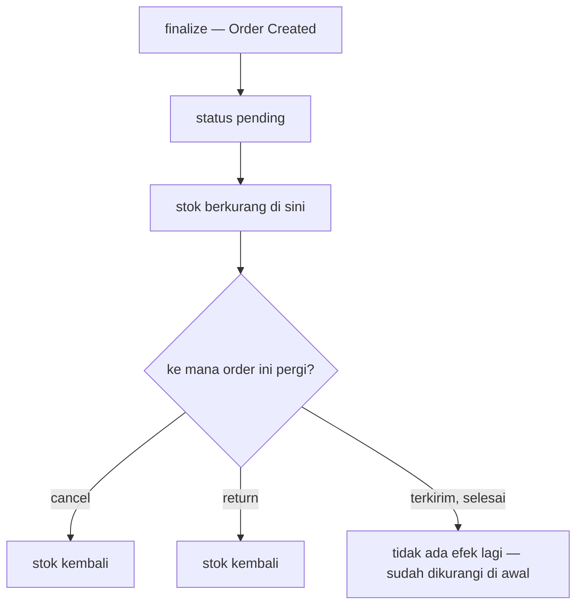

**Spesifikasinya.**

| momen | efek ke stok |
| --- | --- |
| `Order - pending` | `−` sejumlah baris order |
| `Order - cancel` | `+` balik |
| `Order - return` | `+` balik |
| status order lainnya | tidak ada efek — sudah dikurangi saat dibuat |

⚠ **Yang TIDAK ikut diputuskan**, dan sekarang terbuka di clarify: karena pengurangan terjadi di awal
dan tidak ada efek saat barang benar-benar keluar gedung, **tidak ada satu angka pun yang menyatakan
berapa barang yang secara fisik masih ada di rak**. Itu angka yang dipakai saat opname.

---

## stok-bertambah-saat-restock-completed

> ⚠ **Catatan 2026-09-29 15:53 — kata `approved` berbalik arti, putusannya tidak.** Di kasus pertama `approved` =
> **diterima gudang**, dan slot lahir di sana ([diterima-gudang-berstatus-approved](#diterima-gudang-berstatus-approved)).
> Momennya sama dengan `completed` di bawah — barang mendarat — jadi putusannya tetap; baris spesifikasi
> *"`Restock - approved` — tidak ada"* **tidak berlaku lagi**.

> `context.md` baris 34 — *"Restock: `pending`, `cancel`, `approved` / `completed`"*
> `context.md` baris 38–39 — *"Kapan stok bertambah? Saat `Restock - completed`"*

**Putusannya.** Yang menambah stok adalah **`completed`** — momen barang benar-benar mendarat — bukan
momen persetujuan. Sebelumnya dokumen hanya menulis `approved`, dan *disetujui* dengan *barang sampai*
adalah dua peristiwa berbeda yang bisa berjarak berhari-hari.

Ini juga menyelaraskan dokumen dengan kode yang sudah jalan: enum `RestockRequestStatus` memakai
`PENDING` · `FULFILLED` · `CANCELLED`, dan `stock_cost.go` hanya menghitung restock yang **fulfilled**
— *"A pending request is a price somebody hoped for, not one that was paid"*.

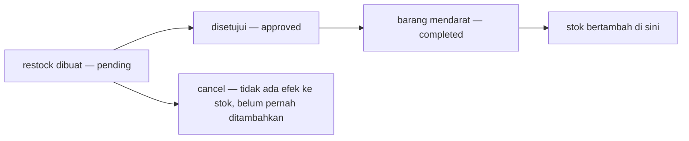

**Spesifikasinya.**

| momen | efek ke stok |
| --- | --- |
| `Restock - pending` | tidak ada |
| `Restock - approved` | tidak ada |
| `Restock - completed` | `+` sejumlah yang benar-benar diterima |
| `Restock - cancel` | tidak ada — tidak perlu kompensasi, karena belum pernah ditambahkan |

⚠ **Residu yang masih terbuka**, di clarify: baris 34 menulis `approved` / `completed` dengan garis
miring, jadi belum jelas apakah keduanya dua status berurutan atau dua nama untuk satu hal.

---

## slot-lahir-saat-barang-tiba

> ⚠ **Catatan 2026-09-29 13:52 — namanya berubah, putusannya tidak.** Kolom slot kini `good_stock`, dan jumlah per SKU
> disimpan di `SKU_STATEMENT.stock_ready` ([stok-diringkas-per-sku](#stok-diringkas-per-sku)). Apakah keduanya satu
> angka masih terbuka — [ready-stock-diganti-nama](./context_clarify.md#ready-stock-diganti-nama).

> [model.md](./model.md) (2026-09-28) — *"SKU_SLOT akan dibuat ketika barang sampai di gudang"* · *"ERD di atas
> dibuat untuk mendukung mekanisme FIFO"* · `ongoing_stock` **dihapus** dari `SKU_SLOT`. Menjawab
> *slot-adalah-tumpukan-fisik*. Sesuai rekomendasi.

**Putusannya.** Stok tinggal di `SKU_SLOT`: **satu tumpukan** barang dari **satu restock**, di **satu gudang**, di
**satu rak**. Slot baru ada saat barang **tiba** — tidak pernah sebelumnya — jadi slot selalu punya rak. Stok ready
sebuah SKU adalah jumlah `ready_stock` semua slotnya.

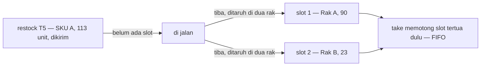

**Kenapa ini lebih baik dari batch dan rak yang dipisah** — usulan saya sebelumnya, yang ditarik:

| | slot | batch + rak terpisah |
| --- | --- | --- |
| harga barang yang dipetik | harga slot yang dipetik — barang dan harganya satu | batch FIFO dan rak dipotong terpisah — harga tidak mengikuti barang |
| instruksi petik | take memilih slot, raknya ikut | butuh aturan kedua untuk memilih rak |
| pindah rak | slot dipecah jadi dua baris, `tx_id` ikut | rak pindah, batch tetap |

**Spesifikasinya.**

| | |
| --- | --- |
| lahir | saat barang diterima di gudang — satu restock item bisa jadi beberapa slot, satu per rak |
| rak | tidak pernah kosong |
| urutan FIFO | `created_at` slot |
| `ongoing_stock` | **tidak** di slot |

⚠ **Yang TIDAK ikut diputuskan**, terbuka di clarify: di mana angka *on the way* sekarang tinggal — teks
`context.md` masih menyebut `stock_ongoing` dicatat · dan `technical/stock/design.md` masih memisahkan batch dan
rak.

---

## pemilik-adalah-tim-di-sku

> [model.md](./model.md) (2026-09-28) — `SKU` mendapat `team_id fk` dan `user_id fk`. Menjawab *pemilik-di-sku*.
> Sesuai rekomendasi.

**Putusannya.** Pemilik barang adalah **tim jualan**, dan disimpan di SKU. Orang yang membuat SKU — biasanya
Customer Service — dicatat terpisah, dan tidak memiliki barangnya.

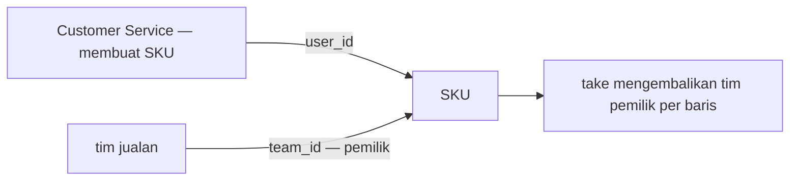

| | |
| --- | --- |
| `SKU.team_id` | tim pemilik — yang dikembalikan take sebagai `TransactionItem.team_id` |
| `SKU.user_id` | orang yang membuat — **bacaan saya**, belum dikonfirmasi |

⚠ Teks `context.md` baris 30 masih menulis *"pemilik barang adalah Customer Service"*.

---

## harga-silang-dihitung-dari-persen

> [model.md](./model.md) (2026-09-28) — `SKU` mendapat `profit_percentage`, dan tidak ada kolom harga kedua di
> mana pun. Menjawab *harga-kedua-disimpan-atau-dihitung*. Sesuai rekomendasi.

**Putusannya.** *"Harga untuk orang lain"* **tidak disimpan**. Ia dihitung saat take: harga slot yang ditarik ×
(1 + persen di SKU). Harga beli yang naik di restock berikutnya otomatis ikut ke harga silang.

| contoh | angka |
| --- | ---: |
| harga slot yang ditarik — `unit_cost` | 10.000 |
| persen di SKU | 20% |
| harga untuk tim lain — `unit_cost_with_markup` | 12.000 |
| baris own | 10.000 — persen tidak dipakai |

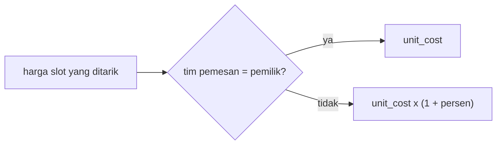

⚠ **Sisanya terbuka di clarify:** nama dan tipe kolomnya (`profit_percentage int` vs `cross_markup_percent` di
product), dan teks `context.md` baris 22 yang masih menulis dua harga.

---

## harga-dan-supplier-per-slot

> [model.md](./model.md) (2026-09-28) — `SKU_SLOT` mendapat `supplier_id` dan `price`.

**Putusannya.** Harga dan supplier adalah milik **tumpukan**, bukan milik SKU. Dua slot dari SKU yang sama boleh
berbeda harga dan berbeda supplier, dan FIFO membacanya dari slot.

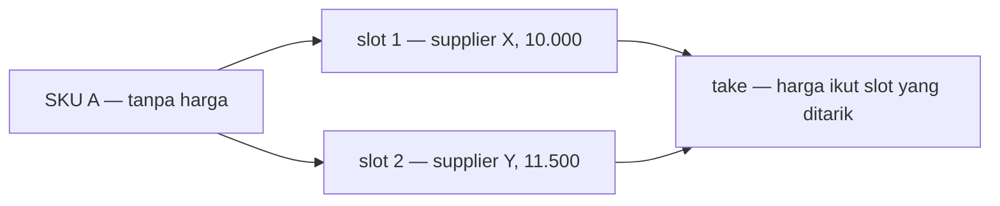

⚠ **Sisanya terbuka di clarify:** dari mana harga itu datang saat slot lahir — petugas gudang yang menerima tidak
tahu harga beli tim jualan — dan apakah `price` itu harga beli atau harga *landed* (sudah termasuk bagian ongkir).

> ✅ **2026-09-30 14:02** — pertanyaan *beli atau landed* terjawab: **dua kolom**, harga beli dan ongkir per unit —
> [ongkir-per-unit-disimpan-terpisah](#ongkir-per-unit-disimpan-terpisah). Harganya kini juga datang dari item —
> [harga-beli-disimpan-di-item](#harga-beli-disimpan-di-item).

---

## transaksi-adalah-barang-masuk

> ⚠ **Dikoreksi 2026-09-29 11:30 — separuh entri ini dicabut.** Empat menit setelah dicatat, `model.md` menghapus
> lagi kolom `TRANSACTIONS.status` dan kalimat enum `(ongoing | arrived)`. **Yang tetap berlaku:** `TRANSACTIONS` =
> barang masuk, `type` = `restock | return`, dan take bukan baris `TRANSACTIONS`. **Yang TIDAK lagi diputuskan:**
> status disimpan di baris, dan nilai-nilai statusnya — status kembali **hanya** di `TRANSACTION_STATUS_LOGS`, dan
> daftarnya terbuka di clarify. Diagram dan tabel di bawah memakai `ongoing`/`arrived` sebagai **nama kerja**, bukan
> enum yang diputuskan. Nama entri tidak diganti: putusannya — *barang masuk* — tidak berbalik.

> [model.md](./model.md) (2026-09-29) — `TRANSACTIONS` mendapat `type` dan `status`: *"TRANSACTIONS type berupa enum
> `(restock | return)`"* · *"TRANSACTIONS status berupa enum `(ongoing | arrived)`"*.
> ⚠ **Sebagian melawan rekomendasi saya** — saya mengusulkan `type` juga memuat `order_take`, dan kolom kirim/resi
> dipindah ke `RESTOCK_DETAILS`. Rekomendasi itu **ditarik**: alasannya di bawah.

**Putusannya.** `TRANSACTIONS` adalah dokumen **barang masuk** — hanya `restock` dan `return`. Statusnya yang sekarang
disimpan **di barisnya** (`ongoing` → `arrived`); `TRANSACTION_STATUS_LOGS` tetap riwayatnya, dengan pelakunya.

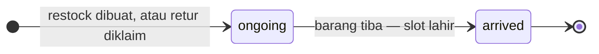

**Kenapa ini lebih baik dari usulan saya.** Restock dan retur sama-sama **paket yang datang lewat kurir** — keduanya
punya jasa kirim, resi dan ongkir. Kolom `TRANSACTIONS` cocok untuk keduanya, jadi tidak ada kolom yang kosong dan
tidak perlu `RESTOCK_DETAILS`. Take untuk order **bukan** paket yang datang, dan memang tidak cocok di sini.

| type | `ongoing` berarti | `arrived` berarti | sejalan dengan |
| --- | --- | --- | --- |
| `restock` | dikirim supplier, di jalan | diterima gudang, slot lahir | [slot-lahir-saat-barang-tiba](#slot-lahir-saat-barang-tiba) |
| `return` | order berstatus `return` — klaim, paket di jalan | order berstatus `return_completed` — slot baru | [the-accept-is-the-status-return-completed](../order/context_decision.md#the-accept-is-the-status-return-completed) |

**Konsekuensi yang ikut, dicatat supaya tidak ditemukan ulang:** take untuk order **bukan** baris `TRANSACTIONS`. Di
mana take dicatat masih terbuka di clarify.

⚠ **Yang TIDAK ikut diputuskan:** tidak ada status batal, dan tidak ada yang menjaga `ongoing → arrived` dari
ditekan dua kali — keduanya di clarify.

> ✅ **2026-10-14** — baris `return` di tabel ini dikonfirmasi: dibuat saat klaim, diterima belakangan —
> [retur-berjalan-seperti-restock](#retur-berjalan-seperti-restock).

---

## ongoing-dihitung-dari-status

> ⚠ **Dibalik separuh, 2026-09-30 13:15.** `SKU_STATEMENT.stock_ongoing` kini **menyimpan** angka *on the way*
> ([ongoing-diringkas-di-statement](#ongoing-diringkas-di-statement)) — *"tidak disimpan di mana pun"* tidak berlaku
> lagi. Yang tetap: **definisinya** — item transaksi yang status terakhirnya `ongoing` — dipakai untuk mencocokkan angka
> yang disimpan.

> ⚠ **Dikoreksi 2026-09-29 11:30 — mekanismenya berubah, putusannya tidak.** Kolom status di `TRANSACTIONS`
> dihapus lagi, jadi *"belum tiba"* sekarang dibaca dari **baris log terakhir** tiap transaksi, bukan dari kolom.
> Putusannya tetap: *on the way* tidak disimpan di mana pun — dan itu bukan tafsiran, karena ERD memang tidak punya
> kolom untuk menyimpannya lagi.

> [model.md](./model.md) (2026-09-29) — status `ongoing` di `TRANSACTIONS`, dan (sejak ronde sebelumnya) tidak ada
> `ongoing_stock` di slot. Menjawab *stock-ongoing-dihitung-dari-item*. Sesuai rekomendasi.

**Putusannya.** Stok *on the way* **tidak disimpan**. Ia dihitung: jumlah `count` di `TRANSACTION_ITEMS` milik
transaksi yang statusnya `ongoing`. Saat status jadi `arrived`, angkanya turun dengan sendirinya — tidak ada counter
yang harus dikoreksi.

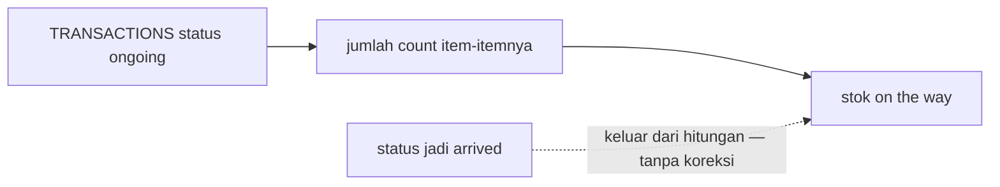

✅ **Teks `context.md` baris 60–61 tetap benar** sebagai deskripsi bisnis — angka *on the way* memang naik saat
restock dibuat dan turun saat tiba. Yang basi hanya baris 66, yang menaruh `stock_ongoing` di catatan per item.

---

## order-id-adalah-nomor-pesanan-restock

> [model.md](./model.md) (2026-09-29) — *"TRANSACTIONS order_id adalah order id untuk restock bukan order atau ref ke
> orderan tertentu."* Menjawab *order-id-dua-arti*. ⚠ **Sebagian melawan rekomendasi saya** — saya mengusulkan dua
> kolom, satu untuk nomor pesanan di supplier dan satu untuk order kita. Jawabannya: kolom ini hanya yang pertama.

**Putusannya.** `TRANSACTIONS.order_id` adalah **nomor pesanan saat tim jualan membeli barang restock** — misalnya
nomor order di marketplace tempat barang dibeli ([business_level §Suplier](../business_level.md#suplier-as-the-source-goods-of-the-product-we-sell):
supplier bisa marketplace lain). Teks bebas, opsional, milik supplier. **Bukan** order kita, dan tidak merujuk
order apa pun di sistem ini.

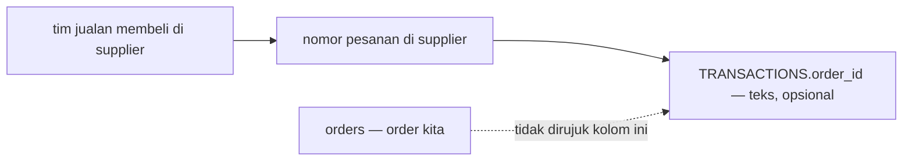

| type | `order_id` berisi |
| --- | --- |
| `restock` | nomor pesanan di supplier, kalau ada |
| `return` | tidak disebut — yang pasti **bukan** order yang diretur |

⚠ **Yang TIDAK ikut diputuskan**, terbuka di clarify: dengan kolom ini bukan order kita, transaksi `return` kini
**tidak punya rujukan ke order yang diretur** — padahal harga slot retur adalah COGS order itu.

---

## retur-merujuk-order-lewat-ref-order-id

> [model.md](./model.md) (2026-09-29) — `TRANSACTIONS.ref_order_id`: *"merujuk ke id pesanan yang retur"*. Menjawab
> *retur-menyebut-ordernya*. Sesuai rekomendasi — dengan nama Anda sendiri (saya menulis `return_order_id`).

**Putusannya.** Transaksi `return` menyebut **order kita** yang diretur di `ref_order_id`. `order_id` tetap milik
restock ([order-id-adalah-nomor-pesanan-restock](#order-id-adalah-nomor-pesanan-restock)). Dua kolom, dua arti, tidak
ada yang dipakai ganda.

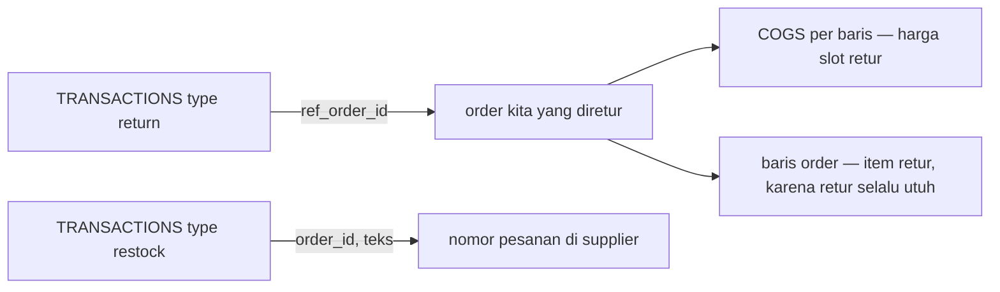

| type | `order_id` | `ref_order_id` |
| --- | --- | --- |
| `restock` | nomor pesanan di supplier, opsional | kosong |
| `return` | — | id order kita, wajib |

⚠ **Yang TIDAK ikut diputuskan**, terbuka di clarify: apakah `ref_order_id` **unik** untuk `return` — satu order
diterima returnya sekali.

---

## adjustment-terpisah-dari-barang-masuk

> [model.md](./model.md) (2026-09-29 12:51) — tabel baru `ADJUSTMENT`, dan `TRANSACTIONS` tetap `restock | return`.
> Menjawab *pecah-transaksi* — rencana Anda sebelumnya adalah tiga tabel (`restocks`, `returns`, `adjustments`).
> Sesuai rekomendasi: **dua**.

**Putusannya.** Adjustment punya tabelnya sendiri. Restock dan retur **tetap satu tabel** barang masuk —
[transaksi-adalah-barang-masuk](#transaksi-adalah-barang-masuk) tetap berlaku, tidak dibalik.

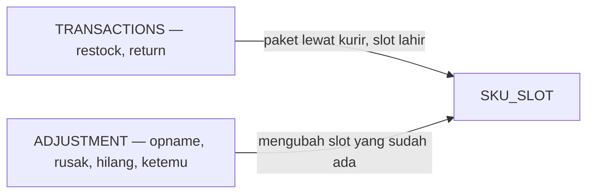

| | `TRANSACTIONS` | `ADJUSTMENT` |
| --- | --- | --- |
| isinya | paket yang datang | perubahan pada stok yang sudah di gudang |
| kurir, resi, ongkir | ada | tidak ada |
| *di jalan* | ada | tidak ada — terjadi seketika |

**Kenapa restock dan retur tidak dipecah:** bagi petugas gudang keduanya satu pintu — satu antrian paket masuk, satu
proses terima, satu asal slot. Memecahnya membuat semua itu jadi `UNION`, demi tiga kolom yang berbeda.

⚠ **Yang TIDAK ikut diputuskan:** bentuk `ADJUSTMENT` — sekarang hanya `id` dan `sku_id`. Terbuka di clarify.

---

## rusak-punya-tabel-sendiri

> ⚠ **Catatan 2026-09-29 15:24 — tabelnya digabung, putusan intinya tetap.** Unit rusak kini di `SKU_ANOMALY_SLOT`
> bersama unit hilang ([rusak-dan-hilang-satu-tabel](#rusak-dan-hilang-satu-tabel)). Yang tetap: barang rusak **tidak**
> di `SKU_SLOT`, jadi pembaca stok tetap tidak bisa menjualnya.

> [model.md](./model.md) (2026-09-29 13:06) — tabel `SKU_BROKEN_SLOT`, `TRANSACTIONS ||--o{ SKU_BROKEN_SLOT` *"mungkin
> memiliki"*. Usulan Anda sendiri, dan ⚠ **membalik rekomendasi saya** — kolom `kondisi` di `SKU_SLOT`.

**Putusannya.** Unit rusak tinggal di tabelnya sendiri. `SKU_SLOT` hanya berisi barang yang bisa dijual.

**Kenapa ini lebih baik dari usulan saya:**

| | kolom `kondisi` di `SKU_SLOT` | `SKU_BROKEN_SLOT` |
| --- | --- | --- |
| pembaca stok yang lupa menyaring | ikut menjual barang rusak | tidak mungkin — barang rusak tidak ada di tabel itu |
| kolom khusus rusak — klaim, bukti, nasibnya | menumpang, kosong di hampir semua baris | punya tempat sendiri |

Stok dibaca di banyak tempat — take, ketersediaan, ringkasan, lokasi petik. Dengan kolom, **setiap** pembaca harus
ingat menyaring; dengan tabel terpisah, pembaca yang tidak tahu apa-apa soal barang rusak pun tetap benar.

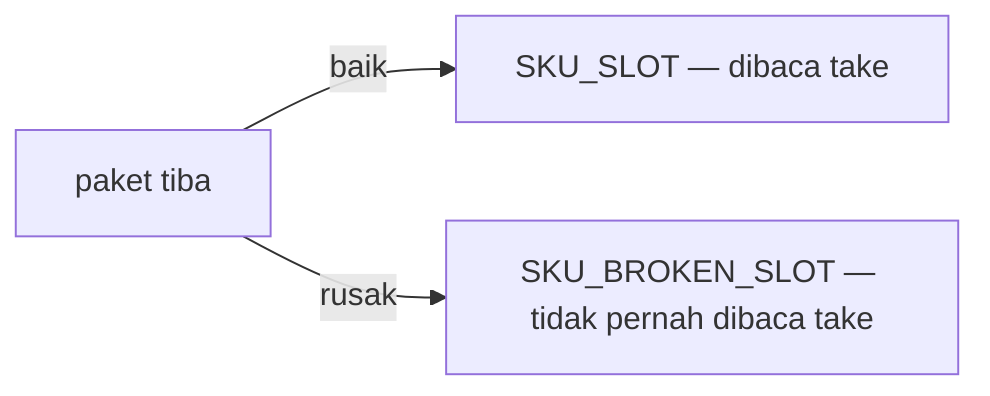

⚠ **Yang TIDAK ikut diputuskan:** isinya — di model baru `id` dan `tx_id` — dan rusak yang terjadi **di gudang**, yang
tidak punya transaksi. Terbuka di clarify.

---

## transaksi-lahir-dengan-item-dan-status

> [model.md](./model.md) (2026-09-29 13:06) — `TRANSACTIONS ||--|{ TRANSACTION_ITEMS` dan
> `TRANSACTIONS ||--|{ TRANSACTION_STATUS_LOGS`, keduanya berubah dari `o{` (boleh nol) ke `|{` (minimal satu).

**Putusannya.** Transaksi tanpa item tidak ada, dan transaksi tanpa baris status tidak ada: status awalnya ditulis
**saat transaksi dibuat**, di transaksi DB yang sama.

| | akibatnya |
| --- | --- |
| minimal satu item | membuat restock kosong ditolak |
| minimal satu status | *"status terakhir"* selalu punya jawaban — query tidak pernah mengembalikan kosong untuk transaksi yang ada |

---

## sku-wajib-bergambar

> ⚠ **Catatan 2026-09-29 15:39** — SKU = product ([sku-adalah-product](#sku-adalah-product)), jadi aturan ini milik
> Product Service.
>
> ✅ **2026-09-30 14:38** — `SKU_IMAGES` keluar dari ERD inventory: aturan ini kini hanya ada di product
> ([inventory-hanya-merujuk-sku](#inventory-hanya-merujuk-sku)).

> [model.md](./model.md) (2026-09-29 13:06) — `SKU ||--|{ SKU_IMAGES`, berubah dari `o{` ke `|{`.

**Putusannya.** Setiap SKU punya **minimal satu** gambar.

✅ **Dikonfirmasi pemilik di chat (2026-09-29):** *"satu sku wajib punya minimal 1 gambar"* — bukan sekadar bacaan saya atas
kardinalitas di ERD.

**Kenapa ini masuk akal dari gudang:** pemetik mencocokkan barang di rak dengan gambarnya — SKU tanpa gambar adalah SKU
yang dipetik dengan menebak.

| | akibatnya |
| --- | --- |
| membuat SKU | ditolak tanpa gambar — CS harus punya foto sebelum SKU ada |
| menghapus gambar | gambar **terakhir** tidak bisa dihapus, hanya diganti |

---

## broken-slot-membawa-asal-dan-bukti

> [model.md](./model.md) (2026-09-29 13:12) — `SKU_BROKEN_SLOT` diisi: `sku_id`, `supplier_id`, `tx_id`, `warehouse_id`,
> `rack_id`, `broken_stock`, `price`, `image_of_proof`. Menjawab *broken-slot-kosong*. Sesuai rekomendasi — dan
> `supplier_id` adalah tambahan Anda sendiri yang tidak saya usulkan.

**Putusannya.** Satu baris rusak membawa hal yang sama dengan slot biasa — **asal** (SKU, supplier, transaksi),
**tempat** (gudang, rak), **jumlah** dan **harga** — ditambah **foto bukti**.

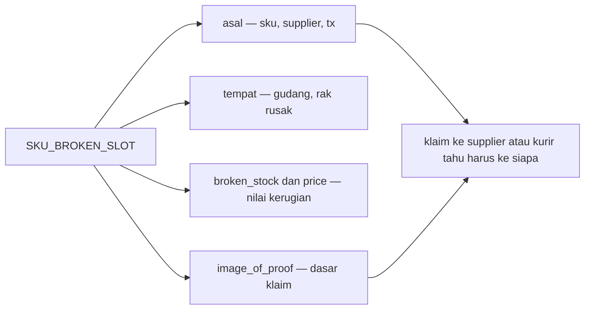

| kolom | kenapa penting |
| --- | --- |
| `supplier_id` | klaim barang rusak ditujukan ke supplier yang mengirimnya — tanpa kolom ini harus ditelusuri lewat transaksi |
| `price` | `broken_stock × price` = nilai kerugian |
| `image_of_proof` | supplier dan kurir tidak menerima klaim tanpa foto |

⚠ **Yang TIDAK ikut diputuskan**, terbuka di clarify: **siapa yang menanggung**. Rusak saat terima ditanggung tim
pemilik, pecah di rak ditanggung gudang — dan keduanya kini membawa `tx_id`, jadi barisnya terlihat sama.

---

## penanggung-dibaca-dari-adjustment-id

> [model.md](./model.md) (2026-09-29 13:20) — `SKU_BROKEN_SLOT.adjustment_id fk "nullable"`, dan kolom yang sama di
> tabel baru `SKU_LOST_SLOT`. Menjawab *penanggung-dari-adjustment-id*. Sesuai rekomendasi.

**Putusannya.** Siapa yang menanggung unit rusak atau hilang dibaca dari **satu kolom**: ada atau tidaknya
`adjustment_id`.

| `adjustment_id` | terjadi | yang menanggung | ke balance |
| --- | --- | --- | --- |
| **kosong** | saat terima — paket datang sudah rusak atau kurang | tim pemilik  | tidak ada — kerugian pemilik sendiri, bukan utang antar-tim |
| **terisi** | di gudang — pecah di rak, tidak ketemu saat opname | gudang  | `broken_good` atau `lost_good` ([the-ledger-speaks-the-business-words](../balance/context_decision.md#the-ledger-speaks-the-business-words)) |

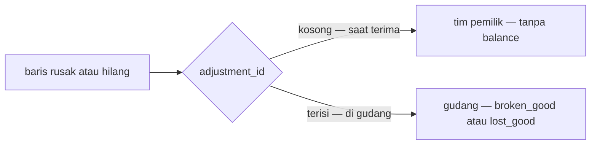

**Kenapa satu kolom ini cukup:** sejak unit yang pecah di rak membawa `tx_id` slot asalnya, `tx_id` saja tidak lagi
membedakan dua kejadian itu. `adjustment_id` membedakannya, dan sekaligus menunjuk tindakan yang menyebabkannya.

⚠ **Yang TIDAK ikut diputuskan:** isi `ADJUSTMENT` itu sendiri — masih `id`, `sku_id`, `type`. Terbuka di clarify.

---

## hilang-punya-tabel-tanpa-rak

> ⚠ **Catatan 2026-09-29 15:24 — tabelnya digabung, dan tabel gabungan PUNYA `rack_id`.** Unit hilang kini baris
> `lost` di `SKU_ANOMALY_SLOT` ([rusak-dan-hilang-satu-tabel](#rusak-dan-hilang-satu-tabel)). Yang tetap: unit hilang
> tidak punya rak. Yang berubah: peringatan di bawah — *kolom itu jangan pernah ditambahkan* — kini terjadi lewat
> penggabungan, jadi penjaganya pindah ke isi kolom; diusulkan `CHECK` di
> *hilang-kini-punya-kolom-rak*, kini [rak-barang-rusak-pilihan-staff](#rak-barang-rusak-pilihan-staff).

> [model.md](./model.md) (2026-09-29 13:20) — tabel `SKU_LOST_SLOT`: `sku_id`, `supplier_id`, `tx_id`, `adjustment_id`,
> `warehouse_id`, `lost_stock`, `price`, `created_at` — **tanpa `rack_id`**. Menjawab *hilang-dicatat-di-mana*.
> ⚠ **Namanya melawan rekomendasi saya** (`SKU_LOSSES`); **isinya menjawab alasan rekomendasi itu** — unit hilang
> tidak ada di rak mana pun, dan tabelnya memang tidak punya rak.

**Putusannya.** Unit yang hilang tinggal di tabelnya sendiri, dengan asal yang sama lengkapnya dengan unit rusak — SKU,
supplier, transaksi, harga, gudang — tapi **tanpa rak**.

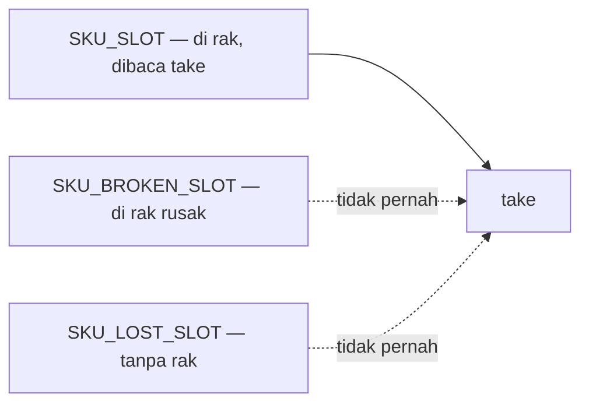

| | `SKU_BROKEN_SLOT` | `SKU_LOST_SLOT` |
| --- | --- | --- |
| barangnya | ada, di rak rusak | tidak ada |
| `rack_id` | ada | **tidak ada** |
| asal, harga, penanggung | sama | sama |

⚠ **Biaya nama ini, dicatat supaya tidak ditemukan ulang:** namanya berakhiran `_SLOT`, sama dengan tabel stok. Yang
menjaganya tidak ikut terjumlah ke stok adalah **tidak adanya `rack_id`** — jadi kolom itu **jangan pernah
ditambahkan** "supaya seragam".

⚠ **Yang TIDAK ikut diputuskan**, terbuka di clarify: apakah `lost_stock` berubah saat barang ditemukan, atau beku.

---

## adjustment-punya-empat-type

> [model.md](./model.md) (2026-09-29 13:52) — *"ADJUSTMENT `type` berupa enum `(opname | broken | lost | found)`."*
> Menjawab *type-adjustment*. Sebagian sesuai rekomendasi: empat dari lima yang saya usulkan — **`move` tidak
> diambil** — dan dua namanya lebih pendek dari kata balance.

**Putusannya.** Adjustment punya empat type: satu untuk sesi hitung, tiga untuk kejadian.

| type | kapan | stok berpindah | balance, kalau gudang yang menanggung |
| --- | --- | --- | --- |
| `opname` | sesi hitung | per selisih — kurang ke hilang, lebih menutup hilang, ketemu rusak ke rusak | per selisih |
| `broken` | pecah, penyok, basah — di gudang | `SKU_SLOT` → `SKU_BROKEN_SLOT` | `broken_good` |
| `lost` | tidak ketemu, di luar opname | `SKU_SLOT` → `SKU_LOST_SLOT` | `lost_good` |
| `found` | ketemu, di luar opname | `SKU_LOST_SLOT` → `SKU_SLOT` | `found` |

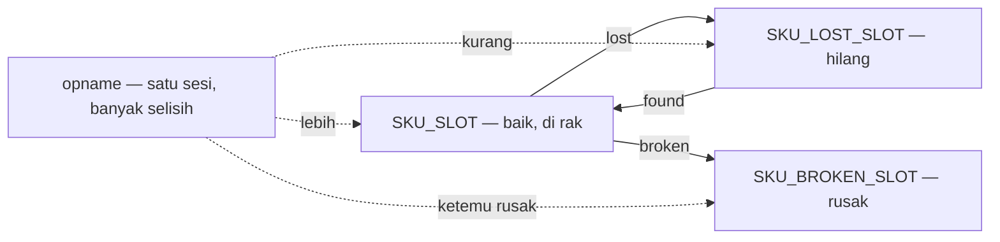

Arah perpindahan dibaca dari nama type dan dari
[penanggung-dibaca-dari-adjustment-id](#penanggung-dibaca-dari-adjustment-id): setiap baris rusak atau hilang yang
lahir dari adjustment ditanggung gudang.

**Kenapa nama pendek tidak masalah.** `type` menamai **kejadiannya** dan milik inventory; kata balance menamai
**uangnya** ([the-ledger-speaks-the-business-words](../balance/context_decision.md#the-ledger-speaks-the-business-words)).
Terjemahannya kolom terakhir tabel di atas — satu tempat, tiga baris.

⚠ **Yang TIDAK ikut diputuskan**, terbuka di clarify: **pindah rak** — tanpa `move`, belum ada jalan untuk
mencatatnya · **bentuk** `ADJUSTMENT` — masih `id`, `sku_id`, `type`: tanpa jumlah, pencatat, atau konfirmasi orang
kedua · dan garisnya ke rusak dan hilang digambar **nol atau satu**, sementara satu opname bisa butuh beberapa baris.

---

## stok-diringkas-per-sku

> ⚠ **Digantikan 2026-09-30 13:29** — statement kini satu baris per SKU **per gudang**
> ([stok-diringkas-per-sku-per-gudang](#stok-diringkas-per-sku-per-gudang)). Yang tetap: ada ringkasan di samping angka
> per tumpukan. Yang tidak: *per SKU*.

> ⚠ **Catatan 2026-09-30 13:14** — kasus pertama menulis statement dengan *updateOrInsert*, jadi barisnya **belum tentu
> ada sejak SKU dibuat**, seperti yang saya baca dari garis *tepat satu* di bawah — terbuka di
> [statement-lahir-kapan](#inventory-hanya-merujuk-sku) — selesai, garisnya hilang bersama `SKU`. Dan 13:15 menambah `stock_ongoing`
> ([ongoing-diringkas-di-statement](#ongoing-diringkas-di-statement)).

> [model.md](./model.md) (2026-09-29 13:52) — tabel baru `SKU_STATEMENT`: `sku_id`, `stock_ready`, `stock_lost`,
> `stock_broken`, `created_at`, `updated_at`, tepat satu per SKU. Jawaban Anda atas *"historical atau statement?"*
> ⚠ **Separuh rekomendasi saya:** saya menyarankan angka sekarang **dan** riwayat — yang ditambahkan adalah angka
> sekarang yang kedua, ringkasan per SKU. Riwayatnya belum.

**Putusannya.** Selain angka per tumpukan, setiap SKU punya **satu baris ringkasan** — siap jual, rusak, hilang —
yang dibaca tanpa menjumlah slot. Kardinalitasnya tepat satu per SKU: barisnya ada sejak SKU dibuat, dengan nol.

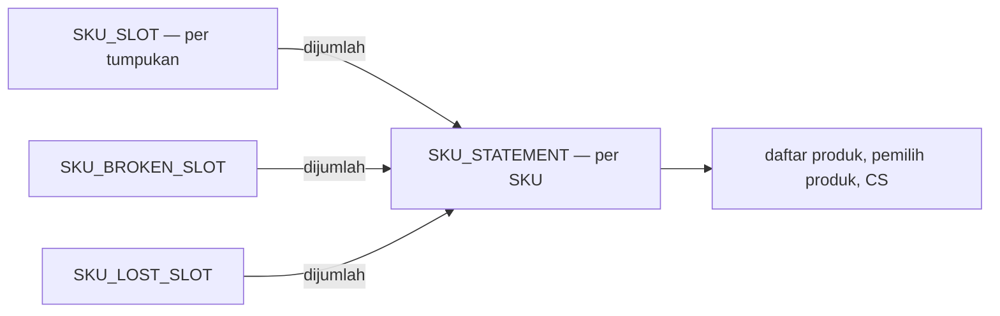

| angka | per tumpukan | ringkasan |
| --- | --- | --- |
| baik, siap jual | `SKU_SLOT.good_stock` | `stock_ready` |
| rusak | `SKU_BROKEN_SLOT.broken_stock` | `stock_broken` |
| hilang | `SKU_LOST_SLOT.lost_stock` | `stock_lost` |

**Kenapa masuk akal dari gudang:** daftar produk dan pemilih produk menampilkan stok puluhan SKU sekaligus — satu
baris per SKU dibaca tanpa menjumlah tumpukan.

⚠ **Yang TIDAK ikut diputuskan**, terbuka di clarify: **gudang** — satu baris per SKU menjumlah semua gudang,
padahal take bertanya per gudang · **riwayat** — kenapa angkanya berubah · bagaimana ringkasan dijaga **sama** dengan
slot · dan apakah `good_stock` dan `stock_ready` satu angka dengan dua nama.

---

## sku-adalah-product

> [context.md](./context.md) (2026-09-29 15:39) — *"Padanan konteks kata: Product = SKU"* · *"service ini memerlukan
> `Product Service` dan `Supplier Service`"*. Menjawab *sku-sama-dengan-product*. Sesuai rekomendasi.

**Putusannya.** SKU dan product adalah **satu hal**. Datanya — judul, deskripsi, gambar, tim pemilik, persen markup
silang, `reserved_stock`, *shared lock* — milik Product Service. Inventory menyimpan **stoknya** dan merujuk lewat id.

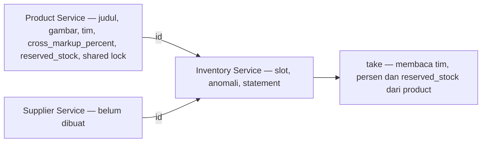

| | akibatnya |
| --- | --- |
| persen markup silang | satu kolom: `cross_markup_percent` milik product — `SKU.profit_percentage` bukan sumber kedua |
| `reserved_stock`, *shared lock* | take membacanya dari product — OrderCreation mendapat sumbernya |
| aturan gambar | [sku-wajib-bergambar](#sku-wajib-bergambar) jadi aturan product |

⚠ **Yang TIDAK ikut diputuskan**, terbuka di clarify: ERD inventory masih menggambar `SKU` lengkap —
[sku-masih-digambar-di-inventory](./context_clarify.md#critique).

> ✅ **2026-09-30 14:38** — diputuskan: [inventory-hanya-merujuk-sku](#inventory-hanya-merujuk-sku).

---

## rusak-dan-hilang-satu-tabel

> [model.md](./model.md) (2026-09-29 15:24) — `SKU_ANOMALY_SLOT`: `type "broken | lost"`, `rack_id` boleh kosong,
> `count`, `price`, `image_of_proof_url`, `notes`, `adjustment_id` — menggantikan `SKU_BROKEN_SLOT` dan `SKU_LOST_SLOT`.
> Usulan Anda sendiri.

**Putusannya.** Unit rusak dan unit hilang tinggal di **satu** tabel, dibedakan `type`. Keduanya tetap di luar
`SKU_SLOT`.

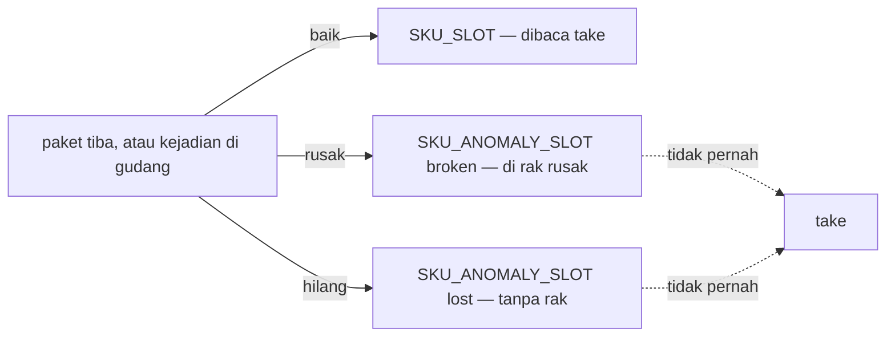

| | `broken` | `lost` |
| --- | --- | --- |
| `rack_id` | rak rusak | kosong |
| foto bukti | ✅ | ✅ — kini juga untuk paket yang datang kurang |
| asal, harga, penanggung (`adjustment_id`) | sama | sama |

**Kenapa ini lebih baik:** kolom keduanya memang sama — asal, harga, bukti, penanggung. Dua tabel berarti dua salinan
setiap aturan; satu tabel memberi foto bukti ke unit hilang tanpa usaha tambahan — kekurangan yang sempat terbuka di
clarify.

⚠ **Yang TIDAK ikut diputuskan**, terbuka di clarify: penjaga bahwa baris `lost` tidak pernah punya rak —
*hilang-kini-punya-kolom-rak*, kini [rak-barang-rusak-pilihan-staff](#rak-barang-rusak-pilihan-staff) · dan garis relasi di `model.md` masih
menunjuk dua tabel lama.

> 🔄 **Dibalik 2026-10-02 15:17** — rusak dan hilang kembali dua tabel:
> [rusak-dan-hilang-tabel-terpisah](#rusak-dan-hilang-tabel-terpisah). Entri ini tetap sebagai riwayat.

---

## diterima-gudang-berstatus-approved

> `restock_full_approved.md` (2026-09-29 15:53) — log `ongoing` *"artinya transaksi masih di
> jalan"*, `created_by` CS · log `approved` *"artinya transaksi sudah diterima gudang"*, `created_by` staff gudang ·
> `SKU_SLOT` dibuat di langkah yang sama. Menjawab sebagian *status-transaksi-apa-saja*.

**Putusannya.** Restock lahir `ongoing`, dibuat CS. Saat petugas gudang menerimanya dan memilih raknya, statusnya
`approved` — dan slot lahir di langkah itu.

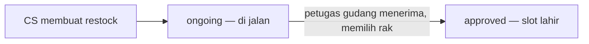

| status | ditulis oleh | artinya | efek ke stok |
| --- | --- | --- | --- |
| `ongoing` | CS | di jalan | dihitung *on the way* ([ongoing-dihitung-dari-status](#ongoing-dihitung-dari-status)) |
| `approved` | petugas gudang | diterima gudang | slot lahir — stok bertambah |

⚠ **Kata `approved` berbalik arti.** [stok-bertambah-saat-restock-completed](#stok-bertambah-saat-restock-completed)
memakai `approved` untuk *disetujui, sebelum tiba*, dan mencatatnya *tidak ada efek ke stok*. Momen stok bertambah tidak
berubah — barang mendarat — hanya namanya kini `approved`. Entri lama sudah diberi catatan.

⚠ **Yang TIDAK ikut diputuskan**, terbuka di clarify: status batal dan *half approved* — kasusnya belum ditulis · satu
status akhir per transaksi.

---

## statement-bertambah-saat-diterima

> `restock_full_approved.md` (2026-09-30 13:14) — *"Kemudian updateOrInsert ke table
> `sku_statement` untuk menambah `stock_ready` dengan `sku_id` terkait."* Menjawab *statement-bertambah-saat-diterima*.
> Sesuai rekomendasi, separuhnya: *di transaksi DB yang sama* belum disebut.

**Putusannya.** Penerimaan restock — langkah yang sama yang menulis log `approved` dan melahirkan slot — menambah
`stock_ready` di baris statement SKU itu. Kalau barisnya belum ada, dibuat.

```mermaid
flowchart LR
  W["petugas gudang menerima"] --> A["log approved"]
  A --> S["SKU_SLOT lahir"]
  S --> T["sku_statement — stock_ready bertambah, baris dibuat kalau belum ada"]
```

| | |
| --- | --- |
| kapan | saat diterima — bersama `approved` |
| berapa | jumlah yang masuk slot |
| baris belum ada | dibuat — *updateOrInsert* |

⚠ **Yang TIDAK ikut diputuskan**, terbuka di clarify kasus: satu perintah atomik di transaksi DB yang sama
([statement-ditulis-atomik](#statement-dibuat-atau-ditambah)) · kapan baris statement lahir
([statement-lahir-kapan](#inventory-hanya-merujuk-sku) — selesai, garisnya hilang bersama `SKU`) · per gudang.

---

## ongoing-diringkas-di-statement

> ⚠ **Catatan 2026-09-30 13:32** — dua hal yang di bawah masih terbuka kini diputuskan: kapan angka ini ditulis
> ([ongoing-berubah-bersama-status](#ongoing-berubah-bersama-status)) dan per gudang
> ([stok-diringkas-per-sku-per-gudang](#stok-diringkas-per-sku-per-gudang)).

> [model.md](./model.md) (2026-09-30 13:15) — `SKU_STATEMENT.stock_ongoing`. ⚠ **Membalik separuh**
> [ongoing-dihitung-dari-status](#ongoing-dihitung-dari-status), yang memutuskan *on the way* tidak disimpan di mana pun
> — waktu itu sesuai rekomendasi saya, yang mengusulkan menghitungnya.

**Putusannya.** Angka *on the way* per SKU disimpan di baris statement, di samping siap jual, rusak dan hilang.

```mermaid
flowchart LR
  C["restock dibuat — ongoing"] -->|"naik"| O["sku_statement.stock_ongoing"]
  A["status akhir — approved atau batal"] -->|"turun"| O
  D["definisi — item transaksi yang status terakhirnya ongoing"] -.->|"pencocok"| O
```

**Kenapa masuk akal:** daftar produk bisa menampilkan *siap jual 10, di jalan 20* dari satu baris, tanpa menghitung
transaksi. **Harganya** — alasan saya dulu menyarankan menghitung: setiap jalan yang mengubah status **harus** mengubah
angka ini juga — dibuat, diterima, batal — dan satu jalan yang lupa membuat barang *di jalan* selamanya.

⚠ **Yang TIDAK ikut diputuskan**, terbuka di clarify kasus: kapan angka ini ditulis — kasus pertama belum menulisnya
([ongoing-ikut-status](#ongoing-berubah-bersama-status) — kini diputuskan) · apakah ia salinan atau sumbernya
sendiri · per gudang.

> ✅ **2026-10-13** — *salinan*: [statement-direkonsiliasi-tiap-malam](#statement-direkonsiliasi-tiap-malam).

---

## stok-diringkas-per-sku-per-gudang

> [model.md](./model.md) (2026-09-30 13:29) — `SKU_STATEMENT.warehouse_id fk`, dan *"Table ini mempunyai composite
> index pada kolom `sku_id` dan `warehouse_id`"*. Menjawab *statement-per-gudang*. Sesuai rekomendasi. **Menggantikan**
> [stok-diringkas-per-sku](#stok-diringkas-per-sku) (RULE 12 — putusannya berubah, jadi namanya juga).

**Putusannya.** Ringkasan stok disimpan satu baris per SKU **per gudang**: di jalan, siap jual, rusak, hilang.

```mermaid
flowchart LR
  S3["slot SKU 1 di Gudang 3"] -->|"dijumlah"| T3["SKU_STATEMENT — SKU 1, Gudang 3"]
  S5["slot SKU 1 di Gudang 5"] -->|"dijumlah"| T5["SKU_STATEMENT — SKU 1, Gudang 5"]
  T3 --> O["order dari Gudang 3 membaca baris Gudang 3 saja"]
```

| | |
| --- | --- |
| kunci | `(sku_id, warehouse_id)` — *composite index* |
| isi | `stock_ongoing` · `stock_ready` · `stock_lost` · `stock_broken` |
| dibaca | daftar produk per gudang · CS yang membuat order dari satu gudang |

**Kenapa ini benar dari gudang:** satu SKU bisa ada di beberapa gudang — restock memilih gudang tujuannya, dan retur boleh
mendarat di gudang lain ([a-return-may-land-in-another-warehouse](../order/context_decision.md#a-return-may-land-in-another-warehouse)).
OrderCreation bertanya *cukup di gudang **ini**?* — angka per SKU menjawab pertanyaan lain.

⚠ **Yang TIDAK ikut diputuskan**, terbuka di clarify kasus: index itu **UNIQUE** atau tidak
([statement-ditulis-atomik](#statement-dibuat-atau-ditambah)) · garis ERD masih *tepat satu*
([statement-lahir-kapan](#inventory-hanya-merujuk-sku) — selesai, garisnya hilang bersama `SKU`).

> ✅ **2026-10-01 10:32** — index itu kini UNIQUE: [statement-unik-per-sku-per-gudang](#statement-unik-per-sku-per-gudang).

---

## gudang-tujuan-dipilih-saat-dibuat

> ⚠ **Catatan 2026-09-30 13:44** — kolomnya kini ada: [model.md](./model.md) `TRANSACTIONS.warehouse_id`. Yang masih
> terbuka tinggal pembatasan penerima ([penerima-dari-gudang-tujuan](#penerima-dicek-anggota-gudang-tujuan)).

> `restock_full_approved.md` (2026-09-30 13:32) — data pembuatan membawa *"warehouse_id:
> `3`"*, dan statement ditulis *"dengan data warehouse_id terkait"*. Menjawab sebagian *gudang-target-di-transaksi*.
> Sesuai [context.md](./context.md) baris 26 dan rekomendasi.

**Putusannya.** CS memilih gudang tujuan saat restock **dibuat**, dan gudang itu dipakai sejak saat itu: *on the way*
sudah tercatat di gudang itu sebelum barangnya tiba.

```mermaid
flowchart LR
  C["CS membuat restock — Gudang 3"] --> O["statement Gudang 3 — di jalan naik"]
  O --> W["petugas Gudang 3 menerima"]
```

⚠ **Yang TIDAK ikut diputuskan**, terbuka di clarify kasus: kolomnya — `TRANSACTIONS` di ERD belum punya `warehouse_id` ·
penerimaan dibatasi untuk petugas gudang itu ([penerima-dari-gudang-tujuan](#penerima-dicek-anggota-gudang-tujuan)).

---

## ongoing-berubah-bersama-status

> ⚠ **Catatan 2026-09-30 13:44** — baris *"turun sebanyak yang datang"* di tabel bawah kini *"sebanyak yang dikirim"*
> ([ongoing-turun-sebanyak-dikirim](#ongoing-turun-sebanyak-dikirim)).
>
> ⚠ **Catatan 2026-09-30 13:41** — *"menjadi 10"* di kutipan bawah kini *"+= 10"*: ditambah, bukan diisi
> ([statement-ditambah-bukan-diisi](#statement-ditambah-bukan-diisi)).

> `restock_full_approved.md` (2026-09-30 13:32) — saat dibuat: *"CreateOrUpdate table
> `SKU_STATEMENT`, isi `stock_ongoing` menjadi 10"* · saat diterima: *"kurangi `stock_ongoing` sejumlah barang yang datang
> kemudian tambahkan ke `stock_ready`"*. Menjawab sebagian *ongoing-ikut-status*.

**Putusannya.** `stock_ongoing` ditulis di langkah yang sama dengan log statusnya: naik saat restock dibuat (log
`ongoing`), turun saat diterima (log `approved`) — dan yang turun dari *di jalan* naik jadi *siap jual*.

```mermaid
flowchart LR
  C["dibuat — log ongoing"] -->|"di jalan naik"| O["stock_ongoing"]
  O -->|"diterima — log approved"| R["stock_ready"]
```

| status | `stock_ongoing` | `stock_ready` |
| --- | --- | --- |
| `ongoing` — dibuat | naik 10 | — |
| `approved` — diterima | turun sebanyak yang datang | naik sebanyak yang datang |

⚠ **Yang TIDAK ikut diputuskan**, terbuka di clarify kasus: *menjadi* 10 atau *tambah* 10
([statement-ditulis-atomik](#statement-dibuat-atau-ditambah)) · turun sebanyak yang datang
atau yang dikirim — sama di kasus penuh, beda di kasus sebagian
([ongoing-turun-sebanyak-dikirim](#ongoing-turun-sebanyak-dikirim) — kini diputuskan) · batal · satu
transaksi DB.

---

## statement-ditambah-bukan-diisi

> `restock_full_approved.md` (2026-09-30 13:41) — *"tambah `stock_ongoing` +=10"* dan
> *"+= stock yang datang ke `stock_ready`"*, menggantikan *"isi `stock_ongoing` menjadi 10"*. Menjawab sebagian
> *statement-ditulis-atomik*. Sesuai rekomendasi.

**Putusannya.** Angka di statement selalu **ditambah atau dikurangi** dari isinya sekarang — tidak pernah diisi dengan
angka dari satu transaksi.

```mermaid
flowchart LR
  T1["T1 dibuat — tambah 10"] --> A["stock_ongoing 10"]
  T2["T2 dibuat — tambah 5"] --> B["stock_ongoing 15"]
  A --> B
  B -->|"T1 dan T2 diterima — kurang 15"| Z["stock_ongoing 0"]
```

| SKU 1, Gudang 3 | kalau diisi | ditambah |
| --- | ---: | ---: |
| T1 10 masih di jalan, T2 5 dibuat | 5 — T1 hilang dari hitungan | **15** |
| keduanya diterima | −10 | **0** |

**Kenapa ini penting dari gudang:** restock SKU yang sama ke gudang yang sama sering tumpang-tindih — tim jualan membeli
lagi sebelum pesanan pertama tiba. Angka yang diisi hanya benar kalau tidak pernah ada dua restock di jalan sekaligus.

⚠ **Yang TIDAK ikut diputuskan**, terbuka di clarify kasus: satu perintah atomik di atas `UNIQUE (sku_id,
warehouse_id)`, di transaksi DB yang sama dengan log statusnya
([statement-ditulis-atomik](#statement-dibuat-atau-ditambah)).

---

## ongoing-turun-sebanyak-dikirim

> `restock_full_approved.md` (2026-09-30 13:44) baris 36 — *"kurangi `stock_ongoing`
> sejumlah barang yang dikirim (karena semua barang utuh dan normal) kemudian += stock yang datang ke `stock_ready`"*.
> Menjawab *ongoing-turun-sebanyak-dikirim*. Sesuai rekomendasi.

**Putusannya.** Saat restock diterima, *on the way* turun sebanyak yang **dikirim** — `count` di item — bukan sebanyak
yang datang. Barang yang sudah diterima tidak lagi *di jalan*, apa pun kondisinya.

```mermaid
flowchart LR
  O["stock_ongoing — 10 dikirim"] -->|"turun 10, seluruhnya"| X["diterima"]
  X -->|"yang baik"| R["stock_ready"]
  X -.->|"kasus sebagian — rusak dan hilang"| A["stock_broken, stock_lost"]
```

| | dikirim | datang baik | `stock_ongoing` | `stock_ready` |
| --- | ---: | ---: | --- | --- |
| kasus ini — penuh | 10 | 10 | − 10 | + 10 |
| kasus sebagian — 1 hilang di jalan | 10 | 9 | − 10 — bukan − 9, yang meninggalkan 1 *di jalan* selamanya | + 9 |

⚠ **Yang TIDAK ikut diputuskan**, dan akan diuji kasus *half approved*: alasan di kasus — *"karena semua barang utuh dan
normal"* — belum menunjukkan ke mana unit rusak dan hilang pergi. Saran saya: ke `stock_broken` dan `stock_lost`, sehingga
yang naik berjumlah sama dengan yang turun ([penerimaan-tiga-angka](#rusak-dan-hilang-dikirim-bersama-penempatan) — kini diputuskan).

---

## harga-beli-disimpan-di-item

> [model.md](./model.md) (2026-09-30 13:55) — `TRANSACTION_ITEMS.unit_price float`. Menjawab sebagian
> *harga-disimpan-di-item*. Sesuai rekomendasi — separuhnya: `supplier_id` belum.

**Putusannya.** Harga beli per unit punya tempat di **item transaksi**, jadi ia bisa disimpan saat restock dibuat — oleh
CS yang membelinya — tidak menunggu barang tiba.

```mermaid
flowchart LR
  C["CS membuat restock — @ 10.000"] --> I["TRANSACTION_ITEMS.unit_price"]
  I -.->|"saat diterima — disalin, belum ditulis di kasus"| S["SKU_SLOT.unit_price"]
  W["petugas gudang"] -.->|"kasus masih memintanya dari sini"| S
```

**Kenapa ini penting dari gudang:** harga slot adalah nilai yang kelak jadi utang gudang kalau barangnya hilang. Kalau
harga itu datang dari petugas gudang, gudang ikut menentukan nilai utangnya sendiri; dari item, harga datang dari yang
membayar.

⚠ **Yang TIDAK ikut diputuskan**, terbuka di clarify kasus: `supplier_id` di item · kasusnya menulis harga saat dibuat
dan berhenti memintanya dari petugas ([harga-disimpan-di-item](#supplier-dan-total-disimpan-di-item) — kini diputuskan) ·
apakah harga slot sama dengan harga item — beda begitu ada ongkir
([ongkir-dibagi-ke-unit-yang-dikirim](#ongkir-dibagi-ke-unit-yang-dikirim)).

> ✅ **2026-09-30 14:03** — kasusnya kini menulis `unit_price` ke item saat restock dibuat. Petugas gudang masih
> mengirimnya lagi saat menerima, dan slot masih dibuat dari kirimannya
> (*harga-dua-sumber*). Ongkir tidak lagi membuat harga slot berbeda dari
> item — ia punya kolom sendiri: [ongkir-per-unit-disimpan-terpisah](#ongkir-per-unit-disimpan-terpisah).
>
> 🔄 **2026-09-30 14:38–15:30** — bentuknya berubah: item menyimpan **total** baris, bukan harga per unit; harga per unit
> dihitung saat diterima ([supplier-dan-total-disimpan-di-item](#supplier-dan-total-disimpan-di-item)). Putusannya
> tetap: harga beli ada di item, dari yang membayar.

---

## ongkir-per-unit-disimpan-terpisah

> [model.md](./model.md) (2026-09-30 14:02) — `unit_cost float "nullable"` di `TRANSACTION_ITEMS`, `SKU_SLOT` dan
> `SKU_ANOMALY_SLOT`, di samping `unit_price` · `restock_full_approved.md` (14:03) —
> `shipping_fee: 10000`, SKU 1 × 10, `unit_price: 10000`, `unit_cost: 1000`. Menjawab separuh
> *harga-landed-dibagi-qty-dikirim*. 🔄 **Melawan rekomendasi saya** — satu kolom berisi harga *landed* — dan **lebih
> baik**: lihat di bawah.

**Putusannya.** Ongkir dibagi ke unit, dan bagian per unitnya disimpan di **kolom sendiri**, di samping harga beli —
di item, di slot, dan di baris rusak atau hilang. Nilai sebuah unit = harga beli + ongkir per unit.

⚠ **Artinya dibaca dari angka kasus** — 10.000 ÷ 10 = 1.000. Kalau maksud Anda lain, koreksi di
[nama-ongkir-per-unit](#ongkir-per-unit-bernama-unit-shipping-cost) — kini diputuskan.

```mermaid
flowchart LR
  F["shipping_fee 10.000"] -->|"dibagi 10 unit"| C["ongkir per unit 1.000"]
  P["unit_price 10.000 — harga beli"] --> V["nilai per unit 11.000"]
  C --> V
  V --> R["rusak atau hilang — kerugian 11.000 per unit"]
  V --> O["take — COGS order 11.000 per unit"]
```

| kolom | isinya di kasus ini | dibaca oleh |
| --- | ---: | --- |
| `unit_price` | 10.000 | membandingkan harga supplier antar-restock — tanpa ongkir yang ikut naik-turun |
| `unit_cost` — ongkir per unit | 1.000 | melihat berapa ongkir memakan tiap unit |
| jumlahnya | 11.000 | COGS di order, nilai kerugian rusak atau hilang |

**Kenapa ini lebih baik dari saran saya.** Satu kolom *landed* (11.000) menjawab *berapa nilainya*, tapi harga supplier
dan ongkirnya tidak bisa dipisah lagi: restock berikut dengan harga beli yang sama tapi kurir lebih mahal terlihat
seperti supplier menaikkan harga. Dua kolom menjaga keduanya, dan jumlahnya tetap satu penjumlahan.

⚠ **Yang TIDAK ikut diputuskan**, terbuka di clarify: nama kolomnya — di order, `unit_cost` adalah harga barang
**seluruhnya** ([nama-ongkir-per-unit](#ongkir-per-unit-bernama-unit-shipping-cost) — kini diputuskan) · `nullable` — `10.000 + NULL` adalah
`NULL` · cara bagi kalau satu paket membawa beberapa SKU
([ongkir-dibagi-ke-unit-yang-dikirim](#ongkir-dibagi-ke-unit-yang-dikirim)) · siapa yang menghitungnya —
kasus membuat CS mengirim ongkir **dan** ongkir per unit ([ongkir-dihitung-server](#ongkir-per-unit-dihitung-saat-diterima) — kini diputuskan).

> ✅ **2026-09-30 14:15** — nama dan `nullable` diputuskan:
> [ongkir-per-unit-bernama-unit-shipping-cost](#ongkir-per-unit-bernama-unit-shipping-cost). ⚠ **14:18** — ongkirnya bisa
> bertambah saat barang tiba ([ongkir-tambahan-dilaporkan-saat-diterima](#ongkir-tambahan-dilaporkan-saat-diterima)), jadi
> 1.000 di diagram di atas hanya benar kalau kurir tidak menagih lagi.
>
> 🔄 **2026-09-30 14:38–15:30** — ongkir per unit kini hanya di slot dan anomali, dihitung saat diterima — tidak lagi di
> item ([ongkir-per-unit-dihitung-saat-diterima](#ongkir-per-unit-dihitung-saat-diterima)).

---

## ongkir-per-unit-bernama-unit-shipping-cost

> [model.md](./model.md) (2026-09-30 14:15) — `unit_cost float "nullable"` → `unit_shipping_cost float`, di
> `TRANSACTION_ITEMS`, `SKU_SLOT` dan `SKU_ANOMALY_SLOT`. Menjawab *nama-ongkir-per-unit*. Sesuai rekomendasi.

**Putusannya.** Kolom ongkir per unit bernama **`unit_shipping_cost`**, dan tidak boleh kosong. Nama `unit_cost` tetap
dengan satu arti di seluruh sistem — harga barang **seluruhnya**, seperti di order — dan di inventory ia hanya muncul
sebagai hasil penjumlahan yang dikirim take ke order.

```mermaid
flowchart LR
  P["unit_price 10.000"] --> S["unit_cost di jawaban take — 11.000"]
  U["unit_shipping_cost 1.000"] --> S
  S --> O["order — TransactionItem.unit_cost 11.000"]
```

| | sebelum 14:15 | sesudah |
| --- | --- | --- |
| nama di slot | `unit_cost` = 1.000 | `unit_shipping_cost` = 1.000 |
| arti `unit_cost` di order | 11.000 — beda arti, nama sama | 11.000 — satu-satunya arti |
| restock tanpa ongkir | `NULL` → `10.000 + NULL` = `NULL` | tidak boleh kosong — `0` |

**Kenapa ini penting:** take mengembalikan `unit_cost` ke order. Dengan nama yang sama untuk dua arti, satu salah salin
membuat COGS order tercatat 1.000 untuk barang 11.000.

⚠ **Yang TIDAK ikut diputuskan:** `DEFAULT 0` belum tertulis di ERD — tanpa `nullable` saja, restock tanpa ongkir akan
ditolak database kalau servernya lupa mengisi 0. Siapa yang menghitungnya dan kapan terbuka di
[ongkir-dihitung-server](#ongkir-per-unit-dihitung-saat-diterima) — kini diputuskan.

---

## penerimaan-hanya-mengirim-rak-dan-jumlah

> `restock_full_approved.md` (2026-09-30 14:18) baris 29 — `{ sku_id: 1, count: 10,
> rack_id: 3 }`. Menjawab separuh *harga-disimpan-di-item*. Sesuai rekomendasi.

**Putusannya.** Saat menerima, petugas gudang hanya mengirim yang **ia lihat**: SKU apa, berapa, di rak mana. Harga,
ongkir per unit dan supplier tidak lagi diketik di pintu.

```mermaid
flowchart LR
  W["petugas gudang"] -->|"sku_id, count, rack_id"| R["penerimaan"]
  I["TRANSACTION_ITEMS — dari CS saat dibuat"] -->|"harga, ongkir per unit, supplier"| R
  R --> S["SKU_SLOT"]
```

**Kenapa ini penting dari gudang:** harga slot adalah nilai yang kelak jadi utang gudang kalau barangnya hilang. Sekarang
gudang tidak lagi ikut menentukan nilai utangnya sendiri.

⚠ **Yang TIDAK ikut diputuskan**, terbuka di clarify kasus: kasusnya belum bilang slot **menyalin dari item**, dan
`supplier_id` tidak punya kolom di item — jadi supplier slot kini tidak punya sumber sama sekali
([harga-disimpan-di-item](#supplier-dan-total-disimpan-di-item) — kini diputuskan).

> ⚠ **2026-09-30 15:30** — kasusnya mengirim `supplier_id` lagi saat menerima, sementara item kini menyimpannya:
> [jumlah-dicocokkan-per-item](#jumlah-dicocokkan-per-item).

---

## ongkir-tambahan-dilaporkan-saat-diterima

> `restock_full_approved.md` (2026-09-30 14:18) baris 31–36 — *"Gudang bisa saja ditagih
> ongkir tambahan oleh jasa kirim saat barang datang"*, dikirim sebagai `additional_shipping_fee: 10000` bersama
> penerimaan.

**Putusannya.** Ongkir sebuah restock tidak selalu final saat restock dibuat: kurir bisa menagih lagi di pintu gudang,
dan **petugas gudang** yang melaporkannya, di langkah penerimaan yang sama.

```mermaid
flowchart LR
  C["CS — ongkir 10.000 saat dibuat"] --> T["total ongkir"]
  W["petugas — ongkir tambahan 10.000 saat tiba"] --> T
  T -->|"dibagi 10 unit"| U["ongkir per unit 2.000, bukan 1.000"]
```

⚠ **Yang TIDAK ikut diputuskan**, terbuka di clarify kasus
([ongkir-tambahan-dicatat](#ongkir-tambahan-dicatat-lalu-dikabarkan) — kini diputuskan): kolomnya — `TRANSACTIONS` belum
punya · apakah ia ikut dibagi ke ongkir per unit · siapa yang membayar kurir dan bagaimana uang itu kembali ke gudang ·
bukti nota, karena angkanya diketik pihak yang akan menagih.

> ✅ **2026-09-30 14:38** — kolomnya ada, dan bagian per unitnya juga:
> [ongkir-tambahan-punya-kolom-sendiri](#ongkir-tambahan-punya-kolom-sendiri).

---

## inventory-hanya-merujuk-sku

> [model.md](./model.md) (2026-09-30 14:38) — `SKU` dan `SKU_IMAGES`, beserta semua garis dari `SKU`, keluar dari ERD
> inventory. Menjawab kritik *sku-masih-digambar-di-inventory*. Sesuai rekomendasi.

**Putusannya.** Inventory tidak menyimpan data SKU — judul, gambar, tim, persen markup. Tabelnya hanya membawa `sku_id`;
datanya dibaca dari Product Service.

```mermaid
flowchart LR
  P["Product Service — SKU, gambar, tim, persen"] -->|"sku_id"| I["inventory — item, slot, anomali, statement, adjustment"]
  I -->|"take membaca tim dan persen"| P
```

**Kenapa ini penting:** dua service yang sama-sama menyimpan judul dan persen satu barang suatu hari berbeda — dan persen
yang dibaca take adalah uang.

✅ **Ikut selesai:** garis `SKU ||--|| SKU_STATEMENT` — *tepat satu per SKU*, yang salah dua kali — hilang bersama `SKU`
(dulu *statement-lahir-kapan*). ⚠ **Yang tidak ikut:** garis ke tabel lama masih ada
([garis-ke-tabel-lama](./context_clarify.md#critique)).

---

## supplier-dan-total-disimpan-di-item

> [model.md](./model.md) (2026-09-30 14:38) — `TRANSACTION_ITEMS`: `supplier_id`, `total`; `unit_price` dan
> `unit_shipping_cost` keluar dari item · `restock_full_approved.md` (15:30) — CS mengirim
> `sku_id`, `supplier_id`, `count`, `total: 100000` *"total saat belanja exclude ongkir"*, dan server menulis keempatnya.
> Menjawab *harga-disimpan-di-item*.

**Putusannya.** Item menyimpan **supplier** dan **total belanja baris**, tanpa ongkir, saat restock dibuat. Harga per
unit tidak disimpan di item; ia dihitung saat barang diterima — total ÷ `count`.

```mermaid
flowchart LR
  C["CS — SKU 1, supplier 3, 10 unit, total 100.000"] --> I["TRANSACTION_ITEMS — supplier_id, count, total"]
  I -->|"saat diterima — 100.000 dibagi 10"| S["SKU_SLOT.unit_price 10.000"]
  I -->|"saat diterima"| P["SKU_SLOT.supplier_id 3"]
```

**Kenapa total lebih baik dari harga per unit:** nota belanja menulis total baris, dan 3 unit seharga 10.000 tidak punya
harga per unit yang bulat. CS mengetik apa yang tertulis di nota, bukan hasil bagi.

Mengubah **bentuk** [harga-beli-disimpan-di-item](#harga-beli-disimpan-di-item) — per unit menjadi total — bukan
putusannya.

⚠ **Yang TIDAK ikut diputuskan:** petugas gudang masih mengirim `supplier_id` saat menerima
([jumlah-dicocokkan-per-item](#jumlah-dicocokkan-per-item)).

---

## ongkir-per-unit-dihitung-saat-diterima

> `restock_full_approved.md` (2026-09-30 15:30) baris 53 — *"`unit_price` di dapat dari per
> item `total` / per item `count`, `unit_shipping_cost` di dapat dari `shipping_fee` / sum all `count`"*. CS tidak lagi
> mengirim ongkir per unit. Menjawab *ongkir-dihitung-server*. Sesuai rekomendasi.

**Putusannya.** CS mengirim angka yang tertulis di nota — total baris dan ongkir. Server menghitung harga dan ongkir
**per unit** saat barang diterima, dan menyimpannya di slot.

| kolom slot | rumus | kasus ini |
| --- | --- | ---: |
| `unit_price` | `total` item ÷ `count` item | 100.000 ÷ 10 = 10.000 |
| `unit_shipping_cost` | `shipping_fee` ÷ jumlah `count` semua item | 10.000 ÷ 10 = 1.000 |
| `unit_additional_shipping_cost` | `additional_shipping_fee` ÷ jumlah `count` semua item — cabangnya belum ditulis di kasus | 0 |

```mermaid
flowchart LR
  N["nota — total 100.000, ongkir 10.000"] --> C["CS mengetik apa yang tertulis"]
  C --> T["transaksi dan item"]
  T -->|"saat diterima, ongkir sudah final"| S["server menghitung per unit, ditulis ke slot"]
```

**Kenapa ini penting:** satu fakta, satu angka yang diketik — tidak ada ongkir per unit yang bisa tidak cocok dengan
ongkir yang dibayar. Dan total ongkirnya baru final saat barang tiba.

⚠ **Yang TIDAK ikut diputuskan:** cabang *ada ongkir tambahan* belum ditulis
([ongkir-tambahan-dicatat](#ongkir-tambahan-dicatat-lalu-dikabarkan) — kini diputuskan) · *"tetap kosong"* berarti `NULL`
atau 0 ([nilai-unit-satu-kolom](./context_clarify.md#nilai-unit-satu-kolom)).

> ✅ **2026-09-30 15:41** — cabang *ada ongkir tambahan* ditulis: `additional_shipping_fee` ÷ jumlah `count` semua item,
> sama seperti ongkir biasa · tanpa tambahan = 0 ([tanpa-ongkir-tambahan-berarti-nol](#tanpa-ongkir-tambahan-berarti-nol)).

---

## ongkir-dibagi-rata-ke-semua-unit

> `restock_full_approved.md` (2026-09-30 15:30) — *"`shipping_fee` / sum all `count`"*.
> Menjawab separuh *harga-landed-dibagi-qty-dikirim*. 🔄 **Melawan rekomendasi saya** — dibagi menurut nilai.

**Putusannya.** Ongkir dibagi **rata** ke semua unit dalam transaksi, apa pun SKU dan harganya.

```mermaid
flowchart LR
  F["ongkir 10.000"] -->|"dibagi 50 unit"| U["200 per unit"]
  U --> A["SKU 1 — 10.000 jadi 10.200"]
  U --> B["SKU 2 — 500 jadi 700"]
```

| paket, ongkir 10.000 | ongkir per unit | harga naik |
| --- | ---: | ---: |
| SKU 1 × 10 @ 10.000 | 200 | 2% |
| SKU 2 × 40 @ 500 | 200 | **40%** |

**Biayanya, dicatat supaya terlihat:** di paket yang harganya campur, barang murah menanggung ongkir yang besar dibanding
harganya — margin SKU 2 terlihat lebih buruk, dan SKU 1 lebih baik, dari yang sebenarnya. **Keuntungannya:** bisa
dihitung di kepala dan diperiksa siapa saja. Kalau paket campuran harga jadi biasa, ini layak dibuka lagi.

⚠ **Yang TIDAK ikut diputuskan:** `count` yang dibagi — yang **dikirim** atau yang **datang**
([ongkir-dibagi-ke-unit-yang-dikirim](#ongkir-dibagi-ke-unit-yang-dikirim)).

> ✅ **2026-09-30 15:41** — berlaku juga untuk ongkir tambahan: `additional_shipping_fee` ÷ jumlah `count` semua item.

---

## ongkir-tambahan-punya-kolom-sendiri

> [model.md](./model.md) (2026-09-30 14:38) — `TRANSACTIONS.additional_shipping_fee float "default 0"` ·
> `unit_additional_shipping_cost` di `SKU_SLOT` dan `SKU_ANOMALY_SLOT` · `shipping_fee` kini `float "default 0"`.
> Menjawab separuh *ongkir-tambahan-dicatat*. 🔄 **Melawan saran saya** — dilebur ke ongkir per unit — **dan lebih baik**.

**Putusannya.** Ongkir tambahan disimpan di transaksi, dan bagian per unitnya punya **kolom sendiri** di slot dan anomali,
terpisah dari ongkir yang dibayar saat restock dibuat. Kedua ongkir `float`, default 0.

```mermaid
flowchart LR
  C["shipping_fee 10.000 — dibayar pemilik saat dibuat"] --> S1["unit_shipping_cost 1.000"]
  W["additional_shipping_fee 10.000 — dibayar gudang di pintu"] --> S2["unit_additional_shipping_cost 1.000"]
  P["unit_price 10.000"] --> V["nilai per unit 12.000"]
  S1 --> V
  S2 --> V
```

**Kenapa lebih baik dari saran saya:** dua ongkir itu dibayar dua pihak. Kalau dilebur, bagian yang dibayar gudang — dan
harus ditagih balik — tidak bisa dibaca lagi dari slot.

⚠ **Yang TIDAK ikut diputuskan:** cabang kasusnya, foto nota, dan siapa yang menanggung
([ongkir-tambahan-dicatat](#ongkir-tambahan-dicatat-lalu-dikabarkan) — kini diputuskan) · kini **tiga** kolom yang harus
dijumlah setiap pembaca ([nilai-unit-satu-kolom](./context_clarify.md#nilai-unit-satu-kolom)).

> ✅ **2026-09-30 15:41** — cabang kasusnya ditulis; ongkir tambahan dibagi seperti ongkir biasa. ⚠ Tapi cabang itu tidak
> menulis `transactions.additional_shipping_fee` — kolomnya tetap 0
> ([ongkir-tambahan-dicatat](#ongkir-tambahan-dicatat-lalu-dikabarkan) — kini diputuskan).
>
> ✅ **2026-09-30 16:08** — kini ditulis: *"Simpan ongkir tambahan ke transaksi terkait"* (baris 57). Sisanya: foto nota
> dan tagihan gudang ke tim pemilik.

---

## tanpa-ongkir-tambahan-berarti-nol

> `restock_full_approved.md` (2026-09-30 15:41) baris 53 — *"`unit_additional_shipping_cost`
> tetap 0 karena tidak ada ongkir tambahan"* — sebelumnya *"tetap kosong"*. Menjawab separuh *nilai-unit-satu-kolom*.
> Sesuai rekomendasi.

**Putusannya.** Kalau kurir tidak menagih lagi, ongkir tambahan per unit ditulis **0**, bukan kosong — jadi nilai sebuah
unit selalu bisa dijumlah.

```mermaid
flowchart LR
  K{"kurir menagih lagi di pintu?"} -->|"ya, 10.000"| A["10.000 dibagi 10 unit — 1.000"]
  K -->|"tidak"| Z["0, bukan kosong"]
  A --> V["nilai unit bisa dijumlah"]
  Z --> V
```

| | kosong (`NULL`) | 0 |
| --- | ---: | ---: |
| nilai unit | 10.000 + 1.000 + `NULL` = **kosong** | 10.000 + 1.000 + 0 = **11.000** |
| COGS order | kosong | 11.000 |
| unit hilang, diganti gudang | kosong | 11.000 |

**Kenapa ini penting:** hampir semua restock datang tanpa ongkir tambahan. Kalau kosong, hampir semua unit tidak punya
nilai.

⚠ **Yang TIDAK ikut diputuskan:** ERD belum menjaganya — `NOT NULL DEFAULT 0` di kolom slot dan anomali, dan satu kolom
yang menjumlah ketiganya ([nilai-unit-satu-kolom](./context_clarify.md#nilai-unit-satu-kolom)).

---

## foto-nota-ongkir-tambahan-di-transaksi

> [model.md](./model.md) (2026-09-30 16:19) — `TRANSACTIONS.additional_shipping_proof_url "foto nota kurir, nullable"`.
> Menjawab separuh *ongkir-tambahan-dicatat*. Sesuai rekomendasi.

**Putusannya.** Foto nota kurir untuk ongkir tambahan disimpan di **`TRANSACTIONS`**, di samping angka yang
dibuktikannya — satu kolom, satu foto per transaksi, kosong kalau kurir tidak menagih lagi.

```mermaid
flowchart LR
  K["kurir menagih 10.000 di pintu"] --> P["petugas memotret notanya"]
  P --> T["TRANSACTIONS — additional_shipping_fee 10.000, additional_shipping_proof_url"]
  T --> B["tagihan ke pemilik dibaca dari sini, notanya ikut"]
```

**Kenapa di transaksi:** ongkir tambahan ditagih sekali per paket, dan angkanya tinggal di sini. Di slot, satu foto akan
tersalin ke setiap slot; di log status, bukti terpisah dari angka yang dibuktikannya. Polanya sama dengan
`SKU_ANOMALY_SLOT.image_of_proof_url`.

⚠ **Yang TIDAK ikut diputuskan**, terbuka di
[ongkir-tambahan-dicatat](#ongkir-tambahan-dicatat-lalu-dikabarkan) — kini diputuskan: aturan *wajib kalau ongkir
tambahan lebih dari 0* — tanpa `CHECK`, ongkir tambahan tanpa nota tetap bisa masuk · kasusnya belum mengirim fotonya ·
tagihan ke pemilik.

> ✅ **2026-09-30 16:23** — *wajib kalau lebih dari 0* diputuskan:
> [foto-nota-wajib-kalau-ada-ongkir-tambahan](#foto-nota-wajib-kalau-ada-ongkir-tambahan).

---

## foto-nota-wajib-kalau-ada-ongkir-tambahan

> [model.md](./model.md) (2026-09-30 16:23) §TRANSACTIONS — *"Foto nota kurir wajib kalau ada ongkir tambahan"*, dengan
> `CHECK (additional_shipping_fee = 0 OR additional_shipping_proof_url IS NOT NULL)`. Menjawab sebagian
> *ongkir-tambahan-dicatat*. Sesuai rekomendasi.

**Putusannya.** Ongkir tambahan lebih dari 0 **tanpa** foto nota ditolak oleh database — bukan oleh layar yang harus
ingat. Kolom fotonya tetap `nullable`: kosongnya hanya sah kalau ongkir tambahannya 0.

```sql
CHECK (additional_shipping_fee = 0 OR additional_shipping_proof_url IS NOT NULL)
```

| `additional_shipping_fee` | `additional_shipping_proof_url` | hasilnya |
| ---: | --- | --- |
| 0 | kosong | ✅ diterima — kurir tidak menagih lagi |
| 10.000 | ada | ✅ diterima |
| 10.000 | kosong | ⛔ ditolak database |

```mermaid
flowchart LR
  W["petugas mengirim ongkir tambahan"] --> Q{"lebih dari 0?"}
  Q -->|"tidak"| OK["diterima, tanpa nota"]
  Q -->|"ya"| F{"ada foto nota?"}
  F -->|"ya"| OK2["diterima"]
  F -->|"tidak"| X["ditolak database"]
```

**Kenapa ini penting:** angkanya diketik pihak yang akan menagih. Dengan `CHECK`, setiap jalan tulis — layar, perintah
operator, impor — tunduk pada aturan yang sama.

⚠ **Yang TIDAK ikut diputuskan**, terbuka di
[ongkir-tambahan-dicatat](#ongkir-tambahan-dicatat-lalu-dikabarkan) — kini diputuskan: kiriman petugas di kasus belum
membawa fotonya — seperti tertulis, penerimaan dengan ongkir tambahan kini **ditolak** · tagihan ke pemilik.

> ✅ **2026-09-30 16:33** — tagihannya bukan urusan inventory: [tagihan-di-luar-inventory](#tagihan-di-luar-inventory).
>
> 🔄 **Dibalik 2026-10-02 14:12** — `CHECK` dihapus, foto kini opsional:
> [foto-nota-ongkir-tambahan-opsional](#foto-nota-ongkir-tambahan-opsional). Entri ini tetap sebagai riwayat.

---

## tagihan-di-luar-inventory

> [context.md](./context.md) (2026-09-30 16:33) §Batasan Service — *"service ini tidak menangani tagihan apa pun."*
> Menjawab separuh *ongkir-tambahan-dicatat* — bagian tagihannya.

**Putusannya.** Inventory mencatat **fakta yang punya nilai uang** — ongkir, ongkir tambahan dan notanya, nilai per unit,
siapa yang menanggung barang rusak atau hilang — tapi tidak pernah mencatat **siapa berutang ke siapa**. Tagihan antar-tim
milik balance.

```mermaid
flowchart LR
  subgraph "inventory — fakta dan nilainya"
    A["ongkir tambahan 10.000 dan notanya, saat approved"]
    R["rusak atau hilang di gudang, adjustment final"]
    F["hilang yang ketemu"]
    V["nilai per unit slot"]
  end
  subgraph "balance — tagihan antar-tim"
    I["incidental_fee — pemilik ke gudang"]
    B["broken_good, lost_good — gudang ke pemilik"]
    D["found — pemilik ke gudang"]
  end
  A --> I
  R --> B
  F --> D
  V -.->|"nilainya dibaca"| B
```

**Kenapa ini masuk akal:** sejalan dengan batas yang ditulis balance sendiri — *balance mencatat akibat uangnya, tidak
pernah memindah unit; inventory membekukan nilai unit saat terima*
([balance — the boundary](../balance/context_clarify.md#the-boundary)). Utang antar-tim hanya punya satu tempat.

| tetap di inventory | bukan di inventory |
| --- | --- |
| nilai per unit, termasuk harga yang dikembalikan take ke order | tagihan, piutang, utang, pembayaran |
| siapa yang menanggung — `adjustment_id` kosong atau terisi | posisi saldo antar-tim, batas utang |
| ongkir tambahan dan fotonya | uang ongkir tambahan kembali ke gudang |

⚠ **Yang TIDAK ikut diputuskan:** bagaimana balance **tahu** — inventory mengumumkan, atau balance membaca
([inventory-mengumumkan-fakta-uang](./context_clarify.md#inventory-mengumumkan-fakta-uang)) · satu uang, tiga nama
([satu-ongkir-tambahan-tiga-nama](./context_clarify.md#satu-ongkir-tambahan-tiga-nama)).

> ⚠ **2026-09-30 16:34** — kalimatnya kini *"tidak menangani tagihan apa pun. **dia cuma mencatat tagihan.**"* Saya
> membacanya bersama kasus baris 61 (16:46): inventory mencatat **biaya yang ditagih kurir** — 10.000 dan notanya — lalu
> mengabarkannya; **tagihan antar-tim** dibuat service penagihan
> ([ongkir-tambahan-dikabarkan-ke-penagihan](#ongkir-tambahan-dikabarkan-ke-penagihan)). Putusan di atas tetap. Kalau
> maksud Anda inventory menyimpan *tim X berutang ke gudang*, putusan ini berbalik — koreksi di
> [inventory-mengumumkan-fakta-uang](./context_clarify.md#inventory-mengumumkan-fakta-uang).

---

## ongkir-tambahan-dikabarkan-ke-penagihan

> `restock_full_approved.md` (2026-09-30 16:46) baris 61 — *"Service ini akan memberi kabar ke
> service lain yang menangani penagihan (todo)"*, di cabang *ada ongkir tambahan*. Menjawab separuh
> *inventory-mengumumkan-fakta-uang*. Sesuai rekomendasi.

**Putusannya.** Saat penerimaan membawa ongkir tambahan, inventory **mengabarkan** service penagihan. Inventory tidak
menagih; ia memberi tahu bahwa gudang sudah mengeluarkan uang untuk barang milik tim lain.

```mermaid
sequenceDiagram
  participant W as petugas gudang
  participant I as inventory_service
  participant P as service penagihan
  W->>I: terima tx 1 — ongkir tambahan 10.000, foto nota
  I->>I: simpan ongkir tambahan, slot, statement, log approved — lalu commit
  I-)P: kabar — tx 1, gudang 3, tim pemilik, 10.000, foto nota
  P->>P: tagihan — tim pemilik mengganti 10.000 ke gudang 3
```

**Kenapa ini penting:** tanpa kabar, 10.000 yang dibayar gudang tercatat rapi di inventory dan tidak pernah kembali.

**Kapan dikirim sudah diputuskan untuk seluruh sistem:** sesudah commit — tanpa outbox, pengiriman dianggap berhasil,
dan penerima menyaring kabar ganda lewat `event_id`
([no-outbox-the-publish-is-trusted](../../technical/event_architecture/context_decision.md#no-outbox-the-publish-is-trusted)).

⚠ **Yang TIDAK ikut diputuskan**, terbuka di
[inventory-mengumumkan-fakta-uang](./context_clarify.md#inventory-mengumumkan-fakta-uang): isi kabarnya — di kasus masih
*todo* · kabar yang sama untuk barang rusak, hilang dan ketemu, saat adjustment `final`.

> ✅ **2026-09-30 16:52–16:53** — context.md kini *"service ini cuma mencatat tagihan. Untuk penagihan akan diurus oleh
> service lain di luar service ini."* — bacaan saya di atas dikonfirmasi: inventory mencatat biayanya, penagihan di luar.
> Dan kasus baris 62: kabar dikirim *"setelah semua proses write selesai"*.

---

## ongkir-tambahan-dicatat-lalu-dikabarkan

> `restock_full_approved.md` (2026-09-30 16:53) — kiriman petugas membawa
> `additional_shipping_proof_url: some_uri` (baris 44) · kabar *"setelah semua proses write selesai"* (baris 62) ·
> [context.md](./context.md) (16:52) — *"cuma mencatat tagihan. Untuk penagihan akan diurus oleh service lain"*. Menjawab
> **seluruh** *ongkir-tambahan-dicatat*, yang dibuka 14:18. Sesuai rekomendasi.

**Putusannya.** Ini alur lengkap ongkir tambahan, dirangkum dari tujuh putusan kecil sejak 14:18: petugas mengirim
angkanya **dan** foto notanya bersama penerimaan · inventory menyimpannya di transaksi · membaginya ke semua unit ·
lalu, **sesudah** semua tulis selesai, mengabarkan service penagihan. Inventory mencatat biayanya; penagihannya di luar.

```mermaid
sequenceDiagram
  participant K as kurir
  participant W as petugas gudang
  participant I as inventory_service
  participant P as service penagihan
  K->>W: minta 10.000 di pintu
  W->>K: bayar dari kas gudang, foto notanya
  W->>I: terima tx 1 — 10 unit, rak 3, ongkir tambahan 10.000, foto nota
  I->>I: simpan ongkir tambahan dan fotonya — CHECK menolak angka tanpa foto
  I->>I: slot — tambahan 10.000 dibagi 10 unit, 1.000 per unit
  I->>I: log approved, statement — semua tulis selesai
  I-)P: kabar — tx 1, gudang 3, tim pemilik, 10.000, foto nota
  P->>P: tim pemilik mengganti 10.000 ke gudang 3
```

| langkah | di mana | putusan asalnya |
| --- | --- | --- |
| kolom angka | `TRANSACTIONS.additional_shipping_fee`, default 0 | [ongkir-tambahan-punya-kolom-sendiri](#ongkir-tambahan-punya-kolom-sendiri) |
| kolom foto | `TRANSACTIONS.additional_shipping_proof_url` | [foto-nota-ongkir-tambahan-di-transaksi](#foto-nota-ongkir-tambahan-di-transaksi) |
| foto wajib kalau lebih dari 0 | `CHECK` di bawah ERD | [foto-nota-wajib-kalau-ada-ongkir-tambahan](#foto-nota-wajib-kalau-ada-ongkir-tambahan) |
| per unit | `unit_additional_shipping_cost` = tambahan ÷ semua `count`, 0 kalau tidak ada | [ongkir-dibagi-rata-ke-semua-unit](#ongkir-dibagi-rata-ke-semua-unit) · [tanpa-ongkir-tambahan-berarti-nol](#tanpa-ongkir-tambahan-berarti-nol) |
| penagihan | service lain, dikabari sesudah tulis selesai | [tagihan-di-luar-inventory](#tagihan-di-luar-inventory) · [ongkir-tambahan-dikabarkan-ke-penagihan](#ongkir-tambahan-dikabarkan-ke-penagihan) |

⚠ **Yang TIDAK ikut diputuskan:** isi kabarnya — di kasus masih *todo*
([inventory-mengumumkan-fakta-uang](./context_clarify.md#inventory-mengumumkan-fakta-uang)) · nama uangnya
([satu-ongkir-tambahan-tiga-nama](./context_clarify.md#satu-ongkir-tambahan-tiga-nama)).

> ✅ **2026-09-30 17:00** — baris 58 kini *"Simpan ongkir tambahan **dan fotonya**"*, dan isi kabarnya ditulis:
> [kabar-membawa-tx-tim-jumlah-dan-foto](#kabar-membawa-tx-tim-jumlah-dan-foto).

---

## kabar-membawa-tx-tim-jumlah-dan-foto

> `restock_full_approved.md` (2026-09-30 17:00) baris 62–74 — kabar ke penagihan *"yang
> nantinya akan mengandung"* `tx_id`, `warehouse_id`, `team_id`, `cs_id`, `total`, `image_of_proof` (data dummy).
> Menjawab bagian ① *inventory-mengumumkan-fakta-uang*. Sesuai rekomendasi, ditambah `cs_id`.

**Putusannya.** Kabar ke service penagihan membawa cukup untuk menagih tanpa bertanya balik ke inventory: transaksinya,
gudangnya, tim yang harus mengganti, CS yang membuat restock, jumlah ongkir tambahan, dan foto notanya.

| field | isinya di kasus 1 | dibaca penagihan untuk |
| --- | --- | --- |
| `tx_id` | 1 | satu tagihan per transaksi — dan menunjuk balik ke restock-nya |
| `warehouse_id` | 3 | siapa yang mengeluarkan uang — yang diganti |
| `team_id` | tim pemilik | siapa yang mengganti |
| `cs_id` | pembuat restock | siapa yang ditanya kalau tagihannya dipersoalkan |
| `total` | 10.000 | jumlahnya |
| `image_of_proof` | foto nota | buktinya — tidak perlu membaca tabel inventory |

```mermaid
flowchart LR
  I["inventory — tx 1 approved, ongkir tambahan 10.000"] -->|"sesudah tulis selesai"| K["kabar — tx, gudang, tim, CS, jumlah, foto"]
  K --> P["penagihan — tim pemilik mengganti 10.000 ke gudang 3"]
```

⚠ **Yang TIDAK ikut diputuskan**, terbuka di clarify kasus
([kabar-memakai-nama-lain](./restock_flow_clarify.md#critique) ·
*tim-di-kabar-tanpa-sumber*): `total` di kabar adalah ongkir **10.000**,
sedangkan `total` di item adalah belanja **100.000** · `image_of_proof` bernama lain dari kolomnya · `team_id` belum
punya kolom di `TRANSACTIONS` ([satu-restock-satu-tim-pemilik](#tim-dikirim-dan-disimpan-di-transaksi) — kini diputuskan).

> ✅ **2026-10-03 14:39** — kiriman penerimaan kini memakai `value` dan `image_of_proof_url`
> ([nilai-ongkir-tambahan-bertipe-double](#nilai-ongkir-tambahan-bertipe-double) ·
> [foto-nota-dikirim-sebagai-link](#foto-nota-dikirim-sebagai-link)), jadi `total` dan `image_of_proof` di tabel atas adalah
> nama data dummy — nama field kabar mengikuti kiriman itu saat kabarnya dirancang. Isinya tetap putusan ini; kritik
> *kabar-memakai-nama-lain* ditutup.

---

## penerimaan-boleh-dipecah-ke-beberapa-rak

> `restock_full_approved.md` (2026-09-30 17:20) baris 76–105, *Kasus Full Approved 2* —
> *"ketika staff gudang menerima paket dia memutuskan untuk meletakkannya ke beberapa rack"*: 20 unit, 10 ke Rak 3 dan 10
> ke Rak 4.

**Putusannya.** Petugas gudang yang memutuskan di mana barang ditaruh, saat menerima — dan boleh membagi **satu item** ke
**beberapa rak**. Setiap rak jadi satu slot; semuanya dari transaksi dan item yang sama, dengan harga per unit yang sama.

```mermaid
flowchart LR
  I["item 2 — SKU 1, 20 unit, total 100.000"] --> S2["slot 2 — Rak 3, 10 unit, 5.500"]
  I --> S3["slot 3 — Rak 4, 10 unit, 5.500"]
```

| | slot 2 | slot 3 |
| --- | --- | --- |
| rak | 3 | 4 |
| `count` | 10 | 10 |
| `unit_price` — 100.000 ÷ 20 | 5.000 | 5.000 |
| `unit_shipping_cost` — 10.000 ÷ 20 | 500 | 500 |

**Kenapa ini masuk akal dari gudang:** rak punya kapasitas. Petugas yang berdiri di depan rak yang tahu 20 unit tidak
muat di satu tempat — CS yang membuat restock tidak tahu.

Sejalan dengan [slot-lahir-saat-barang-tiba](#slot-lahir-saat-barang-tiba) — satu tumpukan, satu rak.

⚠ **Yang TIDAK ikut diputuskan**, terbuka di clarify kasus: *"jumlahnya cocok"* dicocokkan **per item**, dijumlah dari
semua baris ([jumlah-dicocokkan-per-item](#jumlah-dicocokkan-per-item)) · langkah server
kasus 2 belum ditulis.

> ✅ **2026-09-30 17:34** — langkah server kasus 2 ditulis (baris 113–119): satu slot per baris kiriman, rumus harga sama
> dengan kasus 1. ⚠ *"Validasi apakah jumlahnya cocok"* masih belum bilang per baris atau per item.

---

## approved-sekali-dan-final

> [context.md](./context.md) (2026-09-30 17:27) Notes — *"1 `transaction` hanya boleh melewati status `ongoing`, dan
> `approved` secara urut, tidak boleh status log nya double, misal jika sudah `approved` dia sudah tidak bisa di
> apa-apakan."* Menjawab *terima-dua-kali* sebagai aturan, dan sebagian *status-transaksi-apa-saja*. Sesuai rekomendasi.

**Putusannya.** Status sebuah transaksi berjalan **satu arah** — `ongoing` lalu `approved` — dan setiap status hanya
**sekali**. Sesudah `approved`, transaksinya tidak berubah lagi.

```mermaid
stateDiagram-v2
  [*] --> ongoing : CS membuat restock
  ongoing --> approved : petugas gudang menerima
  approved --> [*] : final, tidak bisa diubah
```

| kejadian | hasilnya |
| --- | --- |
| petugas kedua menekan *terima* untuk tx 1 yang sudah `approved` | ditolak — status tidak boleh ganda |
| CS mengubah item tx 1 sesudah `approved` | ditolak — `approved` final |
| petugas salah hitung, baru ketahuan besok | lewat **adjustment**, bukan mengubah tx 1 |
| sebagian barang rusak saat diterima | tetap `approved` — *half approved* bukan status, rusaknya dicatat di angka |

**Kenapa ini penting dari gudang:** petugas bekerja berpasangan. Tanpa aturan ini, dua orang yang menekan *terima* di
detik yang sama membuat 20 unit untuk paket berisi 10.

⚠ **Yang TIDAK ikut diputuskan:** siapa yang **menjaga** aturan ini — saran saya database, `UNIQUE (tx_id, status)` di
bawah ERD seperti `CHECK` ([status-akhir-dua-kali](./context_clarify.md#critique)) · status **batal** — context.md
mendaftar kasus *Restock dibatalkan*, tapi aturan ini hanya punya dua status
([restock-dibatalkan-tanpa-status](#diterima-tidak-bisa-dibatalkan) — kini diputuskan).

> ✅ **2026-09-30 17:44** — status batal ditambahkan, dan yang sudah diterima tidak bisa dibatalkan:
> [diterima-tidak-bisa-dibatalkan](#diterima-tidak-bisa-dibatalkan).

> ⚠ **2026-10-16** — diperluas: `ongoing` → `arrived` → `approved`, masing-masing tetap sekali —
> [paket-tiba-ditandai-sebelum-penempatan](#paket-tiba-ditandai-sebelum-penempatan).

---

## tim-pemilik-dikirim-saat-restock-dibuat

> `restock_full_approved.md` (2026-09-30 17:34) — CS mengirim `team_id: 1` dan `cs_id: 3`
> saat membuat restock, di kedua kasus. Menjawab separuh *satu-restock-satu-tim-pemilik*.

**Putusannya.** Tim pemilik dipilih **satu per restock**, saat restock dibuat — satu `team_id` untuk semua SKU di
dalamnya. Tim itulah yang kelak mengganti ongkir tambahan.

```mermaid
flowchart LR
  C["CS anggota tim 1"] -->|"team_id 1"| T["restock — satu tim pemilik"]
  T -->|"team_id 1"| K["kabar ke penagihan"]
  K --> P["tim 1 mengganti ongkir tambahan"]
```

**Sejalan dengan cara sistem ini membaca tim:** `team_id` di badan request adalah **scope**, dan interceptor akses
memeriksa bahwa CS-nya anggota tim itu.

⚠ **Yang TIDAK ikut diputuskan**, terbuka di
[satu-restock-satu-tim-pemilik](#tim-dikirim-dan-disimpan-di-transaksi) — kini diputuskan: kolomnya — `TRANSACTIONS` belum punya
`team_id` · SKU milik tim lain ditolak saat dibuat · `cs_id` dibaca dari token login, bukan dari kiriman
(*cs-id-dari-token*).

> 🔄 **Dibalik 2026-09-30 18:04** — kasusnya kini menulis *"`team_id` tidak diperlukan karena CS pasti tergabung dalam team
> tertentu"*: [tim-dibaca-dari-keanggotaan-cs](#tim-dibaca-dari-keanggotaan-cs). Entri ini tetap sebagai riwayat.

---

## diterima-tidak-bisa-dibatalkan

> [context.md](./context.md) (2026-09-30 17:44) Notes — *"hanya boleh melewati status `ongoing`, `cancel`, dan `approved`
> secara urut … transaction yang sudah diterima tidak bisa di cancel."* Menjawab kontradiksi
> *restock-dibatalkan-tanpa-status* dan sisa *status-transaksi-apa-saja*.

**Putusannya.** Transaksi punya status **batal** — `cancel`. Dan transaksi yang sudah **diterima** (`approved`) tidak
bisa dibatalkan.

```mermaid
stateDiagram-v2
  [*] --> ongoing : CS membuat restock
  ongoing --> approved : petugas gudang menerima
  ongoing --> cancel : dibatalkan
  approved --> [*] : final, tidak bisa dibatalkan
```

| dari | ke | boleh? |
| --- | --- | --- |
| `ongoing` | `approved` | ✅ |
| `ongoing` | `cancel` | ✅ |
| `approved` | `cancel` | ⛔ — barang sudah di rak |
| `approved` | apa pun | ⛔ — [approved-sekali-dan-final](#approved-sekali-dan-final) |

**Kenapa ini masuk akal dari gudang:** barang yang sudah di rak tidak bisa *tidak jadi datang*. Kalau ternyata ada yang
salah, koreksinya lewat adjustment — bukan membatalkan transaksi yang sudah melahirkan slot.

⏸ **Ditunda atas permintaan pemilik** (2026-09-30 17:44 — *"jangan tanya kasus cancel dulu, belum saya buat"*), sampai
`restock_canceled.md` ditulis: apakah `cancel` final — *"secara urut"* bisa dibaca `cancel` lalu `approved` · berapa
`stock_ongoing` turun saat batal · siapa yang boleh membatalkan · nama `cancel` di samping `ongoing` dan `approved`.

> ✅ **2026-09-30 17:49** — namanya kini `cancelled`, dan final: [cancelled-juga-final](#cancelled-juga-final).

---

## cancelled-juga-final

> [context.md](./context.md) (2026-09-30 17:49) Notes — *"…status `ongoing`, `cancelled`, dan `approved` … `cancelled`
> juga termasuk final status, artinya `cancelled` tidak bisa jadi `approved`."* Menjawab dua butir yang ditunda: final
> atau tidak, dan namanya.

**Putusannya.** Status batal bernama **`cancelled`**, dan **final** — restock yang sudah dibatalkan tidak bisa diterima.

```mermaid
stateDiagram-v2
  [*] --> ongoing : CS membuat restock
  ongoing --> approved : petugas gudang menerima
  ongoing --> cancelled : dibatalkan
  approved --> [*] : final
  cancelled --> [*] : final
```

| status | final? | boleh berpindah ke |
| --- | --- | --- |
| `ongoing` | tidak | `approved` atau `cancelled` |
| `approved` | ya | — |
| `cancelled` | ya | — |

**Kenapa ini penting:** dua status akhir berarti setiap transaksi punya **tepat satu** akhir — yang menjaganya database,
satu status akhir per `tx_id` ([status-akhir-dua-kali](./context_clarify.md#critique)).

⏸ **Masih ditunda** sampai kasus batal ditulis: berapa `stock_ongoing` turun saat batal · siapa yang boleh membatalkan,
dan sampai kapan · paket yang tetap tiba sesudah `cancelled`.

> ✅ **2026-10-02 15:50** — langkah pembatalan ditulis di alur: [pembatalan-oleh-cs-atau-admin](#pembatalan-oleh-cs-atau-admin).
> Sisanya kini di [restock_flow_clarify](./restock_flow_clarify.md#question).

---

## satu-adjustment-banyak-baris-anomali

> [model.md](./model.md) (2026-09-30 18:02) — `ADJUSTMENTS ||--|{ SKU_BROKEN_SLOT` dan `SKU_LOST_SLOT`, dulu `||--o|`.
> Menjawab sebagian *bentuk-adjustment*. Sesuai rekomendasi — separuhnya.

**Putusannya.** Satu adjustment — satu sesi opname atau satu kejadian — boleh melahirkan **beberapa** baris rusak atau
hilang.

```mermaid
flowchart LR
  A["opname Gudang 3, satu sesi"] --> R1["rusak — slot 1, 1 unit"]
  A --> L1["hilang — slot 2, 2 unit"]
  A --> L2["hilang — slot 3, 1 unit"]
```

**Kenapa ini masuk akal dari gudang:** satu opname menghitung banyak rak sekaligus. Satu adjustment per selisih berarti
puluhan adjustment untuk satu sesi — dan tidak ada yang mengikat mereka sebagai satu hitungan.

⚠ **Yang TIDAK ikut diputuskan:** garisnya masih ke tabel lama, dan kardinalitasnya terlalu ketat di dua sisi
([garis-ke-tabel-lama](./context_clarify.md#critique)) · baris per slot dan akibat yang baru ditulis saat `final`
([bentuk-adjustment](./context_clarify.md#bentuk-adjustment)).

> ✅ **2026-10-01 10:32** — kini nol atau banyak: [adjustment-boleh-tanpa-baris-anomali](#adjustment-boleh-tanpa-baris-anomali).

---

## pembuat-restock-dari-token

> `restock_full_approved.md` (2026-09-30 18:04) baris 1 — *"Karena Transaksi hanya bisa
> dilakukan oleh CS, maka secara otomatis `TRANSACTIONS.created_by` sesuai dengan id dalam JWT."* Menjawab
> *cs-id-dari-token*. Sesuai rekomendasi.

**Putusannya.** Pembuat restock dibaca dari **token login**, tidak dikirim. Siapa pun yang memanggil tidak bisa menulis
nama CS lain.

```mermaid
flowchart LR
  T["token login — CS 3"] --> S["server"]
  K["kiriman — tanpa cs_id"] --> S
  S --> C["TRANSACTIONS.created_by 3 — log ongoing juga"]
```

Yang menerima tetap **petugas gudang** — `created_by` log `approved` juga dari tokennya sendiri.

> 🆕 **2026-10-02 14:06** — yang boleh membuat kini CS **atau Admin Tim**:
> [restock-dibuat-cs-atau-admin-tim](#restock-dibuat-cs-atau-admin-tim). Pembuatnya tetap dari token.

---

## tim-dibaca-dari-keanggotaan-cs

> `restock_full_approved.md` (2026-09-30 18:04) baris 1 — *"`team_id` tidak diperlukan
> karena CS pasti tergabung dalam team tertentu."* 🔄 **Membalik**
> [tim-pemilik-dikirim-saat-restock-dibuat](#tim-pemilik-dikirim-saat-restock-dibuat) (17:34). ⚠ **Melawan rekomendasi
> saya.**

**Putusannya.** Restock tidak membawa `team_id`; tim pemiliknya dibaca dari tim tempat CS pembuatnya tergabung.

```mermaid
flowchart LR
  C["CS 3, dari token"] -->|"tergabung di"| T["tim 1"]
  T --> R["restock — tim pemilik 1"]
```

⚠ **Kenapa saya tidak setuju** — dicatat supaya terlihat, bukan untuk dibuka ulang diam-diam: di sistem ini satu orang
boleh punya peran di **beberapa** tim ([user context](../user/context.md) §General), jadi *"tim tertentu"* tidak selalu
satu. Dan aturan otorisasi sistem membaca tim dari **badan request**, bukan dari orangnya. Dulu terbuka di
*tim-dihapus-padahal-scope* dan *satu-restock-satu-tim-pemilik* — keduanya selesai 2026-10-01 12:45.

> 🔄 **Dibalik 2026-10-01 12:45** — `team_id` kembali dikirim, dan kini disimpan:
> [tim-dikirim-dan-disimpan-di-transaksi](#tim-dikirim-dan-disimpan-di-transaksi). Entri ini tetap sebagai riwayat.

---

## statement-unik-per-sku-per-gudang

> [model.md](./model.md) (2026-10-01 10:32) baris 21–22 — `int sku_id fk "unique"` dan `int warehouse_id fk "unique"`,
> bersama catatan *"composite index pada kolom `sku_id` dan `warehouse_id"*. Menjawab bagian UNIQUE dari
> *statement-ditulis-atomik*, dan menutup kontradiksi *sku-unik-padahal-per-gudang*. Sesuai rekomendasi — ⚠ **dibaca
> sebagai pasangan**; tulisannya masih bisa dibaca dua aturan terpisah
> ([unik-terbaca-dua-aturan](./context_clarify.md#critique)).

**Putusannya.** Database menolak baris statement kedua untuk **pasangan** SKU dan gudang yang sama. SKU 1 boleh punya
baris di gudang 3 dan di gudang 5; gudang 3 boleh punya baris untuk SKU 1 dan SKU 2; tapi SKU 1 di gudang 3 hanya satu.

```mermaid
flowchart LR
  A["SKU 1, gudang 3"] --> OK1["boleh"]
  B["SKU 1, gudang 5"] --> OK2["boleh — gudang lain"]
  C["SKU 2, gudang 3"] --> OK3["boleh — SKU lain"]
  D["SKU 1, gudang 3 — kedua kalinya"] --> X["ditolak — pasangan yang sama"]
```

```sql
UNIQUE (sku_id, warehouse_id)
```

| | |
| --- | --- |
| aturan | satu baris per `(sku_id, warehouse_id)` |
| index | dibuat oleh UNIQUE itu sendiri — *composite index* tidak perlu ditulis terpisah |
| dipakai oleh | `INSERT … ON CONFLICT (sku_id, warehouse_id) DO UPDATE` — saat restock dibuat dan saat diterima |

**Kenapa ini penting:** dua restock pertama SKU 1 ke gudang 3 di detik yang sama tidak bisa lagi melahirkan dua baris —
yang kedua masuk ke baris yang pertama ([upsert-berebut](#statement-dibuat-atau-ditambah)).

⚠ **Yang TIDAK ikut diputuskan:** tulis ke statement sebagai satu perintah, di transaksi DB yang sama dengan log statusnya
([statement-ditulis-atomik](#statement-dibuat-atau-ditambah)).


> ✅ **2026-10-03 12:36** — kini ditulis di catatan ERD, [model.md](./model.md) baris 135: *"Table ini `UNIQUE (sku_id,
> warehouse_id)`"*. Tersisa tanda `"unique"` per kolom di kotak ERD ([unik-terbaca-dua-aturan](./context_clarify.md#critique)).
>
> ✅ **2026-10-03 12:45** — tanda per kolom dihapus; aturannya kini hanya di catatan itu
> ([statement-ditulis-urut-sku-id](#statement-ditulis-urut-sku-id)).
---

## adjustment-boleh-tanpa-baris-anomali

> [model.md](./model.md) (2026-10-01 10:32) baris 16–17 — `ADJUSTMENTS ||--o{ SKU_BROKEN_SLOT` dan `SKU_LOST_SLOT`, dulu
> `||--|{` (18:02). Melonggarkan [satu-adjustment-banyak-baris-anomali](#satu-adjustment-banyak-baris-anomali). Sesuai
> rekomendasi — sisi kanannya.

**Putusannya.** Satu adjustment boleh melahirkan nol, satu, atau banyak baris rusak atau hilang. Opname yang hitungannya
cocok tetap tercatat — sebagai adjustment tanpa baris.

```mermaid
flowchart LR
  O1["opname rak A — cocok"] --> N["adjustment tanpa baris rusak atau hilang"]
  O2["opname rak B — kurang 2"] --> L["adjustment dengan satu baris hilang, 2 unit"]
  F["1 unit ketemu — found"] --> S["adjustment yang melahirkan slot — bukan baris anomali"]
```

| kejadian | baris rusak atau hilang |
| --- | --- |
| opname cocok | 0 |
| opname kurang 2 di satu slot | 1 |
| opname: rusak 1 di slot 1, hilang 2 di slot 2 | 2 |
| `found` | 0 — yang lahir slot |

**Kenapa ini masuk akal dari gudang:** opname yang cocok juga bukti — *rak ini sudah dihitung, pada tanggal itu* — dan
tanpa baris adjustment, bukti itu tidak ada.

⚠ **Yang TIDAK ikut diputuskan:** sisi kiri garis masih `||` — setiap baris rusak atau hilang *wajib* punya adjustment,
padahal `adjustment_id` Anda `"nullable"` dan rusak saat terima tidak punya adjustment · garisnya masih ke tabel lama
([garis-ke-tabel-lama](./context_clarify.md#critique)).

---

## tim-dikirim-dan-disimpan-di-transaksi

> [model.md](./model.md) (2026-10-01 12:45) baris 35 — `TRANSACTIONS { int team_id "ref to user team" }` ·
> `restock_full_approved.md` baris 10 dan 86 — CS mengirim `team_id: 2` saat membuat
> restock, di kedua kasus. 🔄 **Membalik** [tim-dibaca-dari-keanggotaan-cs](#tim-dibaca-dari-keanggotaan-cs) (18:04).
> Menjawab *satu-restock-satu-tim-pemilik*. Sesuai rekomendasi.

**Putusannya.** Saat membuat restock, CS mengirim `team_id` — tim tempat ia sedang bekerja — dan server menyimpannya di
`TRANSACTIONS.team_id`. **Siapa** yang membuat tetap dari token; **untuk tim mana** dari kiriman.

```mermaid
flowchart LR
  T["token — siapa: Ani"] --> S["server"]
  K["kiriman — untuk tim mana: team_id 2"] --> S
  S --> C{"Ani CS di tim 2?"}
  C -->|"ya"| W["TRANSACTIONS — created_by Ani, team_id 2"]
  C -->|"tidak"| X["ditolak"]
  W --> P["kabar ke penagihan — tim 2"]
```

| | sumbernya |
| --- | --- |
| `created_by` | token login ([pembuat-restock-dari-token](#pembuat-restock-dari-token)) |
| `team_id` | kiriman — diisi layar dari **pemilih tim**, tidak diketik CS |
| *Ani CS di tim 2?* | diperiksa sistem izin dari `team_id` di kiriman — bukan langkah yang perlu ditulis di kasus |
| `team_id` di kabar ke penagihan | `TRANSACTIONS.team_id` — kini ada sumbernya |

**Kenapa ini benar:** satu orang boleh punya peran di beberapa tim ([user context](../user/context.md) §General). Ani yang
CS di tim 1 dan tim 2 kini bisa membuat restock untuk tim 2 tanpa server menebak, dan kalau dua hari kemudian Ani pindah
tim, tagihan ongkir tambahannya tetap jatuh ke tim 2 — tim yang tercatat saat restock dibuat.

⚠ **Yang TIDAK ikut diputuskan:** kasus baris 1 masih menulis *"`team_id` tidak diperlukan"*
(*baris-1-bilang-tanpa-tim* — ✅ selesai 13:28, barisnya dihapus) · SKU milik tim lain ditolak
saat dibuat (*sku-tim-lain-belum-ditolak*).

> ✅ **2026-10-02 14:06** — SKU tim lain kini ditolak saat dibuat:
> [sku-tim-lain-ditolak-saat-dibuat](#sku-tim-lain-ditolak-saat-dibuat).

---

## restock-dibuat-cs-atau-admin-tim

> [restock_flow.md](./restock_flow.md) (2026-10-02 14:06) baris 33 — *"Customer Service atau Admin Tim membuat transaksi
> `restock`"*. Memperluas *"Transaksi hanya bisa dilakukan oleh CS"* — kalimat kasus 2026-09-30 18:04, kini dihapus.

**Putusannya.** Restock boleh dibuat oleh **CS atau Admin** dari tim pemiliknya — dua peran tim
([user context](../user/context.md) §Role That exists across teams), diperiksa terhadap `team_id` kiriman.

```mermaid
flowchart LR
  A["Ani — CS tim 2"] --> P{"perannya di tim 2?"}
  B["Budi — Admin tim 2"] --> P
  C["Cici — staff gudang"] --> P
  P -->|"CS atau Admin"| OK["restock dibuat — created_by dari token"]
  P -->|"lainnya"| X["ditolak"]
```

| | |
| --- | --- |
| yang boleh | CS, Admin — di tim `team_id` kiriman |
| pembuat | token login ([pembuat-restock-dari-token](#pembuat-restock-dari-token)) |
| di proto | `request_policy` dengan dua peran itu, dan `team_id` bertanda `use_scope` |

---

## sku-tim-lain-ditolak-saat-dibuat

> [restock_flow.md](./restock_flow.md) (2026-10-02 14:06) baris 60–62, *Validasi Awal* — *"Server memastikan setiap
> `Sku.team_id` dalam `CreateRestockPayload.items` sama dengan `CreateRestockPayload.team_id`, jika ada salah satu yang
> berbeda maka transaksi akan ditolak"* · kasus baris 1 — *"kepemilikan SKU melekat ke Tim bukan ke CS Tim"*. Menjawab
> *sku-tim-lain-belum-ditolak*. Sesuai rekomendasi.

**Putusannya.** Kalau satu saja SKU dalam restock bukan milik tim pemilik restock, **seluruh** restock ditolak — tidak ada
transaksi, item, log atau statement yang ditulis.

```mermaid
flowchart LR
  R["restock tim 2 — SKU 1 dan SKU 7"] --> V{"semua SKU milik tim 2?"}
  V -->|"ya"| W["Pencatatan Awal"]
  V -->|"SKU 7 milik tim 1"| X["ditolak seluruhnya — tidak ada yang ditulis"]
```

**Kenapa ini benar:** barang tim 1 tidak boleh masuk stok dengan tim 2 tercatat sebagai pembeli — ongkir tambahannya
akan ditagih ke tim yang tidak memiliki barangnya.

⚠ **Yang TIDAK ikut diputuskan:** tim pemilik SKU dibaca dari kiriman, bukan dari service product
([tim-sku-dari-kiriman-untuk-sementara](#tim-sku-dari-kiriman-untuk-sementara)).

---

## restock-boleh-diterima-sebagian

> [restock_flow.md](./restock_flow.md) (2026-10-02 14:06) baris 81 — *"Sku bisa diterima sebagian karena `rusak di
> jalan`, `hilang di jalan`"*.

**Putusannya.** Penerimaan boleh **kurang** dari yang dikirim, dengan dua alasan: rusak di jalan, atau hilang di jalan.

```mermaid
flowchart LR
  K["Kaos dikirim 10"] --> B["8 baik — Rak A"]
  K --> R["1 rusak di jalan"]
  K --> H["1 hilang di jalan"]
```

| unit | ditulis ke — menurut [model.md](./model.md) |
| --- | --- |
| baik | `SKU_SLOT` |
| rusak di jalan | `SKU_ANOMALY_SLOT`, `type` `broken`, `adjustment_id` kosong |
| hilang di jalan | `SKU_ANOMALY_SLOT`, `type` `lost`, `adjustment_id` kosong |

⚠ **Yang TIDAK ikut diputuskan:** di mana jumlah rusak dan hilang dikirim, dan dicocokkan per item
(*sebagian-tanpa-tempat* · *penerimaan-tiga-angka* — kini diputuskan)
· ongkir dibagi ke unit yang dikirim atau yang diterima
([ongkir-dibagi-ke-unit-yang-dikirim](#ongkir-dibagi-ke-unit-yang-dikirim)).

> ✅ **2026-10-02 14:29** — jumlah rusak dan hilang kini dikirim:
> [rusak-dan-hilang-dikirim-bersama-penempatan](#rusak-dan-hilang-dikirim-bersama-penempatan).

---

## satu-resi-satu-restock-berjalan

> [restock_flow.md](./restock_flow.md) (2026-10-02 14:06) baris 114–116, *Ketentuan Transaksi Restock* — *"Tidak boleh
> ada lebih dari satu transaksi `ongoing` dengan resi sama."* Menjawab separuh *satu-transaksi-satu-paket*.

**Putusannya.** Selama sebuah restock masih `ongoing`, resinya tidak boleh dipakai restock lain. Staff gudang yang
mencari resi itu menemukan tepat **satu** restock yang menunggu.

```mermaid
flowchart LR
  T1["tx 1 — resi JN7827387696"] --> Q{"tx 2 dengan resi yang sama?"}
  Q -->|"tx 1 masih ongoing"| X["ditolak"]
  Q -->|"tx 1 sudah cancelled"| OK["boleh"]
  Q -.->|"tx 1 sudah approved — belum diputuskan"| U["?"]
```

⚠ **Yang TIDAK ikut diputuskan:** resi dari restock yang sudah `approved` · resi dihitung per jasa kirim · database yang
menjaga, bukan teks (*resi-dijaga-database* ✅).

> ✅ **2026-10-02 14:14** — resi dari restock `approved` juga tertutup:
> [resi-dipakai-lagi-hanya-setelah-cancelled](#resi-dipakai-lagi-hanya-setelah-cancelled).

---

## foto-nota-ongkir-tambahan-opsional

> [restock_flow.md](./restock_flow.md) (2026-10-02) baris 111 — *"Dikarenakan Gudang dan Tim berada dalam satu
> manajemen maka `AdditionalShippingFee.image_of_proof` bersifat opsional (Gudang hampir bisa dipastikan tidak
> memanipulasi ongkir meskipun tidak ada bukti nota)."* · [model.md](./model.md) (14:12) — `CHECK` di bawah ERD dihapus.
> 🔄 **Membalik** [foto-nota-wajib-kalau-ada-ongkir-tambahan](#foto-nota-wajib-kalau-ada-ongkir-tambahan). ⚠ **Melawan
> rekomendasi saya.**

**Putusannya.** Ongkir tambahan boleh dicatat tanpa foto nota kurir. Kolom fotonya tetap ada, dan boleh kosong.

```mermaid
flowchart LR
  K["kurir menagih 10.000 di pintu"] --> F{"ada foto nota?"}
  F -->|"ada"| A["disimpan bersama ongkirnya"]
  F -->|"tidak"| B["tetap diterima — foto kosong"]
  A --> T["TRANSACTIONS.additional_shipping_fee 10.000"]
  B --> T
```

| | |
| --- | --- |
| kolom | `additional_shipping_proof_url` boleh kosong, tanpa `CHECK` |
| kabar ke penagihan | tetap membawa fotonya — boleh kosong |
| alasannya | gudang dan tim satu manajemen |

⚠ **Kenapa saya tidak setuju** — dicatat supaya terlihat, bukan untuk dibuka ulang diam-diam: foto bukan hanya pencegah
curang. Ia jawaban saat tim yang ditagih bertanya kemudian *"kenapa 10.000?"* — dan tagihannya diurus service lain, oleh
orang yang tidak ada di pintu gudang.

---

## tim-sku-dari-kiriman-untuk-sementara

> [restock_flow.md](./restock_flow.md) (2026-10-02 14:14) baris 64 — *"Untuk sementara proses validasi cukup seperti
> ini, jika memungkinkan kedepannya akan meminta data valid dari `Product Service`."* Menjawab *sku-dibaca-dari-product*.
> ⚠ **Melawan rekomendasi saya** — untuk sementara.

**Putusannya.** Untuk sekarang, tim pemilik SKU dibaca dari kiriman — `Sku.team_id` — dan dibandingkan dengan `team_id`
restock. Kelak dibaca dari Product Service.

```mermaid
flowchart LR
  K["kiriman — SKU 1, team_id 2"] --> V{"sama dengan team_id restock?"}
  V -->|"sekarang"| N["percaya kiriman"]
  V -.->|"kelak"| P["tanya Product Service — SKU 1 milik tim berapa"]
```

⚠ **Yang perlu diingat sampai *kelak* tiba:** layar yang salah — atau siapa pun yang memanggil API langsung — bisa
memasukkan SKU tim lain dengan menulis `team_id` yang sama. [sku-tim-lain-ditolak-saat-dibuat](#sku-tim-lain-ditolak-saat-dibuat)
hanya sekuat layarnya.

> 🔄 **2026-10-16** — *kelak* tiba: [restock-membaca-product-service-sebelum-kunci](#restock-membaca-product-service-sebelum-kunci).
>
> ⚠ **2026-10-16 (poin 1)** — belum sepenuhnya: Product Service kini dibaca, tapi baris 341 masih mencocokkan `Item.Sku.team_id`
> dari kiriman. Ditanyakan: *pemilik-item-dari-kiriman-atau-product-service* (✅ [pemilik-item-dibaca-dari-product-service](#pemilik-item-dibaca-dari-product-service)).
>
> ✅ **2026-10-16 (poin 1, selesai)** — kini sepenuhnya: [pemilik-item-dibaca-dari-product-service](#pemilik-item-dibaca-dari-product-service).

---

## resi-dipakai-lagi-hanya-setelah-cancelled

> [restock_flow.md](./restock_flow.md) (2026-10-02 14:14) baris 118 — *"Resi boleh dipakai lagi jika pernah di
> `cancel`."* Melengkapi [satu-resi-satu-restock-berjalan](#satu-resi-satu-restock-berjalan). Sesuai rekomendasi — ⚠
> **dibaca**: hanya `cancelled` yang membebaskan resi; resi dari restock `approved` tidak bisa dipakai lagi.

**Putusannya.** Resi yang sudah dipakai sebuah restock hanya boleh dipakai restock baru kalau restock itu `cancelled`.

```mermaid
flowchart LR
  T1["tx 1 — resi JN7827387696"] --> Q{"status tx 1?"}
  Q -->|"ongoing"| X1["tx 2 ditolak"]
  Q -->|"approved"| X2["tx 2 ditolak — paketnya sudah diterima"]
  Q -->|"cancelled"| OK["tx 2 boleh — CS salah isi, lalu membuat ulang"]
```

| restock lama, resi sama | restock baru |
| --- | --- |
| `ongoing` | ditolak |
| `approved` | ditolak |
| `cancelled` | boleh |

**Kenapa ini benar dari gudang:** satu paket datang sekali. CS yang salah mengisi restock membatalkannya lalu membuat
ulang dengan resi yang sama — itu satu-satunya alasan sebuah resi dipakai dua kali.

⚠ **Yang TIDAK ikut diputuskan:** database yang menjaga, dan resi dihitung per jasa kirim
(*resi-dijaga-database* ✅).

> ✅ **2026-10-02 14:43** — bacaan di atas kini tertulis persis di [restock_flow.md](./restock_flow.md) *Ketentuan
> Transaksi Restock*: *"Resi yang sudah dipakai di transaksi dengan status `ongoing` dan `approved` tidak boleh dipakai
> lagi, kecuali jika pada status `cancelled` resi bisa dipakai lagi."*

---

## tim-pemilik-ikut-di-item-dan-slot

> [model.md](./model.md) (2026-10-02 14:12) — `team_id fk` di `TRANSACTION_ITEMS` (baris 66), `SKU_SLOT` (baris 84) dan
> `SKU_ANOMALY_SLOT` (baris 107), di bawah komentar *"data slot ownership"*.

**Putusannya.** Tim pemilik barang disimpan juga di setiap item, slot, dan baris rusak atau hilang — di samping
`TRANSACTIONS.team_id`.

```mermaid
flowchart LR
  T["TRANSACTIONS.team_id 2"] --> I["TRANSACTION_ITEMS.team_id 2"]
  T --> S["SKU_SLOT.team_id 2"]
  T --> A["SKU_ANOMALY_SLOT.team_id 2"]
```

**Kenapa ini masuk akal:** *stok milik tim 2 di gudang 3* terbaca dari slot langsung, tanpa melewati transaksi asalnya.

⚠ **Yang TIDAK ikut diputuskan:** dari mana diisi — seharusnya dari `TRANSACTIONS.team_id`, bukan dari kiriman staff —
dan salinan di item selalu sama dengan transaksinya ([tim-di-item-berlebih](./context_clarify.md#critique)).

---

## rusak-dan-hilang-dikirim-bersama-penempatan

> [restock_flow.md](./restock_flow.md) (2026-10-02 14:29) baris 92–128, *Validasi Penerimaan Placement* —
> `Placement { oneof placement { SlotPlacement slot; AnomalySlotPlacement anomaly_slot; } }`, dengan
> `AnomalySlotPlacement { sku_id, count, type, supplier_id, notes }` dan `AnomalyType { BROKEN, LOST }`. Menjawab
> *sebagian-tanpa-tempat* dan *penerimaan-tiga-angka*. Sesuai rekomendasi.

**Putusannya.** Saat menerima, staff mengirim yang baik, yang rusak dan yang hilang dalam **satu daftar**: setiap baris
adalah penempatan di rak, **atau** anomali — rusak atau hilang, dengan catatan.

```mermaid
flowchart LR
  K["Kaos dikirim 10"] --> P["satu daftar penerimaan"]
  P --> S1["slot — 8 unit, Rak A"]
  P --> A1["anomali BROKEN — 1 unit"]
  P --> A2["anomali LOST — 1 unit"]
  S1 --> T1["SKU_SLOT"]
  A1 --> T2["SKU_ANOMALY_SLOT, type broken"]
  A2 --> T3["SKU_ANOMALY_SLOT, type lost"]
```

| baris | membawa | ditulis ke |
| --- | --- | --- |
| `slot` | SKU, jumlah, rak, supplier | `SKU_SLOT` |
| `anomaly_slot` | SKU, jumlah, `BROKEN` atau `LOST`, supplier, catatan | `SKU_ANOMALY_SLOT`, `adjustment_id` kosong |

**Kenapa ini benar dari gudang:** staff membuka satu paket dan melihat semuanya sekaligus — yang utuh, yang rusak, yang
tidak ada. Satu daftar mengikuti apa yang ia lihat, dan server bisa mencocokkan semuanya terhadap isi paket sekali jalan.

⚠ **Yang TIDAK ikut diputuskan:** rak untuk unit rusak — kiriman tidak membawanya, ERD mewajibkannya
(*hilang-kini-punya-kolom-rak*) · dicocokkan per item
([jumlah-dicocokkan-per-item](#jumlah-dicocokkan-per-item)) · jenis yang lupa diisi terbaca `BROKEN`
(*anomali-kosong-terbaca-rusak*).

> ✅ **2026-10-02 14:32–14:36** — jenis wajib diisi: [jenis-anomali-wajib-diisi](#jenis-anomali-wajib-diisi) · rak anomali
> boleh kosong lagi, sejalan dengan kiriman. Rak untuk yang **rusak** masih terbuka: *rak-barang-rusak-tidak-dikirim*.
>
> ✅ **2026-10-02 14:43** — rak dan foto barang rusak kini dikirim:
> [rak-dan-foto-barang-rusak-dikirim](#rak-dan-foto-barang-rusak-dikirim).

---

## jenis-anomali-wajib-diisi

> [restock_flow.md](./restock_flow.md) (2026-10-02 14:32) baris 125–129 — `ANOMALY_TYPE_UNSPECIFIED = 0; // ditolak`,
> `ANOMALY_TYPE_BROKEN = 1`, `ANOMALY_TYPE_LOST = 2`. Menjawab *anomali-kosong-terbaca-rusak*. Sesuai rekomendasi.

**Putusannya.** Setiap baris anomali wajib menyebut rusak atau hilang. Baris yang jenisnya tidak diisi — terbaca angka 0 —
ditolak server; tidak ada yang tercatat diam-diam sebagai rusak.

```mermaid
flowchart LR
  A["baris anomali, type tidak diisi"] --> Z["terbaca 0 — UNSPECIFIED"] --> X["ditolak"]
  B["type BROKEN"] --> R["SKU_ANOMALY_SLOT, type broken"]
  C["type LOST"] --> L["SKU_ANOMALY_SLOT, type lost"]
```

| angka | nama | hasilnya |
| --- | --- | --- |
| 0 | `ANOMALY_TYPE_UNSPECIFIED` | ditolak |
| 1 | `ANOMALY_TYPE_BROKEN` | baris `broken` |
| 2 | `ANOMALY_TYPE_LOST` | baris `lost` |

Di proto, penolakannya cukup satu aturan validasi pada field-nya: `(buf.validate.field).enum = { defined_only: true,
not_in: [0] }` — ditolak sebelum handler berjalan.

> 🔄 **2026-10-02 15:03** — enum-nya dihapus; jenisnya kini dipilih lewat varian `oneof` — `normal`, `lost`, `broken`:
> [penempatan-tiga-varian](#penempatan-tiga-varian). Putusannya tetap: baris tanpa jenis ditolak.

---

## rak-dan-foto-barang-rusak-dikirim

> [restock_flow.md](./restock_flow.md) (2026-10-02 14:43) baris 123–124 — `optional uint64 rack_id = 6; // diisi untuk
> yang rusak` dan `optional string image_of_proof_url = 7; // foto barang rusak` di `AnomalySlotPlacement`. Menjawab
> *rak-barang-rusak-tidak-dikirim*. Sesuai rekomendasi.

**Putusannya.** Baris rusak membawa rak tempat unitnya ditaruh, dan fotonya. Baris hilang di jalan tidak membawa rak.

```mermaid
flowchart LR
  K["Kaos dikirim 10"] --> R["1 rusak — Rak C, dengan foto"]
  K --> H["1 hilang di jalan — tanpa rak"]
  R --> C["klaim ke supplier — unitnya bisa dicari di Rak C"]
```

| jenis | `rack_id` | `image_of_proof_url` |
| --- | --- | --- |
| `ANOMALY_TYPE_BROKEN` | diisi — tempat unit rusak ditaruh | boleh |
| `ANOMALY_TYPE_LOST` | kosong — tidak pernah sampai ke rak | — |

**Kenapa ini benar dari gudang:** unit rusak masih ada secara fisik, dan kelak dikembalikan, diklaim atau dibuang —
semuanya dimulai dengan *di mana barangnya*.

⚠ **Yang TIDAK ikut diputuskan:** *diisi untuk yang rusak* dijaga server dan database, bukan hanya komentar
(*rak-rusak-dijaga-database*).

> ✅ **2026-10-02 14:46** — tidak dijaga, karena memang tidak wajib: rusak boleh langsung dibuang —
> [rak-barang-rusak-pilihan-staff](#rak-barang-rusak-pilihan-staff).

---

## rak-barang-rusak-pilihan-staff

> [restock_flow.md](./restock_flow.md) (2026-10-02 14:46) baris 143, *Ketentuan Transaksi Restock* — *"Barang rusak saat
> penerimaan boleh disimpan di rack atau langsung dibuang oleh staff. Ini murni keputusan staff gudang, jadi sistem tidak
> mewajibkan barang rusak ditaruh di rak."* Menjawab *rak-rusak-dijaga-database*. Berbeda dari rekomendasi saya — dan
> saya terima.

**Putusannya.** Staff yang memutuskan nasib barang rusak di pintu: **disimpan** di rak — raknya diisi — atau **dibuang**
di tempat — raknya kosong. Sistem tidak mewajibkan rak untuk barang rusak.

```mermaid
flowchart LR
  R["1 kaos rusak saat diterima"] --> Q{"keputusan staff"}
  Q -->|"disimpan"| S["baris broken — rack_id Rak C"]
  Q -->|"dibuang"| D["baris broken — rack_id kosong"]
```

| `rack_id` baris `broken` | artinya |
| --- | --- |
| diisi | unit rusak ada di rak itu — bisa diklaim, dikembalikan, dijual murah |
| kosong | unit rusak sudah dibuang di pintu |

**Kenapa saya terima:** barang rusak yang tidak layak diklaim hanya memakan tempat di rak, dan staff di pintu yang paling
tahu mana yang layak disimpan. Saran saya mewajibkan rak untuk kasus yang tidak selalu ada.

⚠ **Yang TIDAK ikut diputuskan:** rusak yang dibuang tidak boleh terhitung di `stock_broken` — stok rusak yang masih ada
di gudang (*rusak-dibuang-masih-terhitung*).

> 🔄 **Dibalik 2026-10-02 15:03** — barang rusak kini wajib dicatat raknya:
> [barang-rusak-wajib-di-rak](#barang-rusak-wajib-di-rak). Entri ini tetap sebagai riwayat.

---

## penempatan-tiga-varian

> [restock_flow.md](./restock_flow.md) (2026-10-02 15:03) baris 103–132 — `Placement { oneof placement { SlotPlacement
> normal; LostSlotPlacement lost; BrokenSlotPlacement broken; } }`; enum `AnomalyType` dihapus. Melanjutkan
> [rusak-dan-hilang-dikirim-bersama-penempatan](#rusak-dan-hilang-dikirim-bersama-penempatan) dan
> [jenis-anomali-wajib-diisi](#jenis-anomali-wajib-diisi).

**Putusannya.** Setiap baris penerimaan adalah **salah satu** dari tiga varian, dan variannya sekaligus jenisnya.

```mermaid
flowchart LR
  P["satu baris Placement"] --> N["normal — SKU, jumlah, rak, supplier"]
  P --> L["lost — SKU, jumlah, supplier, catatan"]
  P --> B["broken — SKU, jumlah, rak, supplier, catatan, foto"]
  N --> T1["SKU_SLOT"]
  L --> T2["SKU_LOST_SLOT"]
  B --> T3["SKU_BROKEN_SLOT"]
```

**Kenapa ini lebih baik dari enum:** setiap varian membawa field-nya sendiri — `lost` tidak punya rak sama sekali, jadi
tidak ada rak yang perlu dikosongkan; `broken` punya rak dan foto.

⚠ **Yang TIDAK ikut diputuskan:** baris yang tidak memilih varian, dan rak `0`, ditolak
(*nilai-kosong-di-proto*).

> ✅ **2026-10-02 15:30** — keduanya kini ditolak: [penerimaan-menolak-nilai-kosong](#penerimaan-menolak-nilai-kosong).

---

## barang-rusak-wajib-di-rak

> [restock_flow.md](./restock_flow.md) (2026-10-02 15:03) baris 144 — *"Barang rusak saat penerimaan wajib ada keterangan
> di rack mana dia diletakkan, bisa saja di letakkan di tempat khusus barang rusak misal `broken rack`."* ·
> `BrokenSlotPlacement.rack_id` tanpa `optional` · [model.md](./model.md) 15:17 — `SKU_BROKEN_SLOT.rack_id` tanpa
> `"nullable"`. 🔄 **Membalik** [rak-barang-rusak-pilihan-staff](#rak-barang-rusak-pilihan-staff) (14:46).

**Putusannya.** Barang rusak saat diterima **wajib** dicatat raknya. Raknya boleh rak biasa, atau rak khusus barang rusak.

```mermaid
flowchart LR
  R["1 kaos rusak saat diterima"] --> K["rak khusus rusak — broken rack"]
  R --> A["atau rak biasa"]
  K --> C["klaim, retur, atau buang — barangnya selalu bisa dicari"]
  A --> C
```

**Kenapa ini menyelesaikan masalah 14:46:** tidak ada lagi barang rusak yang dibuang di pintu, jadi `stock_broken` selalu
sama dengan barang rusak yang benar-benar ada di gudang — tidak ada kerugian yang tercatat dua kali.

⚠ **Yang TIDAK ikut diputuskan:** membuang barang rusak kelak — itu jalan keluar barang, menunggu mekanisme adjustment.

---

## rusak-dan-hilang-tabel-terpisah

> [model.md](./model.md) (2026-10-02 15:17) baris 83–119 — `SKU_LOST_SLOT` (tanpa rak) dan `SKU_BROKEN_SLOT` (dengan
> `rack_id`, `image_of_proof_url`), masing-masing dengan garis dari `TRANSACTIONS`. 🔄 **Membalik**
> [rusak-dan-hilang-satu-tabel](#rusak-dan-hilang-satu-tabel) (2026-09-29 15:24) — dan kembali sejalan dengan
> [hilang-punya-tabel-tanpa-rak](#hilang-punya-tabel-tanpa-rak).

**Putusannya.** Unit rusak dan hilang tinggal di dua tabel terpisah, masing-masing dengan kolom yang memang ia punya.

| | `SKU_LOST_SLOT` | `SKU_BROKEN_SLOT` |
| --- | --- | --- |
| rak | — tidak pernah di rak | wajib |
| foto | — | boleh |
| catatan | boleh | boleh |
| SKU, tim, transaksi, gudang, jumlah, tiga harga per unit | ada | ada |

```mermaid
flowchart LR
  T["TRANSACTIONS"] --> S["SKU_SLOT — baik, di rak"]
  T --> L["SKU_LOST_SLOT — hilang, tanpa rak"]
  T --> B["SKU_BROKEN_SLOT — rusak, di rak, dengan foto"]
```

**Kenapa ini sejalan dengan alur:** tiga varian penempatan menulis ke tiga tabel, satu lawan satu — tidak ada kolom yang
harus dikosongkan menurut jenisnya.

⚠ **Yang TIDAK ikut diputuskan:** `supplier_id` tidak ikut ke dua tabel ini
(*supplier-hilang-dari-rusak-dan-hilang*) · harga *default 0*
([harga-rusak-dan-hilang-dihitung-seperti-slot](#harga-rusak-dan-hilang-dihitung-seperti-slot)).

> ✅ **2026-10-02 15:27** — supplier kini ikut: [supplier-ikut-ke-rusak-dan-hilang](#supplier-ikut-ke-rusak-dan-hilang).

---

## supplier-ikut-ke-rusak-dan-hilang

> [model.md](./model.md) (2026-10-02 15:27) baris 90 dan 109 — `int supplier_id fk` di `SKU_LOST_SLOT` dan
> `SKU_BROKEN_SLOT`. Menjawab *supplier-hilang-dari-rusak-dan-hilang*. Sesuai rekomendasi.

**Putusannya.** Barang rusak dan hilang menyimpan suppliernya, sama dengan barang baik di `SKU_SLOT`.

```mermaid
flowchart LR
  R["restock — SKU 1 dari supplier 3 dan dari supplier 5"] --> B["1 kaos rusak — supplier 3"]
  B --> K["klaim dikirim ke supplier 3"]
```

**Kenapa ini penting:** klaim barang rusak dan hilang dikirim ke supplier yang benar, juga ketika satu restock membawa
SKU yang sama dari dua supplier.

⚠ **Yang TIDAK ikut diputuskan:** suppliernya datang dari kiriman staff, bukan dari item
([jumlah-dicocokkan-per-item](#jumlah-dicocokkan-per-item)).

> ✅ **2026-10-02 16:02** — supplier kini dibaca dari item: [penempatan-menunjuk-item-id](#penempatan-menunjuk-item-id).

---

## penerimaan-menolak-nilai-kosong

> [restock_flow.md](./restock_flow.md) (2026-10-02 15:30) baris 103–134 — `option (buf.validate.oneof).required = true` di
> `oneof placement`, dan `(buf.validate.field).uint64.gt = 0` di `sku_id`, `count`, `rack_id` dan `supplier_id`. Menjawab
> *nilai-kosong-di-proto*. Sesuai rekomendasi.

**Putusannya.** Penerimaan ditolak sebelum handler berjalan kalau ada baris tanpa varian, atau baris dengan SKU,
jumlah, rak atau supplier bernilai 0.

| yang lupa diisi | dulu terbaca | kini |
| --- | --- | --- |
| varian `normal` / `lost` / `broken` | baris tanpa isi | ditolak |
| `rack_id` | rak 0 — rak yang tidak ada | ditolak |
| `count` | 0 unit | ditolak |
| `sku_id`, `supplier_id` | SKU 0, supplier 0 | ditolak |

```mermaid
flowchart LR
  K["kiriman penerimaan"] --> V{"validator proto"}
  V -->|"ada nilai kosong"| X["ditolak — handler tidak berjalan"]
  V -->|"lengkap"| H["Validasi Penerimaan Placement"]
```

⚠ **Yang TIDAK ikut diputuskan:** `LostSlotPlacement.notes` diberi aturan angka
(*aturan-angka-di-catatan* — selesai 15:50).

---

## harga-rusak-dan-hilang-dihitung-seperti-slot

> [model.md](./model.md) (2026-10-02 15:34) baris 94–96 dan 114–116 — `"default 0"` dihapus dari `unit_price`,
> `unit_shipping_cost` dan `unit_additional_shipping_cost` di `SKU_LOST_SLOT` dan `SKU_BROKEN_SLOT`. Menjawab
> *harga-rusak-hilang-default-nol*. Sesuai rekomendasi.

**Putusannya.** Barang rusak dan hilang membawa harga per unit yang dihitung dengan rumus yang sama dengan barang baik —
tidak ada nilai 0 yang masuk diam-diam.

```mermaid
flowchart LR
  R["rumus Kalkulasi Server"] --> S["SKU_SLOT"]
  R --> B["SKU_BROKEN_SLOT"]
  R --> L["SKU_LOST_SLOT"]
  B --> K["kerugian rusak dan hilang — nilainya benar"]
  L --> K
```

| kaos dikirim 10, belanja 100.000, ongkir 10.000 | `unit_price` | `unit_shipping_cost` |
| --- | ---: | ---: |
| baik, rusak, atau hilang | 10.000 | 1.000 |

**Kenapa ini penting:** kerugian rusak dan hilang yang kelak dikabarkan ke balance dibaca dari angka ini — angka 0 akan
membuat kerugiannya hilang tanpa jejak.

---

## jumlah-dicocokkan-per-item

> [restock_flow.md](./restock_flow.md) (2026-10-02 15:50) baris 139, *Validasi Penerimaan Placement* — *"Semua item
> placement dihitung dan dibandingkan dengan `TRANSACTION_ITEMS` terkait, jumlah setiap item harus sama dengan saat
> `restock` dibuat, sehingga menghindari kesalahan saat API ditembak diluar UI."* Menjawab *penerimaan-merujuk-item* dan
> *cocok-per-baris-atau-per-item*, dan menutup kontradiksi *penerimaan-mengirim-supplier-lagi*. Sesuai rekomendasi —
> dengan `sku_id` dan `supplier_id` sebagai penunjuk item, bukan `item_id`.

**Putusannya.** Semua baris penerimaan — `normal`, `broken`, `lost` — dijumlah **per item**, dan jumlahnya harus sama
dengan `count` item saat restock dibuat. Setiap baris menunjuk itemnya lewat SKU dan supplier.

```mermaid
flowchart LR
  N["normal — 8, Rak A"] --> Q{"item SKU 1, supplier 3 — 8 + 1 + 1 = 10?"}
  B["broken — 1"] --> Q
  L["lost — 1"] --> Q
  Q -->|"ya"| OK["lanjut ke Kalkulasi Server"]
  Q -->|"tidak"| X["ditolak"]
```

| `count` item | baris penerimaan | hasil |
| ---: | --- | --- |
| 10 | 8 + 1 + 1 | diterima |
| 1000 | 500 di Rak A + 500 di Rak B | diterima |
| 1000 | 500 + 600 | ditolak |

**Kenapa ini benar** — alasan Anda sendiri: API bisa dipanggil di luar layar, jadi server yang menghitung, bukan layar.
Dan karena supplier di kiriman staff hanya **menunjuk** item, supplier slot selalu sama dengan supplier item.

⚠ **Yang TIDAK ikut diputuskan:** dua item dengan SKU dan supplier yang sama dalam satu restock
(*item-kembar-sku-supplier*).

> 🔄 **2026-10-02 16:02** — penunjuknya kini `item_id`, jadi dua item kembar tetap bisa dibedakan:
> [penempatan-menunjuk-item-id](#penempatan-menunjuk-item-id). Aturan cocok per item tetap.

---

## ongkir-dibagi-ke-unit-yang-dikirim

> [restock_flow.md](./restock_flow.md) (2026-10-02 15:50) baris 148–151, *Kalkulasi Server* — `shipping_fee` dan
> `additional_shipping_fee` dibagi `sum(…items.map(item => item.count))`: pembaginya `count` item, yang **dikirim**.
> Menjawab *harga-landed-dibagi-qty-dikirim*. Sesuai rekomendasi.

**Putusannya.** Ongkir dan ongkir tambahan dibagi ke semua unit yang **dikirim** — termasuk yang rusak dan hilang — bukan
hanya ke yang datang dengan baik.

```mermaid
flowchart LR
  F["ongkir 10.000"] -->|"dibagi 10 unit yang dikirim"| U["1.000 per unit"]
  U --> G["8 baik"]
  U --> R["1 rusak — kerugiannya terlihat 11.000"]
  U --> H["1 hilang — kerugiannya terlihat 11.000"]
```

| dibagi ke | ongkir per unit baik | kerugian rusak dan hilang |
| --- | ---: | ---: |
| **10 dikirim** — putusannya | 1.000 | 22.000 — terlihat |
| 8 yang baik | 1.250 | 20.000 — 2.000 ongkirnya pindah diam-diam ke barang baik |

**Kenapa ini benar:** kerugian tetap di tempatnya, dan barang yang baik tidak terlihat lebih mahal dari harga
sebenarnya.

> ✅ **2026-10-03 14:33** — rumus di *Kalkulasi Server* (baris 165, 167) kini membagi dengan
> `sum(TRANSACTION_ITEMS.count)` transaksi itu, bukan kiriman CS yang sudah tidak ada saat paket diterima. Angkanya sama.

---

## pembatalan-oleh-cs-atau-admin

> [restock_flow.md](./restock_flow.md) (2026-10-02 15:50) baris 157–159, *Pencatatan Pembatalan* — *"…buat satu row baru di
> table `TRANSACTION_STATUS_LOGS` mengarah ke `tx_id` terkait dan isi dengan status `cancelled`, `created_by` diisi dengan
> `id` cs atau admin yang membatalkan."* Menjawab dua butir yang ditunda: siapa yang boleh membatalkan, dan pencatatannya.

**Putusannya.** Restock dibatalkan oleh CS atau Admin tim: satu log `cancelled`, pembatalnya dari token. Hanya selama
restock masih `ongoing` ([diterima-tidak-bisa-dibatalkan](#diterima-tidak-bisa-dibatalkan) ·
[cancelled-juga-final](#cancelled-juga-final)).

```mermaid
flowchart LR
  C["CS atau Admin tim 2"] --> Q{"restock masih ongoing?"}
  Q -->|"ya"| X["log cancelled — created_by dari token"]
  Q -->|"approved atau cancelled"| N["ditolak"]
  X --> R["resinya bebas dipakai lagi"]
```

⚠ **Yang TIDAK ikut diputuskan:** `stock_ongoing` turun saat batal (*statement-tidak-ada-di-alur*) · paket yang tetap
tiba sesudah batal ([paket-tiba-setelah-batal](./restock_flow_clarify.md#question)).

> ✅ **2026-10-02 16:02** — statement kini diperbarui saat batal:
> [statement-diperbarui-di-setiap-langkah](#statement-diperbarui-di-setiap-langkah).

> ⚠ **2026-10-17** — *Catat Pembatalan* ditulis ([restock_flow.md](./restock_flow.md) baris 357–363). *"Selama masih `ongoing`"*
> kini juga menolak paket yang sudah `arrived`: [paket-yang-sudah-tiba-tidak-bisa-dibatalkan](#paket-yang-sudah-tiba-tidak-bisa-dibatalkan).
> Baris 359 *"hanya oleh pembuat restock"* bisa dibaca bertentangan dengan putusan ini
> (*pembatal-orangnya-atau-timnya* ✅).
>
> ✅ **2026-10-17 (dibetulkan)** — baris 359: *"hanya oleh CS atau admin tim restock (`transactions.team_id`), bukan staff
> gudang"* — **timnya**, bukan orangnya. Putusan ini tetap; dicek lewat `team_id` scope lalu `trx.team_id` (baris 362–366, 389).

---

## penempatan-menunjuk-item-id

> [restock_flow.md](./restock_flow.md) (2026-10-02 16:02) baris 114–132 — `SlotPlacement`, `LostSlotPlacement` dan
> `BrokenSlotPlacement` kini membawa `item_id`, bukan `sku_id` dan `supplier_id`. Menjawab *item-kembar-sku-supplier*, dan
> menyelesaikan *penerimaan-merujuk-item* seperti rekomendasi.

**Putusannya.** Setiap baris penerimaan menunjuk itemnya lewat `item_id`. SKU, supplier dan harga dibaca dari item —
staff tidak mengirimnya lagi.

```mermaid
flowchart LR
  P["baris penerimaan — item_id 7, 8 unit, Rak A"] --> I["TRANSACTION_ITEMS 7 — SKU 1, supplier 3, 10 unit, 100.000"]
  I --> S["SKU_SLOT — SKU 1, supplier 3, 10.000 per unit"]
```

| | dulu | kini |
| --- | --- | --- |
| staff mengirim | `sku_id`, `supplier_id` | `item_id` |
| dua item kaos dari supplier 3, harga beda | tidak bisa dibedakan | `item_id` 7 dan 8 |
| sumber supplier dan harga | kiriman staff dan item | item saja |

⚠ **Yang TIDAK ikut diputuskan:** setiap `item_id` harus milik `tx_id` yang dikirim
([item-dari-transaksi-lain](./restock_flow_clarify.md#critique)).

> ✅ **2026-10-03 12:46** — kini diputuskan: [item-dari-transaksi-lain-ditolak](#item-dari-transaksi-lain-ditolak).

---

## penerimaan-dicatat-dalam-satu-transaksi-db

> [restock_flow.md](./restock_flow.md) (2026-10-02 16:02) baris 151–156, *Pencatatan Penerimaan* — *"(1) Simpan barang
> baik, rusak, dan hilang. (2) Tulis log approved oleh staff. (3) Perbarui statement. (4) Lakukan langkah 1–3 dalam satu
> transaksi DB. (5) Setelah itu, kirim kabar ke penagihan kalau ada ongkir tambahan."* Menjawab
> *pencatatan-penerimaan-terlalu-singkat*. Sesuai rekomendasi.

**Putusannya.** Barang baik, rusak dan hilang, log `approved`, dan statement ditulis dalam **satu** transaksi DB — semua
atau tidak sama sekali. Kabar ke penagihan dikirim **sesudah** transaksi itu selesai, hanya kalau ada ongkir tambahan.

```mermaid
sequenceDiagram
  participant S as staff gudang
  participant I as inventory
  participant D as database
  participant P as penagihan
  S->>I: terima tx 1
  I->>D: satu transaksi DB — slot, rusak, hilang, log approved, statement
  D-->>I: commit
  I-)P: kabar ongkir tambahan — hanya kalau lebih dari 0
```

**Kenapa ini benar:** log `approved` menutup transaksinya, jadi restock yang sama tidak bisa diterima lagi besok; dan
satu transaksi DB berarti tidak pernah ada slot tanpa log, atau log tanpa statement.

⚠ **Yang TIDAK ikut diputuskan:** server memeriksa `ongoing` di dalam transaksi itu, dan database menjaga satu status
akhir ([terima-dua-kali](./restock_flow_clarify.md#critique)) · statement sebagai satu perintah
([statement-ditulis-atomik](#statement-dibuat-atau-ditambah)).

> ✅ **2026-10-03 12:54** — pemeriksaan `ongoing` kini butir pertama di dalam transaksi DB itu:
> [kunci-transaksi-lalu-periksa-ongoing](#kunci-transaksi-lalu-periksa-ongoing).
>
> ✅ **2026-10-03 13:42** — butir *"satu transaksi DB"* dikomentari, digantikan kotak di diagram yang lebih lebar — dari
> validasi sampai pencatatan: [transaksi-db-penerimaan-mulai-dari-validasi](#transaksi-db-penerimaan-mulai-dari-validasi).
> Putusan ini tetap berlaku di dalamnya.

> 🔄 **2026-10-16 (alur lama dihapus)** — butir (5) pindah ke langkah tiba
> ([ongkir-tambahan-diisi-dan-dikabarkan-saat-tiba](#ongkir-tambahan-diisi-dan-dikabarkan-saat-tiba)); penempatan kini tidak
> mengirim kabar apa pun. Butir (1)–(4) tetap — *Tandai Di terima Gudang*, [restock_flow.md](./restock_flow.md) baris 312–328,
> di dalam *kunci tx* lalu periksa `arrived` ([ganti-status-dikunci-per-transaksi](#ganti-status-dikunci-per-transaksi)).

---

## statement-diperbarui-di-setiap-langkah

> [restock_flow.md](./restock_flow.md) (2026-10-02 16:02) — baris 72 *"Catat `stock_ongoing` di table `SKU_STATEMENT`"*,
> baris 154 dan 160 *"Perbarui statement"*. Menjawab *statement-tidak-ada-di-alur*. Sesuai rekomendasi.

**Putusannya.** `SKU_STATEMENT` gudang tujuan diperbarui di ketiga langkah yang mengubah stok: saat restock dibuat,
diterima, dan dibatalkan.

| langkah — kaos 10 ke gudang 3 | `stock_ongoing` | `stock_ready` | `stock_broken` | `stock_lost` |
| --- | ---: | ---: | ---: | ---: |
| dibuat | +10 | | | |
| diterima — 8 baik, 1 rusak, 1 hilang | −10 | +8 | +1 | +1 |
| **atau** dibatalkan | −10 | | | |

```mermaid
flowchart LR
  C["dibuat — ongoing +10"] --> A["diterima — ongoing −10, ready +8, broken +1, lost +1"]
  C --> X["dibatalkan — ongoing −10"]
```

Angkanya mengikuti [statement-ditambah-bukan-diisi](#statement-ditambah-bukan-diisi): selalu tambah dan kurang, tidak
pernah diisi ulang.

⚠ **Yang TIDAK ikut diputuskan:** alur menulis *"catat"* dan *"perbarui"* tanpa angkanya
([statement-tanpa-angka](./restock_flow_clarify.md#critique)).

> ✅ **2026-10-03 14:39** — angkanya kini tertulis di alur: dibuat `stock_ongoing + jumlah item` (baris 70) · diterima
> `stock_ongoing − jumlah dikirim`, lalu `stock_ready`, `stock_broken`, `stock_lost` masing-masing ditambah (baris 176) ·
> dibatalkan `stock_ongoing − jumlah dikirim` (baris 187). Sama dengan tabel di atas. ⚠ Saat dibuat, statement kini disebut
> dua kali — baris 70 dan 82 ([statement-ongoing-disebut-dua-kali](./restock_flow_clarify.md#critique)).
>
> ✅ **2026-10-03 14:42** — kini sekali saja, di *Pencatatan Awal* baris 80: *"Catat `stock_ongoing` di table
> `SKU_STATEMENT`, `stock_ongoing + jumlah item`."* Angka penerimaan dan pembatalan kini di baris 174 dan 185.
---

## restock-tampil-hanya-di-gudang-tujuan

> [restock_flow.md](./restock_flow.md) (2026-10-03 12:00) baris 80 — *"Terdapat halaman di bagian web gudang yang hanya
> menampilkan transaksi `restock` yang mengarah ke gudang itu saja, `restock`-an gudang lain tidak ditampilkan."*
> Menjawab separuh [penerima-dari-gudang-tujuan](#penerima-dicek-anggota-gudang-tujuan). Sesuai
> rekomendasi, separuhnya.

**Putusannya.** Staff gudang hanya melihat restock yang menuju gudangnya sendiri, dan mencari resi hanya di antara
restock itu.

```mermaid
flowchart LR
  T1["tx 1 — gudang 3, ongoing"] --> P3["halaman staff gudang 3 — tampil"]
  T2["tx 2 — gudang 5, ongoing"] -.->|"tidak tampil"| P3
  T2 --> P5["halaman staff gudang 5 — tampil"]
```

| | |
| --- | --- |
| yang menyaring | halaman web gudang |
| dasar saringan | `TRANSACTIONS.warehouse_id` — gudang tujuan yang dipilih saat dibuat ([gudang-tujuan-dipilih-saat-dibuat](#gudang-tujuan-dipilih-saat-dibuat)) |

⚠ **Yang TIDAK ikut diputuskan:** server menolak penerimaan dari staff gudang lain — `tx_id` hanya angka, dan bisa
dikirim tanpa lewat halaman — serta slot dan statement memakai gudang **transaksi**
([penerima-belum-dicek](./restock_flow_clarify.md#critique)).

> ⚠ **2026-10-16 (alur lama dihapus)** — kalimat halaman gudang dan cari lewat resi tidak ikut ke Flow Baru. Putusannya
> tetap; sampai ditulis lagi, ia hanya ada di sini (*halaman-gudang-hilang-dari-alur* (dilepas 10-17)).

---

## statement-dibuat-atau-ditambah

> [model.md](./model.md) (2026-10-03 12:01) baris 136 — *"jika kombinasi ketiganya belum ada maka buat baru, jika sudah
> ada maka tambahkan nilai nya."* Menjawab
> [statement-ditulis-atomik](./restock_flow_clarify.md#question). Sesuai rekomendasi.

**Putusannya.** Setiap tulis ke statement: kalau barisnya belum ada, dibuat; kalau sudah ada, angkanya **ditambah** —
melanjutkan [statement-ditambah-bukan-diisi](#statement-ditambah-bukan-diisi).

```mermaid
flowchart LR
  W["restock kaos +10 ke gudang 3"] --> Q{"baris SKU kaos, gudang 3 ada?"}
  Q -->|"belum"| N["buat — stock_ongoing 10"]
  Q -->|"sudah, ongoing 4"| A["tambah — stock_ongoing 14"]
```

**Pelaksanaannya — satu perintah, bukan dua langkah.** Kalimat *"jika belum ada buat, jika sudah ada tambahkan"* bisa
ditulis programmer sebagai *cari dulu, lalu buat*. Dua restock pertama kaos ke gudang 3 di detik yang sama lalu
sama-sama tidak menemukan baris, sama-sama membuat, dan yang kedua ditolak database — restocknya gagal. Maka ia ditulis
sebagai satu perintah:

```sql
INSERT INTO sku_statement (sku_id, team_id, warehouse_id, stock_ongoing)
VALUES (1, 2, 3, 10)
ON CONFLICT (<kunci unik>) DO UPDATE
  SET stock_ongoing = sku_statement.stock_ongoing + EXCLUDED.stock_ongoing,
      updated_at    = now();
```

| | |
| --- | --- |
| dipakai saat | restock dibuat, diterima, dan dibatalkan ([statement-diperbarui-di-setiap-langkah](#statement-diperbarui-di-setiap-langkah)) |
| syaratnya | `ON CONFLICT` hanya bekerja di atas **UNIQUE** — *composite index* biasa tidak cukup ([unik-terbaca-dua-aturan](./context_clarify.md#critique)) |

⚠ **Yang TIDAK ikut diputuskan:** kuncinya. Catatan ERD kini menulis tiga kolom — `sku_id`, `team_id`, `warehouse_id` —
sedangkan [statement-unik-per-sku-per-gudang](#statement-unik-per-sku-per-gudang) dua
(*tim-di-kunci-statement*, kini dijawab: [statement-tanpa-kolom-tim](#statement-tanpa-kolom-tim)).

> ✅ **Koreksi 2026-10-03 12:25:** kuncinya kembali `(sku_id, warehouse_id)` dan `team_id` keluar dari statement —
> [statement-tanpa-kolom-tim](#statement-tanpa-kolom-tim). Di contoh SQL di atas, `team_id` tidak ada lagi dan
> `<kunci unik>` adalah `(sku_id, warehouse_id)`. Antrean dua tulis bersamaan:
> [tulis-statement-bersamaan-antre](#tulis-statement-bersamaan-antre).

---

## penerima-dicek-anggota-gudang-tujuan

> [restock_flow.md](./restock_flow.md) (2026-10-03 12:23) baris 92 — *"`id` staff gudang yang didapat dari JWT token …
> mencocokan apakah `id` staff tersebut diakui sebagai staff gudang penerima `restock`, pengecekan melibatkan `User
> Service` atau `Team Service`. Jika staff bukan pegawai gudang target maka dia tidak berhak menerimanya."* Bersama
> [context.md](./context.md) (12:21), yang kini menyebut User Service dan Team Service sebagai kebutuhan. Menjawab
> [penerima-dari-gudang-tujuan](./restock_flow_clarify.md#question). Sesuai rekomendasi — dengan cara Anda sendiri.

**Putusannya.** Server, bukan halaman, memeriksa penerima: staff dibaca dari token login, dan ia harus anggota gudang
**tujuan transaksi**. Yang bukan ditolak, dan tidak ada yang ditulis.

```mermaid
sequenceDiagram
  participant S as staff gudang 5
  participant I as inventory
  participant U as User atau Team Service
  S->>I: terima tx 1, token login staff
  I->>I: TRANSACTIONS 1 menuju gudang 3
  I->>U: staff ini anggota gudang 3?
  U-->>I: bukan
  I-->>S: ditolak — tidak ada yang ditulis
```

| | |
| --- | --- |
| siapa penerimanya | dari token login — tidak dikirim di isi permintaan |
| gudang yang dicocokkan | `TRANSACTIONS.warehouse_id` |
| slot dan statement | memakai `TRANSACTIONS.warehouse_id` — sama dengan gudang staff, karena yang lain ditolak |
| cara dibangun di sistem ini | pemeriksa akses membaca tim dari sebuah **field** di permintaan (`use_scope`), tidak dari token. Maka `AcceptRestockPayload` membawa `warehouse_id` sebagai field itu: pemeriksa akses memastikan staff anggota gudang itu, lalu server memastikan gudang itu sama dengan `TRANSACTIONS.warehouse_id`. Dua pemeriksaan, hasilnya sama persis dengan kalimat Anda. |

---

## statement-tanpa-kolom-tim

> [model.md](./model.md) (2026-10-03 12:25) — `team_id` dihapus dari `SKU_STATEMENT`; baris 135 *"composite index pada
> kolom `sku_id`, dan `warehouse_id`, jika kombinasi keduanya belum ada maka buat baru"*. Menjawab
> *tim-di-kunci-statement*. Kuncinya sesuai rekomendasi; kolomnya dihapus — **berbeda dari saran
> saya** (kolomnya tetap, di luar kunci), dan diterima.

**Putusannya.** Baris statement tetap satu per **SKU dan gudang**
([statement-unik-per-sku-per-gudang](#statement-unik-per-sku-per-gudang)), dan statement tidak menyimpan tim sama
sekali. Tim pemilik dibaca dari SKU.

```mermaid
flowchart LR
  S["SKU_STATEMENT — sku_id, warehouse_id, empat angka stok"]
  P["Product Service — SKU 1 milik tim 2"] -->|"sku_id"| S
  T["SKU_SLOT, rusak, hilang — tetap membawa team_id"] -.-> S
```

| | |
| --- | --- |
| kunci | `(sku_id, warehouse_id)` |
| kiriman yang salah tim | tidak bisa lagi melahirkan baris statement kedua untuk kaos di gudang 3 |
| *"stok tim 2"* | daftar SKU tim 2 dari Product Service, lalu statement per `sku_id` — cocok dengan halaman produk yang sudah berhalaman dan meminta stok untuk SKU di halaman itu |
| tim di tempat lain | tetap di item, slot, rusak dan hilang ([tim-pemilik-ikut-di-item-dan-slot](#tim-pemilik-ikut-di-item-dan-slot)) |

⚠ **Yang dibayar:** statement tidak bisa disaring per tim sendirian — selalu lewat daftar SKU.

---

## tulis-statement-bersamaan-antre

> [model.md](./model.md) (2026-10-03 12:25) baris 137 — *"Jika ada penulisan secara hampir bersamaan maka lakukan `lock
> insert`, jika ada 2 req. penulisan maka req ke-2 harus menunggu req ke-1 selesai baru melakukan operasi."* Menjawab
> catatan pelaksanaan di [statement-dibuat-atau-ditambah](#statement-dibuat-atau-ditambah). Sesuai rekomendasi.

**Putusannya.** Dua permintaan yang menulis baris statement yang **sama** tidak berjalan bersamaan: yang kedua menunggu
yang pertama selesai, lalu menambah ke angka yang sudah diperbarui.

```mermaid
sequenceDiagram
  participant A as restock A — kaos +10
  participant D as statement kaos, gudang 3
  participant B as restock B — kaos +5
  A->>D: tulis +10
  B->>D: tulis +5 — menunggu A
  A->>D: selesai — ongoing 10
  D-->>B: giliran B
  B->>D: tambah — ongoing 15
```

| | |
| --- | --- |
| yang antre | hanya permintaan untuk SKU **dan** gudang yang sama |
| sampai kapan menunggu | sampai seluruh transaksi DB peminta pertama selesai — termasuk slot dan log-nya |
| kalau yang pertama gagal | yang kedua membuat barisnya sendiri |

⚠ **Yang TIDAK ikut diputuskan:** apa yang dikunci oleh *lock insert*, dan urutannya kalau satu permintaan menulis
beberapa SKU ([lock-insert-mengunci-apa](./context_clarify.md#critique) · [urutan-kunci-statement](./context_clarify.md#critique)).

> ✅ **Koreksi 2026-10-03 12:36:** kalimat *lock insert* dihapus dari [model.md](./model.md), dan baris 135 kini
> `UNIQUE (sku_id, warehouse_id)`. **Putusannya tetap** — yang kedua tetap menunggu yang pertama — tapi kini dijalankan
> database sendiri: `UNIQUE` + satu perintah *buat atau tambah*, hanya untuk pasangan SKU dan gudang yang sama. Tidak ada
> kunci tabel. *lock-insert-mengunci-apa* selesai; urutannya masih terbuka
> ([urutan-kunci-statement](./context_clarify.md#critique)).
>
> ✅ **2026-10-03 12:45** — urutannya diputuskan: [statement-ditulis-urut-sku-id](#statement-ditulis-urut-sku-id).

---

## item-dari-transaksi-lain-ditolak

> [restock_flow.md](./restock_flow.md) (2026-10-03 12:46) baris 145 — *"Jika ada `item_id` yang tidak terkait maka tolak
> request ini."* Dibaca bersama baris 143 di atasnya — *"dibandingkan dengan `TRANSACTION_ITEMS` terkait"*: **terkait**
> berarti item milik `tx_id` yang dikirim. Menjawab *item-dari-transaksi-lain*. Sesuai rekomendasi.

**Putusannya.** Setiap `item_id` di penerimaan harus salah satu item **transaksi itu**. Kalau satu saja bukan, seluruh
penerimaan ditolak — tidak ada yang ditulis.

```mermaid
flowchart LR
  R["terima tx_id 1 — item 7: 10 di Rak A, item 12: 5 di Rak B"] --> C{"item 7 dan 12 milik tx 1?"}
  C -->|"item 7 ya, item 12 milik tx 2"| X["seluruh penerimaan ditolak"]
  C -->|"semua milik tx 1"| OK["lanjut — cocokkan jumlah per item"]
```

| | |
| --- | --- |
| tx 1 | kaos 10 — `item_id` 7 |
| tx 2 | celana 5 — `item_id` 12 |
| kiriman `tx_id: 1` dengan `item_id` 12 | **ditolak** — celana tidak masuk lewat tx 1 dengan harga tx 2, dan tx 2 tidak bisa diterima dua kali |
| urutan pemeriksaan | sebelum jumlah per item dicocokkan ([jumlah-dicocokkan-per-item](#jumlah-dicocokkan-per-item)) |

---

## statement-ditulis-urut-sku-id

> [model.md](./model.md) (2026-10-03 12:45) baris 136 — *"baris statement selalu ditulis urut `sku_id`"*. Bersama
> dihapusnya tanda `"unique"` per kolom dari kotak `SKU_STATEMENT`. Menjawab kritik *urutan-kunci-statement* dan
> *unik-terbaca-dua-aturan*. Sesuai rekomendasi.

**Putusannya.** Setiap permintaan yang menulis beberapa baris statement menulisnya urut `sku_id`, dari kecil ke besar.
Dua permintaan dengan SKU yang sama lalu **antre**, tidak saling tunggu.

```mermaid
sequenceDiagram
  participant A as restock A — celana, kaos
  participant K as statement kaos SKU 1
  participant C as statement celana SKU 2
  participant B as restock B — kaos, celana
  A->>K: urut sku_id — kaos dulu
  B->>K: kaos dulu — menunggu A
  A->>C: lalu celana
  A->>K: selesai — kaos dan celana dilepas
  B->>K: giliran B — kaos
  B->>C: lalu celana
```

| | |
| --- | --- |
| berlaku saat | restock dibuat, diterima, dibatalkan — dan kelak take |
| tanpa urutan | A memegang kaos menunggu celana, B memegang celana menunggu kaos — database memutus salah satunya, restocknya gagal |
| kunci di ERD | hanya catatan `UNIQUE (sku_id, warehouse_id)` — tanda per kolom sudah tidak ada |

---

## kunci-transaksi-lalu-periksa-ongoing

> [restock_flow.md](./restock_flow.md) (2026-10-03 12:54) — *Pencatatan Penerimaan* (1) *"Kunci baris `TRANSACTIONS`
> itu, lalu periksa statusnya masih `ongoing`; kalau bukan, tolak."* dan (5) *"Lakukan langkah 1–4 dalam satu transaksi
> DB"*; *Pencatatan Pembatalan* (1) *"kunci baris `TRANSACTIONS` terkait, lalu periksa statusnya masih `ongoing` (kalau
> bukan, tolak)"*. Menjawab kritik *terima-dua-kali*. Sesuai rekomendasi.

**Putusannya.** Sebelum menulis apa pun, penerimaan dan pembatalan sama-sama **mengunci** baris transaksinya lalu
memeriksa statusnya masih `ongoing`. Permintaan kedua untuk transaksi yang sama menunggu, lalu melihat status akhir
yang pertama, dan ditolak.

```mermaid
sequenceDiagram
  participant A as staff A
  participant T as TRANSACTIONS tx 1
  participant B as staff B atau CS
  A->>T: kunci tx 1 — ongoing, lanjut
  B->>T: kunci tx 1 — menunggu A
  A->>T: slot, log approved, statement — commit, kunci lepas
  T-->>B: giliran B — status approved
  B-->>B: ditolak — tidak ada yang ditulis
```

| di detik yang sama | tanpa kunci | dengan kunci |
| --- | --- | --- |
| dua staff menekan *terima* tx 1 (kaos 10) | 20 kaos di slot, dua log `approved` | 10 kaos, satu `approved`, yang kedua ditolak |
| staff *terima*, CS *batal* | `approved` **dan** `cancelled`, `stock_ongoing` −10 | satu status akhir — yang datang belakangan ditolak |

⚠ **Yang TIDAK ikut diputuskan:** *Pencatatan Pembatalan* belum menulis *"dalam satu transaksi DB"* — dan kunci hanya
bertahan selama transaksi DB ([pembatalan-tanpa-transaksi-db](./restock_flow_clarify.md#critique)) · ongkir tambahan
ditulis di *Validasi*, di luar transaksi DB ([ongkir-tambahan-di-luar-transaksi-db](./restock_flow_clarify.md#critique)).

> ✅ **2026-10-03 13:42** — keduanya kini dijawab diagram:
> [pembatalan-dalam-satu-transaksi-db](#pembatalan-dalam-satu-transaksi-db) ·
> [transaksi-db-penerimaan-mulai-dari-validasi](#transaksi-db-penerimaan-mulai-dari-validasi).
>
> ⚠ **2026-10-03 13:42 — butir kunci ini kini DIKOMENTARI** (`<!-- -->`) di *Pencatatan Penerimaan* dan *Pencatatan
> Pembatalan*, bersamaan dengan digambarnya kotak *DB Transaction*. Belum dibaca sebagai pembalikan — kotak tidak
> menggantikan kunci ([kunci-dan-periksa-ongoing-dikomentari](./restock_flow_clarify.md#critique)). Kalau pemilik memang
> membaliknya, entri ini diganti nama dan semua rujukannya di-grep (RULE 12).
>
> ⚠ **2026-10-03 13:54 — butir itu kini DIHAPUS**, tidak lagi dikomentari. Masih belum dibaca sebagai pembalikan —
> ditanyakan langsung (*ongoing-diperiksa-server* ✅); kritiknya kini
> bernama [server-tidak-memeriksa-ongoing](./restock_flow_clarify.md#critique).
>
> 🔄 **2026-10-03 14:05** — penerimaan kini mengunci baris `SKU_STATEMENT`, bukan `TRANSACTIONS`:
> [penerimaan-mengunci-statement-lebih-dulu](#penerimaan-mengunci-statement-lebih-dulu). Pemeriksaan `ongoing` sesudah kunci,
> dan kunci di pembatalan, masih belum tertulis.
>
> 🔄 **2026-10-03 14:09 — digantikan**: [kunci-statement-lalu-periksa-ongoing](#kunci-statement-lalu-periksa-ongoing) —
> aturan yang sama, kunci pada baris statement.

---

## restock-dibuat-dalam-satu-transaksi-db

> [restock_flow.md](./restock_flow.md) (2026-10-03 13:42) — diagram, kotak *DB Transaction* pertama: *Transaksi Restock
> Dibuat*, *Validasi Awal*, *Pencatatan Awal*. Sesuai rekomendasi.

**Putusannya.** Pembuatan restock — periksa resi, `TRANSACTIONS`, `TRANSACTION_ITEMS`, log `ongoing`, dan `stock_ongoing`
di statement — satu transaksi DB. Satu langkah gagal, tidak ada yang tertulis.

```mermaid
sequenceDiagram
  participant C as CS tim 2
  participant I as inventory
  participant D as database
  C->>I: buat restock — kaos 10, gudang 3, resi R1
  I->>D: mulai transaksi DB
  I->>D: resi R1 tidak sedang ongoing atau approved
  I->>D: TRANSACTIONS, TRANSACTION_ITEMS, log ongoing
  I->>D: statement kaos gudang 3 — stock_ongoing +10
  I->>D: commit
```

| server mati sesudah item ditulis | tanpa transaksi DB | dengan transaksi DB |
| --- | --- | --- |
| hasilnya | transaksi tanpa log, atau kaos 10 *di jalan* tidak pernah naik | tidak ada yang tertulis — CS menekan *Simpan* lagi |

⚠ **Yang TIDAK ikut diputuskan:** dua permintaan dengan resi R1 di detik yang sama — dua transaksi DB tidak saling melihat
sebelum commit, jadi keduanya lolos (*resi-dijaga-database* ✅).

> ✅ **2026-10-03 14:20** — dijawab: [kunci-statement-lalu-periksa-resi](#kunci-statement-lalu-periksa-resi) ·
> [resi-unik-lintas-jasa-kirim](#resi-unik-lintas-jasa-kirim).

---

## transaksi-db-penerimaan-mulai-dari-validasi

> [restock_flow.md](./restock_flow.md) (2026-10-03 13:42) — diagram, kotak *DB Transaction* kedua: *Validasi Penerimaan
> Placement*, *Kalkulasi Server*, *Pencatatan Penerimaan*; butir *"(5) Lakukan langkah 1–4 dalam satu transaksi DB"*
> dikomentari, digantikan kotak. Menjawab kritik *ongkir-tambahan-di-luar-transaksi-db*. **Jalannya berbeda dari
> rekomendasi** (saya menyarankan memindah tulis ongkir tambahan ke *Pencatatan Penerimaan*; pemilik melebarkan kotaknya) —
> **hasilnya sama**, dan diterima.

**Putusannya.** Transaksi DB penerimaan dibuka sejak *Validasi Penerimaan Placement*. Ongkir tambahan, slot, rusak,
hilang, log `approved` dan statement: semua atau tidak sama sekali. *Kalkulasi* membaca ongkir tambahan yang baru ditulis,
di transaksi yang sama.

```mermaid
sequenceDiagram
  participant S as staff gudang 3
  participant I as inventory
  participant D as database
  S->>I: terima tx 1 — kaos 10, ongkir tambahan 2.000
  I->>D: mulai transaksi DB
  I->>D: cocokkan item_id dan jumlah ke TRANSACTION_ITEMS
  I->>D: ongkir tambahan 2.000 ke TRANSACTIONS
  I->>D: kalkulasi — 200 per unit, membaca 2.000 tadi
  I->>D: slot, rusak, hilang, log approved, statement
  I->>D: commit
```

| pencatatan gagal (rak yang dipilih baru dihapus) | sebelumnya | sekarang |
| --- | --- | --- |
| ongkir tambahan 2.000 | tertinggal di `TRANSACTIONS`, ikut dibagi saat staff mencoba lagi | ikut batal — coba lagi mulai bersih |

⚠ **Yang TIDAK ikut diputuskan:** cek staff ke User/Team Service dan kabar ke penagihan ikut tergambar di dalam kotak —
keduanya service lain ([service-lain-di-dalam-kotak](./restock_flow_clarify.md#critique)) · butir kunci dikomentari
([kunci-dan-periksa-ongoing-dikomentari](./restock_flow_clarify.md#critique)).

> ✅ **2026-10-03 13:54** — cek staff dan kabar ke penagihan kini langkahnya sendiri, di luar kotak:
> [service-lain-di-luar-transaksi-db](#service-lain-di-luar-transaksi-db). ⚠ Butir kunci kini dihapus —
> [server-tidak-memeriksa-ongoing](./restock_flow_clarify.md#critique).

---

## pembatalan-dalam-satu-transaksi-db

> [restock_flow.md](./restock_flow.md) (2026-10-03 13:42) — diagram, *Pencatatan Pembatalan* di dalam kotak *DB
> Transaction*. Menjawab kritik *pembatalan-tanpa-transaksi-db*. Sesuai rekomendasi.

**Putusannya.** Log `cancelled` dan `stock_ongoing` yang turun ditulis dalam satu transaksi DB.

```mermaid
sequenceDiagram
  participant C as CS tim 2
  participant I as inventory
  participant D as database
  C->>I: batalkan tx 1 — kaos 10, gudang 3
  I->>D: mulai transaksi DB
  I->>D: log cancelled, oleh CS
  I->>D: statement kaos gudang 3 — stock_ongoing −10
  I->>D: commit
```

| server mati sebelum statement | sebelumnya | sekarang |
| --- | --- | --- |
| hasilnya | `cancelled`, tapi 10 kaos *di jalan* selamanya | tidak ada yang tertulis — CS membatalkan lagi |

⚠ **Yang TIDAK ikut diputuskan:** digambar sekotak dengan penerimaan — dibaca sebagai transaksi DB-nya **sendiri**
([pembatalan-sekotak-dengan-penerimaan](./restock_flow_clarify.md#critique)) · butir kunci dikomentari
([kunci-dan-periksa-ongoing-dikomentari](./restock_flow_clarify.md#critique)).

> ⚠ **2026-10-03 13:54** — masih sekotak dengan penerimaan, dan butir kunci kini dihapus:
> [server-tidak-memeriksa-ongoing](./restock_flow_clarify.md#critique).
>
> ✅ **2026-10-03 14:20** — kini kotaknya sendiri di diagram, dan kunci serta periksa `ongoing` tertulis
> ([kunci-statement-lalu-periksa-ongoing](#kunci-statement-lalu-periksa-ongoing)).

> ⚠ **2026-10-16 (alur lama dihapus)** — teks *Pencatatan Pembatalan* ikut terhapus; Flow Baru baru punya node
> `createTrxCancel`. Putusan ini, [pembatalan-oleh-cs-atau-admin](#pembatalan-oleh-cs-atau-admin) dan
> [paket-tiba-setelah-batal-dibuat-restock-baru](#paket-tiba-setelah-batal-dibuat-restock-baru) tetap — kuncinya kini *kunci tx*
> ([ganti-status-dikunci-per-transaksi](#ganti-status-dikunci-per-transaksi)), bukan statement.

---

## paket-tiba-setelah-batal-dibuat-restock-baru

> [restock_flow.md](./restock_flow.md) (2026-10-03 13:42) baris 180 — *"Kasus jika trx sudah cancel dan paket ternyata
> tiba digudang maka, CS / Admin Tim bisa membuat trx baru dengan resi yang sama. Resi bisa digunakan kembali karena
> status sebelumnya adalah `cancelled`."* Menjawab *paket-tiba-setelah-batal*, yang ditunda atas permintaan pemilik
> (2026-10-03). Sesuai rekomendasi.

**Putusannya.** Restock `cancelled` tidak pernah diterima. Paket yang tetap tiba diterima lewat **restock baru** dengan
resi yang sama, dibuat CS atau Admin Tim.

```mermaid
flowchart LR
  arrive["paket resi R1 tiba di gudang 3"] --> old{"tx 1 — cancelled"}
  old -->|"tidak bisa diterima"| cs["CS membuat tx 2, resi R1"]
  cs --> ok["tx 2 ongoing — staff menerima seperti biasa"]
```

| | tx 1 | tx 2 |
| --- | --- | --- |
| status | `cancelled`, tetap | `ongoing` → `approved` |
| `stock_ongoing` gudang 3 | sudah −10 saat batal | +10 saat dibuat, −10 saat diterima |
| resi R1 | bebas sejak `cancelled` ([resi-dipakai-lagi-hanya-setelah-cancelled](#resi-dipakai-lagi-hanya-setelah-cancelled)) | dipakai lagi |

---

## service-lain-di-luar-transaksi-db

> [restock_flow.md](./restock_flow.md) (2026-10-03 13:54) — dua simpul baru di diagram, di luar kotak *DB Transaction*:
> *Check Approver Access* (baris 96–98) sebelum kotak, *Kirim Kabar Penagihan* (baris 174–176) sesudahnya. Menjawab kritik
> *service-lain-di-dalam-kotak*. Sesuai rekomendasi.

**Putusannya.** Yang bukan database inventory tidak ada di dalam transaksi DB: cek staff ke User/Team Service dijalankan
**sebelum** transaksi DB penerimaan dibuka, kabar ke penagihan dikirim **sesudah** commit — hanya kalau ada ongkir
tambahan.

```mermaid
flowchart LR
  acc1["Staff Gudang Mengisi Placement"] --> check["Check Approver Access — User atau Team Service"]
  check --> box["transaksi DB — validasi, kalkulasi, pencatatan"]
  box -->|"sesudah commit"| bill["Kirim Kabar Penagihan — kalau ada ongkir tambahan"]
```

| kalau … | di dalam kotak | di luar kotak |
| --- | --- | --- |
| tulis statement gagal setelah kabar ongkir tambahan 2.000 terkirim | penerimaan batal, tagihan 2.000 tetap tercatat di penagihan | kabar belum pernah dikirim — tidak ada yang perlu ditarik |
| User Service lambat 5 detik | transaksi DB terbuka 5 detik hanya untuk menunggu | belum ada transaksi DB yang dibuka |

---

## penerimaan-mengunci-statement-lebih-dulu

> [restock_flow.md](./restock_flow.md) (2026-10-03 14:05) baris 171, *Pencatatan Penerimaan* — *"Kunci baris
> `SKU_STATEMENT`, kemudian: (1) Simpan barang baik, rusak, dan hilang. (2) Tulis log approved oleh staff. (3) Perbarui
> statement."* Sejalan dengan rekomendasi lama di [context_clarify](./context_clarify.md) — *"statement dikunci lebih
> dulu"* — dan menggantikan **sasaran** kunci di [kunci-transaksi-lalu-periksa-ongoing](#kunci-transaksi-lalu-periksa-ongoing)
> (baris `TRANSACTIONS`) untuk penerimaan.

**Putusannya.** Sebelum menulis apa pun, penerimaan mengunci baris statement setiap SKU yang diterima, di gudang
tujuan — urut `sku_id` ([statement-ditulis-urut-sku-id](#statement-ditulis-urut-sku-id)). Dua penerimaan tx yang sama
mengunci baris yang sama, jadi yang kedua **antre**.

```mermaid
sequenceDiagram
  participant A as staff A
  participant K as statement kaos gudang 3
  participant B as staff B
  A->>K: kunci — lanjut
  B->>K: kunci — menunggu A
  A->>K: slot, log approved, statement — commit, kunci lepas
  K-->>B: giliran B
```

| | kunci baris `TRANSACTIONS` | kunci baris `SKU_STATEMENT` |
| --- | --- | --- |
| siapa ikut antre | hanya permintaan untuk tx 1 | semua yang menulis kaos di gudang 3 — restock lain, kelak order |
| lama antre | sepanjang transaksi DB | sama — baris statement toh terkunci sejak (3) sampai commit |
| sekaligus menjaga | status tx 1 | angka statement, dan slot yang ditulis bersamanya |

⚠ **Yang TIDAK ikut diputuskan:** antre saja belum menolak — sesudah giliran B tiba, belum ada langkah yang memeriksa tx 1
masih `ongoing` ([server-tidak-memeriksa-ongoing](./restock_flow_clarify.md#critique)) · pembatalan belum mengunci
apa pun.

> ✅ **2026-10-03 14:09** — keduanya kini tertulis: [kunci-statement-lalu-periksa-ongoing](#kunci-statement-lalu-periksa-ongoing).

---

## kunci-statement-lalu-periksa-ongoing

> [restock_flow.md](./restock_flow.md) (2026-10-03 14:09) baris 171 (*Pencatatan Penerimaan*) dan 182 (*Pencatatan
> Pembatalan*) — *"Kunci baris `SKU_STATEMENT`, periksa transaksi masih ongoing (kalau bukan, tolak), kemudian:"*.
> Menjawab *ongoing-diperiksa-server*, dan menutup kontradiksi *pemeriksaan-ongoing-hilang-dari-alur*. Sesuai rekomendasi.
> 🔄 **Menggantikan** [kunci-transaksi-lalu-periksa-ongoing](#kunci-transaksi-lalu-periksa-ongoing): aturannya sama,
> sasaran kuncinya kini baris statement, bukan baris `TRANSACTIONS`.

**Putusannya.** Penerimaan dan pembatalan sama-sama: kunci baris statement SKU-nya di gudang tujuan (urut `sku_id`), lalu
periksa transaksinya masih `ongoing` — kalau bukan, tolak, dan tidak ada yang tertulis. Keduanya mengunci baris yang
sama, jadi dua *terima*, atau *terima* dan *batal*, antre — dan yang kedua melihat status akhir yang pertama.

```mermaid
sequenceDiagram
  participant A as staff A — terima
  participant K as statement kaos gudang 3
  participant C as CS — batal
  A->>K: kunci — tx 1 ongoing, lanjut
  C->>K: kunci — menunggu A
  A->>K: 10 kaos, log approved, statement — commit
  K-->>C: giliran CS — tx 1 sudah approved
  C-->>C: ditolak — tidak ada yang tertulis
```

| di detik yang sama, atau berselang | hasil |
| --- | --- |
| dua staff menekan *terima* tx 1 (kaos 10) | 10 kaos, satu `approved` — yang kedua ditolak |
| staff *terima*, CS *batal* | satu status akhir — yang datang belakangan ditolak |
| CS membatalkan besok, sesudah diterima | ditolak — [diterima-tidak-bisa-dibatalkan](#diterima-tidak-bisa-dibatalkan) kini dijaga server |

⚠ **Yang TIDAK ikut diputuskan:** penjaga cadangan di database, `UNIQUE (tx_id) WHERE status IN (approved, cancelled)`
([status-akhir-dua-kali](./context_clarify.md#critique)).

---

## kunci-statement-lalu-periksa-resi

> [restock_flow.md](./restock_flow.md) (2026-10-03 14:20) baris 68, *Transaksi Restock Dibuat* — *"Kunci baris
> `SKU_STATEMENT`, periksa resi tidak sedang `ongoing` atau `approved` (kalau dipakai, tolak), kemudian catat."* Menjawab
> separuh *resi-dijaga-database*. Sesuai rekomendasi 14:17 — pola yang sama dengan
> [kunci-statement-lalu-periksa-ongoing](#kunci-statement-lalu-periksa-ongoing).

**Putusannya.** Pembuatan restock mengunci baris statement SKU-nya di gudang tujuan (urut `sku_id`) **sebelum** memeriksa
resi. Dua *Simpan* kembar membawa SKU dan gudang yang sama, jadi antre — yang kedua melihat resinya sudah `ongoing` dan
ditolak.

```mermaid
sequenceDiagram
  participant K1 as Simpan ke-1
  participant S as statement kaos gudang 3
  participant K2 as Simpan ke-2
  K1->>S: kunci — resi R1 belum dipakai, lanjut
  K2->>S: kunci — menunggu ke-1
  K1->>S: tx 1, stock_ongoing +10 — commit
  S-->>K2: giliran ke-2 — R1 sudah ongoing
  K2-->>K2: ditolak — tidak ada yang tertulis
```

| | |
| --- | --- |
| baris statement belum ada (SKU pertama kali ke gudang itu) | dibuat dulu, lalu dikunci — urusan teknis |
| dua restock resi sama, SKU **berbeda**, di detik yang sama | tidak antre — diterima sebagai risiko, hampir mustahil |
| `TRANSACTIONS.status` + `UNIQUE` di database | tidak diperlukan |

> ✅ **2026-10-03 14:39** — baris 68 kini *"Kunci baris `TRANSACTIONS` dengan resi yang sama & `SKU_STATEMENT`, …"*.
> Selain statement, baris transaksi lain dengan resi R1 ikut dikunci — dua CS yang memakai ulang R1 milik tx 1 yang
> `cancelled`, dengan SKU berbeda, kini juga antre. Untuk desain teknis: jenis kunci yang tidak menghalangi pembatalan
> menulis log `cancelled`.

> ⚠ **2026-10-03 14:33** — baris 68 kini *"Kunci baris `TRANSACTIONS` & `SKU_STATEMENT`, …"*: baris `TRANSACTIONS` yang
> mana belum disebut ([kunci-transaksi-mana-saat-dibuat](./restock_flow_clarify.md#critique)). Putusan ini tetap.

> ✅ **2026-10-03 14:27** — kunci baris `TRANSACTIONS` dan pemeriksaan resi kedua di *Validasi Awal* dan *Pencatatan Awal*
> dihapus; resi kini hanya diperiksa di sini. Tidak ada kunci tabel di pembuatan restock.

> ⛔ **2026-10-16** — baris 86 kini *"Kunci baris `TRANSACTIONS` dengan `receipt` terkait"*, tanpa statement: resi yang baru
> pertama dipakai tidak punya baris untuk dikunci. Kontradiksi
> *kunci-resi-kembali-ke-baris-transaksi* — putusan ini tetap sampai dijawab.

> 🔄 **2026-10-16 (uji ulang)** — dijawab: resi kini dikunci dengan *kunci resi* (Flow Baru baris 229, 343) —
> [resi-dikunci-dengan-advisory-lock](#resi-dikunci-dengan-advisory-lock). Bagian resi entri ini digantikan; kunci statement
> tetap dipakai untuk menambah `stock_ongoing`.

---

## resi-unik-lintas-jasa-kirim

> Pemilik di chat, 2026-10-03 14:20 — *"resi tiap jasa kirim pasti berbeda"*. Menjawab separuh *resi-dijaga-database*.
> **Berbeda dari rekomendasi** (resi dihitung per jasa kirim) — diterima: ini pengetahuan lapangan pemilik.

**Putusannya.** Resi saja sudah menunjuk satu paket — tidak ada dua jasa kirim yang menerbitkan nomor yang sama. *"Resi
yang sama"* di aturan resi berarti nomornya saja, tanpa `shipping_id`.

```mermaid
flowchart LR
  r["resi R1"] --> one["selalu satu paket, dari satu jasa kirim"]
  one --> rule["sedang ongoing atau approved? — tolak"]
```

| kalau suatu hari dua kurir memakai nomor yang sama | akibatnya |
| --- | --- |
| restock kedua | **ditolak** dengan pesan error — terlihat oleh CS, tidak diam-diam salah |

---

## nilai-ongkir-tambahan-bertipe-double

> [restock_flow.md](./restock_flow.md) (2026-10-03 14:33) baris 114 — `double value = 1; // nilai ongkir tambahan`,
> menggantikan `float total`. Menjawab separuh kritik *nama-di-kiriman-penerimaan*. Sesuai rekomendasi untuk tipenya;
> namanya `value`, bukan `additional_shipping_fee` yang saya sarankan — diterima, karena field itu sudah berada di dalam
> `additional_shipping_fee`.

**Putusannya.** Ongkir tambahan dikirim sebagai `additional_shipping_fee.value`, bertipe `double` — sama dengan angka uang
lain di alur ini.

```mermaid
flowchart LR
  p["AcceptRestockPayload.additional_shipping_fee.value — 2.000"] --> c["TRANSACTIONS.additional_shipping_fee — 2.000"]
  i["Item.total — 100.000, belanja barang"] --> t["TRANSACTION_ITEMS.total"]
```

| | sebelumnya | sekarang |
| --- | --- | --- |
| nama | `total` — kata yang sama dengan belanja barang 100.000 | `value` — hanya ongkir tambahan 2.000 |
| tipe | `float` — tepat sampai sekitar 16,7 juta | `double` — sama dengan `shipping_fee` dan `total` |

⚠ **Yang TIDAK ikut diputuskan:** foto nota ongkir dikirim sebagai file atau link
(*foto-nota-file-atau-link* ✅).

> ✅ **2026-10-03 14:39** — link: [foto-nota-dikirim-sebagai-link](#foto-nota-dikirim-sebagai-link).

---

## foto-nota-dikirim-sebagai-link

> [restock_flow.md](./restock_flow.md) (2026-10-03 14:39) baris 117 — `optional string image_of_proof_url = 2; // foto nota
> ongkir jika ada`. Menjawab *foto-nota-file-atau-link*. Sesuai rekomendasi.

**Putusannya.** Foto nota ongkir tambahan dikirim sebagai **link** ke foto yang sudah diunggah — sama dengan foto barang
rusak. *Terima* hanya membawa link-nya; tetap opsional ([foto-nota-ongkir-tambahan-opsional](#foto-nota-ongkir-tambahan-opsional)).

```mermaid
sequenceDiagram
  participant S as staff gudang 3
  participant U as unggah foto
  participant I as inventory
  S->>U: unggah foto nota — boleh diulang kalau sinyal putus
  U-->>S: link foto
  S->>I: terima tx 1 — ongkir tambahan 2.000, link foto
  I->>I: link disimpan ke TRANSACTIONS.additional_shipping_proof_url
```

| foto | field di kiriman | disimpan di |
| --- | --- | --- |
| nota ongkir tambahan | `AdditionalShippingFee.image_of_proof_url` | `TRANSACTIONS.additional_shipping_proof_url` |
| barang rusak | `BrokenSlotPlacement.image_of_proof_url` | `SKU_BROKEN_SLOT.image_of_proof_url` |

---

## take-dicatat-per-slot-di-order-slot-map

> [model.md](./model.md) (2026-10-12) baris 124–129 — `ORDER_SLOT_MAP` (`order_id`, `slot_id`, `count`), dengan garis
> `SKU_SLOT ||--o{ ORDER_SLOT_MAP`; di chat: *"untuk menyimpan slot mana saja yang diambil ketika ada order, dan ini juga
> berguna saat order cancel atau order return"*. Menjawab *take-dicatat-di-mana*. **Berbeda dari rekomendasi**
> (`ORDER_TAKES` + `SLOT_LOGS`) — diterima: satu baris per slot yang dipotong sudah cukup untuk mengembalikan stok ke
> slot asalnya. Log umum per perubahan tetap pertanyaan tersendiri
> ([angka-sekarang-dan-riwayat](./context_clarify.md#angka-sekarang-dan-riwayat)).

**Putusannya.** Setiap take menulis **satu baris per slot yang dipotong**: order mana, slot mana, berapa. Batal dan
retur membaca baris-baris itu — jadi stok kembali ke slot asalnya, dan harga per unitnya tetap harga slot itu.

```mermaid
flowchart LR
  O["order 77 — 3 kaos, gudang 3"] --> S1["slot 1, Rak A — sisa 1, 11.200 per unit"]
  O --> S2["slot 2, Rak B — 11.700 per unit"]
  S1 --> M1["ORDER_SLOT_MAP — order 77, slot 1, 1"]
  S2 --> M2["ORDER_SLOT_MAP — order 77, slot 2, 2"]
  M1 --> C["batal — 1 kembali ke slot 1, 2 kembali ke slot 2"]
  M2 --> C
```

| | order 77 — 3 kaos |
| --- | --- |
| baris map | slot 1 × 1 · slot 2 × 2 |
| biaya barang untuk order | 1 × 11.200 + 2 × 11.700 = **34.600** — dari slot, bukan dari harga rata-rata |
| batal | 1 ke Rak A, 2 ke Rak B — rak yang sama dengan tempat diambil |

⚠ **Yang TIDAK ikut diputuskan:** `SKU_SLOT.count` beku atau sisa
(*count-slot-beku-atau-sisa* ✅) · baris map sesudah batal — dihapus atau
ditandai (*slot-map-saat-batal* ✅) · ⏸ retur — kembali ke slot asal atau slot baru,
ditanyakan saat alur retur ditulis.

> ⚠ **2026-10-12 12:32** — alur take di [order_creation_provide.md](./order_creation_provide.md) belum menulis baris map ini
> ([map-tidak-ditulis](./order_creation_provide_clarify.md#critique)). `count` slot kini sisa:
> [count-slot-adalah-sisa](#count-slot-adalah-sisa).
>
> ✅ **2026-10-12 12:46** — alur kini menulis baris map, bertanda `taken`:
> [slot-map-ditandai-taken-atau-released](#slot-map-ditandai-taken-atau-released).

---

## count-slot-adalah-sisa

> [order_creation_provide.md](./order_creation_provide.md) (2026-10-12 12:32) baris 50 — *"Kurangi `count` pada SKU Slot
> terkait."* Menjawab *count-slot-beku-atau-sisa*. Sesuai rekomendasi.

**Putusannya.** `SKU_SLOT.count` adalah **sisa** di slot itu: turun saat take. Jumlah yang tiba tetap tercatat di
`TRANSACTION_ITEMS.count`, dan riwayat keluarnya di `ORDER_SLOT_MAP`.

```mermaid
flowchart LR
  r["restock diterima — slot 1, count 100"] --> t["order 77 mengambil 2"]
  t --> s["slot 1, count 98"]
  t --> m["ORDER_SLOT_MAP — order 77, slot 1, 2"]
```

| | dengan `count` = sisa |
| --- | --- |
| slot Januari sudah habis | `count` 0 — FIFO langsung melewatinya, tanpa menjumlah riwayat |
| berapa yang dulu tiba | `TRANSACTION_ITEMS.count` — tidak disimpan dua kali |

⚠ **Yang TIDAK ikut diputuskan:** `updated_at` belum kembali ke `SKU_SLOT` — kapan sisa itu terakhir berubah.

---

## take-kunci-statement-lalu-periksa-stok

> [order_creation_provide.md](./order_creation_provide.md) (2026-10-12 12:32) baris 9–15 dan 32–38 — kotak *DB Transaction*;
> *"kunci SKU_STATEMENT dengan `product_id == sku_id` terkait, kemudian validasi"*; *"Tutup DB transaction kemudian lempar
> error validasi gagal"*. Sesuai rekomendasi — pola yang sama dengan restock
> ([kunci-statement-lalu-periksa-ongoing](#kunci-statement-lalu-periksa-ongoing)).

**Putusannya.** Take berjalan dalam **satu** transaksi DB: kunci baris statement dulu, lalu periksa stok. Gagal berarti
transaksi ditutup dan tidak ada yang tertulis. Response dikirim sesudah commit.

```mermaid
sequenceDiagram
  participant A as CS tim 5
  participant K as statement kaos gudang 3 — stock_ready 1
  participant B as CS tim 7
  A->>K: kunci — 1 cukup untuk 1, lanjut
  B->>K: kunci — menunggu A
  A->>K: ambil 1 — stock_ready 0, commit
  K-->>B: giliran B — stock_ready 0
  B-->>B: ditolak — tidak ada yang tertulis
```

| di detik yang sama | tanpa kunci | dengan kunci |
| --- | --- | --- |
| dua CS menjual kaos terakhir | dua order, satu kaos — `stock_ready` −1 | satu order, yang kedua ditolak |

⚠ **Yang TIDAK ikut diputuskan:** Product Service dipanggil di dalam kunci
([product-service-di-dalam-kunci](./order_creation_provide_clarify.md#critique)) · angka yang diperiksa
([validasi-belum-menyebut-angka](./order_creation_provide_clarify.md#critique)).

> ⚠ **2026-10-17** — *"pola yang sama dengan restock"* tidak lagi berlaku: restock kini mengunci ganti status dengan *kunci tx*, dan
> statement oleh perintah tulisnya sendiri ([statement-dikunci-oleh-barisnya-sendiri](#statement-dikunci-oleh-barisnya-sendiri)).
> Putusan ini tetap — take mengunci baris statement **sebelum** memeriksa — tapi caranya belum tertulis
> ([kunci-take-belum-terdefinisi](./order_creation_provide_clarify.md#critique)).

> ✅ **2026-10-13 13:03** — angka yang diperiksa kini tertulis: [validasi-take-per-item-semua-atau-tidak](#validasi-take-per-item-semua-atau-tidak).

> ✅ **2026-10-12 13:15** — Product Service kini di luar kunci
> ([product-service-dibaca-sebelum-kunci](#product-service-dibaca-sebelum-kunci)), dan statement *"kurangi stock ready"*
> (baris 62).

---

## markup-dibaca-dari-product-service-saat-take

> [order_creation_provide.md](./order_creation_provide.md) (2026-10-12 12:32) baris 40–46 — *"Hubungi Product Service untuk
> mendapatkan data-data yang bakalan digunakan untuk proses perhitungan."* Sejalan dengan
> [sku-adalah-product](#sku-adalah-product) dan [inventory-computes-the-markup](../order/context_decision.md#inventory-computes-the-markup).

**Putusannya.** Markup dan data product lain dibaca dari **Product Service** saat take, tidak disimpan di inventory. Jadi
markup yang dipakai adalah `products.cross_markup_bps` — bukan `liability_terms.product_markup_bp` — yang menjawab
*"inventory has to be told which one is the rate"* di keputusan order itu.

```mermaid
flowchart LR
  I["inventory — take"] -->|"ProductByIds"| P["Product Service"]
  P -->|"pemilik, cross_markup_bps, cross_locked, reserved_stock"| I
```

| `cross_markup_bps` | artinya | 11.200 menjadi |
| --- | --- | --- |
| 2000 | 20% | 13.440 |
| 0 | tanpa markup — tim lain membayar harga yang sama | 11.200 |

⚠ **Yang TIDAK ikut diputuskan:** dipanggil di dalam kunci
([product-service-di-dalam-kunci](./order_creation_provide_clarify.md#critique)) · kalau Product Service gagal, take
gagal dan order ikut gagal — harga yang sudah diterima di
[inventory-computes-the-markup](../order/context_decision.md#inventory-computes-the-markup).

---

## slot-dipilih-tertua-dulu

> [order_creation_provide.md](./order_creation_provide.md) (2026-10-12 12:46) baris 67–69 — *"Pemilihan Slot diurutkan dari
> `created_at` tertua, jika tidak mencukupi maka cari slot lain tapi tetap urutan dari yang tertua untuk FIFO."* Diagram
> baris 25–27: *Pilih Slot* sebelum *Hitung data Markup*. Menjawab *slot-mana-yang-dipotong* dan
> *markup-dihitung-sebelum-slot-dipilih*. Sesuai rekomendasi.

**Putusannya.** Take memotong slot **tertua dulu** menurut `created_at`; kalau satu slot kurang, lanjut ke slot tertua
berikutnya. Harga dan markup dihitung **sesudah** slot terpilih, dari harga slot-slot itu.

```mermaid
flowchart LR
  o["order 77 — 3 kaos"] --> s1["slot 1, Januari — sisa 1, ambil 1"]
  s1 -->|"kurang 2"| s2["slot 2, Maret — sisa 50, ambil 2"]
  s2 --> h["harga — 11.200 + 2 x 11.700 = 34.600"]
```

| tanpa urutan | dengan tertua dulu |
| --- | --- |
| slot 2 saja dipotong karena cukup — kaos Januari tidak pernah terjual, biaya tercatat 3 × 11.700 = 35.100 | kaos Januari keluar lebih dulu, biaya 34.600 |

⚠ **Yang TIDAK ikut diputuskan:** slot **di gudang permintaan** belum tertulis
([validasi-belum-menyebut-angka](./order_creation_provide_clarify.md#critique)).

> ✅ **2026-10-13 13:03** — gudang permintaan kini tertulis di validasi: [validasi-take-per-item-semua-atau-tidak](#validasi-take-per-item-semua-atau-tidak).

> ✅ **2026-10-12 13:15** — baris 70: *"Tentunya cocokan juga gudang nya."* Slot dipilih dari gudang permintaan.

> ✅ **2026-10-13 13:17** — baris 72: slot yang kurang kini tertulis: [slot-kurang-seluruh-take-gagal](#slot-kurang-seluruh-take-gagal).

---

## slot-map-ditandai-taken-atau-released

> [model.md](./model.md) (2026-10-12 12:46) — `ORDER_SLOT_MAP` mendapat `string type "taken | released"`;
> [order_creation_provide.md](./order_creation_provide.md) baris 71–73 — *"Catat ke tabel `ORDER_SLOT_MAP` … kemudian tandai
> dengan `taken`"*. Menjawab *slot-map-saat-batal*. Sesuai rekomendasi — kolomnya bernama `type`, bukan `status`.

**Putusannya.** Baris map **tidak dihapus**: bertanda `taken` saat take, dan `released` saat stoknya dikembalikan.
Pengembalian hanya dari `taken`, jadi event batal yang datang dua kali tidak mengembalikan stok dua kali — dan
riwayatnya tetap terbaca.

```mermaid
sequenceDiagram
  participant E as event batal order 77
  participant M as ORDER_SLOT_MAP order 77
  participant S as slot 1 dan slot 2
  E->>M: kiriman pertama — baris taken
  M->>S: kembalikan 1 dan 2
  M->>M: tandai released
  E->>M: kiriman kedua — baris released
  M-->>E: tidak ada yang dikembalikan
```

| | hapus baris | tandai `released` — putusannya |
| --- | --- | --- |
| event batal kedua | aman | aman |
| *order 77 pernah mengambil dari Rak A?* | tidak terbaca lagi | terbaca |

⏸ **Ditanyakan saat alur pembatalan ditulis:** baris yang sama diubah menjadi `released`, atau baris baru bertipe
`released` ditambahkan — nama `type` cocok dengan yang kedua, `status` dengan yang pertama · `created_at` belum ada.

> 🔔 **2026-10-12 17:22** — alur pembatalan kini ditulis ([order_creation_provide.md](./order_creation_provide.md) baris
> 80–82); ditanyakan: `released-mengubah-baris-yang-sama` (✅ [map-diubah-jadi-released](./context_decision.md#map-diubah-jadi-released)).
>
> ✅ **2026-10-13 12:51** — baris yang sama diubah: [map-diubah-jadi-released](#map-diubah-jadi-released).

---

## silang-ditolak-kalau-dikunci-atau-melewati-cadangan

> [order_creation_provide.md](./order_creation_provide.md) (2026-10-12 12:46) baris 27–29 — *"Tidak dikunci atau reserved"*
> → *Hitung data Markup*, *"dikunci atau reserved"* → *Lempar error Validasi*. Sejalan dengan
> [product/context.md](../product/context.md) §Cross/Shared Products Rule.

**Putusannya.** Take ditolak kalau product **dikunci** (`cross_locked`) atau stoknya **melewati cadangan**
(`reserved_stock`) — dua aturan product, dijalankan oleh inventory saat take.

```mermaid
flowchart LR
  t["take kaos tim 2, oleh tim 5"] --> k{"cross_locked?"}
  k -->|"ya"| r["ditolak"]
  k -->|"tidak"| c{"sisa sesudah diambil di bawah cadangan?"}
  c -->|"ya"| r
  c -->|"tidak"| ok["lanjut"]
```

| `cross_locked` | `reserved_stock` 5, stok 8, pesan 2 | hasil untuk tim 5 |
| --- | --- | --- |
| mati | sisa 6 | lanjut |
| mati | pesan 4 → sisa 4 | ditolak |
| nyala | — | ditolak |

⚠ **Yang TIDAK ikut diputuskan:** aturan ini hanya untuk **tim lain** — tanpa tim pemesan di permintaan, tim 2 ikut
ditolak saat menjual kaosnya sendiri ([permintaan-tanpa-order-dan-tim](./order_creation_provide_clarify.md#critique)) ·
cadangan per gudang atau total (`reserved-stock-per-gudang-atau-total` (✅ [cadangan-dibandingkan-per-gudang-sesudah-kunci](#cadangan-dibandingkan-per-gudang-sesudah-kunci))) ·
Product Service dipanggil di dalam kunci ([product-service-di-dalam-kunci](./order_creation_provide_clarify.md#critique)).

> ✅ **2026-10-12 13:15** — baris 30: *"hanya kalau tim pemesan bukan pemilik"* — aturan ini kini hanya untuk tim lain, dan
> Product Service kini dibaca sebelum kunci ([product-service-dibaca-sebelum-kunci](#product-service-dibaca-sebelum-kunci)). ⚠ Tim
> pemesan belum ada di permintaan ([tim-pemesan-tidak-dikirim](./order_creation_provide_clarify.md#critique)) · cadangan
> kini dibandingkan di luar kunci ([cadangan-diperiksa-di-luar-kunci](./order_creation_provide_clarify.md#critique)).
>
> ✅ **2026-10-13 13:03** — cadangan kembali ke dalam kunci, per gudang: [cadangan-dibandingkan-per-gudang-sesudah-kunci](#cadangan-dibandingkan-per-gudang-sesudah-kunci). Tim pemesan masih belum ada di
> permintaan.
>
> ✅ **2026-10-13 16:04** — tim pemesan kini di permintaan: [tim-pemesan-dikirim-di-permintaan-take](#tim-pemesan-dikirim-di-permintaan-take).

---

## product-service-dibaca-sebelum-kunci

> [order_creation_provide.md](./order_creation_provide.md) (2026-10-12 13:15) baris 11 dan 26 — *Kontak Product Service* kini
> di luar kotak *DB Transaction*, sebelum *Kunci baris SKU_STATEMENT*. Menjawab *product-service-di-dalam-kunci*. Sesuai
> rekomendasi — pola yang sama dengan [service-lain-di-luar-transaksi-db](#service-lain-di-luar-transaksi-db).

**Putusannya.** Data product — pemilik, markup, `cross_locked`, `reserved_stock` — dibaca **sebelum** transaksi DB take
dibuka. Selama statement terkunci, take tidak menunggu service lain. Kalau Product Service gagal, take ditolak sebelum ada
yang dikunci.

```mermaid
sequenceDiagram
  participant O as Order Service
  participant I as inventory
  participant P as Product Service
  participant D as database
  O->>I: take — 3 kaos, gudang 3
  I->>P: data product kaos
  P-->>I: pemilik tim 2, 2000 bps, tidak dikunci, cadangan 5
  I->>D: mulai transaksi DB — kunci statement kaos gudang 3
  I->>D: periksa, pilih slot, tulis — commit
  I-->>O: response
```

| Product Service lambat 3 detik | di dalam kunci | sebelum kunci — putusannya |
| --- | --- | --- |
| statement kaos gudang 3 | terkunci 3 detik — order dan restock kaos lain ikut menunggu | tidak terkunci selama menunggu |

---

## take-punya-baris-kepala-di-inventory

> [order_creation_provide.md](./order_creation_provide.md) (2026-10-12 13:15) baris 76–78 — *"Buat row baru order, yang
> nantinya ID nya akan digunakan di `ORDER_SLOT_MAP`"*; [model.md](./model.md) — `ORDERS` (`id`, `created_at`) dan
> `ORDERS ||--o{ ORDER_SLOT_MAP`. Sejalan dengan rekomendasi lama `ORDER_TAKES`.

**Putusannya.** Setiap take membuat **satu baris kepala** di inventory, di dalam transaksi DB take. Baris
`ORDER_SLOT_MAP` menunjuk id baris itu — jadi semua slot yang dipotong satu order terkumpul di satu kepala.

```mermaid
flowchart LR
  h["baris kepala take #5"] --> m1["ORDER_SLOT_MAP — slot 1, 1, taken"]
  h --> m2["ORDER_SLOT_MAP — slot 2, 2, taken"]
```

| | |
| --- | --- |
| dibuat | sesudah slot dipotong, sebelum baris map — di transaksi DB yang sama |
| dipakai | baris map menunjuknya |

⚠ **Yang TIDAK ikut diputuskan:** baris kepala belum menyimpan **id order dari Order Service**, jadi pembatalan dan
`InventoryTxCancel` tidak bisa menemukannya · namanya `ORDERS`, sama dengan tabel Order Service
([orders-tanpa-order-asli](./order_creation_provide_clarify.md#critique)).

> ✅ **2026-10-12 13:36** — namanya kini `ORDER_TAKES`; pembatalan biasa menemukannya lewat `transaction_id`
> ([take-dirujuk-lewat-transaction-id](#take-dirujuk-lewat-transaction-id)). ⚠ Masih tanpa rujukan untuk kasus timeout
> ([timeout-tanpa-rujukan](./order_creation_provide_clarify.md#critique)) · garis relasi di ERD masih menyebut `ORDERS`
> ([relasi-masih-orders](./context_clarify.md#relasi-masih-orders)).
>
> ✅ **2026-10-12 16:38** — `ORDER_TAKES.take_ref` `"unique"`, diisi `idempotency_key`:
> [take-ref-dari-idempotency-key](#take-ref-dari-idempotency-key).

---

## take-dirujuk-lewat-transaction-id

> [order_creation_provide.md](./order_creation_provide.md) (2026-10-12 13:36) baris 66 — *"Isi `transaction_id` dengan
> `ORDER_TAKES` id, ini berguna ketika order cancel, saat cancel Order service akan mengirim transaction_id yang
> mereference ke id `order_takes`"*. Menjawab *transaction-id-tanpa-transaksi* dan separuh *orders-tanpa-order-asli*.
> **Berbeda dari rekomendasi** (inventory menyimpan `order_id`) — diterima untuk pembatalan biasa.

**Putusannya.** Response take mengisi `transaction_id` dengan `ORDER_TAKES.id`. Order Service menyimpannya, dan saat order
dibatalkan, event pembatalan membawa id itu — inventory menemukan take-nya langsung.

```mermaid
sequenceDiagram
  participant O as Order Service
  participant I as inventory
  O->>I: take untuk order 77
  I-->>O: transaction_id 5 — ORDER_TAKES 5
  O->>O: simpan 5 di order 77
  O-)I: dua hari kemudian — Order Cancel, transaction_id 5
  I->>I: ORDER_TAKES 5 — kembalikan baris map yang taken
```

| | |
| --- | --- |
| yang harus dilakukan Order Service | menyimpan `transaction_id` di ordernya, dan mengirimnya di event pembatalan — ditanyakan ke penulisnya: *does-the-order-keep-the-take-id* ✅ |

⚠ **Yang TIDAK ikut diputuskan:** kasus **timeout** — take sudah tercatat, tapi balasannya tidak pernah sampai, jadi
Order Service tidak pernah tahu `transaction_id`-nya ([timeout-tanpa-rujukan](./order_creation_provide_clarify.md#critique)).

> ⚠ **2026-10-12 16:38 — bertentangan.** Sisi order memutuskan *semua* pengembalian lewat kunci, termasuk Order Cancel —
> [every-release-goes-by-the-key](../order/context_decision.md#every-release-goes-by-the-key). Baris 66 di alur take masih
> lewat `transaction_id` (`pembatalan-lewat-id-atau-kunci` (✅ [transaction-id-opsional-di-event-batal](./context_decision.md#transaction-id-opsional-di-event-batal))).
> Kalau baris 66 berubah, entri ini diganti nama dan dicatat terbalik (RULE 12). Kasus timeout kini tertutup oleh
> [take-ref-dari-idempotency-key](#take-ref-dari-idempotency-key).
>
> 🔄 **2026-10-12 16:43** — baris 66: Order Cancel kini membawa `transaction_id` **dan** `idempotency_key`. Kunci ikut, sesuai
> sisi order; belum tertulis mana yang dipakai mencari take, dan `orders` tidak menyimpan `transaction_id`
> (`pembatalan-lewat-id-atau-kunci` (✅ [transaction-id-opsional-di-event-batal](./context_decision.md#transaction-id-opsional-di-event-batal))). Belum dibalik.
>
> 🔄 **2026-10-12 17:12** — sisi order kini mengirim `transaction_id` di *Order Created* dan, kalau take sempat menjawab,
> di `InventoryTxCancel` ([order_creation.md](../order/order_creation.md) baris 109, 111). Order Cancel masih tanpa
> sumbernya. Belum dibalik.
>
> 🔄 **2026-10-12 17:22** — [order_creation_provide.md](./order_creation_provide.md) baris 80–82: webhook kompensasi menerima K dan
> `transaction_id` **jika ada**, dan memakai keduanya mencari take. 17:26: *Order Created* tidak lagi membawanya
> ([the-take-id-rides-only-the-compensation](../order/context_decision.md#the-take-id-rides-only-the-compensation)). Id ini
> dibaca inventory sebagai pendamping K, tidak lagi satu-satunya rujukan. Belum tertulis: dipakai bersama atau salah satu
> ([keduanya-dipakai-bagaimana](./order_creation_provide_clarify.md#critique)). Belum dibalik.
>
> 🔄 **2026-10-13 12:42 — separuh dibalik.** `transaction_id` kini *optional* di setiap event batal (baris 118), dan
> Order Service tidak menyimpannya: [transaction-id-opsional-di-event-batal](#transaction-id-opsional-di-event-batal). Yang
> tetap: response mengisi `transaction_id` = `ORDER_TAKES.id`.
>
> ✅ **2026-10-13 17:07** — baris 69: *"Isi `transaction_id` (wajib isi bukan optional)"* — di **response** id itu selalu
> diisi. Optional hanya di event batal, karena saat timeout response tidak pernah diterima.

---

## take-ref-dari-idempotency-key

> [order_creation.md](../order/order_creation.md) (2026-10-12 16:38) baris 129 — `OrderTransactionCreateRequest` mendapat
> `string idempotency_key`; [model.md](./model.md) — `ORDER_TAKES` mendapat `string take_ref "unique"`;
> [order_creation_provide.md](./order_creation_provide.md) baris 78 — *"`take_ref` berasal dari
> `OrderTransactionCreateRequest.idempotency_key`"*. Menjawab *timeout-tanpa-rujukan*. Sesuai rekomendasi — dan sejalan
> dengan [the-frontend-mints-the-idempotency-key](../order/context_decision.md#the-frontend-mints-the-idempotency-key) dan
> [inventory-takes-a-key-once](../order/context_decision.md#inventory-takes-a-key-once) di sisi order.

**Putusannya.** Setiap take membawa kunci yang dibuat **sebelum** apa pun ada — oleh frontend, saat form dibuka. Inventory
menyimpannya di `ORDER_TAKES.take_ref`, `UNIQUE`: satu take per kunci, dan take kedua dengan kunci yang sama ditolak
database. Saat balasan take hilang, pembatalan tetap bisa menyebut take itu lewat kuncinya.

```mermaid
flowchart LR
  f["frontend — kunci K-77"] --> r["OrderTransactionCreateRequest.idempotency_key"]
  r --> t["ORDER_TAKES.take_ref K-77 — UNIQUE"]
  f --> c["InventoryTxCancel — K-77, walau balasan take hilang"]
  c --> t
```

| | |
| --- | --- |
| take kedua dengan K-77 | ditolak `UNIQUE` — tidak ada kaos terpotong |
| pembatalan K-77 tiba sebelum take K-77 selesai | `ORDER_TAKES` K-77 disimpan tanpa slot; take yang datang belakangan ditolak — [inventory-takes-a-key-once](../order/context_decision.md#inventory-takes-a-key-once) |

⚠ **Yang TIDAK ikut diputuskan:** di inventory kuncinya bernama `take_ref`, di permintaan `idempotency_key`
([dua-nama-untuk-satu-kunci](./order_creation_provide_clarify.md#critique)) · Order Cancel lewat kunci atau lewat
`transaction_id` (`pembatalan-lewat-id-atau-kunci` (✅ [transaction-id-opsional-di-event-batal](./context_decision.md#transaction-id-opsional-di-event-batal))).

---

## statement-direkonsiliasi-tiap-malam

> [model.md](./model.md) (2026-10-13 12:22) baris 152 — *"Table ini bersifat statement … dia bisa saja miss dalam perhitungan
> … saya berencana mentrigger kalkulasi ulang setiap tengah malam … 'force reconcile' … ketika force reconcile di tekan saat
> jam kerja berikan user warning"*. Menjawab yang terbuka di [ongoing-diringkas-di-statement](#ongoing-diringkas-di-statement):
> *salinan atau sumbernya sendiri* — **salinan**. Separuh sesuai saran lama: *"tiap malam: statement = jumlah slot"*
> ([statement-bisa-beda-dengan-slot](./context_clarify.md#critique--sku_statement)).

**Putusannya.** `SKU_STATEMENT` adalah **ringkasan** — dibangun dari sumbernya, bukan sumber itu sendiri. Ia dihitung ulang
setiap tengah malam, dan bisa dipicu kapan saja lewat *force reconcile*; di jam kerja, penekan tombol diberi peringatan dulu.
Kalau ringkasan dan sumbernya beda, sumbernya yang menang.

```mermaid
flowchart LR
  W["restock, take, pembatalan — tambah atau kurang"] --> T["SKU_STATEMENT"]
  S["sumbernya"] -->|"tengah malam — hitung ulang"| T
  F["Force Reconcile — peringatan di jam kerja"] -->|"hitung ulang"| T
```

| | |
| --- | --- |
| sehari-hari | tetap ditambah atau dikurangi oleh setiap jalan tulis ([statement-ditambah-bukan-diisi](#statement-ditambah-bukan-diisi)) |
| tengah malam | dihitung ulang dari sumbernya |
| *force reconcile* | kapan saja; di jam kerja, peringatan dulu |
| beda | sumbernya menang — statement ditimpa |

⚠ **Yang TIDAK ikut diputuskan:** dihitung dari apa ([rekonsiliasi-dihitung-dari-apa](./context_clarify.md#rekonsiliasi-dihitung-dari-apa))
· peringatan untuk apa, dan jam kerja siapa ([peringatan-jam-kerja-untuk-apa](./context_clarify.md#peringatan-jam-kerja-untuk-apa))
· selisih dicatat atau ditimpa diam-diam ([selisih-ditimpa-tanpa-laporan](./context_clarify.md#critique--sku_statement)) ·
kunci saat mengisi ([statement-diisi-saat-rekonsiliasi](./context_clarify.md#statement-diisi-saat-rekonsiliasi)).

---

## batal-mengembalikan-slot-dan-stock-ready

> [order_creation_provide.md](./order_creation_provide.md) (2026-10-13 12:42) baris 96–99, 126, 130 — *"Kembalikan ke slot
> asal"* dan *"Perbarui Statement SKU — Kunci SKU_STATEMENT terkait kemudian kembalikan count-nya, stock ready += stock yang
> batal"*, keduanya di kotak *DB Transaction*. Menjawab *stock-ready-tidak-dikembalikan*. Sesuai rekomendasi — urutan
> kuncinya belum ([pelepasan-tanpa-urutan-kunci](./order_creation_provide_clarify.md#critique)).

**Putusannya.** Pembatalan mengembalikan stok ke **dua** tempat yang dikurangi take — `count` slot asalnya, dibaca dari
`ORDER_SLOT_MAP.slot_id`, dan `stock_ready` statement — dalam satu transaksi DB. Satu gagal, keduanya batal.

```mermaid
flowchart LR
  M["ORDER_SLOT_MAP take 5 — slot 1 ambil 1, slot 2 ambil 2"] --> S["SKU_SLOT — slot 1 0 jadi 1, slot 2 48 jadi 50"]
  M --> T["SKU_STATEMENT gudang 3 — stock_ready 48 jadi 51"]
```

| | take | pembatalan |
| --- | --- | --- |
| `SKU_SLOT.count` | dikurangi | dikembalikan ke slot asalnya |
| `stock_ready` | dikurangi | ditambah sebanyak yang batal |
| transaksi DB | satu | satu |

⚠ **Yang TIDAK ikut diputuskan:** menandai map `released` ([map-tidak-ditandai-released](./order_creation_provide_clarify.md#critique))
· urutan kunci ([pelepasan-tanpa-urutan-kunci](./order_creation_provide_clarify.md#critique)).

> ✅ **2026-10-13 12:51** — keduanya kini tertulis: [map-diubah-jadi-released](#map-diubah-jadi-released) ·
> [batal-mengunci-statement-lebih-dulu](#batal-mengunci-statement-lebih-dulu). Tersisa: kiriman kedua mengembalikan lagi
> ([pelepasan-tidak-memeriksa-taken](./order_creation_provide_clarify.md#critique)).
>
> ✅ **2026-10-13 12:58** — tertutup: [batal-hanya-mengembalikan-yang-masih-taken](#batal-hanya-mengembalikan-yang-masih-taken).

---

## transaction-id-opsional-di-event-batal

> [order_creation_provide.md](./order_creation_provide.md) (2026-10-13 12:42) baris 118 — *"Event cancel akan membawa
> `transaction_id` (optional) dan `idempotency_key`"*; baris 122 — *"Cari `transaction_id` (optional) atau
> `idempotency_key` terkait"*. Menutup kontradiksi *pembatalan-lewat-id-atau-kunci*: sisi order tidak menyimpan
> `transaction_id`, dan kini ia tidak diwajibkan. ⚠ **Membalik separuh**
> [take-dirujuk-lewat-transaction-id](#take-dirujuk-lewat-transaction-id).

**Putusannya.** Setiap event batal membawa K; `transaction_id` boleh ada, boleh tidak. Order Service tidak perlu
menyimpannya.

```mermaid
flowchart LR
  E["event batal"] -->|"selalu"| K["idempotency_key K-77"]
  E -.->|"kalau ada"| T["transaction_id 5"]
  K --> F["take 5 — take_ref K-77"]
  T --> F
```

| | |
| --- | --- |
| event batal membawa | K selalu · `transaction_id` kalau Order Service memilikinya |
| sisi order | tidak perlu kolom baru — [the-take-id-rides-only-the-compensation](../order/context_decision.md#the-take-id-rides-only-the-compensation) |
| take dicari lewat | salah satunya — baris 122 |

⚠ **Yang TIDAK ikut diputuskan:** *atau* — id dipakai kalau ada, K kalau tidak — masih dikritik
([keduanya-dipakai-bagaimana](./order_creation_provide_clarify.md#critique)). Baris 66 masih menulis *"akan mengirim
`transaction_id`"* tanpa *optional* (*batal-user-lewat-event-mana* — ✅ [dua-event-batal-satu-webhook](#dua-event-batal-satu-webhook); baris 68 tinggal di [diagram-tertinggal-dari-teks](./order_creation_provide_clarify.md#diagram-tertinggal-dari-teks)).

> 🔄 **2026-10-17** — sisi order kini menyimpan `orders.transaction_id` saat create
> ([an-order-is-one-inventory-transaction](../order/context_decision.md#an-order-is-one-inventory-transaction)): Order Cancel selalu bisa
> membawanya; hanya kompensasi yang mungkin tanpa. Putusan ini tetap — cari lewat K, `transaction_id` opsional.

---

## batal-mengunci-statement-lebih-dulu

> [order_creation_provide.md](./order_creation_provide.md) (2026-10-13 12:51) baris 96 — kotaknya kini *"DB Transaction 'Lock
> SKU_STATEMENT'"*: statement dikunci saat transaksi pembatalan dibuka, sebelum slot dikembalikan. Menjawab
> *pelepasan-tanpa-urutan-kunci*. Sesuai rekomendasi.

**Putusannya.** Pembatalan mengunci baris `SKU_STATEMENT` SKU-nya **lebih dulu**, baru mengembalikan slot dan statement —
urutan yang sama dengan take, jadi keduanya antre di pintu yang sama dan tidak saling menunggu.

```mermaid
sequenceDiagram
  participant B as pembatalan order 77
  participant S as SKU_STATEMENT kaos gudang 3
  participant T as take K-90
  B->>S: kunci
  T->>S: kunci — antre
  B->>B: slot 2 48 jadi 50, map released, stock_ready 48 jadi 51, commit
  S-->>T: giliran take — membaca 51
```

| | take | pembatalan |
| --- | --- | --- |
| kunci pertama | `SKU_STATEMENT`, urut `sku_id` ([statement-ditulis-urut-sku-id](#statement-ditulis-urut-sku-id)) | sama |
| sesudahnya | slot, map, statement | slot, map, statement |

---

## map-diubah-jadi-released

> [order_creation_provide.md](./order_creation_provide.md) (2026-10-13 12:51) baris 126 — *"Kembalikan stock ke SLOT asalnya …
> kemudian tandai sebagai `released`"*. Menjawab *released-mengubah-baris-yang-sama* — saya baca *tandai* sebagai mengubah
> baris yang sama, sesuai rekomendasi; `released_at` tidak ikut. Kalau maksudnya baris baru, entri ini dibalik (RULE 12).

**Putusannya.** Saat batal, baris `ORDER_SLOT_MAP` yang `taken` **diubah** menjadi `released` — tidak ada baris baru. Satu
baris map = satu pengambilan dari satu slot, dengan statusnya sekarang.

```mermaid
stateDiagram-v2
  [*] --> taken: take
  taken --> released: batal
```

| baris map take 5 | sesudah take | sesudah batal |
| --- | --- | --- |
| slot 1, 1 kaos | `taken` | `released` |
| slot 2, 2 kaos | `taken` | `released` |

⚠ **Yang TIDAK ikut diputuskan:** kapan dilepas tidak tersimpan · kiriman kedua masih bisa mengembalikan lagi
([pelepasan-tidak-memeriksa-taken](./order_creation_provide_clarify.md#critique)).

> ✅ **2026-10-13 12:58** — kiriman kedua kini tidak mengembalikan apa pun:
> [batal-hanya-mengembalikan-yang-masih-taken](#batal-hanya-mengembalikan-yang-masih-taken).

---

## batal-hanya-mengembalikan-yang-masih-taken

> [order_creation_provide.md](./order_creation_provide.md) (2026-10-13 12:58) baris 126 — *"ubah `taken` → `released` hanya
> yang masih `taken`, kembalikan hanya baris yang berubah"*. Menjawab *pelepasan-tidak-memeriksa-taken*. Sesuai
> rekomendasi.

**Putusannya.** Pelepasan mengubah **hanya** baris map yang masih `taken`, dan mengembalikan stok **hanya** dari baris yang
berubah. Event batal yang datang dua kali — Pub/Sub mengirim paling sedikit sekali — tidak menemukan apa pun untuk diubah,
jadi tidak mengembalikan apa pun.

```mermaid
sequenceDiagram
  participant E as event batal K-77
  participant M as ORDER_SLOT_MAP take 5
  participant S as slot dan statement
  E->>M: kiriman pertama — ubah yang masih taken
  M-->>E: 2 baris berubah
  E->>S: slot 2 48 jadi 50, stock_ready 48 jadi 51
  E->>M: kiriman kedua — ubah yang masih taken
  M-->>E: 0 baris berubah
  Note over E,S: tidak ada yang dikembalikan, balas sukses
```

| kiriman | baris map yang berubah | slot 2 | `stock_ready` |
| --- | ---: | ---: | ---: |
| pertama | 2 | 48 → 50 | 48 → 51 |
| kedua, kapan pun | 0 | 50 | 51 |

Karena perubahannya berjalan sesudah kunci statement ([batal-mengunci-statement-lebih-dulu](#batal-mengunci-statement-lebih-dulu)),
dua kiriman di detik yang sama pun antre, dan yang kedua mendapat 0 baris.

---

## take-tidak-ketemu-dibalas-sukses

> [order_creation_provide.md](./order_creation_provide.md) (2026-10-13 12:58) baris 101–106 — *"Trx Not Found → Balas Sukses"*,
> menggantikan *"Lempar Error"*. Separuh rekomendasi
> (*take-tidak-ketemu-tidak-disimpan* (✅ [batal-tanpa-take-menyimpan-k](#batal-tanpa-take-menyimpan-k))): balas sukses ✅,
> tapi K belum disimpan.

**Putusannya.** Event batal yang tidak menemukan take-nya dibalas **sukses**, bukan error — jadi tidak diulang Pub/Sub dan
tidak masuk dead letter.

```mermaid
flowchart LR
  E["event batal K-77"] --> Q{"take K-77 ada?"}
  Q -->|"ada"| R["lepas yang masih taken, balas sukses"]
  Q -->|"tidak ada"| S["balas sukses"]
```

| | sebelum 12:58 | sesudah |
| --- | --- | --- |
| take ditolak karena stok kurang — 200 order saat flash sale | 200 pesan diulang, lalu ke dead letter | 200 balasan sukses, dead letter bersih |

⚠ **Yang TIDAK ikut diputuskan:** K tidak disimpan, jadi take yang **datang belakangan** tidak ditolak
(*take-tidak-ketemu-tidak-disimpan* (✅ [batal-tanpa-take-menyimpan-k](#batal-tanpa-take-menyimpan-k))).

> ✅ **2026-10-13 17:07** — K kini disimpan (baris 105, 110): [batal-tanpa-take-menyimpan-k](#batal-tanpa-take-menyimpan-k).

---

## cadangan-dibandingkan-per-gudang-sesudah-kunci

> [order_creation_provide.md](./order_creation_provide.md) (2026-10-13 13:03) baris 44 — *"kalau tim pemesan bukan pemilik:
> `stock_ready − qty ≥ reserved_stock`"*, di langkah kunci; baris 52 — *"Di sini hanya `cross_locked` yang diperiksa …
> `reserved_stock` dibawa ke langkah kunci"*. Menjawab *cadangan-diperiksa-di-luar-kunci* dan
> *reserved-stock-per-gudang-atau-total* — per gudang, karena `stock_ready` yang dibandingkan adalah baris gudang
> permintaan. Sesuai rekomendasi. Kalau maksud Anda total semua gudang, katakan, dan entri ini dibalik.

**Putusannya.** `cross_locked` diperiksa sebelum kunci — ia pengaturan produk, tidak berubah tiap take. Cadangan
dibandingkan **sesudah** baris statement dikunci, terhadap `stock_ready` **gudang permintaan** — karena angka itu berubah
tiap take. `reserved_stock` sendiri tetap diambil dari Product Service sebelum kunci.

```mermaid
sequenceDiagram
  participant A as take tim 5 — 2 kaos
  participant S as SKU_STATEMENT kaos tim 2 gudang 3
  participant B as take tim 7 — 2 kaos
  A->>S: kunci — stock_ready 8
  B->>S: kunci — antre
  A->>A: 8 − 2 = 6, tidak kurang dari cadangan 5 — lolos
  A->>S: stock_ready 6, commit
  S-->>B: giliran — stock_ready 6
  B->>B: 6 − 2 = 4, kurang dari 5 — ditolak
```

| | diperiksa di | dibandingkan dengan |
| --- | --- | --- |
| `cross_locked` | *Kontak Product Service*, sebelum kunci | — |
| `reserved_stock` | *Kunci baris SKU_STATEMENT dan Validasi*, sesudah kunci | `stock_ready` gudang permintaan |
| berlaku untuk | tim pemesan bukan pemilik | |

⚠ **Yang TIDAK ikut diputuskan:** diagram baris 30 masih menolak *reserved* di langkah Product Service
([diagram-tertinggal-dari-teks](./order_creation_provide_clarify.md#diagram-tertinggal-dari-teks), dulu *diagram-dan-teks-beda-soal-cadangan*) · tim
pemesan belum ada di permintaan ([tim-pemesan-tidak-dikirim](./order_creation_provide_clarify.md#critique)).

> ✅ **2026-10-13 16:04** — tim pemesan kini di permintaan: [tim-pemesan-dikirim-di-permintaan-take](#tim-pemesan-dikirim-di-permintaan-take).

> ✅ **2026-10-13 17:07** — diagram baris 31 kini hanya *"dikunci"*, sama dengan teks.

> ⚠ **2026-10-17** — pemilik product, 10-15, mendefinisikan cadangan sebagai stok ≥ cadangan, **tanpa** `qty`
> ([the-reserve-stops-other-teams-at-low-stock](../product/context_decision.md#the-reserve-stops-other-teams-at-low-stock)) — bertentangan
(./order_creation_provide_clarify.md#cadangan-tanpa-qty). Bagian *"semua gudang"* di putusan product
> tidak dipakai — dasarnya inventory Heri ([inventory-heri-diabaikan-di-thoni](#inventory-heri-diabaikan-di-thoni)).

---

## validasi-take-per-item-semua-atau-tidak

> [order_creation_provide.md](./order_creation_provide.md) (2026-10-13 13:03) baris 42–44 — *"Kunci `SKU_STATEMENT` setiap
> item di gudang permintaan, urut `sku_id`. Lalu per item: (1) `stock_ready ≥ qty` … Satu item gagal, semua ditolak."*
> Menjawab *validasi-belum-menyebut-angka*, dan menutup kontradiksi *count-atau-qty* — nama field kini `qty`, sama dengan
> kontrak. Sesuai rekomendasi.

**Putusannya.** Take mengunci baris statement **setiap item**, **di gudang permintaan**, urut `sku_id`. Lalu setiap item
diperiksa: `stock_ready` ≥ `qty`, dan — untuk tim lain — cadangan ([cadangan-dibandingkan-per-gudang-sesudah-kunci](#cadangan-dibandingkan-per-gudang-sesudah-kunci)). Satu item gagal, **seluruh**
take ditolak; tidak ada order yang terambil setengah.

```mermaid
flowchart LR
  R["order — 3 kaos, 2 topi, gudang 3"] --> L["kunci statement kaos dan topi gudang 3, urut sku_id"]
  L --> K{"kaos 3 ≤ stock_ready? topi 2 ≤ stock_ready?"}
  K -->|"keduanya ya"| OK["lanjut Pilih Slot"]
  K -->|"satu tidak"| X["tolak semuanya — tidak ada yang tertulis"]
```

| item | `stock_ready` gudang 3 | `qty` | hasil |
| --- | ---: | ---: | --- |
| kaos | 48 | 3 | cukup |
| topi | 1 | 2 | kurang → **seluruh** take ditolak, kaos pun tidak diambil |

---

## slot-kurang-seluruh-take-gagal

> [order_creation_provide.md](./order_creation_provide.md) (2026-10-13 13:17) baris 72 — *"kalau semua slot kurang, seluruh
> take gagal."* Menjawab *slot-kurang-sesudah-validasi*. Sesuai rekomendasi.

**Putusannya.** Kalau semua slot gudang permintaan, dijumlah, masih kurang dari `qty` — padahal statement tadi bilang
cukup — **seluruh** take gagal: transaksi DB dibatalkan, tidak ada slot terpotong, tidak ada baris map, tidak ada
`ORDER_TAKES`. Sama dengan validasi ([validasi-take-per-item-semua-atau-tidak](#validasi-take-per-item-semua-atau-tidak)):
tidak ada order yang terambil setengah.

```mermaid
flowchart LR
  V["validasi — statement kaos gudang 3 51, qty 50 — lolos"] --> P{"jumlah slot kaos gudang 3 ≥ 50?"}
  P -->|"ya"| OK["ambil tertua dulu, lanjut Hitung data Markup"]
  P -->|"48 — tidak"| X["seluruh take gagal — transaksi DB dibatalkan, tidak ada yang tertulis"]
```

| kaos gudang 3 | statement | slot 1 | slot 2 | jumlah slot | pesanan | hasil |
| --- | ---: | ---: | ---: | ---: | ---: | --- |
| sebelum | 51 | 10 | 38 | 48 | 50 | gagal |
| sesudah | 51 | 10 | 38 | 48 | | tidak ada yang berubah |

⚠ **Yang TIDAK ikut diputuskan:** diagram belum punya panah dari *Pilih Slot* ke *Lempar error Validasi*
([diagram-tertinggal-dari-teks](./order_creation_provide_clarify.md#diagram-tertinggal-dari-teks)) · selisih statement 51
lawan slot 48 dilaporkan atau ditunggu sampai tengah malam
([gerbang-salah-sampai-tengah-malam](./context_clarify.md#critique--sku_statement)).

> ✅ **2026-10-13 17:07** — diagram baris 29: `choose --semua slot kurang--> errorIn`.

---

## dua-event-batal-satu-webhook

> [order_creation_provide.md](./order_creation_provide.md) (2026-10-13 13:17) baris 116 — *"Event ini terjadi saat Order
> Cancel (user batal) atau Compensate (create gagal). Event akan memanggil webhook service inventory."* Menutup kontradiksi
> *batal-user-lewat-event-mana*. Sesuai rekomendasi — saya membacanya sebagai **dua event** Order Service yang sama-sama
> masuk webhook ini, seperti [event_context.md](../order/event_context.md). Kalau maksud Anda Order Service juga mengirim
> *InventoryTxCancel* saat user batal, katakan, dan entri ini dibalik — sisi order lalu harus berubah.

**Putusannya.** Batal oleh user dan create yang gagal melepas stok lewat **satu** webhook inventory, satu jalan pelepasan
([every-release-goes-by-the-key](../order/context_decision.md#every-release-goes-by-the-key)). Sisi order tidak berubah:
*Order Cancel* untuk user batal, *InventoryTxCancel* untuk create yang gagal.

```mermaid
flowchart LR
  U["CS membatalkan order 77"] --> OC["Order Cancel — K-77"]
  F["create order 77 gagal"] --> TX["InventoryTxCancel — K-77, transaction_id kalau ada"]
  OC --> W["Inventory Service Webhook — satu jalan pelepasan"]
  TX --> W
  OC --> SB["settlement, balance"]
```

| terjadi | event | membawa | inventory |
| --- | --- | --- | --- |
| CS membatalkan order 77 | Order Cancel | K-77 | lepas yang masih `taken` |
| create order 77 gagal sesudah take | InventoryTxCancel | K-77, `transaction_id` kalau ada | lepas yang masih `taken` |
| keduanya untuk K-77 | dua-duanya | | yang kedua tidak mengembalikan apa pun ([batal-hanya-mengembalikan-yang-masih-taken](#batal-hanya-mengembalikan-yang-masih-taken)) |

⚠ **Yang TIDAK ikut diputuskan:** diagram baris 92, kalimat baris 84 dan baris 68 masih menyebut satu event
([diagram-tertinggal-dari-teks](./order_creation_provide_clarify.md#diagram-tertinggal-dari-teks)).

> ✅ **2026-10-13 17:16** — kotak baris 94 dan kalimat baris 86 kini *"Order Cancel atau Inventory Tx Cancel Compensate
> Event"*. Tinggal baris 70 ([diagram-tertinggal-dari-teks](./order_creation_provide_clarify.md#diagram-tertinggal-dari-teks)).

---

## tim-pemesan-dikirim-di-permintaan-take

> [order_creation.md](../order/order_creation.md) (2026-10-13 16:04) baris 129 — `uint64 team_id` di
> `OrderTransactionCreateRequest`. Menjawab *sendiri-atau-silang-diketahui-dari-mana* dengan cara A, dan menutup kritik
> *tim-pemesan-tidak-dikirim*. Sesuai rekomendasi — saya membacanya sebagai **tim pemesan**, karena permintaan itu dibuat
> untuk order tim itu. Kalau maksud Anda tim lain, katakan, dan entri ini dibalik. Dicatat juga di sisi order:
> [the-take-request-carries-the-ordering-team](../order/context_decision.md#the-take-request-carries-the-ordering-team).

**Putusannya.** Permintaan take membawa tim pemesan. Inventory membandingkannya, **per item**, dengan tim pemilik dari
Product Service: sama → pesanan **sendiri**, tanpa `cross_locked`, cadangan dan markup; beda → **silang**, ketiganya
berlaku. Satu order bisa berisi keduanya.

```mermaid
flowchart LR
  R["permintaan — team_id 5, gudang 3"] --> P["Product Service — pemilik tiap item"]
  P --> Q{"team_id permintaan sama dengan pemilik?"}
  Q -->|"ya — sendiri"| S["hanya stock_ready ≥ qty"]
  Q -->|"tidak — silang"| X["cross_locked, cadangan, markup"]
```

Kaos milik tim 2 di gudang 3 — `stock_ready` 6, cadangan 5, markup 20%, `cross_locked` mati:

| pesanan | `team_id` | | diperiksa | hasil |
| --- | ---: | --- | --- | --- |
| tim 2, 2 kaos | 2 | sendiri | 6 ≥ 2 | ✅ lolos, tanpa markup |
| tim 5, 2 kaos | 5 | silang | 6 − 2 = 4, kurang dari cadangan 5 | ❌ ditolak |
| tim 5, 1 kaos | 5 | silang | 6 − 1 = 5, tidak kurang dari 5 | ✅ lolos, dengan markup 20% |

⚠ **Yang TIDAK ikut diputuskan:** `TransactionItem.team_id` (baris 137) memakai nama yang sama — untuk tim pemilik? —
ditanyakan di sisi order: `which-team-is-team-id`.

> ✅ **2026-10-13 16:58** — baris 137: *"item owner team_id"* — tim pemilik: [the-line-team-is-the-owner](../order/context_decision.md#the-line-team-is-the-owner).

---

## batal-tanpa-take-menyimpan-k

> [order_creation_provide.md](./order_creation_provide.md) (2026-10-13 17:07) baris 105 dan 110 — *"Trx Not Found →
> Simpan ORDER_TAKES dengan take_ref = K-77, tanpa slot → Balas Sukses"*. Menutup kontradiksi
> *take-tidak-ketemu-tidak-disimpan*; kini sejalan dengan
> [inventory-takes-a-key-once](../order/context_decision.md#inventory-takes-a-key-once) di sisi order. Sesuai rekomendasi.

**Putusannya.** Event batal yang tidak menemukan take-nya **menyimpan K** — satu baris `ORDER_TAKES` dengan `take_ref` = K,
tanpa baris map, tanpa slot — lalu membalas sukses. Take dengan K yang sama yang datang belakangan ditolak oleh `UNIQUE` di
`take_ref`, sehingga seluruh transaksinya batal dan tidak ada yang terpotong.

**Kenapa.** Flash sale — order 77, 3 kaos, K-77; Order Service menunggu paling lama, misalnya, 5 detik:

| detik | yang terjadi | `stock_ready` tanpa K disimpan | dengan K disimpan |
| ---: | --- | ---: | ---: |
| 0 | take K-77 antre di kunci statement | 51 | 51 |
| 5 | Order Service timeout, order 77 tidak dibuat, *Compensate* K-77 dikirim | 51 | 51 |
| 5,1 | webhook: K-77 tidak ketemu | 51 — balas sukses saja | 51 — simpan K-77, balas sukses |
| 8 | take K-77 dapat giliran | **48, selamanya** — tidak ada yang melepasnya | **51** — `UNIQUE` menolak, take batal |

```mermaid
sequenceDiagram
  participant O as Order Service
  participant W as webhook inventory
  participant T as take K-77
  O->>T: take K-77, 3 kaos
  Note over T: antre di kunci statement
  O->>W: detik 5 — timeout, Compensate K-77
  W->>W: K-77 tidak ketemu — simpan ORDER_TAKES take_ref K-77, tanpa slot
  W-->>O: Balas Sukses
  T->>T: detik 8 — buat ORDER_TAKES K-77, UNIQUE menolak
  Note over T: seluruh take batal — stock_ready tetap 51
```

⚠ **Yang TIDAK ikut diputuskan:** take yang ditolak `UNIQUE` belum tertulis di sisi take, saat simpan K sendiri bentrok
belum tertulis, kotak memakai contoh *K-77* sebagai nama, dan belum ada Referensi Proses untuknya
([simpan-k-belum-dirinci](./order_creation_provide_clarify.md#critique)).

> ✅ **2026-10-13 17:16** — baris 32 dan 82: take dengan `take_ref` yang sudah ada **gagal seluruhnya**, lempar error;
> kotak baris 106 kini `take_ref = idempotency_key`. Tinggal: simpan K yang bentrok
> ([simpan-k-belum-dirinci](./order_creation_provide_clarify.md#critique)).

---

## retur-berjalan-seperti-restock

> Anda, di chat (2026-10-14): *"mekanisme retur dia sama dengan restock. Yang membedakan adalah tipenya retur."* Menutup
> kontradiksi *retur-dibuat-saat-klaim-atau-saat-diterima* dengan pilihan **B**, sesuai rekomendasi — yang hari itu juga
> berubah dari A ke B, karena penerimaan (rak, rusak, hilang) ada di halaman inventory. Saya membacanya: transaksi retur
> dibuat saat klaim, menunggu paket, diterima seperti restock, lalu Order Service dikabari. Kalau maksud Anda lain, katakan.

**Putusannya.** Retur memakai alur [restock_flow.md](./restock_flow.md) dengan `type` `return`. Yang berbeda hanya tiga kotak:

| restock | retur |
| --- | --- |
| Transaksi Restock Dibuat — oleh CS atau Admin tim | **Transaksi Return Dibuat** — oleh **Order Service**, saat CS mengklaim atau gudang *force* |
| Kalkulasi Server — `unit_price` = `total ÷ count` | harga dari order yang diretur ([retur-merujuk-order-lewat-ref-order-id](#retur-merujuk-order-lewat-ref-order-id)) |
| Kirim Kabar Penagihan | **Kabari Order Service** — order menjadi `return_completed` |

```mermaid
sequenceDiagram
  participant CS as CS
  participant O as Order Service
  participant I as Inventory Service
  participant G as petugas gudang
  CS->>O: Senin — klaim retur order 78
  O->>I: buat transaksi return — ref_order_id 78
  I->>I: TRANSACTIONS return ongoing, stock_ongoing bertambah
  G->>I: Rabu — paket tiba, isi placement, baik rusak hilang
  I->>I: Pencatatan Penerimaan — satu transaksi DB
  I->>O: kabari — order 78 diterima
  O->>O: order 78 return_completed
```

⚠ **Yang TIDAK ikut diputuskan:** barang baik masuk slot lama atau slot baru
(*retur-ke-slot-asal-atau-slot-baru* (✅ [retur-baik-kembali-ke-slot-lama](#retur-baik-kembali-ke-slot-lama))) · urutan ini mengubah
[order_return.md](../order/order_return.md) — panggilan ke inventory pindah ke saat klaim — jadi perlu disepakati dengan
developer order service.

---

## retur-diterima-baik-rusak-hilang

> Anda, di chat (2026-10-14): *"return juga bisa diterima sebagian. return bisa hilang di pengiriman bisa rusak dan keadaan
> lainnya. Tapi untuk sementara ini, kondisinya bisa hilang atau rusak saja."* Sejalan dengan saran lama
> *retur-utuh-penerimaannya-tidak*: order diretur utuh, penerimaan mencatat apa yang benar-benar datang.

**Putusannya.** Seperti restock ([rusak-dan-hilang-dikirim-bersama-penempatan](#rusak-dan-hilang-dikirim-bersama-penempatan) ·
[jumlah-dicocokkan-per-item](#jumlah-dicocokkan-per-item)): petugas mengirim tiap unit sebagai **baik** (dengan raknya),
**rusak** atau **hilang**, dan jumlahnya harus sama dengan qty yang diretur. Order-nya tetap diretur **utuh**
([a-return-is-never-partial](../order/context_decision.md#a-return-is-never-partial)) — dua lapis, keduanya benar.

```mermaid
flowchart LR
  P["paket order 77 tiba — 3 kaos"] --> B["1 baik — Rak C"]
  P --> K["1 robek — rak rusak"]
  P --> H["1 hilang"]
  B --> C{"1 + 1 + 1 = 3?"}
  K --> C
  H --> C
  C -->|"ya"| OK["Pencatatan Penerimaan"]
  C -->|"tidak"| X["tolak"]
```

| statement gudang retur | sebelum | sesudah |
| --- | ---: | ---: |
| `stock_ongoing` | 3 | 0 |
| `stock_ready` | — | + 1 |
| `stock_broken` | — | + 1 |
| `stock_lost` | — | + 1 |

⏸ **Ditunda atas permintaan Anda:** keadaan lain selain hilang dan rusak.
⚠ **Yang TIDAK ikut diputuskan:** dari mana `supplier_id` baris rusak dan hilang
(*retur-ke-slot-asal-atau-slot-baru* (✅ [retur-baik-kembali-ke-slot-lama](#retur-baik-kembali-ke-slot-lama))).

> ✅ **2026-10-14** — Anda: *"jika menemukan barang rusak atau hilang, saat retur, cukup tempatkan dia di slot rusak atau
> hilang"* — sama dengan restock. Barang baik: [retur-baik-kembali-ke-slot-lama](#retur-baik-kembali-ke-slot-lama).

---

## retur-baik-kembali-ke-slot-lama

> Anda, di chat (2026-10-14): *"Retur tetap di tempatkan di slot lama. Dikarenakan retur tidak mempunyai supplier ID"* · lalu
> *"masalah barang rusak atau hilang, itu mekanismenya sama dengan restock … cukup tempatkan dia di slot rusak atau hilang.
> Itu sudah cukup."* Menjawab *retur-ke-slot-asal-atau-slot-baru* — ⚠ **melawan rekomendasi saya** (slot baru, `supplier_id`
> disalin dari slot asal lewat K). Alasan Anda: slot lama sudah membawa suppliernya, jadi retur tidak perlu menyebut supplier.

**Putusannya.** Unit retur yang **baik** kembali ke **slot asalnya** — slot yang dulu diambil take order itu, ditemukan lewat K:
`ORDER_TAKES.take_ref` → `ORDER_SLOT_MAP` → `slot_id` — dan `count` slot itu bertambah. Unit **rusak** masuk
`SKU_BROKEN_SLOT` baru, unit **hilang** `SKU_LOST_SLOT` baru, seperti restock
([retur-diterima-baik-rusak-hilang](#retur-diterima-baik-rusak-hilang)).

```mermaid
flowchart LR
  K["K-78 — take order 78"] --> M["ORDER_SLOT_MAP — slot 2, 2 kaos"]
  P["paket order 78 tiba"] --> G["1 baik"]
  P --> B["1 robek"]
  G -->|"count slot 2 bertambah 1"| S2["slot 2 — gudang 3, Rak A"]
  M --> S2
  B --> BS["SKU_BROKEN_SLOT baru"]
```

| order 78 — 2 kaos tim 5, dulu diambil dari slot 2 | sebelum | sesudah |
| --- | ---: | ---: |
| slot 2 `count` | 48 | 49 |
| `SKU_BROKEN_SLOT` | — | 1 baris, 1 kaos |
| statement gudang 3 `stock_ongoing` · `stock_ready` · `stock_broken` | 2 · 48 · 0 | 0 · 49 · 1 |

⚠ **Yang TIDAK ikut diputuskan** — aturannya belum ada, ditanyakan di
[aturan-slot-lama-untuk-retur](./context_clarify.md#aturan-slot-lama-untuk-retur): slot asal tidak ada di gudang retur ·
`supplier_id` baris rusak dan hilang · baris yang dulu diambil dari dua slot.

---

## paket-tiba-ditandai-sebelum-penempatan

> [restock_flow.md](./restock_flow.md) (2026-10-15 – 10-16) baris 107 — *"Staff gudang menandai paket mana yang sudah tiba di
> gudang mereka tidak harus melakukan penempatan, di sisi server transaksi terkait cukup ditandai sebagai `arrived` jangan
> lupa isi PIC nya."* · kedua diagram: tiba → cek PIC → `arrived` → penempatan (baris 43, 275–277) ·
> [model.md](./model.md) baris 157 — *"`ongoing | arrived | approved | cancelled`"*. Usulan Anda; *wajib* sesuai rekomendasi.

**Putusannya.** Restock punya status di antara dibuat dan diterima: **`arrived`** — paket sudah di gudang, belum di rak.
Setiap paket **wajib** ditandai tiba sebelum ditempatkan. Yang menandai (PIC) dicek sebagai anggota gudang tujuan, dan
dicatat di `TRANSACTION_STATUS_LOGS.created_by`. Slot tetap lahir di `approved`, saat ditempatkan.

```mermaid
stateDiagram-v2
  direction LR
  [*] --> ongoing : CS atau admin membuat restock
  ongoing --> arrived : PIC gudang menandai paket tiba
  arrived --> approved : staff gudang menempatkan
  ongoing --> cancelled : CS atau admin membatalkan
  approved --> [*]
  cancelled --> [*]
```

| status | artinya | stok |
| --- | --- | --- |
| `ongoing` | di jalan | `stock_ongoing` |
| `arrived` | di gudang, belum di rak | `stock_ongoing` — bacaan saya, belum tertulis |
| `approved` | di rak | `stock_ready`, `stock_broken`, `stock_lost` |
| `cancelled` | batal | — |

> ⚠ **2026-10-16 (step tiba, uji ulang)** — baris 414 kini menurunkan `stock_ongoing` saat tiba, *"sejumlah yang tiba"* — melawan
> bacaan di tabel ini dan [ongoing-turun-sebanyak-dikirim](#ongoing-turun-sebanyak-dikirim). Kontradiksi
> *ongoing-turun-saat-tiba-sejumlah-yang-tiba*; ditanyakan di *unit-yang-sudah-tiba-dicatat-di-mana*.
>
> ✅ **2026-10-16 (A)** — butir decrement dihapus: [statement-tidak-berubah-saat-tiba](#statement-tidak-berubah-saat-tiba). Bacaan di
> tabel ini kini putusan.

**Kenapa ini benar dari gudang:** kurir menyerahkan paket di pintu, dan menghitung serta menaruh isinya di rak bisa
berhari-hari kemudian, oleh orang lain (baris 109). Dua kejadian, dua status — dan daftar *sudah di gudang, belum di rak*
selalu lengkap karena tidak ada paket yang melewatinya.

Saya membaca dari Flow Baru (pembatalan hanya dari *sedang dikirim*, baris 264) dan *"periksa transaksi masih ongoing"*
(baris 207): restock yang sudah `arrived` **tidak bisa dibatalkan** — paketnya sudah di gudang. Kalau maksud Anda lain,
katakan.

⚠ Memperluas [approved-sekali-dan-final](#approved-sekali-dan-final), [cancelled-juga-final](#cancelled-juga-final) dan
[diterima-tidak-bisa-dibatalkan](#diterima-tidak-bisa-dibatalkan) — urutannya kini `ongoing` → `arrived` → `approved`.
⚠ Kata *tiba* di [slot-lahir-saat-barang-tiba](#slot-lahir-saat-barang-tiba), dan `arrived` sebagai nama kerja di
[transaksi-adalah-barang-masuk](#transaksi-adalah-barang-masuk) (09-29), berarti *slot lahir*. Kini `arrived` berarti *tiba,
belum di rak*; slot lahir di `approved`.

⚠ **Yang TIDAK ikut diputuskan:** ongkir tambahan diisi di mana
(*ongkir-tambahan-saat-tiba-atau-saat-penempatan* ✅) ·
penempatan masih memeriksa `ongoing`
(*status-arrived-belum-ikut-di-pemeriksaan* ✅) · cek PIC
di penempatan ([pic-hanya-dicek-saat-tiba](./restock_flow_clarify.md#critique)).

---

## resi-dibandingkan-tanpa-beda-huruf

> [restock_flow.md](./restock_flow.md) (2026-10-16) baris 86 — *"Kunci baris `TRANSACTIONS` dengan `receipt` terkait
> (abaikan lower atau upper case)."*

**Putusannya.** Resi dibandingkan tanpa membedakan huruf besar dan kecil — `jn7827` dan `JN7827` menunjuk paket yang sama,
sejalan dengan [resi-unik-lintas-jasa-kirim](#resi-unik-lintas-jasa-kirim).

```mermaid
flowchart LR
  a["tx 1 — resi JN7827, ongoing"] --> q{"tx 2 — resi jn7827"}
  q --> x["ditolak — resi yang sama"]
```

| | |
| --- | --- |
| disimpan | seperti diketik CS |
| dibandingkan | `lower(receipt)` — dengan indeks di `lower(receipt)`, supaya pemeriksaan tidak membaca seluruh tabel |

⚠ **Yang TIDAK ikut diputuskan:** cara kuncinya —
*kunci-resi-kembali-ke-baris-transaksi* (✅ [resi-dikunci-dengan-advisory-lock](#resi-dikunci-dengan-advisory-lock)).

---

## restock-membaca-product-service-sebelum-kunci

> [restock_flow.md](./restock_flow.md) (2026-10-16) Flow Baru baris 236–240 — *"Request data produk terlampir ke Product
> Service"*, sebelum *"With Lock: Periksa apakah transaksi sudah pernah dibuat?"*. 🔄 *Kelak* di
> [tim-sku-dari-kiriman-untuk-sementara](#tim-sku-dari-kiriman-untuk-sementara) kini tiba — sesuai rekomendasi lama.

**Putusannya.** Saat restock dibuat, data produk setiap item dibaca dari Product Service **sebelum** kunci dan transaksi DB
dibuka — pola yang sama dengan take ([product-service-dibaca-sebelum-kunci](#product-service-dibaca-sebelum-kunci)). Item
tim lain ditolak berdasarkan data itu, bukan berdasarkan kiriman.

```mermaid
sequenceDiagram
  participant C as CS tim 2
  participant I as inventory
  participant P as Product Service
  participant D as database
  C->>I: buat restock — kaos SKU 1, tim 2, resi JN7827
  I->>P: SKU 1 milik tim siapa?
  P-->>I: tim 2 — lolos
  I->>D: kunci, periksa resi, tulis — commit
```

| | sebelumnya | sekarang |
| --- | --- | --- |
| tim pemilik SKU dibaca dari | `Sku.team_id` di kiriman | Product Service |
| SKU tim lain lewat API langsung | lolos kalau `team_id` ditulis sama | ditolak |
| kunci menunggu service lain | — | tidak — dibaca sebelum kunci |

⚠ **Yang TIDAK ikut diputuskan:** `Sku.team_id` masih di kiriman (baris 298) — dua sumber
([dua-sumber-tim-sku](./restock_flow_clarify.md#critique)) · isi *Periksa item terlampir* belum ditulis.

> ⚠ **2026-10-16 (poin 1) — koreksi bacaan saya.** Baris 341 kini: *"cek apakah `Item.Sku.team_id` sama dengan
> `CreateRestockPayload.team_id`"* — pemiliknya dibaca dari **kiriman**. Kalimat *"Item tim lain ditolak berdasarkan data itu,
> bukan berdasarkan kiriman"* di atas, dan baris *"SKU tim lain lewat API langsung — ditolak"* di tabelnya, adalah bacaan saya dan
> **tidak berlaku**. Yang diputuskan hanya: Product Service dibaca sebelum kunci. Sumber pemilik ditanyakan di
> *pemilik-item-dari-kiriman-atau-product-service* (✅ [pemilik-item-dibaca-dari-product-service](#pemilik-item-dibaca-dari-product-service)).
>
> ✅ **2026-10-16 (poin 1, selesai)** — baris 337 kini membandingkan *"response dari product service dengan
> `CreateRestockPayload.team_id`"*: bacaan awal entri ini kini benar —
> [pemilik-item-dibaca-dari-product-service](#pemilik-item-dibaca-dari-product-service).

---

## kabar-penagihan-ditandai-billed

> [model.md](./model.md) (2026-10-16) baris 46 — `TRANSACTIONS.billed bool` *"tanda apakah sudah pernah ditagih-kan ke
> service penagihan"*.

**Putusannya.** Transaksi mencatat apakah ongkir tambahannya sudah dikabarkan ke penagihan. Kabar dikirim sesudah commit
([service-lain-di-luar-transaksi-db](#service-lain-di-luar-transaksi-db)), jadi bisa gagal sesudah datanya tersimpan —
`billed` memisahkan *sudah sampai* dari *belum*.

```mermaid
flowchart LR
  c["commit — ongkir tambahan 2.000"] --> k["kabar ke penagihan"]
  k -->|"sukses"| t["billed true"]
  k -->|"gagal — bacaan saya"| f["billed tetap false, terlihat belum sampai"]
```

| | `billed` |
| --- | --- |
| tanpa ongkir tambahan | tidak ada yang dikabarkan — nilainya belum ditulis |
| kabar sampai | true |
| kabar gagal sesudah commit | false — bisa ditemukan dan dikirim ulang |

> ✅ **2026-10-16 (tiba)** — *Tandai Tiba* baris 437–441: publish sesudah commit, lalu `updateTrxBilled` di transaksi DB sendiri —
> `billed` kini punya langkah yang menulisnya. Belum: hanya kalau ongkir tambahan > 0, dan jalan kirim ulang
> (*billed-tidak-ditulis* ✅).
>
> ✅ **2026-10-17** — publish dan `updateTrxBilled` di `try/catch`, sesudah commit, tanpa `await` ([restock_flow.md](./restock_flow.md)
> baris 223–237): publish yang gagal tidak lagi membalas error ke staff. Belum: kirim ulang saat `billed` false.
>
> ✅ **2026-10-17 (kirim ulang)** — instruksi di `catch` ([restock_flow.md](./restock_flow.md) baris 231–234): tugas berkala
> mencari transaksi dengan ongkir tambahan > 0 dan `billed` false lalu `publishBilling` lagi · penagihan menolak `tx_id` yang
> sama dua kali. Ketiga hal di *"Yang TIDAK ikut diputuskan"* di bawah kini terjawab: `billed` ditulis true sesudah publish
> berhasil, tugas berkala yang mengirim ulang, dan penagihan menolak duplikat.

⚠ **Yang TIDAK ikut diputuskan** — ditunda sampai langkahnya ditulis: kapan ditulis true, siapa yang mengirim ulang, dan
apakah penagihan menolak `tx_id` yang sama dua kali. Ongkir yang bisa diisi lagi saat penempatan membuat satu bool tidak
cukup (*ongkir-tambahan-saat-tiba-atau-saat-penempatan* ✅).

---

## resi-dikunci-dengan-advisory-lock

> [restock_flow.md](./restock_flow.md) (2026-10-16) baris 226–230 — *"mari kita sebut ini `kunci resi`"*,
> `select pg_advisory_xact_lock(hashtextextended('resi:' || lower(${resi}::text), 0));` · baris 343 — *"Buat DB Transaction
> dengan `kunci resi`. Pastikan jika resi belum pernah ada maka loloskan, jika resi sudah pernah ada maka check pada table
> log jika status terakhirnya adalah `cancelled` maka loloskan selain status itu maka tolak."* Menutup kontradiksi
> *kunci-resi-kembali-ke-baris-transaksi*. Sesuai rekomendasi — dan lebih baik: awalan `'resi:'` memisahkannya dari kunci
> lain yang kelak memakai advisory lock, dan hash 64-bit membuat dua resi berbeda hampir tidak pernah antre bersama.
> 🔄 Menggantikan bagian resi dari [kunci-statement-lalu-periksa-resi](#kunci-statement-lalu-periksa-resi).

**Putusannya.** Saat restock dibuat, transaksi DB dibuka dengan mengunci **resinya** — sebuah nama, bukan baris — lalu
resi diperiksa. Kunci itu ada walau belum ada satu baris pun dengan resi tersebut, dan lepas sendiri saat commit atau
rollback.

```mermaid
sequenceDiagram
  participant K1 as Simpan ke-1
  participant L as kunci resi jn7827
  participant K2 as Simpan ke-2
  K1->>L: kunci — belum ada transaksi JN7827, lanjut
  K2->>L: kunci — menunggu ke-1
  K1->>L: tx 1, item, log ongoing, stock_ongoing +10 — commit, kunci lepas
  L-->>K2: giliran ke-2 — tx 1 ongoing
  K2-->>K2: ditolak, rollback — tidak ada yang tertulis
```

| di detik yang sama | kunci baris `TRANSACTIONS` (sebelumnya) | *kunci resi* |
| --- | --- | --- |
| resi JN7827 **baru**, *Simpan* ditekan dua kali | tidak ada baris untuk dikunci — keduanya lolos | yang kedua menunggu, lalu ditolak |
| resi sama, SKU berbeda | lolos — dulu *"diterima sebagai risiko"* | antre |
| `jn7827` dan `JN7827` | — | satu kunci — `lower()` ([resi-dibandingkan-tanpa-beda-huruf](#resi-dibandingkan-tanpa-beda-huruf)) |
| melepas kunci | langkah tersendiri | otomatis saat commit atau rollback |

| | |
| --- | --- |
| urutan kunci | *kunci resi* dulu, lalu baris statement urut `sku_id` — pembatalan dan penerimaan tidak memakai *kunci resi*, jadi tidak ada urutan yang bisa terbalik |
| yang tetap dari [kunci-statement-lalu-periksa-resi](#kunci-statement-lalu-periksa-resi) | baris statement tetap dikunci saat `stock_ongoing` ditambah |

⚠ **Yang TIDAK ikut diputuskan:** *"status terakhirnya"* dibaca dari transaksi yang mana kalau resinya sudah dipakai lebih
dari sekali ([resi-diperiksa-di-satu-transaksi-saja](./restock_flow_clarify.md#critique)) · node `releaseLock` di diagram
(*lepas-kunci-satu-node* — kini [diagram-pembuatan-berbeda-dengan-kode](./restock_flow_clarify.md#critique)).

> ✅ **2026-10-16 (Lepas penguncian baris)** — baris 350–352: *"Cukup dengan commit \ rollback transaction"*. Kunci lepas
> lewat commit atau rollback, tanpa langkah sendiri — sesuai putusan ini. Node `releaseLock` masih ada di diagram, dan ilustrasinya
> belum meneruskan transaksi ke fungsinya ([transaksi-tidak-diteruskan-ke-fungsi](./restock_flow_clarify.md#critique)).
>
> ✅ **2026-10-16 (cek resi)** — *"status terakhirnya"* kini *"status terakhir transaksi yang ditemukan"*, dengan `isReceiptInUse`:
> [resi-dicek-ke-semua-transaksinya](#resi-dicek-ke-semua-transaksinya).
>
> ✅ **2026-10-16 (ilustrasi diperbarui)** — baris 355: `async (tx)`, dan `tx` diteruskan ke `lockReceipt` dan setiap tulisan, termasuk
> `createOrUpdateStmt`. Kunci dan tulisan kini benar-benar di satu transaksi.

---

## pemilik-item-dibaca-dari-product-service

> [restock_flow.md](./restock_flow.md) (2026-10-16) Flow Baru baris 307–312 — `message Item { uint64 sku_id; … }`, tanpa
> `Sku.team_id` · baris 337 — *"Mekanisme pengecekan dengan membandingkan response dari product service dengan
> `CreateRestockPayload.team_id`."* Menjawab *pemilik-item-dari-kiriman-atau-product-service* dengan **B**. Sesuai rekomendasi.
> 🔄 Menyelesaikan [tim-sku-dari-kiriman-untuk-sementara](#tim-sku-dari-kiriman-untuk-sementara) — *kelak* tiba.

**Putusannya.** Kiriman hanya membawa `sku_id` tiap item. Pemiliknya dibaca dari Product Service, sebelum kunci, dan harus
sama dengan `CreateRestockPayload.team_id` untuk **setiap** item — satu saja beda, seluruh restock ditolak
([sku-tim-lain-ditolak-saat-dibuat](#sku-tim-lain-ditolak-saat-dibuat)).

```mermaid
flowchart LR
  K["kiriman — team_id 2, sku 1 dan sku 7"] --> P["Product Service — sku 1 tim 2, sku 7 tim 1"]
  P --> V{"setiap pemilik = team_id 2?"}
  V -->|"ya"| W["lanjut ke kunci resi"]
  V -->|"sku 7 milik tim 1"| X["ditolak seluruhnya — tidak ada yang ditulis"]
```

| pertanyaan | sumbernya |
| --- | --- |
| restock ini untuk tim mana | `CreateRestockPayload.team_id` ([tim-dikirim-dan-disimpan-di-transaksi](#tim-dikirim-dan-disimpan-di-transaksi)) |
| pembuat boleh membuat restock untuk tim itu | sistem izin, dari `team_id` yang sama |
| setiap item milik tim mana | Product Service — satu-satunya sumber |
| celana tim 1 dikirim sebagai tim 2 lewat API langsung | ditolak — kiriman tidak lagi menyebut pemilik |

⚠ **Yang TIDAK ikut diputuskan:** *dikunci* dan *reserved* yang ikut diminta tapi tidak dipakai
(*kunci-produk-dibaca-untuk-restock* (dilepas 10-17)) · kalimat pertama baris 337 masih menyebut *"team si
pembuat request"* (*kalimat-tim-pembuat-tertinggal* (dilepas 10-17)).

---

## cara-bayar-dirujuk-lewat-payment-id

> [model.md](./model.md) (2026-10-16) baris 45 — `int payment_id`, menggantikan `string payment_method` · [restock_flow.md](./restock_flow.md)
> Flow Baru baris 320 — `uint64 payment_id;`. Menutup kontradiksi *payment-id-belum-di-model*. Sesuai rekomendasi.

**Putusannya.** Cara tim membayar barang restock dipilih dari sebuah daftar dan disimpan sebagai id di
`TRANSACTIONS.payment_id` — bukan teks yang diketik CS.

```mermaid
flowchart LR
  C["CS memilih cara bayar dari daftar"] --> K["kiriman — payment_id"]
  K --> T["TRANSACTIONS.payment_id"]
```

| | teks — sebelumnya | id — sekarang |
| --- | --- | --- |
| *transfer*, *Transfer*, *tf* | tiga nilai untuk satu cara bayar | satu id |
| laporan per cara bayar | dikelompokkan dari teks yang tidak seragam | dikelompokkan per id |

⚠ **Yang TIDAK ikut diputuskan:** id itu merujuk ke mana — tabel atau service yang memegang daftar cara bayar. Kolom lain di ERD
menulis rujukannya (`"ref to shipping_agent_id"`); `payment_id` belum.

---

## pic-dicek-saat-tiba-dan-saat-penempatan

> [restock_flow.md](./restock_flow.md) (2026-10-16) Flow Baru baris 278–290 — `checkPic["Check PIC Staff Gudang (Arrived
> Confirmation)"]` sebelum *Tandai Tiba di Gudang*, dan `checkPic2["Check PIC Staff Gudang (Placement)"]` sebelum *Tandai Di
> terima Gudang*, masing-masing dengan jalur *no access* ke error. Menutup kritik *pic-hanya-dicek-saat-tiba*. Sesuai rekomendasi.

**Putusannya.** Staff gudang dicek sebagai anggota gudang tujuan
([penerima-dicek-anggota-gudang-tujuan](#penerima-dicek-anggota-gudang-tujuan)) **di setiap permintaan yang menulis**: saat
menandai tiba, dan sebelum penempatan ditulis. Tiba dan penempatan bisa berselang hari, oleh orang yang berbeda — cek yang
pertama tidak berlaku untuk yang kedua.

```mermaid
sequenceDiagram
  participant A as staff A gudang 3
  participant B as staff gudang 4
  participant I as inventory
  A->>I: Senin — tx 1 tiba
  I->>I: cek PIC — A anggota gudang 3, lanjut
  B->>I: Rabu — penempatan tx 1
  I->>I: cek PIC — gudang 4 bukan tujuan tx 1
  I-->>B: Lempar Error Access Ditolak — tidak ada yang ditulis
```

| | |
| --- | --- |
| *Penempatan Rak* | saya baca: staff mengisi di layar — belum menulis apa pun |
| cek PIC kedua | sesudah layar diisi, sebelum *Tandai Di terima Gudang* menulis — urutan yang sama dengan alur lama (*Mengisi Placement* → *Check PIC Access* → transaksi DB) |
| di luar transaksi DB | ya — service lain ([service-lain-di-luar-transaksi-db](#service-lain-di-luar-transaksi-db)) |

⚠ **Yang TIDAK ikut diputuskan:** teks kedua node itu belum ditulis — cara ceknya masih hanya di teks lama baris 121–123.

---

## resi-dicek-ke-semua-transaksinya

> [restock_flow.md](./restock_flow.md) (2026-10-16) baris 336 — *"jika resi sudah pernah ada maka check pada table log jika
> status terakhir transaksi yang ditemukan adalah `cancelled` maka loloskan selain status itu maka tolak"* · ilustrasi baris 362
> — `isReceiptInUse(tx, receipt)`. Menutup kritik *resi-diperiksa-di-satu-transaksi-saja*. Saya membacanya: **setiap** transaksi
> yang ditemukan dengan resi itu diperiksa — nama `isReceiptInUse` yang membuat bacaan ini pasti. Kalau maksud Anda lain,
> katakan. Melengkapi [resi-dipakai-lagi-hanya-setelah-cancelled](#resi-dipakai-lagi-hanya-setelah-cancelled).

**Putusannya.** Resi **sedang dipakai** kalau ada satu saja transaksi dengan resi itu yang status terakhirnya bukan
`cancelled`. Resi bebas hanya kalau belum pernah dipakai, atau **semua** transaksinya `cancelled` — berapa pun jumlahnya.

```mermaid
flowchart LR
  r["tx 3 — resi JN7827"] --> f["ditemukan: tx 1 cancelled, tx 2 approved"]
  f --> q{"ada yang bukan cancelled?"}
  q -->|"tx 2 approved"| x["ditolak — resi sedang dipakai"]
  q -->|"semua cancelled"| ok["boleh"]
```

| transaksi lama dengan resi JN7827 | restock baru |
| --- | --- |
| tidak ada | boleh |
| tx 1 `cancelled` | boleh |
| tx 1 `cancelled`, tx 2 `ongoing`, `arrived` atau `approved` | ditolak — urutan tx 1 dan tx 2 tidak berpengaruh |
| tx 1 `cancelled`, tx 2 `cancelled` | boleh |

**Kenapa ini penting:** satu resi bisa punya beberapa transaksi justru karena aturan pakai-ulang sesudah batal
([paket-tiba-setelah-batal-dibuat-restock-baru](#paket-tiba-setelah-batal-dibuat-restock-baru)). Membaca satu transaksi saja
bergantung pada mana yang kebetulan ditemukan — tx 1 yang `cancelled` meloloskan restock untuk paket yang sudah diterima.

⚠ Kalimat baris 336 masih bisa dibaca *satu* transaksi tanpa ilustrasinya; satu kata — *"**setiap** transaksi yang ditemukan"* —
membuatnya pasti tanpa ilustrasi.

---

## ongkir-tambahan-diisi-dan-dikabarkan-saat-tiba

> [restock_flow.md](./restock_flow.md) (2026-10-16) Flow Baru baris 400–408 — `ArrivedConfirmationRestockPayload { tx_id;
> optional AdditionalShippingFee additional_shipping_fee; }` · baris 416–417 — *"periksa jika ada ongkir tambahan maka publish ke
> message broker untuk info penagihan"*. Menjawab *ongkir-tambahan-saat-tiba-atau-saat-penempatan*. Sesuai rekomendasi.

**Putusannya.** Ongkir tambahan dikirim staff bersama **konfirmasi tiba** — saat kurir menyerahkan paket dan menagihnya — bukan
saat penempatan. Penagihan dikabari saat itu juga, lewat message broker, tanpa menunggu penempatan yang bisa berhari-hari.

```mermaid
sequenceDiagram
  participant K as kurir
  participant A as staff A gudang 3
  participant I as inventory
  participant B as message broker
  K->>A: Senin — paket tx 1, minta ongkir tambahan 2.000
  A->>I: konfirmasi tiba — ongkir tambahan 2.000, foto nota
  I-)B: kabar ongkir tambahan 2.000 — tim 2
  Note over A,I: Rabu — penempatan tidak membawa ongkir tambahan
```

| | |
| --- | --- |
| diisi di | `ArrivedConfirmationRestockPayload.additional_shipping_fee` — `value`, foto opsional |
| tidak lagi di | kiriman penempatan — sekali isi, sekali kabar, satu `billed` |
| dikabarkan lewat | message broker — sejalan dengan [ongkir-tambahan-dikabarkan-ke-penagihan](#ongkir-tambahan-dikabarkan-ke-penagihan) |
| dibagi per unit | saat penempatan, membaca `TRANSACTIONS.additional_shipping_fee` ([ongkir-dibagi-ke-unit-yang-dikirim](#ongkir-dibagi-ke-unit-yang-dikirim)) |

⚠ **Yang TIDAK ikut diputuskan:** ongkirnya belum **disimpan** di langkah tiba — hanya dikabarkan
(*ongkir-tambahan-dikabarkan-tapi-tidak-disimpan* (✅ selesai 10-16)) ·
kabar sesudah commit, dan kapan `billed` ditulis (*billed-tidak-ditulis* ✅) · kiriman penempatan
belum ditulis — saya uji bahwa ia tidak membawa ongkir tambahan lagi.

> ✅ **2026-10-16 (step tiba, uji ulang)** — baris 415: *"catat di table transaksi terkait di field `additional_shipping_fee`,
> `additional_shipping_proof_url` (optional), dan publish"* — kini disimpan, lalu dikabarkan.
>
> ✅ **2026-10-16 (Mark Placement)** — `PlacementRestockPayload` (baris 453–456) tidak membawa ongkir tambahan: sekali isi, saat tiba.

---

## tiba-dan-penempatan-dua-rpc

> [restock_flow.md](./restock_flow.md) (2026-10-16) Flow Baru baris 276–285 — `subgraph "RPC Procedure: Mark Arrived"` (cek PIC,
> *Tandai Tiba di Gudang*) dan `subgraph "RPC Procedure: Mark Placement"` (cek PIC, *Penempatan Rak*, *Tandai Di terima Gudang*).
> Menjawab bacaan yang saya tunda: penempatan dan *diterima gudang* satu permintaan, atau dicicil. Sesuai bacaan saya.

**Putusannya.** Restock diterima lewat **dua RPC**: *Mark Arrived* saat paket tiba, dan *Mark Placement* saat isinya ditaruh di rak.
*Mark Placement* adalah **satu** permintaan — penempatan dan *diterima gudang* ditulis bersama, tidak dicicil — sehingga
[penerimaan-dicatat-dalam-satu-transaksi-db](#penerimaan-dicatat-dalam-satu-transaksi-db) dan
[jumlah-dicocokkan-per-item](#jumlah-dicocokkan-per-item) tetap berlaku.

```mermaid
sequenceDiagram
  participant A as staff A
  participant B as staff B
  participant I as inventory
  A->>I: Senin — Mark Arrived tx 1, cek PIC, log arrived
  B->>I: Rabu — Mark Placement tx 1, cek PIC, 8 Rak A, 1 rusak, 1 hilang
  I->>I: satu transaksi DB — slot, rusak, hilang, log approved, statement
```

| RPC | isinya | cek PIC |
| --- | --- | --- |
| *Mark Arrived* | log `arrived`, ongkir tambahan | ✅ |
| *Mark Placement* | penempatan seluruh item, log `approved` | ✅ ([pic-dicek-saat-tiba-dan-saat-penempatan](#pic-dicek-saat-tiba-dan-saat-penempatan)) |

⚠ **Yang TIDAK ikut diputuskan:** teks *Mark Placement* belum ditulis.

---

## statement-tidak-berubah-saat-tiba

> [restock_flow.md](./restock_flow.md) (2026-10-16) *Tandai Tiba di Gudang* baris 410–414 — butir *"kunci `sku_statement` terkait
> item-item pada transaksi kemudian decrement `stock_ongoing` sejumlah yang tiba"* **dihapus**, sesudah saya menulis kontradiksi
> *ongoing-turun-saat-tiba-sejumlah-yang-tiba*. Saya membacanya sebagai **A** dari *unit-yang-sudah-tiba-dicatat-di-mana* — sesuai
> rekomendasi. Kalau maksud Anda lain, katakan.

**Putusannya.** Saat paket tiba, `SKU_STATEMENT` **tidak berubah**. Paket yang sudah di gudang tetap dihitung `stock_ongoing` sampai
ditempatkan; `stock_ongoing` turun **sekali**, saat penempatan, sebanyak yang dikirim
([ongoing-turun-sebanyak-dikirim](#ongoing-turun-sebanyak-dikirim)).

```mermaid
flowchart LR
  C["dibuat — ongoing +10"] --> T["Senin tiba — statement tidak berubah"]
  T --> P["Rabu ditempatkan — ongoing −10, ready +8, broken +1, lost +1"]
```

| | `stock_ongoing` kaos gudang 3 | `stock_ready` |
| --- | ---: | ---: |
| restock dibuat, 10 | 10 | 0 |
| Senin — tiba | 10 | 0 |
| Rabu — 8 di rak, 1 rusak, 1 hilang | 0 | 8 |

| | |
| --- | --- |
| arti `stock_ongoing` | belum di rak — di jalan, atau sudah di gudang menunggu ditempatkan |
| *paket mana yang menunggu rak* | dibaca dari transaksi yang status terakhirnya `arrived` — bukan dari statement |
| kolom `stock_arrived` | tidak dibuat |

⚠ **Yang TIDAK ikut diputuskan:** kalimatnya belum tertulis di *Tandai Tiba* — dan kunci `sku_statement` ikut terhapus bersama butir
itu, padahal langkah tiba tetap butuh antrean dengan pembatalan ([tiba-tanpa-kunci](./restock_flow_clarify.md#critique)).

> ✅ **2026-10-16 (Mark Placement)** — penempatan kini menurunkan `stock_ongoing` dan menaikkan ready, broken, lost
> (`updateSkuStatement`, baris 545) — satu-satunya tempat ia turun, sesuai putusan ini.

> ✅ **2026-10-16 (kunci tx)** — kunci kembali, kini per transaksi: [ganti-status-dikunci-per-transaksi](#ganti-status-dikunci-per-transaksi).

---

## ganti-status-dikunci-per-transaksi

> [restock_flow.md](./restock_flow.md) (2026-10-16) *Tandai Tiba di Gudang* baris 416–435 — `await db.transaction(async function (tx)
> { // lock menggunakan pg_advisory_xact_lock … await lockTxId(txId) …`. Usulan Anda, sesudah bertanya *"kenapa yang dikunci malah
> statement, bukan transaction dan transaction_log?"*. Menjawab *kunci-perubahan-status-di-baris-transaksi* dengan **A** — saya
> menyarankan kunci baris `TRANSACTIONS`; Anda memilih kunci **nama** per transaksi. Sama baiknya, dan sejalan dengan
> [resi-dikunci-dengan-advisory-lock](#resi-dikunci-dengan-advisory-lock).

**Putusannya.** Setiap perubahan status sebuah restock antre di **kunci tx** — `pg_advisory_xact_lock` pada id transaksinya, di
dalam transaksi DB. Statement dikunci hanya oleh langkah yang mengubah angkanya, sesudah kunci tx. Sesudah kunci, status terakhir
dibaca ulang dengan query terpisah, dan yang bukan status yang diharapkan ditolak.

```mermaid
sequenceDiagram
  participant A as staff A — Tiba
  participant L as kunci tx 1
  participant B as staff B — Tiba
  A->>L: kunci — status terakhir ongoing, lanjut
  B->>L: kunci — menunggu A
  A->>L: log arrived, ongkir 2.000 — commit, kunci lepas
  L-->>B: giliran B — status terakhir arrived
  B-->>B: ditolak — tidak ada yang tertulis
```

| langkah | kunci, berurutan | status yang diperiksa |
| --- | --- | --- |
| restock dibuat | *kunci resi* → statement urut `sku_id` | resi tidak sedang dipakai |
| tiba | *kunci tx* | `ongoing` |
| penempatan | *kunci tx* → statement urut `sku_id` | `arrived` |
| pembatalan | *kunci tx* → statement urut `sku_id` | `ongoing` |
| take, rekonsiliasi | statement urut `sku_id` | — |

| kenapa tidak | |
| --- | --- |
| statement, untuk tiba | tiba tidak menulis statement — kuncinya hanya akan menahan order kaos di gudang yang sama |
| baris log terakhir | log hanya ditambah: penunggu kedua bangun memegang baris lama `ongoing` dan tidak melihat baris `arrived` yang baru ditulis — ia lolos |

Tidak ada jalan yang mengunci statement **lalu** *kunci tx*, jadi tidak ada dua jalan yang saling menunggu selamanya.

⚠ **Yang TIDAK ikut diputuskan:** ilustrasi baris 421 belum meneruskan `tx` ke `lockTxId`, dan belum memeriksa status sesudah
kunci ([kunci-tx-tanpa-periksa-status](./restock_flow_clarify.md#critique)) · nama kuncinya — saya usul `'tx:' || tx_id`, seperti
*kunci resi* · penempatan dan pembatalan belum ditulis — keduanya harus mengambil *kunci tx* yang sama, membalik sasaran kunci
[kunci-statement-lalu-periksa-ongoing](#kunci-statement-lalu-periksa-ongoing) untuk keduanya; saya uji saat ditulis.

> ✅ **2026-10-16 (disesuaikan)** — baris 421 `lockTxId(tx, txId)`, baris 423 `lastStatus` sesudah kunci: kunci kini di dalam
> transaksi, dan permintaan kedua ditolak. Tersisa: nama kuncinya dan teksnya (*kunci-tx-belum-di-daftar* (dilepas 10-17)).
>
> ✅ **2026-10-16 (Mark Placement)** — penempatan kini mengambil *kunci tx* lewat `dbTx` dan memeriksa `arrived` (baris 532–536).
> ⛔ Belum: statement tidak dikunci maupun ditulis (*statement-tidak-diperbarui-saat-diterima*).
>
> ✅ **2026-10-16 (dibetulkan)** — baris 545 `updateSkuStatement(dbTx, payload)`, sesudah *kunci tx*, di transaksi DB yang sama.
>
> ✅ **2026-10-16 (ongkir sesudah kunci)** — penempatan kini membaca baris transaksi dan itemnya **sesudah** *kunci tx*
> ([restock_flow.md](./restock_flow.md) baris 309–315): ongkir tambahan yang di-commit langkah tiba pasti terbaca. Tersisa di
> ilustrasi: `lockTxId(dbTx, tx.id)` memakai `tx` sebelum dibaca, dan dua bacaan lewat `db`, bukan `dbTx`
> (*kunci-memakai-tx-sebelum-dibaca* ✅ · *baca-lewat-db-di-dalam-transaksi* ✅).
>
> ⚠ **2026-10-17 (dbTx)** — bacaan kini lewat `dbTx` ✅, tapi `tx` kembali dibaca **sebelum** kunci ([restock_flow.md](./restock_flow.md)
> baris 307, kunci baris 310) — catatan 10-16 di atas tidak berlaku lagi sampai urutannya dibalik
> (*ongkir-dibaca-sebelum-kunci* ✅). Kritik *kunci-memakai-tx-sebelum-dibaca* dan
> *baca-lewat-db-di-dalam-transaksi* ditutup di sana.
>
> ✅ **2026-10-17 (kunci dulu)** — urutannya kini dibalik: *kunci tx* dengan `payload.txId` ([restock_flow.md](./restock_flow.md)
> baris 308), lalu baca `tx` (baris 310), lalu `if (!tx)` (baris 312) — semua lewat `dbTx`. Catatan 10-16 berlaku lagi: ongkir
> tambahan yang di-commit langkah tiba pasti terbaca. Tersisa di ilustrasi hanya `createdBy` di log `approved` (baris 326).
>
> ✅ **2026-10-17 (kunci dulu)** — urutannya kini: *kunci tx* dengan `payload.txId` ([restock_flow.md](./restock_flow.md) baris 308)
> → baca `tx` → `if (!tx)` → status `arrived` → baru item dan cocok jumlah — semua lewat `dbTx`. Catatan 10-16 berlaku lagi:
> ongkir tambahan yang di-commit langkah tiba pasti terbaca. Tersisa di ilustrasi hanya `createdBy` di log `approved` (baris 326).
>
> 🔄 **2026-10-17 (kode cukup)** — pemilik dokumen: ilustrasi kode di [restock_flow.md](./restock_flow.md) **adalah**
> spesifikasinya; aturan yang sudah terlihat di kode tidak perlu ditulis ulang sebagai kalimat. Kritik yang hanya meminta itu
> dilepas — daftar di [restock_flow_clarify](./restock_flow_clarify.md#yang-masih-kurang).

---

## statement-dikunci-oleh-barisnya-sendiri

> [restock_flow.md](./restock_flow.md) (2026-10-17) baris 11–14 — *"tanpa advisory lock — baris `(sku_id, warehouse_id)` yang
> unik sudah menjadi kuncinya. Syaratnya: satu perintah per SKU, urut `sku_id`, dan hitungan dilakukan di SQL, bukan di kode."*
> Menjawab pertanyaan Anda 10-17 (*apakah `pg_advisory_xact_lock` perlu untuk statement?*) dan kritik
> *kunci-sku-statement-belum-terdefinisi*. Sesuai rekomendasi.

**Putusannya.** `SKU_STATEMENT` tidak memakai advisory lock. Kuncinya baris `(sku_id, warehouse_id)` itu sendiri — Postgres
mengunci baris saat perintah menulis ke sana, sampai commit. Yang membuatnya aman adalah **bentuk perintahnya**:

| langkah | perintah — satu per SKU, urut `sku_id` |
| --- | --- |
| restock dibuat | `insert … on conflict (sku_id, warehouse_id) do update set stock_ongoing = sku_statement.stock_ongoing + excluded.stock_ongoing` |
| tandai di terima gudang | `update … set stock_ongoing = stock_ongoing - dikirim, stock_ready = stock_ready + baik, stock_broken = stock_broken + rusak, stock_lost = stock_lost + hilang` |
| catat pembatalan | `update … set stock_ongoing = stock_ongoing - dikirim` |

Tiga syarat, dan apa yang terjadi tanpanya:

| syarat | tanpanya — dua restock kaos +50 ke gudang 3, `stock_ongoing` 100, detik yang sama |
| --- | --- |
| hitungan di SQL (`stock_x = stock_x + n`) | keduanya membaca 100 ke kode, keduanya menulis 150 — seharusnya 200 |
| urut `sku_id` | A [kaos, celana] dan B [celana, kaos] saling menunggu — Postgres membatalkan salah satu |
| unik pada **pasangan** | `on conflict (sku_id, warehouse_id)` ditolak Postgres — model.md baris 151, per kolom dihapus 10-17 |

```mermaid
sequenceDiagram
  participant A as restock A
  participant D as database
  participant B as restock B
  A->>D: on conflict do update — kaos gudang 3, +50
  D-->>A: baris kaos dikunci untuk A, 150
  B->>D: on conflict do update — kaos gudang 3, +50
  Note over B,D: menunggu — baris dikunci A
  A->>D: commit
  D-->>B: baris kaos untuk B, 150 + 50 = 200
  B->>D: commit
```

Sejalan dengan [statement-dibuat-atau-ditambah](#statement-dibuat-atau-ditambah). *Kunci resi* dan *kunci tx* **tetap**
advisory lock — keduanya tidak punya baris yang di-`UPDATE` ([resi-dikunci-dengan-advisory-lock](#resi-dikunci-dengan-advisory-lock) ·
[ganti-status-dikunci-per-transaksi](#ganti-status-dikunci-per-transaksi)).

⚠ **Yang TIDAK ikut diputuskan:** langkah lain yang menulis statement — take, retur, rekonsiliasi — belum diuji terhadap
putusan ini.

---

## gudang-dikirim-sebagai-scope-lalu-dicocokkan

> [restock_flow.md](./restock_flow.md) (2026-10-17) baris 180 dan 264 — `uint64 warehouse_id = 1 [(warehouse.role_base.v1.use_scope) = true]`
> di kiriman tiba dan penempatan; baris 192 — *"sistem akses memastikan staff anggota gudang itu sebelum handler berjalan.
> Handler memastikan transaksinya milik gudang itu"*; kode baris 212 dan 334 —
> `if (trx.warehouse_id !== payload.warehouseId) throw AccessDenied()`. Menjawab kritik *cek-akses-tanpa-field-gudang*. Sesuai
> rekomendasi.

**Putusannya.** Kiriman *Mark Arrived* dan *Mark Placement* membawa `warehouse_id` sebagai **field scope**. Dua pemeriksa,
masing-masing satu pertanyaan:

| pemeriksa | pertanyaannya | kalau gagal |
| --- | --- | --- |
| sistem akses — dari proto | apakah staff anggota gudang `warehouse_id`? | ditolak sebelum handler berjalan |
| handler — sesudah membaca transaksi | apakah `transactions.warehouse_id` = `warehouse_id`? | `AccessDenied` |

```mermaid
flowchart LR
  S["staff gudang 5 — warehouse_id 5, tx 1 milik gudang 3"] --> A{"sistem akses — anggota gudang 5?"}
  A -->|"bukan"| X1["ditolak"]
  A -->|"ya"| H{"handler — tx 1 milik gudang 5?"}
  H -->|"bukan — gudang 3"| X2["AccessDenied"]
  H -->|"ya"| OK["tiba atau penempatan berjalan"]
```

Menggantikan **cara** pengecekan di [pic-dicek-saat-tiba-dan-saat-penempatan](#pic-dicek-saat-tiba-dan-saat-penempatan) —
panggilan User Service yang ditulis di handler. **Siapa** yang dicek tetap: staff gudang tujuan
([penerima-dicek-anggota-gudang-tujuan](#penerima-dicek-anggota-gudang-tujuan)).

⚠ **Yang TIDAK ikut diputuskan:** nama peran staff gudang di `request_policy` (masih `/* peran staff gudang */`) · scope
*Catat Pembatalan* — CS atau admin **tim**, jadi field-nya `team_id`, saat langkahnya ditulis.

> ✅ **2026-10-17** — *Catat Pembatalan* memakai pola yang sama dengan `team_id`: `CancelRestockPayload` ([restock_flow.md](./restock_flow.md)
> baris 362–366), cocok `transactions.team_id` sesudah kunci (baris 389). Tinggal pembuatan tanpa scope
> (*pembuatan-tanpa-scope-tim* ✅).
>
> ✅ **2026-10-17 (pembuatan)** — `CreateRestockPayload` kini membawa `team_id` scope ([restock_flow.md](./restock_flow.md) baris 136);
> pasangannya pemeriksaan item: semua item milik tim itu. Keempat kiriman restock kini memakai pola ini.

---

## paket-yang-sudah-tiba-tidak-bisa-dibatalkan

> [restock_flow.md](./restock_flow.md) (2026-10-17) baris 359 — *"Restock hanya bisa dibatalkan ketika dia masih dalam status
> `ongoing`"*. Menjawab ⏸ *pembatalan sesudah `arrived`* — putusan [pembatalan-oleh-cs-atau-admin](#pembatalan-oleh-cs-atau-admin)
> (*"selama masih `ongoing`"*) dibuat sebelum ada `arrived`. Sesuai rekomendasi.

**Putusannya.** Begitu paket ditandai tiba, restock tidak bisa lagi dibatalkan. Paket yang sudah di gudang diselesaikan lewat
penempatan: yang tidak sesuai ditandai rusak atau hilang
([penempatan-tiga-varian](#penempatan-tiga-varian) · [restock-boleh-diterima-sebagian](#restock-boleh-diterima-sebagian)).

| status terakhir | Catat Pembatalan |
| --- | --- |
| `ongoing` | ✅ log `cancelled`, `stock_ongoing` − dikirim |
| `arrived` | ⛔ ditolak — tempatkan, tandai rusak atau hilang |
| `approved` | ⛔ ditolak — [diterima-tidak-bisa-dibatalkan](#diterima-tidak-bisa-dibatalkan) |
| `cancelled` | ⛔ ditolak — [cancelled-juga-final](#cancelled-juga-final) |

```mermaid
stateDiagram-v2
  [*] --> ongoing: restock dibuat
  ongoing --> cancelled: Catat Pembatalan
  ongoing --> arrived: Tandai Tiba
  arrived --> approved: Tandai Di terima Gudang
  cancelled --> [*]
  approved --> [*]
```

Sebelum 10-15 paket yang tiba tapi belum ditempatkan masih `ongoing`, jadi masih bisa dibatalkan — putusan ini menutup celah
itu: barang yang secara fisik ada di gudang tidak bisa hilang dari catatan lewat tombol Batal.

⚠ **Yang TIDAK ikut diputuskan:** siapa yang boleh membatalkan — orangnya atau timnya
(*pembatal-orangnya-atau-timnya* ✅).

> ✅ **2026-10-17** — timnya: CS atau admin `transactions.team_id` ([pembatalan-oleh-cs-atau-admin](#pembatalan-oleh-cs-atau-admin)).

---

## kabar-restock-ditandai-dan-dikirim-ulang

> [model.md](./model.md) (2026-10-17) — `TRANSACTIONS.publish_created` dan `publish_cancelled` (bool).
> [restock_flow.md](./restock_flow.md) (2026-10-17) baris 18–47 — *"Kabar ke message broker, mari kita sebut ini `kirim kabar`"*,
> tabel tiga kabar dan `publishAndMark`; baris 176–198 pembuatan, baris 417–445 pembatalan. Menjawab
> *siapa-mendengar-restock-cancel* dengan **B** — kabar tidak boleh hilang. Sesuai rekomendasi untuk B.

**Putusannya.** Ketiga kabar restock dikirim **sesudah commit**, ditandai di `TRANSACTIONS` saat berhasil, dan dikirim ulang
oleh tugas berkala selama belum ditandai. Gagal publish tidak pernah membalas error ke pengguna — langkahnya sudah berhasil.

| kabar | dikirim saat | kolom | tugas berkala mengirim ulang kalau |
| --- | --- | --- | --- |
| restock created | pembuatan, sesudah commit | `publish_created` | `publish_created` false |
| restock cancelled | pembatalan, sesudah commit — **hanya kalau** `publish_created` sudah true | `publish_cancelled` | status terakhir `cancelled`, `publish_cancelled` false, `publish_created` true |
| penagihan ongkir tambahan | tiba, sesudah commit, kalau ongkir tambahan > 0 | `billed` | `additional_shipping_fee` > 0, `billed` false |

Dua aturan yang menjaga urutan dan duplikat:

- **`cancelled` menunggu `created`.** Kabar batal tidak pernah sampai lebih dulu dari kabar dibuat — pendengar tidak pernah
  menerima "tx 7 batal" untuk restock yang belum ia kenal.
- **Pendengar menolak kabar yang sama dua kali** (`tx_id` + jenis kabar) — publish berhasil tapi penanda gagal ditulis berarti
  terkirim dua kali.

```mermaid
sequenceDiagram
  participant I as inventory
  participant D as database
  participant B as message broker
  participant J as tugas berkala
  I->>D: commit — tx 7 dibuat, publish_created false
  I->>B: restock created tx 7
  B--xI: gagal — broker mati
  I->>D: commit — tx 7 cancelled
  Note over I: publish_created masih false — cancelled tidak dikirim sekarang
  J->>D: cari yang belum ditandai
  J->>B: restock created tx 7
  J->>D: publish_created true
  J->>B: restock cancelled tx 7
  J->>D: publish_cancelled true
```

Memperluas [kabar-penagihan-ditandai-billed](#kabar-penagihan-ditandai-billed) ke dua kabar lain, dengan satu fungsi
(`publishAndMark`) dan satu tugas berkala.

⚠ **Yang TIDAK ikut diputuskan:** **siapa** yang mendengar *created* dan *cancelled* — penandanya membuat jawaban itu tidak
lagi menentukan desain inventory, jadi boleh menyusul.

---

## inventory-heri-diabaikan-di-thoni

> Anda, di chat (2026-10-17): *"abaikan inventory nya heri"* — sesudah merge `backup/inventory` membawa folder
> `business/inventory/` milik Heri ke branch `thoni`. Folder itu sendiri meminta hal yang sama (context.md §General butir 3).
> Menjawab *pindah-ke-inventory* dan kritik *folder-di-luar-inventory* — **berlawanan** dengan saran saya (*ya, pindah*).

**Putusannya.** Di branch `thoni`, `docs/business/inventory/` dianggap **tidak ada**: tidak dibaca, tidak dirujuk, tidak
dibandingkan, tidak dijadikan dasar. stock_thoni tetap usulan sendiri, di foldernya sendiri.

| | |
| --- | --- |
| stock_thoni | tidak merujuk `business/inventory/` — rujukan lama dilepas 10-17 |
| uji kontradiksi | dibandingkan dengan konteks lain (order, product, supplier), CLAUDE.md dan kode bersama — **bukan** dengan rancangan Heri |
| rollup di `thoni` | baris `business/inventory/` tidak dihitung |
| siapa memilih antara dua rancangan | bukan di sini — [member_clarify Q4](../project/member_clarify.md#question) |

```mermaid
flowchart LR
  T["stock_thoni — usulan Thoni"] --> B["branch thoni"]
  H["business/inventory — usulan Heri"] -.->|"diabaikan di thoni"| B
  T -->|"diuji terhadap"| O["order, product, supplier, CLAUDE.md, kode bersama"]
```

⚠ **Yang TIDAK ikut diputuskan:** **kode** yang dibangun untuk rancangan Heri (`inventory_service`, event `restock-*` di
`event.proto`) tetap ada di branch ini dan tetap bersinggungan kalau stock_thoni dibangun di repo yang sama —
*nama-topik-bentrok* ✅.
>
> 🔄 **2026-10-17 (diperluas)** — Anda: *"saya thoni untuk sekarang saya fokus di inventory versi saya sendiri dan jangan
> biarkan keputusan yang ada di inventory heri mempengaruhi keputusan saya"*. Berlaku juga **tidak langsung**: keputusan
> konteks lain (order, product, supplier) dipakai hanya untuk bagian yang **tidak** bersandar pada inventory Heri; bagian yang
> bersandar — ditelusuri lewat dasar dan rujukannya — diabaikan.
>
> | konteks | dipakai | dilepas — dasarnya inventory Heri |
> | --- | --- | --- |
> | product — cadangan | stok ≥ cadangan, tanpa `qty` | *"total semua gudang"*, *"dicek sebelum transaksi"* |
> | supplier — laporan | angka restock, rusak, hilang per supplier per hari | dibaca saat *accept*, lewat `restock-accepted`, menautkan produk ke channel |
> | order — batal | Order Cancel dan `InventoryTxCancel` lewat kunci | order kembali ke `pending` saat gudang tidak menemukan barang |

---

## slot-seri-diurutkan-dengan-id

> Anda, di chat (2026-10-17): *"saya jadi ikut saranmu urutkan `created_at, id`"* — menjawab kritik *slot-tertua-seri*
> ([context_clarify](./context_clarify.md#uji-racks)). Sesuai rekomendasi. 🔄 Beberapa menit sebelumnya Anda memutuskan
> sebaliknya (*"abaikan saja"*) — entri itu, *urutan-slot-seri-dibiarkan*, diganti oleh yang ini.

**Putusannya.** *Slot tertua dulu* diurutkan `created_at`, lalu `id`. Slot yang lahir di satu penempatan punya `created_at`
yang sama persis — `now()` adalah waktu mulai transaksi — dan `id` membuat urutannya tetap di setiap take.

| | |
| --- | --- |
| urutan | `order by created_at, id` |
| di mana | take — *Pilih Slot*, [order_creation_provide.md](./order_creation_provide.md) baris 74 |
| akibatnya | 500 kaos Rak A (slot 41) dan 500 Rak B (slot 42), satu penempatan: take selalu memetik Rak A dulu |

```mermaid
flowchart LR
  P["satu penempatan — slot 41 Rak A, slot 42 Rak B, created_at sama"] --> O["order by created_at, id"]
  O --> T["take — slot 41 dulu, selalu"]
```

> ✅ **2026-10-17** — tertulis di [order_creation_provide.md](./order_creation_provide.md) baris 74.

---

## nama-rak-unik-per-gudang

> [model.md](./model.md) (2026-10-17) — `RACKS.name "UNIQUE (warehouse_id, lower(name))"`. Menjawab kritik *nama-rak-belum-unik*
> ([context_clarify](./context_clarify.md#uji-racks)). Sesuai rekomendasi.

**Putusannya.** Satu gudang tidak punya dua rak dengan nama yang sama, tanpa membedakan huruf besar dan kecil. Gudang lain
boleh memakai nama yang sama.

| gudang | rak yang sudah ada | rak baru | hasil |
| --- | --- | --- | --- |
| 3 | `A-01` | `A-01` | ⛔ ditolak |
| 3 | `A-01` | `a-01` | ⛔ ditolak — `lower(name)` sama |
| 5 | — (gudang 3 punya `A-01`) | `A-01` | ✅ |

```mermaid
erDiagram
  RACKS {
    int id PK
    string name "UNIQUE bersama warehouse_id, tanpa beda huruf"
    int warehouse_id
  }
```

Sejalan dengan [resi-dibandingkan-tanpa-beda-huruf](#resi-dibandingkan-tanpa-beda-huruf).

---

## rak-dicocokkan-ke-gudang-transaksi

> [restock_flow.md](./restock_flow.md) (2026-10-17) baris 323 — *"Jika ada `rack_id` yang tidak ditemukan, atau raknya bukan milik
> gudang transaksi … tolak request ini"*; kode baris 368–376. Menjawab kritik *rak-gudang-lain-diterima*
> ([restock_flow_clarify](./restock_flow_clarify.md#critique)). Sesuai rekomendasi.

**Putusannya.** Penempatan membaca setiap rak di kiriman — tanpa duplikat — dan menolak **seluruh** kiriman kalau satu rak
tidak ditemukan atau milik gudang lain. Patokannya `transactions.warehouse_id`, yang sudah dicocokkan dengan pengirim lebih
dulu ([gudang-dikirim-sebagai-scope-lalu-dicocokkan](#gudang-dikirim-sebagai-scope-lalu-dicocokkan)).

| kiriman staff gudang 3, tx 1 milik gudang 3 | hasil |
| --- | --- |
| kaos → rak 7 (gudang 3), celana → rak 7 | ✅ — rak 7 dibaca sekali |
| kaos → rak 12 (gudang 5) | ⛔ seluruh penempatan ditolak |
| kaos → rak 99 (tidak ada) | ⛔ seluruh penempatan ditolak |
| hilang — tanpa rak | ✅ tidak diperiksa ([hilang-punya-tabel-tanpa-rak](#hilang-punya-tabel-tanpa-rak)) |

```mermaid
flowchart LR
  T["tx dibaca — gudang cocok dengan pengirim"] --> R["baca rak di kiriman, tanpa duplikat"]
  R -->|"ada yang tidak ditemukan atau gudang lain"| X["tolak seluruhnya"]
  R -->|"semua milik gudang tx"| V["isPlacementValid — item dan jumlah"]
```

---

## kabar-restock-dikirim-sebagai-pesan-proto

> [restock_flow.md](./restock_flow.md) (2026-10-17) baris 38 — ``sendEvent({ eventId: `stock-restock:${txId}:${kind}`, event })``;
> baris 202, 276, 451 — `publishAndMark("created" | "billing" | "cancelled", …, { stockRestock…: { … } })`. Menjawab kritik
> *nama-topik-bentrok* (*Kabar sebagai pesan proto — usulan* ✅). Sesuai rekomendasi.

**Putusannya.** Setiap kabar restock adalah **satu pesan proto** yang menamai topiknya sendiri lewat `event_config`; penerbit
hanya mengirim pesan itu dan tidak pernah menulis nama topik — aturan repo (CLAUDE.md, *Events*). `event_id` menjadi kunci
tolak-ganda pendengar: transaksi + jenis kabar.

| kabar | pesan | topik | `event_id` untuk tx 7 |
| --- | --- | --- | --- |
| restock created | `StockRestockCreated` | `stock-restock-created` | `stock-restock:7:created` |
| restock cancelled | `StockRestockCancelled` | `stock-restock-cancelled` | `stock-restock:7:cancelled` |
| penagihan ongkir tambahan | `StockRestockBilling` | `stock-restock-billing` | `stock-restock:7:billing` |

```mermaid
flowchart LR
  P["publishAndMark — kind, tx 7, pesan"] --> E["Event — event_id stock-restock:7:created"]
  E --> C["event_config pesan — stock-restock-created"]
  C --> B["message broker"]
  B --> L["pendengar — tolak event_id yang sama dua kali"]
```

Satu jalan untuk ketiganya: [kabar-restock-ditandai-dan-dikirim-ulang](#kabar-restock-ditandai-dan-dikirim-ulang) tetap berlaku —
penanda, tugas berkala, dan *cancelled* menunggu *created*.

⚠ **Yang TIDAK ikut diputuskan:** **isi** pesan *created* dan *cancelled* — di dokumen masih `/* isi data */`; usulannya di
*Kabar sebagai pesan proto — usulan* (dipangkas 10-19). Isi *penagihan* sudah diputuskan:
[kabar-membawa-tx-tim-jumlah-dan-foto](#kabar-membawa-tx-tim-jumlah-dan-foto).
>
> ✅ **2026-10-19** — isi ketiga pesan kini ditulis di [events.md](./events.md): *created* membawa tx, tim, gudang, pembuat, cara
> bayar, ongkir dan item; *cancelled* membawa tx, tim, gudang dan pembatal; *penagihan* sesuai
> [kabar-membawa-tx-tim-jumlah-dan-foto](#kabar-membawa-tx-tim-jumlah-dan-foto). Yang tadinya tidak ikut diputuskan kini diputuskan.

---

## rak-tidak-bisa-dihapus

> [rack_flow.md](./rack_flow.md) (2026-10-19) baris 12 — *"Rak tidak bisa dihapus"*. Menjawab kritik *rak-tidak-dihapus-belum-tertulis*
> ([rack_flow_clarify](./rack_flow_clarify.md#critique)). Sesuai rekomendasi.

**Putusannya.** Tidak ada RPC hapus rak. Setiap slot — baik maupun rusak — selalu menunjuk rak yang masih ada.

| | |
| --- | --- |
| buat | ✅ admin gudang |
| ubah nama, gambar | ✅ admin gudang |
| hapus | ⛔ tidak ada |

```mermaid
flowchart LR
  R["Rak 7 — gudang 3"] --> S["slot 41 — 500 kaos"]
  R -.->|"tidak bisa dihapus"| X["slot tanpa rak — tidak pernah terjadi"]
```

⚠ **Yang TIDAK ikut diputuskan:** rak yang sudah tidak dipakai — dibiarkan, atau suatu hari dinonaktifkan.

---

## rak-dibuat-diubah-admin-dicari-semua-anggota

> [rack_flow.md](./rack_flow.md) (2026-10-19) baris 7, 17, 23 — buat dan ubah *"hanya oleh admin gudang"*; cari *"bisa dilakukan oleh
> semua anggota gudang semua level. Tambahkan support paginasi"*. Menjawab kritik *cari-rak-juga-untuk-staff* dan
> *daftar-rak-tanpa-halaman*, dan pertanyaan *siapa-mengubah-rak*. Sesuai rekomendasi.

**Putusannya.** Rak dikelola admin gudang dan dicari semua anggota gudang itu — staff penempatan memilih rak tanpa admin.
Pencarian berhalaman, dan scope-nya gudang.

| RPC | siapa | scope | |
| --- | --- | --- | --- |
| buat rak | admin gudang | `warehouse_id` | nama unik per gudang ([nama-rak-unik-per-gudang](#nama-rak-unik-per-gudang)) |
| ubah nama, gambar | admin gudang | `warehouse_id` | rak harus milik gudang itu |
| cari rak | semua anggota gudang, semua level | `warehouse_id` | `PageFilter` / `PageInfo`; urut `sku_count`, `sku_sum`, `created_at`, `name` |

```mermaid
flowchart LR
  A["admin gudang 3"] -->|"buat, ubah"| R["RACKS gudang 3"]
  S["staff gudang 3, semua level"] -->|"cari — berhalaman"| R
```

---

## isi-rak-menjumlah-baik-dan-rusak

> [rack_flow.md](./rack_flow.md) (2026-10-19) baris 19–20 — `sku_count`: *"count(unique(sku)), hitung termasuk yang rusak, abaikan yang
> 0"*; `sku_sum`: *"sku x quantity, hitung termasuk yang rusak, abaikan yang 0"*. Menjawab *isi-rak-dihitung-dari-apa*
> ([rack_flow_clarify](./rack_flow_clarify.md#question)) dengan **B** dan slot 0 tidak ikut — **berlawanan** dengan saran saya (C, dua
> angka terpisah).

**Putusannya.** Isi rak dihitung dari **semua** slot di rak itu — `SKU_SLOT` dan `SKU_BROKEN_SLOT` — yang `count`-nya lebih dari 0.
Satu sku yang ada baik dan rusaknya di rak yang sama dihitung **sekali** di `sku_count`.

| rak | isinya | `sku_count` | `sku_sum` |
| --- | --- | --- | --- |
| R — khusus rusak | kaos rusak 12 | 1 | 12 |
| A | kaos habis (slot `count` 0), celana 30 | 1 | 30 |
| B | kaos baik 20, kaos rusak 2 | 1 | 22 |

```mermaid
flowchart LR
  G["SKU_SLOT di rak — count lebih dari 0"] --> C["sku_count — unique sku"]
  B["SKU_BROKEN_SLOT di rak — count lebih dari 0"] --> C
  G --> S["sku_sum — jumlah unit"]
  B --> S
  Z["slot dengan count 0"] -.->|"diabaikan"| X["tidak dihitung"]
```

Yang diterima dengan putusan ini: di urutan `sku_sum`, rak penuh barang rusak tampak sama dengan rak penuh barang jual — staff
membedakannya dari nama atau gambar rak.

> 📎 **2026-10-19 — filter *"hanya rak yang kosong"*** ([rack_flow.md](./rack_flow.md) baris 26) dibaca dengan hitungan yang sama:
> rak kosong = `sku_count` 0, tidak ada slot baik maupun rusak yang `count`-nya lebih dari 0. Di tabel di atas, rak R **tidak**
> kosong; rak yang semua slotnya `count` 0 kosong.

---

## urutan-rak-diakhiri-id

> [rack_flow.md](./rack_flow.md) (2026-10-19) baris 19–22 — `(sku_count, id)`, `(sku_sum, id)`, `(created_at, id)`, `name`. Menjawab
> kritik *urutan-isi-rak-sering-seri* ([rack_flow_clarify](./rack_flow_clarify.md#critique)). Sesuai rekomendasi.

**Putusannya.** Setiap urutan cari rak diakhiri `id`, jadi rak yang angkanya sama selalu tersusun sama di setiap permintaan
halaman. `name` tidak perlu `id`, karena nama sudah unik per gudang ([nama-rak-unik-per-gudang](#nama-rak-unik-per-gudang)).

| 45 rak kosong, urut `sku_count`, 20 per halaman | tanpa `id` | dengan `id` |
| --- | --- | --- |
| halaman 1 | rak 3, 7, 12, … | rak 1–20 |
| halaman 2 | rak 7 bisa muncul lagi, rak 19 bisa tidak pernah muncul | rak 21–40 |

```mermaid
flowchart LR
  Q["cari rak — urut sku_count"] --> T{"sku_count sama?"}
  T -->|"tidak"| O["urut sku_count"]
  T -->|"ya"| I["urut id — tetap di setiap halaman"]
```

Pola yang sama dengan [slot-seri-diurutkan-dengan-id](#slot-seri-diurutkan-dengan-id).

---

## isi-rak-dihitung-dari-slot-saat-dicari

> Chat 2026-10-19 — *"iya maksud saya table slot"*. Menjawab *isi-rak-dibaca-dari-slot-atau-ringkasan*
> ([rack_flow_clarify](./rack_flow_clarify.md#question)) dengan **A**. Sesuai rekomendasi.

**Putusannya.** `sku_count` dan `sku_sum` cari rak dihitung dari `SKU_SLOT` dan `SKU_BROKEN_SLOT` setiap kali dicari. Tidak ada
tabel ringkasan, dan `SKU_STATEMENT` tidak dipakai karena ia tidak menyimpan rak. Kedua tabel slot diberi index parsial, jadi slot yang
sudah 0 tidak ikut dibaca.

```sql
create index on sku_slot        (warehouse_id, rack_id) where count > 0;
create index on sku_broken_slot (warehouse_id, rack_id) where count > 0;
```

**Diuji di Postgres 17** (lokal, satu transaksi yang di-rollback). Datanya 300 rak per gudang, 2 gudang, dan 600.000 slot, dengan
97% slot sudah 0. Query yang diuji adalah urutan `sku_sum`, 20 rak per halaman.

| | tanpa index parsial | dengan index parsial |
| --- | --- | --- |
| slot berisi di ujung tabel (FIFO: yang lama habis duluan) | 56–90 ms | **7–9 ms**, 150 blok dibaca |
| slot berisi tersebar di seluruh tabel (terburuk) | 55–75 ms | **11 ms** |
| ukuran | tabel `sku_slot` 39 MB | index 160 kB |

Isi yang dihitung juga diuji: R (rusak 12) → 1 / 12, A (kaos 0, celana 30) → 1 / 30, B (kaos 20 + rusak 2) → 1 / 22. Rak gudang 4
tidak muncul. *Hanya kosong* mengembalikan rak tanpa slot dan rak yang slotnya 0 semua, dan halaman 3 / 3 / 2 tidak berulang.

```mermaid
flowchart LR
  ST["SKU_STATEMENT — per sku per gudang"] -.->|"tidak tahu rak — tidak dipakai"| C
  S1["SKU_SLOT — count lebih dari 0"] -->|"index parsial"| C["sku_count, sku_sum per rak — dihitung saat dicari"]
  S2["SKU_BROKEN_SLOT — count lebih dari 0"] -->|"index parsial"| C
  C --> K["rak kosong = keduanya 0"]
```

⚠ **Yang TIDAK ikut diputuskan:** tabel ringkasan per (rak, sku). Ia baru dibahas kalau audit performa RPC ini nanti keluar HEAVY.

---

## nama-rak-dicari-tanpa-pg-trgm

> Chat 2026-10-19 — *"oke jangan pakai pg_trgm"*, setelah uji di Postgres 17. Membatalkan [rack_flow.md](./rack_flow.md) baris 25
> *"type tolerance seperti `pg_trgm`"*. Sesuai temuan kritik *nama-persis-tenggelam* ([rack_flow_clarify](./rack_flow_clarify.md#critique)).

**Putusannya.** Filter nama rak tidak memakai `pg_trgm`. Nama dicari sebagai potongan nama, tanpa beda huruf. Untuk kode rak yang
pendek, `pg_trgm` lebih banyak menemukan rak tetangga daripada membetulkan salah ketik:

| staff mengetik | dengan `pg_trgm` (ambang 0,3) |
| --- | --- |
| `A-01` | A-01, juga A-02 … A-09, B-01, C-01 dan A (kemiripan 0,40–0,43). Diurutkan `sku_sum`, A-01 ada di urutan **ke-9 dari 12** |
| `A-O1` (huruf O) | A-01 **tidak** ketemu (0,25), hanya rak A |
| `A01` | tidak ada hasil (0,29) |

```mermaid
flowchart LR
  K["ketik A-01"] -->|"pg_trgm"| T["A-01 dan sepuluh tetangga"]
  K -->|"tanpa pg_trgm"| P["nama yang memuat A-01"]
```

⚠ **Yang TIDAK ikut diputuskan:** apakah tanda pisah dan spasi diabaikan saat mencari (`A01` → A-01), dan apakah nama persis selalu
di baris pertama. Keduanya masih kritik di [rack_flow_clarify](./rack_flow_clarify.md#critique).

---

## tanda-pisah-membedakan-nama-rak

> Chat 2026-10-19 — *"saya memang menyetujui jika `a-01` dan `a01` itu dianggap beda, jadi tidak masalah"*. Menjawab saran saya
> untuk menjadikan kunci tanpa tanda pisah sebagai aturan unik — **ditolak**. [nama-rak-unik-per-gudang](#nama-rak-unik-per-gudang)
> tetap seperti semula.

**Putusannya.** Hanya beda huruf besar-kecil yang membuat dua nama rak dianggap sama. Tanda pisah dan spasi membedakan nama.
`UNIQUE (warehouse_id, lower(name))` tidak berubah, dan tidak ada kolom `name_key`.

| di gudang 3 sudah ada `A-01`, admin membuat | hasil (diuji di Postgres 17) |
| --- | --- |
| `a-01` | ⛔ ditolak — sama dengan `A-01` |
| `A01` | ✅ rak baru |
| `a 01` | ✅ rak baru |

```mermaid
flowchart LR
  N["A-01 sudah ada"] --> X["a-01 — ditolak, beda huruf saja"]
  N --> Y["A01 — rak lain"]
  N --> Z["a 01 — rak lain"]
```

Akibatnya pada pencarian: kalau tanda pisah diabaikan saat mencari (kritik *kode-tanpa-tanda-tidak-ketemu*), mengetik `A01` akan
menemukan ketiganya. *Nama persis* tetap dibandingkan dengan nama aslinya (`lower(name)`), jadi A01 di baris pertama.

⚠ **Yang TIDAK ikut diputuskan:** apakah pencarian mengabaikan tanda pisah, dan apakah nama persis selalu di baris pertama. Keduanya
masih kritik di [rack_flow_clarify](./rack_flow_clarify.md#critique).

---

## nama-rak-dicari-lewat-kunci

> Chat 2026-10-19 — *"saya setuju dengan `rack_name_key` tapi hanya untuk pencarian"*. Menjawab kritik *kode-tanpa-tanda-tidak-ketemu*
> ([rack_flow_clarify](./rack_flow_clarify.md#critique)). Sesuai rekomendasi, dengan batas: tidak dipakai untuk aturan unik
> ([tanda-pisah-membedakan-nama-rak](#tanda-pisah-membedakan-nama-rak)). [rack_flow.md](./rack_flow.md) baris 25 kini cukup *"nama"*,
> dan aturan pencocokannya dicatat di sini.

**Putusannya.** Filter nama cari rak mencocokkan **kunci**. Ketikan dan nama rak dibuat huruf kecil, lalu semua selain huruf dan
angka dibuang. Kunci dihitung di DB oleh satu fungsi di migrasi service, dan app mengirim ketikan apa adanya. Kunci tidak disimpan
sebagai kolom.

```sql
create function rack_name_key(t text) returns text immutable language sql
    as $$ select regexp_replace(lower(t), '[^a-z0-9]', '', 'g') $$;

-- di query cari rak
and ($2 = '' or rack_name_key(r.name) like '%' || rack_name_key($2) || '%')
```

| | memakai `rack_name_key`? |
| --- | --- |
| filter nama cari rak | ✅ |
| aturan unik nama | ⛔ tetap `lower(name)` — `A-01`, `A01`, `a 01` tiga rak |
| salah ketik (`A-O1`) | ⛔ tidak ditolong ([nama-rak-dicari-tanpa-pg-trgm](#nama-rak-dicari-tanpa-pg-trgm)) |

Diuji di Postgres 17 (di-rollback):

| staff mengetik | ditemukan |
| --- | --- |
| `A01`, `a 01`, `a.01` | A-01 — dengan `ilike` biasa tidak ada hasil |
| `kaosdepan` | Rak Kaos Depan |
| `A-O1` | tidak ada hasil |

```mermaid
flowchart LR
  K["app kirim ketikan apa adanya — A01"] --> Q["DB: rack_name_key = a01"]
  R["rak A-01, A01, a 01 — kunci a01"] --> C{"kunci memuat a01?"}
  Q --> C
  C -->|"ya"| H["masuk hasil"]
  U["aturan unik — lower name"] -.->|"tidak memakai kunci"| R
```

⚠ **Yang TIDAK ikut diputuskan:** apakah nama persis selalu di baris pertama — kritik *nama-persis-tenggelam*.

---

## nama-persis-selalu-pertama

> Chat 2026-10-19 — *"saya ikuti saranmu"*, untuk kritik *nama-persis-tenggelam* ([rack_flow_clarify](./rack_flow_clarify.md#critique)).
> Sesuai rekomendasi.

**Putusannya.** Saat filter nama diisi, rak yang **nama aslinya** persis sama dengan ketikan, tanpa beda huruf, selalu di baris
pertama. Sesudah itu baru urutan yang dipilih, lalu `id` ([urutan-rak-diakhiri-id](#urutan-rak-diakhiri-id)). Yang dibandingkan
adalah nama asli, bukan kunci pencarian ([nama-rak-dicari-lewat-kunci](#nama-rak-dicari-lewat-kunci)). Karena `A-01` dan `A01` dua
rak ([tanda-pisah-membedakan-nama-rak](#tanda-pisah-membedakan-nama-rak)), paling banyak satu rak yang naik.

```sql
order by lower(r.name) = lower($2) desc,   -- nama asli yang persis, selalu pertama
         sku_sum desc, r.id                -- urutan pilihan, lalu id
```

Diuji di Postgres 17 (di-rollback):

| staff mengetik | tanpa aturan ini | dengan aturan ini |
| --- | --- | --- |
| `A` | rak A urutan ke-4 dari 11 | **A**, lalu A-09, A-06, A-02 … |
| `A01` (ada A-01, A01, a 01) | menurut isinya | **A01**, lalu A-01, a 01 |
| `A-01` | menurut isinya | **A-01**, lalu A01, a 01 |
| `a.01` | menurut isinya | tidak ada yang persis — ketiganya menurut isinya |

```mermaid
flowchart LR
  K["ketik A01"] -->|"saring lewat rack_name_key"| F["A-01, A01, a 01"]
  F --> C{"lower name = lower ketikan?"}
  C -->|"ya"| P["A01 — baris pertama"]
  C -->|"tidak"| U["A-01, a 01 — urutan pilihan, lalu id"]
```
